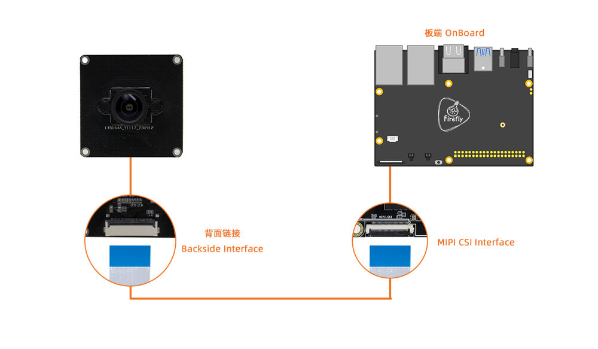

# 03 传感器接入：物理接口、采集图与时间一致性

截止2026-11-05。本章使用RK3588官方规格、Firefly相机/雷达接入文档、Linux V4L2规范与Orbbec/Slamtec源码，区分芯片能力、载板接线、BSP配置和传感器SDK。未取得完整多传感器并发实测、硬件触发/PTP误差或指定本体标定工程；资料不足不等于接口不存在。本文未连接硬件，分析计算不作性能实测。

## 一、支持矩阵必须落到具体板卡

| 类型 | 物理路径 | 已取得证据 | 关键边界 |
| --- | --- | --- | --- |
| RAW RGB | MIPI CSI-2→D-PHY→CIF/ISP | IMX415/CAM-8MS1M与Firefly目标板名单 | FPC针脚、电源、lane、驱动/IQ均需匹配 |
| USB RGB-D/ToF | USB→传感器SDK→frameset | Orbbec v2 ARM64路线/API | 测试平台名单以Jetson为主；非RK3588认证 |
| 2D LiDAR | TTL UART，常经USB转串口 | RPLIDAR C1；ROC-RK3588S-PC/Humble示例 | 5kHz采样≠8—12Hz扫描≠控制频率 |
| Ethernet LiDAR/Radar | 网口/协议驱动 | 芯片网络接口，未取得指定传感器工程 | UDP包/时间戳/PTP/标定需逐款验证 |
| IMU/关节/触觉/力矩 | I²C/SPI/UART/CAN/工业总线等 | 板卡接口与AMP/EtherCAT路线 | 不是指定传感器驱动或同步保证 |
| 长距离相机 | GMSL/FPD-Link外部串解器→CSI | 本次未取得指定桥接器完整BSP | 不能把CSI连接能力称原生GMSL |

RK3588页面写双16MP ISP、HDR/3DNR、多MIPI CSI-2/DVP和HDMI RX；概述32MP不是任意路数、分辨率与帧率的笛卡尔积。RK3588S载板的接口暴露不同，ROCK5B与B+原理图也按revision区分，不能用一个SoC规格替代连接器及供电设计。[Rockchip_RK3588](https://www.rock-chips.com/a/en/products/RK35_Series/2022/0926/1660.html)（[本地原件](REFERENCES.md#ref-84d8ab12b1d2bf18)) [Radxa_ROCK5B_Schematic_v220](https://dl.radxa.com/rock5/5b/docs/hw/radxa_rock_5b_schematic_v2.20.pdf)（[本地原件](REFERENCES.md#ref-9fec26604674917f))

CAM-8MS1M(IMX415)伙伴规格为3840×2160/60fps、RAW10/RAW12、5V、30pin FPC，传感器工作温度-10～55℃；SNR/WDR/功耗仍为TBD，不能从“工业级”补齐耐温/功耗。支持名单明确含ITX-3588J、ROC-RK3588S-PC等，以及RK3576部分板卡/系统配置；它是模组和伙伴BSP组合，不是任意30pin可互换。[RK03_IMX415](https://community.t-firefly.com/en/docs/products/accessories/IMX415/started)（[本地原件](REFERENCES.md#ref-28260a573e3fe2e8))

官方连接图强调背面FPC及CSI方向，不能连接标MIPI DSI的显示口。图只支持接线读法，未证明图中所有载板revision、所有路数或同步精度。实际设计须核对电压、IOMUX、插接方向和上电次序。

## 二、采集图与ISP配置为何决定可用路数

Firefly AIO-3588JD4文档明确默认仅启用MIPI_CSI0，CSI0/1共享I²C并需GPIO切换，双路并用要改传感器驱动支持动态切换。页中Full模式使用csi2_dphy0，最多4lane、2.5Gbps/lane；Split使用dphy1/2各最多2lane，可同时使用，但不能与dphy0混启。此说明对应文档中的逻辑D-PHY路径，不能用来替代所有RK3588 C-PHY/D-PHY资源的完整TRM。[RK03_Camera](https://community.t-firefly.com/en/docs/products/motherboard/AIO-3588JD4/usage-camera)（[本地原件](REFERENCES.md#ref-81b7d314c2c67105))

完整单路示例sensor→csi2_dphy0→mipi2_csi2→rkcif_mipi_lvds2→sditf→rkisp0_vir0；双路分别接mipi2/mipi3与不同ISP虚拟节点。DTS需要sensor地址/clock/reset、data-lanes、成对remote-endpoint以及CIF/ISP/MMU状态一致。xc7160有自身ISP，可绕过rkisp；RAW传感器要启对应ISP。CAM-8MS1M与CAM-2MS2MF的dtsi在该配置互斥，不能把单摄/双摄demo直接同时启用。

调试应按/sys/class/video4linux/*/name辨别rkisp_mainpath与stream_cif_mipi_id0，不固定猜/dev/video0。文档展示1080p NV12 mmap捕获和GStreamer预览，但默认示例节点与文字指导应按实际media graph核对。IQ使用external/camera_engine_rkaiq/iqfiles/isp3x JSON；isp20 XML转JSON也不适配isp3x，isp21 JSON同样不能直接搬。图像变清晰不等于几何/色彩标定正确，曝光控制/HDR融合与时间延迟还会影响VLA输入分布。页面相关源码目录标Kernel5.10，不能因网页更新于2026便声称示例已在所有Kernel6.1镜像验证。[RK03_Camera](https://community.t-firefly.com/en/docs/products/motherboard/AIO-3588JD4/usage-camera)（[本地原件](REFERENCES.md#ref-81b7d314c2c67105))

## 三、带宽、内存和观测年龄

分析理想有效像素带宽 B=W×H×fps×bit/8。3840×2160×60×10/8=622.08MB/s，RAW12为746.496MB/s，不含CSI封包、空白、嵌入数据和物理编码开销。4lane×2.5Gbps=1.25GB/s是标称链路上限，2lane为625MB/s；RAW10 4K60在2lane模式下有效像素已接近理想上限，因此不能仅凭相机规格承诺Split双路4K60。需实际sensor mode/lane rate、blanking与BSP验证。1080p30 NV12为93.312MB/s，RGB8为186.624MB/s；一次完整读写至少增加两倍相应数据流，ISP/RGA/NPU/录像共享DDR还要加中间buffer和布局padding，不能用物理端口相加得整机持续吞吐。

V4L2交换buffer指针/元数据，QBUF后buffer属于驱动，DQBUF后才可由应用处理；planes有各自length/bytesused/data_offset，逻辑图像大小不等于分配容量。sequence包括驱动观察到的丢失/重复帧，但可能不计远端USB设备在硬件中丢掉的帧。V4L2_BUF_FLAG_ERROR即使DQBUF成功也表示数据可能损坏。改变layout/format可能要STREAMOFF→释放/重新分配→STREAMON，不能保留旧stride与buffer大小。[RK03_V4L2_Buffer](https://docs.kernel.org/userspace-api/media/v4l/buffer.html)（[本地原件](REFERENCES.md#ref-6ec2a6979ded2e53))

接RGA/RKNN时零拷贝只在dma-buf导入、地址可达、像素布局、cache/fence和生命周期都匹配才成立。RKNN2普通YOLO示例仍走malloc/inputs_set，RKNN3包装fd不消除PCIe传输。有限队列要规定背压/丢弃过期帧，算法用哪个frame_id必须贯穿异步返回。应记录采集、到达、推理开始/结束、发布与控制使用时刻，数据年龄等于使用时刻减可比时钟下的采集时刻；每段单独低延迟不保证最后观测新鲜。[RK02_RKNN2_API](https://raw.githubusercontent.com/airockchip/rknn-toolkit2/master/rknpu2/runtime/Linux/librknn_api/include/rknn_api.h)（[本地原件](REFERENCES.md#ref-c1d5c2aa8bf544d1)) [RK02_RGA_Guide](https://raw.githubusercontent.com/airockchip/librga/main/docs/Rockchip_Developer_Guide_RGA_CN.md)（[本地原件](REFERENCES.md#ref-b175c5e9893e4e95))

## 四、同步与标定需要追到底层时间戳

V4L2驱动决定timestamp时钟与帧事件，须检查TIMESTAMP_MASK/TSTAMP_SRC_MASK，MONOTONIC与REALTIME不能直接相减；mem2mem的TIMESTAMP_COPY是输入时间转发，不是设备新采集时间。曝光起点、结束或滚动读出之间仍有差别。多相机“同时收到”不等于同步曝光，硬件触发、sensor mode、线延迟和时间映射均需测量；PTP支持要落到MAC/PHY硬时间戳、驱动和网络拓扑，本文未取得整板测得同步误差。

Orbbec的frame时间来自设备（不支持时可能主机fallback），system是主机收到，global把采集时刻映到主机时钟且必须先确认支持，0表示不可用。Gemini330长基线默认曝光结束、短基线默认中间；global不改变对应事件。enableGlobalTimestamp、timerSyncWithHost与周期enableDeviceClockSync有不同作用，流中重同步可产生时间不连续。其Linux monotonic模式实际用CLOCK_MONOTONIC_RAW，不能随便拿CLOCK_MONOTONIC相减。system-global可估从所代表曝光时刻到SDK接收的延迟，受映射误差影响，不只是USB传输。[RK03_OrbbecTime](https://raw.githubusercontent.com/orbbec/OrbbecSDK_v2/main/docs/tutorial/timestamp.md)（[本地原件](REFERENCES.md#ref-6d698eb3dad5c80c))

Orbbec v2 README测试ARM64名单没有RK3588，LingBot深度滤波明确JetPack6.2目标，不能据Linux支持宣布NPU深度增强适配。RGB-D需要确认准确相机固件、内/外参、D2C策略、depth scale与无效值处理，深度空洞/透明反射物也要进真实留出集。SDK主许可MIT，LICENSE另列libusb LGPL等第三方条款，固件、扩展、工具和模型独立审查。[RK03_Orbbec](https://raw.githubusercontent.com/orbbec/OrbbecSDK_v2/main/README.md)（[本地原件](REFERENCES.md#ref-96eb386e04fb724f)) [RK03_OrbbecLicenseText](https://raw.githubusercontent.com/orbbec/OrbbecSDK_v2/main/LICENSE.txt)（[本地原件](REFERENCES.md#ref-3a2178a5d6e6d650))

## 五、LiDAR与运动融合：有示例不等于高动态定位

Firefly RPLIDAR C1规格为5kHz点采样、8—12Hz扫描、UART460800bps，白70%反射12m、黑10%反射6m、室内应用；测距范围条件不能当所有目标可靠检出。ROS2示例目标ROC-RK3588S-PC/Ubuntu22.04/Humble，经USB串口启动C1 launch并发布/scan。量产应以udev权限/稳定序列号替代示例chmod777与易变ttyUSB0。[RK03_RPLIDAR](https://community.t-firefly.com/en/docs/products/accessories/RPLIDAR-C1/started)（[本地原件](REFERENCES.md#ref-b211cf4162a45881))

源码把start=this->now放在grabScanDataHq之前，end在返回后，scan_time为二者差，time_increment用scan_time/(node_count-1)。这是主机围绕SDK获取的计时，不证明各激光点硬件时间；angle_compensate重采样并不能补回真实逐点曝光时间或运动畸变。ranges从dist_mm_q2换成米，角度为弧度，0距离变infinity，frame_id与inverted/flip_x_axis改变坐标读法。伙伴client文字输出角度为度，不能因此把LaserScan原始角度当度。轮速/IMU融合应确认同一基准、scan deskew和TF外参，否则高速转弯时地图可能错位。[RK03_RPLIDARCode](https://raw.githubusercontent.com/Slamtec/rplidar_ros/ros2/src/rplidar_node.cpp)（[本地原件](REFERENCES.md#ref-061e9889025ee87d))

力矩/触觉/关节接入还需明确总线周期、序列/单位、采样率、滤波延迟、量程和饱和；CAN接口存在不证明指定驱动器/编码器协议。整套验收应冻结接线图/DTS/IQ/固件/SDK/标定，做并发采集＋推理＋录像负载，记录sequence缺口、CRC/ERROR、队列深度、观测年龄P99、温度和重连恢复，再做动态标定/融合留出验证。官方接线与单设备demo已取得，多路同步、跨传感器统一时钟与控制融合效果仍待实机证明。

## 参考资料与本地原文

采集时间逐项列出；移动分支及无版本网页仅代表此次快照。HTML 保留正文与可取得静态依赖，动态交互、视频及缺失依赖不保证完整。未进行目标板安装或实机性能验证。

| 来源 | 原 URL | 本地原件 | 采集 UTC | 归档状态 |
| --- | --- | --- | --- | --- |
| Rockchip_RK3588 | [原文](https://www.rock-chips.com/a/en/products/RK35_Series/2022/0926/1660.html) | [归档](REFERENCES.md#ref-84d8ab12b1d2bf18) | 2026-11-04T15:43:28.467780+00:00 | partial_static；缺失依赖 2 |
| Radxa_ROCK5B_Schematic_v220 | [原文](https://dl.radxa.com/rock5/5b/docs/hw/radxa_rock_5b_schematic_v2.20.pdf) | [归档](REFERENCES.md#ref-9fec26604674917f) | 2026-11-04T15:48:53.533694+00:00 | complete_static；缺失依赖 0 |
| RK03_IMX415 | [原文](https://community.t-firefly.com/en/docs/products/accessories/IMX415/started) | [归档](REFERENCES.md#ref-28260a573e3fe2e8) | 2026-11-04T16:47:03.184262+00:00 | partial_static；缺失依赖 2 |
| RK03_Camera | [原文](https://community.t-firefly.com/en/docs/products/motherboard/AIO-3588JD4/usage-camera) | [归档](REFERENCES.md#ref-81b7d314c2c67105) | 2026-11-04T16:47:41.719928+00:00 | partial_static；缺失依赖 2 |
| RK03_V4L2_Buffer | [原文](https://docs.kernel.org/userspace-api/media/v4l/buffer.html) | [归档](REFERENCES.md#ref-6ec2a6979ded2e53) | 2026-11-04T16:47:10.657122+00:00 | complete_static；缺失依赖 0 |
| RK02_RKNN2_API | [原文](https://raw.githubusercontent.com/airockchip/rknn-toolkit2/master/rknpu2/runtime/Linux/librknn_api/include/rknn_api.h) | [归档](REFERENCES.md#ref-c1d5c2aa8bf544d1) | 2026-11-04T16:19:24.340648+00:00 | complete_static；缺失依赖 0 |
| RK02_RGA_Guide | [原文](https://raw.githubusercontent.com/airockchip/librga/main/docs/Rockchip_Developer_Guide_RGA_CN.md) | [归档](REFERENCES.md#ref-b175c5e9893e4e95) | 2026-11-04T16:10:46.889750+00:00 | complete_static；缺失依赖 0 |
| RK03_OrbbecTime | [原文](https://raw.githubusercontent.com/orbbec/OrbbecSDK_v2/main/docs/tutorial/timestamp.md) | [归档](REFERENCES.md#ref-6d698eb3dad5c80c) | 2026-11-04T16:47:45.288226+00:00 | complete_static；缺失依赖 0 |
| RK03_Orbbec | [原文](https://raw.githubusercontent.com/orbbec/OrbbecSDK_v2/main/README.md) | [归档](REFERENCES.md#ref-96eb386e04fb724f) | 2026-11-04T16:47:06.649326+00:00 | complete_static；缺失依赖 0 |
| RK03_OrbbecLicenseText | [原文](https://raw.githubusercontent.com/orbbec/OrbbecSDK_v2/main/LICENSE.txt) | [归档](REFERENCES.md#ref-3a2178a5d6e6d650) | 2026-11-04T16:47:47.386257+00:00 | complete_static；缺失依赖 0 |
| RK03_RPLIDAR | [原文](https://community.t-firefly.com/en/docs/products/accessories/RPLIDAR-C1/started) | [归档](REFERENCES.md#ref-b211cf4162a45881) | 2026-11-04T16:47:04.945431+00:00 | partial_static；缺失依赖 2 |
| RK03_RPLIDARCode | [原文](https://raw.githubusercontent.com/Slamtec/rplidar_ros/ros2/src/rplidar_node.cpp) | [归档](REFERENCES.md#ref-061e9889025ee87d) | 2026-11-04T16:47:48.795631+00:00 | complete_static；缺失依赖 0 |

[证据记录](research_state/evidence/03_Sensor_Integration.json)；[本章开始前哈希基线](research_state/baselines/03_Sensor_Integration_before.json)。检查和去重记录由专题索引汇总。
