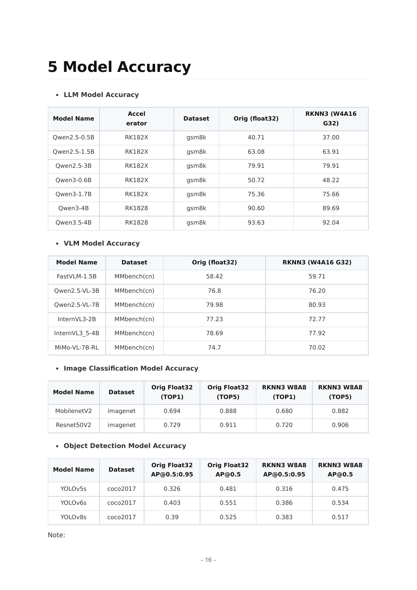

# 04 AI任务、模型地图与动作推理边界

截止2026-11-05。Rockchip已提供传统视觉、语言/多模态和协处理器模型工具链，并公开π0.5动作策略展示；公开示例与发行说明的“支持”不能等同任何机器人已量产验证。本章实际核验模型/API/导出文档，未下载大权重或运行模型。Hugging Face的Qwen2.5-3B-Instruct、GR00T-N1.6-3B、MiniCPM-RobotManip模型卡请求失败，不能据此报告权重许可已核验；模型ID和原链接可在官方发行说明及本地失败清单追溯。

## 一、任务与部署证据地图

| 任务 | 模型/精确对象 | 模态/规模 | 平台证据 | 许可/成熟度边界 |
| --- | --- | --- | --- | --- |
| 语言/任务解释 | Qwen2.5-0.5B/1.5B/3B/7B；Qwen3系列 | token→token | RKNN3发行说明与Zoo；RKLLM另有SoC清单 | 工具代码与权重分开；指定卡版本未取得 |
| 视觉语言 | Qwen2.5-VL-3B/7B，Qwen3-VL-2B/4B，InternVL3-2B，FastVLM1.5B | 图＋文本→文本/结构 | 独立vision/LLM转换与分段基准 | 视觉理解不等于可执行动作 |
| 语音/检索/OCR | Whisper、SenseVoiceSmall、Qwen3-Embedding、PaddleOCR-VL等 | 音频/文档/文本 | 官方支持目录；逐模型详细工程未全取 | 不给整个目录统一性能或许可 |
| 2D感知 | YOLOv8n/s、MobileNetV2、ResNet50V2 | RGB→框/类别 | Toolkit2/Zoo源码；RKNN3基准 | 优化图输出不同，权重/数据另核 |
| 深度/3D前端 | RAFT-Stereo，Depth-Anything-V2/3目录对象 | 双目→视差/单目→深度 | RAFT导出/运行说明；Depth模型仅发行清单 | 不证明SLAM/稠密地图完整系统 |
| 操作/VLA | π0.5；GR00T-N1.6-3B/N1.7-3B；MiniCPM-RobotManip | 视觉/语言/状态→动作 | π0.5厂商展示；其余RKNN3支持列表 | 完整本体/成功率/动作SDK待取 |
| 模仿/生成策略 | π0/π0-FAST/π0.5，Diffusion Policy | 序列观测→动作chunk | 作者代码/论文；仅π0.5有本平台宣称 | 不能把作者GPU结果归因NPU |
| 世界模型/视频预测 | 本轮未取得完整Rockchip交付物 | 场景→未来状态/视频 | 不以VLM问答替代 | 需单独模型、算子与时序验证 |
| 运动/导航/规划agent | 机器人Agent展示、ROS/EtherCAT路线 | 感知/地图→技能/轨迹 | 方案公告和接口文档 | MPC/IK非基础模型；无全身策略指标 |

支持列表来源为RKNN3 SDK1.2.0发行说明第6—11页；Zoo README快照仍把预转换目录写v1.1.0，发行说明写v1.2.0，需冻结真实下载包而不能替读者消除版本差异。仅出现模型名没有自动证明目标SKU、输入shape、编译精度、权重哈希、任务精度或并发能力。[RK02_00_RKNN3_SDK_Release_Notes_V1.2.0](https://raw.githubusercontent.com/airockchip/rknn3-toolkit/main/doc/EN/00_RKNN3_SDK_Release_Notes_V1.2.0.pdf)（[本地原件](REFERENCES.md#ref-f422f7a4bad78537)) [RK02_RKNN3_ZooReadme](https://raw.githubusercontent.com/airockchip/rknn3-model-zoo/main/README.md)（[本地原件](REFERENCES.md#ref-2dc1a71ffd1b3a27)) [RK02_RKLLM_Readme](https://raw.githubusercontent.com/airockchip/rknn-llm/main/README.md)（[本地原件](REFERENCES.md#ref-5b6e59180a191ea7))

## 二、从视觉与语言到动作：π0.5源码机制

作者openpi明确π0为flow-based VLA，π0-FAST为动作tokenizer自回归，π0.5开源训练/推理当前只支持flow matching head。默认Pi0Config为PaliGemma gemma_2b与gemma_300m action expert、bfloat16、action_dim32、action_horizon50；π0.5把state放入离散语言token，action expert以adaRMSNorm注入flow timestep，max_token_len默认200（π0默认48）。这是作者通用配置，不是Rockchip部署的确认配置。[RK04_OpenpiReadme](https://raw.githubusercontent.com/Physical-Intelligence/openpi/main/README.md)（[本地原件](REFERENCES.md#ref-93ae0cec36eeb1cd)) [RK04_PiConfig](https://raw.githubusercontent.com/Physical-Intelligence/openpi/main/src/openpi/models/pi0_config.py)（[本地原件](REFERENCES.md#ref-baf8f866abcf634f))

源码embed_prefix分别编码图像与语言；sample_actions先为前缀填KV cache，再从形状[B,50,32]高斯噪声开始，默认num_steps10、dt=-1/steps，循环用action expert预测速度场并更新动作，返回连续动作chunk。缓存的收益是同一次动作生成中避免重复前缀计算；新的图像/状态意味着前缀条件变化，不能跨观测无限复用缓存。改变去噪步数、动作horizon、输入分辨率或精度都会改变时间与质量，必须与展会“5FPS”配置核对。[RK04_PiModel](https://raw.githubusercontent.com/Physical-Intelligence/openpi/main/src/openpi/models/pi0.py)（[本地原件](REFERENCES.md#ref-204b4f30ace48fed))

DROID适配源码输入两路224×224 RGB、7维关节位置＋1维夹爪，转换成base/left_wrist并用第三路零图和mask填充；输出仅取前8维。FAST的图像名称与mask不同，不能把两种输入映射互换。32维模型padding不是机器人32个自由度，也不是8维输出可以直接驱动任何本体。还需训练归一化/反归一化、绝对/增量语义、关节顺序、坐标、角度/夹爪单位、action period以及限位。[RK04_DroidPolicy](https://raw.githubusercontent.com/Physical-Intelligence/openpi/main/src/openpi/policies/droid_policy.py)（[本地原件](REFERENCES.md#ref-6120791f5851ad3e))

openpi远程客户端说明每N步调用策略，其余步执行预测chunk，WebSocket服务默认端口8000；因此policy-call与动作采样/控制频率分离。通用remote文档键名与DROID专用适配键名不同，应按实际policy构建观测，不机械照抄。相机/状态变旧、网络抖动和新的指令取消应进入chunk有效期/重规划逻辑。减少policy次数可降低推理负载，同时可能增加开环暴露时间；没有本体测试不能宣称更安全。[RK04_Remote](https://raw.githubusercontent.com/Physical-Intelligence/openpi/main/docs/remote_inference.md)（[本地原件](REFERENCES.md#ref-326ee697f9295f0c))

厂商2026-09-22公告称经过针对性优化的π0.5在RK1828“5FPS以上”，展出RK3588＋RK1828衔接工件识别、定位、语言解析、轨迹/关节控制及结果校验。该数字是厂商宣称，未披露π0.5 checkpoint/commit、动作chunk、denoise steps、量化、输入相机/shape、batch、功耗、预后处理/RPC、warmup/P99、尝试次数或成功率。不能用倒数200ms当完整闭环延迟，也不能用horizon50×5推导250Hz伺服；作者默认配置未证实用于该演示。[Rockchip_Multicard_2026](https://www.rock-chips.com/a/cn/news/rockchip/2026/0922/2181.html)（[本地原件](REFERENCES.md#ref-ed5b70feb4b4688c))

## 三、视觉/多模态的具体优化与失效条件

Qwen3-VL示例允许vision部分算子迁主控CPU，LMHead拆出以减协处理器内存，但prune_mode默认关闭。KV由F16变Int4_to_F16需重新导出并可能损失精度；--rebuild只支持profile/KV相关配置，其他图变化需完整流程。vision高宽需32倍数且仍可能出现不兼容shape，提高分辨率占内存并压缩语言上下文。示例要求PyTorch≥2.9.0时ONNX与.onnx.data放一起；文档依赖条件不能当环境实测。本次未取得SpeedUP完整算法/精度测量，ratio参数与支持名单只证明接口，不能泛化加速幅度。[RK04_Qwen3VL](https://raw.githubusercontent.com/airockchip/rknn3-model-zoo/main/examples/Qwen3_VL/README.md)（[本地原件](REFERENCES.md#ref-4e7d6451877df76c))

RAFT-Stereo示例冻结作者commit6068c1a26f84f8132de10f60b2bc0ce61568e085，优化补丁将5D transpose改4D操作；setup流程先验证PyTorch/ONNX再转RKNN。默认160×240、目标rk1820，导出iters1但运行kwargs32维持循环；eth3d/realtime架构不同。输出日志输入NHWC UINT8双张量、输出NCHW FP16视差，预处理2.95ms、reasoning616.32ms是文档样例而非完整统计；未给精确主机/功耗/重复/P99，不能称平台稳定性能。量化路径写w8a16而非泛化成所有CV W8A8。[RK04_RAFT](https://raw.githubusercontent.com/airockchip/rknn3-model-zoo/main/examples/RAFT-Stereo/README.md)（[本地原件](REFERENCES.md#ref-bfed70f9253ec466))

视差要结合标定的焦距、基线与符号/尺度转深度，z=fB/d在d接近0时误差放大；预处理缩放/padding也改变有效内参。彩色视差图仅可视化，不证明三维距离准确或导航安全。YOLO优化图输出布局/阈值、RAFT循环结构、VLM裁剪与CPU算子位置均体现真正迁移成本在图和任务契约，而不是只安装支持ONNX的工具。

## 四、官方基准与任务精度分层

| 测试 | 精确条件/范围 | 官方结果 | 本文采用边界 |
| --- | --- | --- | --- |
| Qwen2.5-7B | RK3588性能模式/PCIe RK1828 NPU1GHz；128输入/128输出 | TTFT157.59ms、decode70.14TPS | 语言阶段，无闭环/P99/功耗 |
| Qwen3-VL-4B | RK1828，384×384；语言128/128另测 | vision104.22ms，decode90.99TPS | 独立阶段不能当总时延 |
| YOLOv8s | RK182X，640×640 | 单核34.73FPS；多batch多核232.61FPS | 延迟/吞吐分开 |
| InternVL3-2B | MMbench(cn) | float32 77.23；W4A16G32 72.77 | 下降4.46百分点；不是抓取精度 |
| YOLOv8s | COCO2017 AP@0.5:0.95 | float32 0.39；W8A8 0.383 | 检测任务统计，非危险漏检率 |

官方精度原表见下图；G32说明在下一页定义4位非对称权重和16位浮点激活。表内有升有降，不能把数值接近解释成全任务无损。performance行未完整提供每模型精度/功耗/样本，应保留缺口。LLM/VLM通用基准、仿真任务成功和真实机器人成功是三套分母。[RK02_00_RKNN3_SDK_Release_Notes_V1.2.0](https://raw.githubusercontent.com/airockchip/rknn3-toolkit/main/doc/EN/00_RKNN3_SDK_Release_Notes_V1.2.0.pdf)（[本地原件](REFERENCES.md#ref-f422f7a4bad78537))

Diffusion Policy论文项目在4类基准12任务报告平均成功率改善46.9%，属于作者实验，不是RK3588/RK1828结果。其条件去噪生成动作序列、receding horizon执行部分再观察，适合多模态动作分布，但多次去噪引入迭代时延；参数量、数据和动作频率需按具体任务工程冻结。本次未取得其完整Rockchip转换项目，故列作策略机制对照。[RK04_Diffusion](https://diffusion-policy.cs.columbia.edu/)（[本地原件](REFERENCES.md#ref-f885a065432cf7fa))

## 五、训练、许可和可复建模型运营

openpi作者说明基模型预训练10k+小时机器人数据，但明确目标机器人不同、适配可能失败。作者GPU环境推理>8GB、LoRA>22.5GB、全量微调>70GB，测试Ubuntu22.04；这些是作者栈条件，不是NPU量化推理的内存需求。Rockchip当前证据主线是端侧推理，不能把LoRA加载等同在NPU完成训练；GRQ也可能依赖开发端CUDA环境。训练/仿真/数据清洗可留外部GPU，边缘端采集、推理与监测，需要确认数据出域和版本追溯。[RK04_OpenpiReadme](https://raw.githubusercontent.com/Physical-Intelligence/openpi/main/README.md)（[本地原件](REFERENCES.md#ref-93ae0cec36eeb1cd)) [RK02_RKNN3_ZooReadme](https://raw.githubusercontent.com/airockchip/rknn3-model-zoo/main/README.md)（[本地原件](REFERENCES.md#ref-2dc1a71ffd1b3a27))

模型运营应采集原始观测＋实际执行动作＋反馈/失败，清洗时间和标定，按场景/物体/操作者划分留出集，再训练/压缩/部署。策略部署比较浮点与量化的动作误差、任务成功、碰撞/越限、人工干预；检测评估看召回/危险漏检，VLM评估结构与语义，世界模型还需预测误差和真实规划收益。配置任何压缩/SpeedUP后重跑相同任务集，不只看token速度。

openpi根代码Apache2.0已取得；checkpoint路径、预训练数据、微调数据和本体资产不自动获得同一许可。RKNN3 SDK专用协议、Zoo代码、量化工具、固件及第三方算子另核；HF卡访问失败使关键权重许可/训练数据仍未核实。本文保留支持层级与缺口，可指导候选筛选，但放行仍需源模型/配置/产物哈希、目标SDK、完整计时、热稳定、动作契约和真实留出任务验收。

## 参考资料与本地原文

采集时间逐项列出；移动分支及无版本网页仅代表此次快照。HTML 保留正文与可取得静态依赖，动态交互、视频及缺失依赖不保证完整。未进行目标板安装或实机性能验证。

| 来源 | 原 URL | 本地原件 | 采集 UTC | 归档状态 |
| --- | --- | --- | --- | --- |
| RK02_00_RKNN3_SDK_Release_Notes_V1.2.0 | [原文](https://raw.githubusercontent.com/airockchip/rknn3-toolkit/main/doc/EN/00_RKNN3_SDK_Release_Notes_V1.2.0.pdf) | [归档](REFERENCES.md#ref-f422f7a4bad78537) | 2026-11-04T16:32:49.070460+00:00 | complete_static；缺失依赖 0 |
| RK02_RKNN3_ZooReadme | [原文](https://raw.githubusercontent.com/airockchip/rknn3-model-zoo/main/README.md) | [归档](REFERENCES.md#ref-2dc1a71ffd1b3a27) | 2026-11-04T16:37:52.343432+00:00 | complete_static；缺失依赖 0 |
| RK02_RKLLM_Readme | [原文](https://raw.githubusercontent.com/airockchip/rknn-llm/main/README.md) | [归档](REFERENCES.md#ref-5b6e59180a191ea7) | 2026-11-04T16:10:05.951168+00:00 | complete_static；缺失依赖 0 |
| RK04_OpenpiReadme | [原文](https://raw.githubusercontent.com/Physical-Intelligence/openpi/main/README.md) | [归档](REFERENCES.md#ref-93ae0cec36eeb1cd) | 2026-11-04T16:52:30.266425+00:00 | complete_static；缺失依赖 0 |
| RK04_PiConfig | [原文](https://raw.githubusercontent.com/Physical-Intelligence/openpi/main/src/openpi/models/pi0_config.py) | [归档](REFERENCES.md#ref-baf8f866abcf634f) | 2026-11-04T16:54:13.751029+00:00 | complete_static；缺失依赖 0 |
| RK04_PiModel | [原文](https://raw.githubusercontent.com/Physical-Intelligence/openpi/main/src/openpi/models/pi0.py) | [归档](REFERENCES.md#ref-204b4f30ace48fed) | 2026-11-04T16:54:15.727284+00:00 | complete_static；缺失依赖 0 |
| RK04_DroidPolicy | [原文](https://raw.githubusercontent.com/Physical-Intelligence/openpi/main/src/openpi/policies/droid_policy.py) | [归档](REFERENCES.md#ref-6120791f5851ad3e) | 2026-11-04T16:54:16.831503+00:00 | complete_static；缺失依赖 0 |
| RK04_Remote | [原文](https://raw.githubusercontent.com/Physical-Intelligence/openpi/main/docs/remote_inference.md) | [归档](REFERENCES.md#ref-326ee697f9295f0c) | 2026-11-04T16:54:17.863648+00:00 | complete_static；缺失依赖 0 |
| Rockchip_Multicard_2026 | [原文](https://www.rock-chips.com/a/cn/news/rockchip/2026/0922/2181.html) | [归档](REFERENCES.md#ref-ed5b70feb4b4688c) | 2026-11-04T15:46:57.771231+00:00 | partial_static；缺失依赖 3 |
| RK04_Qwen3VL | [原文](https://raw.githubusercontent.com/airockchip/rknn3-model-zoo/main/examples/Qwen3_VL/README.md) | [归档](REFERENCES.md#ref-4e7d6451877df76c) | 2026-11-04T16:53:52.941764+00:00 | complete_static；缺失依赖 0 |
| RK04_RAFT | [原文](https://raw.githubusercontent.com/airockchip/rknn3-model-zoo/main/examples/RAFT-Stereo/README.md) | [归档](REFERENCES.md#ref-bfed70f9253ec466) | 2026-11-04T16:53:51.712916+00:00 | complete_static；缺失依赖 0 |
| RK04_Diffusion | [原文](https://diffusion-policy.cs.columbia.edu/) | [归档](REFERENCES.md#ref-f885a065432cf7fa) | 2026-11-04T16:52:43.360366+00:00 | partial_static；缺失依赖 4 |

[证据记录](research_state/evidence/04_AI_Capabilities.json)；[本章开始前哈希基线](research_state/baselines/04_AI_Capabilities_before.json)。检查和去重记录由专题索引汇总。
