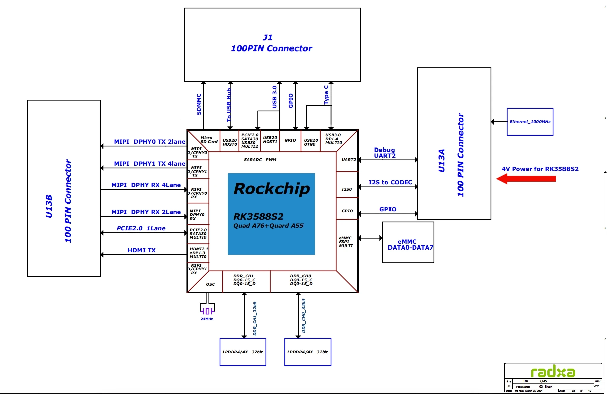

# 07 Rockchip 具身智能生态：交付分工与量产责任

截至2026-11-05。本文研究公开交付物和具体产品关系，不以伙伴数量衡量市场采用。生态的实际价值是把SoC变为可采集、可推理、可维护的计算节点；机器人动作契约、工厂责任和运营结果仍需要项目级证据。板卡、传感器和本体厂商提供的能力不能全部归为芯片原生能力。

## 1. 主要伙伴及其真实交接

| 层级 | 代表对象 | 可取得交付物 | 与机器人链路的交接 | 成熟度边界 |
| --- | --- | --- | --- | --- |
| 芯片与推理 | Rockchip、airockchip | SoC规格、RKNN2/RKLLM/RKNN3工具与模型示例 | 图、权重、张量、驱动 | 示例不是全部本体验收 |
| 模组与载板 | Radxa CM5、ROCK5T | 模组框图、原理图、OS文档 | 供电、连接器、设备树、散热 | 工业款与普通款不可混用 |
| 双芯节点 | Firefly RK182X Kit | 两种载板手册、BSP入口 | 主控PCIe到协处理器、工业接口 | SDK完整包需联系销售 |
| 传感器 | Orbbec、Slamtec及Firefly相机 | ARM接口、时间戳说明、ROS示例 | 标定、frame、时间和buffer | ARM64支持不自动证明RK板组合 |
| 系统与控制 | Firefly文档、ROS2、IgH | RT/AMP/EtherCAT及OTA配置 | 普通域与实时域、总线与升级 | 无完整电机保护/安全认证 |
| 整机与集成 | 优必选、卧安、松延及多卡伙伴 | 芯片厂商活动报道及展牌 | 产品任务与计算节点 | 演示、型号绑定和运营必须区分 |

资料入口：[Radxa_CM5](https://docs.radxa.com/en/som/cm/cm5)（[本地原件](REFERENCES.md#ref-403039acbce6cd64))、[Radxa_ROCK5T_Product](https://docs.radxa.com/en/rock5/rock5t/getting-started/introduction)（[本地原件](REFERENCES.md#ref-4136354c74d2cafb))、[Firefly_RK182X_Kit_PDF](https://download.t-firefly.com/Spec/Suite/RK182X-Development-Kit_Specifications_EN.pdf)（[本地原件](REFERENCES.md#ref-9d86adab08bd1a92))、[RK03_Orbbec](https://raw.githubusercontent.com/orbbec/OrbbecSDK_v2/main/README.md)（[本地原件](REFERENCES.md#ref-96eb386e04fb724f))、[RK03_RPLIDAR](https://community.t-firefly.com/en/docs/products/accessories/RPLIDAR-C1/started)（[本地原件](REFERENCES.md#ref-b211cf4162a45881))、[Rockchip_Robotics_2026](https://www.rock-chips.com/a/cn/news/rockchip/2026/0827/2177.html)（[本地原件](REFERENCES.md#ref-7e32246384c451c6))。上表只列与本研究有关的代表，不是认证伙伴清单。对于支持票据、当地备件、现场服务和失效责任，本次没有取得逐客户合同。

## 2. Radxa：模组使原型可复用，载板仍决定系统

CM5官方框图把RK3588S2、DDR、eMMC和三个100pin连接器分开，标出PCIe2.0单lane、MIPI RX/TX、USB和音频路径。它有助于确定自研载板要承担的PHY、连接器、电源完整性和引脚复用工作。图中以太网标注本身不能证明已有RJ45接口；供电箭头也不能当满载功耗。[Radxa_CM5](https://docs.radxa.com/en/som/cm/cm5)（[本地原件](REFERENCES.md#ref-403039acbce6cd64))

这张完整官方图已打开复核。它支持“模组与载板分工”，不支持所有标出的复用功能同时启用。CM5原理图封面与内页版本存在差异，ROCK5T Industrial下载资源名与所取PDF内页版本也存在冲突；因此量产评审应索取目标硬件revision的BOM、原理图、pin map和PCN，而不是只保存网页名称。工业ROCK5T使用RK3588J且频率不同，不能沿用普通RK3588性能宣传。[Radxa_CM5_Schematic_v221](https://dl.radxa.com/cm5/v2210/radxa_cm5_v2210_schematic.pdf)（[本地原件](REFERENCES.md#ref-78248c901d856013)) [Radxa_ROCK5T_Industrial_Schematic_v201](https://dl.radxa.com/rock5/5t/docs/hw/radxa_rock5t_Industrial_schematic_v2.01.pdf)（[本地原件](REFERENCES.md#ref-a8b34e88995b1ab6)) [Radxa_ROCK5T_Product](https://docs.radxa.com/en/rock5/rock5t/getting-started/introduction)（[本地原件](REFERENCES.md#ref-4136354c74d2cafb))

Radxa OS文档的价值在于提供可复用系统入口；它不能代替项目锁定kernel、GPU驱动、NPU驱动与外设overlay。对于机器人，载板上的相机供电、总线隔离、看门狗和断电行为影响故障恢复，普通开发板启动成功并不足以确认这些路径。团队应把调试记录沉淀为硬件revision到镜像哈希的对应关系，再用更换模组、冷启动和恢复出厂测试检验可维护性。[RK02_Radxa_OS](https://docs.radxa.com/en/rock5/rock5b/radxa-os)（[本地原件](REFERENCES.md#ref-8e081a5d0b4a4372))

## 3. Firefly与多卡伙伴：把算力组合为系统产品

Firefly RK182X开发套件以主控和协处理器双模组分工：主控承担采集、预处理和调度，PCIe连接RK182X执行模型。PDF分别描述DualM2与Dual260P；网络口、尺寸、CAN及最大功耗不能互相套用。开发起步文档说明完整SDK需向sales取得，交叉编译应在x86_64 Ubuntu20.04/22.04环境进行，SDK不能放到板端编译，路径及用户权限也有约束。这使公开wiki更适合作为工艺入口，而非已经取得完整可复建BSP的证明。[Firefly_RK182X_Kit_PDF](https://download.t-firefly.com/Spec/Suite/RK182X-Development-Kit_Specifications_EN.pdf)（[本地原件](REFERENCES.md#ref-9d86adab08bd1a92)) [RK02_RK182X_Started](https://community.t-firefly.com/en/docs/products/accessories/RK182x/started)（[本地原件](REFERENCES.md#ref-a2dd36cd401ab3f5))

2026-09-22芯片厂商报道明确列出Firefly AIBOX Pro为RK3588+两颗RK1828，飞凌嵌入式为RK3588+四颗RK1828，万物纵横为1U四路RK182X。前两者的型号/组合与最后一者的系列口径不同，应保留原文。它们面向Agent、RAG、知识库及工业数据不出域；不是已经证明移动机器人可获得四倍闭环性能。朗国USB/网口接Windows PC和树莓派HAT形态说明接入方式可拓展，但专用协议、驱动版本与主机转发时延仍决定可用性。[Rockchip_Multicard_2026](https://www.rock-chips.com/a/cn/news/rockchip/2026/0922/2181.html)（[本地原件](REFERENCES.md#ref-ed5b70feb4b4688c))

对机器人集成商的实际影响是可以购买整机节点而不是自画加速卡。不过一体采购也会增加板商BSP与接口依赖。合同应明确出问题时由谁复现模型、谁维护PCIe驱动、谁提供升级回退镜像；多卡容量不足或排队过长不能由“支持27B”一句宣传承担责任。本文未取得这些产品的长期现场日志、销量或独立客户验收书。

## 4. 原型到产线：身份、镜像、回退不是同一工序

Firefly的RKDevInfoWriteTool文档更新于2026-07-08，工具向VendorStorage写入SN、Wi-Fi/LAN/BT MAC，在Windows端一次连接一个目标设备。Loader适用于已有可启动固件；空白或不能进入Loader的设备需Maskrom及正确MiniLoader。Auto模式成功后递增，File逐行消费，ForceWrite可能覆写已有信息；写后Read回读比仅见成功状态更能确认结果。[RK07_Production](https://community.t-firefly.com/en/docs/tools/production-tool/Device-Info-Write-Tool/rkdev-info-write-tool)（[本地原件](REFERENCES.md#ref-230c6d1aec7a9d70))

身份分配的机制风险在于产线重启、重复工位或返修可能造成重复地址。因此分析建议由产线数据库分配唯一范围，保留SN、板revision、镜像哈希、校准版本和写入回读结果；这不是工具已经提供的集中追溯能力。SN/MAC可写也不意味着密钥注入、传感器标定和机械参数已经完成。升级时要明确哪些分区被覆盖，避免固件可启动但标定与本体型号失配。Linux OTA文档的Recovery路径和Android升级路径不同，不能假定整个生态自动提供A/B事务更新。[RK02_OTA_Linux](https://community.t-firefly.com/en/docs/software/other/OTA/ota-linux)（[本地原件](REFERENCES.md#ref-ccf3f3086d29b250)) [RK02_OTA_Android](https://community.t-firefly.com/en/docs/software/other/OTA/ota-android)（[本地原件](REFERENCES.md#ref-b74204037a5761bf))

运维放行还需验证断电、坏包、版本错配、空间不足、远程升级中断与回滚后的旧数据兼容。安全启动解决镜像认证的一部分，缺少抗回滚支持时仍可能执行旧的合法签名软件；更新签名、撤销与备份策略应由整机维护责任方制定。[RK02_Secure_Config](https://community.t-firefly.com/en/docs/software/other/SecureBoot/secureboot-config)（[本地原件](REFERENCES.md#ref-0e3551cfe884717f))

## 5. 支持、保修与供应必须按交易核对

Firefly主页列载板/机壳/散热定制、BSP调优以及“10-year life cycle”服务，是通用服务主张。当前未取得Rockchip各SoC、各DDR/eMMC配置或特定板revision的PCN/EOL通知期与不可取消采购条款，因此不能写为所有产品十年供货。样品可下单、量产交期、最低采购量和软件漏洞维护周期必须分别确认。[Firefly_Home](https://www.t-firefly.com/)（[本地原件](REFERENCES.md#ref-83a9114dc31de7d6))

商店退款政策给出收到产品后30个自然日的退换入口、产品不含配件的12个月保修，并限定损坏、误用和用户修改等情形；返修运费也有责任划分。它支持零售交易的公开条件，不是本地工业现场响应SLA，也不证明ODM改板后的保修仍适用。Shipping页面仅作为渠道条件入口，本文没有以页面推导某地区确定库存、含税交期或海关成本。正式项目需要带地区、币种、税费、数量、配置和有效期的报价。[RK07_Return](https://www.t-firefly.com/policies/refund-policy)（[本地原件](REFERENCES.md#ref-df1fb186f7396920)) [RK07_Shipping](https://www.t-firefly.com/policies/shipping-policy)（[本地原件](REFERENCES.md#ref-1866e9dc795fc4b2))

论坛、wiki和课程能降低上手成本，但不能用发帖量或Stars替代商业支持。本次未取得可靠时点的完整仓库活跃度统计，不列排名。训练与部署教程也不是人员培训认证；实机维护需要把故障收集、版本回退和工位产测交给有责任的团队。

## 6. 开放性与“自主可控”的逐层核查

Rockchip采用Arm Cortex/Mali等IP，品牌所在地不证明芯片制造、封装、内存和所有IP均为本地来源。本次没有取得逐SKU制造厂和国产化率的完整证据。软件方面，模型示例仓库与SDK二进制许可不同；RKNN3 SDK许可授予有限使用权并限制逆向，第三方软件另遵其许可证，不宜概括成完全开源。[Rockchip_RK3588](https://www.rock-chips.com/a/en/products/RK35_Series/2022/0926/1660.html)（[本地原件](REFERENCES.md#ref-84d8ab12b1d2bf18)) [RK02_RKNN3_License](https://raw.githubusercontent.com/airockchip/rknn3-toolkit/main/LICENSE)（[本地原件](REFERENCES.md#ref-e0d48d173b53dd02)) [RK02_Zoo_License](https://raw.githubusercontent.com/airockchip/rknn_model_zoo/main/LICENSE)（[本地原件](REFERENCES.md#ref-ba6849df7cc36b0a))

转换侧GRQ量化依赖GPU/CUDA，意味着端侧使用本地NPU也可能依赖外部GPU工具链。Orbbec SDK、libusb、模型权重、数据、仿真资产和本体SDK还需分别审计；作者开源策略不自动授权厂商改造权重。对于国产框架，本次可核实的路径以PyTorch/ONNX转换为主，没有取得Paddle、MindSpore在本研究目标SKU上覆盖全部关键算子的验收，因此不写为完整原生国产框架替代。[RK02_02_RKNN3_SDK_Development_Guide_V1.2.0](https://raw.githubusercontent.com/airockchip/rknn3-toolkit/main/doc/EN/02_RKNN3_SDK_Development_Guide_V1.2.0.pdf)（[本地原件](REFERENCES.md#ref-9d498a30029e5731)) [RK03_OrbbecLicenseText](https://raw.githubusercontent.com/orbbec/OrbbecSDK_v2/main/LICENSE.txt)（[本地原件](REFERENCES.md#ref-3a2178a5d6e6d650)) [RK04_OpenpiLicense](https://raw.githubusercontent.com/Physical-Intelligence/openpi/main/LICENSE)（[本地原件](REFERENCES.md#ref-e7710e649d1b8e41))

选型动作应落实为一张交付责任表：芯片方确认目标驱动与runtime，板商确认硬件/BSP/供应，传感器方确认时间戳/标定，集成商确认动作单位/频率/失效，整机方确认现场维护和业务验收。生态优势在这些交接有明确责任且版本可复建时成立；若只有若干独立demo，项目仍需承担系统集成与长期验证成本。

## 参考资料与本地原文

采集时间逐项列出；移动分支及无版本网页仅代表此次快照。HTML 保留正文与可取得静态依赖，动态交互、视频及缺失依赖不保证完整。未进行目标板安装或实机性能验证。

| 来源 | 原 URL | 本地原件 | 采集 UTC | 归档状态 |
| --- | --- | --- | --- | --- |
| Radxa_CM5 | [原文](https://docs.radxa.com/en/som/cm/cm5) | [归档](REFERENCES.md#ref-403039acbce6cd64) | 2026-11-04T15:47:09.772977+00:00 | partial_static；缺失依赖 5 |
| Radxa_ROCK5T_Product | [原文](https://docs.radxa.com/en/rock5/rock5t/getting-started/introduction) | [归档](REFERENCES.md#ref-4136354c74d2cafb) | 2026-11-04T15:50:16.753956+00:00 | partial_static；缺失依赖 5 |
| Firefly_RK182X_Kit_PDF | [原文](https://download.t-firefly.com/Spec/Suite/RK182X-Development-Kit_Specifications_EN.pdf) | [归档](REFERENCES.md#ref-9d86adab08bd1a92) | 2026-11-04T15:50:00.874477+00:00 | complete_static；缺失依赖 0 |
| RK03_Orbbec | [原文](https://raw.githubusercontent.com/orbbec/OrbbecSDK_v2/main/README.md) | [归档](REFERENCES.md#ref-96eb386e04fb724f) | 2026-11-04T16:47:06.649326+00:00 | complete_static；缺失依赖 0 |
| RK03_RPLIDAR | [原文](https://community.t-firefly.com/en/docs/products/accessories/RPLIDAR-C1/started) | [归档](REFERENCES.md#ref-b211cf4162a45881) | 2026-11-04T16:47:04.945431+00:00 | partial_static；缺失依赖 2 |
| Rockchip_Robotics_2026 | [原文](https://www.rock-chips.com/a/cn/news/rockchip/2026/0827/2177.html) | [归档](REFERENCES.md#ref-7e32246384c451c6) | 2026-11-04T17:02:24.334402+00:00 | partial_static；缺失依赖 4 |
| Radxa_CM5_Schematic_v221 | [原文](https://dl.radxa.com/cm5/v2210/radxa_cm5_v2210_schematic.pdf) | [归档](REFERENCES.md#ref-78248c901d856013) | 2026-11-04T15:50:10.483270+00:00 | complete_static；缺失依赖 0 |
| Radxa_ROCK5T_Industrial_Schematic_v201 | [原文](https://dl.radxa.com/rock5/5t/docs/hw/radxa_rock5t_Industrial_schematic_v2.01.pdf) | [归档](REFERENCES.md#ref-a8b34e88995b1ab6) | 2026-11-04T15:50:14.850464+00:00 | complete_static；缺失依赖 0 |
| RK02_Radxa_OS | [原文](https://docs.radxa.com/en/rock5/rock5b/radxa-os) | [归档](REFERENCES.md#ref-8e081a5d0b4a4372) | 2026-11-04T16:06:14.431397+00:00 | partial_static；缺失依赖 5 |
| RK02_RK182X_Started | [原文](https://community.t-firefly.com/en/docs/products/accessories/RK182x/started) | [归档](REFERENCES.md#ref-a2dd36cd401ab3f5) | 2026-11-04T16:31:04.987368+00:00 | partial_static；缺失依赖 2 |
| Rockchip_Multicard_2026 | [原文](https://www.rock-chips.com/a/cn/news/rockchip/2026/0922/2181.html) | [归档](REFERENCES.md#ref-ed5b70feb4b4688c) | 2026-11-04T15:46:57.771231+00:00 | partial_static；缺失依赖 3 |
| RK07_Production | [原文](https://community.t-firefly.com/en/docs/tools/production-tool/Device-Info-Write-Tool/rkdev-info-write-tool) | [归档](REFERENCES.md#ref-230c6d1aec7a9d70) | 2026-11-04T17:13:13.121860+00:00 | partial_static；缺失依赖 2 |
| RK02_OTA_Linux | [原文](https://community.t-firefly.com/en/docs/software/other/OTA/ota-linux) | [归档](REFERENCES.md#ref-ccf3f3086d29b250) | 2026-11-04T16:41:38.657971+00:00 | partial_static；缺失依赖 2 |
| RK02_OTA_Android | [原文](https://community.t-firefly.com/en/docs/software/other/OTA/ota-android) | [归档](REFERENCES.md#ref-b74204037a5761bf) | 2026-11-04T16:40:33.388088+00:00 | partial_static；缺失依赖 2 |
| RK02_Secure_Config | [原文](https://community.t-firefly.com/en/docs/software/other/SecureBoot/secureboot-config) | [归档](REFERENCES.md#ref-0e3551cfe884717f) | 2026-11-04T16:40:35.448148+00:00 | partial_static；缺失依赖 2 |
| Firefly_Home | [原文](https://www.t-firefly.com/) | [归档](REFERENCES.md#ref-83a9114dc31de7d6) | 2026-11-04T15:44:28.681706+00:00 | partial_static；缺失依赖 5 |
| RK07_Return | [原文](https://www.t-firefly.com/policies/refund-policy) | [归档](REFERENCES.md#ref-df1fb186f7396920) | 2026-11-04T17:13:18.332744+00:00 | partial_static；缺失依赖 4 |
| RK07_Shipping | [原文](https://www.t-firefly.com/policies/shipping-policy) | [归档](REFERENCES.md#ref-1866e9dc795fc4b2) | 2026-11-04T17:13:15.323022+00:00 | partial_static；缺失依赖 4 |
| Rockchip_RK3588 | [原文](https://www.rock-chips.com/a/en/products/RK35_Series/2022/0926/1660.html) | [归档](REFERENCES.md#ref-84d8ab12b1d2bf18) | 2026-11-04T15:43:28.467780+00:00 | partial_static；缺失依赖 2 |
| RK02_RKNN3_License | [原文](https://raw.githubusercontent.com/airockchip/rknn3-toolkit/main/LICENSE) | [归档](REFERENCES.md#ref-e0d48d173b53dd02) | 2026-11-04T16:32:45.776051+00:00 | complete_static；缺失依赖 0 |
| RK02_Zoo_License | [原文](https://raw.githubusercontent.com/airockchip/rknn_model_zoo/main/LICENSE) | [归档](REFERENCES.md#ref-ba6849df7cc36b0a) | 2026-11-04T16:20:29.012282+00:00 | complete_static；缺失依赖 0 |
| RK02_02_RKNN3_SDK_Development_Guide_V1.2.0 | [原文](https://raw.githubusercontent.com/airockchip/rknn3-toolkit/main/doc/EN/02_RKNN3_SDK_Development_Guide_V1.2.0.pdf) | [归档](REFERENCES.md#ref-9d498a30029e5731) | 2026-11-04T16:32:54.533544+00:00 | complete_static；缺失依赖 0 |
| RK03_OrbbecLicenseText | [原文](https://raw.githubusercontent.com/orbbec/OrbbecSDK_v2/main/LICENSE.txt) | [归档](REFERENCES.md#ref-3a2178a5d6e6d650) | 2026-11-04T16:47:47.386257+00:00 | complete_static；缺失依赖 0 |
| RK04_OpenpiLicense | [原文](https://raw.githubusercontent.com/Physical-Intelligence/openpi/main/LICENSE) | [归档](REFERENCES.md#ref-e7710e649d1b8e41) | 2026-11-04T16:52:42.124770+00:00 | complete_static；缺失依赖 0 |

[证据记录](research_state/evidence/07_Ecosystem.json)；[本章开始前哈希基线](research_state/baselines/07_Ecosystem_before.json)。检查和去重记录由专题索引汇总。
