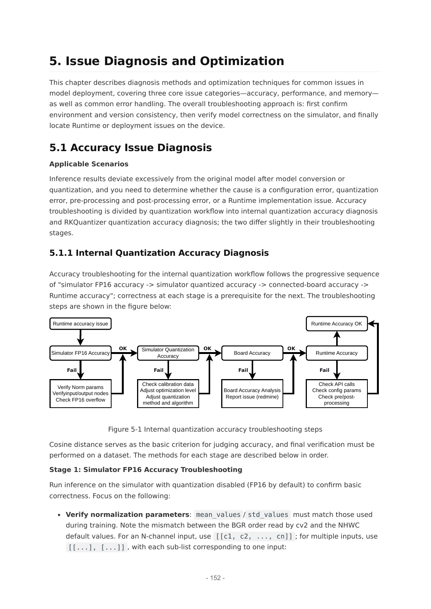

# 08A 量化与编译：压缩优势怎样变成可用模型

截至2026-11-05，主证据为RKNN3 V1.2.0开发、算子及发行手册。本文沿数值表示、误差目标、图映射和插件执行分析机制，不把SDK支持名单视为所有模型可无损部署，也不把NPU峰值当模型时延。

## 1. 痛点与数值格式

端侧大模型首先面对权重容量和反复读权重的带宽压力。W4A16 G32的官方含义是权重4bit非对称量化、激活16bit浮点，沿输入通道每32个权重配置量化参数。它不同于全部计算和缓存都变成4bit。对7B参数模型，分析计算仅裸权重为7×10⁹×4/8=3.5GB；实际还需scale/零点、对齐、未量化层、词嵌入、KV和workspace。5GB协处理器可用容量也不能全给裸权重。[RK02_00_RKNN3_SDK_Release_Notes_V1.2.0](https://raw.githubusercontent.com/airockchip/rknn3-toolkit/main/doc/EN/00_RKNN3_SDK_Release_Notes_V1.2.0.pdf)（[本地原件](REFERENCES.md#ref-f422f7a4bad78537))

作为解释性数学模型，可写q=clip(round(w/s)+z)，重构为ŵ=s(q−z)。这是非对称量化的一般分析表达，不是对未公开RKQuantizer舍入、饱和和元数据编码的复现。若假设每组scale与零点共占b字节，均匀分组N个权重的元数据开销约Nb/32；例如b=4时为每权重1bit额外开销。这个示例仅说明低位宽不等于文件精确压缩比例，实际格式必须测导出产物。手册没有完整披露每项存储编码，不能据此给实际压缩倍数。

| 对象 | 官方格式/约束 | 优势机制 | 不能推导 |
| --- | --- | --- | --- |
| LLM量化 | W4/W6/W8 A16，RKQuantizer group32 | 减少权重容量和读取量 | 激活、KV也全部4bit |
| 常规视觉 | 内部量化可用W8A8等 | 降低张量带宽并映射NPU | 与LLM精度/速度相同 |
| 混合量化 | per-layer或auto_hybrid_rate | 为敏感层保留更多位宽 | 必然无损或固定提升 |
| 自定义CPU算子 | RK182X RISC-V CPU插件 | 补充图中不支持节点 | fallback无代价 |

依据：开发手册第41—47、144—150页，发行说明第16—17页。[RK02_02_RKNN3_SDK_Development_Guide_V1.2.0](https://raw.githubusercontent.com/airockchip/rknn3-toolkit/main/doc/EN/02_RKNN3_SDK_Development_Guide_V1.2.0.pdf)（[本地原件](REFERENCES.md#ref-9d498a30029e5731))

## 2. GRQ优化的是block输出，不是逐张量最小误差

开发手册第42页说明Normal不需要校准集；GRQ通过反向传播最小化量化前后每个block输出的均方误差，求该block线性层的量化参数。与只最小化张量误差的KL/MMSE不同，block级目标把层之间的误差传播纳入局部优化，因而官方建议优先GRQ。它需要GPU/CUDA，不是部署端NPU自动在线训练。优势在校准分布接近真实输入且转换链一致时成立；对极端光照、罕见工具调用或新本体状态，误差仍可能集中在关键分支。

多模态校准不能只用纯文本。官方推荐在浮点模型目标子模块入口register_forward_pre_hook捕获args/kwargs，保存pickle与JSON索引；工具捕获后抛StopForward提前终止，generate也只触发一次forward而不会真的生成token。这意味着采样必须确认输入实际经过目标模块，不能把没有触发的None样本当有效视觉激活。纯文本input+target路径仅适用于纯文本LLM。手册建议20—200个多样真实样本，这只是一般建议，不是机器人动作精度已达到要求的样本量。[RK02_02_RKNN3_SDK_Development_Guide_V1.2.0](https://raw.githubusercontent.com/airockchip/rknn3-toolkit/main/doc/EN/02_RKNN3_SDK_Development_Guide_V1.2.0.pdf)（[本地原件](REFERENCES.md#ref-9d498a30029e5731))

对VLA的分析验证应覆盖相机、语言和本体状态，保留未参与校准的任务/场景作为留出集。block输出余弦相近不保证轨迹碰撞率不变；动作坐标、归一化及后续IK会放大特定方向误差。量化选择应同时看目标张量误差、任务指标和失败事件，而非挑一个准确率接近的语言模型分数替代操作成功。

## 3. 混合精度必须跨越PyTorch到ONNX的名称映射

layer_quant_config与auto_hybrid_rate不能同时使用。混合设置还依赖export_op_quantized_dtype在ONNX导出后执行，且它传入的ONNX必须与后续load_llm一致；转换时op_quantized_dtype要指向同一阶段输出的JSON。丢失映射可能导致配置不生效或转换错误。因而“保留某敏感层高精度”并非只写一个Python字典，还需要把源层、导出节点、编译图及最终产物关联保存。[RK02_02_RKNN3_SDK_Development_Guide_V1.2.0](https://raw.githubusercontent.com/airockchip/rknn3-toolkit/main/doc/EN/02_RKNN3_SDK_Development_Guide_V1.2.0.pdf)（[本地原件](REFERENCES.md#ref-9d498a30029e5731))

这也是部署资产锁定的实际内容：浮点模型commit和权重哈希、tokenizer/processor、捕获数据、量化配置、ONNX与external data、映射JSON、compiler/runtime版本及产物哈希。改变裁剪、分辨率、位置编码或导出图后，旧映射和旧校准不能默认为有效。RKNN2、RKLLM和RKNN3不是相互替换的单一运行时；目标RK3588与RK182X也不应共用未经转换验证的产物。[RK02_RKNN2_Readme](https://raw.githubusercontent.com/airockchip/rknn-toolkit2/master/README.md)（[本地原件](REFERENCES.md#ref-15f0b493e9150c73)) [RK02_RKLLM_Readme](https://raw.githubusercontent.com/airockchip/rknn-llm/main/README.md)（[本地原件](REFERENCES.md#ref-5b6e59180a191ea7)) [RK02_RKNN3_Readme](https://raw.githubusercontent.com/airockchip/rknn3-toolkit/main/README.md)（[本地原件](REFERENCES.md#ref-f132b85162ebf4e6))

## 4. 算子融合与CPU补齐的真实代价

算子手册分别列RK182X、RK3572，含exMatMulActivation和Attention扩展；支持一个框架算子名称还不够，需要查shape、布局、数据类型及具体约束。exMatMulActivation把矩阵乘与激活表示为融合操作，可能减少中间张量与调度，但本文没有取得逐模型融合比例、kernel选择和实测收益，不能称为普遍某倍加速。[RK02_07_RKNN3_Supported_Operators_and_Constraints_Reference_V1.2.0](https://raw.githubusercontent.com/airockchip/rknn3-toolkit/main/doc/EN/07_RKNN3_Supported_Operators_and_Constraints_Reference_V1.2.0.pdf)（[本地原件](REFERENCES.md#ref-60602278513d0590))

开发手册第144—149页提供两类插件：末端后处理可把YOLO解码/NMS移到协处理器CPU，减少返回主控的数据；任意位置CustomOperator可补不支持的图节点。二者都是CPU backend，不是NPU专用kernel。CustomOperator需要读属性、NC1HWC2/FP16与NCHW/FP32转换、计算和重新打包，因此可能增加串行计算与布局代价。补齐算子让图可运行，不自动提高吞吐。

插件需要纯C及RK182X的riscv64-unknown-elf-gcc、c908v/RVV等配置，不能把Arm Linux的共享库直接传入。生命周期依次为init、compute、deinit及固定名注册入口；插件在model_init后、run前加载。同op_type后加载会替换旧插件，因此插件版本与模型应绑定。后处理加载后还应重新查询输出个数与属性再分配内存，不能继续沿用原始logits布局。[RK02_02_RKNN3_SDK_Development_Guide_V1.2.0](https://raw.githubusercontent.com/airockchip/rknn3-toolkit/main/doc/EN/02_RKNN3_SDK_Development_Guide_V1.2.0.pdf)（[本地原件](REFERENCES.md#ref-9d498a30029e5731))

## 5. 官方证据与误差验证

官方第152页完整流程图已打开复核：内部量化诊断依次为模拟器FP16、模拟器量化、板端、应用runtime，失败分别回查归一化、输入输出节点、FP16溢出、校准和API。该图证明诊断路径存在，不证明本文已执行这些步骤。模拟器可检功能，性能必须在板端测量；单层/累计余弦与欧氏距离用于定位，最后仍需数据集验证。[RK02_02_RKNN3_SDK_Development_Guide_V1.2.0](https://raw.githubusercontent.com/airockchip/rknn3-toolkit/main/doc/EN/02_RKNN3_SDK_Development_Guide_V1.2.0.pdf)（[本地原件](REFERENCES.md#ref-9d498a30029e5731))

发行说明V1.2.0中InternVL3-2B在MMbench(cn)从77.23变为72.77，下降4.46个百分点；Qwen3-4B gsm8k为90.60到89.69。另有分数略升的模型，不能据此声称量化训练改善普遍泛化。官方表未给完整重复试验和机器人任务分母。视觉YOLOv8s COCO AP@0.5:0.95为0.390到0.383，必须保留与语言百分数不同的度量尺度。[RK02_00_RKNN3_SDK_Release_Notes_V1.2.0](https://raw.githubusercontent.com/airockchip/rknn3-toolkit/main/doc/EN/00_RKNN3_SDK_Release_Notes_V1.2.0.pdf)（[本地原件](REFERENCES.md#ref-f422f7a4bad78537))

## 6. 友商机制、迁移与护城河判断

TensorRT显式Q/DQ控制图的数值边界，传播和融合需保持算术正确性；INT4 WoQ针对GEMM，低精度权重读取后解量化再以高精度计算。它与RKNN3 W4A16解决相近的容量/带宽痛点，但块参数、图导入、目标kernel、硬件和runtime不同，不能交换engine、scale或按位宽给速度排名。TensorRT文档也明确某些预量化ONNX算子不支持，迁移往往从浮点源图重建并重新验收。[RK08_TRT_Explicit](https://docs.nvidia.com/deeplearning/tensorrt/latest/inference-library/quantized-types-explicit-quantization.html)（[本地原件](REFERENCES.md#ref-f47c2746e3737567)) [RK08_TRT_Quant](https://docs.nvidia.com/deeplearning/tensorrt/latest/inference-library/work-with-quantized-types.html)（[本地原件](REFERENCES.md#ref-cfee9c77bfa7c45e))

llama.cpp提供多位宽量化和CPU/GPU混合后端，适合比较开放部署与内存分配路线；它的GGUF与RKNN3模型/权重/词表拆分不等价。本文未在同一板或同一GPU、相同模型精度上测两者，只有机制比较。[RK02_llamacpp_Compare](https://raw.githubusercontent.com/ggml-org/llama.cpp/master/README.md)（[本地原件](REFERENCES.md#ref-fbdd980ae105c4a6))

本专题判断：量化、图编译与协处理器CPU补齐形成可复用工程能力，价值在模型受支持、误差合格且软件版本可复建时成立。尚无证据证明这些机制在所有VLA/世界模型上具独占优势；关键缺口是闭源编译器内部调度、量化元数据编码、板端并发功率与动作精度。RKNN SDK许可和模型权重/数据许可分别处理，公开文档不等于二进制全开源。[RK02_RKNN3_License](https://raw.githubusercontent.com/airockchip/rknn3-toolkit/main/LICENSE)（[本地原件](REFERENCES.md#ref-e0d48d173b53dd02))

## 参考资料与本地原文

采集时间逐项列出；移动分支及无版本网页仅代表此次快照。HTML 保留正文与可取得静态依赖，动态交互、视频及缺失依赖不保证完整。未进行目标板安装或实机性能验证。

| 来源 | 原 URL | 本地原件 | 采集 UTC | 归档状态 |
| --- | --- | --- | --- | --- |
| RK02_00_RKNN3_SDK_Release_Notes_V1.2.0 | [原文](https://raw.githubusercontent.com/airockchip/rknn3-toolkit/main/doc/EN/00_RKNN3_SDK_Release_Notes_V1.2.0.pdf) | [归档](REFERENCES.md#ref-f422f7a4bad78537) | 2026-11-04T16:32:49.070460+00:00 | complete_static；缺失依赖 0 |
| RK02_02_RKNN3_SDK_Development_Guide_V1.2.0 | [原文](https://raw.githubusercontent.com/airockchip/rknn3-toolkit/main/doc/EN/02_RKNN3_SDK_Development_Guide_V1.2.0.pdf) | [归档](REFERENCES.md#ref-9d498a30029e5731) | 2026-11-04T16:32:54.533544+00:00 | complete_static；缺失依赖 0 |
| RK02_RKNN2_Readme | [原文](https://raw.githubusercontent.com/airockchip/rknn-toolkit2/master/README.md) | [归档](REFERENCES.md#ref-15f0b493e9150c73) | 2026-11-04T16:10:04.951084+00:00 | complete_static；缺失依赖 0 |
| RK02_RKLLM_Readme | [原文](https://raw.githubusercontent.com/airockchip/rknn-llm/main/README.md) | [归档](REFERENCES.md#ref-5b6e59180a191ea7) | 2026-11-04T16:10:05.951168+00:00 | complete_static；缺失依赖 0 |
| RK02_RKNN3_Readme | [原文](https://raw.githubusercontent.com/airockchip/rknn3-toolkit/main/README.md) | [归档](REFERENCES.md#ref-f132b85162ebf4e6) | 2026-11-04T16:32:33.513636+00:00 | complete_static；缺失依赖 0 |
| RK02_07_RKNN3_Supported_Operators_and_Constraints_Reference_V1.2.0 | [原文](https://raw.githubusercontent.com/airockchip/rknn3-toolkit/main/doc/EN/07_RKNN3_Supported_Operators_and_Constraints_Reference_V1.2.0.pdf) | [归档](REFERENCES.md#ref-60602278513d0590) | 2026-11-04T16:33:06.975486+00:00 | complete_static；缺失依赖 0 |
| RK08_TRT_Explicit | [原文](https://docs.nvidia.com/deeplearning/tensorrt/latest/inference-library/quantized-types-explicit-quantization.html) | [归档](REFERENCES.md#ref-f47c2746e3737567) | 2026-11-04T17:15:45.571211+00:00 | complete_static；缺失依赖 2 |
| RK08_TRT_Quant | [原文](https://docs.nvidia.com/deeplearning/tensorrt/latest/inference-library/work-with-quantized-types.html) | [归档](REFERENCES.md#ref-cfee9c77bfa7c45e) | 2026-11-04T17:15:33.736948+00:00 | complete_static；缺失依赖 2 |
| RK02_llamacpp_Compare | [原文](https://raw.githubusercontent.com/ggml-org/llama.cpp/master/README.md) | [归档](REFERENCES.md#ref-fbdd980ae105c4a6) | 2026-11-04T16:26:19.013745+00:00 | complete_static；缺失依赖 0 |
| RK02_RKNN3_License | [原文](https://raw.githubusercontent.com/airockchip/rknn3-toolkit/main/LICENSE) | [归档](REFERENCES.md#ref-e0d48d173b53dd02) | 2026-11-04T16:32:45.776051+00:00 | complete_static；缺失依赖 0 |

[证据记录](research_state/evidence/08A_Quantization_Compiler.json)；[本章开始前哈希基线](research_state/baselines/08A_Quantization_Compiler_before.json)。检查和去重记录由专题索引汇总。
