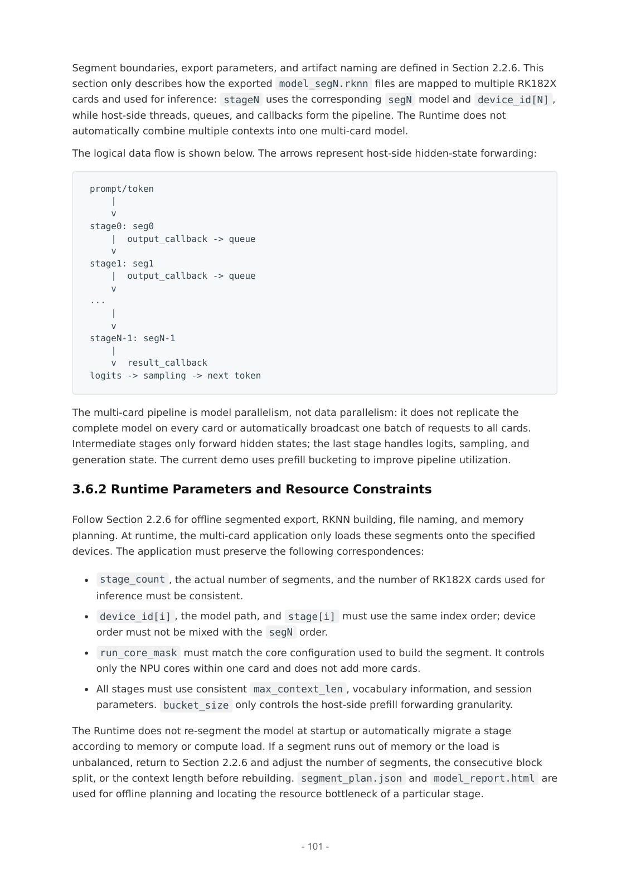

# 08B 内存、协处理器与多卡：容量和时延的不同约束

截至2026-11-05。核心对象为RK1820/RK1828及RKNN3 V1.2.0。正文区分芯片内DRAM、主控DDR、总线传输、缓存一致性和会话状态；所有公式为分析上限或容量估算，不是本文硬件实测。

## 1. 片内DRAM解决权重驻留，物理带宽仍待证实

Rockchip系列页说明RK182X内置2.5GB/5GB高带宽DRAM、多核RISC-V和NPU，外部接口含PCIe2.0、USB3.0及RGMII。板商资料将2.5/5GB分别对应RK1820/1828，并使用3D DRAM stacking描述。它支持高带宽存储与协处理器的产品定位，但本次未取得GB/s实测、总线宽度/时钟、缓存命中和存内计算电路证据，不将其直接称为标准HBM或已证明存内乘加。[Rockchip_RK182X](https://www.rock-chips.com/a/cn/product/RK18xilie/2025/1114/2113.html)（[本地原件](REFERENCES.md#ref-7d4a49a630895d8b)) [Firefly_RK182X_Kit_PDF](https://download.t-firefly.com/Spec/Suite/RK182X-Development-Kit_Specifications_EN.pdf)（[本地原件](REFERENCES.md#ref-9d86adab08bd1a92))

对逐token解码，分析下界可写T≥max(C/F，D/B)，其中C为算术工作量、F为有效计算能力、D为需要读写字节、B为有效带宽。实际还包括kernel调度、CPU采样和主机传输。权重驻留可避免每token从主控重新搬完整模型，但未取得D/B时不能用20TOPS计算解码速度。长上下文还增长KV，视觉token和多个会话改变占用；短文本基准并不代表机器人多图历史的资源需求。

RKNN3提供eval_memory按核心分开Command、Weight、Internal、KVCache和Total；eval_perf列CPU/NPU时间、调用次数及比例。这些诊断入口比裸模型文件大小更接近容量规划。某一核心或某一stage耗尽内存时，其他核心/卡尚有空闲也不保证能自动调剂。手册的示例表是工具输出说明，不能视为当前机器人模型的内存数据。[RK02_02_RKNN3_SDK_Development_Guide_V1.2.0](https://raw.githubusercontent.com/airockchip/rknn3-toolkit/main/doc/EN/02_RKNN3_SDK_Development_Guide_V1.2.0.pdf)（[本地原件](REFERENCES.md#ref-9d498a30029e5731))

## 2. DMA共享必须满足布局、可达性和同步

第62—64页规定输入输出由rknn3_tensor_mem管理。create_mem默认cacheable，需要mem_sync；NON_CACHEABLE不需要同类缓存同步，但CPU访问性能更低。create_mem_from_fd可复用外部DMA-BUF，要求有效fd和匹配大小；create_mem_from_phys在当前版本未实现。因此从相机到NPU的零拷贝是受限接口能力，不是所有物理地址、全部跨设备拓扑都可直接共享。[RK02_02_RKNN3_SDK_Development_Guide_V1.2.0](https://raw.githubusercontent.com/airockchip/rknn3-toolkit/main/doc/EN/02_RKNN3_SDK_Development_Guide_V1.2.0.pdf)（[本地原件](REFERENCES.md#ref-9d498a30029e5731))

数据路径应逐步检查：相机buffer的格式/stride，RGA变换后的形状，NPU输入布局和aligned_size，推理完成事件，输出读取以及buffer再入队。CPU写输入后SYNC_TO_DEVICE，推理完成后SYNC_FROM_DEVICE再读；同步是阻塞操作并应逐tensor执行。跳过同步可能得到上一帧缓存值，其后果不只是速度问题，还会错配观测与动作。释放顺序为输入输出memory先于context；异步worker仍持引用时不能释放或让相机覆盖。

通过fd避免CPU memcpy并不表示PCIe上零传输、也不免布局转换。RK182X是协处理器；代理/native执行以及主控与设备内存可达性还需目标BSP验证。RGA文档的fd/stride/cache/fence规则仅解决本地相关硬件交接的一部分，不足以证明主控dma-buf能够跨PCIe被RK182X以同一地址读写。[RK02_RGA_Guide](https://raw.githubusercontent.com/airockchip/librga/main/docs/Rockchip_Developer_Guide_RGA_CN.md)（[本地原件](REFERENCES.md#ref-b175c5e9893e4e95)) [RK02_RGA_FAQ](https://raw.githubusercontent.com/airockchip/librga/main/docs/Rockchip_FAQ_RGA_CN.md)（[本地原件](REFERENCES.md#ref-a2e0e8f0ba8423e2))

## 3. 多卡是分段模型并行，主机仍在数据路径中

RKNN3开发手册第101页官方逻辑图已打开核验，箭头明确表示主机转发hidden states。stage0加载seg0，输出callback进入queue，下游stage依次执行，最后stage采样下一token。这不是每卡复制完整模型的数据并行，也不是自动形成统一大内存。stage_count、导出段数、实际卡数和device_id顺序必须匹配；run_core_mask只选单卡NPU核，不能代替加卡。[RK02_02_RKNN3_SDK_Development_Guide_V1.2.0](https://raw.githubusercontent.com/airockchip/rknn3-toolkit/main/doc/EN/02_RKNN3_SDK_Development_Guide_V1.2.0.pdf)（[本地原件](REFERENCES.md#ref-9d498a30029e5731))

每段都有独立context、模型、tensor和session。prefill可按bucket转发以提高流水利用，128是手册建议起点；callback必须携真实token count，下游不能假定每包满bucket。Runtime-owned输出必须复制到队列项，不能把原指针交异步线程后再复用原buffer。队列需要producer_done、failed、close状态，任一stage失败应唤醒并关闭下游，join线程后释放资源。清KV要对每段session执行，不能只清首卡。[RK02_02_RKNN3_SDK_Development_Guide_V1.2.0](https://raw.githubusercontent.com/airockchip/rknn3-toolkit/main/doc/EN/02_RKNN3_SDK_Development_Guide_V1.2.0.pdf)（[本地原件](REFERENCES.md#ref-9d498a30029e5731))

分析而言，稳定流水吞吐受最慢stage及传输限制，第一批结果还需经历各stage总延迟；decode每token必须按因果順序穿越全段。因此卡数扩容量可能使原本不能运行的模型可运行，却未必降低单请求TTFT，更不会自动增加policy频率。手册明确runtime不在启动时重新切层或迁移stage；不均衡要回到segment_plan和model_report，重新分段、配置上下文并编译。

## 4. PCIe、hidden-state与排队的上限分析

PCIe2.0单lane为5GT/s，按8b/10b分析理想单方向字节率500MB/s，尚未扣包/协议和软件开销，也未证明某载板实际链路宽度。假设每次转发FP16 hidden state，token数S、维度H，则裸payload为2SH字节；以S=128、H=4096为例是1,048,576字节，按500MB/s理想约2.10ms。它只用于说明bucket/隐藏维度会影响链路成本；不含主机复制、同步、每段开销或回程，不是RK1828多卡实测。[Rockchip_RK182X](https://www.rock-chips.com/a/cn/product/RK18xilie/2025/1114/2113.html)（[本地原件](REFERENCES.md#ref-7d4a49a630895d8b))

若模型输出仍是大型特征而不是压缩后的检测结果，PCIe与CPU复制可能占比上升。末端后处理插件可减少返回量，但其CPU耗时必须加入；不能只比较NPU kernel。多个相机、录像、网络和控制共享主控时，平均空载时延也可能低估观测年龄。分析建议记录每帧采集、入队、传输、各stage开始结束、动作接收及丢弃原因，结合队列长度与功率温度，而不是以毫秒倒数当系统控制频率。

## 5. 分页KV是资源机制，当前不是任意多请求并行

手册第124—125页给连续KV与paged KV路径。tokens_per_page在转换阶段决定是否成为paged model，正整数开启并建议64倍数；SlidingAttention等情形会退回连续策略。当前request_num只支持1，因而通用介绍中的多请求内存优势不能直接当本版本已支持多请求同时推理。Session内部管理页；底层显式方式需逐core/cache type查询page_size、max_page_num，创建页、空闲context绑定页表，解绑成功后才能销毁。[RK02_02_RKNN3_SDK_Development_Guide_V1.2.0](https://raw.githubusercontent.com/airockchip/rknn3-toolkit/main/doc/EN/02_RKNN3_SDK_Development_Guide_V1.2.0.pdf)（[本地原件](REFERENCES.md#ref-9d498a30029e5731))

容量分析中FullAttention页数为ceil(L/P)，最多浪费一个尾页的P−1个token位置，实际字节要乘每页大小及缓存类型。page大小变动意味着内存与调度折中，不能宣称页越小总会更快。KV保存文件又强绑定模型/runtime；升级后不可默认复用。循环覆盖策略保留系统prompt也不保证机器人对话历史和环境状态仍完整，应用必须制定陈旧记忆清理条件。

单context一次仅运行一个session；多卡不同stage可由主机并发，但不改变每段限制。Server可并发收HTTP却通过FIFO排队串行推理，读写timeout不是排队超时。机器人应在上层设观测有效期、取消与丢弃策略；长回答阻塞紧急任务是系统调度问题，不能靠接口“兼容OpenAI”解决。[RK02_06_RKLLM3_Server_User_Guide_V1.2.0](https://raw.githubusercontent.com/airockchip/rknn3-toolkit/main/doc/EN/06_RKLLM3_Server_User_Guide_V1.2.0.pdf)（[本地原件](REFERENCES.md#ref-35c26847abdacb11))

## 6. 性能、竞品与成立条件

| 机制 | 容量来自哪里 | 关键数据路径 | 运行边界 | 选型检查 |
| --- | --- | --- | --- | --- |
| RK182X单卡驻留 | 协处理器DRAM | 主机输入、设备计算、结果回传 | 权重/KV/内部张量共享有限容量 | 每核心实际余量 |
| RKNN3多卡分段 | 各卡独立存储 | 主机队列转发hidden states | 分段固定，逐token跨全部段 | 最慢stage、失败传播 |
| RKNN3分页KV | 按页分配缓存 | 空闲时绑定/解绑页表 | V1.2.0 request_num=1 | 页数上限和模型匹配 |
| TensorRT权重流式 | host分担device权重 | 执行中按需传输权重 | 需构建flag、budget和scratch | 链路与host峰值内存 |

前三行依据RKNN3开发手册，最后一行为独立GPU软件机制比较；没有同条件速度排名。[RK02_02_RKNN3_SDK_Development_Guide_V1.2.0](https://raw.githubusercontent.com/airockchip/rknn3-toolkit/main/doc/EN/02_RKNN3_SDK_Development_Guide_V1.2.0.pdf)（[本地原件](REFERENCES.md#ref-9d498a30029e5731)) [RK08_TRT_WeightStream](https://docs.nvidia.com/deeplearning/tensorrt/latest/inference-library/weight-streaming.html)（[本地原件](REFERENCES.md#ref-40f9a3122acdb4fd))

发行说明V1.2.0在RK3588性能模式、PCIe、RK182X NPU1GHz条件下列Qwen2.5-7B单RK1828 TTFT157.59ms、decode70.14TPS；四RK1828 Gemma-4-31B输入5120/输出128则TTFT9153.38ms、decode13.82TPS。模型与输入不同，不能计算四卡加速比。Qwen3-VL-4B视觉384²为104.22ms、语言decode90.99TPS，视觉与语言阶段独立测量，不能把其中一项作为多模态总闭环时延。所有表仍缺本文所需的板端P99、功耗、热稳定和本体任务成功。[RK02_00_RKNN3_SDK_Release_Notes_V1.2.0](https://raw.githubusercontent.com/airockchip/rknn3-toolkit/main/doc/EN/00_RKNN3_SDK_Release_Notes_V1.2.0.pdf)（[本地原件](REFERENCES.md#ref-f422f7a4bad78537))

TensorRT weight streaming在host保留权重按需送device，以device budget和scratch规划换取更大模型容量；这与RK182X多卡分段驻留不同，二者都可能以传输代价换容量。文档要求构建flag和强类型网络，预算自动估计也可能OOM。迁移需重建engine和内存规划，不能借该GPU机制宣称RK182X支持透明weight streaming。llama.cpp CPU/GPU混合也是容量分摊路线，未取得同条件测量时只能比边界和工程投入。[RK08_TRT_WeightStream](https://docs.nvidia.com/deeplearning/tensorrt/latest/inference-library/weight-streaming.html)（[本地原件](REFERENCES.md#ref-40f9a3122acdb4fd)) [RK02_llamacpp_Compare](https://raw.githubusercontent.com/ggml-org/llama.cpp/master/README.md)（[本地原件](REFERENCES.md#ref-fbdd980ae105c4a6))

可检验放行应固定模型、上下文、卡数、分段、core mask和BSP，分别测冷加载、短/长prefill、decode、并发感知和更新回退；记录峰值内存、链路流量、队列/P99及能量。协处理器护城河的潜在价值是专用存储与可分段工具协同，成立于模型驻留、负载平衡、传输可控及任务延迟允许；物理带宽和整机收益仍需正式目标设备证据。SDK许可与多卡插件维护责任必须在量产合同中明确。[RK02_RKNN3_License](https://raw.githubusercontent.com/airockchip/rknn3-toolkit/main/LICENSE)（[本地原件](REFERENCES.md#ref-e0d48d173b53dd02))

## 参考资料与本地原文

采集时间逐项列出；移动分支及无版本网页仅代表此次快照。HTML 保留正文与可取得静态依赖，动态交互、视频及缺失依赖不保证完整。未进行目标板安装或实机性能验证。

| 来源 | 原 URL | 本地原件 | 采集 UTC | 归档状态 |
| --- | --- | --- | --- | --- |
| Rockchip_RK182X | [原文](https://www.rock-chips.com/a/cn/product/RK18xilie/2025/1114/2113.html) | [归档](REFERENCES.md#ref-7d4a49a630895d8b) | 2026-11-04T15:46:37.610283+00:00 | partial_static；缺失依赖 2 |
| Firefly_RK182X_Kit_PDF | [原文](https://download.t-firefly.com/Spec/Suite/RK182X-Development-Kit_Specifications_EN.pdf) | [归档](REFERENCES.md#ref-9d86adab08bd1a92) | 2026-11-04T15:50:00.874477+00:00 | complete_static；缺失依赖 0 |
| RK02_02_RKNN3_SDK_Development_Guide_V1.2.0 | [原文](https://raw.githubusercontent.com/airockchip/rknn3-toolkit/main/doc/EN/02_RKNN3_SDK_Development_Guide_V1.2.0.pdf) | [归档](REFERENCES.md#ref-9d498a30029e5731) | 2026-11-04T16:32:54.533544+00:00 | complete_static；缺失依赖 0 |
| RK02_RGA_Guide | [原文](https://raw.githubusercontent.com/airockchip/librga/main/docs/Rockchip_Developer_Guide_RGA_CN.md) | [归档](REFERENCES.md#ref-b175c5e9893e4e95) | 2026-11-04T16:10:46.889750+00:00 | complete_static；缺失依赖 0 |
| RK02_RGA_FAQ | [原文](https://raw.githubusercontent.com/airockchip/librga/main/docs/Rockchip_FAQ_RGA_CN.md) | [归档](REFERENCES.md#ref-a2e0e8f0ba8423e2) | 2026-11-04T16:10:48.443208+00:00 | complete_static；缺失依赖 0 |
| RK02_06_RKLLM3_Server_User_Guide_V1.2.0 | [原文](https://raw.githubusercontent.com/airockchip/rknn3-toolkit/main/doc/EN/06_RKLLM3_Server_User_Guide_V1.2.0.pdf) | [归档](REFERENCES.md#ref-35c26847abdacb11) | 2026-11-04T16:33:04.621902+00:00 | complete_static；缺失依赖 0 |
| RK08_TRT_WeightStream | [原文](https://docs.nvidia.com/deeplearning/tensorrt/latest/inference-library/weight-streaming.html) | [归档](REFERENCES.md#ref-40f9a3122acdb4fd) | 2026-11-04T17:17:20.336981+00:00 | complete_static；缺失依赖 1 |
| RK02_00_RKNN3_SDK_Release_Notes_V1.2.0 | [原文](https://raw.githubusercontent.com/airockchip/rknn3-toolkit/main/doc/EN/00_RKNN3_SDK_Release_Notes_V1.2.0.pdf) | [归档](REFERENCES.md#ref-f422f7a4bad78537) | 2026-11-04T16:32:49.070460+00:00 | complete_static；缺失依赖 0 |
| RK02_llamacpp_Compare | [原文](https://raw.githubusercontent.com/ggml-org/llama.cpp/master/README.md) | [归档](REFERENCES.md#ref-fbdd980ae105c4a6) | 2026-11-04T16:26:19.013745+00:00 | complete_static；缺失依赖 0 |
| RK02_RKNN3_License | [原文](https://raw.githubusercontent.com/airockchip/rknn3-toolkit/main/LICENSE) | [归档](REFERENCES.md#ref-e0d48d173b53dd02) | 2026-11-04T16:32:45.776051+00:00 | complete_static；缺失依赖 0 |

[证据记录](research_state/evidence/08B_Memory_Coprocessor_Multicard.json)；[本章开始前哈希基线](research_state/baselines/08B_Memory_Coprocessor_Multicard_before.json)。检查和去重记录由专题索引汇总。
