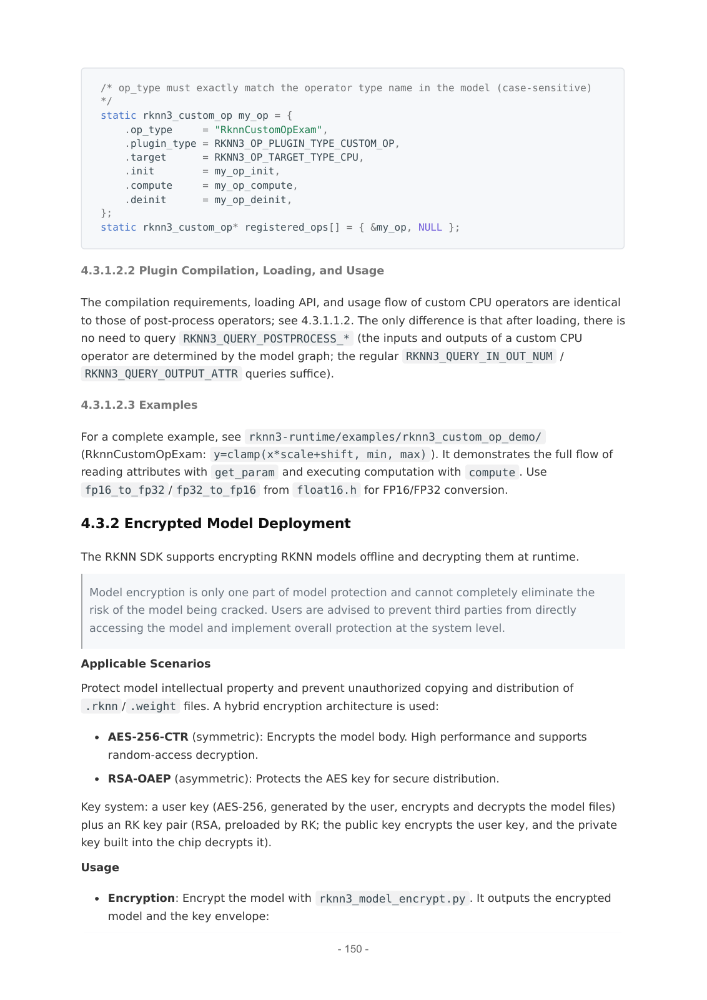

# 08C 感知、实时与可信部署：跨域协同的价值和边界

截至2026-11-05。Rockchip的潜在系统优势包括ISP/多媒体、普通Linux与实时域的组合、工业总线以及模型/启动保护。它们解决不同问题，必须分别验收；本文没有取得功能安全认证或完整故障容错系统，也未执行烧key、刷机或电机调试。

## 1. 感知前端：ISP改善输入，但不能替代时间与几何

RV1126B官方页给12M30 ISP、8M30 AI-ISP、AI Remosaic/PDAF及多目拼接等能力。其价值在于把图像处理靠近采集侧，减轻主控对原始图像的处理压力，并可能改善低质输入。官方资料未提供本研究所需的暗光/运动/透明物体留出集、AI-ISP执行图和全链功耗，因此不能宣称所有视觉模型准确率提高，也不能从五相机输入推导五路最高分辨率同步运行。[Rockchip_RV1126B](https://www.rock-chips.com/a/cn/product/RV11xilie/2025/1208/2117.html)（[本地原件](REFERENCES.md#ref-7613c4b621a6faa7))

RK3588伙伴相机文档可追踪sensor→D-PHY→MIPI CSI→CIF→sditf→ISP/MMU，再到V4L2。带自有ISP的相机可走不同CIF路径；DTS的remote-endpoint连接、sensor驱动、时钟与供电都需匹配。ISP3x IQ采用JSON，但isp20 XML转换后仍不适用，isp21 JSON也不能直接等价。这表明IQ不是只换扩展名，而与ISP代际、sensor及调参绑定。[RK03_Camera](https://community.t-firefly.com/en/docs/products/motherboard/AIO-3588JD4/usage-camera)（[本地原件](REFERENCES.md#ref-81b7d314c2c67105))

对机器人，视觉增强可能改变颜色、纹理和几何特征分布。分析建议固定曝光/增益策略、ISP/IQ版本和模型预处理，用真实留出场景比较增强前后关键点、深度及任务失败，不能只以视觉观感选配置。相机换批或镜头换型后，训练输入契约也需重新检查。

时间方面，V4L2驱动决定timestamp时钟和对应采集事件；Orbbec区分设备采集、系统到达与global映射，并提醒并非所有设备支持global、0可表示不可用。时间映射不能自动同步曝光，Wi-Fi TSF厂商宣传也没有给误差分布。融合优势成立于曝光事件、时钟域、外参及数据年龄都确定；仅凭相同header时间无法证明多传感器同刻观测。[RK03_V4L2_Buffer](https://docs.kernel.org/userspace-api/media/v4l/buffer.html)（[本地原件](REFERENCES.md#ref-6ec2a6979ded2e53)) [RK03_OrbbecTime](https://raw.githubusercontent.com/orbbec/OrbbecSDK_v2/main/docs/tutorial/timestamp.md)（[本地原件](REFERENCES.md#ref-6d698eb3dad5c80c)) [Rockchip_Robotics_2026](https://www.rock-chips.com/a/cn/news/rockchip/2026/0827/2177.html)（[本地原件](REFERENCES.md#ref-7e32246384c451c6))

## 2. PREEMPT_RT改变可抢占性，不是固定WCET

Firefly文档示例在RK3588 SDK匹配kernel补丁并启用rockchip_rt.config，随后用cyclictest −p99、运行12h等参数测试。这里99是调度优先级，不是P99统计。文档没有给目标机器人并发相机/NPU/网络时的延迟直方图，不能把“微秒级”介绍当本系统WCET承诺。[RK02_RT_Preempt](https://community.t-firefly.com/en/docs/software/industry-robot/RT-Linux/rtlinux-preempt-rt)（[本地原件](REFERENCES.md#ref-38c6142c135a686a))

Linux官方锁文档说明PREEMPT_RT下spinlock_t等可映射为基于rt_mutex的睡眠锁，并采用优先级继承；raw_spinlock仍有不同规则，关中断/不可抢占区不能被优先级继承直接消除。semaphore缺所有者，不能按相同方式提供优先级继承，仍可能优先级反转。因此改RT kernel后，驱动锁顺序、ISR和共享资源是实际审查对象，不能只检查内核配置存在。[RK08_Linux_Locks](https://docs.kernel.org/locking/locktypes.html)（[本地原件](REFERENCES.md#ref-8b673af79843926d))

分析测试应先定控制周期及容忍抖动，区分线程唤醒、控制计算、总线发送、执行器响应；再加录像、NPU、多卡传输、存储写入及热负载。记录最大观测值、P99、样本数、观测时间和异常日志。最大观测值也不是已证明最坏情况；硬实时需求还需边界论证。模型平均时延足够小但偶发排队过长时，上层过期动作仍会破坏控制。

## 3. AMP隔离以资源合同为前提

AMP将Linux SMP与指定AP核心/MCU的RTOS或裸机分开，可以把实时控制从普通应用调度中分离。SDK包含HAL、RT-Thread、Linux管理驱动/RPMsg、U-Boot装载及ITS；不同文件要描述同一个资源分配。private memory的DTS reserved-memory、ITS load/size和linker必须一致，共享区不能撞CMA、显示或NPU内存。[RK02_AMP_Structure](https://community.t-firefly.com/en/docs/software/industry-robot/AMP/amp-sdk-structure)（[本地原件](REFERENCES.md#ref-b8d11e251a4e4afa)) [RK02_AMP_Prereq](https://community.t-firefly.com/en/docs/software/industry-robot/AMP/amp-prerequisites)（[本地原件](REFERENCES.md#ref-7859770da31383a7))

外设只应由一个执行域主动管理，中断路由、IOMUX和clock/power domain也需一致；Linux因为“没有消费者”关时钟可能让远端控制停止。物理分核降低普通调度干扰，却不意味着共享DDR、功耗、时钟和管理驱动完全隔离。RPMsg消息要有序号、时间、单位、有效期及异常状态；本次未取得具体本体的共享内存协议、保护反应和故障恢复实现，不能把AMP称为已完成独立安全控制器。

其优势在资源可专属、通信量有限并且远端有自主失效处置时成立。若远端仍等待Linux提供每周期目标、共享电源失效或消息过期不检测，则分核不能阻止旧目标继续被执行。分析建议对Linux卡死、重启、RPMsg中断和共享区损坏分别测试，明确电机是否保持、受控停止或撤销使能；这些动作需整机方决定并验证。

## 4. EtherCAT及下游控制：通信成功不是动作安全

伙伴文档要求兼容且专用以太网口、从站ESI、匹配目标kernel的IgH以及严格实时需求时PREEMPT_RT。主站扫描、从站状态和PDO交换证明通信路径的一部分；急停、限位和机械保护在准备文档中独立列出，不属于NPU推理输出自动具备的能力。专用端口可降低办公网络混用，但还需NIC驱动、中断绑核和具体拓扑测量。[RK02_EtherCAT_Preparation](https://community.t-firefly.com/en/docs/software/industry-robot/EtherCAT/ethercat-preparation)（[本地原件](REFERENCES.md#ref-8c42f6b3ba4f0541)) [RK02_EtherCAT_Build](https://community.t-firefly.com/en/docs/software/industry-robot/EtherCAT/ethercat-build-install)（[本地原件](REFERENCES.md#ref-974bab78cbb46482))

VLA通常输出动作chunk，controller可能分解目标，EtherCAT周期再送往servo；四种频率不同。上层停止写入不保证下层停止保持旧值；自然语言生成正确也不保证单位、关节顺序、限速和碰撞约束正确。分析建议设置序号/超时、关节位置速度力矩边界及保护反馈，落实到接收端，不能仅在上层界面显示停止。RK3588“RT”产品名称本身也不证明这条链路已有WCET或认证。

## 5. 模型加密、镜像认证与抗回滚分别核查

RKNN3开发手册第150页原页已打开，列AES-256-CTR加密模型主体、RSA-OAEP保护用户AES key的混合结构；RK预置key pair保护密钥分发。第151页要求init后、load_model前set_decrypt_key，并称权重跨PCIe/USB/以太网传为密文。模型加密主要针对未授权复制与分发，官方同时明确不能完全消除破解风险。图与文字不证明模型执行时的所有数据都不可读取，也不证明算法有功能安全。[RK02_02_RKNN3_SDK_Development_Guide_V1.2.0](https://raw.githubusercontent.com/airockchip/rknn3-toolkit/main/doc/EN/02_RKNN3_SDK_Development_Guide_V1.2.0.pdf)（[本地原件](REFERENCES.md#ref-9d498a30029e5731))

从通用密码机制分析，CTR保密性不能单独作为认证完整性的证明；本文未取得这一产品所有封装校验与篡改处理细节，因此不推断其已缺失或已具备完整防篡改链。应让供应方说明密钥范围、更新/撤销、包验证、debug访问和返修授权。载板、模型用户key与设备预置key的责任不同，不能仅因模型文件加密便认为数据服务已合规。

Firefly kernel6.1示例配置FIT签名、OP-TEE/RPMB存储等；overview明确rollback-index不支持，key烧写涉及不可逆配置。签名认证能限制未授权镜像，但旧的合法签名版本仍可能需要额外回滚管理。恢复Loader模式与生产身份写入流程也要纳入信任边界。本文仅阅读文档，没有执行这些不可逆操作，也没有将示例配置推广所有SKU/BSP。[RK02_Secure_Config](https://community.t-firefly.com/en/docs/software/other/SecureBoot/secureboot-config)（[本地原件](REFERENCES.md#ref-0e3551cfe884717f)) [RK02_SecureBoot](https://community.t-firefly.com/en/docs/software/other/SecureBoot/secureboot-overview)（[本地原件](REFERENCES.md#ref-6a0f17927bb8ae3c))

## 6. 对标和可迁移边界

| 问题 | Rockchip证据路径 | 同类机制比较 | 迁移/验收动作 |
| --- | --- | --- | --- |
| 采集输入质量 | sensor驱动、ISP/IQ与AI-ISP | 通用相机ISP仍需sensor调参 | 重验曝光/模型分布/标定 |
| 普通域抖动 | PREEMPT_RT与AMP | Linux RT锁语义是共用机制 | 重审驱动/IRQ/资源分配 |
| 工业通信 | IgH与专用以太网口 | 总线能力不等于servo保护 | 绑定从站、PDO、周期和超时 |
| 镜像与模型保护 | FIT/OP-TEE、RKNN3加密 | Jetson BootROM→bootloader→UEFI链 | key格式及烧写不可直接移植 |

Jetson Linux R36.4.4文档描述BootROM/fuse建立PKC信任链，bootloader后由UEFI key机制认证payload，并明确fuse位不可从1改回0及产线工具边界。它与Rockchip FIT配置解决相近的启动认证问题，但key、BSP、引导阶段与工厂工艺不同。没有同等威胁模型、覆盖范围与独立测试，不能给“更安全”排名；更不能把Jetson机制或安全认证自动套到Rockchip。[RK08_Jetson_Secure](https://docs.nvidia.com/jetson/archives/r36.4.4/DeveloperGuide/SD/Security/SecureBoot.html)（[本地原件](REFERENCES.md#ref-7da3f868d4324aea)) [RK08_Linux_Locks](https://docs.kernel.org/locking/locktypes.html)（[本地原件](REFERENCES.md#ref-8b673af79843926d))

本专题的护城河判断是：感知前端、多执行域和可信部署若能由板商提供一致BSP与责任清晰的整机接口，可减少系统集成环节；单项机制多为行业共用思路，优势需由目标任务的质量、抖动、恢复和维护成本证实。缺完整TRM、密钥生命周期说明、独立失效测试及安全认证时，研究结论只支持候选路线。SDK/RTOS/IgH/模型和本体各自许可仍需按具体交付包审计，本文不能签发整机放行结论。[RK02_RKNN3_License](https://raw.githubusercontent.com/airockchip/rknn3-toolkit/main/LICENSE)（[本地原件](REFERENCES.md#ref-e0d48d173b53dd02))

## 参考资料与本地原文

采集时间逐项列出；移动分支及无版本网页仅代表此次快照。HTML 保留正文与可取得静态依赖，动态交互、视频及缺失依赖不保证完整。未进行目标板安装或实机性能验证。

| 来源 | 原 URL | 本地原件 | 采集 UTC | 归档状态 |
| --- | --- | --- | --- | --- |
| Rockchip_RV1126B | [原文](https://www.rock-chips.com/a/cn/product/RV11xilie/2025/1208/2117.html) | [归档](REFERENCES.md#ref-7613c4b621a6faa7) | 2026-11-04T15:46:38.792350+00:00 | partial_static；缺失依赖 2 |
| RK03_Camera | [原文](https://community.t-firefly.com/en/docs/products/motherboard/AIO-3588JD4/usage-camera) | [归档](REFERENCES.md#ref-81b7d314c2c67105) | 2026-11-04T16:47:41.719928+00:00 | partial_static；缺失依赖 2 |
| RK03_V4L2_Buffer | [原文](https://docs.kernel.org/userspace-api/media/v4l/buffer.html) | [归档](REFERENCES.md#ref-6ec2a6979ded2e53) | 2026-11-04T16:47:10.657122+00:00 | complete_static；缺失依赖 0 |
| RK03_OrbbecTime | [原文](https://raw.githubusercontent.com/orbbec/OrbbecSDK_v2/main/docs/tutorial/timestamp.md) | [归档](REFERENCES.md#ref-6d698eb3dad5c80c) | 2026-11-04T16:47:45.288226+00:00 | complete_static；缺失依赖 0 |
| Rockchip_Robotics_2026 | [原文](https://www.rock-chips.com/a/cn/news/rockchip/2026/0827/2177.html) | [归档](REFERENCES.md#ref-7e32246384c451c6) | 2026-11-04T17:02:24.334402+00:00 | partial_static；缺失依赖 4 |
| RK02_RT_Preempt | [原文](https://community.t-firefly.com/en/docs/software/industry-robot/RT-Linux/rtlinux-preempt-rt) | [归档](REFERENCES.md#ref-38c6142c135a686a) | 2026-11-04T16:40:23.281062+00:00 | partial_static；缺失依赖 2 |
| RK08_Linux_Locks | [原文](https://docs.kernel.org/locking/locktypes.html) | [归档](REFERENCES.md#ref-8b673af79843926d) | 2026-11-04T17:19:31.958812+00:00 | complete_static；缺失依赖 0 |
| RK02_AMP_Structure | [原文](https://community.t-firefly.com/en/docs/software/industry-robot/AMP/amp-sdk-structure) | [归档](REFERENCES.md#ref-b8d11e251a4e4afa) | 2026-11-04T16:40:25.673549+00:00 | partial_static；缺失依赖 2 |
| RK02_AMP_Prereq | [原文](https://community.t-firefly.com/en/docs/software/industry-robot/AMP/amp-prerequisites) | [归档](REFERENCES.md#ref-7859770da31383a7) | 2026-11-04T16:41:47.418007+00:00 | partial_static；缺失依赖 2 |
| RK02_EtherCAT_Preparation | [原文](https://community.t-firefly.com/en/docs/software/industry-robot/EtherCAT/ethercat-preparation) | [归档](REFERENCES.md#ref-8c42f6b3ba4f0541) | 2026-11-04T16:40:27.995472+00:00 | partial_static；缺失依赖 2 |
| RK02_EtherCAT_Build | [原文](https://community.t-firefly.com/en/docs/software/industry-robot/EtherCAT/ethercat-build-install) | [归档](REFERENCES.md#ref-974bab78cbb46482) | 2026-11-04T16:41:42.729970+00:00 | partial_static；缺失依赖 2 |
| RK02_02_RKNN3_SDK_Development_Guide_V1.2.0 | [原文](https://raw.githubusercontent.com/airockchip/rknn3-toolkit/main/doc/EN/02_RKNN3_SDK_Development_Guide_V1.2.0.pdf) | [归档](REFERENCES.md#ref-9d498a30029e5731) | 2026-11-04T16:32:54.533544+00:00 | complete_static；缺失依赖 0 |
| RK02_Secure_Config | [原文](https://community.t-firefly.com/en/docs/software/other/SecureBoot/secureboot-config) | [归档](REFERENCES.md#ref-0e3551cfe884717f) | 2026-11-04T16:40:35.448148+00:00 | partial_static；缺失依赖 2 |
| RK02_SecureBoot | [原文](https://community.t-firefly.com/en/docs/software/other/SecureBoot/secureboot-overview) | [归档](REFERENCES.md#ref-6a0f17927bb8ae3c) | 2026-11-04T16:37:50.466010+00:00 | partial_static；缺失依赖 2 |
| RK08_Jetson_Secure | [原文](https://docs.nvidia.com/jetson/archives/r36.4.4/DeveloperGuide/SD/Security/SecureBoot.html) | [归档](REFERENCES.md#ref-7da3f868d4324aea) | 2026-11-04T17:19:44.484887+00:00 | complete_static；缺失依赖 0 |
| RK02_RKNN3_License | [原文](https://raw.githubusercontent.com/airockchip/rknn3-toolkit/main/LICENSE) | [归档](REFERENCES.md#ref-e0d48d173b53dd02) | 2026-11-04T16:32:45.776051+00:00 | complete_static；缺失依赖 0 |

[证据记录](research_state/evidence/08C_Perception_RealTime_Trust.json)；[本章开始前哈希基线](research_state/baselines/08C_Perception_RealTime_Trust_before.json)。检查和去重记录由专题索引汇总。
