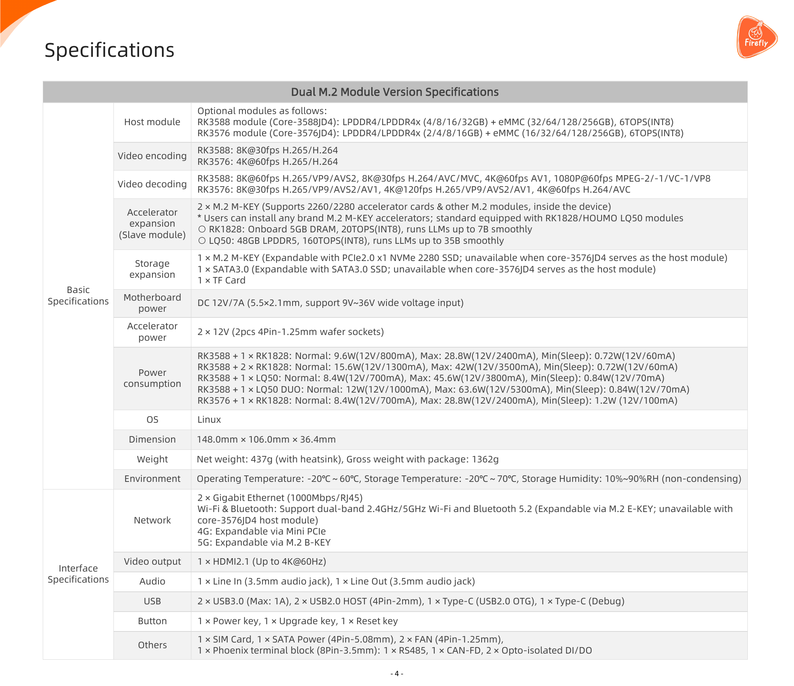

# 09 Rockchip SWOT与条件选型

截至2026-11-05。本章把技术、产品成熟度、采购、维护及区域服务条件合在一起判断。可确认的是公开平台路径、部分厂商性能表、整机展牌和渠道条款；尚不能确认机器人芯片市场份额、完整机器人业务收入、真实本体ROI或同条件平台性价比排名。

## 1. 市场证据、财报定位与统计分母

本次从官网投资者目录源码定位公开财报API，第一页列2026-10-27第三季度报告、2026-08-18半年度报告、2026-04-15年度摘要；第二页列2025年年度报告等，URL指向上交所。这些API原响应已归档，能核实报告名称、发布日期和官方定位关系，不能替代报告财务正文。三份上交所原件请求返回脚本浏览器校验页，已拒收并标为failed；没有绕过校验，也未引用其中收入、利润、研发费用或行业描述。[RK09_FinancialAPI](https://www.rock-chips.com/plus/tzzgxApi.php?type=1&page=1)（[本地原件](REFERENCES.md#ref-2abd85c3f5bf0490)) [RK09_FinancialAPI2](https://www.rock-chips.com/plus/tzzgxApi.php?type=1&page=2)（[本地原件](REFERENCES.md#ref-4d1d7d9329074bce))

因此“公司整体增长→机器人业务增长”的归因在此没有财务支持。即使后来取得公司总收入，也需要分清芯片/其他产品、终端类别、收入与出货数量，不能按具身概念名单反推比例。市场份额还要有地区、时间、机器人品类、芯片/计算节点分母及抽样方法。当前没有可靠独立分母，不给份额或全球排名。财报未取得属于访问/采集缺口，不等于公司未披露。

公开产品覆盖视觉、控制与语言协处理器，合作形态包括消费本体、工业节点和多卡服务器，说明可选系统形态较多；它不能证明各形态都达到量产或同等软件成熟度。市场机会应按“任务有端侧需求→平台依赖可满足→谁承担交付→客户实测合格”逐项成立，而不是按伙伴总数判断。

## 2. 商业案例按成熟度分别读取

| 案例 | 对象/芯片证据 | 公开状态 | 可支持结论 | 缺口 |
| --- | --- | --- | --- | --- |
| 优必选悟空AlphaMini2 | 2026-08活动展牌RK3566 | 芯片厂商展示 | 特定展示型号绑定 | OEM BOM、量产批次、成功率 |
| 卧安KATA Friends | 展牌RK3576 | 芯片厂商展示 | 消费交互本体存在对应关系 | 发货量、在岗时数、收益 |
| π0.5机械臂方案 | RK3588+RK1828、厂商称超过5FPS | 展会演示/应用探索 | 端侧VLA路线已展示 | 模型配置、真实成功、人工介入 |
| 亿次网联本地办公智能体 | 厂商称RK1828、部分省份部署 | 厂商部署宣称 | 非机器人本地AI商业路线 | 客户/地点、台数、合同、成本 |
| 双/四卡节点 | Firefly、飞凌、万物纵横 | 产品/方案展示 | 形态及分段扩展路径 | 客户验收、运维、同条件能耗 |

原文和官方图证据见[Rockchip_Robotics_2026](https://www.rock-chips.com/a/cn/news/rockchip/2026/0827/2177.html)（[本地原件](REFERENCES.md#ref-7e32246384c451c6))、[Rockchip_Multicard_2026](https://www.rock-chips.com/a/cn/news/rockchip/2026/0922/2181.html)（[本地原件](REFERENCES.md#ref-ed5b70feb4b4688c))。AlphaMini2展牌绑定不向其他悟空代际推广；办公部署也不作为机器人在岗证明。松延轻量化人形与Lumistar TERO PRO报道缺精确芯片/部分型号关系，不补齐BOM。本文没有把展示数量当订单数。

厂商称办公方案可接私有网盘/OA、数据留在本地，这一机制可能减少网络依赖与远端数据传输。但“部分省份部署”没有客户名单、合同或使用时长，不能计算收入贡献。对于机器人本体，应补任务尝试总数、成功定义、人工介入、环境分布、失败后果与暴露小时，再评价芯片更换是否带来收益。换代产品采用新计算节点也不能继承旧产品累计业务成绩。

TerraMow整机官网可作为消费机器人服务模式对照：页面提供视觉割草产品、有限保修与地区服务入口。本研究未在该官网核到Rockchip准确芯片BOM，因此不将其型号价格、三年保修或销量归因到Rockchip芯片。该对照仅说明整机消费者购买的是任务和售后，板卡保修与整机价值不能混为一项。[RK06_TerraMow](https://www.terramow.com/)（[本地原件](REFERENCES.md#ref-de832c3be654cf1e))

## 3. S/W：事实到机制，再到选型动作

**优势一：采集、多媒体与计算可组合。** ISP、MPP/RGA和RKNN路径适合有明确输入格式的视觉任务；若外设驱动、IQ、buffer和模型已绑定，可能减少CPU处理和自研硬件环节。失效条件是相机换型、格式转换/复制过多或并发带宽超限。选型动作是用目标相机和录像/NPU同时运行测观测年龄、丢帧与功率，而不是从ISP最高路数推并发系统能力。[RK03_Camera](https://community.t-firefly.com/en/docs/products/motherboard/AIO-3588JD4/usage-camera)（[本地原件](REFERENCES.md#ref-81b7d314c2c67105)) [RK02_MPP_Readme](https://raw.githubusercontent.com/rockchip-linux/mpp/develop/readme.txt)（[本地原件](REFERENCES.md#ref-f7d16c51152e1c0a)) [RK02_RGA_Guide](https://raw.githubusercontent.com/airockchip/librga/main/docs/Rockchip_Developer_Guide_RGA_CN.md)（[本地原件](REFERENCES.md#ref-b175c5e9893e4e95))

**优势二：可选主控加协处理器与多卡。** RK182X内存、RKNN3压缩和分段让较大语言模型在端侧有实际路线；若模型受支持、量化精度合格且传输/排队受控，离线部署可降低云依赖。失效条件是未支持算子、上下文膨胀或stage不均衡。选型动作是测各段容量、冷启动/长prefill/P99，明确超过任务延迟时的替代后端。[RK02_02_RKNN3_SDK_Development_Guide_V1.2.0](https://raw.githubusercontent.com/airockchip/rknn3-toolkit/main/doc/EN/02_RKNN3_SDK_Development_Guide_V1.2.0.pdf)（[本地原件](REFERENCES.md#ref-9d498a30029e5731))

**优势三：板商与本地集成服务入口。** 可取得模块/载板资料、BSP/产线工具与定制服务，利于已有Arm/Linux团队开展产品工程。优势成立于确实拿到可复建SDK、支持合同和量产版本；十年服务宣传、零售现货入口不能代替逐料号承诺。动作是采购前确认PCN/EOL、硬件revision、漏洞更新、产测和备件责任。[Firefly_Home](https://www.t-firefly.com/)（[本地原件](REFERENCES.md#ref-83a9114dc31de7d6)) [RK02_RK182X_Started](https://community.t-firefly.com/en/docs/products/accessories/RK182x/started)（[本地原件](REFERENCES.md#ref-a2dd36cd401ab3f5)) [RK07_Production](https://community.t-firefly.com/en/docs/tools/production-tool/Device-Info-Write-Tool/rkdev-info-write-tool)（[本地原件](REFERENCES.md#ref-230c6d1aec7a9d70))

**短板一：研究灵活性和成熟度跨栈不同。** RKNN2、RKLLM、RKNN3各有目标和格式，编译产物依赖图与版本；GPU作者策略的动态图、训练和未支持算子不自动映射NPU。后果是模型快速迭代时转换/校准成本可能超过节点差价。动作是保留浮点源模型、权重/数据和替代执行后端，先确认关键算子/任务精度，再扩展本体集成。[RK02_RKNN2_Readme](https://raw.githubusercontent.com/airockchip/rknn-toolkit2/master/README.md)（[本地原件](REFERENCES.md#ref-15f0b493e9150c73)) [RK02_RKLLM_Readme](https://raw.githubusercontent.com/airockchip/rknn-llm/main/README.md)（[本地原件](REFERENCES.md#ref-5b6e59180a191ea7)) [RK04_OpenpiReadme](https://raw.githubusercontent.com/Physical-Intelligence/openpi/main/README.md)（[本地原件](REFERENCES.md#ref-93ae0cec36eeb1cd))

**短板二：闭环、安全与运维证据尚不足。** 厂商模型FPS不是控制频率，RT/AMP/总线文档不是完整危险响应；Secure Boot示例不支持rollback-index。后果是工业/高风险本体仍需独立保护与项目验证。动作是采购本体控制器/安全部件并落实断连、过期动作、重启和升级失败后的停机方案，不能仅以AI节点可启动放行。[RK02_SecureBoot](https://community.t-firefly.com/en/docs/software/other/SecureBoot/secureboot-overview)（[本地原件](REFERENCES.md#ref-6a0f17927bb8ae3c)) [RK02_AMP_Prereq](https://community.t-firefly.com/en/docs/software/industry-robot/AMP/amp-prerequisites)（[本地原件](REFERENCES.md#ref-7859770da31383a7)) [RK02_EtherCAT_Preparation](https://community.t-firefly.com/en/docs/software/industry-robot/EtherCAT/ethercat-preparation)（[本地原件](REFERENCES.md#ref-8c42f6b3ba4f0541))

## 4. O/T：明确情景，不把预测写成事实

机会情景包括断网交互、私有巡检数据、固定视觉质检与成本敏感消费本体。端侧若能保留任务质量并减少传输/远端费用，商业价值可能成立；前提是集成/维护成本没有抵消节省，且应用许可和数据处理合法。模型压缩、传感器和本地Agent生态增加候选路线，但不构成确定市场规模。RK1860在2026-09报道为计划，不列作当前可交付方案或采购替代。[Rockchip_Multicard_2026](https://www.rock-chips.com/a/cn/news/rockchip/2026/0922/2181.html)（[本地原件](REFERENCES.md#ref-ed5b70feb4b4688c))

威胁情景一是模型结构更新快于目标算子/BSP维护；二是低功耗竞品改善同类任务，压缩硬件差价；三是长上下文/视觉历史与主控并发使现有容量、链路、散热不足；四是供应改版与第三方依赖导致重新验证。应对是把任务验收、软件可复建、替代节点与供应合同纳入选型。没有同条件测量不能宣称Rockchip必然更便宜、更省电或迁移一定容易。

Arm IP、DDR、编译器/runtime二进制与GRQ的GPU/CUDA依赖说明“本土芯片品牌”不等于所有IP、制造与工具链完全独立。SDK、代码、模型权重/数据和本体资产许可应拆开；本次未取得逐SKU制造来源或完整国产化率，不给数字。[Rockchip_RK3588](https://www.rock-chips.com/a/en/products/RK35_Series/2022/0926/1660.html)（[本地原件](REFERENCES.md#ref-84d8ab12b1d2bf18)) [RK02_RKNN3_License](https://raw.githubusercontent.com/airockchip/rknn3-toolkit/main/LICENSE)（[本地原件](REFERENCES.md#ref-e0d48d173b53dd02)) [RK02_02_RKNN3_SDK_Development_Guide_V1.2.0](https://raw.githubusercontent.com/airockchip/rknn3-toolkit/main/doc/EN/02_RKNN3_SDK_Development_Guide_V1.2.0.pdf)（[本地原件](REFERENCES.md#ref-9d498a30029e5731))

## 5. 采购与透明TCO

Firefly商城默认RK182X套件页面为959美元，对应RK3588S 8G+64G与RK1820选项；不是双RK1828机型正式报价。页面尚未结算，数量、地区、税费与库存未全部确定。Shipping条款把备货3—7工作日与运输参考时间分开，关税/税费由客户承担，最终以结算为准。退换30自然日与不含配件12个月保修也不是现场运维SLA。[Firefly_RK182X_Kit](https://www.t-firefly.com/products/rk182x-3d-ram-stacking-development-kit)（[本地原件](REFERENCES.md#ref-65277f38349d0425)) [RK07_Shipping](https://www.t-firefly.com/policies/shipping-policy)（[本地原件](REFERENCES.md#ref-1866e9dc795fc4b2)) [RK07_Return](https://www.t-firefly.com/policies/refund-policy)（[本地原件](REFERENCES.md#ref-df1fb186f7396920))

官方套件PDF第4页完整规格表已打开，用于说明硬件配置与功耗条件。RK3588+单RK1828 Max28.8W、双RK1828 Max42W为板商整板宣称，缺负载/环境/统计口径；不作为单芯TDP或全年平均功率。散热、电源、存储与载板已经是系统成本的一部分，模组价不能替代完整机器人BOM。[Firefly_RK182X_Kit_PDF](https://download.t-firefly.com/Spec/Suite/RK182X-Development-Kit_Specifications_EN.pdf)（[本地原件](REFERENCES.md#ref-9d86adab08bd1a92))

分析TCO模型以同币种、同年份、不含融资折现为假设：

TCO = N×(C节点+C传感器+C电源散热+C存储载板+C集成装配+C许可) + C一次研发验证 + C产线认证 + Y×C年软件维护 + N×Y×C年备件现场 + N×Y×H×P/1000×E + C网络云服务 + C停机。

N为部署台数，Y为年数，H为每台每年工作小时，P为实测平均系统功率(W)，E为电价(币种/kWh)，其余C均为对应货币成本；停机项需暴露时间、事件次数与业务损失，不能任意填一个比例。研发验证包含模型转换、留出集、BSP、并发/热/失效、升级和本体适配。许可/云项随方案而变，零SDK费用也不等于零维护费用。

假设H=4000h/年、Y=3年、两候选平均系统功率差10W，则每台能量差120kWh；只有在同任务负载/成功率下实测得到这10W并有电价后才能计算费用。该例不是用板商Max功耗推节能。若单节点价格便宜ΔC，最多只能说固定采购差NΔC，再与额外转换/验证/维护比较；没有任务产出和人工介入不能算ROI或回本月数。

## 6. 区域政策与数据服务

已取得《生成式人工智能服务管理暂行办法》官方原文，公布于2023-07-13，2023-08-15施行。第二条针对向中国境内公众提供生成内容服务，并明确未向境内公众提供服务的机构研发/应用不适用本办法；第七条涉及训练数据合法来源与个人信息，第十一条涉及输入/记录保护，第十七条针对具有舆论属性或社会动员能力服务的评估/备案。不能把任意工厂离线识别都归为同一公众服务，也不能据不适用本办法推断免除其他法律。[RK09_GenAI](https://www.cac.gov.cn/2023-07/13/c_1690898327029107.htm)（[本地原件](REFERENCES.md#ref-4d0c17a97aa7b944))

本地执行可能减少数据外传，但相机/音频采集、日志、远程支持和模型微调仍会处理数据。分析动作是按实际地区、公众服务与否、用途、数据类型和流向审核；传感器录制和OTA/遥测即使不走大模型云接口，也需明确维护责任。个人信息保护法候选原页请求404，本文未把该失败候选当法律正文；政策检索是本次有限范围，不声称已覆盖截至2026年全部新增规则或所有出海辖区。

本次没有取得能准确映射RK182X/RK3588具体采购与最终用途的出口许可判定，不写“国产平台完全无出口风险”，也不将数据中心GPU限制套到所有端侧芯片。采购与产品上线需要当期地区、SKU、用途和软件服务责任的正式确认，政策情景不作为性能排名理由。

## 7. 条件选型矩阵

| 场景 | 候选路线 | 适用前提 | 主要放行证据 | 当前结论 |
| --- | --- | --- | --- | --- |
| 模型/策略科研 | 外部GPU训练+RK部署验证 | 关键图可导出、允许分阶段研究 | 浮点复现、转换误差、源码/权重 | 可验证候选，不替代作者训练机 |
| 灵巧操作/VLA | RK3588+RK1828 | 指定策略/动作chunk满足本体要求 | 多相机年龄、P99、真实成功、失效 | 厂商demo支持路线，量产待证 |
| 物流AMR | 视觉主控+独立控制器 | 地图/时间/驱动/底盘合同明确 | 障碍/断连/旧地图、急停、运营 | 不由ROS/LiDAR例推出导航验收 |
| 固定视觉 | RKNN2 SoC或必要RK182X | 任务与阈值明确、吞吐精度达标 | 真实缺陷留出、并发/丢帧/热 | 较直接的受限任务验证路线 |
| 消费陪伴 | 视觉/语言SoC按任务选 | 成本/电池/隐私/OTA可满足 | 交互体验、噪声、续航、退换 | 展牌存在，整机收益未确认 |
| 工业边缘 | 工业模组/载板、RT/AMP/IgH | revision、资源、环境与供应明确 | 温度/电磁/重启、产测、PCN | 工业名称不足以免验证 |
| 安全关键 | 独立安全控制及AI辅助 | AI失效不破坏保护路径 | 正式风险评估、认证/危险响应 | 不能以公开AI文档独立放行 |

最后的选型顺序是任务契约、接口/模型可复建、目标设备并发与热稳定、真实闭环及故障、量产供应维护。若前一项失败，应回到模型/节点/控制设计调整；不靠添加参数或引述峰值越过验收。当前报告支持组织选型和向供应方索取具体证据，尚不支持确定采购ROI、全面替代GPU或未经项目验证的机器人量产安全结论。

## 参考资料与本地原文

采集时间逐项列出；移动分支及无版本网页仅代表此次快照。HTML 保留正文与可取得静态依赖，动态交互、视频及缺失依赖不保证完整。未进行目标板安装或实机性能验证。

| 来源 | 原 URL | 本地原件 | 采集 UTC | 归档状态 |
| --- | --- | --- | --- | --- |
| RK09_FinancialAPI | [原文](https://www.rock-chips.com/plus/tzzgxApi.php?type=1&page=1) | [归档](REFERENCES.md#ref-2abd85c3f5bf0490) | 2026-11-04T17:26:16.740903+00:00 | complete_static；缺失依赖 0 |
| RK09_FinancialAPI2 | [原文](https://www.rock-chips.com/plus/tzzgxApi.php?type=1&page=2) | [归档](REFERENCES.md#ref-4d1d7d9329074bce) | 2026-11-04T17:26:49.737346+00:00 | complete_static；缺失依赖 0 |
| Rockchip_Robotics_2026 | [原文](https://www.rock-chips.com/a/cn/news/rockchip/2026/0827/2177.html) | [归档](REFERENCES.md#ref-7e32246384c451c6) | 2026-11-04T17:02:24.334402+00:00 | partial_static；缺失依赖 4 |
| Rockchip_Multicard_2026 | [原文](https://www.rock-chips.com/a/cn/news/rockchip/2026/0922/2181.html) | [归档](REFERENCES.md#ref-ed5b70feb4b4688c) | 2026-11-04T15:46:57.771231+00:00 | partial_static；缺失依赖 3 |
| RK06_TerraMow | [原文](https://www.terramow.com/) | [归档](REFERENCES.md#ref-de832c3be654cf1e) | 2026-11-04T17:06:39.605391+00:00 | partial_static；缺失依赖 66 |
| RK03_Camera | [原文](https://community.t-firefly.com/en/docs/products/motherboard/AIO-3588JD4/usage-camera) | [归档](REFERENCES.md#ref-81b7d314c2c67105) | 2026-11-04T16:47:41.719928+00:00 | partial_static；缺失依赖 2 |
| RK02_MPP_Readme | [原文](https://raw.githubusercontent.com/rockchip-linux/mpp/develop/readme.txt) | [归档](REFERENCES.md#ref-f7d16c51152e1c0a) | 2026-11-04T16:09:42.183440+00:00 | complete_static；缺失依赖 0 |
| RK02_RGA_Guide | [原文](https://raw.githubusercontent.com/airockchip/librga/main/docs/Rockchip_Developer_Guide_RGA_CN.md) | [归档](REFERENCES.md#ref-b175c5e9893e4e95) | 2026-11-04T16:10:46.889750+00:00 | complete_static；缺失依赖 0 |
| RK02_02_RKNN3_SDK_Development_Guide_V1.2.0 | [原文](https://raw.githubusercontent.com/airockchip/rknn3-toolkit/main/doc/EN/02_RKNN3_SDK_Development_Guide_V1.2.0.pdf) | [归档](REFERENCES.md#ref-9d498a30029e5731) | 2026-11-04T16:32:54.533544+00:00 | complete_static；缺失依赖 0 |
| Firefly_Home | [原文](https://www.t-firefly.com/) | [归档](REFERENCES.md#ref-83a9114dc31de7d6) | 2026-11-04T15:44:28.681706+00:00 | partial_static；缺失依赖 5 |
| RK02_RK182X_Started | [原文](https://community.t-firefly.com/en/docs/products/accessories/RK182x/started) | [归档](REFERENCES.md#ref-a2dd36cd401ab3f5) | 2026-11-04T16:31:04.987368+00:00 | partial_static；缺失依赖 2 |
| RK07_Production | [原文](https://community.t-firefly.com/en/docs/tools/production-tool/Device-Info-Write-Tool/rkdev-info-write-tool) | [归档](REFERENCES.md#ref-230c6d1aec7a9d70) | 2026-11-04T17:13:13.121860+00:00 | partial_static；缺失依赖 2 |
| RK02_RKNN2_Readme | [原文](https://raw.githubusercontent.com/airockchip/rknn-toolkit2/master/README.md) | [归档](REFERENCES.md#ref-15f0b493e9150c73) | 2026-11-04T16:10:04.951084+00:00 | complete_static；缺失依赖 0 |
| RK02_RKLLM_Readme | [原文](https://raw.githubusercontent.com/airockchip/rknn-llm/main/README.md) | [归档](REFERENCES.md#ref-5b6e59180a191ea7) | 2026-11-04T16:10:05.951168+00:00 | complete_static；缺失依赖 0 |
| RK04_OpenpiReadme | [原文](https://raw.githubusercontent.com/Physical-Intelligence/openpi/main/README.md) | [归档](REFERENCES.md#ref-93ae0cec36eeb1cd) | 2026-11-04T16:52:30.266425+00:00 | complete_static；缺失依赖 0 |
| RK02_SecureBoot | [原文](https://community.t-firefly.com/en/docs/software/other/SecureBoot/secureboot-overview) | [归档](REFERENCES.md#ref-6a0f17927bb8ae3c) | 2026-11-04T16:37:50.466010+00:00 | partial_static；缺失依赖 2 |
| RK02_AMP_Prereq | [原文](https://community.t-firefly.com/en/docs/software/industry-robot/AMP/amp-prerequisites) | [归档](REFERENCES.md#ref-7859770da31383a7) | 2026-11-04T16:41:47.418007+00:00 | partial_static；缺失依赖 2 |
| RK02_EtherCAT_Preparation | [原文](https://community.t-firefly.com/en/docs/software/industry-robot/EtherCAT/ethercat-preparation) | [归档](REFERENCES.md#ref-8c42f6b3ba4f0541) | 2026-11-04T16:40:27.995472+00:00 | partial_static；缺失依赖 2 |
| Rockchip_RK3588 | [原文](https://www.rock-chips.com/a/en/products/RK35_Series/2022/0926/1660.html) | [归档](REFERENCES.md#ref-84d8ab12b1d2bf18) | 2026-11-04T15:43:28.467780+00:00 | partial_static；缺失依赖 2 |
| RK02_RKNN3_License | [原文](https://raw.githubusercontent.com/airockchip/rknn3-toolkit/main/LICENSE) | [归档](REFERENCES.md#ref-e0d48d173b53dd02) | 2026-11-04T16:32:45.776051+00:00 | complete_static；缺失依赖 0 |
| Firefly_RK182X_Kit | [原文](https://www.t-firefly.com/products/rk182x-3d-ram-stacking-development-kit) | [归档](REFERENCES.md#ref-65277f38349d0425) | 2026-11-04T15:47:24.951450+00:00 | partial_static；缺失依赖 5 |
| RK07_Shipping | [原文](https://www.t-firefly.com/policies/shipping-policy) | [归档](REFERENCES.md#ref-1866e9dc795fc4b2) | 2026-11-04T17:13:15.323022+00:00 | partial_static；缺失依赖 4 |
| RK07_Return | [原文](https://www.t-firefly.com/policies/refund-policy) | [归档](REFERENCES.md#ref-df1fb186f7396920) | 2026-11-04T17:13:18.332744+00:00 | partial_static；缺失依赖 4 |
| Firefly_RK182X_Kit_PDF | [原文](https://download.t-firefly.com/Spec/Suite/RK182X-Development-Kit_Specifications_EN.pdf) | [归档](REFERENCES.md#ref-9d86adab08bd1a92) | 2026-11-04T15:50:00.874477+00:00 | complete_static；缺失依赖 0 |
| RK09_GenAI | [原文](https://www.cac.gov.cn/2023-07/13/c_1690898327029107.htm) | [归档](REFERENCES.md#ref-4d0c17a97aa7b944) | 2026-11-04T17:24:35.240286+00:00 | complete_static；缺失依赖 2 |

[证据记录](research_state/evidence/09_SWOT_Analysis.json)；[本章开始前哈希基线](research_state/baselines/09_SWOT_Analysis_before.json)。检查和去重记录由专题索引汇总。
