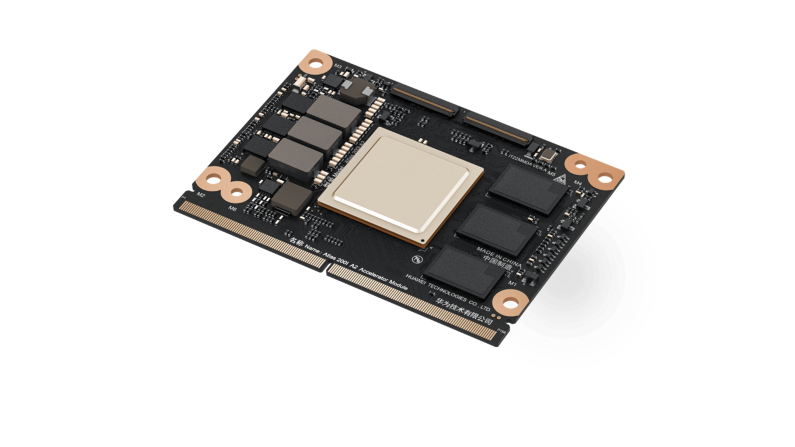
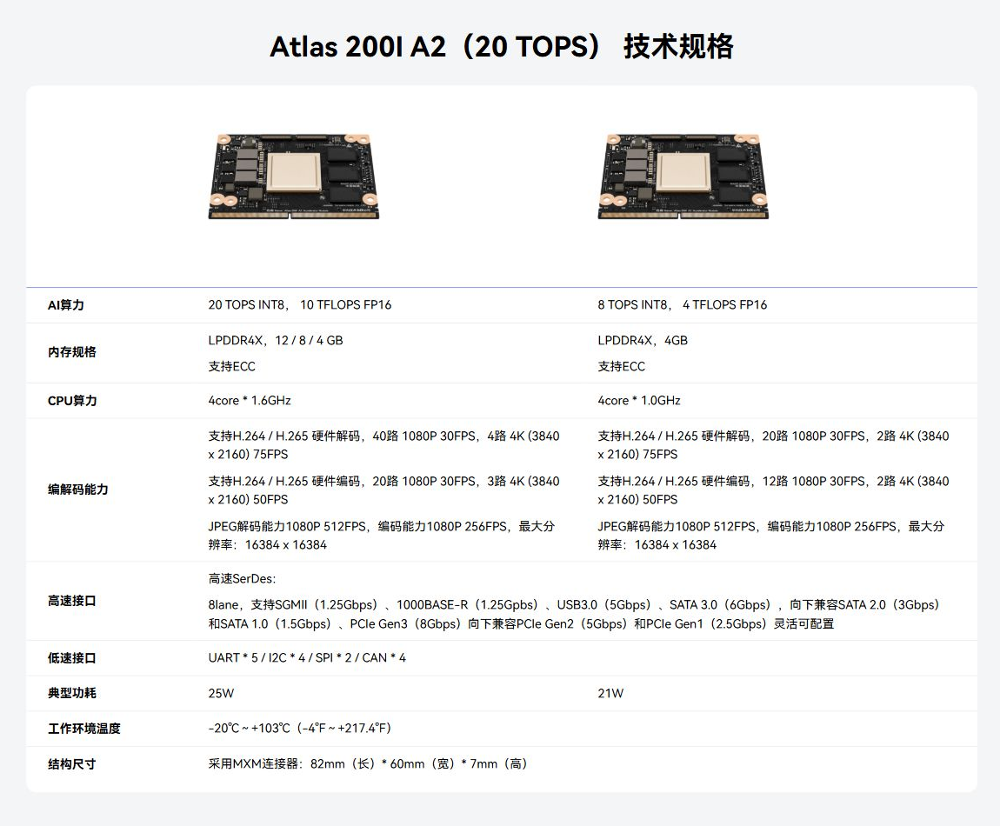
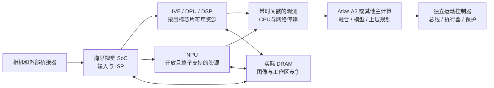

# Huawei / HiSilicon 具身智能硬件平台：端侧计算、视觉前端与工程选型

调研截止：2026-11-05（Asia/Shanghai）｜版本：第 01 章深度样章，待用户审阅｜方法：官方公开文献核验，未开展硬件或机器人实测。

## 1. 选型结论与平台边界

**当前取得的官方证据支持两条不同的端侧路线：Atlas 200I A2 提供可集成的 AI 加速模块；海思视觉 SoC 提供从相机输入、ISP、专用视觉处理到神经网络推理的单芯片组合。** 前者更接近机器人集中计算模块的采购对象，后者更适合相机、双目感知节点或资源受限的视觉终端。它们属于不同产品体系，硬件资源、SDK、交付形式及量产责任需要分别确认。不能因为目录合称 Huawei_HiSilicon，就把昇腾服务器的算力、CANN 软件能力或海思某一芯片的视觉引擎套用到整个目录。依据：[S1 Atlas 200I A2官方原文](https://www.hiascend.com/hardware/accelerator-module-A2)／[本地原件](REFERENCES.md#ref-ccbe37b98431c440)；[S8 机器视觉总览官方原文](https://www.hisilicon.com/cn/products/smart-vision/machine-vision)／[本地原件](REFERENCES.md#ref-da859a14df869329)；[S9 智慧视觉总览官方原文](https://www.hisilicon.com/cn/products/smart-vision)／[本地原件](REFERENCES.md#ref-54a700c24650a71a)。

本章逐款覆盖 A2 产品页的 20 TOPS、8 TOPS 两个规格列，以及 Hi3403V100、Hi3519AV200、Hi3519DV500、Hi3516DV500、Hi3516CV610 五款视觉 SoC；补充 Hi3559AV100 的存量架构差异，并以 Ascend 950PR / Atlas 350 说明服务器计算与机器人端侧的界线。上述产品均有本次取得的官方网页正文，但**官网在列不等于现货、量产认证或长期供货承诺**；“主力候选”指本文按任务需求选出的比较范围，不代表已核验市场销量排名。华为云、全部昇腾训练集群、手机 SoC、所有 MCU/无线芯片不在本章逐型号比较范围；独立运动控制器作为系统分工保留，不凭导航目录填入未验证的芯片规格。

三个判断先于 TOPS 排序：第一，客户模型能使用多少开放计算资源；第二，实际板卡有多少可用内存及其持续带宽；第三，视频、AI、CPU 和接口并发时是否满足热设计及观测时延预算。Hi3519AV200 的 8.1 TOPS 中仅 2.5 TOPS 开放，Hi3516CV610 的 1Gb 内存只有 128MB；这两项约束比单一宣传数字更直接决定模型可部署范围。A2 的 20 TOPS 也不能自动推出 VLA 的调用频率、运动控制频率或机器人任务成功率。本章的推荐均为工程分析，尚需目标模型和本体上的验证。

材料编号 S1—S13 对应文末清单。正文来源链接同时指向在线原文和本地可读原件；原始响应、采集时点及 SHA256 保存在同目录 metadata 和本章证据记录中。无明确发布时间的产品页按“本次快照”使用，不把抓取日期当发布日期。

## 2. 产品层级与采购对象

| 层级 | 本章对象 | 已核实形态 | 需另行确认的交付物 | 对机器人选型的含义 |
|---|---|---|---|---|
| 芯片 / SoC | 六款海思视觉芯片 | QFN / FCCSP / FC-BGA 芯片；具体尺寸见后表 | DRAM、存储、PMIC、PHY、PCB、散热、BSP、传感器驱动 | 芯片能力需要完整板级设计才能变成机器人可用功能 |
| 集成模块 | Atlas 200I A2 两规格列，S1 | MXM，82×60×7mm，集成 CPU、AI、编解码、ISP、图形输出 | 准确订货料号、容量组合、载板、供电和热设计、系统存储 | 可按模块集成；不把模块等同完整开发套件 |
| 开发套件 / 载板 | Atlas 200I DK A2 等检索线索 | 本轮未取得可作为有效证据的完整硬件手册 | 板号、模块料号、原理图、接口复用、散热和配套镜像 | 本章不填写未经有效归档的插座数量、板级电压或价格 |
| PCIe 标卡 | Atlas 350，S11 | 服务器内扩高、全长、双宽卡 | 兼容服务器、机箱风道、供电、驱动、主机内存 | 属服务器推理侧；不作为机器人端侧模块替换件 |
| 工业整机 | Atlas 500 Pro 等目录线索 | 本轮候选页面正文对象未匹配目标型号 | 精确机型、工业认证、环境温度、整机 BOM | 不凭导航标题或跳转地址推定整机规格 |

产品层级来自各型号官方页；开发板和整机证据缺口来自本次检索与正文核验，详见第 10 节。海思芯片的“最大 8GB / 4GB”是外部内存控制器容量上限，不是购买裸芯片即包含相应 DRAM；eMMC 接口支持 2TB 同样不是板上已经安装 2TB。A2 则在模块产品页直接给出 LPDDR4X 容量选项，采购仍应把规格列落实到可订货料号和硬件版本。

## 3. Atlas 200I A2：模块计算、视频与接口

### 3.1 两个规格列的可核验差异

下表严格保留 S1 的两列关系。页面标题包含“20 TOPS”，表内同时提供 8 TOPS 列；本章用性能列标识，**不编造两列的芯片后缀、准确订货型号或 12/8/4GB 与料号的一一映射**。dense / sparse、AI 核频率、CPU 微架构、制造节点和内存总线宽度均未在该有效来源中给出。依据：[S1 Atlas 200I A2官方原文](https://www.hiascend.com/hardware/accelerator-module-A2)／[本地原件](REFERENCES.md#ref-ccbe37b98431c440)，技术规格表。

| 项目 | A2：20 TOPS 规格列 | A2：8 TOPS 规格列 | 口径与限制 |
|---|---|---|---|
| AI 算力 | 20 TOPS INT8；10 TFLOPS FP16 | 8 TOPS INT8；4 TFLOPS FP16 | 厂商规格；未注明稠密/稀疏及模型测试条件 |
| CPU | 4 核×1.6GHz | 4 核×1.0GHz | 不据此猜测 Cortex 型号或控制任务 WCET |
| 内存 | LPDDR4X 12 / 8 / 4GB，ECC | LPDDR4X 4GB，ECC | 具体容量 SKU 待确认；带宽未取得 |
| H.264/H.265 解码 | 40×1080p30；4×4K75 | 20×1080p30；2×4K75 | 不同分辨率能力条目，不能相加或当模型识别帧率 |
| H.264/H.265 编码 | 20×1080p30；3×4K50 | 12×1080p30；2×4K50 | 不据此宣称编解码和 AI 全链路并发上限 |
| JPEG | 解码 1080p512fps，编码 1080p256fps | 同左 | 最大分辨率 16384×16384；最大尺寸不等于此帧率 |
| 典型功耗 | 25W | 21W | 模块产品规格，未给具体工作负载或最大功耗 |
| 形态 | MXM，82×60×7mm | 同左 | 不等于载板尺寸或完整整机高度 |

图 1：S1 官方模块外观资产，原件复制，未重绘。图片仅支持模块形态的直观理解；官网明确“图片仅供参考，具体硬件产品形态以实物为准”，不能凭照片认定 DRAM 容量、引脚分配或热传导结构。原图和哈希记录在本章证据 JSON。

图 2：将已归档 S1 HTML 在本地浏览器渲染后裁取的官方规格表，保留标题、两列和全部参数行。它同时呈现 20/8 TOPS、功耗与温度原文，支持审核两规格列的对应关系；这是网页参数截图，不能代替正式电气或热设计手册。截图未补齐官网未提供的条件。

### 3.2 高速通道与控制接口的真实边界

S1 给出 8-lane 高速 SerDes，可配置 SGMII 1.25Gbps、1000BASE-R 1.25Gbps、USB 3.0 5Gbps、SATA 3.0 6Gbps、PCIe Gen3 8Gbps，并兼容列出的低代接口；低速接口为 5×UART、4×I²C、2×SPI、4×CAN。**8 lane 是可配置通道池，不是八组全功能接口各自独立同时满速运行。** PCIe 的 8Gbps 是页面的链路速率条目，不能直接等同应用吞吐，也不能自动认定载板可用 x8。页面还列出 MIPI、音频和图形输出能力，但未取得足够有效手册确认其逐项 lane、复用、时钟和电气约束。

CAN 控制器到关节执行器之间仍需板级收发器、供电、隔离及连接器；以太网信号到机器人网络仍需核实 PHY、参考时钟和接线方式。外部相机解串器、PCIe 桥接、NVMe 以及无线模块都会改变供电、散热和布局。不得从“具有 CAN / 以太网”推出原生 EtherCAT 主站、TSN、CAN FD、同步触发或功能安全认证；本轮有效 A2 页没有给出这些保证。

分析上，20 TOPS 列的峰值是 8 TOPS 列的 2.5 倍，典型功耗仅为 25/21≈1.19 倍，但两列缺少同条件模型与功率测试，**不能据此给出 2.1 倍实测能效提升**。内存从 4GB 增到 12GB 能扩大模型、图像队列和地图的容纳空间，却不能证明更高内存带宽或更低生成时延。若任务瓶颈在 CPU 预处理、算子回退或数据搬移，NPU 峰值比例可能无法转化为闭环性能。

### 3.3 温度、供电与持续运行

S1 原文将“−20℃～+103℃”列为“工作环境温度”。本章完整保留该信息，但**不将其作为已经完成交叉验证的环境温度规格**：它没有说明传感点、散热条件、降频曲线和最大负载，所尝试的版本化热文档归档为 WAF 挑战页，无法补足核验链。不能擅自将 103℃改写为芯片结温，也不能承诺整机可以在 103℃环境下工作。

25W / 21W 是典型模块条目，不能用作输入电源的唯一额定值或电池续航预算。工程上应取得最大持续与瞬态功率、各电源轨、电压容差、上电时序、冷却接触要求、环境/芯片/散热板测点，以及并发负载下的降频阈值。把载板、电源转换、存储、PHY、相机、无线和风扇的耗电加到整机预算后，再进行最差环境下的持续运行测量；本轮没有这些实测数据。

## 4. 海思视觉 SoC：开放计算资源与专用引擎

### 4.1 CPU、NPU、DSP 与内存配置

海思的优势候选来自专用视觉处理和系统集成：ISP 改善输入图像，IVE / DSP 支持传统视觉，DPU 处理双目深度，NPU 执行神经网络；这些资源不能简单相加为一个通用模型的计算池。下表只记录有效官方页；所有 TOPS 均为厂商规格或宣传上限，相关页面没有给出稠密/稀疏、完整频率/功率条件与模型基准，故不作跨平台速度排名。来源：[S2 Hi3403V100官方原文](https://www.hisilicon.com/cn/products/smart-vision/machine-vision/hi3403v100)／[本地原件](REFERENCES.md#ref-c2d6971a30360f9c)；[S3 Hi3519AV200官方原文](https://www.hisilicon.com/cn/products/smart-vision/machine-vision/hi3519av200)／[本地原件](REFERENCES.md#ref-387e661a1427ecf6)；[S4 Hi3519DV500官方原文](https://www.hisilicon.com/cn/products/smart-vision/machine-vision/hi3519dv500)／[本地原件](REFERENCES.md#ref-fb9339639d9cd3da)；[S5 Hi3516DV500官方原文](https://www.hisilicon.com/cn/products/smart-vision/machine-vision/hi3516dv500)／[本地原件](REFERENCES.md#ref-ae8b7e0bde6a7d6d)；[S6 Hi3516CV610官方原文](https://www.hisilicon.com/cn/products/smart-vision/machine-vision/hi3516cv610)／[本地原件](REFERENCES.md#ref-7e91d964fbc23ad4)。

| 芯片 | CPU / 控制核 | 神经网络算力与格式 | 专用视觉资源 | 内存接口 / 容量 | 来源 |
|---|---|---|---|---|---|
| Hi3403V100 | 4×A55 1.4GHz；32bit MCU 500MHz | 10.4 TOPS INT8；15.2 TOPS INT4；双异构引擎 | 双 Vision Q6 DSP；双目、矩阵加速 | 64bit DDR4 / LPDDR4 / 4x，外接最高 8GB | S2 |
| Hi3519AV200 | 4×A55 1.4GHz；32bit MCU 500MHz | 总 8.1 TOPS INT8；2.5T 开放，5.6T HNR 未开放；支持 INT4/INT8/FP16 | 双 Vision Q6 DSP；双目、矩阵加速 | 多种 DDR4 / LPDDR4 / 4x 位宽方案，外接最高 8GB | S3 |
| Hi3519DV500 | 2×A55 1.0GHz | 2.5 TOPS INT8（产品亮点） | IVE 特征点/光流；DPU 双目深度；DMA | 32bit DDR4 / LPDDR4 / 4x，外接最高 4GB | S4 |
| Hi3516DV500 | 2×A55 850MHz | 2 TOPS INT8（产品亮点） | IVE 特征点/光流；DPU 双目深度；DMA | 32bit DDR4 / LPDDR4 / 4x，外接最高 4GB | S5 |
| Hi3516CV610 | 2×Cortex-A7 950MHz | 1 TOPS；位宽未注明；厂商称支持 Transformer 加速 | IVE2.5；AI ISP；未在有效页列出同类 DPU 规格 | 内置 1Gb DDR3/3L＝128MB；最高 2133Mbps | S6 |

**Hi3403V100 的 10.4 TOPS 不是一颗均质 NPU。** 关键特性明确：引擎 1 为 4.8 TOPS，支持 INT4 / INT8 / FP16；引擎 2 为 5.6 TOPS，支持 INT8 / INT16。4.8+5.6=10.4 解释 INT8 合计口径，但不说明单一网络可无条件同时占满两引擎。INT4 合计 15.2 是页面另列规格，不能把 INT8 的两个引擎都视为同等 INT4 引擎，也不为 FP16 补算峰值。简介写“最高 10 TOPS”，详细条目写 10.4；本文数值比较采用详细条目，同时保留宣传值的存在，不能将其误认成不同 SKU。

**Hi3519AV200 更需要按开放资源选型。** 其总 8.1 TOPS 包含为 HNR 使用且未开放的 5.6 TOPS；客户通用 AI 模型应以 2.5 TOPS 开放部分作为资源候选，不能按 8.1 TOPS 预算。分析计算：开放占比为 2.5/8.1≈30.9%，把总值全算可用会高估约 3.24 倍。HNR 的意义是改善成像链，可能有助于低照感知，但这种间接收益仍需机器人曝光、运动和任务精度验证，不能记作 VLA 的额外可用算力。页面列 INT4 / FP16 支持，不提供相应峰值；支持格式不等于所有模型算子、层融合和量化精度均适用。

Hi3519DV500 / Hi3516DV500 的 DPU 页面分别列出最大分辨率 2048×2048、最大视差 224、处理性能 720p30。**三项不能拼成“2048×2048、224 视差、30fps 同时成立”。** IVE 的特征点与光流也不是全套 VIO/SLAM 性能保证；标定、时间同步、IMU 融合、遮挡与纹理不足的处理仍需软件和系统验证。Hi3403V100 / Hi3519AV200 提供双目及矩阵引擎，但本轮有效页没有同样完整的双目测试条件，不能沿用 DV500 的数字。

### 4.2 Hi3516CV610：内存容量决定模型边界

S6 明确“内置 1Gb DDR3/3L”，单位 b 是 bit；按 8bit=1Byte 换算，容量为 128MB，而非 1GB。这是页面内置配置，不应与其余 SoC 外部 DRAM 最大容量混列。官方称支持 Transformer 特性加速、内置专属多模态大模型、端侧部署；有效页没有给出模型名称、参数量、量化位宽、上下文长度、工作区和时延，故只能作为厂商功能描述，不能认定能部署任意通用 VLM 或 7B VLA。

分析例子：一个假设 1 亿参数模型，即使全部权重仅用 INT8，也约需 100MB（十进制），还不含激活、runtime、系统、ISP/编码缓存和工作区。它与 128MB 物理内存已在同一数量级，因此“1 TOPS 可跑大模型”必须还原到具体压缩模型及内存占用。此计算只说明容量约束，不证明这类模型在该芯片可运行，也不宣称不能通过切分、压缩或流式方式运行任何模型。

CV610 典型编码组合为 3200×1800@30fps+1280×720@30fps，或 3840×2160@20fps+1280×720@20fps；最大编码尺寸 4K 不意味着 4K30。页面的“4MP30 每天仅需 5GB”和“压缩率提升 20%”没有给出场景运动、画质、码率控制和对照编码器完整条件，本章不将其作为机器人录像容量或网络预算。S6 列 Linux 5.10、OpenHarmony 4.1；开发文档条目的 2026-10-19 是资源更新日期，不是芯片发布日期。

## 5. DRAM、存储和并发数据路径

### 5.1 内存带宽可以推导什么

以下是**分析计算的接口理论上限**，公式 B（GB/s，十进制）＝数据位宽(bit)÷8×数据速率(Mbps)÷1000。这里 Mbps 已是数据传输率，不再额外乘 DDR 的 2；结果不是实测，也未扣除刷新、协议、仲裁和低效率访问。输入来自 S2—S5 的外部存储接口；“最大容量”仍需要实际 PCB 安装及验证。

| 芯片 / 内存方案 | 数据位宽 | 最高数据速率 | 理论接口上限 GB/s | 容量边界 / 未知 |
|---|---|---|---|---|
| Hi3403V100 LPDDR4/4x | 64bit | 3733Mbps | 29.864 | 外接最高 8GB；应用有效带宽未知 |
| Hi3403V100 DDR4 | 64bit | 3200Mbps | 25.600 | 同上；不能同时叠加两种方案带宽 |
| Hi3519AV200 LPDDR4/4x 或 DDR4 | 64bit | 2666Mbps | 21.328 | 外接最高 8GB |
| Hi3519AV200 DDR4 另一方案 | 48bit | 3200Mbps | 19.200 | 位宽减小后，速率提高仍不等于带宽更高 |
| Hi3519AV200 LPDDR4/4x 另一方案 | 32bit | 3733Mbps | 14.932 | 需核实颗粒、布线与 BSP 配置 |
| Hi3519DV500 DDR4 / LPDDR4 / 4x | 32bit | 2666Mbps | 10.664 | 外接最高 4GB |
| Hi3516DV500 DDR4 / LPDDR4 / 4x | 32bit | 2400Mbps | 9.600 | 外接最高 4GB |
| Hi3516CV610 / A2 | 未取得 | CV610 2133Mbps；A2 未取得 | 不计算 | 不凭容量或 CPU 频率反推带宽 |

带宽推导揭示一个选型机制：Hi3519AV200 的 48bit DDR4 3200Mbps 与 64bit 2666Mbps 方案不能只按“3200 大于 2666”排序；其理论接口带宽反而较低。NPU、ISP、编解码、CPU、DPU / DSP 访问同一外部存储系统时，实际吞吐还受控制器仲裁、缓存命中与缓冲分配影响。选择 8GB 颗粒不会自动提高总线宽度，也不能让双目、编码和模型各自独占表中带宽。

分析例子：4 路 1920×1080、30fps、8bit YUV420 非压缩图像流，单次图像载荷为 4×1920×1080×30×1.5≈0.373GB/s；每路保存 3 帧约占 9.33MB，四路合计约 37.3MB。这只包含一种像素格式的一次载荷或队列；ISP 中间图、不同尺寸、重复读写、模型张量、协议和缓存会继续增加需求。该计算不能证明某芯片能在 4 路输入、HNR、深度、模型及编码同时启用时达到 30fps。对 CV610，这种缓冲规模尤其需要与系统内存预算共同审核。

### 5.2 启动存储和系统磁盘

S2—S5 均列 eMMC 5.1 最大支持 2TB，但没有给出量产板已安装容量；Hi3403V100、Hi3519AV200 还列 NAND 和 PCIe 从片启动等选择，实际启动方式需与板级 strap、boot 配置、固件和安全启动流程配套。CV610 列 eMMC 4.5 的 4bit 数据位宽，SPI NOR 最大 32MB、SPI NAND 最大 512MB；这些是接口/容量边界，不能当作所有产品同时搭载的存储清单。

A2 有 SATA / PCIe 能力，但有效模块页没有提供足以确认其内置系统存储容量、NVMe 兼容清单及启动组合的资料。本章不把 DK 的存储或第三方载板 SSD 写成 A2 模块标配。机器人数据记录还应核实写入寿命、掉电保护、根文件系统恢复和模型双分区占用；容量足够并不保证长时连续录像和 OTA 的可靠性。

### 5.3 异构视觉节点到机器人计算的分工

下图为**基于 S1—S6 公开模块整理的分析示意，非官方架构图**；它表示一种可评估的系统分工，不代表已经打通的 SDK、零拷贝路径或产品级连接方案。DMA 和专用引擎的存在不能证明跨设备无复制。

这种分工可能减少主计算侧的视觉预处理负担，但优势成立需要接口吞吐、统一时间戳、标定、数据格式和端到端时延可控。若将图像先有损编码再跨以太网解码，网络负载可降低，代价可能是排队时延和图像细节改变；若传原始帧，带宽和跨设备复制成为重点。海思同片 DSP/MCU 与 Linux CPU 也有数据共享和调度关系，不能凭硬件核数证明任务隔离或硬实时。第 02 章将在用户审阅后核查具体软件链，本章不预先写成已验证的软件支持。

## 6. 相机、高速扩展与机器人控制接口

| 芯片 | 物理 sensor 输入 | 网络侧 | USB / PCIe | 低速外设与系统前提 | 来源 |
|---|---|---|---|---|---|
| Hi3403V100 | 8 lane；2×4 或 4×2；最高 4 路 | 2×千兆接口，RGMII/RMII | 2×USB3；PCIe2 x2，或 x1+USB3；RC/EP | UART/I²C/SPI/GPIO；MCU；外部 PHY 与引脚复用需确认 | S2 |
| Hi3519AV200 | 8 lane；2×4 或 4×2；最高 4 路 | 2×千兆接口，RGMII/RMII | 2×USB3；PCIe2 x2，或 x1+USB3；RC/EP | UART/I²C/SPI/GPIO；MCU；不能叠加所有共享高速配置 | S3 |
| Hi3519DV500 | 8 lane；2×4 或 4×2；最高 4 路 | 1×千兆接口，RGMII/RMII | 1×USB3 Host/Device；有效页未列 PCIe | UART/I²C/SPI/PWM/GPIO；2×SDIO3 | S4 |
| Hi3516DV500 | 4 lane；4 或 2×2；最高 2 路 | 1×千兆接口，RGMII/RMII | 1×USB3 Host/Device；有效页未列 PCIe | UART/I²C/SPI/PWM/GPIO；2×SDIO3 | S5 |
| Hi3516CV610 | 2×2 或 4 lane；最高 2 路 | 集成 FE PHY | 1×USB2 Host/Device；有效页未列 PCIe | UART/I²C/SPI/PWM/GPIO；2×SDIO2 | S6 |

S2 / S3 明确列 PCIe 与 USB 的两种配置，这体现共享通道约束。表中“2×USB3”与“PCIe x2”不能据此保证同时独立满速，实际配置应落到 pinmux、硬件手册和 BSP。千兆接口的 RGMII/RMII 是 MAC 到 PHY 的连接模式，不能把芯片引脚当成两只现成 RJ45；CV610 另行明确集成 FE PHY，也仍需要板级网络接口设计。没有列 PCIe 的型号只表述为“本轮有效页未列”，不推断其全部非公开能力。

S4 / S5 对 MIPI 虚拟通道的 1—4 路 YUV 描述，不能增加物理 RAW 相机通道数量。例如 Hi3516DV500 的最高 2 路 sensor 与最高 4 路 YUV 虚拟通道属于不同输入条件。S4 / S5 列 cw ToF、结构光模组和 CMOS 电平热成像接入能力，说明输入机制方向，尚不足以证明某一商用深度相机、ToF 驱动或雷达已开箱即用。GMSL / FPD-Link 需要外部解串器及驱动；LiDAR、IMU、触觉和关节协议还要分别核实电气、时钟和软件实现。

视频能力与机器人任务能力必须分开：Hi3403V100 / Hi3519AV200 的 4K60 编码、Hi3519DV500 的 4K30、Hi3516DV500 的 5M30 组合是视频引擎条目；DPU 双目 720p30 是另一条目；目标检测或 VLA 推理帧率需要具体模型测试。40 路视频解码既不等于 40 路物理相机，也不证明 40 路闭环感知。接口带宽充裕还不解决曝光时间、帧年龄、错误恢复和最差时延问题。

## 7. 功耗、热设计、工业环境与安全

| 对象 | 官方功耗原文 | 对应条件 | 封装 / 形态 | 温度与认证边界 | 来源 |
|---|---|---|---|---|---|
| Hi3403V100 | 5.2W 典型 | 4K30+4 TOPS | FC-BGA 23×23mm，0.65mm pitch | 有效页未给温度测点、工业等级或功能安全认证 | S2 |
| Hi3519AV200 | 4.9W 典型 | 4K30+2.5 TOPS | FC-BGA 23×23mm，0.65mm pitch | 同上；不按总 8.1 TOPS 计算该功耗能效 | S3 |
| Hi3519DV500 | 2.5W 典型 | 编码 4K30+2 TOPS | FCCSP 15×15mm，0.65mm pitch | 同上；不是 2.5 TOPS 峰值的功率配对 | S4 |
| Hi3516DV500 | 2W 典型 | 编码 5M30+2 TOPS | FCCSP 15×15mm，0.65mm pitch | 同上；包含视频工作负载条件 | S5 |
| Hi3516CV610 | 数值未取得 | 有效页未列典型/最大功耗 | QFN 9×9mm，0.35mm pitch | “工作温度 −20～70℃”，测点未明确 | S6 |
| Atlas A2 两列 | 25W / 21W 典型 | 有效页未注明测试负载 | MXM 82×60×7mm | 环境温度原文 −20～103℃，交叉核验缺口见 3.3 | S1 |

这张表最关键的是条件列：Hi3403V100 的 5.2W 与 4 TOPS 配对，不能把 10.4/5.2 宣称为满载能效；Hi3519DV500 的 2.5W 条件为 2 TOPS 而不是峰值 2.5。即使 Hi3516DV500 的 AI 条目和功耗条件都写 2 TOPS，典型值仍不等于全芯片最大值，更不是 DRAM、PHY、相机、PMIC 和完整 PCB 的总功耗。缺乏同条件输入、AI 模型、环境和测量边界，不作这些型号的 TOPS/W 排名。

多个海思页只称“先进低功耗工艺”，未给 nm。本章不从封装、年份、CPU 型号或第三方推测补写制造节点；封装尺寸不等于芯片 die 面积，也不包含 PCB、散热器和连接器占地。RoHS 是材料限制相关标识，不能证明汽车等级、工业长寿命或安全完整性等级。所谓用于“工控”是应用定位，不自动构成工业款的 −40℃起温、抗振、EMC 或独立安全处理保证。

S2—S6 的安全启动、TrustZone / REE-TEE 和加密功能主要用于代码、模型及数据保护。它们不能替代运动系统的危险分析、独立停机链、锁步安全核、实时操作系统认证或机器人功能安全证据。Hi3403V100 / Hi3519AV200 的 500MHz MCU 和 LiteOS 支持可以作为低延时辅助任务候选，仍需确认看门狗、故障隔离、共享内存干扰和驱动；本轮未取得可证明运动控制 WCET、伺服周期或安全认证的文档。

热设计验收应使用实际板卡与目标工作负载，记录环境、芯片/壳体/散热器测点、风速、频率、输入电压和并发功能，观察长时间降频、丢帧及时延尾部。平均/P99 时延都不能当作 WCET；突发电源和电机干扰同样需要系统级验证。以上是建议的验证方法，本轮没有进行这些测试，也没有据官方典型数值给出电池续航或散热器选型结论。

## 8. 必要旧代与服务器侧参照

### 8.1 Hi3559AV100：存量设计需要单独保留架构

[S7 Hi3559AV100官方原文](https://www.hisilicon.com/cn/products/smart-vision/public-security/IPC/Hi3559AV100.html)／[本地原件](REFERENCES.md#ref-2e72d386388d43a7) 的详细页公开 2×A73 1.6GHz、2×A53 1.2GHz，另列 1×A53 1.2GHz；不能简化成同质“五核 A73”。它具有 Mali-G71 双核 900MHz（OpenCL 1.1/1.2/2.0、OpenGL ES 3.0/3.1/3.2）、4×DSP 700MHz、双 NNIE 840MHz、Cortex-M7 192MHz Sensor Hub，以及双目深度单元。其 CPU/GPU/NNIE 架构与 A55+NPU 的其他视觉 SoC 不同，说明存量算法资产的迁移不能仅看品牌和 TOPS。

| Hi3559AV100 项目 | 官方规格与边界 | 迁移分析 |
|---|---|---|
| AI 宣传值 | S2 相关产品条目称 4 TOPS；该详细页列双 NNIE 840MHz，未注明该 TOPS 位宽 | 只保留宣传值，不与已注明 INT8 的型号作同口径排名 |
| 相机 / 视频 | 16 sensor lane，最高 8 路；8K30 编解码；另列 4K120 解码 | 最大路数、编码、解码和双目并发需要系统条件，不能相加 |
| 内存 / 存储 | 64bit DDR4 / 2×32bit LPDDR4，外接最高 8GB；eMMC5.1 最大 2TB、UFS2.1 最大 512GB | 详细页未给 DRAM 数据速率，故不计算带宽；接口容量不是安装容量 |
| 外设 / OS | 2 GMAC，2 USB3，PCIe2 x2 RC/EP；Linux SMP，Linux+LiteOS AMP | NNIE、GPU、DSP 二进制与新 NPU 工具链不能假定兼容 |
| 功耗 / 形态 | 典型 3W（4K120）；FC-BGA 25×25mm，0.65mm pitch | 该功耗未明确 AI 同时运行条件，不当全芯片满载或新代能效对照 |

“旧代”在此指与新一组候选明显不同的存量架构参照，**不表示本轮已取得正式 EOL 通知**。其可供货期限、软件维护窗口和板级替换关系未核实。若现有产品依赖 NNIE、Mali 或 AMP 方案，应先拿到原 BSP/SDK 与算法产物，核实 NPU 迁移及设备树差异，再决定继续维护还是换板；不能把新芯片视作 pin-compatible 升级。

### 8.2 Ascend 950PR 与 Atlas 350：把芯片和标卡分开

本次 [S10 Ascend 950PR官方原文](https://www.hiascend.com/hardware/processor)／[本地原件](REFERENCES.md#ref-f76d3858c1e85150) 的实际正文是 Ascend 950PR，不是旧材料常见的 310/910 规格页。其称聚焦 LLM Prefill / 推荐，最大 128GB、1.6TB/s 高速片上内存，SIMD+SIMT，灵衢 2.0 双向互联最高 2TB/s；“最大 1784 TFLOPS”没有在该简介绑定精度，本文不把它写成 FP16，也不移植到 A2。与此同时，[S11 Atlas 350官方原文](https://www.hiascend.com/hardware/accelerator-card)／[本地原件](REFERENCES.md#ref-ef168f1e844b2b6d) 明确 Atlas 350 采用 950PR，但**标卡参数必须按标卡页单独读**。

| Atlas 350 标卡项目 | S11 官方规格 | 工程边界 |
|---|---|---|
| 理论算力 | 1561 TFLOPS mxFP4；804 TFLOPS mxFP8 / HiF8 / mxFP6 / INT8；425 TFLOPS FP16 / BF16 | 页面使用 TFLOPS 标签含 INT8；本章保留原口径，不用于与 A2 的 INT8 TOPS 比速 |
| 内存 | 112GB HBM，1.4TB/s，ECC | 与处理器页最大 128GB / 1.6TB/s 不同，不能互换 |
| 主机接口 | PCIe5 x16，双向 128GB/s | 双向合计不等于单向有效模型数据吞吐 |
| 卡间互联 | 2 卡双向 424GB/s；4 卡全互连双向 318GB/s / 卡 | 连接拓扑和端口条件不同，不能给每对卡都承诺总值 |
| 电源 / 散热 | 最大 ≤600W；被动散热；工作环境 5～35℃ | 被动卡依赖主机风道，不能解释为自然对流、无风扇系统 |
| 物理形态 | 295×39.04×137mm；3kg；扩高全长双宽 PCIe 卡 | 需要服务器空间、供电和支撑，不是 A2 模块尺寸 |

这组数据可用于研究服务器推理资源边界，但未证明特定 VLA 已优化部署或机器人仿真可用。mxFP4、SIMT 或大容量 HBM 的存在不能替代图形/物理仿真软件证据。服务器模型结果传到机器人还需网络、失败降级和时延管理，不能把服务器峰值等价成机载实时能力。处理器架构白皮书的候选 URL 因 robots 检查无法取得原件，未纳入本章有效来源；本章不据它补填架构细节。

## 9. 可获得性、价格、支持与量产动作

公开产品页确认了产品名称与描述，没有形成可直接下单的统一规格矩阵。[S12 购买渠道官方原文](https://www.hisilicon.com/cn/WhereToBuy)／[本地原件](REFERENCES.md#ref-6742493defffa2a6) 实际列有授权智慧视觉的渠道，例如深圳淇诺/华强、思尼克、科通、力源/鼎芯/帕太，以及云汉芯城；本轮页面提供产品类别和地区授权，不能据此证明每一家都持有本章每一型号现货。页面中的“暂无经销商信息”筛选状态与后续可读渠道列表并存，本章只依据明确列出的条目，不把动态筛选计数作为结论。

| 核验项 | 本轮可证实情况 | 未解决原因 | 选型动作 |
|---|---|---|---|
| 精确 SKU / 板号 | 六款海思准确芯片名称；A2 两性能列 | A2 容量/料号映射、DK 板号未取得有效原件 | 要求报价附件写芯片完整后缀、硬件版、模块容量和板号 |
| 发布时间 / 可供货 | 产品页可读；CV610 资源更新 2026-10-19 | 未取得逐型号发布公告、现货或交期承诺 | 官网在列作为咨询入口；订单以书面供货条件为准 |
| 价格与数量 | 无可复核的本章逐 SKU 报价 | 未取得币种、日期、地区、税与阶梯量口径 | 分样片、开发板、量产模块、裸芯片询价，明确含税及 MOQ |
| 生命周期 / PCN / EOL | 本轮没有可支撑逐型号终止日期的有效公告 | 公告入口仅导航，未取得具体通知正文 | 索取产品供货年限、PCN、最后购买期、备件与替换方案 |
| 工业交付 / 认证 | 部分页声明工控场景、RoHS | 未取得目标 SKU 的工业等级/整机认证 | 以目标板卡实测与合同证明环境、EMC、抗振和维护条件 |
| 开发资料 / 许可 | 产品页公开支持系统；有官方培训入口 | 课程目录不等于开放 SDK、许可和可下载 BSP | 获取目标版本包及二进制、源码、模型、工具各自许可 |

[S13 上海海思学堂宣传材料官方原文](https://www.hisilicon.com/dam/asset/view/d8442760823b4f5e9fabb6c5bd684846.pdf)／[本地原件](REFERENCES.md#ref-00381035722b48d1) 是《上海海思学堂》宣传材料，PDF 共 13 页，末页版权 2024，但未给明确发布日期。第 5 页说明使用 HiSupport 注册用户访问及必要时联系 FAE；第 8 页列 CV610 的 SVP_NPU、BSP、MPP、硬件课程，第 9 页列 DV500 图像调优课程。这支持“存在相应培训和文档获取路线”，**不证明本轮已获得完整 BSP、课程内容或 SDK 重分发权限**。PDF 的 1.0 上线功能和后续规划属于该材料版本，不当作 2026 年实时开放状况。

海思产品页所写 Linux SMP / Linux5.10 / OpenHarmony4.1 / LiteOS 是平台支持方向，尚未固定内核 patch、BSP、驱动、编译器与固件版本。即使 OS 开源，也不能据此认为 NPU runtime、ISP 调优工具、固件、模型权重或训练数据可自由再分发。A2 的模型编译和驱动同样需要对应硬件/软件版本；本章没有对实际安装包的许可做已完成判断，这将作为第 02 章的明确核验点。

工程选型可按以下条件推进：多路视觉前端优先评估 Hi3403V100 的开放异构引擎、8GB 外部 DRAM 和接口，但要验证双引擎调度与并发；重视 AI ISP 的摄像节点可考虑 AV200，其通用 AI 预算按 2.5 TOPS 而非 8.1；双目小型终端可比较两个 DV500 的输入路数、CPU 频率、视频条件和真实板级功率；CV610 适合在具体轻量模型与 128MB 内存预算内评估，不能先假设通用大模型能力；集中 AI 模块路线可评估 A2，前提是拿到准确容量 SKU、热规范和目标模型部署结果。上述是条件选型建议，未核验报价、现货和客户收益，不能据此形成采购排名或 ROI。

## 10. 证据质量、检索缺口与下一步验收

本章有效来源共 13 项：12 个官方网页快照与 1 份官方 PDF。主要数字依据具体型号详细参数，不用搜索摘要作证。网页原始响应与本地化 HTML、CSS、图片、字体等识别到的依赖共存于项目唯一 reference_metrial；它们不是纯文本链接代替原件。官方模块图和规格截图均已逐图实际打开，截图原始全页、中间文件哈希、裁剪操作与图源均保存。未取得有效、可核验的 A2/海思芯片官方内部框图；已归档海思页的多数大图为装饰/场景图片，未将其冒称内部架构；本章以官方规格截图、参数表与明确标注的分析示意解释资源关系。

必须区分归档工具的结构状态与人工内容验收：A2 的版本化文档、热设计和 DK 接口候选虽然部分返回 HTTP200 / complete_static，实际正文是 HuaweiCloudWAF 的 JavaScript/Cookie 挑战提示，已排除。A2 白皮书入口及原 PDF、950 架构 PDF 因 robots 检查失败未获原件；没有采用其中仅可在浏览器看到的数值。300I Duo / Pro 与 500 Pro 的 query 候选正文实际落到 Atlas 350 / 其他服务器，已排除对目标型号的归因。HiSpark 旧入口和开发中心未形成有效目标硬件正文，未据此判定相关平台退役。所有候选、失败原因和对象不匹配记录保留在 [候选证据排除日志](research_state/evidence/01_rejected_candidates.json)。

有效来源中购买渠道页为 partial_static，缺少 2 个识别资源；其可读渠道正文足以支持本章有限陈述，但本地动态筛选和版式完整性不作保证。其余 effective complete_static 也只表示工具识别到的静态呈现依赖状态：脚本默认冻结，动态加载、登录、iframe、交互和像素级复现均不能据此宣称完整。A2 另有不可用遥测脚本，非参数正文依赖；本地规格表已经渲染核查。归档状态详情由最终有效资料集合和 metadata 保留，原始失败记录未改写。

本章仍未解决的关键证据包括：A2 准确料号和电气/热手册、六款 SoC 的正式 datasheet/硬件设计手册及制造节点、逐型号供货/PCN/报价、目标传感器和载板配置、开放引擎的软件使用限制、完整模型/视频并发性能以及工业与功能安全证书。这些缺口有的属于有效页未披露，有的属于本文未能取得原件，两者在上文分开说明；不能把下载失败归因成厂商不存在相关资料。

后续硬件验收应固定完整芯片/模块 SKU、DRAM 颗粒和容量、板号、供电、散热、BSP/SDK/驱动/固件，以及传感器配置。以真实输入同时运行采集、ISP/HNR、深度、推理、录像和通信，记录内存峰值、CPU/NPU/专用引擎占用、持续功率、测点温度、丢帧、观测年龄和端到端时延分布；再单列上层策略调用、控制器和伺服频率。只有这条证据链能确认硬件规格如何转化为机器人可持续收益，本章公开文献核验不能替代它。

第 01 章完成后停在用户审阅门槛；既有第 02—09 章浅版文件保持原样，不将其计入本轮深度研究完成状态。通过审阅后，再按顺序开展第 02 章软件栈总览、主要栈独立专题与专题索引。

## 参考资料与本地原文

以下为本章有效引用联合清单。产品页未提供发布日期/版本者，以实际抓取时间界定快照；采集 UTC 来自 registry，不能用于推断上市日期。原始字节、HTTP、响应头、依赖及哈希见每份 metadata；S13 页码按 PDF 物理页计。

| 编号 / 对象 | 在线原文与本地可读原件 | 材料日期 / 版本边界 | 实际采集 UTC | 本章用途 |
|---|---|---|---|---|
| S1 Atlas 200I A2 | [S1 Atlas 200I A2官方原文](https://www.hiascend.com/hardware/accelerator-module-A2)／[本地原件](REFERENCES.md#ref-ccbe37b98431c440) | 产品页未注明版本/发布日期；本次快照 | 2026-11-04T15:46:18.440423+00:00 | 模块规格、两性能列、I/O、功耗、温度与官方图 |
| S2 Hi3403V100 | [S2 Hi3403V100官方原文](https://www.hisilicon.com/cn/products/smart-vision/machine-vision/hi3403v100)／[本地原件](REFERENCES.md#ref-c2d6971a30360f9c) | 产品页未注明版本/发布日期；本次快照 | 2026-11-04T15:55:36.357424+00:00 | 异构引擎、DRAM、接口、典型功耗 |
| S3 Hi3519AV200 | [S3 Hi3519AV200官方原文](https://www.hisilicon.com/cn/products/smart-vision/machine-vision/hi3519av200)／[本地原件](REFERENCES.md#ref-387e661a1427ecf6) | 产品页未注明版本/发布日期；本次快照 | 2026-11-04T15:55:51.885466+00:00 | 开放2.5T与HNR保留、DRAM、接口 |
| S4 Hi3519DV500 | [S4 Hi3519DV500官方原文](https://www.hisilicon.com/cn/products/smart-vision/machine-vision/hi3519dv500)／[本地原件](REFERENCES.md#ref-fb9339639d9cd3da) | 产品页未注明版本/发布日期；本次快照 | 2026-11-04T15:55:55.988547+00:00 | 双目引擎、4路输入、视频与功耗条件 |
| S5 Hi3516DV500 | [S5 Hi3516DV500官方原文](https://www.hisilicon.com/cn/products/smart-vision/machine-vision/hi3516dv500)／[本地原件](REFERENCES.md#ref-ae8b7e0bde6a7d6d) | 产品页未注明版本/发布日期；本次快照 | 2026-11-04T15:56:01.654577+00:00 | 双目引擎、2路输入、视频与功耗条件 |
| S6 Hi3516CV610 | [S6 Hi3516CV610官方原文](https://www.hisilicon.com/cn/products/smart-vision/machine-vision/hi3516cv610)／[本地原件](REFERENCES.md#ref-7e91d964fbc23ad4) | 开发资源更新 2026-10-19；非芯片发布日期 | 2026-11-04T15:54:58.249797+00:00 | 128MB、轻量模型边界、OS与温度 |
| S7 Hi3559AV100 | [S7 Hi3559AV100官方原文](https://www.hisilicon.com/cn/products/smart-vision/public-security/IPC/Hi3559AV100.html)／[本地原件](REFERENCES.md#ref-2e72d386388d43a7) | 产品页未注明版本/发布日期；本次快照 | 2026-11-04T16:04:18.426310+00:00 | 存量CPU/GPU/NNIE架构与板级差异 |
| S8 机器视觉总览 | [S8 机器视觉总览官方原文](https://www.hisilicon.com/cn/products/smart-vision/machine-vision)／[本地原件](REFERENCES.md#ref-da859a14df869329) | 产品页未注明版本/发布日期；本次快照 | 2026-11-04T15:54:51.184829+00:00 | 视觉应用定位；宣传百分比不作实测 |
| S9 智慧视觉总览 | [S9 智慧视觉总览官方原文](https://www.hisilicon.com/cn/products/smart-vision)／[本地原件](REFERENCES.md#ref-54a700c24650a71a) | 产品页未注明版本/发布日期；本次快照 | 2026-11-04T15:54:40.824218+00:00 | 智慧视觉体系定位，不作逐芯片规格 |
| S10 Ascend 950PR | [S10 Ascend 950PR官方原文](https://www.hiascend.com/hardware/processor)／[本地原件](REFERENCES.md#ref-f76d3858c1e85150) | 产品页未注明版本/发布日期；本次快照 | 2026-11-04T15:52:06.436035+00:00 | 服务器处理器最大配置与精度缺口 |
| S11 Atlas 350 | [S11 Atlas 350官方原文](https://www.hiascend.com/hardware/accelerator-card)／[本地原件](REFERENCES.md#ref-ef168f1e844b2b6d) | 产品页未注明版本/发布日期；本次快照 | 2026-11-04T15:52:13.429248+00:00 | 标卡与处理器差异、功耗/互联边界 |
| S12 购买渠道 | [S12 购买渠道官方原文](https://www.hisilicon.com/cn/WhereToBuy)／[本地原件](REFERENCES.md#ref-6742493defffa2a6) | 产品页未注明版本/发布日期；本次快照 | 2026-11-04T15:56:04.736234+00:00 | 渠道入口；不证明现货、价格与供货期 |
| S13 上海海思学堂宣传材料 | [S13 上海海思学堂宣传材料官方原文](https://www.hisilicon.com/dam/asset/view/d8442760823b4f5e9fabb6c5bd684846.pdf)／[本地原件](REFERENCES.md#ref-00381035722b48d1) | 宣传材料 1.0；末页版权 2024，发布日期未注明 | 2026-11-04T15:56:16.261779+00:00 | 资料获取权限及相关课程目录 |

复核入口：[本章有效资料集合](REFERENCES.md)；[全部检索候选归档索引（含排除项）](REFERENCES.md)；[关键主张与图源证据](research_state/evidence/01_Hardware_Platform.json)；[结构与归档质量检查](research_state/archive_qa/01_Hardware_Platform_quality.json)；[最终联合清单去重运行](research_state/archive_qa/01_Hardware_Platform_dedup.json)。
