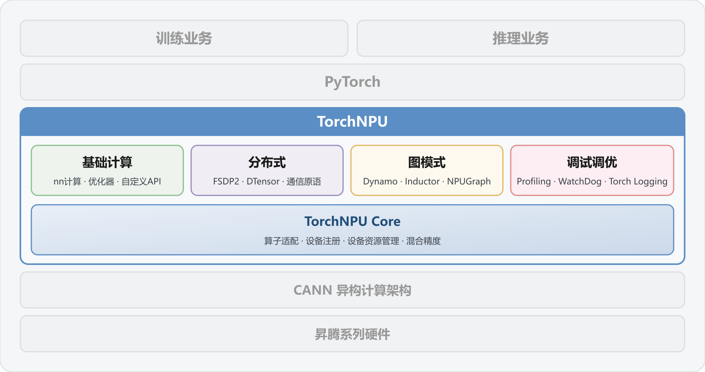

# 02B 框架适配与模型部署：TorchNPU、MindSpore Lite、YOLO 与 vLLM

数据截止 2026-11-05。本专题研究框架、模型图和目标芯片之间的真实连接，区分华为官方项目、第三方项目维护的后端、旧样例以及尚未核验的机器人策略。支持某个设备系列不等于支持该系列全部算子、所有模型和全部精度；提供检测部署路线也不等于已经部署多模态 VLA。

## 1. TorchNPU 适配层与版本边界

[Ascend_Pytorch_README](https://raw.githubusercontent.com/Ascend/pytorch/848b8e7271069d5a9947bf75fd02a162092b41a6/README.zh.md)（[本地原件](REFERENCES.md#ref-631b32f5b2990a25)） 定义 TorchNPU 为 PyTorch 的昇腾适配插件，使用 PrivateUse1 接入算子和设备资源；核心层承担设备注册、资源和混合精度，上层覆盖基础计算、分布式、图模式与调试。虚拟内存减少碎片、跨流复用、Dynamo/Inductor/NPUGraph 的收益有前提：目标图可捕获、算子和同步方式兼容、编译与缓存成本能被重复运行摊薄。README 称 NPUGraph 从 2.6.0 以上支持，但没有给 A2 目标模型实测，不能把“图下沉”写成一定提高机器人策略频率。

华为项目官方架构 SVG，经 sharp 渲染为白底 PNG；已逐图检查中文文字完整。图呈现 PyTorch→TorchNPU 四个功能域→Core→CANN→昇腾硬件。它解释集成分层，未列逐芯片功能矩阵，不支持将 FSDP2、通信优化或全图模式自动归因到 Atlas 200I A2。

[TorchNPU_Compatibility](https://raw.githubusercontent.com/Ascend/pytorch/848b8e7271069d5a9947bf75fd02a162092b41a6/COMPATIBILITY.md)（[本地原件](REFERENCES.md#ref-c8e8a0ecbae18c29)） 推荐安装包 2.14.0、PyTorch 2.14.0、CANN 9.2.X、Python3.10—3.14，并在明细表列 TorchNPU 产品版本 26.2.0 配套 CANN9.2.0；README 的安装例仍为 2.12.0+CANN9.1.0。因此必须分别记录产品版本、pip 包版本及 PyTorch 版本，不能把 `.postN` 转换成产品版本号。此兼容表是有效固定提交资料，可以支持其自身版本陈述；它不替代实际 CANN9.2.0 安装包、驱动配套或 A2 发版验收。

[TorchNPU_Version](https://raw.githubusercontent.com/Ascend/pytorch/848b8e7271069d5a9947bf75fd02a162092b41a6/version.txt)（[本地原件](REFERENCES.md#ref-ee788460702ca65c)） 当前源树构建清单仅列 2.16.0、2.15.0、2.14.0、2.13.0，并说明 `build.sh --torch` 据此校验，实际构建版本还由环境/已安装 PyTorch 驱动。[TorchNPU_Support](https://raw.githubusercontent.com/Ascend/pytorch/848b8e7271069d5a9947bf75fd02a162092b41a6/SUPPORT.md)（[本地原件](REFERENCES.md#ref-8ec3a493e5bb1fd0)） 将 2.16/2.15 标为计划、未发布，2.14/2.13 列 2026-10-15 开发状态。源树可以准备构建的版本、已经发布的包和项目维护状态不能混为一谈；README 的旧安装例也不能证明当前 master 可构建 2.12。支持表的未来日期保留“预计”，不代用户确认未来可用。

| 证据对象 | 已核验内容 | 限制 | 工程动作 |
|---|---|---|---|
| 兼容表 | 310B 等系列在硬件列表；推荐2.14/CANN9.2.X | 未逐模型逐后缀保证 | 按完整硬件、包、驱动矩阵选组合 |
| version.txt | 本提交可供构建的四条版本线 | 包含未来计划线 | 固定 tag/commit 和 build 参数 |
| SUPPORT | 开发、维护、EOL和预计后续状态 | 源码状态不等于合同支持期 | 核对量产维护与补丁承诺 |
| README 示例 | 2.12+CANN9.1.0 的入门方式 | 不是当前构建清单 | 用兼容表及发行包重现 |

设备列表含 310B 与 vLLM 对 200I A2 的明确排除并不矛盾：通用框架接入与具体推理服务的优化、算子和测试覆盖是不同层。单纯 `tensor.to('npu')` 成功不能证明目标注意力、状态缓存或动作头可执行。迁移应逐层检查设备分配、缺失算子、精度和图断点，记录 CPU 回退与拷贝；分布式训练采用 HCCL 的描述也不证明机载多模块有等价互联和训练资源。

## 2. MindSpore 与 Lite：模型构建不等于直接读 OM

[MindSpore_Lite_README](https://raw.githubusercontent.com/mindspore-ai/mindspore/16873579685a1662f10ebd1df068bf512f211869/mindspore/lite/README_CN.md)（[本地原件](REFERENCES.md#ref-d0f903468c5eec67)） 的定位是端、边、云推理框架。[MindSpore_Lite_Context](https://raw.githubusercontent.com/mindspore-ai/mindspore/16873579685a1662f10ebd1df068bf512f211869/mindspore/lite/python/api/context.py)（[本地原件](REFERENCES.md#ref-05d6c61893baf702)） 提供 `target=['ascend']`、device_id、precision_mode、provider（空或 ge）、rank_id。设置 Ascend 时会检查环境并加入 CPU backup；注释明确说明模型转换引入的 Transpose 可在 CPU 执行。不能把该回退机制扩大成“任何不支持算子都能无损回退”，也不能只看 NPU 占用而忽略 CPU 成本和模态同步。

[MindSpore_Lite_Converter](https://raw.githubusercontent.com/mindspore-ai/mindspore/16873579685a1662f10ebd1df068bf512f211869/mindspore/lite/python/api/converter.py)（[本地原件](REFERENCES.md#ref-df5f2465b9cb0028)） 暴露原始模型转换配置与目标设备相关设置；[MindSpore_Lite_Model](https://raw.githubusercontent.com/mindspore-ai/mindspore/16873579685a1662f10ebd1df068bf512f211869/mindspore/lite/python/api/model.py)（[本地原件](REFERENCES.md#ref-cda426e70c7f20f7)） 通过 `build_from_file` 加载 MindIR/MindIR Lite 类型、读取配置，`get_inputs` 获取 tensor、`resize` 调整输入维度、`predict` 执行。接口存在 resize 不表示所有后端、所有图都支持任意动态 shape；实际 build/resize 返回状态应列为模型验收。该路径不能写成“所有 MindSpore Lite 模型直接导入 OM”，更不能因为 Ascend target 存在，就称海思 CV610 的 SVP_NPU 和 AscendCL 同一后端。

MindSpore 训练到 Lite 的价值是减少训练图到推理侧的语义转换环节，但成立条件仍包括目标发行包、算子、输入形式和资源预算。本轮拿到的是 master 源码，不是固定 A2 商业发行矩阵，也没有目标 VLA 测试。建议将 CPU 基线、转换后目标模型及相同输入的结果并行比较，定位差异来自转换、精度、算子或前处理；为每个退回 CPU 的步骤保存 profiler 证据。不能据框架通用支持推导通用大模型在 128MB CV610 上可行。

## 3. 可追到代码的 A2 检测部署路径

[Ultralytics_Ascend_Doc](https://raw.githubusercontent.com/ultralytics/ultralytics/c4e0ba9310ca5c567adb2b02f351f4d721557c71/docs/en/integrations/ascend.md)（[本地原件](REFERENCES.md#ref-a1db7fce7f18dedb)） 是 Ultralytics 项目维护的集成文档，列 Ascend310B4 对应 OrangePi AIPro8T/Atlas200I A2 8TOPS，310B1 对应20T。它提供具体目标编译线索，但不属于华为准确采购 SKU 手册，不能反向补齐 01 未证实的模块料号/内存组合。部署应读取实际板卡芯片后缀并取得相应安装包。文档声明支持七类任务，语义分割和深度仅 YOLO26；这里保留项目宣称，不将每一任务都计为本文实测。

该文档默认 `format=ascend`、`name=Ascend310B4`、imgsz640、batch1、quantize16、opset17、simplify=True；FP16-only 是这个导出后端的限制，不是昇腾硬件只有 FP16。文档将 opset17 的限制归因于 CANN parser，本文仅据此描述本后端要求，不宣称所有未来/其他 CANN 版本均有相同上限。nms 可为 None/True/False，分别选择原始输出、嵌入 NMS 或无 NMS 头；输出契约随选项改变，不能仅比较框数量便认为量化误差。

[Ultralytics_Ascend_Exporter](https://raw.githubusercontent.com/ultralytics/ultralytics/c4e0ba9310ca5c567adb2b02f351f4d721557c71/ultralytics/utils/export/ascend.py)（[本地原件](REFERENCES.md#ref-0826b6cee47ed307)） 实际调用 ONNX→ATC，使用静态 NCHW、目标 soc 和 force_fp16。会重建输出目录避免残留其他芯片模型；本文只审阅源码，没有执行删除或导出。[Ultralytics_Ascend_Backend](https://raw.githubusercontent.com/ultralytics/ultralytics/c4e0ba9310ca5c567adb2b02f351f4d721557c71/ultralytics/nn/backends/ascend.py)（[本地原件](REFERENCES.md#ref-85889b8b8d60cc34)） 递归找到 OM，构建 `InferSession(device_id, om)`、加载 metadata，前向把 BCHW、归一化输入转为 CPU NumPy 后 infer，析构调用 free_resource。文档要求每个目录只放一份 OM：代码用“第一份”，不会可靠替用户选择正确 SoC。模型文件和 metadata.yaml 应成套校验；标签、尺寸和任务信息错误会导致后处理解释偏差。

| 部署节点 | 已取得证据 | 输出契约 | 未完成的系统环节 |
|---|---|---|---|
| 训练/导出 | PyTorch/YOLO→ONNX | 精确模型、opset、输入名称 | 训练数据和权重许可证未逐模型核验 |
| 编译 | ATC→OM，指定310B后缀 | 静态batch/shape、FP16 | 目标安装包的算子覆盖实测 |
| 运行 | ais_bench InferSession | OM+metadata、归一化BCHW | 相机格式转换与时间戳 |
| 机器人消息 | 本文集成分析 | 原图尺寸、坐标系、帧号和置信度 | ROS适配、动作反馈及失效策略 |

缺匹配 310B kernels 而只装 310P kernels 时，文档给出 Conv2D “No supported Ops kernel and engine” 失败。这说明 `atc` 在 PATH 只是必要条件；应固定编译器、目标算子包和 SoC 组合。ATC 可在无 NPU 的 Linux x86/ARM64主机运行是构建分工优势；推理和验证仍需设备。CI 编译成功、InferSession 输出和真机检测准确率应分别记录。相机采集、ISP、padding、RGB、尺度回映射和坐标 frame 在这两份后端文件中没有完成机器人级证明，不能称完整视觉闭环。

## 4. vLLM-Ascend 的支持排除与部署边界

[VLLM_Ascend_FAQ](https://raw.githubusercontent.com/vllm-project/vllm-ascend/4a29682d1d8fa89df63a45dc4df2a2a8068984ff/docs/source/faqs.md)（[本地原件](REFERENCES.md#ref-f20d548af3f05045)） 设备条目明确：Atlas A2/A3服务器系列，及实验性 Atlas300I Duo；Atlas200I A2（310B）未支持且尚无计划。这里优先采用具体设备声明，不能凭后文“技术上 TorchNPU 支持即可继续适配”的概括推翻排除表。FAQ 中“310I Duo”文字与 Atlas300I 名称并存，本文不据笔误创造新品。其 W8A8/W4A8/W4A4、图捕获、KV cache 和 Prefill/Decode 分离能力均只按支持平台使用，不移植到 A2模块。

FAQ 将并发引起的 TPOT 暴涨与 KV cache 满载和 preemption 重算联系，解释图捕获尺寸/图数量导致 stream 资源不足，以及初始化失败后需重启相关进程。这些可帮助分析服务器服务容量；没有归档同模型性能报告时不能输出 tokens/s 排名。语言规划服务远程调用还需观测上传、排队、网络、输出约束和下游控制，TTFT/TPOT不能当机器人动作完成时延；纯文本 LLM 支持也不构成 VLA 动作头部署证据。

## 5. 许可、对标与选型结论

[Ascend_Pytorch_License](https://raw.githubusercontent.com/Ascend/pytorch/848b8e7271069d5a9947bf75fd02a162092b41a6/LICENSE)（[本地原件](REFERENCES.md#ref-fa776f961ff2c65d)） 保留多贡献者版权及 BSD 三条件式再分发条款；[TorchNPU_Docs_License](https://raw.githubusercontent.com/Ascend/pytorch/848b8e7271069d5a9947bf75fd02a162092b41a6/docs/LICENSE)（[本地原件](REFERENCES.md#ref-3f6a90da52e553c6)） 为 CC BY4.0，图文改动应保留来源并标注。[MindSpore_License](https://raw.githubusercontent.com/mindspore-ai/mindspore/16873579685a1662f10ebd1df068bf512f211869/LICENSE)（[本地原件](REFERENCES.md#ref-6fd61b8704aab060)） 和 [VLLM_Ascend_License](https://raw.githubusercontent.com/vllm-project/vllm-ascend/4a29682d1d8fa89df63a45dc4df2a2a8068984ff/LICENSE)（[本地原件](REFERENCES.md#ref-872f7eae47477360)） 为 Apache2；[Ultralytics_License](https://raw.githubusercontent.com/ultralytics/ultralytics/c4e0ba9310ca5c567adb2b02f351f4d721557c71/LICENSE)（[本地原件](REFERENCES.md#ref-969a4c6853947b6b)） 为 AGPL3，其 exporter/backend文件也明确 AGPL3。代码许可、文档许可、模型权重、训练数据以及 CANN/ais_bench/驱动二进制分别核验；本轮未采集目标模型卡和所有传递依赖许可，因此不能宣布商业产品已可自由闭源分发，也不把 AGPL 的义务简化为一律禁止商业使用。

与 CUDA/PyTorch 或 TensorRT 机制对比，TorchNPU 保留框架编程入口，OM 路线固定部署图，Lite 提供推理封装；迁移成本主要来自硬件算子覆盖、数值、资源、生态依赖和交付版本。没有同模型同功率同输入测量，本文不做效率或易用性排名。A2轻量检测可优先验证已追到代码的静态 OM 路径；训练/服务器图优化按对应硬件另测；vLLM不作为200I A2已支持路线。科研多模态策略应先明确输入/输出、注意力算子、状态缓存、动作空间和误差容许，再选择后端，而不能用平台名称决定模型能否闭环。

## 参考资料与原件

下列资料按 2026-11-05 核验时点使用；抓取日期不是发布日期。源码固定到 URL 中的提交 SHA，代表该快照，不保证所有发行包包含相同实现。未运行安装脚本、模型或设备。

| 来源 | 原文 / 本地原件 | 版本与归档边界 |
|---|---|---|
| Ascend_Pytorch_README | [Ascend_Pytorch_README](https://raw.githubusercontent.com/Ascend/pytorch/848b8e7271069d5a9947bf75fd02a162092b41a6/README.zh.md) / [原件](REFERENCES.md#ref-631b32f5b2990a25) | 固定提交源码/许可快照；确切 SHA 见原文 URL；采集 UTC 2026-11-04T16:24:55.143489+00:00；complete_static |
| TorchNPU_Compatibility | [TorchNPU_Compatibility](https://raw.githubusercontent.com/Ascend/pytorch/848b8e7271069d5a9947bf75fd02a162092b41a6/COMPATIBILITY.md) / [原件](REFERENCES.md#ref-c8e8a0ecbae18c29) | 固定提交源码/许可快照；确切 SHA 见原文 URL；采集 UTC 2026-11-04T16:26:54.995372+00:00；complete_static |
| TorchNPU_Support | [TorchNPU_Support](https://raw.githubusercontent.com/Ascend/pytorch/848b8e7271069d5a9947bf75fd02a162092b41a6/SUPPORT.md) / [原件](REFERENCES.md#ref-8ec3a493e5bb1fd0) | 固定提交源码/许可快照；确切 SHA 见原文 URL；采集 UTC 2026-11-04T16:26:56.006939+00:00；complete_static |
| TorchNPU_Version | [TorchNPU_Version](https://raw.githubusercontent.com/Ascend/pytorch/848b8e7271069d5a9947bf75fd02a162092b41a6/version.txt) / [原件](REFERENCES.md#ref-ee788460702ca65c) | 固定提交源码/许可快照；确切 SHA 见原文 URL；采集 UTC 2026-11-04T16:34:25.071067+00:00；complete_static |
| TorchNPU_ArchitectureSVG | [TorchNPU_ArchitectureSVG](https://raw.githubusercontent.com/Ascend/pytorch/848b8e7271069d5a9947bf75fd02a162092b41a6/docs/zh/figures/architecture.svg) / [原件](REFERENCES.md#ref-fd5f565a2196f526) | 固定提交源码/许可快照；确切 SHA 见原文 URL；采集 UTC 2026-11-04T16:26:57.135960+00:00；complete_static |
| Ascend_Pytorch_License | [Ascend_Pytorch_License](https://raw.githubusercontent.com/Ascend/pytorch/848b8e7271069d5a9947bf75fd02a162092b41a6/LICENSE) / [原件](REFERENCES.md#ref-fa776f961ff2c65d) | 固定提交源码/许可快照；确切 SHA 见原文 URL；采集 UTC 2026-11-04T16:24:56.280412+00:00；complete_static |
| TorchNPU_Docs_License | [TorchNPU_Docs_License](https://raw.githubusercontent.com/Ascend/pytorch/848b8e7271069d5a9947bf75fd02a162092b41a6/docs/LICENSE) / [原件](REFERENCES.md#ref-3f6a90da52e553c6) | 固定提交源码/许可快照；确切 SHA 见原文 URL；采集 UTC 2026-11-04T16:26:58.702192+00:00；complete_static |
| MindSpore_Lite_README | [MindSpore_Lite_README](https://raw.githubusercontent.com/mindspore-ai/mindspore/16873579685a1662f10ebd1df068bf512f211869/mindspore/lite/README_CN.md) / [原件](REFERENCES.md#ref-d0f903468c5eec67) | 固定提交源码/许可快照；确切 SHA 见原文 URL；采集 UTC 2026-11-04T16:27:02.093898+00:00；complete_static |
| MindSpore_Lite_Context | [MindSpore_Lite_Context](https://raw.githubusercontent.com/mindspore-ai/mindspore/16873579685a1662f10ebd1df068bf512f211869/mindspore/lite/python/api/context.py) / [原件](REFERENCES.md#ref-05d6c61893baf702) | 固定提交源码/许可快照；确切 SHA 见原文 URL；采集 UTC 2026-11-04T16:27:03.683423+00:00；complete_static |
| MindSpore_Lite_Model | [MindSpore_Lite_Model](https://raw.githubusercontent.com/mindspore-ai/mindspore/16873579685a1662f10ebd1df068bf512f211869/mindspore/lite/python/api/model.py) / [原件](REFERENCES.md#ref-cda426e70c7f20f7) | 固定提交源码/许可快照；确切 SHA 见原文 URL；采集 UTC 2026-11-04T16:27:05.007387+00:00；complete_static |
| MindSpore_Lite_Converter | [MindSpore_Lite_Converter](https://raw.githubusercontent.com/mindspore-ai/mindspore/16873579685a1662f10ebd1df068bf512f211869/mindspore/lite/python/api/converter.py) / [原件](REFERENCES.md#ref-df5f2465b9cb0028) | 固定提交源码/许可快照；确切 SHA 见原文 URL；采集 UTC 2026-11-04T16:27:06.384813+00:00；complete_static |
| MindSpore_License | [MindSpore_License](https://raw.githubusercontent.com/mindspore-ai/mindspore/16873579685a1662f10ebd1df068bf512f211869/LICENSE) / [原件](REFERENCES.md#ref-6fd61b8704aab060) | 固定提交源码/许可快照；确切 SHA 见原文 URL；采集 UTC 2026-11-04T16:24:58.424251+00:00；complete_static |
| Ultralytics_Ascend_Doc | [Ultralytics_Ascend_Doc](https://raw.githubusercontent.com/ultralytics/ultralytics/c4e0ba9310ca5c567adb2b02f351f4d721557c71/docs/en/integrations/ascend.md) / [原件](REFERENCES.md#ref-a1db7fce7f18dedb) | 固定提交源码/许可快照；确切 SHA 见原文 URL；采集 UTC 2026-11-04T16:25:01.762950+00:00；complete_static |
| Ultralytics_Ascend_Exporter | [Ultralytics_Ascend_Exporter](https://raw.githubusercontent.com/ultralytics/ultralytics/c4e0ba9310ca5c567adb2b02f351f4d721557c71/ultralytics/utils/export/ascend.py) / [原件](REFERENCES.md#ref-0826b6cee47ed307) | 固定提交源码/许可快照；确切 SHA 见原文 URL；采集 UTC 2026-11-04T16:26:59.797042+00:00；complete_static |
| Ultralytics_Ascend_Backend | [Ultralytics_Ascend_Backend](https://raw.githubusercontent.com/ultralytics/ultralytics/c4e0ba9310ca5c567adb2b02f351f4d721557c71/ultralytics/nn/backends/ascend.py) / [原件](REFERENCES.md#ref-85889b8b8d60cc34) | 固定提交源码/许可快照；确切 SHA 见原文 URL；采集 UTC 2026-11-04T16:27:00.982899+00:00；complete_static |
| Ultralytics_License | [Ultralytics_License](https://raw.githubusercontent.com/ultralytics/ultralytics/c4e0ba9310ca5c567adb2b02f351f4d721557c71/LICENSE) / [原件](REFERENCES.md#ref-969a4c6853947b6b) | 固定提交源码/许可快照；确切 SHA 见原文 URL；采集 UTC 2026-11-04T16:25:02.981780+00:00；complete_static |
| VLLM_Ascend_FAQ | [VLLM_Ascend_FAQ](https://raw.githubusercontent.com/vllm-project/vllm-ascend/4a29682d1d8fa89df63a45dc4df2a2a8068984ff/docs/source/faqs.md) / [原件](REFERENCES.md#ref-f20d548af3f05045) | 固定提交源码/许可快照；确切 SHA 见原文 URL；采集 UTC 2026-11-04T16:24:59.633656+00:00；complete_static |
| VLLM_Ascend_License | [VLLM_Ascend_License](https://raw.githubusercontent.com/vllm-project/vllm-ascend/4a29682d1d8fa89df63a45dc4df2a2a8068984ff/LICENSE) / [原件](REFERENCES.md#ref-872f7eae47477360) | 固定提交源码/许可快照；确切 SHA 见原文 URL；采集 UTC 2026-11-04T16:25:00.706728+00:00；complete_static |

[主张和图源核验](research_state/evidence/02B_Framework_Model_Deployment.json)。各引用保存原始响应、哈希及 metadata；静态归档不承诺动态交互或像素级复现。
