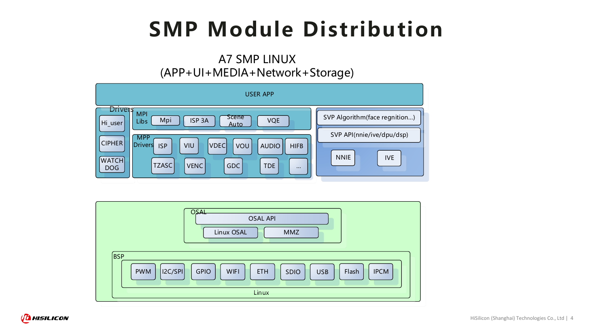
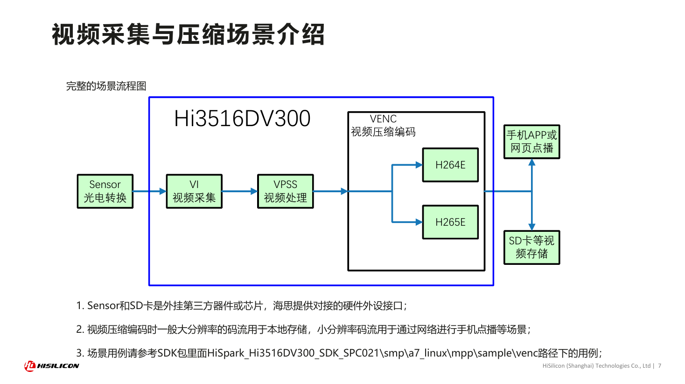
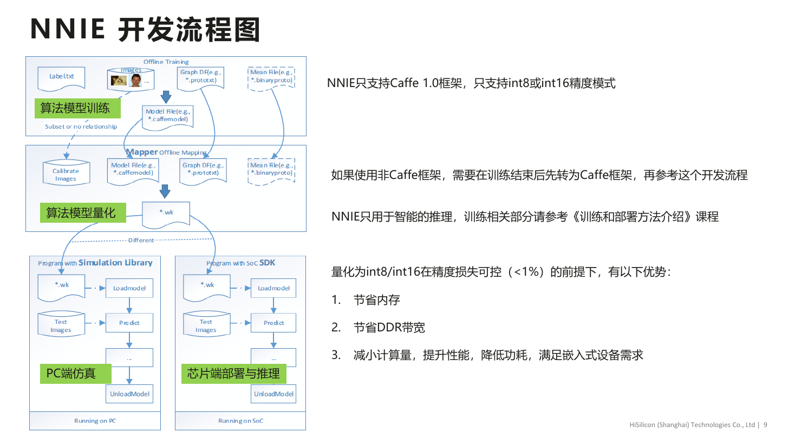

# 02C 海思 BSP、MPP、SVP 与多执行域

本专题以 2026-11-05 可核验原件研究智慧视觉 SoC 软件交付。旧 DV300 教材、OpenHarmony 上游与当前 Hi3403 社区封装分别使用；不能把三者拼成已经验证的当前全系列 SDK。尤其 NNIE、SVP_NPU 与昇腾 CANN 是不同部署对象，图产物、API、算子和许可须按目标包核验。

## 1. 从板级启动到媒体应用的层次

[HiSilicon_DV300_SDK_PDF](https://www.hisilicon.com/dam/asset/view/7c925d6a091b49b5b1d1b0dc28d6dc4b.pdf/download)（[本地原件](REFERENCES.md#ref-7dcd59b2f2952de6)） 是版权2021的课程材料，第5页明确包目录 `Hi3516DV300_SDK_V2.0.2.1`；第9页指向 HiMPP4.0 和 HiSVP 开发/API文档。它不是本轮已经取得完整 SDK 或这些参考手册的证明。第4页官方图将用户应用、MPI/ISP3A/Scene Auto、MPP驱动、SVP算法/API、OSAL/MMZ及BSP分开：音视频、AI和外设共享系统资源，但通过不同接口与驱动进入硬件。

上图保留教材完整第4页，NNIE/IVE、Linux OSAL、MMZ、PWM/I2C/USB等标签均可读。它说明 DV300 SMP Linux 软件分工，不证明每个 SVP API 标签所示引擎在所有芯片都存在，也不能用图中的 DPU/DSP 泛称补填目标型号功能。

课程给出安装 SDK→烧录开发板镜像→加载驱动/编译 sample→应用开发四步；OSDRV 包含镜像/rootfs/工具，MPP包含头文件、用户库、驱动、调试工具和sample。实际移植不仅是交叉编译应用：U-Boot/分区、内核配置、设备树/管脚、sensor驱动和时钟、rootfs ABI、内存保留及驱动装载参数均需适配载板。旧 `load3516dv300` 和 `sample_vio` 命令只作教材示例，本轮未运行；不能对 DV500、AV200、CV610 直接使用。

[OH_HiSilicon_README](https://raw.githubusercontent.com/openharmony/device_soc_hisilicon/7c1e2d5b35c090009bbe195f09337701c60af032/README.md)（[本地原件](REFERENCES.md#ref-f3b4a2b9762761f5)） 指向 SoC 内容与板级仓分工；[OH_DV300_README](https://raw.githubusercontent.com/openharmony/device_soc_hisilicon/7c1e2d5b35c090009bbe195f09337701c60af032/hi3516dv300/README_zh.md)（[本地原件](REFERENCES.md#ref-27744d9b77642827)） 明确“当前支持Hi3516DV300”，列 sdk_linux、sdk_liteos、OSAL、用户态sensor、媒体库、hdf配置与uboot。standard linux 与small/mini的构建入口不同。上游项目存在不证明 CV610 的 OpenHarmony4.1 版本已经从这份 DV300端口获得，也不证明全部 Linux API 在 LiteOS域等价可用。

## 2. MPP 数据流、绑定和内存

[HiSilicon_DV300_Media_PDF](https://www.hisilicon.com/dam/asset/view/2a1c6e800feb43f4a8a31f8bcdcdc84a.pdf/download)（[本地原件](REFERENCES.md#ref-35a27bc010e9b7ba)） 第7页是 Sensor→VI→VPSS→VENC→网络/SD卡。VI负责采集，VPSS可做单输入多输出、降噪、缩放旋转，VENC编码。不同分支可服务推理低分辨率图和存储高分辨率视频，但是否可并发以及每路耗时必须测量。编码码流不能直接当 NPU 输入 tensor；若推理从压缩流取图还增加解码和缓存，实时视觉通常应验证编码前图像分支。

第7页完整流程图明确 Sensor/SD卡是外部器件。图解释媒体链路，不是机器人动作闭环；编码最大规格也不等于所有路同时跑满。第8/9页按 device/pipe/channel 与 group/channel 管理 VI/VPSS；第23页列 SYS/VB 初始化、物理内存及模块状态管理、绑定/解绑。绑定是媒体模块之间的数据联接，不等于任意用户态框架直接共享 buffer 或已实现零拷贝。

| 环节 | 官方旧版证据 | 当前实施需核验 | 错用风险 |
|---|---|---|---|
| VI/ISP | DV300采集/图像链路 | sensor型号、模式、时钟、标定/曝光 | 接口存在却无正确图像 |
| VPSS | 多输出及图像处理 | shape、stride、格式、压缩和帧深度 | 将width当行步长导致错误 |
| SYS/VB/MMZ | 物理内存/池/模块绑定 | buffer所有权、缓存、保留内存 | 枯竭、旧数据或提前释放 |
| VENC/存储 | 编码与网络/本地分支 | 并发编码、码率、磁盘与网络 | 推理被后台流量干扰 |
| SVP/NPU | 具体API/算子路径 | 目标SDK版本、模型产物和开放引擎 | 跨代模型无法加载 |

[HiView_3403_VPSS](https://raw.githubusercontent.com/openhisilicon/HIVIEW/395b53d4c28cf5e528c9e1ba3f7ec39ad8e852d4/mod/svp/3403/vpss_capture.cpp)（[本地原件](REFERENCES.md#ref-724494f823f91527)） 来自 openhisilicon/HIVIEW，属于第三方社区/服务商项目；[HiView_README](https://raw.githubusercontent.com/openhisilicon/HIVIEW/395b53d4c28cf5e528c9e1ba3f7ec39ad8e852d4/README.md)（[本地原件](REFERENCES.md#ref-c89786e45c3e552a)） 提供BSP、MPP、编解码、网络、SVP等功能描述，不能当海思量产承诺。3403目录实际使用小写 `hi_mpi_*`，从帧读取物理/虚拟地址、stride和pixel_format，在转换分支申请cached MMZ并调用IVE色彩转换，必要时使用VGS转换压缩/非线性帧，随后释放VPSS channel frame。不能为了“现代API”自行改写为`ss_mpi_*`；命名和结构体应来自实际目标包。

此源码足以揭示图像存储不是单一连续RGB数组：Y/UV行步长、半平面420/422、压缩模式、物理映射及帧锁需要分别处理；它不证明当前实现所有分支无缺陷、缓存维护已完整或SDK二进制能合法再分发。[HiView_3403_YOLO](https://raw.githubusercontent.com/openhisilicon/HIVIEW/395b53d4c28cf5e528c9e1ba3f7ec39ad8e852d4/mod/svp/3403/yolov8.cpp)（[本地原件](REFERENCES.md#ref-b8c035537722bae0)） 调用外部类init，且按stride/height计算平面大小、映射图像；本轮没有追到完整算法库、模型转换器及硬件测试，不据文件名声称完整 YOLOv8 已在任意Hi3403量产板验证。

## 3. NNIE 的模型分段、量化与缓存一致性

[HiSilicon_DV300_SVP_PDF](https://www.hisilicon.com/dam/asset/view/4ef2e012655a4aae8c80619b8cfd093f.pdf/download)（[本地原件](REFERENCES.md#ref-8b4b0448c818638c)） 第6—10页定义NNIE/IVE及PC RuyiStudio，旧NNIE接受Caffe1.0，量化INT8/INT16生成WK；训练后量化、PC仿真及SoC运行分开。模型图、权重、均值和标定图参与量化。第11页还介绍全8/全16及混合精度；“精度损失可控<1%”是第9页的成立前提，没有给本轮模型、数据集及任务定义，不能写成所有模型误差保证。

官方第9页区分训练、Mapper生成WK、仿真库与SoC SDK推理。PC仿真仅用于模型与执行评估；这里的“仿真”不提供机器人接触动力学、渲染、ROS或sim-to-real平台。OM和WK不能因都称离线模型而互换，旧NNIE的Caffe约束也不能套到新SVP_NPU。

第14/17页明确不支持层的custom/proposal和网络分段，需要用户自己实现CPU部分、提取段末结果；切得更碎会增加软硬件交互，影响效率。第16页列 LoadModel、GetTskBufSize、Forward、Query和任务buffer管理。第17/18页说明handle、bInstant、Query及cached空间刷cache：硬件从DDR读取，CPU曾访问缓存地址时需按该版 `HI_MPI_SYS_MmzFlushCache` 维护一致性。IVE第27页同样要求缓存处理。不能用普通memcpy替代硬件可访问内存、完成同步和缓存语义；也不能将一次flush简化成所有CPU↔设备读写方向都已处理。

旧教材列LSTM、分类/检测/分割网络与算子范围，提供适配起点；不表示Transformer/VLM任意图可执行。CPU分段可补缺失功能但会消耗CPU和带宽，可能失去低功耗与时效优势；应报告分段数、搬运量、CPU耗时和端到端精度。强行用TOPS估算模型时延会遗漏这些成本。

## 4. 当前芯片、多域系统与交付责任

[HiSilicon_Hi3403V100](https://www.hisilicon.com/cn/products/smart-vision/machine-vision/hi3403v100)（[本地原件](REFERENCES.md#ref-c2d6971a30360f9c)） 的异构引擎精度不同，需要模型分配、算子可用性和并发调度证据；[HiSilicon_Hi3519AV200](https://www.hisilicon.com/cn/products/smart-vision/machine-vision/hi3519av200)（[本地原件](REFERENCES.md#ref-387e661a1427ecf6)） 明确8.1T中开放2.5T、HNR专用5.6T不开放，软件不能把保留AI ISP引擎自动计入用户推理预算。[HiSilicon_Hi3516CV610](https://www.hisilicon.com/cn/products/smart-vision/machine-vision/hi3516cv610)（[本地原件](REFERENCES.md#ref-7e91d964fbc23ad4)） 的Linux5.10/OpenHarmony4.1及Transformer/VLM描述是具体产品支持/宣称；尚未取得完整目标包、模型和资源数据，不能与DV300端口合并为已复现路线。[HiSilicon_AcademyPDF](https://www.hisilicon.com/dam/asset/view/d8442760823b4f5e9fabb6c5bd684846.pdf)（[本地原件](REFERENCES.md#ref-00381035722b48d1)） 第8页列CV610 SVP_NPU/BSP/MPP课程，并说明HiSupport注册/FAE获取路线，证明资料途径而非本轮已取得接口手册。

[HiSilicon_LiteOS_PDF](https://www.hisilicon.com/dam/asset/view/5103be8a8500426e8b60325acbfc9359.pdf/download)（[本地原件](REFERENCES.md#ref-03c5df99d558fb36)） 展示任务、内存、中断、HAL、传感和低功耗框架以及OTA概念。其6KB、us响应或省电比例缺少本轮目标硬件/负载条件，只作教材宣称，不当Hi3403内置MCU控制能力保证。Linux负责应用/网络，MCU或LiteOS域承担周期任务是可设计的分工；是否有AMP、共享内存协议、IPC中断、更新顺序及故障隔离必须按目标SDK验证。芯片含MCU不等于厂商已交付机器人伺服固件，POSIX接口也不保证ROS2/rclcpp在所有域可用。

## 5. 许可与条件选型

[OH_Driver_License](https://raw.githubusercontent.com/openharmony/device_soc_hisilicon/7c1e2d5b35c090009bbe195f09337701c60af032/hi3516dv300/sdk_linux/drv/LICENSE)（[本地原件](REFERENCES.md#ref-99677d79a1d3021c)） 是GPLv2原件，DV300 README说明驱动与其他模块许可分别适用；仓库顶层 [OH_HiSilicon_License](https://raw.githubusercontent.com/openharmony/device_soc_hisilicon/7c1e2d5b35c090009bbe195f09337701c60af032/LICENSE)（[本地原件](REFERENCES.md#ref-419f3efb06e078ac)） 不能替代子目录许可。[OH_Media_EULA](https://raw.githubusercontent.com/openharmony/device_soc_hisilicon/7c1e2d5b35c090009bbe195f09337701c60af032/hi3516dv300/sdk_linux/out/lib/LICENSE)（[本地原件](REFERENCES.md#ref-d888125c58c7c3fd)） 的2021二进制条款仅授权开发板内部开发/测试，不授予制造、销售或分发使用该软件产品的权利。这个结论限定该份原件，不能称所有当前海思商业合同均如此；量产应取得目标包单独商业授权。查看原件不是接受协议，本文未安装或运行该库。

HIVIEW树未找到项目总体LICENSE，仅见依赖局部许可，因此不能认为所有源码及附带SDK都可自由重分发。公开下载的PDF也不是SDK授权。海思路径优势来自视觉流水线及专用引擎的集成；与通用GPU/框架路线作机制比较时，其代价包括ISP/视频/模型转换与板级二进制的强版本耦合。没有同模型同视频并发实测，不给效率排名。

固定视觉节点可优先验证原始帧分支、硬件前处理和轻量模型，前提是获得精确芯片SDK、sensor驱动和商业权限；复杂多模态策略应先验证算子/内存和CPU分段成本。放行须同时运行采集、ISP/HNR、推理、编码、网络与日志，测峰值内存、持续功率、帧池耗尽、重启和观测年龄。当前公开资料还缺新型号API手册、固件/BSP版本矩阵、模型编译器许可、调度/缓存细节与维护承诺，这些未解决点不能由旧教程替代。

## 参考资料与原件

下列资料按 2026-11-05 核验时点使用；抓取日期不是发布日期。源码固定到 URL 中的提交 SHA，代表该快照，不保证所有发行包包含相同实现。未运行安装脚本、模型或设备。

| 来源 | 原文 / 本地原件 | 版本与归档边界 |
|---|---|---|
| HiSilicon_DV300_SDK_PDF | [HiSilicon_DV300_SDK_PDF](https://www.hisilicon.com/dam/asset/view/7c925d6a091b49b5b1d1b0dc28d6dc4b.pdf/download) / [原件](REFERENCES.md#ref-7dcd59b2f2952de6) | SDK V2.0.2.1；版权2021；采集 UTC 2026-11-04T16:30:58.571674+00:00；complete_static |
| HiSilicon_DV300_Media_PDF | [HiSilicon_DV300_Media_PDF](https://www.hisilicon.com/dam/asset/view/2a1c6e800feb43f4a8a31f8bcdcdc84a.pdf/download) / [原件](REFERENCES.md#ref-35a27bc010e9b7ba) | DV300/HiMPP4.0/SPC021；版权2021；采集 UTC 2026-11-04T16:31:04.931888+00:00；complete_static |
| HiSilicon_DV300_SVP_PDF | [HiSilicon_DV300_SVP_PDF](https://www.hisilicon.com/dam/asset/view/4ef2e012655a4aae8c80619b8cfd093f.pdf/download) / [原件](REFERENCES.md#ref-8b4b0448c818638c) | DV300 NNIE/IVE旧教材；版权2021；采集 UTC 2026-11-04T16:31:10.189959+00:00；complete_static |
| HiSilicon_LiteOS_PDF | [HiSilicon_LiteOS_PDF](https://www.hisilicon.com/dam/asset/view/5103be8a8500426e8b60325acbfc9359.pdf/download) / [原件](REFERENCES.md#ref-03c5df99d558fb36) | 未标明确版号/发布日期的旧IoT教材；采集 UTC 2026-11-04T16:30:55.412005+00:00；complete_static |
| OH_HiSilicon_README | [OH_HiSilicon_README](https://raw.githubusercontent.com/openharmony/device_soc_hisilicon/7c1e2d5b35c090009bbe195f09337701c60af032/README.md) / [原件](REFERENCES.md#ref-f3b4a2b9762761f5) | 固定提交源码/许可快照；确切 SHA 见原文 URL；采集 UTC 2026-11-04T16:34:26.273042+00:00；complete_static |
| OH_DV300_README | [OH_DV300_README](https://raw.githubusercontent.com/openharmony/device_soc_hisilicon/7c1e2d5b35c090009bbe195f09337701c60af032/hi3516dv300/README_zh.md) / [原件](REFERENCES.md#ref-27744d9b77642827) | 固定提交源码/许可快照；确切 SHA 见原文 URL；采集 UTC 2026-11-04T16:34:27.497312+00:00；complete_static |
| OH_HiSilicon_License | [OH_HiSilicon_License](https://raw.githubusercontent.com/openharmony/device_soc_hisilicon/7c1e2d5b35c090009bbe195f09337701c60af032/LICENSE) / [原件](REFERENCES.md#ref-419f3efb06e078ac) | 固定提交源码/许可快照；确切 SHA 见原文 URL；采集 UTC 2026-11-04T16:33:40.663414+00:00；complete_static |
| OH_Driver_License | [OH_Driver_License](https://raw.githubusercontent.com/openharmony/device_soc_hisilicon/7c1e2d5b35c090009bbe195f09337701c60af032/hi3516dv300/sdk_linux/drv/LICENSE) / [原件](REFERENCES.md#ref-99677d79a1d3021c) | 固定提交源码/许可快照；确切 SHA 见原文 URL；采集 UTC 2026-11-04T16:34:29.181859+00:00；complete_static |
| OH_Media_EULA | [OH_Media_EULA](https://raw.githubusercontent.com/openharmony/device_soc_hisilicon/7c1e2d5b35c090009bbe195f09337701c60af032/hi3516dv300/sdk_linux/out/lib/LICENSE) / [原件](REFERENCES.md#ref-d888125c58c7c3fd) | DV300子目录2021二进制许可；采集 UTC 2026-11-04T16:38:04.870536+00:00；complete_static |
| HiView_README | [HiView_README](https://raw.githubusercontent.com/openhisilicon/HIVIEW/395b53d4c28cf5e528c9e1ba3f7ec39ad8e852d4/README.md) / [原件](REFERENCES.md#ref-c89786e45c3e552a) | 固定提交源码/许可快照；确切 SHA 见原文 URL；采集 UTC 2026-11-04T16:33:38.757127+00:00；complete_static |
| HiView_3403_VPSS | [HiView_3403_VPSS](https://raw.githubusercontent.com/openhisilicon/HIVIEW/395b53d4c28cf5e528c9e1ba3f7ec39ad8e852d4/mod/svp/3403/vpss_capture.cpp) / [原件](REFERENCES.md#ref-724494f823f91527) | 固定提交源码/许可快照；确切 SHA 见原文 URL；采集 UTC 2026-11-04T16:38:01.012968+00:00；complete_static |
| HiView_3403_YOLO | [HiView_3403_YOLO](https://raw.githubusercontent.com/openhisilicon/HIVIEW/395b53d4c28cf5e528c9e1ba3f7ec39ad8e852d4/mod/svp/3403/yolov8.cpp) / [原件](REFERENCES.md#ref-b8c035537722bae0) | 固定提交源码/许可快照；确切 SHA 见原文 URL；采集 UTC 2026-11-04T16:38:03.318452+00:00；complete_static |
| HiSilicon_Hi3403V100 | [HiSilicon_Hi3403V100](https://www.hisilicon.com/cn/products/smart-vision/machine-vision/hi3403v100) / [原件](REFERENCES.md#ref-c2d6971a30360f9c) | 页面未标版号；按采集快照使用；采集 UTC 2026-11-04T15:55:36.357424+00:00；complete_static |
| HiSilicon_Hi3519AV200 | [HiSilicon_Hi3519AV200](https://www.hisilicon.com/cn/products/smart-vision/machine-vision/hi3519av200) / [原件](REFERENCES.md#ref-387e661a1427ecf6) | 页面未标版号；按采集快照使用；采集 UTC 2026-11-04T15:55:51.885466+00:00；complete_static |
| HiSilicon_Hi3516CV610 | [HiSilicon_Hi3516CV610](https://www.hisilicon.com/cn/products/smart-vision/machine-vision/hi3516cv610) / [原件](REFERENCES.md#ref-7e91d964fbc23ad4) | 页面未标版号；按采集快照使用；采集 UTC 2026-11-04T15:54:58.249797+00:00；complete_static |
| HiSilicon_AcademyPDF | [HiSilicon_AcademyPDF](https://www.hisilicon.com/dam/asset/view/d8442760823b4f5e9fabb6c5bd684846.pdf) / [原件](REFERENCES.md#ref-00381035722b48d1) | 页面未标版号；按采集快照使用；采集 UTC 2026-11-04T15:56:16.261779+00:00；complete_static |

[主张和图源核验](research_state/evidence/02C_HiSilicon_BSP_MPP_NPU.json)。各引用保存原始响应、哈希及 metadata；静态归档不承诺动态交互或像素级复现。
