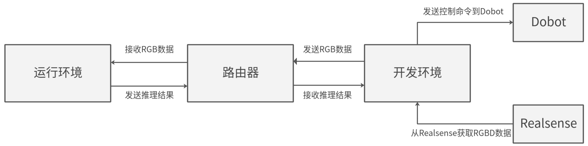

# 02D 机器人集成、数据契约与运维边界

数据截止2026-11-05。本专题把软件推理入口接到传感器、本体和运维，依据华为旧机器人示例和已核验runtime源码解释实际断点；本体产品级采用和商业收益留待06核验。公开示例、社区适配、平台接口存在与产品交付分别标注，本文未安装软件、操控机器人或进行硬件测试。

## 1. 已公开示例能证明什么

[Ascend_Robot_Arm_README](https://raw.githubusercontent.com/Ascend/samples/fc2aea93e48be8f8cee51d0c6c1b13a08155f83a/python/level3_multi_model/Robotic_Arm_Object_Following/README_CN.md)（[本地原件](REFERENCES.md#ref-8f2874b95d479613)） 声明软件3.1.0及以上、Atlas200DK，组合RealSense D435、Dobot Magician、Ubuntu18.04 x64主控和路由器。200DK执行YOLOv3图标检测，PC接RGBD、传图与收结果，再计算机械臂角度。README描述目标居中和保持距离；这不是通用语义指令到动作的VLA，更不是当前200I A2生产本体认证。它还要求修改pydobot添加角度控制接口，说明本体控制并非CANN自带。

图由华为示例README直接引用，原图已下载打开。双向箭头经过路由器，RGBD接入和控制命令在开发主机侧，200DK仅承担推理。图支持“本体控制/相机和AI任务分工”的结论，未显示确定性通信、安全控制器或伺服频率。

[Ascend_Robot_Chess_README](https://raw.githubusercontent.com/Ascend/samples/fc2aea93e48be8f8cee51d0c6c1b13a08155f83a/python/level3_multi_model/Robot_Play_Chess/README_CN.md)（[本地原件](REFERENCES.md#ref-ff1625a4f4845e8f)） 同属Atlas200DK旧样例，使用VGG16棋子分类、PC对弈引擎、中心控制、六轴Mirobot与Webserver，USB相机480×640。模型感知与棋局规划是不同模块，机械臂校准由相关工具完成；提供OM下载及预期照片不等于长期成功率、故障恢复或商业交付。[Ascend_Robot_Car_README](https://raw.githubusercontent.com/Ascend/samples/fc2aea93e48be8f8cee51d0c6c1b13a08155f83a/cplusplus/contrib/robots_car/README_CN.md)（[本地原件](REFERENCES.md#ref-63de9339d4968942)） 是contrib巡检小车样例，CANN≥5.0.4、Atlas200DK/Atlas300，DBNet/CRNN、Presenter和`catkin_make`。构建工具与ros.org入口支持“旧ROS/catkin路线”的归类；未明确ROS发行版、当前ROS2适配、控制总线或准确底盘，因此不补写Nav2/EtherCAT/TSN认证。

| 样例 | 感知/计算任务 | 本体和控制位置 | 证据成熟度 | 不能推导 |
|---|---|---|---|---|
| 目标跟随 | YOLOv3图标检测+RGBD | PC算角度、Dobot执行 | 官方旧教学示例 | A2通用VLA/伺服实时 |
| 下棋 | VGG16分类+PC对弈 | PC中心控制、Mirobot | 官方旧教学示例 | 无人长期运营成功率 |
| 巡检小车 | DBNet/CRNN+避障描述 | contrib ROS/catkin工程 | 官方仓社区贡献示例 | 当前ROS2或底盘认证 |

## 2. 原码揭示的时间和坐标契约

[Ascend_Robot_Arm_Code](https://raw.githubusercontent.com/Ascend/samples/fc2aea93e48be8f8cee51d0c6c1b13a08155f83a/python/level3_multi_model/Robotic_Arm_Object_Following/src/robotic_arm_object_following.py)（[本地原件](REFERENCES.md#ref-ef719f51c5eefd5d)） 从RealSense对齐彩色/深度帧，读取depth_scale、color intrinsics；发送RGB的长度、时间戳和pickle数据，经TCP接检测结果。每5次相关帧处理触发一次动作（`ROBOT_MOVE_FREQUENCY=5`），这是代码计数逻辑，既不是5Hz，也不能用相机标称fps除5宣布稳定控制频率：网络、推理、事件回调和运动等待都会改变真实间隔。

原码`pixel_to_point`按 `(u-cx)/fx`、`(v-cy)/fy`乘深度并从米转换毫米，后续使用旋转和平移转换到世界坐标。README中的总公式却写成R乘K再加T、未显式乘深度，与其内参定义及源码反投影不同。本文不直接复用该公式；按针孔模型，已去畸变像素p应使用 `Pc=z·K⁻¹p`，再`Pw=R·Pc+t`，这里是分析纠正，不是新官方接口。色彩/深度对齐、深度缺失、外参方向和单位仍须验证，不能据单样例几何简化保证任意机械臂标定。

原码显示检测结果可能和对象中最新color/depth/intrinsics一起参与动作；本次未在所有收发链路证明同一帧号严格配对。生产集成应保存采集时刻、推理输入ID、深度帧ID、外参版本和本体状态时刻，将结果返回同一观测快照。若相机在机械臂末端，使用推理结束后的姿态代替曝光时姿态会造成坐标偏差。视场中检测框的置信度也不能反映深度ROI的有效点数，目标边缘或背景深度会使平均深度偏离物体。

TCP是字节流，示例直接读取4字节长度的片段不应被当作生产完整帧解析证明；需要检验短读、断线、长度上限和重连。pickle还把信任问题带入输入解析：网络消息应采用明确受限的结构/类型和验证，不能把教学局域网假设扩展到公网或任意设备。上述为对实际代码边界的分析；本轮未测试攻击或运行不可信消息，不将源码阅读称安全审计完成。

## 3. 从推理结果到动作：分层验收

ROS适配器应携带原图尺寸、resize/padding变换、frame_id、采集时间、类别/置信度、深度单位和标定版本；输出框经尺度回映射才能进入相机坐标，随后通过曝光时刻外参和本体状态转换。新模型动作头还需joint顺序、角度/位置/力矩单位、坐标基准、动作horizon/chunk、有效期和饱和范围。旧YOLO示例不能证明任意动作空间已适配。

| 层次 | 输入输出契约（分析） | 时效与资源问题 | 放行动作 |
|---|---|---|---|
| 采集/前处理 | 帧ID、时钟域、图像/深度格式 | 同步、队列、曝光年龄 | 对齐和丢帧测试 |
| NPU感知 | 静态tensor、模型版本、结果ID | pool、异步完成、CPU后处理 | 数值及并发测试 |
| 策略/规划 | 状态、目标、约束、动作期限 | RPC排队、缓存和超时 | 旧结果拒收及约束校验 |
| 控制器 | 轨迹、关节、反馈、模式 | 独立周期与总线负载 | 中断/跟踪误差及降级测试 |
| 伺服/保护 | 电机反馈、限位、保护 | 硬件响应和故障域 | 使用本体正式接口验证 |

策略调用、controller manager、总线和电机伺服频率分别记录；NPU毫秒倒数不是任一控制层频率。感知超时时只停止发布新消息不保证下游停止运动，控制端必须判断命令有效期与失联行为。进入轨迹控制前还需可达性、关节速度/加速度、碰撞与限位；自然语言规划正确不能代替轨迹可执行和任务成功。这里给集成设计条件，不声称本轮取得华为机器人安全控制栈或认证。

以ROS2设计新适配时，应核对目标OS/CPU ABI、DDS实现、QoS和队列策略；这些需独立ROS2资料和实机验证，旧catkin样例不足。视频节点可选择有界队列减少旧帧积压，离线采样记录可能要求完整性；控制deadline、timestamp和背压应逐消息确定，而不是全系统统一“可靠传输”。芯片有以太网不能推导TSN时钟同步，普通Ethernet/CAN接口也不能推导EtherCAT主站和功能安全交付。

## 4. 容器、版本清单和OTA的真实作用

[VLLM_Ascend_FAQ](https://raw.githubusercontent.com/vllm-project/vllm-ascend/4a29682d1d8fa89df63a45dc4df2a2a8068984ff/docs/source/faqs.md)（[本地原件](REFERENCES.md#ref-f20d548af3f05045)） 描述支持服务器的容器与离线导入路线，同时错误定位仍要求CANN、NNAL及设备可用。容器保存用户态环境有利重现，但不替代主机内核驱动、固件、设备权限和板级外设；将镜像启动成功视作平台适配完成会漏掉物理依赖。本文未拉取或运行容器，更未按FAQ建议扩大主机特权；生产部署应仅按实际必要设备权限实现。

[ACL_Async_ModelProcess](https://raw.githubusercontent.com/Ascend/samples/fc2aea93e48be8f8cee51d0c6c1b13a08155f83a/cplusplus/level2_simple_inference/1_classification/resnet50_async_imagenet_classification/src/model_process.cpp)（[本地原件](REFERENCES.md#ref-9aab3388a79f9a2b)） 的异步内存池与同步提供NPU资源生命周期参考，[Ultralytics_Ascend_Backend](https://raw.githubusercontent.com/ultralytics/ultralytics/c4e0ba9310ca5c567adb2b02f351f4d721557c71/ultralytics/nn/backends/ascend.py)（[本地原件](REFERENCES.md#ref-85889b8b8d60cc34)） 的InferSession释放提供应用侧封装。运维须监测模型加载、算子失败、池和内存峰值、队列年龄、丢帧、CPU负载、温度/功率、结果有效性及控制反馈；不能只监测进程存活或NPU利用率。后台编码、日志、升级下载和规划RPC会干扰控制主机，需要明确CPU/内存预算与优先级，并用同时运行的负载测量验证隔离效果。

发布清单应固定完整SKU/板号、OS/BSP/固件/驱动、CANN/算子包、框架和依赖、模型/metadata/标定哈希及本体SDK。模型升级会改变类别、归一化、shape、动作契约或资源，不能仅用文件校验和判断行为兼容；需留出相同场景和失败样本回归。OTA建议将可回退镜像、模型和配置作为一致组合，验证断电、分区与回退后的兼容。[HiSilicon_LiteOS_PDF](https://www.hisilicon.com/dam/asset/view/5103be8a8500426e8b60325acbfc9359.pdf/download)（[本地原件](REFERENCES.md#ref-03c5df99d558fb36)） 展示OTA/安全框架概念，未提供本轮目标芯片的A/B分区、签名、密钥配置或恢复时序，故不能称已经具有开箱可用的机器人OTA方案。

## 5. 许可与选择建议

[Ascend_Samples_License](https://raw.githubusercontent.com/Ascend/samples/fc2aea93e48be8f8cee51d0c6c1b13a08155f83a/LICENSE)（[本地原件](REFERENCES.md#ref-181037fb87140fdd)） 的Apache2与各README“学习参考、非商业目的”说明分别保存；pydobot、RealSense、Mirobot SDK、对弈引擎、模型权重/数据、Presenter/FFmpeg及runtime许可需要各自获取。[OH_Media_EULA](https://raw.githubusercontent.com/openharmony/device_soc_hisilicon/7c1e2d5b35c090009bbe195f09337701c60af032/hi3516dv300/sdk_linux/out/lib/LICENSE)（[本地原件](REFERENCES.md#ref-d888125c58c7c3fd)） 说明旧DV300公开媒体二进制开发授权不自动授予量产分发；新目标合同仍需单独核验。未核验的许可不是默认禁止，也不是默认自由商业分发。

轻量原型可采用已可追溯的检测OM链路与独立PC/MCU控制，快速验证数据契约；量产则须重新固定板级软件与本体SDK，验证长时间闭环、失联、重启、队列与安全响应。机制对比上，通用GPU机器人软件包可能减少某些适配工序，海思视觉节点可减少媒体处理资源成本；本轮没有同任务条件下的双方测量与商业包比较，不做开发工期、性能或成本排名。关键收益必须由完整任务成功、人工介入、持续运行和整机能耗证明，而不是模型峰值、演示照片或仓库stars。

## 参考资料与原件

下列资料按 2026-11-05 核验时点使用；抓取日期不是发布日期。源码固定到 URL 中的提交 SHA，代表该快照，不保证所有发行包包含相同实现。未运行安装脚本、模型或设备。

| 来源 | 原文 / 本地原件 | 版本与归档边界 |
|---|---|---|
| Ascend_Robot_Arm_README | [Ascend_Robot_Arm_README](https://raw.githubusercontent.com/Ascend/samples/fc2aea93e48be8f8cee51d0c6c1b13a08155f83a/python/level3_multi_model/Robotic_Arm_Object_Following/README_CN.md) / [原件](REFERENCES.md#ref-8f2874b95d479613) | 固定提交源码/许可快照；确切 SHA 见原文 URL；采集 UTC 2026-11-04T16:26:51.818729+00:00；complete_static |
| Ascend_Robot_Arm_Code | [Ascend_Robot_Arm_Code](https://raw.githubusercontent.com/Ascend/samples/fc2aea93e48be8f8cee51d0c6c1b13a08155f83a/python/level3_multi_model/Robotic_Arm_Object_Following/src/robotic_arm_object_following.py) / [原件](REFERENCES.md#ref-ef719f51c5eefd5d) | 固定提交源码/许可快照；确切 SHA 见原文 URL；采集 UTC 2026-11-04T16:40:57.702368+00:00；complete_static |
| Ascend_Robot_Arm_Flow | [Ascend_Robot_Arm_Flow](https://images.gitee.com/uploads/images/2021/0310/112856_f44ecafd_5537256.png) / [原件](REFERENCES.md#ref-1cf94bd983a08931) | 页面未标版号；按采集快照使用；采集 UTC 2026-11-04T16:41:02.432670+00:00；complete_static |
| Ascend_Robot_Chess_README | [Ascend_Robot_Chess_README](https://raw.githubusercontent.com/Ascend/samples/fc2aea93e48be8f8cee51d0c6c1b13a08155f83a/python/level3_multi_model/Robot_Play_Chess/README_CN.md) / [原件](REFERENCES.md#ref-ff1625a4f4845e8f) | 固定提交源码/许可快照；确切 SHA 见原文 URL；采集 UTC 2026-11-04T16:26:52.848629+00:00；complete_static |
| Ascend_Robot_Car_README | [Ascend_Robot_Car_README](https://raw.githubusercontent.com/Ascend/samples/fc2aea93e48be8f8cee51d0c6c1b13a08155f83a/cplusplus/contrib/robots_car/README_CN.md) / [原件](REFERENCES.md#ref-63de9339d4968942) | 固定提交源码/许可快照；确切 SHA 见原文 URL；采集 UTC 2026-11-04T16:26:53.914348+00:00；complete_static |
| Ascend_Samples_License | [Ascend_Samples_License](https://raw.githubusercontent.com/Ascend/samples/fc2aea93e48be8f8cee51d0c6c1b13a08155f83a/LICENSE) / [原件](REFERENCES.md#ref-181037fb87140fdd) | 固定提交源码/许可快照；确切 SHA 见原文 URL；采集 UTC 2026-11-04T16:24:54.066194+00:00；complete_static |
| ACL_Async_ModelProcess | [ACL_Async_ModelProcess](https://raw.githubusercontent.com/Ascend/samples/fc2aea93e48be8f8cee51d0c6c1b13a08155f83a/cplusplus/level2_simple_inference/1_classification/resnet50_async_imagenet_classification/src/model_process.cpp) / [原件](REFERENCES.md#ref-9aab3388a79f9a2b) | 固定提交源码/许可快照；确切 SHA 见原文 URL；采集 UTC 2026-11-04T16:26:49.315372+00:00；complete_static |
| Ultralytics_Ascend_Backend | [Ultralytics_Ascend_Backend](https://raw.githubusercontent.com/ultralytics/ultralytics/c4e0ba9310ca5c567adb2b02f351f4d721557c71/ultralytics/nn/backends/ascend.py) / [原件](REFERENCES.md#ref-85889b8b8d60cc34) | 固定提交源码/许可快照；确切 SHA 见原文 URL；采集 UTC 2026-11-04T16:27:00.982899+00:00；complete_static |
| VLLM_Ascend_FAQ | [VLLM_Ascend_FAQ](https://raw.githubusercontent.com/vllm-project/vllm-ascend/4a29682d1d8fa89df63a45dc4df2a2a8068984ff/docs/source/faqs.md) / [原件](REFERENCES.md#ref-f20d548af3f05045) | 固定提交源码/许可快照；确切 SHA 见原文 URL；采集 UTC 2026-11-04T16:24:59.633656+00:00；complete_static |
| HiSilicon_LiteOS_PDF | [HiSilicon_LiteOS_PDF](https://www.hisilicon.com/dam/asset/view/5103be8a8500426e8b60325acbfc9359.pdf/download) / [原件](REFERENCES.md#ref-03c5df99d558fb36) | 页面未标版号；按采集快照使用；采集 UTC 2026-11-04T16:30:55.412005+00:00；complete_static |
| OH_Media_EULA | [OH_Media_EULA](https://raw.githubusercontent.com/openharmony/device_soc_hisilicon/7c1e2d5b35c090009bbe195f09337701c60af032/hi3516dv300/sdk_linux/out/lib/LICENSE) / [原件](REFERENCES.md#ref-d888125c58c7c3fd) | 固定提交源码/许可快照；确切 SHA 见原文 URL；采集 UTC 2026-11-04T16:38:04.870536+00:00；complete_static |

[主张和图源核验](research_state/evidence/02D_Robot_Integration_Operations.json)。各引用保存原始响应、哈希及 metadata；静态归档不承诺动态交互或像素级复现。
