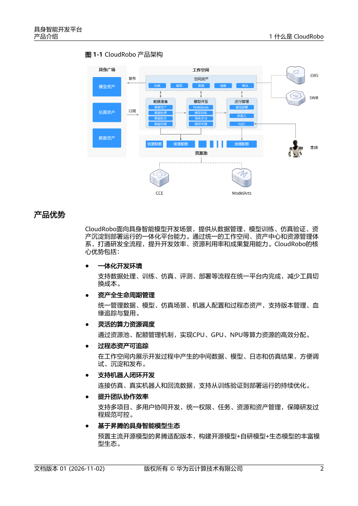

# 02 华为/海思具身智能软件栈总览

数据截止2026-11-05；本章已经完成五个独立深度专题及资料核验。核心判断是：昇腾模块的CANN/框架部署链、海思视觉SoC的BSP/MPP/SVP链、机器人控制和运维，以及CloudRobo云开发是不同交付层。公开原件能支持具体模型部署入口、旧机器人示例与云模型/动作接口，却不足以证明所有当前SKU已有统一机器人全栈、任意VLA或实时控制认证。选型必须按完整SKU、发行包、模型和本体契约验证。

## 1. 阅读路线与软件边界

五篇逐篇完成：[02A_Ascend_CANN_Runtime](02A_Ascend_CANN_Runtime.md) 研究ATC/OM、AscendCL对象生命周期、buffer/异步/动态档位；[02B_Framework_Model_Deployment](02B_Framework_Model_Deployment.md) 研究TorchNPU、MindSpore Lite、YOLO导出/runtime及vLLM支持排除；[02C_HiSilicon_BSP_MPP_NPU](02C_HiSilicon_BSP_MPP_NPU.md) 研究板级包、视频流水线、NNIE量化/分段、多执行域和二进制许可；[02D_Robot_Integration_Operations](02D_Robot_Integration_Operations.md) 研究真实示例收发、坐标/时间/动作契约、控制分层与运维；[02E_CloudRobo_Development_Platform](02E_CloudRobo_Development_Platform.md)补齐本轮后续章节发现的云资源/权限、模型注册、R2C配置生效、ROS2队列和回退机制。它们分别保留主张记录、基线、质量检查和零网络去重运行；总览用于选择路径，具体API和限制以专题原文为准。

| 软件域 | 公开证据与作用 | 对应硬件边界 | 本轮成熟度 | 未解决项 |
|---|---|---|---|---|
| CANN/ATC/AscendCL | 目标编译OM、资源和推理执行 | Ascend目标后缀；旧310示例另标 | 官方代码与第三方当前链路 | A2准确包/驱动/固件矩阵 |
| TorchNPU | PyTorch算子/设备/图/分布式适配 | 兼容表含310B等系列 | 官方项目固定提交 | 每模型算子及图功能实测 |
| MindSpore Lite | Converter、Context、Model、predict | Ascend provider与CPU backup | 官方API固定提交 | A2发行包/动态模式矩阵 |
| YOLO Ascend后端 | ONNX→ATC→OM+metadata→InferSession | 文档列310B1/B4目标 | 第三方项目维护的明确路径 | 输入链及准确率/性能复现 |
| vLLM-Ascend | 服务器LLM服务、图/KV管理 | A2/A3服务器及实验310P | 项目FAQ具体支持表 | 明确不支持200I A2/310B |
| 海思BSP/MPP/SVP | 镜像/驱动、媒体、专用AI | 每SoC和板号分开 | 官方旧教材+上游/社区实现 | 当前型号完整SDK和商业权限 |
| 机器人控制 | 本体SDK、消息/坐标、运动执行 | 旧200DK+PC+指定本体 | 教学示例和集成分析 | 当前本体交付/安全/运维验证 |
| CloudRobo/R2C | 工作空间、OBS/SWR、CCE/ModelArts及观测/动作映射 | 云训练/部署与本体端侧分开 | 官方开发/真机接口实践 | SDK/资产许可、准确资源及闭环性能 |

## 2. 两条端侧数据链与一个服务器分支

昇腾检测路线可追到 [Ultralytics_Ascend_Doc](https://raw.githubusercontent.com/ultralytics/ultralytics/c4e0ba9310ca5c567adb2b02f351f4d721557c71/docs/en/integrations/ascend.md)（[本地原件](REFERENCES.md#ref-a1db7fce7f18dedb)）、[Ultralytics_Ascend_Exporter](https://raw.githubusercontent.com/ultralytics/ultralytics/c4e0ba9310ca5c567adb2b02f351f4d721557c71/ultralytics/utils/export/ascend.py)（[本地原件](REFERENCES.md#ref-0826b6cee47ed307)） 和 [Ultralytics_Ascend_Backend](https://raw.githubusercontent.com/ultralytics/ultralytics/c4e0ba9310ca5c567adb2b02f351f4d721557c71/ultralytics/nn/backends/ascend.py)（[本地原件](REFERENCES.md#ref-85889b8b8d60cc34)）：YOLO产生ONNX，ATC编译静态NCHW、FP16、具体SoC的OM，目录保存metadata，InferSession执行，输入经过CPU NumPy。默认imgsz640、batch1、opset17和quantize16是该后端快照设置，不能当所有CANN统一上限。第三方文档把310B4/310B1映射到8T/20T开发平台，但没有替代01缺失的准确料号和内存SKU证据。

[ACL_ModelProcess](https://raw.githubusercontent.com/Ascend/samples/fc2aea93e48be8f8cee51d0c6c1b13a08155f83a/cplusplus/level2_simple_inference/1_classification/resnet50_imagenet_classification/src/model_process.cpp)（[本地原件](REFERENCES.md#ref-4773c545724ea61b)）、[ACL_SampleProcess](https://raw.githubusercontent.com/Ascend/samples/fc2aea93e48be8f8cee51d0c6c1b13a08155f83a/cplusplus/level2_simple_inference/1_classification/resnet50_imagenet_classification/src/sample_process.cpp)（[本地原件](REFERENCES.md#ref-b1cece1042fbfdaa)）、[ACL_Async_ModelProcess](https://raw.githubusercontent.com/Ascend/samples/fc2aea93e48be8f8cee51d0c6c1b13a08155f83a/cplusplus/level2_simple_inference/1_classification/resnet50_async_imagenet_classification/src/model_process.cpp)（[本地原件](REFERENCES.md#ref-9aab3388a79f9a2b)） 则提供更底层的资源解释：工作区/权重区、modelId/描述符、dataset和buffer、context/stream、同步执行与异步回调各有生命周期。包装器不等于真实内存，提交不等于输出完成；本体控制必须在数据完成且时间有效时消费结果。[ACL_Dynamic_README](https://raw.githubusercontent.com/Ascend/samples/fc2aea93e48be8f8cee51d0c6c1b13a08155f83a/cplusplus/level2_simple_inference/1_classification/resnet50_imagenet_dynamic_dims/README_CN.md)（[本地原件](REFERENCES.md#ref-0e7479d186c8d8e5)） 的CANN≥5.0.4/Atlas200DK/Atlas300档位用例是旧310参考，不当当前A2动态输入验收。

海思视觉路线依据 [HiSilicon_DV300_SDK_PDF](https://www.hisilicon.com/dam/asset/view/7c925d6a091b49b5b1d1b0dc28d6dc4b.pdf/download)（[本地原件](REFERENCES.md#ref-7dcd59b2f2952de6)） 和 [HiSilicon_DV300_Media_PDF](https://www.hisilicon.com/dam/asset/view/2a1c6e800feb43f4a8a31f8bcdcdc84a.pdf/download)（[本地原件](REFERENCES.md#ref-35a27bc010e9b7ba)）：板级SDK启动和加载驱动，Sensor→VI/ISP→VPSS→推理或编码/网络分支，SYS/VB/MMZ负责相应资源。[HiSilicon_DV300_SVP_PDF](https://www.hisilicon.com/dam/asset/view/4ef2e012655a4aae8c80619b8cfd093f.pdf/download)（[本地原件](REFERENCES.md#ref-8b4b0448c818638c)） 的旧NNIE通过Caffe/RuyiStudio量化WK，支持分段由CPU补缺失层；WK与昇腾OM不同。[HiView_3403_VPSS](https://raw.githubusercontent.com/openhisilicon/HIVIEW/395b53d4c28cf5e528c9e1ba3f7ec39ad8e852d4/mod/svp/3403/vpss_capture.cpp)（[本地原件](REFERENCES.md#ref-724494f823f91527)） 揭示当前社区3403的stride、格式、物理映射、VGS/IVE转换和帧释放，但算法库及目标商业包未完整取得，不能称全系列官方NPU SDK已验证。

硬件引擎也不能只看总TOPS：[HiSilicon_Hi3519AV200](https://www.hisilicon.com/cn/products/smart-vision/machine-vision/hi3519av200)（[本地原件](REFERENCES.md#ref-387e661a1427ecf6)） 的HNR5.6T保留不开放，通用AI预算应按开放2.5T；[HiSilicon_Hi3403V100](https://www.hisilicon.com/cn/products/smart-vision/machine-vision/hi3403v100)（[本地原件](REFERENCES.md#ref-c2d6971a30360f9c)） 双引擎精度不同，仍需目标调度/算子证据；[HiSilicon_Hi3516CV610](https://www.hisilicon.com/cn/products/smart-vision/machine-vision/hi3516cv610)（[本地原件](REFERENCES.md#ref-7e91d964fbc23ad4)） 的128MB与产品轻量VLM宣称不能推导通用大VLA。Linux/OpenHarmony/LiteOS支持方向还需要具体发行包，[OH_DV300_README](https://raw.githubusercontent.com/openharmony/device_soc_hisilicon/7c1e2d5b35c090009bbe195f09337701c60af032/hi3516dv300/README_zh.md)（[本地原件](REFERENCES.md#ref-27744d9b77642827)） 的DV300约束不能替代CV610端口证明。

服务器分支依据 [VLLM_Ascend_FAQ](https://raw.githubusercontent.com/vllm-project/vllm-ascend/4a29682d1d8fa89df63a45dc4df2a2a8068984ff/docs/source/faqs.md)（[本地原件](REFERENCES.md#ref-f20d548af3f05045)）：支持“Atlas A2”主要指910B服务器/训练系列，200I A2（310B）明确未支持且未计划。图捕获尺寸、KV cache、preemption及TTFT/TPOT调优能帮助服务器服务容量设计，不能作为机载模块模型性能或控制频率。远程规划增加观测上传、网络、排队和下游约束链，必须另测端到端时间。

CloudRobo是新增云开发分支。官方产品架构连接工作空间资产与OBS存储、SWR镜像、CCE数据/评测、ModelArts训练及R2C本体接口，平台本身无数据存储。SO101/PI05链已有LeRobot v0.5.1、双图/六关节、训练资产和在线服务步骤；自定义镜像ASCEND_SNT9B不是310B端侧支持证据。r2c.json在服务详情、新部署、模型OBS目录和训练终态的读取范围不同，修改OBS后重启现存服务不会更新映射。云模型输出chunk，经ROS2适配器映射回本体，动作执行频率和云policy/控制器/伺服分别验收。[CloudRobo_ProductPDF](https://support.huaweicloud.com/productdesc-cloudrobo/CloudRobo%20%E4%BA%A7%E5%93%81%E4%BB%8B%E7%BB%8D-pdf.pdf)（[本地原件](REFERENCES.md#ref-522f065088effec2)） [CloudRobo_R2C_Protocol](https://support.huaweicloud.com/sdkreference-cloudrobo/cloudrobo_03_0005.html)（[本地原件](REFERENCES.md#ref-0d6d7a9901ad30ed)） [CloudRobo_MetaEngineAdapter](https://support.huaweicloud.com/sdkreference-cloudrobo/cloudrobo_03_0043.html)（[本地原件](REFERENCES.md#ref-ee80c57df6e65a65)）

官方架构图支持云开发对象交接，不证明所有步骤由同一加速器运行，也不证明端侧A2已搭载在示例机器人。IAM/委托、资产血缘和资源配额可减少协作混乱，但模型权重、镜像digest、映射、端侧YAML及标定仍应成组冻结。费用有开发平台、仿真、模型和独立资源项，预算/供应/监管详见[09_SWOT_Analysis](09_SWOT_Analysis.md)，不能用体验额度或教学示例价格当项目成本。[CloudRobo_BillingPDF](https://support.huaweicloud.com/price-cloudrobo/CloudRobo%20%E8%AE%A1%E8%B4%B9%E8%AF%B4%E6%98%8E-pdf.pdf)（[本地原件](REFERENCES.md#ref-8b711de4fe937ab4)）

## 3. 版本、工具与开发调优

[TorchNPU_Compatibility](https://raw.githubusercontent.com/Ascend/pytorch/848b8e7271069d5a9947bf75fd02a162092b41a6/COMPATIBILITY.md)（[本地原件](REFERENCES.md#ref-c8e8a0ecbae18c29)） 推荐安装包2.14/PyTorch2.14/CANN9.2.X，并列26.2.0与CANN9.2.0配套；[Ascend_Pytorch_README](https://raw.githubusercontent.com/Ascend/pytorch/848b8e7271069d5a9947bf75fd02a162092b41a6/README.zh.md)（[本地原件](REFERENCES.md#ref-631b32f5b2990a25)） 的2.12+CANN9.1.0只是安装例。[TorchNPU_Version](https://raw.githubusercontent.com/Ascend/pytorch/848b8e7271069d5a9947bf75fd02a162092b41a6/version.txt)（[本地原件](REFERENCES.md#ref-ee788460702ca65c)） 构建列表含2.13—2.16，[TorchNPU_Support](https://raw.githubusercontent.com/Ascend/pytorch/848b8e7271069d5a9947bf75fd02a162092b41a6/SUPPORT.md)（[本地原件](REFERENCES.md#ref-8ec3a493e5bb1fd0)） 的2.15/2.16为未来计划。源树、安装包、产品版本、维护状态和未来规划必须分开，不能用“最新”概括。固定提交仓库可核验这些表，但本轮没有下载目标CANN实际发行包，门户/公告归档空壳未纳入证据。

MindStudio在旧示例中提供IDE入口，TorchNPU README列profiling、日志和通信WatchDog；海思旧教材列proc/debug dump、HiBurn和RuyiStudio。它们能定位模型、媒体或系统问题，不能仅凭工具名宣称端到端机器人可观测性齐备。调优须同时记录CPU前后处理、NPU、搬运、video/ISP、队列和控制反馈；编译日志、模型加载与独立算子profiling分别验证，不能只报告设备执行核时间。

| 验收对象 | 应固定/记录的内容 | 触发重新验证的变化 | 不能替代的证据 |
|---|---|---|---|
| 平台包 | SKU/板号、OS/BSP、驱动/固件/runtime | 升级、换载板/容量 | 合同支持和电气规范 |
| 模型图 | 网络/权重/编译参数/目标/metadata哈希 | shape、精度、算子、标签改变 | 目标准确率及任务成功 |
| 输入链 | 原始格式、stride、标定、frame/time | sensor/ISP/padding改变 | 相机真值/时序测量 |
| 并发运行 | 内存、队列、编码/网络/日志负载 | 新任务和后台负载 | 持续温度/功率和尾时延 |
| 动作端 | 单位、关节顺序、有效期、反馈 | 本体/控制模式改变 | 可执行性与失效响应 |

## 4. 许可、成熟度和选择条件

[Ascend_Samples_License](https://raw.githubusercontent.com/Ascend/samples/fc2aea93e48be8f8cee51d0c6c1b13a08155f83a/LICENSE)（[本地原件](REFERENCES.md#ref-181037fb87140fdd)） 为Apache2，但教学README非商业说明保留；[Ascend_Pytorch_License](https://raw.githubusercontent.com/Ascend/pytorch/848b8e7271069d5a9947bf75fd02a162092b41a6/LICENSE)（[本地原件](REFERENCES.md#ref-fa776f961ff2c65d)） 为多贡献者BSD式代码许可，[TorchNPU_Docs_License](https://raw.githubusercontent.com/Ascend/pytorch/848b8e7271069d5a9947bf75fd02a162092b41a6/docs/LICENSE)（[本地原件](REFERENCES.md#ref-3f6a90da52e553c6)） 为CC BY4.0；[MindSpore_License](https://raw.githubusercontent.com/mindspore-ai/mindspore/16873579685a1662f10ebd1df068bf512f211869/LICENSE)（[本地原件](REFERENCES.md#ref-6fd61b8704aab060)）、[VLLM_Ascend_License](https://raw.githubusercontent.com/vllm-project/vllm-ascend/4a29682d1d8fa89df63a45dc4df2a2a8068984ff/LICENSE)（[本地原件](REFERENCES.md#ref-872f7eae47477360)） 为Apache2，[Ultralytics_License](https://raw.githubusercontent.com/ultralytics/ultralytics/c4e0ba9310ca5c567adb2b02f351f4d721557c71/LICENSE)（[本地原件](REFERENCES.md#ref-969a4c6853947b6b)） 为AGPL3。代码、权重、数据、文档、CANN/算子包、固件和本体SDK分别核验，开源框架不自动授权全部二进制和量产模型。[OH_Media_EULA](https://raw.githubusercontent.com/openharmony/device_soc_hisilicon/7c1e2d5b35c090009bbe195f09337701c60af032/hi3516dv300/sdk_linux/out/lib/LICENSE)（[本地原件](REFERENCES.md#ref-d888125c58c7c3fd)） 的旧DV300媒体库仅授权开发板内部开发/测试，未授予制造/销售/分发含该软件产品；目标商业授权仍需单独取得，不外推所有当前合同。

[Ascend_Robot_Arm_README](https://raw.githubusercontent.com/Ascend/samples/fc2aea93e48be8f8cee51d0c6c1b13a08155f83a/python/level3_multi_model/Robotic_Arm_Object_Following/README_CN.md)（[本地原件](REFERENCES.md#ref-8f2874b95d479613)）、[Ascend_Robot_Chess_README](https://raw.githubusercontent.com/Ascend/samples/fc2aea93e48be8f8cee51d0c6c1b13a08155f83a/python/level3_multi_model/Robot_Play_Chess/README_CN.md)（[本地原件](REFERENCES.md#ref-ff1625a4f4845e8f)） 和 [Ascend_Robot_Car_README](https://raw.githubusercontent.com/Ascend/samples/fc2aea93e48be8f8cee51d0c6c1b13a08155f83a/cplusplus/contrib/robots_car/README_CN.md)（[本地原件](REFERENCES.md#ref-63de9339d4968942)） 证明特定旧200DK机器人示例存在；没有证明当前A2统一ROS2、本体安全或量产运营。[Ascend_Robot_Arm_Code](https://raw.githubusercontent.com/Ascend/samples/fc2aea93e48be8f8cee51d0c6c1b13a08155f83a/python/level3_multi_model/Robotic_Arm_Object_Following/src/robotic_arm_object_following.py)（[本地原件](REFERENCES.md#ref-ef719f51c5eefd5d)） 的每5帧触发是计数，不是5Hz，反投影代码也与README总公式不同。[HiSilicon_AcademyPDF](https://www.hisilicon.com/dam/asset/view/d8442760823b4f5e9fabb6c5bd684846.pdf)（[本地原件](REFERENCES.md#ref-00381035722b48d1)） 说明获取CV610/BSP/MPP课程和HiSupport/FAE途径，不能据课程目录声称接口手册已取得。

对固定视觉节点，可优先评估海思硬件图像流水线和轻量推理，成立条件是合法目标SDK、sensor驱动和并发验证；对A2轻量检测，可优先验证当前第三方静态OM路径；对服务器大模型服务，按vLLM具体硬件列表选择；对多模态机器人策略，先确定注意力/状态缓存/动作头和本体契约，再测框架路径；云开发可评估CloudRobo独立资源、模型与本体接口，仍需取得SDK/资产许可及真实任务验收。没有同模型同输入同功率测试，本文不输出与NVIDIA的倍数、成本或开发效率排名。03的真实传感器/同步研究和06的具体本体研究与这些路线衔接。

## 5. 归档与质量边界

本章引用联合集合覆盖总览及02A—02E；每篇正文满足有效汉字底线，表格最多5列，官方图逐张打开，PNG/SVG/PDF保留原件及衍生哈希。HTML保存原始响应和识别到的依赖；CloudRobo网页部分静态依赖缺失，按partial_static披露，静态归档不证明动态登录/交互完整。CANN当前门户、公告正文占位和海思资料列表动态目录已排除有效证据，原始registry状态未改写，访问限制不能推断厂商没有资料。

本章核验是公开文献、源码、许可和归档结构，未运行NPU、模型、容器或机器人。剩余缺口包括当前A2准确安装组合、新海思SDK/API与商业授权、传递依赖和模型许可、目标模型/传感器性能、实时和安全控制、量产支持。质量检查通过不等于事实自动正确或实机达标；这些边界在逐篇claim_review和manual_review中保存。

## 参考资料与原件

下列资料按 2026-11-05 核验时点使用；抓取日期不是发布日期。URL带提交SHA或tag的源码限定对应版本；main/master及模型卡仅为采集快照，未锁不可变revision。未运行安装脚本、模型或设备。

| 来源 | 原文 / 本地原件 | 版本与归档边界 |
|---|---|---|
| ACL_ResNet_README | [ACL_ResNet_README](https://raw.githubusercontent.com/Ascend/samples/fc2aea93e48be8f8cee51d0c6c1b13a08155f83a/cplusplus/level2_simple_inference/1_classification/resnet50_imagenet_classification/README_CN.md) / [原件](REFERENCES.md#ref-7ee889c63c64edd5) | 固定提交源码/许可快照；确切 SHA 见原文 URL；采集 UTC 2026-11-04T16:26:44.928697+00:00；complete_static |
| ACL_ModelProcess | [ACL_ModelProcess](https://raw.githubusercontent.com/Ascend/samples/fc2aea93e48be8f8cee51d0c6c1b13a08155f83a/cplusplus/level2_simple_inference/1_classification/resnet50_imagenet_classification/src/model_process.cpp) / [原件](REFERENCES.md#ref-4773c545724ea61b) | 固定提交源码/许可快照；确切 SHA 见原文 URL；采集 UTC 2026-11-04T16:26:46.107974+00:00；complete_static |
| ACL_SampleProcess | [ACL_SampleProcess](https://raw.githubusercontent.com/Ascend/samples/fc2aea93e48be8f8cee51d0c6c1b13a08155f83a/cplusplus/level2_simple_inference/1_classification/resnet50_imagenet_classification/src/sample_process.cpp) / [原件](REFERENCES.md#ref-b1cece1042fbfdaa) | 固定提交源码/许可快照；确切 SHA 见原文 URL；采集 UTC 2026-11-04T16:26:47.147990+00:00；complete_static |
| ACL_Async_ModelProcess | [ACL_Async_ModelProcess](https://raw.githubusercontent.com/Ascend/samples/fc2aea93e48be8f8cee51d0c6c1b13a08155f83a/cplusplus/level2_simple_inference/1_classification/resnet50_async_imagenet_classification/src/model_process.cpp) / [原件](REFERENCES.md#ref-9aab3388a79f9a2b) | 固定提交源码/许可快照；确切 SHA 见原文 URL；采集 UTC 2026-11-04T16:26:49.315372+00:00；complete_static |
| ACL_Dynamic_README | [ACL_Dynamic_README](https://raw.githubusercontent.com/Ascend/samples/fc2aea93e48be8f8cee51d0c6c1b13a08155f83a/cplusplus/level2_simple_inference/1_classification/resnet50_imagenet_dynamic_dims/README_CN.md) / [原件](REFERENCES.md#ref-0e7479d186c8d8e5) | 固定提交源码/许可快照；确切 SHA 见原文 URL；采集 UTC 2026-11-04T16:26:48.201531+00:00；complete_static |
| ACL_FirstApp_Figure | [ACL_FirstApp_Figure](https://raw.githubusercontent.com/Ascend/samples/fc2aea93e48be8f8cee51d0c6c1b13a08155f83a/cplusplus/level2_simple_inference/1_classification/resnet50_firstapp/README_fig.png) / [原件](REFERENCES.md#ref-f1da2d06245dd3cc) | 固定提交源码/许可快照；确切 SHA 见原文 URL；采集 UTC 2026-11-04T16:26:50.678467+00:00；complete_static |
| Ascend_Samples_License | [Ascend_Samples_License](https://raw.githubusercontent.com/Ascend/samples/fc2aea93e48be8f8cee51d0c6c1b13a08155f83a/LICENSE) / [原件](REFERENCES.md#ref-181037fb87140fdd) | 固定提交源码/许可快照；确切 SHA 见原文 URL；采集 UTC 2026-11-04T16:24:54.066194+00:00；complete_static |
| Ultralytics_Ascend_Exporter | [Ultralytics_Ascend_Exporter](https://raw.githubusercontent.com/ultralytics/ultralytics/c4e0ba9310ca5c567adb2b02f351f4d721557c71/ultralytics/utils/export/ascend.py) / [原件](REFERENCES.md#ref-0826b6cee47ed307) | 固定提交源码/许可快照；确切 SHA 见原文 URL；采集 UTC 2026-11-04T16:26:59.797042+00:00；complete_static |
| Ultralytics_Ascend_Backend | [Ultralytics_Ascend_Backend](https://raw.githubusercontent.com/ultralytics/ultralytics/c4e0ba9310ca5c567adb2b02f351f4d721557c71/ultralytics/nn/backends/ascend.py) / [原件](REFERENCES.md#ref-85889b8b8d60cc34) | 固定提交源码/许可快照；确切 SHA 见原文 URL；采集 UTC 2026-11-04T16:27:00.982899+00:00；complete_static |
| Ascend_Pytorch_README | [Ascend_Pytorch_README](https://raw.githubusercontent.com/Ascend/pytorch/848b8e7271069d5a9947bf75fd02a162092b41a6/README.zh.md) / [原件](REFERENCES.md#ref-631b32f5b2990a25) | 固定提交源码/许可快照；确切 SHA 见原文 URL；采集 UTC 2026-11-04T16:24:55.143489+00:00；complete_static |
| TorchNPU_Compatibility | [TorchNPU_Compatibility](https://raw.githubusercontent.com/Ascend/pytorch/848b8e7271069d5a9947bf75fd02a162092b41a6/COMPATIBILITY.md) / [原件](REFERENCES.md#ref-c8e8a0ecbae18c29) | 固定提交源码/许可快照；确切 SHA 见原文 URL；采集 UTC 2026-11-04T16:26:54.995372+00:00；complete_static |
| TorchNPU_Support | [TorchNPU_Support](https://raw.githubusercontent.com/Ascend/pytorch/848b8e7271069d5a9947bf75fd02a162092b41a6/SUPPORT.md) / [原件](REFERENCES.md#ref-8ec3a493e5bb1fd0) | 固定提交源码/许可快照；确切 SHA 见原文 URL；采集 UTC 2026-11-04T16:26:56.006939+00:00；complete_static |
| TorchNPU_Version | [TorchNPU_Version](https://raw.githubusercontent.com/Ascend/pytorch/848b8e7271069d5a9947bf75fd02a162092b41a6/version.txt) / [原件](REFERENCES.md#ref-ee788460702ca65c) | 固定提交源码/许可快照；确切 SHA 见原文 URL；采集 UTC 2026-11-04T16:34:25.071067+00:00；complete_static |
| TorchNPU_ArchitectureSVG | [TorchNPU_ArchitectureSVG](https://raw.githubusercontent.com/Ascend/pytorch/848b8e7271069d5a9947bf75fd02a162092b41a6/docs/zh/figures/architecture.svg) / [原件](REFERENCES.md#ref-fd5f565a2196f526) | 固定提交源码/许可快照；确切 SHA 见原文 URL；采集 UTC 2026-11-04T16:26:57.135960+00:00；complete_static |
| Ascend_Pytorch_License | [Ascend_Pytorch_License](https://raw.githubusercontent.com/Ascend/pytorch/848b8e7271069d5a9947bf75fd02a162092b41a6/LICENSE) / [原件](REFERENCES.md#ref-fa776f961ff2c65d) | 固定提交源码/许可快照；确切 SHA 见原文 URL；采集 UTC 2026-11-04T16:24:56.280412+00:00；complete_static |
| TorchNPU_Docs_License | [TorchNPU_Docs_License](https://raw.githubusercontent.com/Ascend/pytorch/848b8e7271069d5a9947bf75fd02a162092b41a6/docs/LICENSE) / [原件](REFERENCES.md#ref-3f6a90da52e553c6) | 固定提交源码/许可快照；确切 SHA 见原文 URL；采集 UTC 2026-11-04T16:26:58.702192+00:00；complete_static |
| MindSpore_Lite_README | [MindSpore_Lite_README](https://raw.githubusercontent.com/mindspore-ai/mindspore/16873579685a1662f10ebd1df068bf512f211869/mindspore/lite/README_CN.md) / [原件](REFERENCES.md#ref-d0f903468c5eec67) | 固定提交源码/许可快照；确切 SHA 见原文 URL；采集 UTC 2026-11-04T16:27:02.093898+00:00；complete_static |
| MindSpore_Lite_Context | [MindSpore_Lite_Context](https://raw.githubusercontent.com/mindspore-ai/mindspore/16873579685a1662f10ebd1df068bf512f211869/mindspore/lite/python/api/context.py) / [原件](REFERENCES.md#ref-05d6c61893baf702) | 固定提交源码/许可快照；确切 SHA 见原文 URL；采集 UTC 2026-11-04T16:27:03.683423+00:00；complete_static |
| MindSpore_Lite_Model | [MindSpore_Lite_Model](https://raw.githubusercontent.com/mindspore-ai/mindspore/16873579685a1662f10ebd1df068bf512f211869/mindspore/lite/python/api/model.py) / [原件](REFERENCES.md#ref-cda426e70c7f20f7) | 固定提交源码/许可快照；确切 SHA 见原文 URL；采集 UTC 2026-11-04T16:27:05.007387+00:00；complete_static |
| MindSpore_Lite_Converter | [MindSpore_Lite_Converter](https://raw.githubusercontent.com/mindspore-ai/mindspore/16873579685a1662f10ebd1df068bf512f211869/mindspore/lite/python/api/converter.py) / [原件](REFERENCES.md#ref-df5f2465b9cb0028) | 固定提交源码/许可快照；确切 SHA 见原文 URL；采集 UTC 2026-11-04T16:27:06.384813+00:00；complete_static |
| MindSpore_License | [MindSpore_License](https://raw.githubusercontent.com/mindspore-ai/mindspore/16873579685a1662f10ebd1df068bf512f211869/LICENSE) / [原件](REFERENCES.md#ref-6fd61b8704aab060) | 固定提交源码/许可快照；确切 SHA 见原文 URL；采集 UTC 2026-11-04T16:24:58.424251+00:00；complete_static |
| Ultralytics_Ascend_Doc | [Ultralytics_Ascend_Doc](https://raw.githubusercontent.com/ultralytics/ultralytics/c4e0ba9310ca5c567adb2b02f351f4d721557c71/docs/en/integrations/ascend.md) / [原件](REFERENCES.md#ref-a1db7fce7f18dedb) | 固定提交源码/许可快照；确切 SHA 见原文 URL；采集 UTC 2026-11-04T16:25:01.762950+00:00；complete_static |
| Ultralytics_License | [Ultralytics_License](https://raw.githubusercontent.com/ultralytics/ultralytics/c4e0ba9310ca5c567adb2b02f351f4d721557c71/LICENSE) / [原件](REFERENCES.md#ref-969a4c6853947b6b) | 固定提交源码/许可快照；确切 SHA 见原文 URL；采集 UTC 2026-11-04T16:25:02.981780+00:00；complete_static |
| VLLM_Ascend_FAQ | [VLLM_Ascend_FAQ](https://raw.githubusercontent.com/vllm-project/vllm-ascend/4a29682d1d8fa89df63a45dc4df2a2a8068984ff/docs/source/faqs.md) / [原件](REFERENCES.md#ref-f20d548af3f05045) | 固定提交源码/许可快照；确切 SHA 见原文 URL；采集 UTC 2026-11-04T16:24:59.633656+00:00；complete_static |
| VLLM_Ascend_License | [VLLM_Ascend_License](https://raw.githubusercontent.com/vllm-project/vllm-ascend/4a29682d1d8fa89df63a45dc4df2a2a8068984ff/LICENSE) / [原件](REFERENCES.md#ref-872f7eae47477360) | 固定提交源码/许可快照；确切 SHA 见原文 URL；采集 UTC 2026-11-04T16:25:00.706728+00:00；complete_static |
| HiSilicon_DV300_SDK_PDF | [HiSilicon_DV300_SDK_PDF](https://www.hisilicon.com/dam/asset/view/7c925d6a091b49b5b1d1b0dc28d6dc4b.pdf/download) / [原件](REFERENCES.md#ref-7dcd59b2f2952de6) | 页面/tag版本见原文；按采集快照使用；采集 UTC 2026-11-04T16:30:58.571674+00:00；complete_static |
| HiSilicon_DV300_Media_PDF | [HiSilicon_DV300_Media_PDF](https://www.hisilicon.com/dam/asset/view/2a1c6e800feb43f4a8a31f8bcdcdc84a.pdf/download) / [原件](REFERENCES.md#ref-35a27bc010e9b7ba) | 页面/tag版本见原文；按采集快照使用；采集 UTC 2026-11-04T16:31:04.931888+00:00；complete_static |
| HiSilicon_DV300_SVP_PDF | [HiSilicon_DV300_SVP_PDF](https://www.hisilicon.com/dam/asset/view/4ef2e012655a4aae8c80619b8cfd093f.pdf/download) / [原件](REFERENCES.md#ref-8b4b0448c818638c) | 页面/tag版本见原文；按采集快照使用；采集 UTC 2026-11-04T16:31:10.189959+00:00；complete_static |
| HiSilicon_LiteOS_PDF | [HiSilicon_LiteOS_PDF](https://www.hisilicon.com/dam/asset/view/5103be8a8500426e8b60325acbfc9359.pdf/download) / [原件](REFERENCES.md#ref-03c5df99d558fb36) | 页面/tag版本见原文；按采集快照使用；采集 UTC 2026-11-04T16:30:55.412005+00:00；complete_static |
| OH_HiSilicon_README | [OH_HiSilicon_README](https://raw.githubusercontent.com/openharmony/device_soc_hisilicon/7c1e2d5b35c090009bbe195f09337701c60af032/README.md) / [原件](REFERENCES.md#ref-f3b4a2b9762761f5) | 固定提交源码/许可快照；确切 SHA 见原文 URL；采集 UTC 2026-11-04T16:34:26.273042+00:00；complete_static |
| OH_DV300_README | [OH_DV300_README](https://raw.githubusercontent.com/openharmony/device_soc_hisilicon/7c1e2d5b35c090009bbe195f09337701c60af032/hi3516dv300/README_zh.md) / [原件](REFERENCES.md#ref-27744d9b77642827) | 固定提交源码/许可快照；确切 SHA 见原文 URL；采集 UTC 2026-11-04T16:34:27.497312+00:00；complete_static |
| OH_HiSilicon_License | [OH_HiSilicon_License](https://raw.githubusercontent.com/openharmony/device_soc_hisilicon/7c1e2d5b35c090009bbe195f09337701c60af032/LICENSE) / [原件](REFERENCES.md#ref-419f3efb06e078ac) | 固定提交源码/许可快照；确切 SHA 见原文 URL；采集 UTC 2026-11-04T16:33:40.663414+00:00；complete_static |
| OH_Driver_License | [OH_Driver_License](https://raw.githubusercontent.com/openharmony/device_soc_hisilicon/7c1e2d5b35c090009bbe195f09337701c60af032/hi3516dv300/sdk_linux/drv/LICENSE) / [原件](REFERENCES.md#ref-99677d79a1d3021c) | 固定提交源码/许可快照；确切 SHA 见原文 URL；采集 UTC 2026-11-04T16:34:29.181859+00:00；complete_static |
| OH_Media_EULA | [OH_Media_EULA](https://raw.githubusercontent.com/openharmony/device_soc_hisilicon/7c1e2d5b35c090009bbe195f09337701c60af032/hi3516dv300/sdk_linux/out/lib/LICENSE) / [原件](REFERENCES.md#ref-d888125c58c7c3fd) | 固定提交源码/许可快照；确切 SHA 见原文 URL；采集 UTC 2026-11-04T16:38:04.870536+00:00；complete_static |
| HiView_README | [HiView_README](https://raw.githubusercontent.com/openhisilicon/HIVIEW/395b53d4c28cf5e528c9e1ba3f7ec39ad8e852d4/README.md) / [原件](REFERENCES.md#ref-c89786e45c3e552a) | 固定提交源码/许可快照；确切 SHA 见原文 URL；采集 UTC 2026-11-04T16:33:38.757127+00:00；complete_static |
| HiView_3403_VPSS | [HiView_3403_VPSS](https://raw.githubusercontent.com/openhisilicon/HIVIEW/395b53d4c28cf5e528c9e1ba3f7ec39ad8e852d4/mod/svp/3403/vpss_capture.cpp) / [原件](REFERENCES.md#ref-724494f823f91527) | 固定提交源码/许可快照；确切 SHA 见原文 URL；采集 UTC 2026-11-04T16:38:01.012968+00:00；complete_static |
| HiView_3403_YOLO | [HiView_3403_YOLO](https://raw.githubusercontent.com/openhisilicon/HIVIEW/395b53d4c28cf5e528c9e1ba3f7ec39ad8e852d4/mod/svp/3403/yolov8.cpp) / [原件](REFERENCES.md#ref-b8c035537722bae0) | 固定提交源码/许可快照；确切 SHA 见原文 URL；采集 UTC 2026-11-04T16:38:03.318452+00:00；complete_static |
| HiSilicon_Hi3403V100 | [HiSilicon_Hi3403V100](https://www.hisilicon.com/cn/products/smart-vision/machine-vision/hi3403v100) / [原件](REFERENCES.md#ref-c2d6971a30360f9c) | 页面/tag版本见原文；按采集快照使用；采集 UTC 2026-11-04T15:55:36.357424+00:00；complete_static |
| HiSilicon_Hi3519AV200 | [HiSilicon_Hi3519AV200](https://www.hisilicon.com/cn/products/smart-vision/machine-vision/hi3519av200) / [原件](REFERENCES.md#ref-387e661a1427ecf6) | 页面/tag版本见原文；按采集快照使用；采集 UTC 2026-11-04T15:55:51.885466+00:00；complete_static |
| HiSilicon_Hi3516CV610 | [HiSilicon_Hi3516CV610](https://www.hisilicon.com/cn/products/smart-vision/machine-vision/hi3516cv610) / [原件](REFERENCES.md#ref-7e91d964fbc23ad4) | 页面/tag版本见原文；按采集快照使用；采集 UTC 2026-11-04T15:54:58.249797+00:00；complete_static |
| HiSilicon_AcademyPDF | [HiSilicon_AcademyPDF](https://www.hisilicon.com/dam/asset/view/d8442760823b4f5e9fabb6c5bd684846.pdf) / [原件](REFERENCES.md#ref-00381035722b48d1) | 页面/tag版本见原文；按采集快照使用；采集 UTC 2026-11-04T15:56:16.261779+00:00；complete_static |
| Ascend_Robot_Arm_README | [Ascend_Robot_Arm_README](https://raw.githubusercontent.com/Ascend/samples/fc2aea93e48be8f8cee51d0c6c1b13a08155f83a/python/level3_multi_model/Robotic_Arm_Object_Following/README_CN.md) / [原件](REFERENCES.md#ref-8f2874b95d479613) | 固定提交源码/许可快照；确切 SHA 见原文 URL；采集 UTC 2026-11-04T16:26:51.818729+00:00；complete_static |
| Ascend_Robot_Arm_Code | [Ascend_Robot_Arm_Code](https://raw.githubusercontent.com/Ascend/samples/fc2aea93e48be8f8cee51d0c6c1b13a08155f83a/python/level3_multi_model/Robotic_Arm_Object_Following/src/robotic_arm_object_following.py) / [原件](REFERENCES.md#ref-ef719f51c5eefd5d) | 固定提交源码/许可快照；确切 SHA 见原文 URL；采集 UTC 2026-11-04T16:40:57.702368+00:00；complete_static |
| Ascend_Robot_Arm_Flow | [Ascend_Robot_Arm_Flow](https://images.gitee.com/uploads/images/2021/0310/112856_f44ecafd_5537256.png) / [原件](REFERENCES.md#ref-1cf94bd983a08931) | 页面/tag版本见原文；按采集快照使用；采集 UTC 2026-11-04T16:41:02.432670+00:00；complete_static |
| Ascend_Robot_Chess_README | [Ascend_Robot_Chess_README](https://raw.githubusercontent.com/Ascend/samples/fc2aea93e48be8f8cee51d0c6c1b13a08155f83a/python/level3_multi_model/Robot_Play_Chess/README_CN.md) / [原件](REFERENCES.md#ref-ff1625a4f4845e8f) | 固定提交源码/许可快照；确切 SHA 见原文 URL；采集 UTC 2026-11-04T16:26:52.848629+00:00；complete_static |
| Ascend_Robot_Car_README | [Ascend_Robot_Car_README](https://raw.githubusercontent.com/Ascend/samples/fc2aea93e48be8f8cee51d0c6c1b13a08155f83a/cplusplus/contrib/robots_car/README_CN.md) / [原件](REFERENCES.md#ref-63de9339d4968942) | 固定提交源码/许可快照；确切 SHA 见原文 URL；采集 UTC 2026-11-04T16:26:53.914348+00:00；complete_static |
| CloudRobo_ProductPDF | [CloudRobo_ProductPDF](https://support.huaweicloud.com/productdesc-cloudrobo/CloudRobo%20%E4%BA%A7%E5%93%81%E4%BB%8B%E7%BB%8D-pdf.pdf) / [原件](REFERENCES.md#ref-522f065088effec2) | 文档01，2026-11-02；完整20页PDF；采集 UTC 2026-11-04T16:53:04.019493+00:00；complete_static |
| CloudRobo_Functions | [CloudRobo_Functions](https://support.huaweicloud.com/productdesc-cloudrobo/cloudrobo_01_0002.html) / [原件](REFERENCES.md#ref-bd48039a66701d30) | 页面/tag版本见原文；按采集快照使用；采集 UTC 2026-11-04T16:50:47.477798+00:00；partial_static |
| CloudRobo_AccessControl | [CloudRobo_AccessControl](https://support.huaweicloud.com/productdesc-cloudrobo/cloudrobo_01_0006.html) / [原件](REFERENCES.md#ref-dfb97688196115fb) | 页面/tag版本见原文；按采集快照使用；采集 UTC 2026-11-04T17:24:48.434911+00:00；partial_static |
| CloudRobo_RealInference | [CloudRobo_RealInference](https://support.huaweicloud.com/bestpractice-cloudrobo/cloudrobo_05_0002.html) / [原件](REFERENCES.md#ref-dc1a9e483afe4193) | 页面/tag版本见原文；按采集快照使用；采集 UTC 2026-11-04T16:51:56.983744+00:00；partial_static |
| CloudRobo_NotebookModels | [CloudRobo_NotebookModels](https://support.huaweicloud.com/bestpractice-cloudrobo/cloudrobo_05_0071.html) / [原件](REFERENCES.md#ref-98c113a13752203d) | 页面/tag版本见原文；按采集快照使用；采集 UTC 2026-11-04T16:55:53.247719+00:00；partial_static |
| CloudRobo_TrainAlgorithm | [CloudRobo_TrainAlgorithm](https://support.huaweicloud.com/bestpractice-cloudrobo/cloudrobo_05_0037.html) / [原件](REFERENCES.md#ref-0224f097e5474a8f) | 页面/tag版本见原文；按采集快照使用；采集 UTC 2026-11-04T16:55:58.816438+00:00；partial_static |
| CloudRobo_Pretrained | [CloudRobo_Pretrained](https://support.huaweicloud.com/bestpractice-cloudrobo/cloudrobo_05_0003.html) / [原件](REFERENCES.md#ref-b5692b0c250db726) | 页面/tag版本见原文；按采集快照使用；采集 UTC 2026-11-04T16:52:12.666576+00:00；partial_static |
| CloudRobo_CustomModel | [CloudRobo_CustomModel](https://support.huaweicloud.com/bestpractice-cloudrobo/cloudrobo_05_0063.html) / [原件](REFERENCES.md#ref-5ae8198484173dda) | 页面/tag版本见原文；按采集快照使用；采集 UTC 2026-11-04T16:52:27.137172+00:00；partial_static |
| CloudRobo_R2C_Protocol | [CloudRobo_R2C_Protocol](https://support.huaweicloud.com/sdkreference-cloudrobo/cloudrobo_03_0005.html) / [原件](REFERENCES.md#ref-0d6d7a9901ad30ed) | 页面/tag版本见原文；按采集快照使用；采集 UTC 2026-11-04T17:16:19.243550+00:00；partial_static |
| CloudRobo_MetaEngineAdapter | [CloudRobo_MetaEngineAdapter](https://support.huaweicloud.com/sdkreference-cloudrobo/cloudrobo_03_0043.html) / [原件](REFERENCES.md#ref-ee80c57df6e65a65) | 页面/tag版本见原文；按采集快照使用；采集 UTC 2026-11-04T17:16:33.063349+00:00；partial_static |
| CloudRobo_SimEvaluation | [CloudRobo_SimEvaluation](https://support.huaweicloud.com/bestpractice-cloudrobo/cloudrobo_05_0057.html) / [原件](REFERENCES.md#ref-ed5202e058aafdf3) | 页面/tag版本见原文；按采集快照使用；采集 UTC 2026-11-04T17:01:04.460075+00:00；partial_static |
| O3DE_ROS2_Gem | [O3DE_ROS2_Gem](https://docs.o3de.org/docs/user-guide/gems/reference/robotics/ros2/) / [原件](REFERENCES.md#ref-dc8455e9dd28d51b) | 无发行版本号；2026-11-05文档快照，文档CC BY4.0；采集 UTC 2026-11-04T17:17:20.064711+00:00；complete_static |
| LeRobot_License_051 | [LeRobot_License_051](https://raw.githubusercontent.com/huggingface/lerobot/v0.5.1/LICENSE) / [原件](REFERENCES.md#ref-e62ae236f246ce5d) | v0.5.1固定tag，主体Apache2.0及派生通知；采集 UTC 2026-11-04T16:56:20.670298+00:00；complete_static |
| CloudRobo_BillingPDF | [CloudRobo_BillingPDF](https://support.huaweicloud.com/price-cloudrobo/CloudRobo%20%E8%AE%A1%E8%B4%B9%E8%AF%B4%E6%98%8E-pdf.pdf) / [原件](REFERENCES.md#ref-8b711de4fe937ab4) | 文档01，2026-11-02，26页；采集 UTC 2026-11-04T17:24:36.474606+00:00；complete_static |
| CloudRobo_BillingManagement | [CloudRobo_BillingManagement](https://support.huaweicloud.com/price-cloudrobo/cloudrobo_04_0017.html) / [原件](REFERENCES.md#ref-ad679c4948e75582) | 页面/tag版本见原文；按采集快照使用；采集 UTC 2026-11-04T17:24:46.238677+00:00；partial_static |

[主张和图源核验](research_state/evidence/02_Software_Stack.json)。各引用保存原始响应、哈希及 metadata；静态归档不承诺动态交互或像素级复现。
