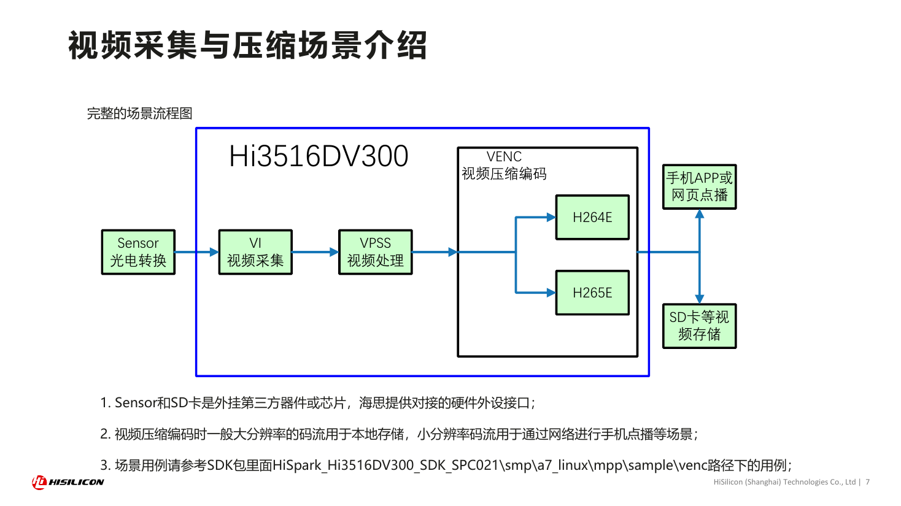
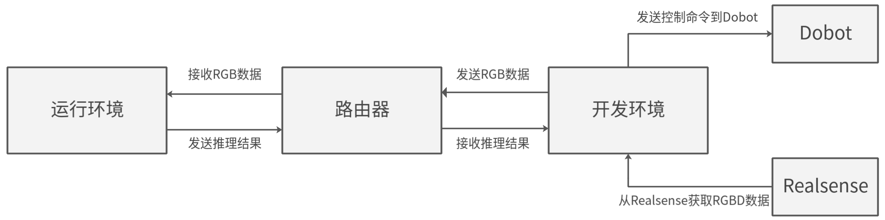

# 03 华为/海思平台的传感器接入、同步与融合

数据截止2026-11-05。本章把芯片PHY、板级连接、sensor驱动、图像处理、DMA/内存、模型输入与本体坐标分开。产品支持接口可以提供适配起点，不能单独证明某一相机、LiDAR或工业传感器已经通过完整系统验收。现有证据覆盖官方芯片页、DV300媒体/SVP教材、当前3403社区帧路径以及旧200DK+D435示例；未取得准确A2载板接口/时序手册和新芯片传感器兼容矩阵。

## 1. 硬件输入能力与完整连接路径

[HiSilicon_Hi3519DV500](https://www.hisilicon.com/cn/products/smart-vision/machine-vision/hi3519dv500)（[本地原件](REFERENCES.md#ref-fb9339639d9cd3da)） 明确8-lane image sensor输入，可2×4或4×2配置，最高4路sensor，支持MIPI/LVDS/Sub-LVDS/HiSPi，另列MIPI虚拟通道1—4路YUV、结构光/cwToF及CMOS电平热成像输入。[HiSilicon_Hi3516DV500](https://www.hisilicon.com/cn/products/smart-vision/machine-vision/hi3516dv500)（[本地原件](REFERENCES.md#ref-ae8b7e0bde6a7d6d)） 则为4lane、最高2路sensor。虚拟通道YUV是在传输上复用的数据流，不等于每路拥有独立RAW sensor/ISP资源；输入最大路数、ISP最大分辨率、拼接和编码条件要分别读，不能直接相乘成全链路保证。

[HiSilicon_Hi3403V100](https://www.hisilicon.com/cn/products/smart-vision/machine-vision/hi3403v100)（[本地原件](REFERENCES.md#ref-c2d6971a30360f9c)）、[HiSilicon_Hi3519AV200](https://www.hisilicon.com/cn/products/smart-vision/machine-vision/hi3519av200)（[本地原件](REFERENCES.md#ref-387e661a1427ecf6)） 是更高资源视觉SoC，但用户开放NPU预算、AI ISP与媒体输入仍须分别配置。[Huawei_Atlas200IA2_Product](https://www.hiascend.com/hardware/accelerator-module-A2)（[本地原件](REFERENCES.md#ref-ccbe37b98431c440)） 声明ISP、MIPI、PCIe、USB和以太网，8条SerDes可配置及UART/I2C/SPI/CAN；8条SerDes并非8个高速端口可同时独占，MIPI入口也未在本次产品正文给出完整接线、lane速率及sensor名单。模块MXM引脚、载板连接器和芯片接口是三层，不能据网页宣布任意GMSL相机直接插用。

| 类型 | 可核验入口 | 实际数据路径 | 未取得的关键条件 |
|---|---|---|---|
| RGB RAW/YUV相机 | DV500明确sensor lane/格式 | sensor→接收器→VI/ISP→VPSS | 精确sensor驱动、模式和时钟 |
| USB RGBD | 旧200DK示例中的PC+D435 | USB相机→PC SDK→RGB网络→NPU | 当前A2本机USB/驱动兼容证明 |
| 双目/结构光/ToF | DV500产品描述与DPU | 外部模组→输入/标定→深度处理 | 双目同步、有效深度范围/误差 |
| 热红外/双光 | 产品页列CMOS输入/融合 | 外部热sensor→校正/配准→融合 | 镜头/非均匀校正及跨谱标定 |
| LiDAR/Radar | 主机网络/USB/串口可设计 | 外部驱动→点云/测量→时间对齐 | 具体设备、驱动、时间戳和平台认证 |
| IMU/力矩/触觉/关节 | I2C/SPI/UART/CAN等接口线索 | 驱动/本体SDK→标定/状态消息 | 采样、同步、单位和控制总线证明 |

GMSL/FPD-Link是长距离串行相机链的外部器件/协议范畴，MIPI接收器本身不能代替serializer/deserializer、供电、触发和驱动。本轮没有目标板桥接芯片及同步原件，因此不称其为SoC原生GMSL支持。Ethernet/PCIe也不能证明特定雷达或LiDAR有即插即用驱动；载板供电、电平和带宽共享必须按端口设计核验。

## 2. ISP、深度与融合的成立条件

[HiSilicon_DV300_Media_PDF](https://www.hisilicon.com/dam/asset/view/2a1c6e800feb43f4a8a31f8bcdcdc84a.pdf/download)（[本地原件](REFERENCES.md#ref-35a27bc010e9b7ba)） 第7—9页官方流程区分VI采集、VPSS处理、VENC编码及网络/存储。推理宜从合适图像分支取得输入；先压缩再解码会增加延迟及压缩差异。ISP的曝光、WDR、降噪、几何校正和融合影响模型输入分布：夜间降噪可能改变纹理，跨帧处理可能改变时效，rolling-shutter与运动校正需陀螺仪时间对齐。产品有相关功能不意味着当前传感器配置和训练数据分布已经验证。

官方完整第7页支持理解Sensor→VI→VPSS→编码及输出分支；它限定DV300/2021教材，不能作当前DV500多路并发证据。RGB识别和录像可使用不同分辨率，但必须记录模型实际采样、crop/resize和原始图坐标映射，不能将低分辨率检测框直接作为高分辨率像素坐标。

两个DV500产品页列DPU最大分辨率2048×2048、最大视差224、处理性能720p30，三个最大值不是同一运行条件。不能称2048²@30fps且224视差全开已保证。按理想双目模型，深度z=fB/d，误差近似|δz|≈fB|δd|/d²（分析），远处视差小则误差放大；实际还受基线/内参、整流、曝光同步、遮挡和纹理影响。DPU存在不能替代双目模组标定和真实距离误差，也不能替代ToF的相位/多径校正。

热红外与RGB融合需要两种光学系统的外参、不同视场/畸变、帧率和时间对齐；“双光融合”不等于温度测量精度保证。ToF支持必须核对模组输出是RAW相关数据、幅度/相位还是已有深度图，时序、校准和软件入口不同。结构光同样需要投射器、相机和标定，产品接口描述不足以形成完整3D相机BOM。

## 3. buffer、stride、缓存与拷贝

[HiView_3403_VPSS](https://raw.githubusercontent.com/openhisilicon/HIVIEW/395b53d4c28cf5e528c9e1ba3f7ec39ad8e852d4/mod/svp/3403/vpss_capture.cpp)（[本地原件](REFERENCES.md#ref-724494f823f91527)） 的第三方实现保留帧地址、stride、pixel_format，必要时使用VGS将压缩/非线性帧转换，并以IVE处理色彩，最后释放channel frame。width是有效像素数，stride是行存储步长；Y/UV半平面420/422、压缩和布局分别影响大小和访问。使用NumPy/OpenCV或ROS image消息时，必须写入正确行步长和编码，否则模型可能读到padding或交换UV通道。该代码不是厂商完整缓存/零拷贝保证，也未完成本轮硬件测试。

[HiSilicon_DV300_SVP_PDF](https://www.hisilicon.com/dam/asset/view/4ef2e012655a4aae8c80619b8cfd093f.pdf/download)（[本地原件](REFERENCES.md#ref-8b4b0448c818638c)） 第18/27页说明NNIE/IVE访问DDR，cached内存被CPU访问后需按版本维护cache，完成查询后才能消费/复用。[ACL_ModelProcess](https://raw.githubusercontent.com/Ascend/samples/fc2aea93e48be8f8cee51d0c6c1b13a08155f83a/cplusplus/level2_simple_inference/1_classification/resnet50_imagenet_classification/src/model_process.cpp)（[本地原件](REFERENCES.md#ref-4773c545724ea61b)） 和 [ACL_Async_ModelProcess](https://raw.githubusercontent.com/Ascend/samples/fc2aea93e48be8f8cee51d0c6c1b13a08155f83a/cplusplus/level2_simple_inference/1_classification/resnet50_async_imagenet_classification/src/model_process.cpp)（[本地原件](REFERENCES.md#ref-9aab3388a79f9a2b)） 展示device buffer、dataset、同步/异步与内存池；将海思MMZ地址直接交给昇腾ACL不自动具有跨设备可达性。所谓零拷贝至少需要生产者和消费者共享可寻址存储、格式/对齐符合、缓存一致且所有权持续到消费结束；仅保留指针或调用mmap不足以证明成立。

复制路径应逐步记录：相机DMA→CPU可见、YUV→RGB/resize、框架tensor、Host→Device、Device→Host、ROS序列化/网络。[Ultralytics_Ascend_Backend](https://raw.githubusercontent.com/ultralytics/ultralytics/c4e0ba9310ca5c567adb2b02f351f4d721557c71/ultralytics/nn/backends/ascend.py)（[本地原件](REFERENCES.md#ref-85889b8b8d60cc34)） 实际`im.cpu().numpy()`后infer，说明这一封装存在CPU数据交接，不应称直接相机到NPU。若在独立海思前端编码上传、A2服务器解码推理，网络和解码又增加一组资源与延迟，应和本地RAW链独立测量。

## 4. D435示例与时间戳机制

[Ascend_Robot_Arm_README](https://raw.githubusercontent.com/Ascend/samples/fc2aea93e48be8f8cee51d0c6c1b13a08155f83a/python/level3_multi_model/Robotic_Arm_Object_Following/README_CN.md)（[本地原件](REFERENCES.md#ref-8f2874b95d479613)） 指定D435连接PC、200DK网络推理；[Ascend_Robot_Arm_Code](https://raw.githubusercontent.com/Ascend/samples/fc2aea93e48be8f8cee51d0c6c1b13a08155f83a/python/level3_multi_model/Robotic_Arm_Object_Following/src/robotic_arm_object_following.py)（[本地原件](REFERENCES.md#ref-ef719f51c5eefd5d)） 配置深度z16和彩色bgr8、30fps，使用`rs.align(rs.stream.color)`、depth_scale和color intrinsics。align是按标定将深度投影到彩色像素的空间处理，不等价多相机硬触发、全系统时间同步或深度与本体状态同时刻。frames timestamp随RGB封包发送，但本轮未证明端到端结果严格按该ID绑定深度和动作，不能据时间戳字段存在宣称已消除旧观测问题。

官方示例图清楚区分RGBD主机接入、网络RGB/结果和Dobot动作。本轮没有RealSense最新驱动/ROS原件：候选下载因robots检查不允许或无法检查失败，日志保存，不用失败断言驱动不存在。D435支持结论只限定旧华为示例组合，未扩大到所有A2载板/内核。

| 时间量 | 含义 | 误用风险 | 应记录的核验 |
|---|---|---|---|
| 曝光/采样时刻 | 场景产生观测的时刻 | 驱动到达时间代替曝光 | 硬件时间戳及曝光定义 |
| DMA/SDK到达 | 主机拿到数据的时刻 | 被认为跨设备统一时钟 | 时钟域、偏移、漂移 |
| 推理提交/完成 | 排队和计算边界 | 只测核时间遗漏队列 | 帧ID及在途数 |
| ROS发布/消费 | 消息交接 | 发布时间当采样时间 | 源timestamp、QoS及队列 |
| 动作生效 | 控制/本体实际响应 | 命令发送当动作完成 | 本体反馈与有效期限 |

PTP、硬触发、PPS或外部同步必须有硬件/驱动支持证据；本轮未取得目标SKU的PTP硬件timestamp、MIPI触发或传感器共同clock原件，不补填。多传感器即使时钟对齐，曝光窗口、rolling shutter行时刻和处理延迟仍会不同。末端相机融合应使用曝光时本体姿态；移动LiDAR点云可能需按点时间做deskew，不能只用一帧发布时间配IMU。本章给机制条件，未取得指定LiDAR/Radar点级timestamp协议。

## 5. 带宽、背压与系统验收

以下是未含协议/对齐/空白和复制开销的分析下限：1920×1080 RGB888@30fps为186.624MB/s（十进制）；YUV420 8bit为93.312MB/s；4路分别746.496/373.248MB/s。若D435示例改用640×480 BGR8+z16、30fps，原始两流下限46.08MB/s；该分辨率是假设计算，不能当本文实测或原码全部配置。RGBD本地流量、仅RGB网络发送和GPU/NPU tensor流量是不同分母，不将USB标称Gbps直接当有效模型吞吐。

raw像素位深计算与已编码H.264/H.265码率不能混用；编码码率受内容/QP/GOP影响，解码输出再形成大体积图像。多路并发还受lane配置、ISP/VPSS调度、DRAM、CPU前处理、NPU、网口与存储影响，产品单路最大值不能相加。应以相同传感器模式同时运行采集、深度、推理、编码、日志和通信，记录有效帧率、丢帧、输入/输出队列、持续功率温度和观测年龄分布。

高负载下保留所有帧会积累动作依据过期的问题；检测控制可用有界队列和拒绝旧结果，离线记录另保存完整性。必须验证帧引用释放、buffer池耗尽、拔插、sensor超时、格式切换和重启恢复。IMU/力矩/触觉还需饱和、零偏、温漂、量纲和关节映射测试；接口有CAN不能证明本体驱动和伺服周期。本章没有P99/WCET或整机成功率数据，不输出“实时融合已支持”。

选型动作是先确定传感器型号/模式、精确板号、桥接器和电气连接，再拿到BSP/驱动、标定/同步协议与合法软件包；建立单路数值/时间基线，最后多路并发和失效验证。已有海思流水线可减少媒体适配，但优势以格式/缓存/调度正确为条件；A2经主机或本机接入需分别评估路径，没有同系统测量不作零拷贝/时延排名。

## 参考资料与原件

下列资料按 2026-11-05 核验时点使用；抓取日期不是发布日期。源码固定到 URL 中的提交 SHA，代表该快照，不保证所有发行包包含相同实现。未运行安装脚本、模型或设备。

| 来源 | 原文 / 本地原件 | 版本与归档边界 |
|---|---|---|
| HiSilicon_Hi3519DV500 | [HiSilicon_Hi3519DV500](https://www.hisilicon.com/cn/products/smart-vision/machine-vision/hi3519dv500) / [原件](REFERENCES.md#ref-fb9339639d9cd3da) | 页面未标版号；按采集快照使用；采集 UTC 2026-11-04T15:55:55.988547+00:00；complete_static |
| HiSilicon_Hi3516DV500 | [HiSilicon_Hi3516DV500](https://www.hisilicon.com/cn/products/smart-vision/machine-vision/hi3516dv500) / [原件](REFERENCES.md#ref-ae8b7e0bde6a7d6d) | 页面未标版号；按采集快照使用；采集 UTC 2026-11-04T15:56:01.654577+00:00；complete_static |
| HiSilicon_Hi3403V100 | [HiSilicon_Hi3403V100](https://www.hisilicon.com/cn/products/smart-vision/machine-vision/hi3403v100) / [原件](REFERENCES.md#ref-c2d6971a30360f9c) | 页面未标版号；按采集快照使用；采集 UTC 2026-11-04T15:55:36.357424+00:00；complete_static |
| HiSilicon_Hi3519AV200 | [HiSilicon_Hi3519AV200](https://www.hisilicon.com/cn/products/smart-vision/machine-vision/hi3519av200) / [原件](REFERENCES.md#ref-387e661a1427ecf6) | 页面未标版号；按采集快照使用；采集 UTC 2026-11-04T15:55:51.885466+00:00；complete_static |
| Huawei_Atlas200IA2_Product | [Huawei_Atlas200IA2_Product](https://www.hiascend.com/hardware/accelerator-module-A2) / [原件](REFERENCES.md#ref-ccbe37b98431c440) | 页面未标版号；按采集快照使用；采集 UTC 2026-11-04T15:46:18.440423+00:00；complete_static |
| HiSilicon_DV300_Media_PDF | [HiSilicon_DV300_Media_PDF](https://www.hisilicon.com/dam/asset/view/2a1c6e800feb43f4a8a31f8bcdcdc84a.pdf/download) / [原件](REFERENCES.md#ref-35a27bc010e9b7ba) | 页面未标版号；按采集快照使用；采集 UTC 2026-11-04T16:31:04.931888+00:00；complete_static |
| HiSilicon_DV300_SVP_PDF | [HiSilicon_DV300_SVP_PDF](https://www.hisilicon.com/dam/asset/view/4ef2e012655a4aae8c80619b8cfd093f.pdf/download) / [原件](REFERENCES.md#ref-8b4b0448c818638c) | 页面未标版号；按采集快照使用；采集 UTC 2026-11-04T16:31:10.189959+00:00；complete_static |
| HiView_3403_VPSS | [HiView_3403_VPSS](https://raw.githubusercontent.com/openhisilicon/HIVIEW/395b53d4c28cf5e528c9e1ba3f7ec39ad8e852d4/mod/svp/3403/vpss_capture.cpp) / [原件](REFERENCES.md#ref-724494f823f91527) | 固定提交源码/许可快照；确切 SHA 见原文 URL；采集 UTC 2026-11-04T16:38:01.012968+00:00；complete_static |
| ACL_ModelProcess | [ACL_ModelProcess](https://raw.githubusercontent.com/Ascend/samples/fc2aea93e48be8f8cee51d0c6c1b13a08155f83a/cplusplus/level2_simple_inference/1_classification/resnet50_imagenet_classification/src/model_process.cpp) / [原件](REFERENCES.md#ref-4773c545724ea61b) | 固定提交源码/许可快照；确切 SHA 见原文 URL；采集 UTC 2026-11-04T16:26:46.107974+00:00；complete_static |
| ACL_Async_ModelProcess | [ACL_Async_ModelProcess](https://raw.githubusercontent.com/Ascend/samples/fc2aea93e48be8f8cee51d0c6c1b13a08155f83a/cplusplus/level2_simple_inference/1_classification/resnet50_async_imagenet_classification/src/model_process.cpp) / [原件](REFERENCES.md#ref-9aab3388a79f9a2b) | 固定提交源码/许可快照；确切 SHA 见原文 URL；采集 UTC 2026-11-04T16:26:49.315372+00:00；complete_static |
| Ultralytics_Ascend_Backend | [Ultralytics_Ascend_Backend](https://raw.githubusercontent.com/ultralytics/ultralytics/c4e0ba9310ca5c567adb2b02f351f4d721557c71/ultralytics/nn/backends/ascend.py) / [原件](REFERENCES.md#ref-85889b8b8d60cc34) | 固定提交源码/许可快照；确切 SHA 见原文 URL；采集 UTC 2026-11-04T16:27:00.982899+00:00；complete_static |
| Ascend_Robot_Arm_README | [Ascend_Robot_Arm_README](https://raw.githubusercontent.com/Ascend/samples/fc2aea93e48be8f8cee51d0c6c1b13a08155f83a/python/level3_multi_model/Robotic_Arm_Object_Following/README_CN.md) / [原件](REFERENCES.md#ref-8f2874b95d479613) | 固定提交源码/许可快照；确切 SHA 见原文 URL；采集 UTC 2026-11-04T16:26:51.818729+00:00；complete_static |
| Ascend_Robot_Arm_Code | [Ascend_Robot_Arm_Code](https://raw.githubusercontent.com/Ascend/samples/fc2aea93e48be8f8cee51d0c6c1b13a08155f83a/python/level3_multi_model/Robotic_Arm_Object_Following/src/robotic_arm_object_following.py) / [原件](REFERENCES.md#ref-ef719f51c5eefd5d) | 固定提交源码/许可快照；确切 SHA 见原文 URL；采集 UTC 2026-11-04T16:40:57.702368+00:00；complete_static |
| Ascend_Robot_Arm_Flow | [Ascend_Robot_Arm_Flow](https://images.gitee.com/uploads/images/2021/0310/112856_f44ecafd_5537256.png) / [原件](REFERENCES.md#ref-1cf94bd983a08931) | 页面未标版号；按采集快照使用；采集 UTC 2026-11-04T16:41:02.432670+00:00；complete_static |

[主张和图源核验](research_state/evidence/03_Sensor_Integration.json)。各引用保存原始响应、哈希及 metadata；静态归档不承诺动态交互或像素级复现。
