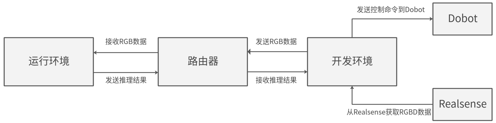

# 06 机器人本体适配与成熟度

本章按2026-11-05取得的官方实践和固定源码快照区分“可接入”“可执行任务”“有运营收益”。CloudRobo已有明确本体、模型服务和动作契约，旧Ascend samples也有硬件演示；尚未取得各案例连续运营台数、暴露时间、人工介入率及可归因到具体端侧芯片的ROI。云模型服务、本地PC、机器人控制器和Atlas模组是不同设备，不能因为平台品牌相同就补出机器人搭载型号。[CloudRobo_ProductPDF](https://support.huaweicloud.com/productdesc-cloudrobo/CloudRobo%20%E4%BA%A7%E5%93%81%E4%BB%8B%E7%BB%8D-pdf.pdf)（[本地原件](REFERENCES.md#ref-522f065088effec2)）

## 本体—计算—任务证据地图

|本体/对象|任务与计算位置|接口/依赖|成熟度及缺口|
|---|---|---|---|
|SO-ARM101|ACT或PI05抓笔放笔筒；云服务推理|LeRobot v0.5.1、R2C、PC、双RGB相机|官方开发调试实践；无量产/成功率报告|
|UR5e+大寰夹爪|PI05基础策略+残差RL抓放航插|Ubuntu、RealSense双图、TCP/串口、人工接管|真机强化开发路线；无工业节拍收益|
|五八智能天狼Q25|CloudRobo-VLN-Track二维跟随导航|ROS2图像/Path、R2C适配器|官方接入调用；无目标机算力料号|
|Dobot机械臂+200DK|YOLOv3识别图标目标跟随|PC、D435、网络、旧样例|公开演示；非A2新代验证|
|Mirobot+200DK|VGG16视觉下棋|旧Ascend软件/机械臂接口|样例集成；无商业棋艺服务数据|
|contrib机器人小车|DBNet/CRNN文字识别|catkin、旧CANN示例|贡献代码参考；非产品认证|

前三条由CloudRobo具体步骤支撑，后面三条来自华为仓库。不同平台版本和本体代际不能合并成“全系列即插即用”。[CloudRobo_RealInference](https://support.huaweicloud.com/bestpractice-cloudrobo/cloudrobo_05_0002.html)（[本地原件](REFERENCES.md#ref-dc1a9e483afe4193)） [CloudRobo_ResidualOverview](https://support.huaweicloud.com/bestpractice-cloudrobo/cloudrobo_05_0019.html)（[本地原件](REFERENCES.md#ref-51dc4befe0b86566)） [CloudRobo_VLN](https://support.huaweicloud.com/bestpractice-cloudrobo/cloudrobo_05_0074.html)（[本地原件](REFERENCES.md#ref-8a29cdc042132589)） [Ascend_Robot_Arm_README](https://raw.githubusercontent.com/Ascend/samples/fc2aea93e48be8f8cee51d0c6c1b13a08155f83a/python/level3_multi_model/Robotic_Arm_Object_Following/README_CN.md)（[本地原件](REFERENCES.md#ref-8f2874b95d479613)） [Ascend_Robot_Chess_README](https://raw.githubusercontent.com/Ascend/samples/fc2aea93e48be8f8cee51d0c6c1b13a08155f83a/python/level3_multi_model/Robot_Play_Chess/README_CN.md)（[本地原件](REFERENCES.md#ref-ff1625a4f4845e8f)） [Ascend_Robot_Car_README](https://raw.githubusercontent.com/Ascend/samples/fc2aea93e48be8f8cee51d0c6c1b13a08155f83a/cplusplus/contrib/robots_car/README_CN.md)（[本地原件](REFERENCES.md#ref-63de9339d4968942)）

## SO101：可复位的教学操作系统

2026-11-02真机实践要求SO-ARM101从臂、主控PC、电源、USB和两路RGB相机。PC要求六核以上、16GB以上内存；推荐八核、32GB，本机推理才要求相应NVIDIA显卡。云服务路线不能将这些PC要求改写为昇腾模组BOM。相机给出第三视角与腕部型号、支架和位置，笔筒推荐距安装基准26.5cm；这是指定任务场景，不是通用机械臂工作半径认证。[CloudRobo_RealInference](https://support.huaweicloud.com/bestpractice-cloudrobo/cloudrobo_05_0002.html)（[本地原件](REFERENCES.md#ref-dc1a9e483afe4193)）

从臂和主臂分别标定，中位姿与各关节MIN/MAX保存成按robot.id区分的JSON；换USB端口、硬件或标定文件后要确认身份。LeRobot固定v0.5.1，R2C包0.1.62只是文档示例。机器人平台创建后处于待激活，下载证书bundle、修改YAML相机和串口、运行cloudroboclient才变在线；在线意味着通信状态，不等于机械限位、模型输入和双图顺序正确。

PI05例六关节state、双图和prompt映射到50×6关节位置chunk。下层位置归一化、单位和限速必须与采集/训练一致；本章未取得完整SDK，不能认定网络chunk自带实时插值与碰撞检查。真机推理默认60steps，达到上限未完成时可重新prompt；重复指令可能从新观测继续，也可能重新技能初始化，需要实测状态机，不能把人工重发算作单次自主成功。[CloudRobo_Pretrained](https://support.huaweicloud.com/bestpractice-cloudrobo/cloudrobo_05_0003.html)（[本地原件](REFERENCES.md#ref-b5692b0c250db726)） [CloudRobo_RealInference](https://support.huaweicloud.com/bestpractice-cloudrobo/cloudrobo_05_0002.html)（[本地原件](REFERENCES.md#ref-dc1a9e483afe4193)）

文档建议立即断电及独立急停。它体现原型试验的风险控制，没有给机器人安全认证等级。上线前要检验相机冻结、动作超时、重连重复发送、关节异常和物品移位，明确本地控制器在云端停写后是否仍执行缓存动作。任务层停止请求、控制器取消和电机停止分别测量，不能将服务超时当硬件停机保证。

## UR5e：残差学习与人类干预

2026-10月官方残差路线使用UR5e、RealSense正面/腕部相机、大寰夹爪、Ubuntu及Python3.10。端侧安装robot_infra和hil-residual-rl；R2C SDK从登录平台取得，版本和许可本次未取完整。该路线是端侧观测/执行与云模型训练协作，不是UR5e已经内置A2或Hi3403。[CloudRobo_ResidualInstall](https://support.huaweicloud.com/bestpractice-cloudrobo/cloudrobo_05_0022.html)（[本地原件](REFERENCES.md#ref-404d4857ae7682bb)） [CloudRobo_ResidualOverview](https://support.huaweicloud.com/bestpractice-cloudrobo/cloudrobo_05_0019.html)（[本地原件](REFERENCES.md#ref-51dc4befe0b86566)）

激活配置含frequency=1，上一行注释frequency:20不能当实际20Hz；jump_step=2按索引0、2、4执行。action_scalar列平移0.01、旋转0.05等，abs_pose_limit给工作范围，tcp_offset=0.235为该任务配置；它们不是跨夹爪安全值。相机dim示例[640,360]而参数表称[H,W]，实际采集布局应核对；运行日志显示送入模型224×224×3，说明还有预处理。[CloudRobo_ResidualActivate](https://support.huaweicloud.com/bestpractice-cloudrobo/cloudrobo_05_0024.html)（[本地原件](REFERENCES.md#ref-5eb9e21677b1e55c)）

位置、axis-angle旋转、夹爪宽度、TCP速度/力与timestamp列入观测；动作是七维浮点。必须确认axis-angle和RPY转换、基座frame、TCP偏置以及绝对目标/归一化动作的处理顺序。日志展示target timestamp和执行动作，但文档中的时间值不是经统一时钟校验的延迟benchmark，不用差值计算服务时延。

SpaceMouse可人工干预；按T标记成功并保存，按N标记失败不保存，采满successes_needed后停止。分析：这种示教集保留成功轨迹，无法直接统计总体失败率；评估需要另存每次尝试及失败分母。轨迹包含actions、intervene_flags、rewards、termination/truncation、curr/next_obs、base/residual_actions及chunk/step索引，可追踪接管与策略修正；标签与终止语义仍需核对。[CloudRobo_ResidualDebug](https://support.huaweicloud.com/bestpractice-cloudrobo/cloudrobo_05_0027.html)（[本地原件](REFERENCES.md#ref-2af60c241cd552d0)）

在线强化推荐8×SNT9B2、192vCPU、1536GiB公共池，实例数默认1；资源不足会等待。这是训练资源建议，不是每台机械臂需八张卡，也不是A2内存规格。冻结BC加受限残差的优势有条件：基础策略可行、奖励正确、接管及时、观测时效足够；没有完整基线与样本统计，本章不采纳“最后一厘米”作为已测精度结论。[CloudRobo_ResidualCreate](https://support.huaweicloud.com/bestpractice-cloudrobo/cloudrobo_05_0030.html)（[本地原件](REFERENCES.md#ref-7d91f7e751450f52)） [CloudRobo_ResidualOverview](https://support.huaweicloud.com/bestpractice-cloudrobo/cloudrobo_05_0019.html)（[本地原件](REFERENCES.md#ref-51dc4befe0b86566)）

## Q25：路径而非全身伺服

Q25适配器订阅/camera/image_raw，bgr8/rgb8，JPEG默认224×224质量90，发布频率≥1Hz，与runtime.publish_hz匹配。模型输出8个[x,y,sin_yaw,cos_yaw]路径点，适配器发布/track/cloud_trajectory的nav_msgs/Path。位置以米表示，前为+x、左为+y，frame_id固定base_link，时间戳来自观测图像。[CloudRobo_VLN](https://support.huaweicloud.com/bestpractice-cloudrobo/cloudrobo_05_0074.html)（[本地原件](REFERENCES.md#ref-8a29cdc042132589)）

将sin_yaw/cos_yaw转换成Pose四元数时z/w应是sin(yaw/2)、cos(yaw/2)，不能直接复制模型的全角正余弦。base_link随本体移动，旧路径必须考虑观测年龄，不能把图片时间戳理解为执行时刻。下游负责解析八点轨迹、局部避障和运动控制；文档没有步态、关节总线、伺服周期、安全认证或网络失联策略的完整交付。/reset提示词与/infer步骤说明会话状态，本体共享同一云模型时需隔离各机器人状态和队列。

## 旧200DK：参考链路的版本限制

图展示PC相机/深度、200DK识别与机械臂执行的网络关系，支持数据路径解释，不证明现款A2的性能。源码ROBOT_MOVE_FREQUENCY=5是每五帧计数而非5Hz；RGB时间戳发送不能证明深度、结果和关节同帧配对。反投影需使用Pc=zK^-1p，再Pw=RPc+t；README总公式存在省略，不应照抄。代码还需处理TCP短读、反序列化信任边界和结果过期，不能当生产部署范本。[Ascend_Robot_Arm_Code](https://raw.githubusercontent.com/Ascend/samples/fc2aea93e48be8f8cee51d0c6c1b13a08155f83a/python/level3_multi_model/Robotic_Arm_Object_Following/src/robotic_arm_object_following.py)（[本地原件](REFERENCES.md#ref-ef719f51c5eefd5d)） [Ascend_Robot_Arm_README](https://raw.githubusercontent.com/Ascend/samples/fc2aea93e48be8f8cee51d0c6c1b13a08155f83a/python/level3_multi_model/Robotic_Arm_Object_Following/README_CN.md)（[本地原件](REFERENCES.md#ref-8f2874b95d479613)）

## 商业状态与验收

本轮扩大官方新闻/客户检索，浏览器发现国地中心2026-07-20实训场样板点公告；归档请求被robots规则拒绝，保存为待取件线索，未纳入有效来源和可审计商业结论。不能根据未归档公告补台数、采购额或具体芯片，更不能将工业数据采集验证写成持续自主量产运营。当前上述案例有效证据集中于开发和参考实践，商业合同、在岗规模与收益仍待客户原文。

验收应按本体建立版本单：控制器/固件、本体SDK、载板/计算模块、模型权重/配置、相机及标定、r2c.json/YAML与关节映射。分别统计独立尝试、完成、人工接管、碰撞/保护、网络中断与热稳定时间；失败记录必须保留。完成接口与模型测试后，再要求正式交付、保修、PCN/EOL、备件和运营数据。结构/归档检查只能支持资料复查，不能替代机器人实测；CloudRobo网页缺失静态依赖按partial_static披露。

## 参考资料与原件

下列资料按 2026-11-05 核验时点使用；抓取日期不是发布日期。源码固定到 URL 中的提交 SHA，代表该快照，不保证所有发行包包含相同实现。未运行安装脚本、模型或设备。

| 来源 | 原文 / 本地原件 | 版本与归档边界 |
|---|---|---|
| CloudRobo_ProductPDF | [CloudRobo_ProductPDF](https://support.huaweicloud.com/productdesc-cloudrobo/CloudRobo%20%E4%BA%A7%E5%93%81%E4%BB%8B%E7%BB%8D-pdf.pdf) / [原件](REFERENCES.md#ref-522f065088effec2) | 文档01，2026-11-02；完整20页PDF；采集 UTC 2026-11-04T16:53:04.019493+00:00；complete_static |
| CloudRobo_RealInference | [CloudRobo_RealInference](https://support.huaweicloud.com/bestpractice-cloudrobo/cloudrobo_05_0002.html) / [原件](REFERENCES.md#ref-dc1a9e483afe4193) | 页面未标版号；按采集快照使用；采集 UTC 2026-11-04T16:51:56.983744+00:00；partial_static |
| CloudRobo_Pretrained | [CloudRobo_Pretrained](https://support.huaweicloud.com/bestpractice-cloudrobo/cloudrobo_05_0003.html) / [原件](REFERENCES.md#ref-b5692b0c250db726) | 页面未标版号；按采集快照使用；采集 UTC 2026-11-04T16:52:12.666576+00:00；partial_static |
| CloudRobo_VLN | [CloudRobo_VLN](https://support.huaweicloud.com/bestpractice-cloudrobo/cloudrobo_05_0074.html) / [原件](REFERENCES.md#ref-8a29cdc042132589) | 页面未标版号；按采集快照使用；采集 UTC 2026-11-04T16:52:51.987369+00:00；partial_static |
| CloudRobo_ResidualOverview | [CloudRobo_ResidualOverview](https://support.huaweicloud.com/bestpractice-cloudrobo/cloudrobo_05_0019.html) / [原件](REFERENCES.md#ref-51dc4befe0b86566) | 页面未标版号；按采集快照使用；采集 UTC 2026-11-04T16:56:01.075479+00:00；partial_static |
| CloudRobo_ResidualInstall | [CloudRobo_ResidualInstall](https://support.huaweicloud.com/bestpractice-cloudrobo/cloudrobo_05_0022.html) / [原件](REFERENCES.md#ref-404d4857ae7682bb) | 页面未标版号；按采集快照使用；采集 UTC 2026-11-04T17:05:43.482371+00:00；partial_static |
| CloudRobo_ResidualActivate | [CloudRobo_ResidualActivate](https://support.huaweicloud.com/bestpractice-cloudrobo/cloudrobo_05_0024.html) / [原件](REFERENCES.md#ref-5eb9e21677b1e55c) | 页面未标版号；按采集快照使用；采集 UTC 2026-11-04T17:05:45.727340+00:00；partial_static |
| CloudRobo_ResidualDebug | [CloudRobo_ResidualDebug](https://support.huaweicloud.com/bestpractice-cloudrobo/cloudrobo_05_0027.html) / [原件](REFERENCES.md#ref-2af60c241cd552d0) | 页面未标版号；按采集快照使用；采集 UTC 2026-11-04T17:05:48.028639+00:00；partial_static |
| CloudRobo_ResidualCreate | [CloudRobo_ResidualCreate](https://support.huaweicloud.com/bestpractice-cloudrobo/cloudrobo_05_0030.html) / [原件](REFERENCES.md#ref-7d91f7e751450f52) | 页面未标版号；按采集快照使用；采集 UTC 2026-11-04T17:05:53.036384+00:00；partial_static |
| CloudRobo_SimEvaluation | [CloudRobo_SimEvaluation](https://support.huaweicloud.com/bestpractice-cloudrobo/cloudrobo_05_0057.html) / [原件](REFERENCES.md#ref-ed5202e058aafdf3) | 页面未标版号；按采集快照使用；采集 UTC 2026-11-04T17:01:04.460075+00:00；partial_static |
| Ascend_Robot_Arm_README | [Ascend_Robot_Arm_README](https://raw.githubusercontent.com/Ascend/samples/fc2aea93e48be8f8cee51d0c6c1b13a08155f83a/python/level3_multi_model/Robotic_Arm_Object_Following/README_CN.md) / [原件](REFERENCES.md#ref-8f2874b95d479613) | 固定提交源码/许可快照；确切 SHA 见原文 URL；采集 UTC 2026-11-04T16:26:51.818729+00:00；complete_static |
| Ascend_Robot_Arm_Code | [Ascend_Robot_Arm_Code](https://raw.githubusercontent.com/Ascend/samples/fc2aea93e48be8f8cee51d0c6c1b13a08155f83a/python/level3_multi_model/Robotic_Arm_Object_Following/src/robotic_arm_object_following.py) / [原件](REFERENCES.md#ref-ef719f51c5eefd5d) | 固定提交源码/许可快照；确切 SHA 见原文 URL；采集 UTC 2026-11-04T16:40:57.702368+00:00；complete_static |
| Ascend_Robot_Arm_Flow | [Ascend_Robot_Arm_Flow](https://images.gitee.com/uploads/images/2021/0310/112856_f44ecafd_5537256.png) / [原件](REFERENCES.md#ref-1cf94bd983a08931) | 页面未标版号；按采集快照使用；采集 UTC 2026-11-04T16:41:02.432670+00:00；complete_static |
| Ascend_Robot_Chess_README | [Ascend_Robot_Chess_README](https://raw.githubusercontent.com/Ascend/samples/fc2aea93e48be8f8cee51d0c6c1b13a08155f83a/python/level3_multi_model/Robot_Play_Chess/README_CN.md) / [原件](REFERENCES.md#ref-ff1625a4f4845e8f) | 固定提交源码/许可快照；确切 SHA 见原文 URL；采集 UTC 2026-11-04T16:26:52.848629+00:00；complete_static |
| Ascend_Robot_Car_README | [Ascend_Robot_Car_README](https://raw.githubusercontent.com/Ascend/samples/fc2aea93e48be8f8cee51d0c6c1b13a08155f83a/cplusplus/contrib/robots_car/README_CN.md) / [原件](REFERENCES.md#ref-63de9339d4968942) | 固定提交源码/许可快照；确切 SHA 见原文 URL；采集 UTC 2026-11-04T16:26:53.914348+00:00；complete_static |

[主张和图源核验](research_state/evidence/06_Robot_Integration.json)。各引用保存原始响应、哈希及 metadata；静态归档不承诺动态交互或像素级复现。
