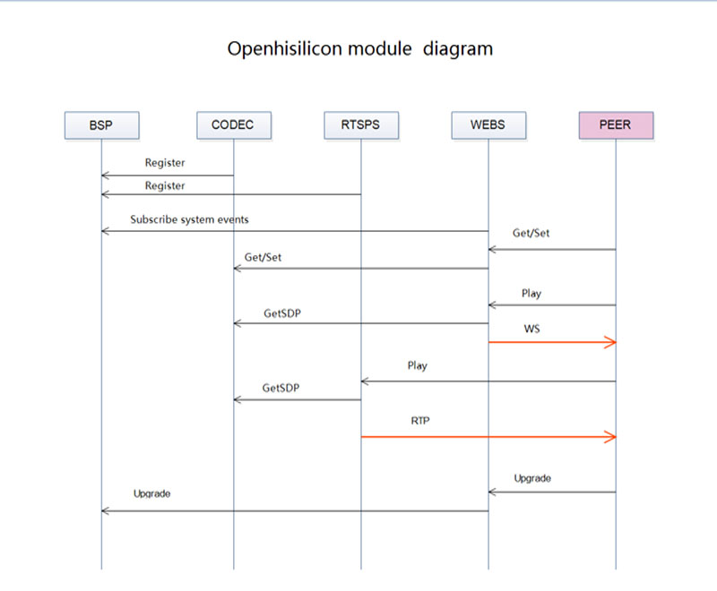

# 07 生态、伙伴与交付责任

截至2026-11-05，Huawei/HiSilicon生态可分成昇腾训练部署、海思视觉/BSP、华为云具身开发、本体/传感器和渠道交付几层。伙伴和开源代码的价值是缩短适配距离，不能据其标签推导目标SKU量产认证、供货或已商业运营。关键是明确谁维护编译器、谁交付BSP、谁修正动作接口、谁承担本地保修与版本回退。

## 代表参与者和实际分工

|参与者|提供内容|实际交接对象|本次确认程度|
|---|---|---|---|
|华为Ascend/PyTorch|torch_npu适配与版本矩阵|PyTorch/CANN/driver/firmware|固定提交文档，需目标设备复建|
|MindSpore|框架与Lite模型接口|MindIR、target/provider、CPU备援|源码接口，不保证任意模型|
|Ultralytics|第三方Ascend导出/后端|ONNX→ATC→OM、metadata|AGPL软件路径，需模型许可|
|华为云CloudRobo|资产、训练、仿真、部署、R2C|OBS/SWR、CCE/ModelArts、本体配置|官方功能与实践，公测/专属池条件|
|RLinf作者社区|具身/agent RL基础设施|模型、环境、rollout/actor调度|作者Ascend矩阵与教程，非海思端侧|
|HIVIEW/Openhisilicon|核心板/底板、BSP/MPP/AI/ISP集成|buffer、视频、Web/流媒体/升级|第三方自述与源码，合同待取|
|OpenHarmony社区|HiSilicon HDI、驱动、板级工程|SoC目录、board/vendor与SDK|DV300等明确对象，许可分层|
|LeRobot/本体厂商|数据/策略/标定、机器人执行|joint/camera/action/本体SDK|具体SO101/UR5e/Q25实践|

昇腾与海思不是同一推理runtime家族；将torch_npu模型移到海思NPU仍需转换、算子和数据接口适配。CloudRobo在线模型也不自动生成端侧OM/WK。上述分工由原文和实现支撑。[Ascend_Pytorch_README](https://raw.githubusercontent.com/Ascend/pytorch/848b8e7271069d5a9947bf75fd02a162092b41a6/README.zh.md)（[本地原件](REFERENCES.md#ref-631b32f5b2990a25)） [TorchNPU_Compatibility](https://raw.githubusercontent.com/Ascend/pytorch/848b8e7271069d5a9947bf75fd02a162092b41a6/COMPATIBILITY.md)（[本地原件](REFERENCES.md#ref-c8e8a0ecbae18c29)） [MindSpore_Lite_README](https://raw.githubusercontent.com/mindspore-ai/mindspore/16873579685a1662f10ebd1df068bf512f211869/mindspore/lite/README_CN.md)（[本地原件](REFERENCES.md#ref-d0f903468c5eec67)） [Ultralytics_Ascend_Doc](https://raw.githubusercontent.com/ultralytics/ultralytics/c4e0ba9310ca5c567adb2b02f351f4d721557c71/docs/en/integrations/ascend.md)（[本地原件](REFERENCES.md#ref-a1db7fce7f18dedb)） [CloudRobo_ProductPDF](https://support.huaweicloud.com/productdesc-cloudrobo/CloudRobo%20%E4%BA%A7%E5%93%81%E4%BB%8B%E7%BB%8D-pdf.pdf)（[本地原件](REFERENCES.md#ref-522f065088effec2)）

## 开源框架生态与版本责任

TorchNPU的README安装例与COMPATIBILITY推荐矩阵可能不是同一发布组合，必须按正式包、PyTorch、CANN和维护表锁定，构建支持与计划支持分开。MindSpore Lite存在CPU backup机制，但fallback可改变时延与功耗；让模型能启动只是起点。Ultralytics把310B1/310B4对应20/8TOPS A2的内容属于第三方集成线索，不能替代采购SKU确认。其源码AGPL-3.0还需与商业分发方式一起审核，不能因芯片SDK闭源就忽略应用代码义务。[TorchNPU_Compatibility](https://raw.githubusercontent.com/Ascend/pytorch/848b8e7271069d5a9947bf75fd02a162092b41a6/COMPATIBILITY.md)（[本地原件](REFERENCES.md#ref-c8e8a0ecbae18c29)） [MindSpore_Lite_README](https://raw.githubusercontent.com/mindspore-ai/mindspore/16873579685a1662f10ebd1df068bf512f211869/mindspore/lite/README_CN.md)（[本地原件](REFERENCES.md#ref-d0f903468c5eec67)） [Ultralytics_Ascend_Doc](https://raw.githubusercontent.com/ultralytics/ultralytics/c4e0ba9310ca5c567adb2b02f351f4d721557c71/docs/en/integrations/ascend.md)（[本地原件](REFERENCES.md#ref-a1db7fce7f18dedb)） [Ultralytics_License](https://raw.githubusercontent.com/ultralytics/ultralytics/c4e0ba9310ca5c567adb2b02f351f4d721557c71/LICENSE)（[本地原件](REFERENCES.md#ref-969a4c6853947b6b)）

RLinf作者README在采集快照列OpenVLA-OFT、GR00T N1.5、OpenPI、StarVLA与DreamZero的Ascend CANN支持，其他新模型更新不等于矩阵每一行都有Ascend验证。OpenPI教程把LIBERO/ManiSkill跨后端和MetaWorld/CALVIN总体示例分开；StarVLA具体路径固定上游starVLA-v1.6、aarch64源码构建decord、匹配torch_npu并跳过CUDA flash-attention，LIBERO使用OSMesa CPU渲染。训练NPU兼容不等于物理与渲染在NPU执行。[RLinf_README](https://raw.githubusercontent.com/RLinf/RLinf/main/README.md)（[本地原件](REFERENCES.md#ref-acf2f895b8420d9f)） [RLinf_OpenPI_Guide](https://raw.githubusercontent.com/RLinf/RLinf/main/docs/source-en/rst_source/examples/embodied/pi0.rst)（[本地原件](REFERENCES.md#ref-8e9c1b7c17ea131a)） [RLinf_StarVLA_Guide](https://raw.githubusercontent.com/RLinf/RLinf/main/docs/source-en/rst_source/examples/embodied/starvla.rst)（[本地原件](REFERENCES.md#ref-09b731053f6e4f1a)）

Wan世界模型教程还有更具体依赖：MindIE-SD需另装并匹配CANN/PyTorch，导入attention/rotary相关算子，失败时警告并保留原diffsynth实现。当前路线用世界模型直接生成观测，Ascend配置关闭仿真器评估，需要另行验证策略数值行为。作者的一般结果表不能直接标为Ascend性能。RLinf代码许可Apache-2.0，模型/世界模型、VAE、奖励网络、初始化数据和仿真资产仍各有许可；README main是采集快照，未固定revision，不作为生产版本锁。[RLinf_Wan_Guide](https://raw.githubusercontent.com/RLinf/RLinf/main/docs/source-en/rst_source/examples/embodied/wan.rst)（[本地原件](REFERENCES.md#ref-14ee3f4821f26eef)） [RLinf_License](https://raw.githubusercontent.com/RLinf/RLinf/main/LICENSE)（[本地原件](REFERENCES.md#ref-dca3f21b2135ad15)）

这项后续发现补充04/05的证据地图：世界模型已有第三方Ascend训练路线；仍没有取得200I A2/海思端侧交付，也没有证明CloudRobo使用同一RLinf实现。CloudRobo残差数据格式与RLinf一致仅支持数据接口联系，不能据此称双方全部版本、模型和算子统一认证。[CloudRobo_ResidualDebug](https://support.huaweicloud.com/bestpractice-cloudrobo/cloudrobo_05_0027.html)（[本地原件](REFERENCES.md#ref-2af60c241cd552d0)）

## 海思集成商与板级生态

HIVIEW作者明确提供Hardware customization、System building、AI algorithm与ISP tuning服务，核心板+底板可定制；README列CV610、DV500、3403板图和BSP/MPP、编码、RTSP/WebRTC、ONVIF、UVC、SVP功能。对于视频传感器前端，这能减少协议和界面工程；对于机器人还需添加ROS时间戳、动作协议和故障降级。功能清单是作者自述，不能称海思官方认证或跨型号相同能力。[HiView_README](https://raw.githubusercontent.com/openhisilicon/HIVIEW/395b53d4c28cf5e528c9e1ba3f7ec39ad8e852d4/README.md)（[本地原件](REFERENCES.md#ref-c89786e45c3e552a)）

图显示BSP注册/事件、CODEC配置、RTSPS SDP/RTP、WEBS控制/WS和Upgrade交互，支持模块职责说明，不提供网络安全或视频时延实测。升级箭头不证明有签名、双分区、断电恢复、反回滚或密钥管理。3403 VPSS源码展示frame/stride/MMZ/释放路径，集成仍须查BSP、sensor驱动、ISP参数、交叉编译器和每个依赖许可。本轮固定提交目录没有全仓统一LICENSE，局部依赖许可不能授予整个方案的商用权。[HiView_3403_VPSS](https://raw.githubusercontent.com/openhisilicon/HIVIEW/395b53d4c28cf5e528c9e1ba3f7ec39ad8e852d4/mod/svp/3403/vpss_capture.cpp)（[本地原件](REFERENCES.md#ref-724494f823f91527)）

OpenHarmony官方仓库区分Hi3516DV300 Taurus、Hi3518EV300 Aries、Hi3861 Pegasus等SoC/board关系；不能由DV300端口推导CV610 OpenHarmony4.1具体BSP已开源。驱动GPLv2和媒体EULA义务也不同，已取得2021媒体包限制开发板内部开发/测试，不授予制造售卖分发；新商业SDK要取得新合同，不能将旧许可扩大为当前所有产品统一禁商用。[OH_HiSilicon_README](https://raw.githubusercontent.com/openharmony/device_soc_hisilicon/7c1e2d5b35c090009bbe195f09337701c60af032/README.md)（[本地原件](REFERENCES.md#ref-f3b4a2b9762761f5)） [OH_Driver_License](https://raw.githubusercontent.com/openharmony/device_soc_hisilicon/7c1e2d5b35c090009bbe195f09337701c60af032/hi3516dv300/sdk_linux/drv/LICENSE)（[本地原件](REFERENCES.md#ref-99677d79a1d3021c)） [OH_Media_EULA](https://raw.githubusercontent.com/openharmony/device_soc_hisilicon/7c1e2d5b35c090009bbe195f09337701c60af032/hi3516dv300/sdk_linux/out/lib/LICENSE)（[本地原件](REFERENCES.md#ref-d888125c58c7c3fd)）

## 渠道、培训与本地支持

|官方列示渠道|相关授权类别|区域/选型含义|
|---|---|---|
|淇诺/华强、思尼克|包含智慧视觉等多类|中国大陆/香港；逐SKU询价|
|深圳科通|智慧视觉、媒体、感知、模拟|不能按类别保证所有芯片现货|
|力源/鼎芯/帕太|包含智慧视觉等|确认法人、销售与FAE责任|
|云汉芯城|线上多类；线下范围另列|线上/线下授权范围不同|

以上是海思官网当前渠道正文，不记录或联络个人联系人，不提交采购表单。类别授权不是工业板卡认证、MOQ、单价或交期。供应商应提供准确料号、批次、授权链、可追溯发票、替代料/PCN及样品到量产支持方式。[HiSilicon_BuyChannels](https://www.hisilicon.com/cn/WhereToBuy)（[本地原件](REFERENCES.md#ref-6742493defffa2a6)）

海思学堂2024宣传PDF列1.0已有50+课程，覆盖CV610硬件/BSP/MPP/SVP_NPU、DV500调优及MCU入门；2.0用户认证、3.0自助问答是规划。HiSupport注册用户访问，不能把课程列表当本次已取得SDK手册或所有培训免费公开。官网开发中心本次抓取只有JavaScript提示，排除为有效正文；应向FAE索取目标SKU正式资料与培训版本。[HiSilicon_AcademyPDF](https://www.hisilicon.com/dam/asset/view/d8442760823b4f5e9fabb6c5bd684846.pdf)（[本地原件](REFERENCES.md#ref-00381035722b48d1)）

## 从原型到量产的交付约束

原型阶段应固定计算板、相机、模型及本体的最小可工作组合；量产阶段还需sensor/ISP标定批次、产测夹具、刷机脚本、序列号/密钥管理、镜像签名、OTA回退、坏板替换和散热一致性。开源样例降低入门工作量，却不能替代这些职责。应让芯片/模组商负责硬件与BSP、集成商负责视频/模型链路、本体商负责控制与保护、云商负责服务/IAM与日志，各自明确缺陷响应和升级兼容窗口。

国产化分析要分层：品牌/开发团队所在地、芯片IP与制造封装、OS/toolchain、runtime二进制、模型权重、相机和机器人SDK、镜像/数据服务分别确认。当前实践明确使用RealSense、UR5e、Python、PyTorch/LeRobot、ROS2/O3DE和开源模型；因此不能由华为品牌推出全系统国产化率或自主可控比例。对关键外部依赖应准备版本冻结、替代接口和离线恢复，并核实替代件的真实性能。

本次没有完整社区活跃度计数，不使用Stars/贡献者数推导采用率。正式选型要求供货/PCN/EOL、当地保修/备件、SDK许可、驱动与算子维护周期，以及云资源区域/配额/SLA的书面证据。静态资料能支撑责任划分，不能承诺现货、认证和成本收益；CloudRobo网页缺失依赖按partial_static归档。

## 参考资料与原件

下列资料按 2026-11-05 核验时点使用；抓取日期不是发布日期。URL带提交SHA或tag的源码限定对应版本；main/master及模型卡仅为采集快照，未锁不可变revision。未运行安装脚本、模型或设备。

| 来源 | 原文 / 本地原件 | 版本与归档边界 |
|---|---|---|
| HiSilicon_BuyChannels | [HiSilicon_BuyChannels](https://www.hisilicon.com/cn/WhereToBuy) / [原件](REFERENCES.md#ref-6742493defffa2a6) | 页面未标版号；按采集快照使用；采集 UTC 2026-11-04T15:56:04.736234+00:00；partial_static |
| HiSilicon_AcademyPDF | [HiSilicon_AcademyPDF](https://www.hisilicon.com/dam/asset/view/d8442760823b4f5e9fabb6c5bd684846.pdf) / [原件](REFERENCES.md#ref-00381035722b48d1) | 页面未标版号；按采集快照使用；采集 UTC 2026-11-04T15:56:16.261779+00:00；complete_static |
| HiView_README | [HiView_README](https://raw.githubusercontent.com/openhisilicon/HIVIEW/395b53d4c28cf5e528c9e1ba3f7ec39ad8e852d4/README.md) / [原件](REFERENCES.md#ref-c89786e45c3e552a) | 固定提交源码/许可快照；确切 SHA 见原文 URL；采集 UTC 2026-11-04T16:33:38.757127+00:00；complete_static |
| HiView_ArchitectureImage | [HiView_ArchitectureImage](https://raw.githubusercontent.com/openhisilicon/HIVIEW/395b53d4c28cf5e528c9e1ba3f7ec39ad8e852d4/res/diagram.jpg) / [原件](REFERENCES.md#ref-957af65c6dbe24f6) | 固定提交源码/许可快照；确切 SHA 见原文 URL；采集 UTC 2026-11-04T17:08:13.380471+00:00；complete_static |
| HiView_3403_VPSS | [HiView_3403_VPSS](https://raw.githubusercontent.com/openhisilicon/HIVIEW/395b53d4c28cf5e528c9e1ba3f7ec39ad8e852d4/mod/svp/3403/vpss_capture.cpp) / [原件](REFERENCES.md#ref-724494f823f91527) | 固定提交源码/许可快照；确切 SHA 见原文 URL；采集 UTC 2026-11-04T16:38:01.012968+00:00；complete_static |
| OH_HiSilicon_README | [OH_HiSilicon_README](https://raw.githubusercontent.com/openharmony/device_soc_hisilicon/7c1e2d5b35c090009bbe195f09337701c60af032/README.md) / [原件](REFERENCES.md#ref-f3b4a2b9762761f5) | 固定提交源码/许可快照；确切 SHA 见原文 URL；采集 UTC 2026-11-04T16:34:26.273042+00:00；complete_static |
| OH_Driver_License | [OH_Driver_License](https://raw.githubusercontent.com/openharmony/device_soc_hisilicon/7c1e2d5b35c090009bbe195f09337701c60af032/hi3516dv300/sdk_linux/drv/LICENSE) / [原件](REFERENCES.md#ref-99677d79a1d3021c) | 固定提交源码/许可快照；确切 SHA 见原文 URL；采集 UTC 2026-11-04T16:34:29.181859+00:00；complete_static |
| OH_Media_EULA | [OH_Media_EULA](https://raw.githubusercontent.com/openharmony/device_soc_hisilicon/7c1e2d5b35c090009bbe195f09337701c60af032/hi3516dv300/sdk_linux/out/lib/LICENSE) / [原件](REFERENCES.md#ref-d888125c58c7c3fd) | 固定提交源码/许可快照；确切 SHA 见原文 URL；采集 UTC 2026-11-04T16:38:04.870536+00:00；complete_static |
| Ascend_Pytorch_README | [Ascend_Pytorch_README](https://raw.githubusercontent.com/Ascend/pytorch/848b8e7271069d5a9947bf75fd02a162092b41a6/README.zh.md) / [原件](REFERENCES.md#ref-631b32f5b2990a25) | 固定提交源码/许可快照；确切 SHA 见原文 URL；采集 UTC 2026-11-04T16:24:55.143489+00:00；complete_static |
| TorchNPU_Compatibility | [TorchNPU_Compatibility](https://raw.githubusercontent.com/Ascend/pytorch/848b8e7271069d5a9947bf75fd02a162092b41a6/COMPATIBILITY.md) / [原件](REFERENCES.md#ref-c8e8a0ecbae18c29) | 固定提交源码/许可快照；确切 SHA 见原文 URL；采集 UTC 2026-11-04T16:26:54.995372+00:00；complete_static |
| MindSpore_Lite_README | [MindSpore_Lite_README](https://raw.githubusercontent.com/mindspore-ai/mindspore/16873579685a1662f10ebd1df068bf512f211869/mindspore/lite/README_CN.md) / [原件](REFERENCES.md#ref-d0f903468c5eec67) | 固定提交源码/许可快照；确切 SHA 见原文 URL；采集 UTC 2026-11-04T16:27:02.093898+00:00；complete_static |
| Ultralytics_Ascend_Doc | [Ultralytics_Ascend_Doc](https://raw.githubusercontent.com/ultralytics/ultralytics/c4e0ba9310ca5c567adb2b02f351f4d721557c71/docs/en/integrations/ascend.md) / [原件](REFERENCES.md#ref-a1db7fce7f18dedb) | 固定提交源码/许可快照；确切 SHA 见原文 URL；采集 UTC 2026-11-04T16:25:01.762950+00:00；complete_static |
| Ultralytics_License | [Ultralytics_License](https://raw.githubusercontent.com/ultralytics/ultralytics/c4e0ba9310ca5c567adb2b02f351f4d721557c71/LICENSE) / [原件](REFERENCES.md#ref-969a4c6853947b6b) | 固定提交源码/许可快照；确切 SHA 见原文 URL；采集 UTC 2026-11-04T16:25:02.981780+00:00；complete_static |
| CloudRobo_ProductPDF | [CloudRobo_ProductPDF](https://support.huaweicloud.com/productdesc-cloudrobo/CloudRobo%20%E4%BA%A7%E5%93%81%E4%BB%8B%E7%BB%8D-pdf.pdf) / [原件](REFERENCES.md#ref-522f065088effec2) | 文档01，2026-11-02；完整20页PDF；采集 UTC 2026-11-04T16:53:04.019493+00:00；complete_static |
| CloudRobo_VLN | [CloudRobo_VLN](https://support.huaweicloud.com/bestpractice-cloudrobo/cloudrobo_05_0074.html) / [原件](REFERENCES.md#ref-8a29cdc042132589) | 页面未标版号；按采集快照使用；采集 UTC 2026-11-04T16:52:51.987369+00:00；partial_static |
| CloudRobo_ResidualDebug | [CloudRobo_ResidualDebug](https://support.huaweicloud.com/bestpractice-cloudrobo/cloudrobo_05_0027.html) / [原件](REFERENCES.md#ref-2af60c241cd552d0) | 页面未标版号；按采集快照使用；采集 UTC 2026-11-04T17:05:48.028639+00:00；partial_static |
| LeRobot_License_051 | [LeRobot_License_051](https://raw.githubusercontent.com/huggingface/lerobot/v0.5.1/LICENSE) / [原件](REFERENCES.md#ref-e62ae236f246ce5d) | 固定v0.5.1 tag；未锁提交SHA；采集 UTC 2026-11-04T16:56:20.670298+00:00；complete_static |
| RLinf_README | [RLinf_README](https://raw.githubusercontent.com/RLinf/RLinf/main/README.md) / [原件](REFERENCES.md#ref-acf2f895b8420d9f) | main/master采集快照，未锁提交SHA；采集 UTC 2026-11-04T17:08:14.592964+00:00；complete_static |
| RLinf_License | [RLinf_License](https://raw.githubusercontent.com/RLinf/RLinf/main/LICENSE) / [原件](REFERENCES.md#ref-dca3f21b2135ad15) | main/master采集快照，未锁提交SHA；采集 UTC 2026-11-04T17:08:15.888730+00:00；complete_static |
| RLinf_OpenPI_Guide | [RLinf_OpenPI_Guide](https://raw.githubusercontent.com/RLinf/RLinf/main/docs/source-en/rst_source/examples/embodied/pi0.rst) / [原件](REFERENCES.md#ref-8e9c1b7c17ea131a) | main/master采集快照，未锁提交SHA；采集 UTC 2026-11-04T17:09:11.242037+00:00；complete_static |
| RLinf_StarVLA_Guide | [RLinf_StarVLA_Guide](https://raw.githubusercontent.com/RLinf/RLinf/main/docs/source-en/rst_source/examples/embodied/starvla.rst) / [原件](REFERENCES.md#ref-09b731053f6e4f1a) | main/master采集快照，未锁提交SHA；采集 UTC 2026-11-04T17:09:12.182538+00:00；complete_static |
| RLinf_Wan_Guide | [RLinf_Wan_Guide](https://raw.githubusercontent.com/RLinf/RLinf/main/docs/source-en/rst_source/examples/embodied/wan.rst) / [原件](REFERENCES.md#ref-14ee3f4821f26eef) | main/master采集快照，未锁提交SHA；采集 UTC 2026-11-04T17:09:13.222465+00:00；complete_static |

[主张和图源核验](research_state/evidence/07_Ecosystem.json)。各引用保存原始响应、哈希及 metadata；静态归档不承诺动态交互或像素级复现。
