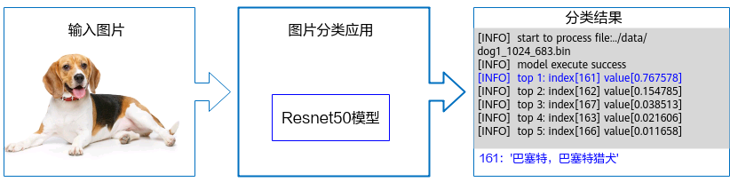

# 08A 昇腾编译产物、执行与内存契约

本专题讨论昇腾模型部署机制能形成什么工程优势，以及优势何时失效。使用Ascend samples固定提交fc2aea93e48be8f8cee51d0c6c1b13a08155f83a、TorchNPU等02已核验源码及2026-11-05官方TensorRT对照资料。旧310/200DK示例仅支持对应接口实现的判断，不是现款200I A2时延实证。本次没有目标板实测，也没有取得A2绑定CANN完整算子调优报告。

## 痛点：部署不止是加载权重

机器人视觉/VLA链同时依赖模型、编译配置、传感器buffer和动作时效。离线编译可把图和目标设备约束提前处理，减少运行时决策；但生成文件必须与SoC、OS/驱动、runtime和输入契约相匹配。ATC产物OM不应与PyTorch权重、ONNX或海思WK混称同一种通用模型文件。若只验证文件能加载，会漏掉动态shape、输入布局、内存峰值及返回结果过期等问题。[ACL_ResNet_README](https://raw.githubusercontent.com/Ascend/samples/fc2aea93e48be8f8cee51d0c6c1b13a08155f83a/cplusplus/level2_simple_inference/1_classification/resnet50_imagenet_classification/README_CN.md)（[本地原件](REFERENCES.md#ref-7ee889c63c64edd5)） [Ultralytics_Ascend_Exporter](https://raw.githubusercontent.com/ultralytics/ultralytics/c4e0ba9310ca5c567adb2b02f351f4d721557c71/ultralytics/utils/export/ascend.py)（[本地原件](REFERENCES.md#ref-0826b6cee47ed307)）

官方样例链条是训练模型→转换/编译→OM→ACL加载→dataset封装→执行→输出。Ultralytics集成则导出静态NCHW ONNX，以framework=5和force_fp16等配置调用ATC，旁带metadata；这组配置属于该集成，不是CANN全部精度能力。后端InferSession使用im.cpu().numpy()再infer，意味着传入张量经过CPU路径，不能仅凭NPU推理称camera zero-copy。[Ultralytics_Ascend_Exporter](https://raw.githubusercontent.com/ultralytics/ultralytics/c4e0ba9310ca5c567adb2b02f351f4d721557c71/ultralytics/utils/export/ascend.py)（[本地原件](REFERENCES.md#ref-0826b6cee47ed307)） [Ultralytics_Ascend_Backend](https://raw.githubusercontent.com/ultralytics/ultralytics/c4e0ba9310ca5c567adb2b02f351f4d721557c71/ultralytics/nn/backends/ascend.py)（[本地原件](REFERENCES.md#ref-85889b8b8d60cc34)）

## 模块、对象与所有权

|对象/步骤|样例机制|解决问题|失效条件|
|---|---|---|---|
|模型work/weight|query大小、malloc、loadWithMem|明确执行工作区与权重内存|大小/释放顺序错误|
|ModelDesc|加载后查询I/O大小等|按编译产物配置tensor|不等于语义/颜色自动匹配|
|Input Dataset|封装DataBuffer引用输入|分离描述与实际存储|外层提前free输入|
|Output Dataset|模型类分配与释放输出|明确输出寿命|异步未完成复用|
|Stream/callback|提交、订阅、回调/同步|可重叠合法任务|提交返回被误作完成|

ModelProcess先aclmdlQuerySize取得模型work及weight大小，再分配并加载；输入CreateInput只建wrapper/数据集，DestroyInput销毁wrapper不释放外层存储。输出由模型类分配，DestroyOutput相应释放。这个差别决定应用需要拥有哪个buffer，不能把“dataset销毁成功”当全部内存已free。热更新时旧任务还可能访问旧权重、输出和descriptor，因此必须先排空执行，再卸载模型。[ACL_ModelProcess](https://raw.githubusercontent.com/Ascend/samples/fc2aea93e48be8f8cee51d0c6c1b13a08155f83a/cplusplus/level2_simple_inference/1_classification/resnet50_imagenet_classification/src/model_process.cpp)（[本地原件](REFERENCES.md#ref-4773c545724ea61b)）

官方图支持图片经ResNet50得到Top5的功能链，不含耗时、精度和整机功率。输入图像格式、通道顺序、归一化与编译shape仍需源码/模型配置核对；同样的Top5输出也不代表机器人目标位置准确。

## 异步流水：避免“提交即完成”

异步样例使用ExecuteAsync、任务池、回调处理和资源回收，stream同步是确认完成的重要边界。分析：当采集、预处理、推理和后处理能同时工作时，流水可以提高吞吐；但是每帧观测年龄还要计排队时间，吞吐提升可能同时增加尾延迟。并发模型争用带宽、工作区与设备资源，多个stream也不保证算子真正并行。[ACL_Async_ModelProcess](https://raw.githubusercontent.com/Ascend/samples/fc2aea93e48be8f8cee51d0c6c1b13a08155f83a/cplusplus/level2_simple_inference/1_classification/resnet50_async_imagenet_classification/src/model_process.cpp)（[本地原件](REFERENCES.md#ref-9aab3388a79f9a2b)） [ACL_SampleProcess](https://raw.githubusercontent.com/Ascend/samples/fc2aea93e48be8f8cee51d0c6c1b13a08155f83a/cplusplus/level2_simple_inference/1_classification/resnet50_imagenet_classification/src/sample_process.cpp)（[本地原件](REFERENCES.md#ref-b1cece1042fbfdaa)）

将buffer地址、frame_id、提交序号和完成event绑定，外层只有在消费完成后才复用内存；队列满时明确丢旧帧、丢新帧或阻塞。机器人通常关心新观测，按FIFO无限排队容易执行过期结果。异步callback应只提交轻量结果和回收职责，不能在回调里做不可控阻塞。上述属于基于源码对象生命周期的工程建议，样例没有提供可接受P99或WCET保证。

故障处理也要分级：API返回、异步执行错误、模型输入错误、设备失联与控制任务超时分别记录。重新创建context/模型是否能恢复取决于runtime与错误类型，本次未取得完整故障域证明，不能承诺某个模型出错绝不影响同设备其他任务。推理服务恢复和机器人停止是两条链，需由本地控制器处理动作过期。

## 动态shape、量化与fallback

动态dims样例要求CANN≥5.0.4，列Ascend310、200DK/300，并在编译阶段预设dims集合。输入选择该集合不是任意动态形状；换相机分辨率、batch、语言token或action horizon时要重新查模型和算子支持。权重存储量下降亦不代表所有激活/工作区同比下降，量化需校准分布、scale、饱和与敏感层误差验证。[ACL_Dynamic_README](https://raw.githubusercontent.com/Ascend/samples/fc2aea93e48be8f8cee51d0c6c1b13a08155f83a/cplusplus/level2_simple_inference/1_classification/resnet50_imagenet_dynamic_dims/README_CN.md)（[本地原件](REFERENCES.md#ref-0e7479d186c8d8e5)）

MindSpore Lite Context target Ascend存在CPU backup路径和provider配置；fallback是可行性工具，但会引入CPU算子与数据域交接。必须测算子分区和每次拷贝，而非只记总模型平均时延。TorchNPU兼容矩阵应锁定正式发行组合，不能把构建文件中的未来PyTorch版本当已发布。vLLM Ascend FAQ又明确200I A2(310B)不支持/无计划，服务器Atlas A2不同家族；“昇腾支持LLM”不能取消这个产品边界。[MindSpore_Lite_Context](https://raw.githubusercontent.com/mindspore-ai/mindspore/16873579685a1662f10ebd1df068bf512f211869/mindspore/lite/python/api/context.py)（[本地原件](REFERENCES.md#ref-05d6c61893baf702)） [TorchNPU_Compatibility](https://raw.githubusercontent.com/Ascend/pytorch/848b8e7271069d5a9947bf75fd02a162092b41a6/COMPATIBILITY.md)（[本地原件](REFERENCES.md#ref-c8e8a0ecbae18c29)） [VLLM_Ascend_FAQ](https://raw.githubusercontent.com/vllm-project/vllm-ascend/4a29682d1d8fa89df63a45dc4df2a2a8068984ff/docs/source/faqs.md)（[本地原件](REFERENCES.md#ref-f20d548af3f05045)）

## 同类技术对标与护城河判断

|痛点|昇腾已取得机制|TensorRT官方机制|迁移含义|
|---|---|---|---|
|离线部署|ATC/OM与ACL|builder选择目标GPU tactic，engine/runtime|ONNX可作为中间资产，engine/OM不互换|
|执行对象寿命|模型内存、descriptor、dataset|runtime/engine/context、I/O与activation|必须重新实现所有权与完成同步|
|并发/错误|stream与callback例|独立execution context及异步CUDA错误边界|不能仅替换函数名|
|兼容性|目标SKU与CANN绑定|默认同OS/CPU/GPU/TRT，条件性兼容|编译文件需要重建/校验|

TensorRT官方文档解释builder计时噪声和tactic选择影响数值、execution context持有每次推理状态，同一context并发使用需要约束；默认engine兼容对象包括OS、CPU架构、GPU型号和TensorRT版本。它与昇腾都解决编译部署问题，但公开机制不等于同条件性能优劣。TensorRT的线程、内存和兼容细则不能转移成ACL保证。[NVIDIA_TensorRT_Objects](https://docs.nvidia.com/deeplearning/tensorrt/latest/architecture/how-trt-works.html)（[本地原件](REFERENCES.md#ref-9df325c2c44e3de5)）

昇腾的可积累优势主要来自模型/算子适配、编译调优经验和已锁定BSP的部署资产。模型本身开源、硬件TOPS或“支持框架”都不能单独构成可复用护城河。优势成立条件是目标模型主要算子有高效实现、输入契约稳定、内存及热预算足够、版本可维护；模型动态性强、fallback频繁或端侧内存不足时收益可能消失。

## 验证和许可边界

可复建实验应保存源模型/权重SHA、转换工具版本、ATC命令、编译日志、OM哈希、SoC/板/BSP、driver/firmware/runtime和各tensor布局。对batch/shape/精度分别比较功能误差、模型时延、端到端数据年龄、加载峰值和长期稳定，先测单模型，再测相机/编解码/策略并发。官方旧例没有模型成功率、功耗和完整任务benchmark，不能补加速倍数。

Ascend样例代码许可与CANN二进制授权分开；框架、模型、传感器、本体SDK及所分发部署包都要分别确认。TensorRT对照资料只用于机制研究，不证明部署者已接受其商业许可。本篇引用和图源复用共享registry，08资料联合目录将在总览导出；结构检查不是设备执行或事实正确性的自动认证。[Ascend_Samples_License](https://raw.githubusercontent.com/Ascend/samples/fc2aea93e48be8f8cee51d0c6c1b13a08155f83a/LICENSE)（[本地原件](REFERENCES.md#ref-181037fb87140fdd)）

## 参考资料与原件

下列资料按 2026-11-05 核验时点使用；抓取日期不是发布日期。源码固定到 URL 中的提交 SHA，代表该快照，不保证所有发行包包含相同实现。未运行安装脚本、模型或设备。

| 来源 | 原文 / 本地原件 | 版本与归档边界 |
|---|---|---|
| ACL_ResNet_README | [ACL_ResNet_README](https://raw.githubusercontent.com/Ascend/samples/fc2aea93e48be8f8cee51d0c6c1b13a08155f83a/cplusplus/level2_simple_inference/1_classification/resnet50_imagenet_classification/README_CN.md) / [原件](REFERENCES.md#ref-7ee889c63c64edd5) | 固定提交源码/许可快照；确切 SHA 见原文 URL；采集 UTC 2026-11-04T16:26:44.928697+00:00；complete_static |
| ACL_ModelProcess | [ACL_ModelProcess](https://raw.githubusercontent.com/Ascend/samples/fc2aea93e48be8f8cee51d0c6c1b13a08155f83a/cplusplus/level2_simple_inference/1_classification/resnet50_imagenet_classification/src/model_process.cpp) / [原件](REFERENCES.md#ref-4773c545724ea61b) | 固定提交源码/许可快照；确切 SHA 见原文 URL；采集 UTC 2026-11-04T16:26:46.107974+00:00；complete_static |
| ACL_SampleProcess | [ACL_SampleProcess](https://raw.githubusercontent.com/Ascend/samples/fc2aea93e48be8f8cee51d0c6c1b13a08155f83a/cplusplus/level2_simple_inference/1_classification/resnet50_imagenet_classification/src/sample_process.cpp) / [原件](REFERENCES.md#ref-b1cece1042fbfdaa) | 固定提交源码/许可快照；确切 SHA 见原文 URL；采集 UTC 2026-11-04T16:26:47.147990+00:00；complete_static |
| ACL_Async_ModelProcess | [ACL_Async_ModelProcess](https://raw.githubusercontent.com/Ascend/samples/fc2aea93e48be8f8cee51d0c6c1b13a08155f83a/cplusplus/level2_simple_inference/1_classification/resnet50_async_imagenet_classification/src/model_process.cpp) / [原件](REFERENCES.md#ref-9aab3388a79f9a2b) | 固定提交源码/许可快照；确切 SHA 见原文 URL；采集 UTC 2026-11-04T16:26:49.315372+00:00；complete_static |
| ACL_Dynamic_README | [ACL_Dynamic_README](https://raw.githubusercontent.com/Ascend/samples/fc2aea93e48be8f8cee51d0c6c1b13a08155f83a/cplusplus/level2_simple_inference/1_classification/resnet50_imagenet_dynamic_dims/README_CN.md) / [原件](REFERENCES.md#ref-0e7479d186c8d8e5) | 固定提交源码/许可快照；确切 SHA 见原文 URL；采集 UTC 2026-11-04T16:26:48.201531+00:00；complete_static |
| ACL_FirstApp_Figure | [ACL_FirstApp_Figure](https://raw.githubusercontent.com/Ascend/samples/fc2aea93e48be8f8cee51d0c6c1b13a08155f83a/cplusplus/level2_simple_inference/1_classification/resnet50_firstapp/README_fig.png) / [原件](REFERENCES.md#ref-f1da2d06245dd3cc) | 固定提交源码/许可快照；确切 SHA 见原文 URL；采集 UTC 2026-11-04T16:26:50.678467+00:00；complete_static |
| Ascend_Samples_License | [Ascend_Samples_License](https://raw.githubusercontent.com/Ascend/samples/fc2aea93e48be8f8cee51d0c6c1b13a08155f83a/LICENSE) / [原件](REFERENCES.md#ref-181037fb87140fdd) | 固定提交源码/许可快照；确切 SHA 见原文 URL；采集 UTC 2026-11-04T16:24:54.066194+00:00；complete_static |
| TorchNPU_Compatibility | [TorchNPU_Compatibility](https://raw.githubusercontent.com/Ascend/pytorch/848b8e7271069d5a9947bf75fd02a162092b41a6/COMPATIBILITY.md) / [原件](REFERENCES.md#ref-c8e8a0ecbae18c29) | 固定提交源码/许可快照；确切 SHA 见原文 URL；采集 UTC 2026-11-04T16:26:54.995372+00:00；complete_static |
| MindSpore_Lite_Context | [MindSpore_Lite_Context](https://raw.githubusercontent.com/mindspore-ai/mindspore/16873579685a1662f10ebd1df068bf512f211869/mindspore/lite/python/api/context.py) / [原件](REFERENCES.md#ref-05d6c61893baf702) | 固定提交源码/许可快照；确切 SHA 见原文 URL；采集 UTC 2026-11-04T16:27:03.683423+00:00；complete_static |
| Ultralytics_Ascend_Exporter | [Ultralytics_Ascend_Exporter](https://raw.githubusercontent.com/ultralytics/ultralytics/c4e0ba9310ca5c567adb2b02f351f4d721557c71/ultralytics/utils/export/ascend.py) / [原件](REFERENCES.md#ref-0826b6cee47ed307) | 固定提交源码/许可快照；确切 SHA 见原文 URL；采集 UTC 2026-11-04T16:26:59.797042+00:00；complete_static |
| Ultralytics_Ascend_Backend | [Ultralytics_Ascend_Backend](https://raw.githubusercontent.com/ultralytics/ultralytics/c4e0ba9310ca5c567adb2b02f351f4d721557c71/ultralytics/nn/backends/ascend.py) / [原件](REFERENCES.md#ref-85889b8b8d60cc34) | 固定提交源码/许可快照；确切 SHA 见原文 URL；采集 UTC 2026-11-04T16:27:00.982899+00:00；complete_static |
| VLLM_Ascend_FAQ | [VLLM_Ascend_FAQ](https://raw.githubusercontent.com/vllm-project/vllm-ascend/4a29682d1d8fa89df63a45dc4df2a2a8068984ff/docs/source/faqs.md) / [原件](REFERENCES.md#ref-f20d548af3f05045) | 固定提交源码/许可快照；确切 SHA 见原文 URL；采集 UTC 2026-11-04T16:24:59.633656+00:00；complete_static |
| NVIDIA_TensorRT_Objects | [NVIDIA_TensorRT_Objects](https://docs.nvidia.com/deeplearning/tensorrt/latest/architecture/how-trt-works.html) / [原件](REFERENCES.md#ref-9df325c2c44e3de5) | 页面未标版号；按采集快照使用；采集 UTC 2026-11-04T17:11:40.683207+00:00；complete_static |

[主张和图源核验](research_state/evidence/08A_Ascend_Execution_Compilation.json)。各引用保存原始响应、哈希及 metadata；静态归档不承诺动态交互或像素级复现。
