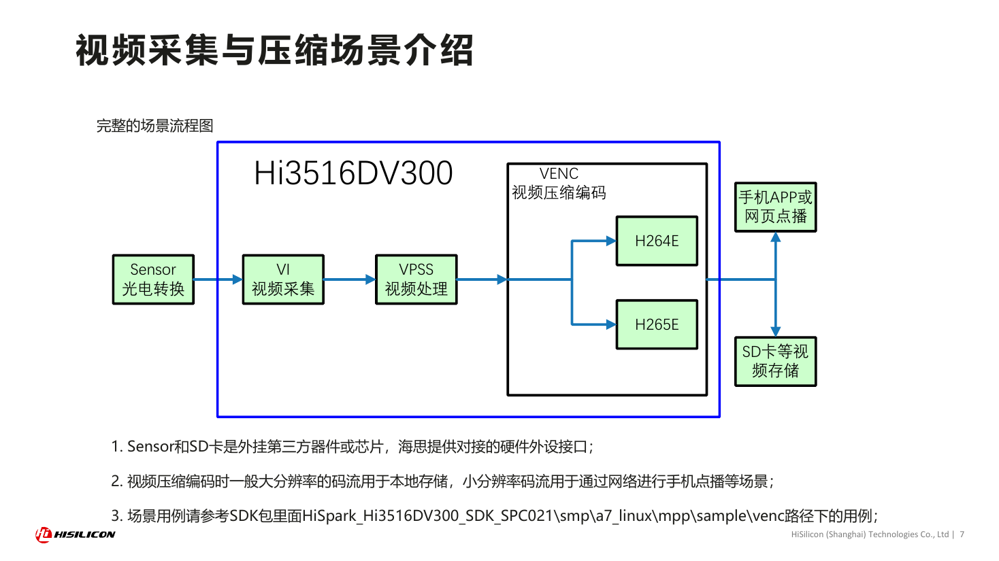
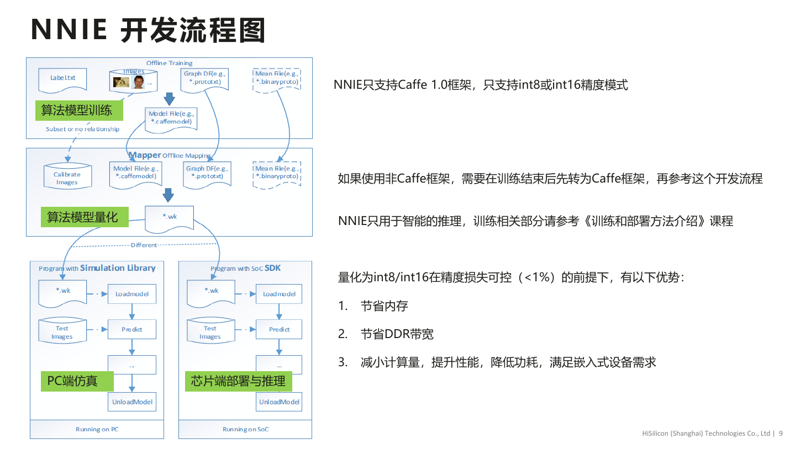

# 08B 海思媒体前端、专用加速与内存协同

海思的可观察技术积累集中于传感器输入、ISP/画质、视频处理、编解码和智能分析的协同链。对于长期工作的视觉节点，专用模块可以减少CPU处理；对于复杂VLA/全身控制，媒体专长不能自动变成通用模型能力。本专题区分2021 DV300 HiMPP4.0/NNIE文档、当前Hi3403/DV500/CV610产品说明和HIVIEW第三方源码，不跨代复用接口、精度或性能。[HiSilicon_DV300_SDK_PDF](https://www.hisilicon.com/dam/asset/view/7c925d6a091b49b5b1d1b0dc28d6dc4b.pdf/download)（[本地原件](REFERENCES.md#ref-7dcd59b2f2952de6)）

## 痛点与硬件执行分工

|对象|可核验专用能力|工程收益成立条件|不能推出|
|---|---|---|---|
|DV300旧媒体栈|VI/ISP/VPSS/编码/显示分支|sensor驱动、buffer和模块绑定正确|现款NPU全部接口相同|
|Hi3403V100|双NPU引擎与不同数值格式|模型可分配到对应引擎、编译器支持|10.4TOPS同时服务任意模型|
|Hi3519AV200|开放2.5TOPS+HNR保留5.6|应用使用允许的计算域|通用可用8.1TOPS|
|DV500|双目DPU的分辨率/视差/性能指标|标定、输入条件符合规格|所有最大指标同时成立|
|CV610|轻量视觉NPU与128MB内置DDR|小模型/媒体内存可承受|完整7B模型端侧闭环|

Hi3403官方精度分配到不同引擎：一个支持INT4/INT8/FP16，另一个支持INT8/INT16，汇总15.2TOPS INT4与10.4TOPS INT8不能替代可用并发组合。Hi3519AV200的HNR算力专供画质，不能交给任意策略。DV500 DPU最大2048×2048、视差224、720p30分列，本次没有同一测试条件证明三者可同时达到。[HiSilicon_Hi3403V100](https://www.hisilicon.com/cn/products/smart-vision/machine-vision/hi3403v100)（[本地原件](REFERENCES.md#ref-c2d6971a30360f9c)） [HiSilicon_Hi3519AV200](https://www.hisilicon.com/cn/products/smart-vision/machine-vision/hi3519av200)（[本地原件](REFERENCES.md#ref-387e661a1427ecf6)） [HiSilicon_Hi3519DV500](https://www.hisilicon.com/cn/products/smart-vision/machine-vision/hi3519dv500)（[本地原件](REFERENCES.md#ref-fb9339639d9cd3da)） [HiSilicon_Hi3516CV610](https://www.hisilicon.com/cn/products/smart-vision/machine-vision/hi3516cv610)（[本地原件](REFERENCES.md#ref-7e91d964fbc23ad4)）

## 媒体数据路径与buffer所有权

官方图展示视频输入、处理和多个输出目的，支持把采集/ISP与编码、显示、智能分析分开讨论。模块绑定可能避免应用层反复取帧，但不能仅凭图宣称全链zero-copy、任意路数并发或CPU/NPU缓存自动一致。图属于DV300文档，现款SoC的模块能力需查各自SDK。

HIVIEW 3403源码使用hi_mpi_*接口获取VPSS frame，涉及像素格式、stride、MMZ内存与释放。物理地址、CPU虚拟地址、行跨度和有效图像宽度是不同对象：width×height×通道只在无padding、正确格式时描述有效数据，不一定等于分配字节。YCbCr平面/半平面布局转换到模型NCHW时，需要检查每行和各plane偏移，不能把物理地址直接包装成NumPy数组而忽略映射。[HiView_3403_VPSS](https://raw.githubusercontent.com/openhisilicon/HIVIEW/395b53d4c28cf5e528c9e1ba3f7ec39ad8e852d4/mod/svp/3403/vpss_capture.cpp)（[本地原件](REFERENCES.md#ref-724494f823f91527)）

可复用内存仍有所有权问题。采集模块持有buffer、应用获取引用、加速器读取、应用释放构成完整寿命；若异步算法未完成就release，采集可覆写同一帧。CPU写cached MMZ后设备读取、设备写后CPU读取都要按目标SDK一致性规定处理。DV300旧NNIE要求相关flush与查询句柄，不能把旧缓存操作名当Hi3403当前NPU统一接口。[HiSilicon_DV300_SVP_PDF](https://www.hisilicon.com/dam/asset/view/4ef2e012655a4aae8c80619b8cfd093f.pdf/download)（[本地原件](REFERENCES.md#ref-8b4b0448c818638c)）

分析：流水收益取决于sensor输出格式能否被ISP/VPSS、算法和编码复用。同帧做编码、显示和检测时，应通过引用计数/event或SDK绑定管理fan-out，最长消费者会延长buffer驻留。队列深度增加可避免短时丢帧，但也增加观测年龄与内存；机器人动作层需要优先新结果，视频录制则可能优先连续性，因此两条消费者的背压规则应分离。

## NNIE转换、数值与CPU分段

旧DV300流程以Caffe1.0模型为源，经RuyiStudio校准/量化生成WK，再由NNIE执行；INT8/INT16等条件以该文档为准。NNIE仿真做模型功能和指令验证，不模拟机器人接触。WK的输入布局、量化尺度和层支持需要转换报告校验，不能拿ONNX直接加载或认为任意新VLM可自动转换。[HiSilicon_DV300_SVP_PDF](https://www.hisilicon.com/dam/asset/view/4ef2e012655a4aae8c80619b8cfd093f.pdf/download)（[本地原件](REFERENCES.md#ref-8b4b0448c818638c)）

不支持的自定义层/proposal需应用自行做CPU计算与分段衔接。分析：卷积主干可能较高效，但分段边界增加同步、内存访问、布局调整和CPU计算；总耗时可写为各加速段+CPU段+交接+排队，并不能只加NPU执行时间。校准数据若只含清晰静态图像，低光、遮挡或运动模糊下的误差可能扩大，量化选型必须看任务级精度而非文件变小。

CPU与NPU分段还涉及数值语义。INT8结果经scale转换、CPU层浮点运算，再回到量化域时，舍入/截断和饱和必须与模型模拟一致。当前新NPU编译器是否同样采用旧NNIE分段机制本次未取得，不能由旧文档推导新栈全部限制。HIVIEW YOLO路径可作为特定源码参考，未证明全算法库或官方性能认证。[HiView_3403_YOLO](https://raw.githubusercontent.com/openhisilicon/HIVIEW/395b53d4c28cf5e528c9e1ba3f7ec39ad8e852d4/mod/svp/3403/yolov8.cpp)（[本地原件](REFERENCES.md#ref-b8c035537722bae0)）

## 媒体专长的收益与边界

固定检测、视频记录、网络推流或相机前端可把媒体专用模块的功能直接变成工程资产；减少CPU占用与集成工作量的收益需要在实际并发、温度与码率下测量。图像变清晰不保证策略误差下降，AI-ISP/HNR对图像统计的改变也可能让训练域与真实域偏离。应对raw/处理后图像分别保存配置，核查低光增强引入的时序、伪纹理与检测误差。

对于多模态策略，瓶颈可能转移到内存容量、模型算子、历史状态和语言token。CV610内置1Gb DDR是128MB而非1GB，媒体buffer、OS和runtime会占用其部分资源；芯片“支持轻量VLM”宣称无法证明7B VLA工作集可容纳。选择媒体节点+外部策略计算是一种分析架构，需要测网络/RPC时效，不能把独立样例拼成已验证机器人系统。[HiSilicon_Hi3516CV610](https://www.hisilicon.com/cn/products/smart-vision/machine-vision/hi3516cv610)（[本地原件](REFERENCES.md#ref-7e91d964fbc23ad4)）

## 同类技术对照与可检验结论

|痛点|海思取得的路径|CUDA官方相关机制|选型动作|
|---|---|---|---|
|跨处理器访问|媒体/MMZ、物理/虚拟地址、flush|UVA、managed、mapped各有条件|核实可达性和一致性，不只看共享内存|
|减少CPU搬运|模块绑定/设备读取路径|mapped内存可直接访问但受链路代价|测实际复制字节和读写带宽|
|内存/时延稳定|预分配buffer、固定媒体链|驻留/迁移、pinning、prefetch|测首帧、抖动与压力下P99|

CUDA手册明确统一虚拟地址不等于统一物理内存；managed能力按OS/kernel/设备变化，mapped访问仍经互联且不能自动获得本地显存带宽。该原则说明“零复制”需要限定，不能把NVIDIA的ATS/HMM或特定Tegra一致性能力移植到海思SoC。没有同条件实测，本章不排名两平台。[NVIDIA_CUDA_Memory](https://docs.nvidia.com/cuda/cuda-programming-guide/02-basics/understanding-memory.html)（[本地原件](REFERENCES.md#ref-453cf4bfa7cf193e)）

建议在目标板按路径测：sensor/ISP→VPSS→算法输入→NPU/CPU→结果，同时并发编码/网络，记录格式、stride、路数、buffer数、复制字节、flush次数、帧号、时间戳、功率和热稳态。先验证每模块功能，再检查CPU/NPU/DDR争用与长期释放是否泄漏。吞吐、丢帧、P99和WCET分开；平均fps不能保证机器人控制截止。

2021 SDK、EULA、驱动、第三方源码与新商业发布包分别审查。旧媒体EULA的板内开发限制不能自动延伸为当前商业合同，但也不能忽略。正式护城河是经过验证的sensor/ISP参数、BSP稳定性、媒体调度和模型接口积累；“低功耗”“全自主”及安全/工业等级本次未取得充分测量或证书，不写成事实。[OH_Media_EULA](https://raw.githubusercontent.com/openharmony/device_soc_hisilicon/7c1e2d5b35c090009bbe195f09337701c60af032/hi3516dv300/sdk_linux/out/lib/LICENSE)（[本地原件](REFERENCES.md#ref-d888125c58c7c3fd)）

## 参考资料与原件

下列资料按 2026-11-05 核验时点使用；抓取日期不是发布日期。源码固定到 URL 中的提交 SHA，代表该快照，不保证所有发行包包含相同实现。未运行安装脚本、模型或设备。

| 来源 | 原文 / 本地原件 | 版本与归档边界 |
|---|---|---|
| HiSilicon_DV300_SDK_PDF | [HiSilicon_DV300_SDK_PDF](https://www.hisilicon.com/dam/asset/view/7c925d6a091b49b5b1d1b0dc28d6dc4b.pdf/download) / [原件](REFERENCES.md#ref-7dcd59b2f2952de6) | 页面未标版号；按采集快照使用；采集 UTC 2026-11-04T16:30:58.571674+00:00；complete_static |
| HiSilicon_DV300_Media_PDF | [HiSilicon_DV300_Media_PDF](https://www.hisilicon.com/dam/asset/view/2a1c6e800feb43f4a8a31f8bcdcdc84a.pdf/download) / [原件](REFERENCES.md#ref-35a27bc010e9b7ba) | 页面未标版号；按采集快照使用；采集 UTC 2026-11-04T16:31:04.931888+00:00；complete_static |
| HiSilicon_DV300_SVP_PDF | [HiSilicon_DV300_SVP_PDF](https://www.hisilicon.com/dam/asset/view/4ef2e012655a4aae8c80619b8cfd093f.pdf/download) / [原件](REFERENCES.md#ref-8b4b0448c818638c) | 页面未标版号；按采集快照使用；采集 UTC 2026-11-04T16:31:10.189959+00:00；complete_static |
| HiSilicon_Hi3403V100 | [HiSilicon_Hi3403V100](https://www.hisilicon.com/cn/products/smart-vision/machine-vision/hi3403v100) / [原件](REFERENCES.md#ref-c2d6971a30360f9c) | 页面未标版号；按采集快照使用；采集 UTC 2026-11-04T15:55:36.357424+00:00；complete_static |
| HiSilicon_Hi3519AV200 | [HiSilicon_Hi3519AV200](https://www.hisilicon.com/cn/products/smart-vision/machine-vision/hi3519av200) / [原件](REFERENCES.md#ref-387e661a1427ecf6) | 页面未标版号；按采集快照使用；采集 UTC 2026-11-04T15:55:51.885466+00:00；complete_static |
| HiSilicon_Hi3519DV500 | [HiSilicon_Hi3519DV500](https://www.hisilicon.com/cn/products/smart-vision/machine-vision/hi3519dv500) / [原件](REFERENCES.md#ref-fb9339639d9cd3da) | 页面未标版号；按采集快照使用；采集 UTC 2026-11-04T15:55:55.988547+00:00；complete_static |
| HiSilicon_Hi3516CV610 | [HiSilicon_Hi3516CV610](https://www.hisilicon.com/cn/products/smart-vision/machine-vision/hi3516cv610) / [原件](REFERENCES.md#ref-7e91d964fbc23ad4) | 页面未标版号；按采集快照使用；采集 UTC 2026-11-04T15:54:58.249797+00:00；complete_static |
| HiView_3403_VPSS | [HiView_3403_VPSS](https://raw.githubusercontent.com/openhisilicon/HIVIEW/395b53d4c28cf5e528c9e1ba3f7ec39ad8e852d4/mod/svp/3403/vpss_capture.cpp) / [原件](REFERENCES.md#ref-724494f823f91527) | 固定提交源码/许可快照；确切 SHA 见原文 URL；采集 UTC 2026-11-04T16:38:01.012968+00:00；complete_static |
| HiView_3403_YOLO | [HiView_3403_YOLO](https://raw.githubusercontent.com/openhisilicon/HIVIEW/395b53d4c28cf5e528c9e1ba3f7ec39ad8e852d4/mod/svp/3403/yolov8.cpp) / [原件](REFERENCES.md#ref-b8c035537722bae0) | 固定提交源码/许可快照；确切 SHA 见原文 URL；采集 UTC 2026-11-04T16:38:03.318452+00:00；complete_static |
| OH_Media_EULA | [OH_Media_EULA](https://raw.githubusercontent.com/openharmony/device_soc_hisilicon/7c1e2d5b35c090009bbe195f09337701c60af032/hi3516dv300/sdk_linux/out/lib/LICENSE) / [原件](REFERENCES.md#ref-d888125c58c7c3fd) | 固定提交源码/许可快照；确切 SHA 见原文 URL；采集 UTC 2026-11-04T16:38:04.870536+00:00；complete_static |
| NVIDIA_CUDA_Memory | [NVIDIA_CUDA_Memory](https://docs.nvidia.com/cuda/cuda-programming-guide/02-basics/understanding-memory.html) / [原件](REFERENCES.md#ref-453cf4bfa7cf193e) | 页面未标版号；按采集快照使用；采集 UTC 2026-11-04T17:12:04.011696+00:00；complete_static |

[主张和图源核验](research_state/evidence/08B_HiSilicon_Media_Memory.json)。各引用保存原始响应、哈希及 metadata；静态归档不承诺动态交互或像素级复现。
