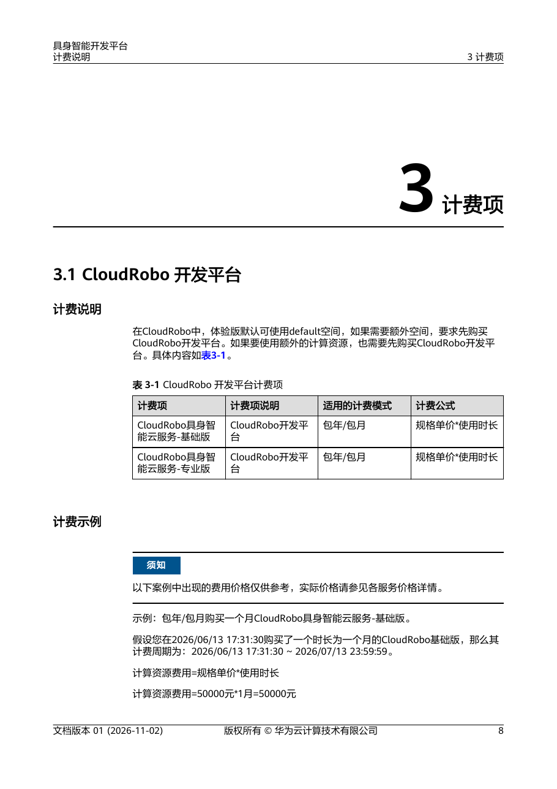

# 09 SWOT、成本与条件选型

截至2026-11-05，Huawei/HiSilicon最有证据支撑的选择是昇腾特定模型执行、海思视觉前端，以及CloudRobo的数据—训练—仿真—本体开发协作。三者具有不同硬件、软件和商业边界。本文不将它们合并成已经量产的通用具身机器人全栈；比较目标是找到可验收方案，而非依据峰值算力或品牌作排名。技术机制详见[08_Core_Technology_Moat](08_Core_Technology_Moat.md)，具体本体详见[06_Robot_Integration](06_Robot_Integration.md)。

## 市场与商业成熟度

本轮公开原件没有形成带地区、时期和统计分母的具身计算市场份额数据，因此不报告昇腾或海思的机器人芯片份额，也不以合作数量推断销量。公司收入、服务器收入、视觉芯片出货和机载机器人装机是不同市场口径；即使获取集团财报也不能据此分摊具身业务。有效材料证明产品、开发路线及渠道存在，尚不能证明同一SKU持续在岗的规模和盈利。

SO101抓放、UR5e残差强化及Q25路径跟随已取得官方开发实践，分别支持本体标定、训练/干预和ROS路径接口。它们缺少独立尝试分母、连续运营暴露小时、现场人工接管率和采购台数。UR5e成功示教保存、失败不保存的流程尤其不能用保存文件数估计任务成功率。商业订阅有计费项也不等于已有客户付费或实现运营收益。[CloudRobo_RealInference](https://support.huaweicloud.com/bestpractice-cloudrobo/cloudrobo_05_0002.html)（[本地原件](REFERENCES.md#ref-dc1a9e483afe4193)） [CloudRobo_ResidualDebug](https://support.huaweicloud.com/bestpractice-cloudrobo/cloudrobo_05_0027.html)（[本地原件](REFERENCES.md#ref-2af60c241cd552d0)） [CloudRobo_VLN](https://support.huaweicloud.com/bestpractice-cloudrobo/cloudrobo_05_0074.html)（[本地原件](REFERENCES.md#ref-8a29cdc042132589)）

国地中心2026-07-20实训场与“灵龙”进入延锋的官方公告曾在浏览器中可见，但统一归档被robots拒绝；作为待取件线索记录，不纳入本章有效商业证据。不得从采集/自主作业验证补出量产合同、芯片料号、节拍、台数或ROI。对实际客户，需要客户原文及任务日志把演示、试点、合同、交付和连续运营分开。

## SWOT：事实到动作

|类别|可核验事实|影响机制|成立/失效条件|选型动作|
|---|---|---|---|---|
|优势：执行工具链|ACL有OM加载/执行/回收链|减少重复编写设备资源管理|目标算子、shape及发行包配套；fallback可能失效|冻结包与模型哈希，测完整输入链|
|优势：视觉前端|海思有ISP/VPSS及专用处理|固定图像任务可复用硬件流水线|合法SDK、sensor调优、buffer/格式正确|测多路视频和模型长期并发|
|优势：开发协作|CloudRobo连接资产、算力和本体|减少数据/配置跨工具脱节|工作空间权限、版本及成本治理完整|模型、映射、镜像成组发布|
|短板：分层适配|910B学习路线与310B端侧不同|训练可用不能保证机载部署|大模型内存、kernel、动作头未验|先做端侧精度/热/尾时延验证|
|机会：本地项目|有分类授权渠道及中文课程|可缩短目标SDK/支持的定位过程|实际合同、料号及FAE响应落实|建立量产BSP/供货验收单|
|威胁：迁移与服务依赖|专用产物、收费资源、网络及二进制依赖|退出、停服或版本变化带来重验成本|数据不可导出、弱网、许可限制时放大|保留源资产及离线保护/恢复路线|

以上为机制分析，不是加速、开发效率或总成本的实测排名。ACL、当前产品、CloudRobo产品文档、RLinf准确容器与授权渠道分别支撑事实层。[ACL_ModelProcess](https://raw.githubusercontent.com/Ascend/samples/fc2aea93e48be8f8cee51d0c6c1b13a08155f83a/cplusplus/level2_simple_inference/1_classification/resnet50_imagenet_classification/src/model_process.cpp)（[本地原件](REFERENCES.md#ref-4773c545724ea61b)） [HiSilicon_Hi3519AV200](https://www.hisilicon.com/cn/products/smart-vision/machine-vision/hi3519av200)（[本地原件](REFERENCES.md#ref-387e661a1427ecf6)） [CloudRobo_ProductPDF](https://support.huaweicloud.com/productdesc-cloudrobo/CloudRobo%20%E4%BA%A7%E5%93%81%E4%BB%8B%E7%BB%8D-pdf.pdf)（[本地原件](REFERENCES.md#ref-522f065088effec2)） [RLinf_Ascend_Container](https://raw.githubusercontent.com/RLinf/RLinf/main/docs/source-en/rst_source/examples/embodied/_ascend_libero.rst)（[本地原件](REFERENCES.md#ref-dc5d74c5151ec519)） [HiSilicon_BuyChannels](https://www.hisilicon.com/cn/WhereToBuy)（[本地原件](REFERENCES.md#ref-6742493defffa2a6)）

海思优势有明确资源约束：Hi3519AV200的5.6TOPS HNR不开放，通用预算按开放2.5TOPS；CV610的1Gb DDR为128MB，不能因轻量VLM宣传就推定通用VLA可驻留。昇腾服务器A2名称不能替代200I A2/310B。RLinf的CANN9.1.1 for 910B增强开放学习路线，但不能变成A2端侧性能证明。机会应选任务与设备组合，不选抽象的“国产化”百分比。[HiSilicon_Hi3516CV610](https://www.hisilicon.com/cn/products/smart-vision/machine-vision/hi3516cv610)（[本地原件](REFERENCES.md#ref-7e91d964fbc23ad4)） [RLinf_Ascend_Container](https://raw.githubusercontent.com/RLinf/RLinf/main/docs/source-en/rst_source/examples/embodied/_ascend_libero.rst)（[本地原件](REFERENCES.md#ref-dc5d74c5151ec519)）

## 采购与云费用：先识别真实购买对象

海思渠道按产品类别、地区列授权分销商，不能证明某SKU现货、MOQ、含税单价或交期。A2官方产品页给模组定位，但本轮仍缺准确料号、载板配套和正式生命周期承诺。采购单应区分芯片、SOM、开发板、量产载板、散热、相机桥接、本体SDK和集成服务；向合同取得币种、数量、税费、地区、有效期、支持、PCN/EOL及备件条款。本文未联系渠道或提交询价。[HiSilicon_BuyChannels](https://www.hisilicon.com/cn/WhereToBuy)（[本地原件](REFERENCES.md#ref-6742493defffa2a6)） [Huawei_Atlas200IA2_Product](https://www.hiascend.com/hardware/accelerator-module-A2)（[本地原件](REFERENCES.md#ref-ccbe37b98431c440)）

CloudRobo计费文档01（2026-11-02，完整26页）将开发平台、高阶服务、算力资源和智能模型列为包年/包月预付费。体验版默认default空间，额外空间/计算资源要求先购买开发平台；基础版可配高阶仿真服务，专业版可配专属仿真单元，模型订阅需基础或专业版前置。平台配额不能当每任务可用或永久免费额度。[CloudRobo_BillingPDF](https://support.huaweicloud.com/price-cloudrobo/CloudRobo%20%E8%AE%A1%E8%B4%B9%E8%AF%B4%E6%98%8E-pdf.pdf)（[本地原件](REFERENCES.md#ref-8b711de4fe937ab4)） [CloudRobo_BillingPlatform](https://support.huaweicloud.com/price-cloudrobo/cloudrobo_04_0006.html)（[本地原件](REFERENCES.md#ref-bbb3154c12d27f1b)） [CloudRobo_BillingCompute](https://support.huaweicloud.com/price-cloudrobo/cloudrobo_04_0007.html)（[本地原件](REFERENCES.md#ref-1a1ca3af58f2934e)）

图为PDF物理第11页完整渲染，保留表3-1和“价格仅供参考”声明。基础版50000元/月、仿真服务/专属单元及VLA示例10000元/月是计费教学值，不是已取得的2026-11-05正式报价。不能把专业版价格用基础版示例替代，也不能据此宣布一套确定配置7万元/月；各订阅对应的对象、包含量、并发及购买前置条件尚需正式订单验证。[CloudRobo_BillingPDF](https://support.huaweicloud.com/price-cloudrobo/CloudRobo%20%E8%AE%A1%E8%B4%B9%E8%AF%B4%E6%98%8E-pdf.pdf)（[本地原件](REFERENCES.md#ref-8b711de4fe937ab4)）

|费用对象|单位与数量输入|公开边界|预算动作|
|---|---|---|---|
|开发平台/模型/仿真|元/实例月、实例数、月数|包年/包月；示例非报价|按区域与合同取得每项净价|
|训练资源|元/资源小时、训练小时/次、次数|ModelArts独立资源；训练推荐非强制BOM|记录排队、失败重跑及checkpoint费用|
|存储与传输|元/GB月、GB、请求数|OBS/SWR等独立服务|计数据/镜像副本与保留期|
|ELB/EIP|元/小时、可用区数、带宽/流量|CCE Standard纳管需独享型ELB按需实例|确认自动创建资源及停止流程|
|端侧系统|元/台、台数、备件数|芯片价不等于整机BOM|纳入载板、散热、sensor及控制器|
|集成与维护|元/人时、人时、年数|未取得统一费率|记录移植、产测、升级和重验|

ELB按需费用是CloudRobo主订阅之外的资源管理支出，公式为可用区数×实例规格单价×时长＋EIP费用。产品架构里的OBS存储、SWR镜像、CCE和ModelArts分别建账，合同包含项先核清再相加，避免重复计费。[CloudRobo_BillingManagement](https://support.huaweicloud.com/price-cloudrobo/cloudrobo_04_0017.html)（[本地原件](REFERENCES.md#ref-ad679c4948e75582)） [CloudRobo_ProductPDF](https://support.huaweicloud.com/productdesc-cloudrobo/CloudRobo%20%E4%BA%A7%E5%93%81%E4%BB%8B%E7%BB%8D-pdf.pdf)（[本地原件](REFERENCES.md#ref-522f065088effec2)）

透明TCO模型（分析）为：TCO=N×(单台完整BOM＋初装费)＋备件＋集成人时×费率＋Σ(订阅实例数×月数×月单价)＋Σ(训练小时×小时单价)＋存储/网络＋维护人时×费率＋退役迁移。N为台数，观察期Y为年数；运行小时H=N×Y×每年实际运行小时。单位成本TCO/H只是每机器人运行小时的成本，不是每成功任务成本，更不是ROI。所有价格、用量和工时仍缺正式项目输入，本文不填总额；若要每任务成本必须另取成功任务数、失败重试与人工费用，避免以“计划工作小时”代替有效产出。

预付费使利用率影响单位成本。分析：其他输入不变、有效运行小时减半时，固定部分的每小时成本翻倍；训练费和流量不一定同比变化。到期未续费先宽限、再保留冻结、最后释放，时长依客户等级，不能承诺统一天数。PDF亦有2023/2026例日期不一致，预算采用订单实际时间。停用需按退订/资源删除规则核账，本文只调研流程，没有执行任何操作。[CloudRobo_BillingPDF](https://support.huaweicloud.com/price-cloudrobo/CloudRobo%20%E8%AE%A1%E8%B4%B9%E8%AF%B4%E6%98%8E-pdf.pdf)（[本地原件](REFERENCES.md#ref-8b711de4fe937ab4)）

## 地区政策、数据与交付责任

国家网信办令第16号《促进和规范数据跨境流动规定》2024-03-22公布并施行。第三条的跨国制造等活动豁免以前提“不包含个人信息或者重要数据”为条件；机器人视频、人员动作或生产现场资料不能仅凭用途名称获得豁免。第五、七、八条区分关键信息基础设施运营者、一般/敏感个人信息、重要数据及自当年1月1日起累计人数；第十、十一条仍要求告知、单独同意、影响评估及安全义务。豁免出境机制不等于免除其他义务。[CAC_CrossBorder_2024](https://www.cac.gov.cn/2024-03/22/c_1712776611775634.htm)（[本地原件](REFERENCES.md#ref-45c93df732722343)）

对本地项目，先确定采集、OBS桶、训练、推理、模型下载、日志和远程运维各自地区及接收方，画数据流并分类；不要把选用中国品牌自动解释为数据不出境。涉及出口、再出口或境外供应时，还应取得具体料号、出口主体、目的地、最终用户/用途和实施时点的监管意见。本轮未取得覆盖全部芯片的现行出口分类，故不判定全部海思端侧受同一数据中心条款限制或全部豁免。

CloudRobo提供IAM、委托和工作空间，委托以临时凭据操作OBS等资源；客户仍负责内容、身份及权限。产品文档的合同范围声明和安全责任共担不能成为机器人功能安全认证。将本地制动、控制器限位、急停、失联动作有效期、证书撤销和备份恢复纳入本体交付；云SLA也不能替代电机停止时间保证。[CloudRobo_AccessControl](https://support.huaweicloud.com/productdesc-cloudrobo/cloudrobo_01_0006.html)（[本地原件](REFERENCES.md#ref-dfb97688196115fb)） [CloudRobo_SharedResponsibility](https://support.huaweicloud.com/productdesc-cloudrobo/cloudrobo_01_0003.html)（[本地原件](REFERENCES.md#ref-21bde8d60d9a5c8c)）

## 按应用放行

|应用|优先验证路线|适用条件|放行证据与退出条件|
|---|---|---|---|
|科研/教学|SO101＋CloudRobo；910B＋RLinf|固定模型/数据/本体，接受开发依赖|版本复建、失败分母、资源预算|
|操作机器人|UR5e残差或已适配ACT/PI05|动作映射、标定、保护及任务数据充分|真机留出任务、接管率、网络/温度长测|
|物流AMR|端侧感知＋本地导航；云上任务协作|本体导航/避障/控制器独立落实|地图/定位、障碍响应、失联降级；Q25路径不代全套|
|固定视觉|海思ISP/MPP＋轻量模型|输入固定、商业SDK及sensor调优可得|视频/NPU并发、画质/准确率、热与带宽|
|消费设备|小模型端侧先验证|内存、功率、体积及许可可接受|目标模型量化、隐私、升级恢复和生命周期|
|工业应用|按SKU/BSP＋本地控制器集成|环境等级、供应、产测和维护合同充分|连续任务/节拍、故障恢复、备件及PCN|
|安全应用|独立保护系统先落实|危险响应有正式工程验证|安全认证/故障测试；证据不足不靠云模型放行|

该矩阵是条件建议，不能证明现有SKU满足所有应用。决策先锁定任务输入输出和本体契约，再测目标设备模型与sensor/媒体并发、温度稳定及完整链路尾时延；继而测失败/断网/重连，最后落实商业交付。训练收敛、仿真成绩、任务完成、在岗运营和财务收益分阶段验收，达不到下一阶段证据时保留原型或试点状态。

本章引用网页正文完整但部分静态依赖缺失，按partial_static披露；PDF与监管原文保存完整原件及哈希。实际报价、市场份额、当前SKU正式SDK/热与安全等级、客户规模/收益和适用出口分类均保留未知，不以结构检查通过代替实机或商业验证。

## 参考资料与原件

下列资料按 2026-11-05 核验时点使用；抓取日期不是发布日期。URL带提交SHA或tag的源码限定对应版本；main/master及模型卡仅为采集快照，未锁不可变revision。未运行安装脚本、模型或设备。

| 来源 | 原文 / 本地原件 | 版本与归档边界 |
|---|---|---|
| CloudRobo_BillingPDF | [CloudRobo_BillingPDF](https://support.huaweicloud.com/price-cloudrobo/CloudRobo%20%E8%AE%A1%E8%B4%B9%E8%AF%B4%E6%98%8E-pdf.pdf) / [原件](REFERENCES.md#ref-8b711de4fe937ab4) | 文档01，2026-11-02，完整26页；采集 UTC 2026-11-04T17:24:36.474606+00:00；complete_static |
| CloudRobo_BillingPlatform | [CloudRobo_BillingPlatform](https://support.huaweicloud.com/price-cloudrobo/cloudrobo_04_0006.html) / [原件](REFERENCES.md#ref-bbb3154c12d27f1b) | 页面未标版号；按采集快照使用；采集 UTC 2026-11-04T17:24:38.813817+00:00；partial_static |
| CloudRobo_BillingCompute | [CloudRobo_BillingCompute](https://support.huaweicloud.com/price-cloudrobo/cloudrobo_04_0007.html) / [原件](REFERENCES.md#ref-1a1ca3af58f2934e) | 页面未标版号；按采集快照使用；采集 UTC 2026-11-04T17:24:41.698322+00:00；partial_static |
| CloudRobo_BillingModels | [CloudRobo_BillingModels](https://support.huaweicloud.com/price-cloudrobo/cloudrobo_04_0018.html) / [原件](REFERENCES.md#ref-8011caa51f9cdb08) | 页面未标版号；按采集快照使用；采集 UTC 2026-11-04T17:24:44.054613+00:00；partial_static |
| CloudRobo_BillingManagement | [CloudRobo_BillingManagement](https://support.huaweicloud.com/price-cloudrobo/cloudrobo_04_0017.html) / [原件](REFERENCES.md#ref-ad679c4948e75582) | 页面未标版号；按采集快照使用；采集 UTC 2026-11-04T17:24:46.238677+00:00；partial_static |
| CloudRobo_ProductPDF | [CloudRobo_ProductPDF](https://support.huaweicloud.com/productdesc-cloudrobo/CloudRobo%20%E4%BA%A7%E5%93%81%E4%BB%8B%E7%BB%8D-pdf.pdf) / [原件](REFERENCES.md#ref-522f065088effec2) | 文档01，2026-11-02；完整20页PDF；采集 UTC 2026-11-04T16:53:04.019493+00:00；complete_static |
| CloudRobo_AccessControl | [CloudRobo_AccessControl](https://support.huaweicloud.com/productdesc-cloudrobo/cloudrobo_01_0006.html) / [原件](REFERENCES.md#ref-dfb97688196115fb) | 页面未标版号；按采集快照使用；采集 UTC 2026-11-04T17:24:48.434911+00:00；partial_static |
| CloudRobo_SharedResponsibility | [CloudRobo_SharedResponsibility](https://support.huaweicloud.com/productdesc-cloudrobo/cloudrobo_01_0003.html) / [原件](REFERENCES.md#ref-21bde8d60d9a5c8c) | 页面未标版号；按采集快照使用；采集 UTC 2026-11-04T17:24:50.706845+00:00；partial_static |
| CAC_CrossBorder_2024 | [CAC_CrossBorder_2024](https://www.cac.gov.cn/2024-03/22/c_1712776611775634.htm) / [原件](REFERENCES.md#ref-45c93df732722343) | 国家网信办令16号；2024-03-22公布施行；采集 UTC 2026-11-04T17:25:40.124229+00:00；complete_static |
| CloudRobo_RealInference | [CloudRobo_RealInference](https://support.huaweicloud.com/bestpractice-cloudrobo/cloudrobo_05_0002.html) / [原件](REFERENCES.md#ref-dc1a9e483afe4193) | 页面未标版号；按采集快照使用；采集 UTC 2026-11-04T16:51:56.983744+00:00；partial_static |
| CloudRobo_ResidualDebug | [CloudRobo_ResidualDebug](https://support.huaweicloud.com/bestpractice-cloudrobo/cloudrobo_05_0027.html) / [原件](REFERENCES.md#ref-2af60c241cd552d0) | 页面未标版号；按采集快照使用；采集 UTC 2026-11-04T17:05:48.028639+00:00；partial_static |
| CloudRobo_VLN | [CloudRobo_VLN](https://support.huaweicloud.com/bestpractice-cloudrobo/cloudrobo_05_0074.html) / [原件](REFERENCES.md#ref-8a29cdc042132589) | 页面未标版号；按采集快照使用；采集 UTC 2026-11-04T16:52:51.987369+00:00；partial_static |
| ACL_ModelProcess | [ACL_ModelProcess](https://raw.githubusercontent.com/Ascend/samples/fc2aea93e48be8f8cee51d0c6c1b13a08155f83a/cplusplus/level2_simple_inference/1_classification/resnet50_imagenet_classification/src/model_process.cpp) / [原件](REFERENCES.md#ref-4773c545724ea61b) | 固定提交源码/许可快照；确切 SHA 见原文 URL；采集 UTC 2026-11-04T16:26:46.107974+00:00；complete_static |
| HiSilicon_Hi3519AV200 | [HiSilicon_Hi3519AV200](https://www.hisilicon.com/cn/products/smart-vision/machine-vision/hi3519av200) / [原件](REFERENCES.md#ref-387e661a1427ecf6) | 页面未标版号；按采集快照使用；采集 UTC 2026-11-04T15:55:51.885466+00:00；complete_static |
| HiSilicon_Hi3516CV610 | [HiSilicon_Hi3516CV610](https://www.hisilicon.com/cn/products/smart-vision/machine-vision/hi3516cv610) / [原件](REFERENCES.md#ref-7e91d964fbc23ad4) | 页面未标版号；按采集快照使用；采集 UTC 2026-11-04T15:54:58.249797+00:00；complete_static |
| RLinf_Ascend_Container | [RLinf_Ascend_Container](https://raw.githubusercontent.com/RLinf/RLinf/main/docs/source-en/rst_source/examples/embodied/_ascend_libero.rst) / [原件](REFERENCES.md#ref-dc5d74c5151ec519) | main采集快照，未锁提交SHA；CANN9.1.1 for 910B；采集 UTC 2026-11-04T17:12:19.065351+00:00；complete_static |
| HiSilicon_BuyChannels | [HiSilicon_BuyChannels](https://www.hisilicon.com/cn/WhereToBuy) / [原件](REFERENCES.md#ref-6742493defffa2a6) | 页面未标版号；按采集快照使用；采集 UTC 2026-11-04T15:56:04.736234+00:00；partial_static |
| Huawei_Atlas200IA2_Product | [Huawei_Atlas200IA2_Product](https://www.hiascend.com/hardware/accelerator-module-A2) / [原件](REFERENCES.md#ref-ccbe37b98431c440) | 页面未标版号；按采集快照使用；采集 UTC 2026-11-04T15:46:18.440423+00:00；complete_static |

[主张和图源核验](research_state/evidence/09_SWOT_Analysis.json)。各引用保存原始响应、哈希及 metadata；静态归档不承诺动态交互或像素级复现。
