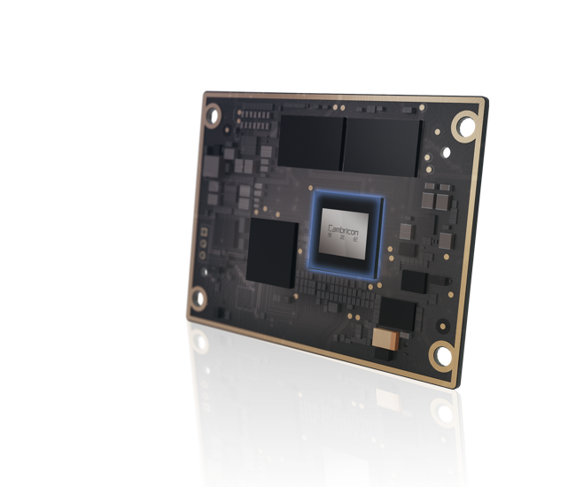
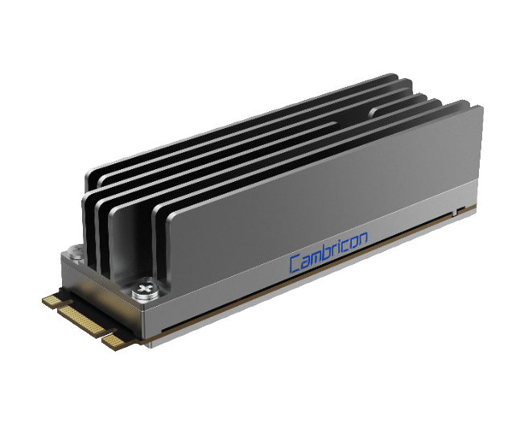
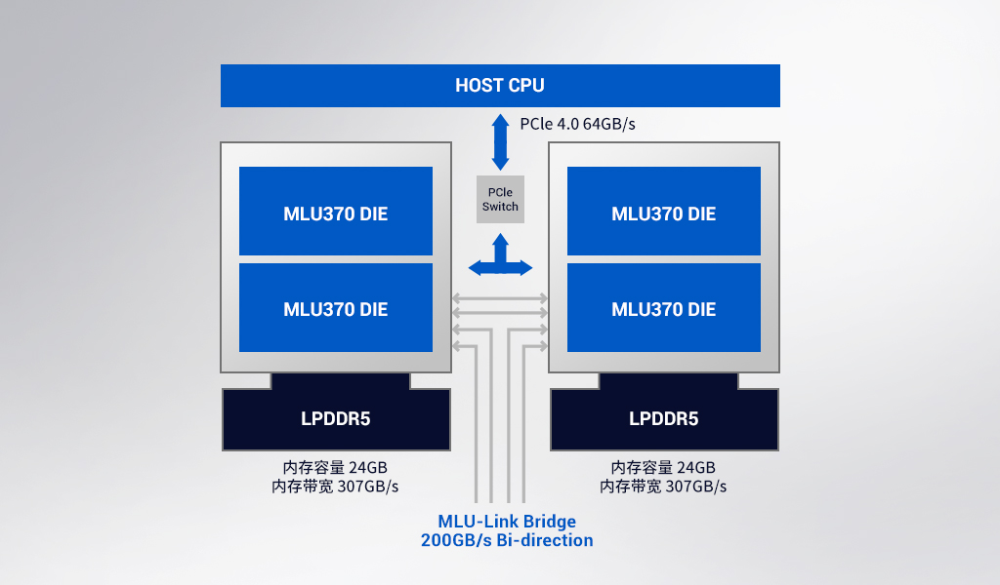
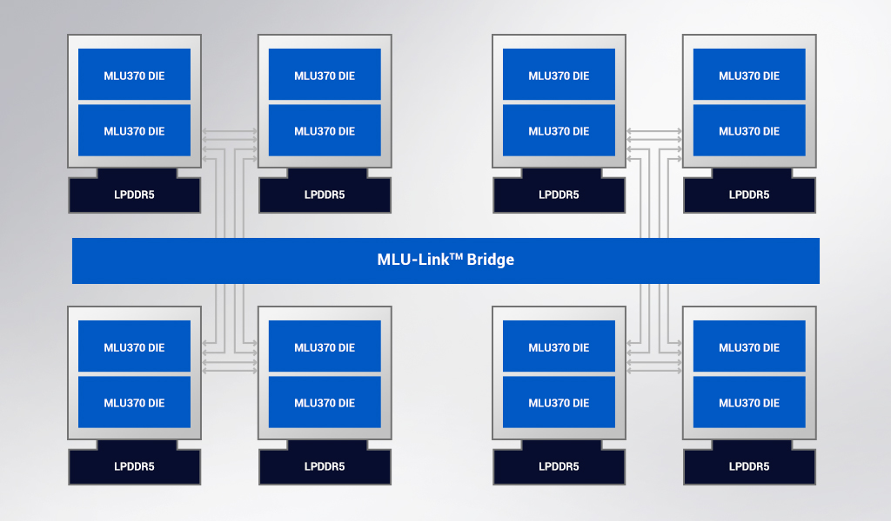
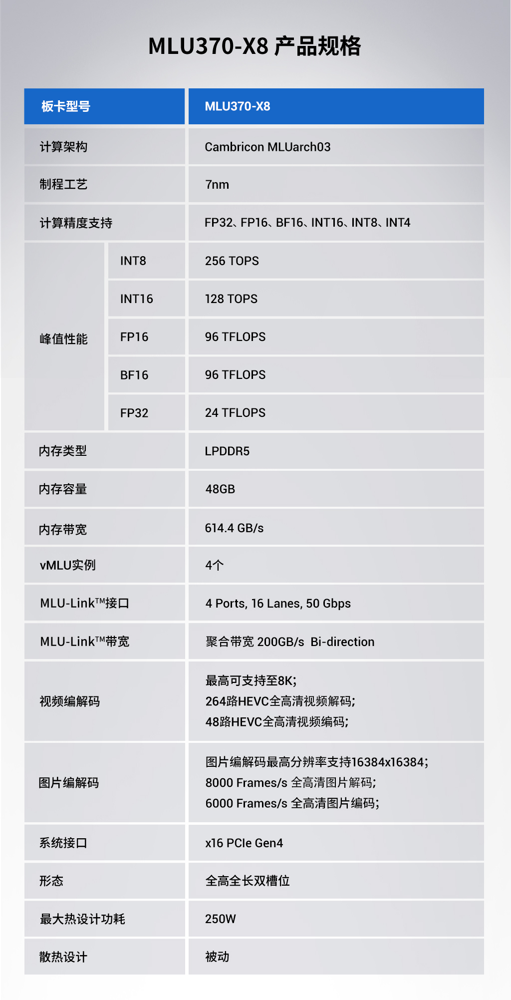
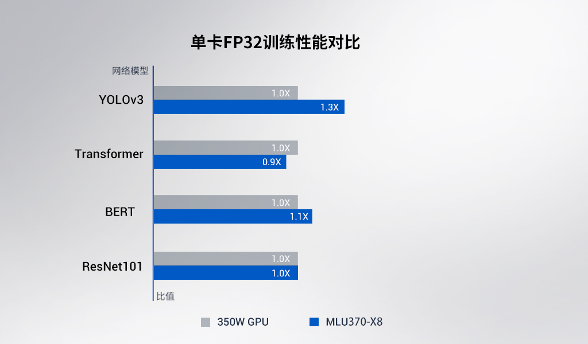
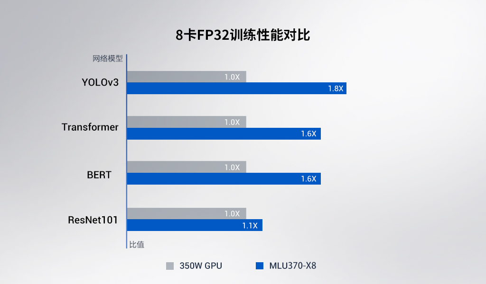
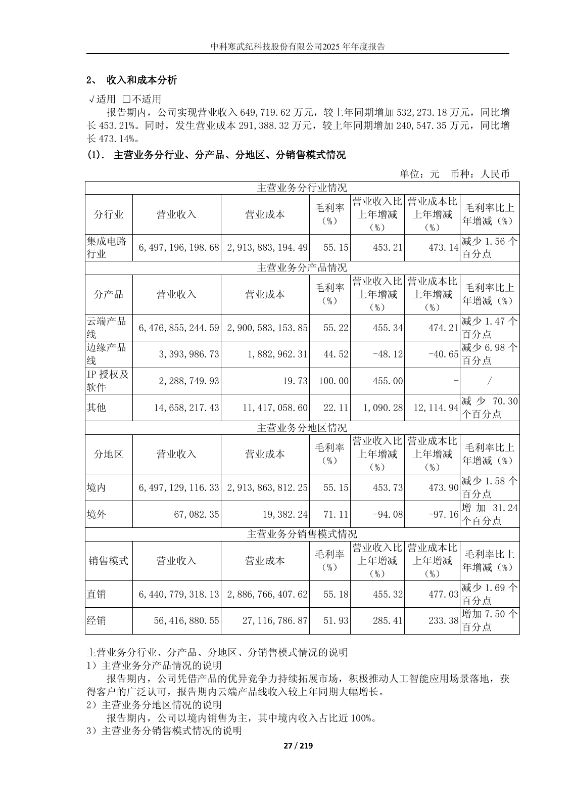

# 寒武纪 Cambricon 具身智能硬件平台：规格、系统分工与交付证据

资料采集截止：2026-11-05（Asia/Shanghai）。本章为01质量样章，等待用户审阅；02—09仍是已有首轮简报，未按本次深度标准完成。研究采用官网规格、2022年首发原文、2025年年报、2026年半年报及官方代码仓库快照。采集日期不代表产品发布日期，也不代表材料均更新到2026年11月。

## 1. 先确定寒武纪在机器人系统中的位置

**公开证据支持把寒武纪分成“端侧推理模组/协处理器”和“主机侧训练/集中推理加速器”两条路线，尚不足以把它认定为已交付的完整具身机器人平台。** MLU220-SOM提供CPU、AI运算、内存和启动存储；MLU220-M.2接入外部主机，适合既有设备增加AI处理能力。MLU370系列则面向服务器或训练主机，需要CPU、系统内存、存储、供电和机箱配合。终端处理器IP是给芯片设计客户授权的核，不能与可采购模组混为一谈。对应产品定位见[思元220系列概述](https://www.cambricon.com/index.php?m=content&c=index&a=lists&catid=55)、[MLU220-SOM规格](https://www.cambricon.com/index.php?m=content&c=index&a=lists&catid=56)、[MLU220-M.2规格](https://www.cambricon.com/index.php?m=content&c=index&a=lists&catid=57)、[MLU370-X8规格](https://www.cambricon.com/index.php?m=content&c=index&a=lists&catid=406)及[Cambricon-1M IP规格](https://www.cambricon.com/index.php?m=content&c=index&a=lists&catid=12)。

对具身项目，优先判断模型及缓存是否装得下、数据能否进入计算单元、连续负载是否热稳定、控制器是否能处理失联，再比较同口径算力。MLU220的INT8 TOPS不能替代浮点训练速度；云端卡能支持大模型，也不证明同一模型能在220上运行。官网把“智能机器人”列为思元220应用场景，但未在本轮取得的材料中给出机器人本体型号、完整BOM、实机闭环延迟或任务完成率。此项属于应用定位，而非机器人量产适配证据。[来源：[思元220系列概述](https://www.cambricon.com/index.php?m=content&c=index&a=lists&catid=55)]

**时效核对是本章最重要的限制。** 官网目录仍以220/270/370为可查对象；2026半年报确认公司继续研发新一代处理器微架构、指令集和面向大模型的硬件平台，却没有提供这些新硬件的完整板卡SKU规格。2022年WAIC新闻已披露思元590采用MLUarch05，并称其内存及PCIe能力升级，但当时明确是“在研”信息。本文因此保留590作为需要追踪的代际，既不把370称为2026最新旗舰，也不把媒体流传的590/690/720算力、HBM、价格或量产时间填进正式参数表。[来源：[官网目录与产品定位](https://www.cambricon.com/)；[思元590与车载方案历史披露](https://www.cambricon.com/index.php?m=content&c=index&a=show&catid=127&id=51)；[公司2026年半年度报告全文（雪球公开副本）](https://stockmc.xueqiu.com/202608/688256_20260808_TUNG.pdf)第11、14—19页]

本章具体覆盖220两种官方交付形态、370-S4/S8/X4/X8、270-S4/F4、1M/1H主要IP档位，以及必要的290/玄思1000和车载在研方案边界。290与玄思1000只用于解释历史训练产品关系，本轮未取得完整规格，不以猜测补出型号对比。车载芯片也不自动进入机器人量产候选。后续软件、传感器、模型、仿真和本体适配依01—09顺序展开，本章只交代影响硬件选型的接口和交付前提。

## 2. 产品与交付层级：芯片、SOM、卡、IP不能互换

下表“在列/披露”仅描述公开材料状态，不是现货、生命周期或生产保证。

| 对象 | 交付形态 | 已核到的用途 | 本章采用的证据状态 | 具身系统位置（分析） | 来源 |
|---|---|---|---|---|---|
| 思元220 / MLU220-SOM | SoC及板对板模组 | 边缘端单系统AI | 官网在列；首发日未从当前页取得 | 本体感知、固定视觉、小模型推理的候选 | [思元220系列概述](https://www.cambricon.com/index.php?m=content&c=index&a=lists&catid=55)；[MLU220-SOM规格](https://www.cambricon.com/index.php?m=content&c=index&a=lists&catid=56) |
| MLU220-M.2 | M.2协处理卡 | 既有终端/边缘设备AI赋能 | 官网在列；当前页无生命周期承诺 | 主机承担OS、传感器与控制，MLU加速模型 | [MLU220-M.2规格](https://www.cambricon.com/index.php?m=content&c=index&a=lists&catid=57) |
| MLU370-S4/S8 | 服务器PCIe卡 | 高密度云端推理 | 官网合并规格页；两SKU容量映射未独立展开 | 场站/后台感知、集中模型服务候选 | [MLU370-S4/S8规格](https://www.cambricon.com/index.php?m=content&c=index&a=lists&catid=365) |
| MLU370-X4 / X8 | PCIe训练/推理卡 | 训推一体；X8支持多芯互联 | X8于2022-03-21发布并称小规模出货 | 开发、训练、集中推理主机候选 | [MLU370-X4规格](https://www.cambricon.com/index.php?m=content&c=index&a=lists&catid=371)；[MLU370-X8规格](https://www.cambricon.com/index.php?m=content&c=index&a=lists&catid=406)；[MLU370-X8首发、框图和性能图](https://www.cambricon.com/index.php?m=content&c=index&a=show&catid=127&id=48) |
| MLU270-S4 / F4 | 数据中心卡 / 桌面卡 | AI推理；F4主动散热 | 官网在列，属于必要旧代 | 既有系统维护及传统模型迁移 | [MLU270-S4规格](https://www.cambricon.com/index.php?m=content&c=index&a=lists&catid=36)；[MLU270-F4规格](https://www.cambricon.com/index.php?m=content&c=index&a=lists&catid=37) |
| Cambricon-1M / 1H | 智能处理器IP | 嵌入客户SoC | 官网列出核配置，非可直接装机板卡 | 自研芯片路线，需授权、流片和系统开发 | [Cambricon-1M IP规格](https://www.cambricon.com/index.php?m=content&c=index&a=lists&catid=12)；[Cambricon-1H IP规格](https://www.cambricon.com/index.php?m=content&c=index&a=lists&catid=13) |
| 思元590；SD5223/SD5226 | 历史在研芯片描述 | 云端训练；车载行泊/高阶驾驶 | 2022披露，未取得当前逐SKU交付证明 | 追踪项，不作为已交付机器人配置 | [思元590与车载方案历史披露](https://www.cambricon.com/index.php?m=content&c=index&a=show&catid=127&id=51) |

2026半年报第5页还解释了UBB是支持OAM模组的通用底板，但释义本身不是寒武纪某款OAM/UBB的产品数据手册。不能据此推定当前集群的插槽数、互联带宽、液冷规格或单节点功率。公司“智能整机”与“智能计算集群系统”也不同：前者是单台服务器，后者还结合伙伴的网络、存储、服务器及集群管理软件。报价和验收必须按这两个交付边界分别确认。[来源：[公司2026年半年度报告全文（雪球公开副本）](https://stockmc.xueqiu.com/202608/688256_20260808_TUNG.pdf)第5、10页]

## 3. 端侧MLU220：算力以外的完整规格与缺口

### 3.1 计算、内存和存储

| 项目 | MLU220-SOM | MLU220-M.2 | 对部署的影响与口径 | 来源 |
|---|---|---|---|---|
| AI架构 / 制程 | MLUv02；当前规格页未列制程 | MLUv02；当前规格页未列制程 | 不把370的7nm套给220；年报“7nm等工艺经验”不是逐芯片制程 | [MLU220-SOM规格](https://www.cambricon.com/index.php?m=content&c=index&a=lists&catid=56)；[MLU220-M.2规格](https://www.cambricon.com/index.php?m=content&c=index&a=lists&catid=57)；[公司2025年年度报告全文](https://dataclouds.cninfo.com.cn/shgonggao/hsomarket/2026/20260312/05ca784762a7401b9ed371d917e436dc.PDF)第20页 |
| AI峰值 | 16 TOPS，INT8 | 8 TOPS，INT8；概述明确理论峰值 | dense/sparse、运行频率及对应测试功率均未完整披露，不擅自认作同条件应用速度 | [MLU220-SOM规格](https://www.cambricon.com/index.php?m=content&c=index&a=lists&catid=56)；[MLU220-M.2规格](https://www.cambricon.com/index.php?m=content&c=index&a=lists&catid=57) |
| 通用CPU | 4×Arm A55，1.5GHz | 卡规格页未列可由用户使用的CPU配置 | 系列芯片集成A55，不代表M.2提供与SOM相同自主系统接口 | [思元220系列概述](https://www.cambricon.com/index.php?m=content&c=index&a=lists&catid=55)；[MLU220-SOM规格](https://www.cambricon.com/index.php?m=content&c=index&a=lists&catid=56)；[MLU220-M.2规格](https://www.cambricon.com/index.php?m=content&c=index&a=lists&catid=57) |
| GPU / 其他专用引擎 | AI及编解码能力有披露；GPU具体配置未取得 | 同样未取得GPU配置 | 不据缺项宣称“无GPU”，也不默认提供通用图形/光追渲染 | [MLU220-SOM规格](https://www.cambricon.com/index.php?m=content&c=index&a=lists&catid=56)；[MLU220-M.2规格](https://www.cambricon.com/index.php?m=content&c=index&a=lists&catid=57) |
| 内存 | 8GB；网页写“LPDDR4×，64bits，3733MHz”，按系列页LPDDR4x理解类型 | LPDDR4x，64bit；容量和速率未列 | 不能把SOM的8GB或3733参数移到M.2；可用容量还要扣系统和工作区 | [思元220系列概述](https://www.cambricon.com/index.php?m=content&c=index&a=lists&catid=55)；[MLU220-SOM规格](https://www.cambricon.com/index.php?m=content&c=index&a=lists&catid=56)；[MLU220-M.2规格](https://www.cambricon.com/index.php?m=content&c=index&a=lists&catid=57) |
| 内存带宽 | 产品页未给GB/s | 产品页未给GB/s | 只有位宽及速率表述，不能写成实测吞吐 | [MLU220-SOM规格](https://www.cambricon.com/index.php?m=content&c=index&a=lists&catid=56)；[MLU220-M.2规格](https://www.cambricon.com/index.php?m=content&c=index&a=lists&catid=57) |
| 存储 | 32GB eMMC 5.1 HS400；页面写400MB/s | 卡页未列应用存储 | 400MB/s是官网规格表述，不等于数据集随机读写实测；M.2形态也不代表NVMe盘 | [MLU220-SOM规格](https://www.cambricon.com/index.php?m=content&c=index&a=lists&catid=56)；[MLU220-M.2规格](https://www.cambricon.com/index.php?m=content&c=index&a=lists&catid=57) |

MLUv02系列页称采用片上网络NoC，有利于片内数据压缩、提升缓存有效容量和带宽。这解释其设计方向，但未给出220缓存容量、压缩比或某机器人模型的加速幅度。不能据此承诺“内存带宽翻倍”或“端到端零拷贝”。CPU、AI单元及编解码器同时负载时的仲裁和带宽竞争，仍须开发手册和实际负载验证。[来源：[思元220系列概述](https://www.cambricon.com/index.php?m=content&c=index&a=lists&catid=55)]

**内存带宽的条件计算：**若网页“3733MHz”实质指3733 MT/s数据率，64bit接口的理想外部带宽为3733×64÷8＝29,864 MB/s，即29.864 GB/s。网页没有解释它是时钟还是有效传输速率，本文仅保留这一假设计算，未将29.864 GB/s记为官方带宽；控制器效率、刷新、共享访问和热降频均会降低有效吞吐。应向厂商索取正式速率单位和带宽测试条件。[输入来源：[MLU220-SOM规格](https://www.cambricon.com/index.php?m=content&c=index&a=lists&catid=56)]

对大模型的判断也应先看容量。例如**分析假设**7B参数全部按INT8存储，仅权重就约7GB（十进制），尚未包括量化元数据、KV缓存、视觉编码器、激活、运行时和OS。这个估算只说明8GB SOM存在明显的内存预算压力，不证明模型一定能加载、算子一定兼容或能达到某策略调用频率。即使经过量化压缩，模型精度和动作安全也需要独立验证。对于M.2，容量尚未在本轮官方页取得，连这一容量预算都不能直接复用。

### 3.2 媒体处理能力与机器人视觉不能画等号

| 媒体项目 | MLU220-SOM官方表述 | MLU220-M.2官方表述 | 可以支持的判断 | 不能支持的判断 |
|---|---|---|---|---|
| 视频格式 | H.264、HEVC/H.265、VP8、VP9 | 相同格式清单 | 具备压缩视频处理相关能力 | 全格式在同一条件下都达到同一路数 |
| 视频路数 | 解码16×1080P@30fps；编码8×1080P@30fps | 未列具体路数 | SOM可作为多路压缩视频处理候选 | M.2同样16路；16路端到端视觉推理；16路相机物理输入 |
| JPEG分辨率 | 最大8192×8192 | 最大8192×8192 | 可处理该上限的JPEG图像输入 | 该最大分辨率下能达到FHD吞吐 |
| JPEG吞吐 | 解码820fps@FHD；编码800fps@FHD | 未列fps | 厂商给出的FHD媒体处理数字 | 感知模型fps、检测成功率、闭环延迟或伺服频率 |

上表来源为[MLU220-SOM规格](https://www.cambricon.com/index.php?m=content&c=index&a=lists&catid=56)及[MLU220-M.2规格](https://www.cambricon.com/index.php?m=content&c=index&a=lists&catid=57)，均无独立测试报告。SOM规格没有列出视频路数对应码率、profile、同时编解码条件、输入传输方式和负载功率，因此应作为能力上限线索，不当成机器人任务验收值。视觉流水线还包括采集、传输、解码、缩放/颜色变换、模型推理、融合、规划和控制，每一步都可能成为瓶颈。

### 3.3 形态、功率与热设计

| 项目 | MLU220-SOM | MLU220-M.2 | 工程放行要求 |
|---|---|---|---|
| 尺寸 / 高度 | 50×66mm；高度未列 | 80×22mm；无散热7.2mm，带散热21.3mm | 按正式机械图核对净空、固定孔、重量及振动 |
| 连接器 | 板对板；针数及完整pinout未取得 | M.2 2280，B+M key | 形状/键位匹配不证明供电、协议和驱动匹配 |
| 功率 | ≤15W；概述写15W | 8.25W | 网页未给同负载功率曲线或可选功率模式；整机另计 |
| 散热 | 裸板，由客户设计 | 被动散热 | SOM需设计接触面、导热与机壳；M.2需核对周边风流/导热 |
| 环境 / 可靠性 | 工作/存储温度、结温上限、MTBF、工业等级未从当前页取得 | 同样未取得 | 不能把“智能制造用途”写成工业宽温认证 |
| 输入电源 / 安全 | 电压、瞬态、完整启动时序和安全认证未取得 | 页面未给完整电气规范 | 索取电源时序、复位/掉电恢复、看门狗及故障输出资料 |

本表来源为[MLU220-SOM规格](https://www.cambricon.com/index.php?m=content&c=index&a=lists&catid=56)及[MLU220-M.2规格](https://www.cambricon.com/index.php?m=content&c=index&a=lists&catid=57)。“≤15W”不能直接作为电源额定输出：还需考虑载板、传感器、存储、DC/DC损耗和瞬态余量。“被动散热”也不等于密封机器人舱内任何环境温度下均可长期满载。先明确厂商功率统计范围，再测密闭舱和电机热源共同作用下的稳态温升、降频及最差延迟；无需先假定可用温度数值。

图1：MLU220-SOM官方外观原图。可帮助理解裸模组形态和客户自做散热的集成边界；不能用渲染图读出连接器针数、电气pinout或散热能力。图片文件名中的日期只表示素材路径，不认作发布日期。[来源：[MLU220-SOM规格](https://www.cambricon.com/index.php?m=content&c=index&a=lists&catid=56)]

图2：MLU220-M.2官方带散热外观原图。21.3mm带散热高度应参与整机机械选型，不能只按“M.2 2280”认为它与低矮SSD的净空相同。[来源：[MLU220-M.2规格](https://www.cambricon.com/index.php?m=content&c=index&a=lists&catid=57)]

## 4. 接口与控制分工：哪些功能仍由载板和主机实现

| 接口或功能 | SOM公开条目 | M.2公开条目 | 集成边界（分析） | 仍需取得的资料 |
|---|---|---|---|---|
| 主机/扩展总线 | PCIe 3.0 2×2，标注RC；SDIO 3.0×2 | PCIe 3.0×2 | SOM的RC条目与M.2端点角色不同；不能直接互换连接方案 | lane分配、复用、电气、驱动与复位时序 |
| 网络 | 2×千兆以太网 | 未列独立网络端口 | 是否需外置PHY/磁性器件、连接器仍应按模组pinout确认；M.2通过主机联网 | 原理图、PHY配套、时间戳和同步能力 |
| 低速外设 | I2C、SPI、UART、GPIO | 未列独立外设端口 | 数量、电平和复用未公开；RS232/485收发器不能从UART条目推定已包含 | pinmux、电平、隔离和总线驱动 |
| 摄像头 | 规格页未列CSI或GMSL | 规格页未列直连相机口 | 可先评估网络/外部采集路径；不把解码路数写成直连相机接口数 | CSI/ISP实际能力、桥接方案和采集SDK |
| 机器人总线 | 未在本轮规格页取得CAN、EtherCAT、TSN条目 | 未取得对应条目 | 需外部控制器或主机接口方案；未取得不等于硅片绝无此能力 | 控制器/收发器、驱动、同步和时延验证 |
| 存储、USB及显示 | 已列eMMC/PCIe/SDIO；USB及显示规格未取得 | 本身为AI协处理卡，非显示接口交付 | 应区分芯片潜在接口、模组引出和载板实际连接器 | 载板手册、固件、驱动及操作系统支持矩阵 |

接口事实来源为[MLU220-SOM规格](https://www.cambricon.com/index.php?m=content&c=index&a=lists&catid=56)及[MLU220-M.2规格](https://www.cambricon.com/index.php?m=content&c=index&a=lists&catid=57)。本轮未取得官方电气设计/载板开发手册，表中“外部器件/主机分工”是工程分析，不能替代厂商参考原理图。第三方载板若增加HDMI、USB、RS485或无线连接，这些是该板的交付功能，不能反写成所有寒武纪SOM标配。

**传输预算示例（分析，非官方实测）：**假设两路1920×1080、RGB888、30fps原始图像，不含任何协议开销，载荷为2×1920×1080×3×30＝373,248,000 B/s，约2.986 Gbit/s。两条1GbE链路合计线速仅2Gbit/s，所以不能无条件承载这组原始图像。压缩、降采样、其他采集总线或分布式预处理可以改变输入预算，但会引入质量、时延或系统复杂度，需要逐方案测量。JPEG/HEVC吞吐没有消除数据进入模组的链路约束。[接口输入来源：[MLU220-SOM规格](https://www.cambricon.com/index.php?m=content&c=index&a=lists&catid=56)]

推荐的任务分工是：CPU或主机执行设备管理和数据预处理，MLU负责已验证的模型算子，独立控制器执行运动闭环与故障响应。此为分析建议，非已核验的寒武纪机器人参考架构。采集频率、模型调用频率、规划频率、控制频率、总线周期和伺服频率须分别测量；“本地低延时”“结果实时反馈”不能证明P99、WCET或硬实时保障。

## 5. 主机侧MLU370：训练与集中推理的硬件预算

### 5.1 计算与内存：采用官网逐卡峰值

以下均为厂商公布峰值；未在所取卡页明确说明dense/sparse及完整频率/功率条件。INT4是支持格式，不等于已经公布INT4 TOPS，也不等于任意4bit模型或FP4兼容。

| 板卡 | 架构 / 制程 | INT8 / INT16 TOPS | FP16 / BF16 TFLOPS | FP32 TFLOPS | 内存 / 带宽 | 来源 |
|---|---|---|---|---|---|---|
| MLU370-S4/S8 | MLUarch03；7nm，概述指TSMC | 192 / 96 | 72 / 72 | 18 | LPDDR5；24GB/48GB；307.2GB/s | [MLU370-S4/S8规格](https://www.cambricon.com/index.php?m=content&c=index&a=lists&catid=365) |
| MLU370-X4 | MLUarch03；7nm | 256 / 128 | 96 / 96 | 24 | LPDDR5；24GB；307.2GB/s | [MLU370-X4规格](https://www.cambricon.com/index.php?m=content&c=index&a=lists&catid=371) |
| MLU370-X8 | MLUarch03；7nm；双芯四芯粒 | 256 / 128 | 96 / 96 | 24 | LPDDR5；48GB；614.4GB/s聚合 | [MLU370-X8规格](https://www.cambricon.com/index.php?m=content&c=index&a=lists&catid=406)；[MLU370-X8首发、框图和性能图](https://www.cambricon.com/index.php?m=content&c=index&a=show&catid=127&id=48) |

S4/S8官网采用合并表，列“24GB/48GB”，未逐列写明各P/N和容量对应关系；本文保留原合并口径，不仅按命名顺序把S8认定为48GB或推定其他指标一定相同。采购应锁定具体卡号、容量和固件。X8的256 TOPS/24 TFLOPS则同时由当前产品页和2022首发规格原图确认，**不能因为双芯自行翻成512 TOPS/48 TFLOPS**；官方未在所取材料说明同峰值的底层限制原因。[来源：[MLU370-S4/S8规格](https://www.cambricon.com/index.php?m=content&c=index&a=lists&catid=365)；[MLU370-X8规格](https://www.cambricon.com/index.php?m=content&c=index&a=lists&catid=406)；[MLU370-X8首发、框图和性能图](https://www.cambricon.com/index.php?m=content&c=index&a=show&catid=127&id=48)]

思元370系列页称芯片基于7nm、集成390亿晶体管，采用chiplet组合及MLUarch03，内含Supercharger卷积加速与多算子硬件融合。它支持LPDDR5，不是本轮公开规格中的HBM卡。系列页“带宽为上一代3倍”“访存能效达GDDR6的1.5倍”属于厂商宣称；第二项没有完整内存对照型号和测量方法，不换算成机器人续航收益。[来源：[思元370架构及芯片定位](https://www.cambricon.com/index.php?m=content&c=index&a=lists&catid=360)]

### 5.2 接口、媒体、散热和系统主机

| 项目 | MLU370-S4/S8 | MLU370-X4 | MLU370-X8 | 部署限制 |
|---|---|---|---|---|
| 主机接口 | PCIe Gen4×16 | PCIe Gen4×16 | PCIe Gen4×16；另有MLU-Link | PCIe卡需要主机，不提供完整CPU/OS/磁盘系统 |
| 机械形态 | 半高半长、单槽位 | 全高全长、单槽位 | 全高全长、双槽位 | 当前页未列完整毫米/重量和辅助供电，按手册确认 |
| 最大热功耗 | 75W | 150W | 250W | 热设计数值不等于整台服务器输入功率 |
| 散热 | 被动 | 被动 | 被动 | 通常依赖整机气流；缺温度/风量手册不能做密封舱保证 |
| HEVC全高清解码/编码 | 132路 / 24路 | 132路 / 24路 | 264路 / 48路 | 卡页未给相同码率/帧率完整条件，不直接比机器人相机数 |
| JPEG上限及吞吐 | 16384×16384；4000/3000 Frames/s全高清解码/编码 | 相同 | 16384×16384；8000/6000 Frames/s | 最大分辨率与全高清吞吐必须分开 |
| 卡间互联 | 当前规格表未列同样接口 | 当前规格表未列同样接口 | 4 ports、16 lanes、50Gbps；200GB/s双向聚合 | 不把X8专属交付接口扩展给全系列 |

本表分别来源于[MLU370-S4/S8规格](https://www.cambricon.com/index.php?m=content&c=index&a=lists&catid=365)、[MLU370-X4规格](https://www.cambricon.com/index.php?m=content&c=index&a=lists&catid=371)及[MLU370-X8规格](https://www.cambricon.com/index.php?m=content&c=index&a=lists&catid=406)。作为具身开发主机，除了模型训练，还可能要求图形渲染、仿真、传感器回放和数据标注。MLU训练支持不能代替通用图形GPU支持；本轮未取得其独立运行光追仿真器的硬件/软件证据。若工具链需要图形GPU，应另配图形执行设备并核对CPU、内存、PCIe带宽及功率。MLU卡主要解决AI计算，不自动解决仿真渲染。

### 5.3 双芯内存和MLU-Link应怎样读

图3：2022年首发官方双芯四芯粒框图。图中两个思元370芯片各有24GB LPDDR5及约307GB/s内存带宽，主机经PCIe交换器连接，MLU-Link提供额外通信。它支持“卡级48GB、聚合614.4GB/s”的结构理解；**不证明单个kernel能以614.4GB/s访问一块硬件统一内存，也不证明48GB对任意模型无需分区管理。**模型切分、跨芯通信和运行时的内存分配必须单独确认。[来源：[MLU370-X8首发、框图和性能图](https://www.cambricon.com/index.php?m=content&c=index&a=show&catid=127&id=48)；精确带宽以[MLU370-X8规格](https://www.cambricon.com/index.php?m=content&c=index&a=lists&catid=406)规格表为准]

图4：官方4卡桥接拓扑，含8颗思元370芯片。首发文明确“4张加速卡为一组”，支持八卡部署并不等于图中是一张八卡全互联拓扑。官方称每卡200GB/s通信吞吐，规格标为双向聚合；对照PCIe4.0×16图示约64GB/s也是双向口径，故其3.1倍为厂商带宽口径比较，不是训练必然提速3.1倍。单向有效负载、跨组路由、通信延迟、桥接卡兼容性和错误恢复均未在该图公开。[来源：[MLU370-X8首发、框图和性能图](https://www.cambricon.com/index.php?m=content&c=index&a=show&catid=127&id=48)；[MLU370-X8规格](https://www.cambricon.com/index.php?m=content&c=index&a=lists&catid=406)]

对需要参数同步的训练，互联的收益成立条件是通信在步长中占有实质比例、通信库能使用该拓扑、并行切分没有引入更大的同步开销。若模型很小、输入或主机预处理占主导，额外带宽未必改变训练时间。机器人后台模型服务还要测RPC、队列和网络失联下的行为；卡间带宽不是本体到服务器的网络带宽。

图5：2022年首发官方X8完整规格表。与当前页主要峰值/内存/互联数据一致；原图还列“4个vMLU实例”，当前产品页没有同样展开。这里只记为历史版本的虚拟化条目，不把它写成当前runtime、任意容器或220端侧可用的隔离能力。[来源：[MLU370-X8首发、框图和性能图](https://www.cambricon.com/index.php?m=content&c=index&a=show&catid=127&id=48)；[MLU370-X8规格](https://www.cambricon.com/index.php?m=content&c=index&a=lists&catid=406)]

## 6. 应用性能证据：保留结果，同时保留测量边界

图6：厂商2022年单卡FP32训练性能图，350W GPU归一化为1.0。YOLOv3为1.3×，Transformer为0.9×，BERT为1.1×，ResNet101为1.0×。其中Transformer低于对照，不能概括成所有网络更快。原图只有一位小数，本文不补造更多有效位。[来源：[MLU370-X8首发、框图和性能图](https://www.cambricon.com/index.php?m=content&c=index&a=show&catid=127&id=48)]

图7：同一首发材料的八卡FP32训练性能图，四模型分别1.8×、1.6×、1.6×、1.1×。正文称平均155%；图示数值已四舍五入，算术平均约1.525，不能把两者差异自行解释成数据错误或精确还原未公开原始值。[来源：[MLU370-X8首发、框图和性能图](https://www.cambricon.com/index.php?m=content&c=index&a=show&catid=127&id=48)]

| 测试条件 | 官方披露 | 未取得 / 不能推导 |
|---|---|---|
| MLU侧 | 250W MLU370-X8；NF5468M5；Xeon Gold 5218 @2.30GHz；MLU370 SDK 1.2.0 | 具体batch、模型commit、样本量、训练收敛目标、主机内存、数据预处理包含范围 |
| GPU侧 | 350W GPU；Supermicro AS-4124GS-TNR；Xeon Gold 6130 @2.10GHz；CUDA11.2 | 未明确GPU精确SKU；所列主机型号与CPU搭配未独立核验，保留官方原文不纠正猜测 |
| 指标 | 图题为FP32训练性能比；正文称单卡相当、8卡平均155% | 不同主机/软件栈；不是同平台控制变量测试，也不是绝对samples/s或训练总时长 |
| 对具身的适用性 | 可作为该版本四种传统网络训练的选型线索 | 不能迁移为VLA/扩散策略、FP16/BF16、实时感知、P99、WCET或真实机器人任务成绩 |

上表来源为[MLU370-X8首发、框图和性能图](https://www.cambricon.com/index.php?m=content&c=index&a=show&catid=127&id=48)。370系列和X4另有MagicMind v0.6、NF5468M6/2×Xeon Gold 6330的推理对照，ResNet-50 GPU数据来自产品官网，其他网络取最大吞吐实测，来源口径本来就混合。不能将该推理图与X8的2022训练图拼成一个同条件排名。[来源：[思元370架构及芯片定位](https://www.cambricon.com/index.php?m=content&c=index&a=lists&catid=360)；[MLU370-X4规格](https://www.cambricon.com/index.php?m=content&c=index&a=lists&catid=371)]

本轮没有MLU220机器人负载实测，也未取得足以复现全部上述训练结果的官方脚本与日志。验证方案应固定模型/权重版本、batch、输入尺寸、相机数、精度、软件版本和功率，记录warmup、持续时间、输出一致性、平均/P99及最长观测延迟，再报告CPU、MLU、编解码、内存和网络占用。最长观测值仍不是WCET证明；训练吞吐也不是闭环动作频率。

## 7. 旧代、终端IP与车载计划的适用边界

### 7.1 MLU270：历史系统和桌面部署

| 项目 | MLU270-S4 | MLU270-F4 | 来源 / 解释 |
|---|---|---|---|
| 架构 / 峰值 | MLUv02；INT8/INT4/INT16为128/256/64 TOPS* | 相同 | [MLU270-S4规格](https://www.cambricon.com/index.php?m=content&c=index&a=lists&catid=36)；[MLU270-F4规格](https://www.cambricon.com/index.php?m=content&c=index&a=lists&catid=37)；页面称非稀疏模型理论峰值 |
| 内存 | 16GB DDR4，ECC；256bit；102GB/s | 相同 | 不把ECC继承给220或370 |
| 接口 | PCIe Gen3×16 | PCIe Gen3×16 | 都需主机；不是自主SOM |
| 功率 | 最大热设计功耗70W | TDP150W；TBP160W | F4的散热与整板供电预算必须分别记录 |
| 形态 | 半高半长单槽；167.5×68.9mm；310g | 全高全长双槽；267×111.15mm；874g | 高度/散热器净空仍需机械图 |
| 散热 / 定位 | 被动；数据中心推理 | EOTS主动散热；桌面/工作站推理 | F4有主动风扇，更适于桌面原型，但不等于宽温工业整机 |

星号口径不能省略：官网写TOPS＝1024 GOPS，因此INT8“128 TOPS”对应131,072 GOPS，或按1000 GOPS/TOPS表示为131.072 TOPS（页面约写131）。这是单位换算，不是软件升级新增算力。370的256 TOPS与270的128 TOPS不宜直接形成精确2倍应用性能比；跨代架构、内存、精度和功率均不同。270页面列FP32、FP16支持，却未给同表浮点峰值，不按INT8反推出FP32。[来源：[MLU270-S4规格](https://www.cambricon.com/index.php?m=content&c=index&a=lists&catid=36)；[MLU270-F4规格](https://www.cambricon.com/index.php?m=content&c=index&a=lists&catid=37)]

### 7.2 1M/1H：IP配置不等于量产SoC

| IP核 | 官方运算资源 | 1GHz下INT8峰值 | 其他公开位宽峰值 | 集成前提 | 来源 |
|---|---|---|---|---|---|
| 1M-4K | 4096个8bit MAC | 8 TOPS | INT16 4；INT32 1 TOPS | 客户SoC实现频率、内存、功率及接口 | [Cambricon-1M IP规格](https://www.cambricon.com/index.php?m=content&c=index&a=lists&catid=12) |
| 1M-2K | 2048个8bit MAC | 4 TOPS | INT16 2；INT32 0.5 TOPS | 同上 | [Cambricon-1M IP规格](https://www.cambricon.com/index.php?m=content&c=index&a=lists&catid=12) |
| 1M-1K | 1024个8bit MAC | 2 TOPS | INT16 1；INT32 0.25 TOPS | 同上 | [Cambricon-1M IP规格](https://www.cambricon.com/index.php?m=content&c=index&a=lists&catid=12) |
| 1H16 | 256个16bit浮点MAC及512个8bit定点MAC | 1 TOPS | 16bit浮点页面写0.5 Tops，保留原单位 | IP核不是带CPU/DRAM的开发板 | [Cambricon-1H IP规格](https://www.cambricon.com/index.php?m=content&c=index&a=lists&catid=13) |
| 1H8 / 1H8mini | 512 / 256个8bit MAC | 1 / 0.5 TOPS | 当前页未列其他峰值 | 实际流片和SDK配套另验收 | [Cambricon-1H IP规格](https://www.cambricon.com/index.php?m=content&c=index&a=lists&catid=13) |

1M页面称支持fp32/fp16/int32/int16/int8/int4并增加压缩/解压模块，但没有给出每档IP的面积、工艺、功耗或访存系统。1GHz是公开计算条件，不是所有客户芯片达到的频率。1M“第三代架构”与MLUarch03“云端第三代”也不能仅凭序号认定为同一执行架构。IP授权条款、可用RTL/验证环境、修改及再分发权、支持年限和流片成本未取得，不能用IP峰值替代SOM采购报价。

2022 WAIC还披露SD5223为L2+行泊芯片，16 TOPS；SD5226为面向L4的SoC，算力“将达到400 TOPS以上”、7nm。它们是该时间点在研计划，所取新闻没有完整精度/dense-sparse条件、量产SKU、车规证书或机器人载板；2026半年报仍列行歌科技为子公司，但这不证明2022全部计划已交付。**不将“车云协同”、车规视觉描述或计划算力当成机器人安全与本体适配证据。**[来源：[思元590与车载方案历史披露](https://www.cambricon.com/index.php?m=content&c=index&a=show&catid=127&id=51)；[公司2026年半年度报告全文（雪球公开副本）](https://stockmc.xueqiu.com/202608/688256_20260808_TUNG.pdf)第4页]

## 8. 价格、供货与当前业务证据

### 8.1 可采购与可量产：目前还缺哪些承诺

| 对象 | 已取得的供货/成熟度信息 | 价格与生命周期缺口 | 采购动作（分析） |
|---|---|---|---|
| MLU220-SOM / M.2 | 官网在列；2025年报称思元220累计销量突破百万片 | 当前逐SKU报价、MOQ、交期、最后订购日及供货年限未取得 | 按精确P/N、容量、BSP和批次询价，取得PCN/EOL及备货约定 |
| MLU370-X8 | 2022首发称主流服务器适配完成、已对客户小规模出货 | 该历史声明不证明2026同卡现货或生命周期 | 要求当前整机兼容名单、桥接卡版本、质保与维修渠道 |
| MLU370-S4/S8/X4 | 官网规格可查；产品页有服务器伙伴展示 | 不能从伙伴Logo读出现货库存、报价或绑定支持期 | 核对服务器槽位、散热、供电、CPU平台和当前驱动 |
| MLU270-S4/F4 | 官网保留规格，F4明确桌面定位 | 当前新项目供货规划和软件支持年限未取得 | 存量项目锁定维护包；新增项目先核对生命周期 |
| 终端IP / 新代云端 | 产品核配置和公司持续迭代披露 | 无匹配当前交付配置的公开授权费/模组价 | 将授权、软件、量产器件与系统集成分别签约 |

事实来源为[MLU220-SOM规格](https://www.cambricon.com/index.php?m=content&c=index&a=lists&catid=56)、[MLU220-M.2规格](https://www.cambricon.com/index.php?m=content&c=index&a=lists&catid=57)、[MLU370-S4/S8规格](https://www.cambricon.com/index.php?m=content&c=index&a=lists&catid=365)、[MLU370-X4规格](https://www.cambricon.com/index.php?m=content&c=index&a=lists&catid=371)、[MLU270-F4规格](https://www.cambricon.com/index.php?m=content&c=index&a=lists&catid=37)、[MLU370-X8首发、框图和性能图](https://www.cambricon.com/index.php?m=content&c=index&a=show&catid=127&id=48)及[公司2025年年度报告全文](https://dataclouds.cninfo.com.cn/shgonggao/hsomarket/2026/20260312/05ca784762a7401b9ed371d917e436dc.PDF)第14页。本轮未取得可核对地区、币种、含税、数量及日期的当前官方报价，不把零售平台搜索片段、历史套件报价或公司总营收除以销量当作ASP。系统BOM还包含载板、主机、网络/存储、散热、电源、模型适配及运维，不能用8.25W卡或15W模组数字算整机成本和续航。

SOM生产模组与开发套件要分别确认：本轮未取得由寒武纪官方交付、具明确载板型号和完整BOM的MLU220机器人开发套件资料。EVM220及第三方“宽温工控机”等线索尚未完成原厂SKU规格核验，不纳入已确认配置表。搜索和历史介绍缺少当前交付证据，不足以确认其退市，也不足以承诺可采购。

### 8.2 年报与半年报能证明什么

2025年报第14页称思元220“自发布以来累计销量突破百万片”；第28页“智能芯片及板卡”当年销售量为117,436片，是公司合并产品口径。前者跨多年且没有SOM/M.2/裸芯分项，后者没有逐芯片拆分，不能据其差异推出220销量缩水或某新代芯片销量，也不能当成百万台机器人装机量。[来源：[公司2025年年度报告全文](https://dataclouds.cninfo.com.cn/shgonggao/hsomarket/2026/20260312/05ca784762a7401b9ed371d917e436dc.PDF)]

图8：公司2025年度报告第27页完整原页，金额单位人民币元。云端产品线收入6,476,855,244.59元，边缘产品线3,393,986.73元，IP授权及软件2,288,749.93元。折合约64.7686亿元、339.3987万元、228.8750万元，保留原始数值以便复核。边缘收入同比为-48.12%，这是该产品线年度收入变化；既不等于机器人收入，也不证明MLU220所有型号停产。业务结构提示应重点验证端侧持续投入与交付承诺，不能仅凭公司总体增长消除这一采购问题。[来源：[公司2025年年度报告全文](https://dataclouds.cninfo.com.cn/shgonggao/hsomarket/2026/20260312/05ca784762a7401b9ed371d917e436dc.PDF)]

2026半年报第10—12页进一步称金融/互联网等场景规模化商用，并介绍大模型训练、强化学习框架、GLM/DeepSeek/Qwen/Kimi/MiniMax适配及预填充/解码分离等进展。这些是**公司级厂商披露**，未附本章所需的逐硬件、逐模型和机器人任务测量；不能因此认为MLU220支持所有上述模型，亦不能把LLM强化学习框架适配等同于机器人动力学仿真或具身策略训练已完成。半年报第19页硬件平台研发主要面向智能计算中心、互联网和大模型，未列出新的机器人SOM规格。[来源：[公司2026年半年度报告全文（雪球公开副本）](https://stockmc.xueqiu.com/202608/688256_20260808_TUNG.pdf)]

公司年报第13页明确Fabless模式，即晶圆制造和封装测试由外部加工厂商完成。对于量产机器人，这意味着应取得具体料号供货、版本变更与替代方案的合约证据；“国产厂商”或“持续备货”不能直接推出每个SKU供应无限或零交期。年报和半年报未在所取内容给出该章所需的正式PCN/EOL与供货截至年限，本文保留未知。[来源：[公司2025年年度报告全文](https://dataclouds.cninfo.com.cn/shgonggao/hsomarket/2026/20260312/05ca784762a7401b9ed371d917e436dc.PDF)；[公司2026年半年度报告全文（雪球公开副本）](https://stockmc.xueqiu.com/202608/688256_20260808_TUNG.pdf)]

## 9. 硬件选型还依赖软件、许可和可靠性契约

本章不提前完成02软件研究，但有两点必须影响01结论。第一，官方torch_mlu README演示的是MLU服务器上的PyTorch扩展，依赖CNToolkit、CNNL、CNCL、CNCV、DALI、CNNL_Extra、BANGC OPS，并推荐预装依赖的官方容器。README的配套表示例为CTR 2.15与torch_mlu 1.22.0，仍包含2024/2025的分支计划日期。2026采集这一页面不能把表中“开发中”“长期支持”当作当前有效支持状态，更不能推定所有依赖及容器可用于MLU220 Arm A55。[来源：[torch_mlu官方README](https://raw.githubusercontent.com/Cambricon/torch_mlu/master/README.md)]

第二，torch_mlu仓库LICENSE是BSD式三条款许可，要求保留版权/许可条件并限制未经许可的背书，且包含多来源版权声明；这覆盖该仓库代码，不自动覆盖NeuWare二进制、runtime、容器、模型权重、训练数据、仿真资产和机器人本体SDK。IP授权也完全是另一份商业契约。本轮未取得完整二进制/runtime许可与220 BSP包，不能写成“整个寒武纪平台开源并可自由再分发”。Stars和最新提交没有在本章核验，不用它们证明生态成熟度。[来源：[torch_mlu官方LICENSE](https://raw.githubusercontent.com/Cambricon/torch_mlu/master/LICENSE)；[torch_mlu官方README](https://raw.githubusercontent.com/Cambricon/torch_mlu/master/README.md)]

对设备可靠性，同样应区分：270 DDR4 ECC为该卡规格，不能推给所有代际；X8历史vMLU实例不证明故障隔离或实时调度；公司ISO9001描述不等于该模组通过机器人功能安全认证。本轮未取得逐SKU安全启动、密钥保存、固件签名、OTA回滚、锁步CPU或硬实时认证资料，故不写“安全实时具身平台”。若部署需要这些能力，要求供应方给正式文件和适用版本，再由系统方案完成安全链。[来源：[MLU270-S4规格](https://www.cambricon.com/index.php?m=content&c=index&a=lists&catid=36)；[MLU370-X8首发、框图和性能图](https://www.cambricon.com/index.php?m=content&c=index&a=show&catid=127&id=48)；[公司2025年年度报告全文](https://dataclouds.cninfo.com.cn/shgonggao/hsomarket/2026/20260312/05ca784762a7401b9ed371d917e436dc.PDF)第18页]

## 10. 具身项目的条件选型与下一步放行证据

下表是基于已公开硬件的工程分析，不是厂商机器人方案目录，也没有跨厂商同条件性能排名。

| 项目需求 | 候选位置 | 优势成立条件 | 失效/未证条件 | 选型动作 |
|---|---|---|---|---|
| 固定视觉、简单AMR感知 | MLU220-SOM或主机+M.2 | 模型算子/量化可用，容量足够，输入和热设计匹配 | 把媒体fps当推理fps；载板/BSP尚未交付 | 固定真实输入，验收采集到模型输出的持续时延 |
| 既有工控主机增加AI | MLU220-M.2 | 主机插槽PCIe×2、电气和驱动兼容 | 只满足B+M键位；容量或Arm/x86软件路径不匹配 | 核对接口净空21.3mm、主机CPU平台、卡容量及SDK |
| 机器人后台训练/集中推理 | 当前可交付云端卡；370作为公开技术基线 | 同任务验证框架、内存切分、通信库和服务器支持 | 用2022传统网络图推定2026 VLA/大模型优势 | 要求供应方提供当前SKU及目标模型的复现实验 |
| 高容量、多任务本体VLA | 当前资料不足以推荐220作为默认主算力 | 实际模型足够小且完整流水线通过验证 | 权重、视觉/KV缓存超预算，算子或输入链路不满足 | 先完成模型容量与精度评估，再决定端侧或云边分工 |
| 多卡具身训练数据流水线 | X8等支持互联的主机方案 | 拓扑、通信和模型切分均验证；渲染设备另行适配 | 聚合带宽误作统一内存；训练卡误作图形GPU | 同时验收训练、数据处理、渲染和跨卡通信 |
| 安全运动闭环、工业宽温 | 外部控制器+经验证AI计算单元 | 独立失效处理、控制周期与环境可靠性具证据 | 单凭“实时”“工业应用”或厂商品牌判断 | 索取安全/温度/寿命文件，验证掉电与失联响应 |

本章形成的具体放行清单为：取得准确P/N及容量、供货/PCN/EOL承诺、BSP与驱动支持矩阵；取得SOM连接器pinout与参考载板、M.2电气/机械图及云端卡供电/气流要求；固定目标模型与工作区容量；在实际传感器与密闭舱下测热稳定及最差观测延迟；明确独立控制器与失效行为；锁定软件/模型各自许可与交付物。完成这些之后，才能把“公开硬件候选”升级为“可验收机器人配置”。

公开资料不能补齐的主要事项是：220完整开发/电气/热手册、M.2容量、当前新代云端逐SKU数据、第三方机器人整机、本体级性能、官方报价和供货年限。未知原因分别包括“当前页面未列”“本文未取得开发中心正文”“历史计划不适用当前量产”及“尚未取得实机测试”；不能统一归咎于厂商绝不公开。

## 11. 归档、核验与审阅边界

全部被引用主文件通过研究根toolkit统一下载，使用本项目唯一reference_metrial及registry；[本章资料归档索引](REFERENCES.md)、[本章引用联合清单](research_state/manifests/Cambricon_01_Hardware_Platform.json)、[主张、图源与人工核验记录](research_state/evidence/01_Hardware_Platform.json)和[研究进度与审阅状态](research_state/progress.json)提供续接入口。原有下载器比Skill快照多两项兼容性修复（静默挑战页识别、非公开资产URL保留并披露），已比对，复用现有工具，未覆盖工具或其他平台报告。项目原有02—09按本章SHA256基线保护。

所引官网HTML正文已归档，但静态依赖存在局部缺失：主要是联系图标的连接/超时错误，CDN脚本因robots无法取得，以及新闻页部分图像/脚本缺失。脚本默认冻结，投资者页动态公告列表没有作为有效正文来源；本章另外取得公司披露PDF。归档不声称像素级或交互完整。开发者文档入口两次因robots检查失败未取到正文；交易所2025PDF链接返回HTML而非PDF，2026PDF未通过robots检查，均保留失败记录且不列入有效来源。

2025年报采用巨潮资讯正式披露全文；2026半年报采用公开的雪球PDF副本，已核对公司名称、报告期间、174页正文与披露日期，但**未取得交易所版本字节，不能证明两个副本哈希相同**。它是公司报告的公开副本，未将雪球当作硬件制造商或独立测评方。检索中的AI摘要和搜索片段仅用于找原件，没有作为性能或规格证据。

8张正文图已逐图打开核验：220两张产品图、X8双芯框图、4卡桥接、完整规格表、单卡与八卡FP32图、年报完整参数/收入页。保留原文件、URL、素材/文档版本及SHA256，原图未改字。结构检查及去重结果保存在资料QA目录；它们检验正文结构、链接、哈希、HTML一致性及基线，**不等于自动证明事实正确，也不等于做过硬件、模型或机器人测试**。

当前交付仅为01样章；待用户审阅通过后，按02软件总览与独立专题→03→…→09继续。

## 参考资料与本地原文

下表编号可用于核对材料，正文同时提供原文URL。所有本地原件采用实际绝对路径；网页目录保存HTML、原始响应、正文文本及可取得的CSS/图片/字体等依赖。材料发布时间与2026-11-05采集时间分别记录，不以网页版权年份判定更新日。

| 编号 | 材料 / 原始URL | 发布日期、版本或适用范围 | 本地原件 | 静态归档状态 |
|---|---|---|---|---|
| S01 | [官网目录与产品定位](https://www.cambricon.com/) | 页面未标发布日期/版本 | [本地原件](REFERENCES.md#ref-0cb845e5b95a8129) | partial_static |
| S02 | [思元220系列概述](https://www.cambricon.com/index.php?m=content&c=index&a=lists&catid=55) | 页面未标发布日期/版本 | [本地原件](REFERENCES.md#ref-ec65fbb467e7f4b1) | partial_static |
| S03 | [MLU220-SOM规格](https://www.cambricon.com/index.php?m=content&c=index&a=lists&catid=56) | 页面未标发布日期/版本 | [本地原件](REFERENCES.md#ref-3ca3860ec8f92782) | partial_static |
| S04 | [MLU220-M.2规格](https://www.cambricon.com/index.php?m=content&c=index&a=lists&catid=57) | 页面未标发布日期/版本 | [本地原件](REFERENCES.md#ref-d41edc67c452664b) | partial_static |
| S05 | [思元370架构及芯片定位](https://www.cambricon.com/index.php?m=content&c=index&a=lists&catid=360) | 页面未标发布日期/版本；含MagicMind v0.6测试 | [本地原件](REFERENCES.md#ref-e787321b2422518a) | partial_static |
| S06 | [MLU370-S4/S8规格](https://www.cambricon.com/index.php?m=content&c=index&a=lists&catid=365) | 页面未标发布日期/版本 | [本地原件](REFERENCES.md#ref-e864b177a4027cb6) | partial_static |
| S07 | [MLU370-X4规格](https://www.cambricon.com/index.php?m=content&c=index&a=lists&catid=371) | 页面未标发布日期/版本；含MagicMind v0.6测试 | [本地原件](REFERENCES.md#ref-722d67889119c924) | partial_static |
| S08 | [MLU370-X8规格](https://www.cambricon.com/index.php?m=content&c=index&a=lists&catid=406) | 页面未标发布日期/版本；含MLU370 SDK 1.2.0测试 | [本地原件](REFERENCES.md#ref-105df36cca03151b) | partial_static |
| S09 | [MLU270-S4规格](https://www.cambricon.com/index.php?m=content&c=index&a=lists&catid=36) | 页面未标发布日期/版本 | [本地原件](REFERENCES.md#ref-b167d4530c36efb4) | partial_static |
| S10 | [MLU270-F4规格](https://www.cambricon.com/index.php?m=content&c=index&a=lists&catid=37) | 页面未标发布日期/版本 | [本地原件](REFERENCES.md#ref-6237f943ad061f00) | partial_static |
| S11 | [Cambricon-1M IP规格](https://www.cambricon.com/index.php?m=content&c=index&a=lists&catid=12) | 页面未标发布日期/版本；1GHz假设 | [本地原件](REFERENCES.md#ref-94b9807197d68bb9) | partial_static |
| S12 | [Cambricon-1H IP规格](https://www.cambricon.com/index.php?m=content&c=index&a=lists&catid=13) | 页面未标发布日期/版本；1GHz假设 | [本地原件](REFERENCES.md#ref-dbbca77260092fc9) | partial_static |
| S13 | [MLU370-X8首发、框图和性能图](https://www.cambricon.com/index.php?m=content&c=index&a=show&catid=127&id=48) | 2022-03-21；MLU370 SDK 1.2.0 | [本地原件](REFERENCES.md#ref-c939e7683987a353) | partial_static |
| S14 | [思元590与车载方案历史披露](https://www.cambricon.com/index.php?m=content&c=index&a=show&catid=127&id=51) | 2022-09-02；在研口径 | [本地原件](REFERENCES.md#ref-05cec57b842100c8) | partial_static |
| S15 | [公司2025年年度报告全文](https://dataclouds.cninfo.com.cn/shgonggao/hsomarket/2026/20260312/05ca784762a7401b9ed371d917e436dc.PDF) | 2026-03-12批准报出；2026-03-13公告；219页 | [本地原件](REFERENCES.md#ref-03976579100c836d) | complete_static |
| S16 | [公司2026年半年度报告全文（雪球公开副本）](https://stockmc.xueqiu.com/202608/688256_20260808_TUNG.pdf) | 2026-08-08披露；期间2026-01-01至06-30；174页 | [本地原件](REFERENCES.md#ref-dead190244c52e17) | complete_static |
| S17 | [torch_mlu官方README](https://raw.githubusercontent.com/Cambricon/torch_mlu/master/README.md) | master采集快照；文内CTR 2.15/torch_mlu 1.22.0；不是最新发布认证 | [本地原件](REFERENCES.md#ref-2c40d9dfcf1f9e42) | complete_static |
| S18 | [torch_mlu官方LICENSE](https://raw.githubusercontent.com/Cambricon/torch_mlu/master/LICENSE) | master采集快照；BSD式三条款许可正文 | [本地原件](REFERENCES.md#ref-8ac23ceef8149c5f) | complete_static |
