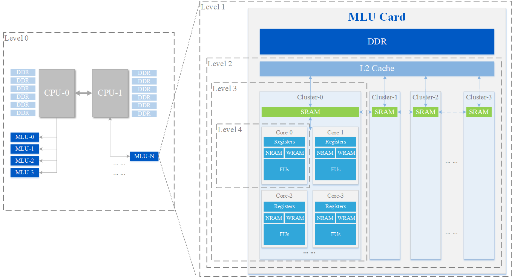
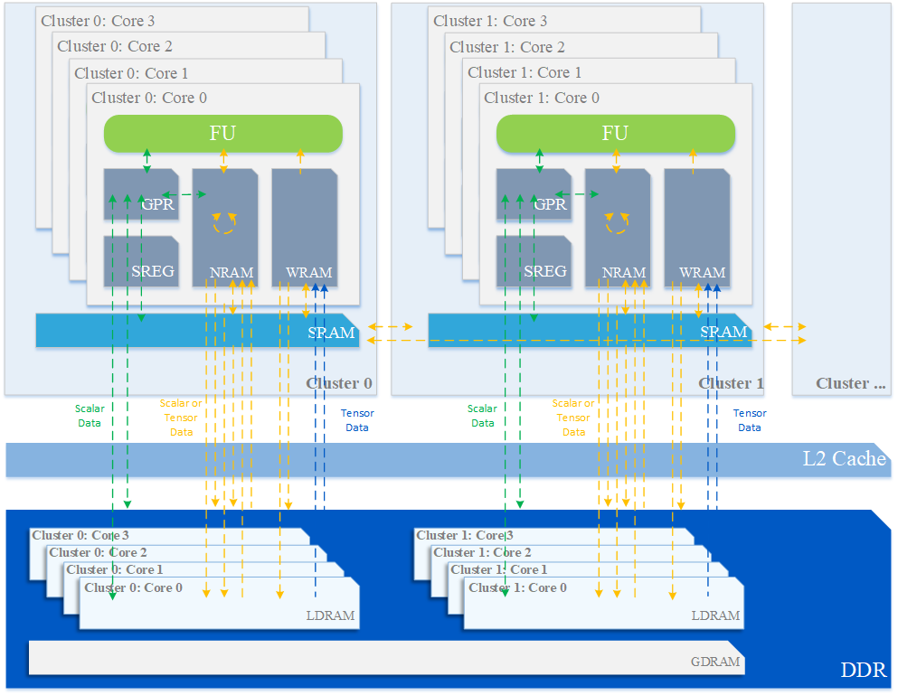
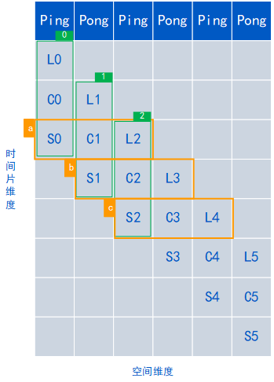

# 02A 寒武纪 NeuWare、BANG C 与基础执行库

采集截止：2026-11-05（Asia/Shanghai）。本专题研究驱动、编译器、运行时、算子库与片上数据流；源码固定于官方仓库树SHA，不把文献研究写成已安装SDK或已测机器人。

## 1. NeuWare的价值成立在什么层

机器人模型迁移通常先遇到算子与布局不匹配，再遇到小batch、搬运和同步开销。NeuWare官网的“云边端一体、训推一体”是软件产品架构宣称，支持统一开发思路；它不能替代具体芯片的二进制、驱动及算子支持矩阵。官方栈图将MagicMind、CNNL、CNCL、CNCV、BANGC/BANGPy置于框架与硬件之间，但没有逐SKU版本或实时契约。本文将其拆成可核验的交付单元。[NEU](https://www.cambricon.com/index.php?m=content&c=index&a=lists&catid=71)

图1：官网软件栈原图。CNNL负责AI算子，CNCL负责通信，CNCV负责视觉运算，BANG语言用于自定义计算。框架标志表示产品定位，不能证明任意PyTorch版本、模型、220端侧BSP或机器人中间件已兼容。图中ONNX是模型交换路径之一，也不是完整训练运行时。

| 执行层 | 已核验对象 | 输入与输出 | 交接责任 | 证据边界 |
|---|---|---|---|---|
| 系统驱动 | DKMS驱动安装方式 | 内核模块、设备节点 | 匹配Linux内核并正确装卸 | 未取得驱动安装手册正文、固件完整矩阵 |
| 编译工具 | CNCC、CNAS、LLVM-MM | Host/BANG源码→目标代码 | 目标架构、ABI及链接库 | 不是CUDA二进制兼容证明 |
| 运行时/设备库 | CNRT、CNDRV、CNDEV等 | 队列、内存、设备与监控 | 设备选择、生命周期和同步 | API语义采用已取得开发指南，独立API网页受robots限制 |
| 计算库 | CNNL、MLU-OPS | descriptor、指针、workspace→结果 | dtype、shape、layout、stride | MLU-OPS源码开放不代表CNNL二进制开放 |
| 调试分析 | CNGDB、CNPerf、CNStudio、CNVS | 程序与运行活动→调试/分析信息 | 区分Host与设备耗时 | 名称在指南中确认，未取得所有工具完整发行说明 |

表中组件与DKMS来自官方BANG算子开发指南。指南描述驱动支持多个Linux发行版，但没有给出所有内核、CPU架构与板卡组合的穷举矩阵；DKMS能重编内核模块也不证明任意实时内核或签名策略均可用。[BANG](https://raw.githubusercontent.com/Cambricon/mlu-ops/549075224cd46ac2a52e4883b51dd50fe4b1abf5/docs/BANG-C-OPS-Develop-Guide.md)

## 2. 从算子到硬件：任务粒度与存储层级

官方开发指南以MLU03抽象模型说明服务器、板卡、芯片、Cluster和Core五级层次。Block/Union任务的资源占用与调度粒度不同，Union需要满足相应Cluster资源及维度约束。不能把图中示意Cluster数与某SKU的真实可见资源数相等；运行时还可能面对分区、配置及不同代际。指南中部分说明直接采用370例子，本专题不将其片上容量与同步范围套给MLU220。[BANG](https://raw.githubusercontent.com/Cambricon/mlu-ops/549075224cd46ac2a52e4883b51dd50fe4b1abf5/docs/BANG-C-OPS-Develop-Guide.md)

图2：官方仓库抽象硬件模型，展示Host、MLU Card、Cluster、Core之间的层级。它有助于理解任务拆分与资源争用，不是逐板卡datasheet；图中的DDR也是抽象存储名称，不能改写01已核验的LPDDR5类型。

图3：官方抽象存储模型。NRAM/WRAM归Core私有，SRAM为Cluster共享，L2和GDRAM处于更外层；虚线与箭头表示不同数据路径。图不提供跨设备统一地址、DMA可达性或摄像头缓冲区直接进入NRAM的保证。

NRAM用于向量/张量输入输出和临时量，容量有限；WRAM用于卷积核且布局有专门要求；SRAM支持Cluster内共享；LDRAM/GDRAM在片外。优化关键不是把数据全部“放片上”，而是选择tile，使多份输入、输出、临时结果及双缓冲同时装得下，再控制搬运和计算重叠。MLU03指南区分IO-DMA与Move-DMA，异步流水允许隐藏部分搬运，但存在依赖时必须使用合适同步。多核共享结果涉及Cluster/Union同步，不能靠Host函数返回推定所有核完成。[BANG](https://raw.githubusercontent.com/Cambricon/mlu-ops/549075224cd46ac2a52e4883b51dd50fe4b1abf5/docs/BANG-C-OPS-Develop-Guide.md)

对于机器人batch=1，沿batch均分会让部分Core空转；沿空间或元素切分可增加并行度，却可能在卷积/池化边界产生冗余读取。这里的选择应由真实shape和访存效率决定，而不是固定“用更多核就更快”。同一算子在不同硬件或不同输入规模，瓶颈可能从IO转为计算。小模型若主要耗在Host预处理和队列提交，局部kernel优化对观测年龄的收益也可能很小。前两点是指南中的优化机制，后一项是系统分析。[BANG](https://raw.githubusercontent.com/Cambricon/mlu-ops/549075224cd46ac2a52e4883b51dd50fe4b1abf5/docs/BANG-C-OPS-Develop-Guide.md) [PERF](https://raw.githubusercontent.com/Cambricon/mlu-ops/549075224cd46ac2a52e4883b51dd50fe4b1abf5/docs/MLU-OPS-Performance-Acceptance-Standard.md)

## 3. 追踪真实源码：Abs的descriptor、stride与三级流水

当前`kernels/abs/abs.cpp`先检查handle、输入输出descriptor、dtype和shape，处理零元素，再进行架构与大张量限制检查。BF16支持有`handle->arch >= MLUOP_MLU590`条件；较早架构对stride展开后的元素范围也有限制。随后依据`strideCaseWithNotConsistentDense`选择普通或带stride的三级流水kernel。它证明“同一接口”内部仍存在目标和布局分支，不证明全部模型的BF16都支持。[ABS](https://raw.githubusercontent.com/Cambricon/mlu-ops/549075224cd46ac2a52e4883b51dd50fe4b1abf5/kernels/abs/abs.cpp)

设备代码用`__nram__`缓冲区、`NFU_ALIGN_SIZE`对齐、两份ping-pong空间和`__bang_abs`执行分块计算；复杂数据分支需要更多辅助空间。张量逻辑元素数与物理跨度不同，转置/切片视图不能默认当连续内存使用。错误地只传shape而忽略stride，会在算术表达式正确时仍读错数据；无条件先转连续也可能引入额外复制。应比较原stride路径与显式连续化的整体成本。[ABSK](https://raw.githubusercontent.com/Cambricon/mlu-ops/549075224cd46ac2a52e4883b51dd50fe4b1abf5/kernels/abs/abs_block.mlu) [ABS](https://raw.githubusercontent.com/Cambricon/mlu-ops/549075224cd46ac2a52e4883b51dd50fe4b1abf5/kernels/abs/abs.cpp)

图4：BANG开发指南中的ping-pong流水原图，纵轴为时间片、横轴为空间，L/C/S分别表示加载、计算、写出。它展示错开阶段的设计方法；首尾填充、同步、内存占用及负载均衡仍有成本，不能从图推导固定加速倍数。[BANG](https://raw.githubusercontent.com/Cambricon/mlu-ops/549075224cd46ac2a52e4883b51dd50fe4b1abf5/docs/BANG-C-OPS-Develop-Guide.md)

设计文档V1.0日期为2024-05-27，列出的类型和限制与当前源码不完全相同：文档主要围绕float/half/bfloat16并声明不支持原位，当前源码还包含int32与complex分支。本文对实际分支采用固定SHA源码，对接口契约中仍未明确的原位行为保留限制，不因指针检查没有显式排除就认定原位安全。文档中的1E-7精度和50%效率是该算子设计验收目标，不是测试日志或机器人性能。[ABSD](https://raw.githubusercontent.com/Cambricon/mlu-ops/549075224cd46ac2a52e4883b51dd50fe4b1abf5/docs/design_docs/abs/abs.md) [ABS](https://raw.githubusercontent.com/Cambricon/mlu-ops/549075224cd46ac2a52e4883b51dd50fe4b1abf5/kernels/abs/abs.cpp)

CNNL复用示例还展示descriptor转换、transpose、matmul heuristic与workspace查询。workspace是GDRAM中的临时区，可用于布局转换及子算子中间结果；它与模型权重分开预算。先查询大小，再申请并按正确设备/队列传入，最后在任务完成后释放。shape、算法、精度或并发发生变化时，应重新核对需求，不能把某次查询结果永久用于全部请求。[CNNL](https://raw.githubusercontent.com/Cambricon/mlu-ops/549075224cd46ac2a52e4883b51dd50fe4b1abf5/docs/MLU-OPS-How-To-Use-CNNL-API.md) [BANG](https://raw.githubusercontent.com/Cambricon/mlu-ops/549075224cd46ac2a52e4883b51dd50fe4b1abf5/docs/BANG-C-OPS-Develop-Guide.md)

## 4. 异步执行的生命周期与性能口径

开发指南的Host示例包括`cnrtQueueCreate`、`cnrtMalloc`、Host→Device复制、kernel提交、`cnrtQueueSync`、Device→Host复制和销毁对象；Notifier用于设备时间测量。指南同时混有旧命名示例，具体编译应以交付版本头文件为准，不能把不同CNRT版本的函数拼成保证可编译的代码。独立CNRT内存/队列API网页和驱动指南因robots未允许或无法完成检查而未取得正文，已保留失败记录。上述生命周期依据成功取得的开发指南，未伪称独立API网页已核验。[BANG](https://raw.githubusercontent.com/Cambricon/mlu-ops/549075224cd46ac2a52e4883b51dd50fe4b1abf5/docs/BANG-C-OPS-Develop-Guide.md)

异步kernel或MemcpyAsync返回代表任务已提交，并不代表输入已经消费或输出可读。同步前重用、修改或释放源缓冲区会破坏数据正确性。Host、设备和跨队列依赖要分别管理；同步拷贝的返回语义也不能用于推导默认队列中的其他任务全部完成。对于传感器循环，建议以“采集帧→推理请求→完成事件→后处理发布”管理buffer所有权；失败或超时后，先隔离旧请求，再回收资源。这是由指南语义形成的工程建议，不是厂商已提供机器人队列适配。[BANG](https://raw.githubusercontent.com/Cambricon/mlu-ops/549075224cd46ac2a52e4883b51dd50fe4b1abf5/docs/BANG-C-OPS-Develop-Guide.md)

官方性能验收标准以理论IO量/设备耗时/带宽和理论运算量/设备耗时/峰值评估效率，常见规模目标为瓶颈侧60%以上，一般规模30%以上。`mlu-only`模式跳过CPU结果比对，且依赖真实值的算子不宜使用随机输入测量。因此“效率达到标准”和“模型精度验证通过”必须分开。精度文档区分平均相对、标准相对、最大单点及误差偏向性指标；例如卷积FP32阈值与FP16阈值不同，不能采用一个diff数值评价所有算子。[PERF](https://raw.githubusercontent.com/Cambricon/mlu-ops/549075224cd46ac2a52e4883b51dd50fe4b1abf5/docs/MLU-OPS-Performance-Acceptance-Standard.md) [ACC](https://raw.githubusercontent.com/Cambricon/mlu-ops/549075224cd46ac2a52e4883b51dd50fe4b1abf5/docs/MLU-OPS-Accuracy-Acceptance-Standard.md)

本轮没有适合跨厂商控制变量比较的实际算子日志，不给加速排名。设备kernel时间没有包括相机采集、Host预处理、H2D/D2H、排队、后处理与控制器执行。对具身任务，平均/P99/最长观测时延分别报告；Notifier测到的微秒倒数既不是policy频率，也不是伺服频率，更不是WCET证明。

## 5. 版本、迁移资产与可复建验证

| 项目 | 本轮实际依据 | 必须锁定的部署条件 |
|---|---|---|
| MLU-OPS源码 | 固定树SHA 549075224cd46ac2a52e4883b51dd50fe4b1abf5 | 与所用发布版、子模块及算子测试配置一致 |
| 工具链/库 | README要求CNToolkit≥4.1.0、CNNL≥1.28.0 | 不能用指南中旧版链接替代当前最低依赖 |
| 驱动 | README要求≥6.0.3 | 型号、固件、Linux内核与CPU架构的组合需另核 |
| OS | x86_64下列Ubuntu22.04、CentOS7.6/8.5、Kylin10、Debian10/12 | v1.0.0后不再支持Ubuntu18.04，v1.4.1后不再支持Ubuntu20.04 |
| 许可 | MLU-OPS为MIT | 保留版权/许可；不扩展到CNNL、驱动、固件或容器 |

表中依赖是当前README要求，不等于整套SDK所有组件都必须采用同一最小版本，也不证明arm64 MLU220可使用x86构建包。README还提示SDK/镜像需联系官方支持取得，本研究未发送联系消息、未获得完整二进制资源。[OPS](https://raw.githubusercontent.com/Cambricon/mlu-ops/549075224cd46ac2a52e4883b51dd50fe4b1abf5/README.md) [OPLIC](https://raw.githubusercontent.com/Cambricon/mlu-ops/549075224cd46ac2a52e4883b51dd50fe4b1abf5/LICENSE)

与AMD HIP比较，双方都用Host/Device、异步队列或stream、内存生命周期和显式同步管理依赖。HIP文档还要求根据设备能力、pinned Host内存及资源占用判断复制/计算能否重叠；概念可复用，但HIP kernel、warp假设与MLU的NRAM/WRAM、Block/Union拆分不是机械改名关系。可迁移的是数学定义、测试输入、精度阈值与分析方法，设备代码、布局和调优参数需要重做。对照材料是HIP7.16.0采集快照，只用于机制说明。[HIP](https://rocm.docs.amd.com/projects/HIP/en/latest/how-to/hip_runtime_api/asynchronous.html) [BANG](https://raw.githubusercontent.com/Cambricon/mlu-ops/549075224cd46ac2a52e4883b51dd50fe4b1abf5/docs/BANG-C-OPS-Develop-Guide.md)

可复建验收应先固定P/N、CPU/OS/kernel、driver/firmware、CNToolkit/CNNL/MLU-OPS版本及源码SHA，保存模型真实shape、dtype、stride、workspace和并发设置；用零元素、尾块、非连续视图、异常值和不同架构限制验证结果；再比较连续化成本、设备时间及Host完整耗时。最后把真实相机帧接入应用并记录完成事件、过期输出处置和热稳定。本轮只完成源码/文档核验，全部设备执行步骤仍属于后续验证计划。

官网HTML及HIP页面部分静态依赖缺失，已保留原响应、正文及可取得资源；独立源码文件的成功归档不表示它引用的所有include、链接库或相对图片均已取得。本专题正文采用的四张图已单独归档并逐图打开，未改字。

## 参考资料与本地原文

所有正文来源均为2026-11-05采集的归档快照。官网未标发布日期时不使用版权年充当版本；仓库原件URL固定于树SHA，具体提交日期未独立核验。`complete_static`对单独源码/Markdown仅指主文件原件取得，不保证其相对链接、子模块、镜像、模型权重和训练数据均已下载。

| 材料 | 原始URL与版本边界 | 本地原件 | 归档状态 |
|---|---|---|---|
| Cambricon_NeuWare | [原文](https://www.cambricon.com/index.php?m=content&c=index&a=lists&catid=71)；官网采集页，未标发布日期 | [原件](REFERENCES.md#ref-5678a12af89b986d) | partial_static |
| Cambricon_mlu-ops_docs_BANG-C-OPS-Develop-Guide_md | [原文](https://raw.githubusercontent.com/Cambricon/mlu-ops/549075224cd46ac2a52e4883b51dd50fe4b1abf5/docs/BANG-C-OPS-Develop-Guide.md)；源码固定树SHA 549075224cd4 | [原件](REFERENCES.md#ref-7613d3be6b7379e3) | complete_static |
| Cambricon_mlu-ops_docs_MLU-OPS-Performance-Acceptance-Standard_md | [原文](https://raw.githubusercontent.com/Cambricon/mlu-ops/549075224cd46ac2a52e4883b51dd50fe4b1abf5/docs/MLU-OPS-Performance-Acceptance-Standard.md)；源码固定树SHA 549075224cd4 | [原件](REFERENCES.md#ref-ef31ff92410c5094) | complete_static |
| Cambricon_mlu-ops_kernels_abs_abs_cpp | [原文](https://raw.githubusercontent.com/Cambricon/mlu-ops/549075224cd46ac2a52e4883b51dd50fe4b1abf5/kernels/abs/abs.cpp)；源码固定树SHA 549075224cd4 | [原件](REFERENCES.md#ref-4620cee57dc81eb0) | complete_static |
| Cambricon_mlu-ops_kernels_abs_abs_block_mlu | [原文](https://raw.githubusercontent.com/Cambricon/mlu-ops/549075224cd46ac2a52e4883b51dd50fe4b1abf5/kernels/abs/abs_block.mlu)；源码固定树SHA 549075224cd4 | [原件](REFERENCES.md#ref-8f6e0e682ec72a68) | complete_static |
| Cambricon_mlu-ops_docs_design_docs_abs_abs_md | [原文](https://raw.githubusercontent.com/Cambricon/mlu-ops/549075224cd46ac2a52e4883b51dd50fe4b1abf5/docs/design_docs/abs/abs.md)；源码固定树SHA 549075224cd4 | [原件](REFERENCES.md#ref-2ece728f7a64b790) | complete_static |
| Cambricon_mlu-ops_docs_MLU-OPS-How-To-Use-CNNL-API_md | [原文](https://raw.githubusercontent.com/Cambricon/mlu-ops/549075224cd46ac2a52e4883b51dd50fe4b1abf5/docs/MLU-OPS-How-To-Use-CNNL-API.md)；源码固定树SHA 549075224cd4 | [原件](REFERENCES.md#ref-12b4af55b9d2cb4d) | complete_static |
| Cambricon_mlu-ops_docs_MLU-OPS-Accuracy-Acceptance-Standard_md | [原文](https://raw.githubusercontent.com/Cambricon/mlu-ops/549075224cd46ac2a52e4883b51dd50fe4b1abf5/docs/MLU-OPS-Accuracy-Acceptance-Standard.md)；源码固定树SHA 549075224cd4 | [原件](REFERENCES.md#ref-289beac085b40351) | complete_static |
| Cambricon_mlu-ops_README_md | [原文](https://raw.githubusercontent.com/Cambricon/mlu-ops/549075224cd46ac2a52e4883b51dd50fe4b1abf5/README.md)；源码固定树SHA 549075224cd4 | [原件](REFERENCES.md#ref-d538b567d02b0e43) | complete_static |
| Cambricon_mlu-ops_LICENSE | [原文](https://raw.githubusercontent.com/Cambricon/mlu-ops/549075224cd46ac2a52e4883b51dd50fe4b1abf5/LICENSE)；源码固定树SHA 549075224cd4 | [原件](REFERENCES.md#ref-de656c3d116d3bfa) | complete_static |
| Compare_HIP_Async | [原文](https://rocm.docs.amd.com/projects/HIP/en/latest/how-to/hip_runtime_api/asynchronous.html)；文档采集快照；适用版本见正文 | [原件](REFERENCES.md#ref-5cf849602d8959af) | partial_static |
| Cambricon_mlu-ops_docs_images_hardwarehierarchy_png | [原文](https://raw.githubusercontent.com/Cambricon/mlu-ops/549075224cd46ac2a52e4883b51dd50fe4b1abf5/docs/images/hardwarehierarchy.png)；源码固定树SHA 549075224cd4 | [原件](REFERENCES.md#ref-3d9b2448e53113aa) | complete_static |
| Cambricon_mlu-ops_docs_images_memorymodel_png | [原文](https://raw.githubusercontent.com/Cambricon/mlu-ops/549075224cd46ac2a52e4883b51dd50fe4b1abf5/docs/images/memorymodel.png)；源码固定树SHA 549075224cd4 | [原件](REFERENCES.md#ref-aa877e2fa258bd7e) | complete_static |
| Cambricon_mlu-ops_docs_images_pingpong_png | [原文](https://raw.githubusercontent.com/Cambricon/mlu-ops/549075224cd46ac2a52e4883b51dd50fe4b1abf5/docs/images/pingpong.png)；源码固定树SHA 549075224cd4 | [原件](REFERENCES.md#ref-ec397b7e9c2fbbfd) | complete_static |
