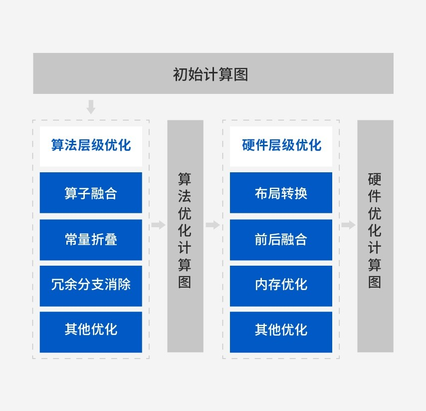

# 02B MagicMind：图编译、量化、动态shape与目标推理

采集截止：2026-11-05。重点依据官方产品页、MagicMind Cloud/Edge固定SHA示例与公共构建/运行代码。模型代码已阅读，未下载模型权重或安装MagicMind二进制；不能将示例存在写成模型或机器人实机复现。

## 1. 编译模型与框架直接执行有什么区别

MagicMind解决的是训练框架图与目标硬件执行之间的转换和优化问题。官网称采用MLIR图编译技术，并提供跨框架解析、自动代码生成、图优化和插件化设计。“业界首个”与“极致性能”属于厂商宣称，本研究没有独立验证其排名。官方架构将工作分成FrontEnd模型表示、Builder图优化/CodeGen、Runtime模型部署三层。[MM](https://www.cambricon.com/index.php?m=content&c=index&a=lists&catid=378)

图1：官网MagicMind架构原图。它支持区分训练模型、MagicMind图与目标执行产物；“端边云”箭头不提供所有旧芯片的当前版本矩阵。图中TensorFlow标志需要结合仓库发行记录解读，不能按2026采集日期认为持续支持。

图2：官方算法/硬件优化流程原图。算子融合、常量折叠、冗余分支消除、布局转换、前后融合与内存优化作用于不同层。融合可以减少中间张量与提交，但成立条件是算子、数值和布局兼容；本图不证明任意模型所有节点都可融合或没有Host拷贝。

| 对象 | 输入 | 输出 | 生命周期与交接 |
|---|---|---|---|
| Parser / Network | ONNX或对应框架模型、权重及输入说明 | MagicMind统一计算图 | 算子覆盖、shape、dtype、输出名称先确认 |
| BuilderConfig / Calibrator | 精度、目标架构、shape范围、校准样本 | 图优化与量化配置 | 校准预处理必须与目标输入一致 |
| Builder / Model | Network及配置 | 序列化模型文件 | 绑定目标、工具链、插件、输入输出契约 |
| Engine / Context | 模型、设备及执行配置 | 推理上下文、运行时tensor | 不能推定同一context可被多线程并发安全共享 |
| Queue / Tensor | 输入缓冲、完成依赖 | 输出及完成状态 | enqueue后需按队列语义等待再读写/释放 |

此表依据ResNet50生成脚本、公共构建函数与MMRunner源码；不将TensorRT对象的行为直接套给MagicMind。[GEN](https://raw.githubusercontent.com/Cambricon/magicmind_cloud/dc085c193c0af091f92a844cc3bfa350f1d7027f/buildin/cv/classification/resnet50_onnx/gen_model/gen_model.py) [MODEL](https://raw.githubusercontent.com/Cambricon/magicmind_cloud/dc085c193c0af091f92a844cc3bfa350f1d7027f/buildin/python_common/model_process.py) [RUNNER](https://raw.githubusercontent.com/Cambricon/magicmind_cloud/dc085c193c0af091f92a844cc3bfa350f1d7027f/buildin/python_common/mm_runner.py)

## 2. 云端ResNet50链条：模型到序列化产物

官方ResNet50 ONNX示例使用`OnnxParser`生成Network，配置输入维度和batch，提取Builder参数；精度字符串含`qint`时调用校准，再执行`builder.build_model`与`serialize_to_file`。`gen_model time cost`包围解析、配置、校准和构建过程，不能当kernel时延。模型生成阶段还显式开启`type64to32_conversion`，这是样例中的类型收窄选项；遇到大整数、索引或高精度值时需要验证溢出和数值误差，不能视为无损转换。[GEN](https://raw.githubusercontent.com/Cambricon/magicmind_cloud/dc085c193c0af091f92a844cc3bfa350f1d7027f/buildin/cv/classification/resnet50_onnx/gen_model/gen_model.py) [MODEL](https://raw.githubusercontent.com/Cambricon/magicmind_cloud/dc085c193c0af091f92a844cc3bfa350f1d7027f/buildin/python_common/model_process.py)

公共参数支持`input_dims`中的-1动态轴、每输入batch、`dim_range_min/max`、`input_layout/output_layout`、`cluster_num`、`computation_preference`及外部JSON配置。`graph_shape_mutable=true`时才设置范围，min/max需要成对；动态输入代表编译/执行可表达变化，不代表所有范围都同样快、同样省内存或不会触发额外分配。固定相机分辨率的机器人可以先采用明确静态shape降低变动，再根据真实多尺寸需求测试动态路径。后一句为工程选择建议。[PARAM](https://raw.githubusercontent.com/Cambricon/magicmind_cloud/dc085c193c0af091f92a844cc3bfa350f1d7027f/buildin/python_common/build_param.py) [MODEL](https://raw.githubusercontent.com/Cambricon/magicmind_cloud/dc085c193c0af091f92a844cc3bfa350f1d7027f/buildin/python_common/model_process.py)

**架构入口存在实际差异。** `build_param.py`的choices包含`mtp_220/270/290/372`、`tp_322`和`mtp_592`；但`model_process.py::get_mlu_arches_from_param`的候选仅`mtp_372`、`tp_322`、`mtp_592`。该函数会断言检查显式传入架构。默认cluster字典里出现220也没有消除前面的限制。这一固定SHA路径不能直接作为220当前可编译证明；它也不证明MagicMind所有版本绝不支持220。应索取明确支持220的版本、目标名及完整生成脚本。[PARAM](https://raw.githubusercontent.com/Cambricon/magicmind_cloud/dc085c193c0af091f92a844cc3bfa350f1d7027f/buildin/python_common/build_param.py) [MODEL](https://raw.githubusercontent.com/Cambricon/magicmind_cloud/dc085c193c0af091f92a844cc3bfa350f1d7027f/buildin/python_common/model_process.py)

## 3. 量化到底改变了什么

公共代码支持`force_float32`、`force_float16`及INT8/INT16混合浮点模式；权重粒度可选per_tensor/per_axis，激活量化可选symmetric/asymmetric。`common_calibrate`建立Calibrator、激活指定设备，并选择LINEAR或EQNM统计算法再执行calibrate。它证明该示例的校准与配置过程，不证明每种算法在所有硬件/精度组合上适用。设备校准与跨编译工具链也需各自可取得，不能理解成纯CPU任意离线生成。[PARAM](https://raw.githubusercontent.com/Cambricon/magicmind_cloud/dc085c193c0af091f92a844cc3bfa350f1d7027f/buildin/python_common/build_param.py) [CALIB](https://raw.githubusercontent.com/Cambricon/magicmind_cloud/dc085c193c0af091f92a844cc3bfa350f1d7027f/buildin/python_common/common_calibrate.py)

量化缩小数值表示与部分带宽需求，代价是截断、范围和尺度误差。真实机器人应让校准覆盖曝光、逆光、遮挡、相机噪声和任务状态，不能把ImageNet静态图片的统计范围当成机器人数据分布。`conv_scale_fold`帮助折叠计算，但参数说明要求在校准时就固定该设置，否则量化统计与实际权重分布可能不一致；`insert_bn_before_firstnode`还会改变输入类型为UINT8，应用不能再次按浮点归一化造成重复处理。[PARAM](https://raw.githubusercontent.com/Cambricon/magicmind_cloud/dc085c193c0af091f92a844cc3bfa350f1d7027f/buildin/python_common/build_param.py) [MODEL](https://raw.githubusercontent.com/Cambricon/magicmind_cloud/dc085c193c0af091f92a844cc3bfa350f1d7027f/buildin/python_common/model_process.py)

| 厂商示例 | 输入/模式 | 公开结果 | 可以支持 | 缺失条件 |
|---|---|---|---|---|
| ResNet50 ONNX | ImageNet2012，batch1，FP32 | TOP1 75.01%，TOP5 92.37% | 此样例精度参考 | 表中未完整给板卡/功耗、数据数量和SDK组合 |
| 同一示例 | FP16 | 75.01%，92.36% | 所列精度变化较小 | 不是本研究复现结果 |
| 同一示例 | qint8_mixed_float16 | 74.47%，92.08% | TOP1比表中FP32低0.54个百分点 | 不推出机器人任务成功率下降同幅度 |

来源为官方ResNet50样例精度表。README另给1000图片运行命令及约0.751/0.926输出，不能据其四舍五入值反推精度表全部样本口径。性能命令为`mm_run`、threads1、iterations1000，但没有本章可完整复现的绝对延迟表，故不写INT8提速倍数。[RES](https://raw.githubusercontent.com/Cambricon/magicmind_cloud/dc085c193c0af091f92a844cc3bfa350f1d7027f/buildin/cv/classification/resnet50_onnx/README.md)

## 4. 端侧YOLOv3链条揭示的目标与输出契约

MagicMind Edge主README的概览仍写300系列主机前提，模型表却标MLU-3226；具体YOLOv3文档明确部署CE3226，并给远程3226校准/执行路径。文档里还残留内部GitLab转换工程地址，本轮没有访问该非公共服务。因此Darknet权重→Caffe模型这一步未取得完整公开转换工具，不能把“一键运行”称为完整可复建链条。公开仓库代码仍可用于研究Caffe→MagicMind→目标推理的后半段。[EDGE](https://raw.githubusercontent.com/Cambricon/magicmind_edge/04d1e858c1760439adc8dcdd146405558d9c524b/README.md) [YOLO](https://raw.githubusercontent.com/Cambricon/magicmind_edge/04d1e858c1760439adc8dcdd146405558d9c524b/buildin/cv/detection/yolov3_caffe/README.MD)

具体`gen_model.py`将输入设为batch×3×416×416，`graph_shape_mutable=false`，目标写`mtp_322`，交叉工具链路径为旧版aarch64 Linaro；这与Cloud公共工具使用`tp_322`命名不同，应按各自SDK语法核对，不擅自统一。脚本最多取50份校准样本，输入layout从NCHW改NHWC，设置均值0/方差65025，得到UINT8输入；输出再添加permute和YOLO DetectionOutput节点，80类、置信阈值0.001、NMS0.45、最多256框。anchors、类别和阈值都进入产物契约，修改业务配置不能只换Host标签文件。[YGEN](https://raw.githubusercontent.com/Cambricon/magicmind_edge/04d1e858c1760439adc8dcdd146405558d9c524b/buildin/cv/detection/yolov3_caffe/gen_model/gen_model.py)

推理C++读取离线模型，创建engine/context/queue与输入tensor，读取图像并预处理，H2D拷贝、enqueue、QueueSync，再D2H取检测数和7浮点记录，执行后处理与COCO结果保存。计时段包括循环内图像读取/预处理、复制、推理、后处理和保存逻辑，属于该文件输入程序的E2E吞吐；并未包含摄像头曝光、网络传输、ROS发布、规划或动作执行。应用接入机器人时还需保存原图尺寸、resize/padding、坐标逆变换、帧标识与时间戳，再将结果转为目标消息；这一接续未在该demo验证。[YINFER](https://raw.githubusercontent.com/Cambricon/magicmind_edge/04d1e858c1760439adc8dcdd146405558d9c524b/buildin/cv/detection/yolov3_caffe/infer_cpp/src/infer.cpp)

`benchmark_ok.csv`记`coco-mini`、metric=`map`、eval=0.6780786692668364、fps=42.3246；README完整COCO输出则分别列AP@[.50:.95]=0.375、AP50=0.678。CSV没有IoU口径、精度、batch、板卡、频率、功耗与SDK，不能因数字相近就把其map认定为完整COCO mAP，也不能把42.3246写成220视觉或机器人频率。保留原数值及不确定口径，比虚构比较更有用。[YBENCH](https://raw.githubusercontent.com/Cambricon/magicmind_edge/04d1e858c1760439adc8dcdd146405558d9c524b/buildin/cv/detection/yolov3_caffe/benchmark/benchmark_ok.csv) [YOLO](https://raw.githubusercontent.com/Cambricon/magicmind_edge/04d1e858c1760439adc8dcdd146405558d9c524b/buildin/cv/detection/yolov3_caffe/README.MD)

## 5. 运行时、fallback与插件边界

公共MMRunner先反序列化Model，激活Device，创建Engine、Context、Queue与inputs；调用时从NumPy装载输入、移动到设备，`context.enqueue`后`queue.sync`，最后`asnumpy`。所以这个Python包装器是每次调用同步等待结果的路径，不能因为底层enqueue异步就称应用已经流水并发或零拷贝。多请求应分别核对context、tensor与队列的生命周期和线程安全，而不是共用成员`inputs/outputs`后假设无竞争。[RUNNER](https://raw.githubusercontent.com/Cambricon/magicmind_cloud/dc085c193c0af091f92a844cc3bfa350f1d7027f/buildin/python_common/mm_runner.py)

官网支持插件与逐算子搭图，公共参数有`plugin_path`；本轮未取得完整MagicMind插件ABI、动态shape插件、分区策略及CPU fallback API文档。不能把torch_mlu的CPU回退行为反写成MagicMind默认行为。算子缺失时，应先查对应版本parser/算子支持，选择重写模型、经验证插件或显式应用拆分，并测额外传输；只有接口实际支持时才能讨论自动fallback。[MM](https://www.cambricon.com/index.php?m=content&c=index&a=lists&catid=378) [PARAM](https://raw.githubusercontent.com/Cambricon/magicmind_cloud/dc085c193c0af091f92a844cc3bfa350f1d7027f/buildin/python_common/build_param.py)

序列化文件应保存模型/权重哈希、输入输出名和dtype/layout、校准集与预处理、shape范围、目标架构、工具链及插件哈希、构建配置和runtime版本。换SKU、SDK、插件、量化参数或数据分布后重新验证加载、精度、峰值内存、首帧及持续性能；本文未取得足以承诺跨版本兼容的正式矩阵，也不认定该文件与TensorRT engine通用。

## 6. 版本冲突、机制对标与验收

Cloud README发行记录最新列v1.7对应MagicMind1.7.0，并明确删除TensorFlow支持；其上方简介/模型表和官网仍保留TensorFlow。较早v1.6/v1.5分别对应1.6.0/1.5.0。这些是仓库所列版本，不是2026最新商业SDK认证；应优先用明确release条目解释该版本支持边界，残留表项需复核。Edge所列v1.2、旧0.13.x环境也不能与Cloud1.7混用。[CLOUD](https://raw.githubusercontent.com/Cambricon/magicmind_cloud/dc085c193c0af091f92a844cc3bfa350f1d7027f/README.md) [EDGE](https://raw.githubusercontent.com/Cambricon/magicmind_edge/04d1e858c1760439adc8dcdd146405558d9c524b/README.md)

与TensorRT比较，二者都把模型图、优化配置、目标产物和runtime对象分开，均需要验证布局、输入范围和数值变化。TensorRT11.4文档解释显式Q/DQ控制计算边界、per-channel尺度与插件交接；本轮MagicMind样例主要是Builder/Calibrator配置。校准数据与评估方法可复用，但Q/DQ解析覆盖、插件、engine和scale的具体语义不能直接继承。没有同模型同硬件/功率测试，只比较部署机制。[TRT](https://docs.nvidia.com/deeplearning/tensorrt/latest/architecture/how-trt-works.html) [TRTQ](https://docs.nvidia.com/deeplearning/tensorrt/latest/inference-library/quantized-types-explicit-quantization.html)

Cloud/Edge仓库代码为Apache2.0，README明确权重/数据由第三方维护并遵循各自许可；这不授予MagicMind二进制、交叉工具链、固件或模型数据的再分发权。官网正文归档为partial_static，缺失脚本/联系图标等依赖如实保留；官方两张架构/优化图已逐图打开。当前未取得受robots限制的独立API正文，不以仓库API调用替代全量API支持承诺。[MMLIC](https://raw.githubusercontent.com/Cambricon/magicmind_cloud/dc085c193c0af091f92a844cc3bfa350f1d7027f/LICENSE) [EDLIC](https://raw.githubusercontent.com/Cambricon/magicmind_edge/04d1e858c1760439adc8dcdd146405558d9c524b/LICENSE) [CLOUD](https://raw.githubusercontent.com/Cambricon/magicmind_cloud/dc085c193c0af091f92a844cc3bfa350f1d7027f/README.md)

可复建步骤是先锁定目标及SDK，再固定模型与转换工具；跑原始精度，生成浮点产物，核对tensor契约；使用任务数据校准并比较量化精度；分别验证静态/动态shape、边界输入、加载失败与并发；测mm_run模型时间和实际采集/消息链时延；最后接入机器人控制契约。本轮模型源→转换/量化→编译→目标推理的文献链已经追踪，公开缺失转换工具、实际设备执行和动作接口三个环节仍明确未完成。

## 参考资料与本地原文

所有正文来源均为2026-11-05采集的归档快照。官网未标发布日期时不使用版权年充当版本；仓库原件URL固定于树SHA，具体提交日期未独立核验。`complete_static`对单独源码/Markdown仅指主文件原件取得，不保证其相对链接、子模块、镜像、模型权重和训练数据均已下载。

| 材料 | 原始URL与版本边界 | 本地原件 | 归档状态 |
|---|---|---|---|
| Cambricon_MagicMind | [原文](https://www.cambricon.com/index.php?m=content&c=index&a=lists&catid=378)；官网采集页，未标发布日期 | [原件](REFERENCES.md#ref-a96dd88f52e2f212) | partial_static |
| Cambricon_magicmind_cloud_buildin_cv_classification_resnet50_onnx_gen_model_gen_model_py | [原文](https://raw.githubusercontent.com/Cambricon/magicmind_cloud/dc085c193c0af091f92a844cc3bfa350f1d7027f/buildin/cv/classification/resnet50_onnx/gen_model/gen_model.py)；源码固定树SHA dc085c193c0a | [原件](REFERENCES.md#ref-29a1573f12727598) | complete_static |
| Cambricon_magicmind_cloud_buildin_python_common_model_process_py | [原文](https://raw.githubusercontent.com/Cambricon/magicmind_cloud/dc085c193c0af091f92a844cc3bfa350f1d7027f/buildin/python_common/model_process.py)；源码固定树SHA dc085c193c0a | [原件](REFERENCES.md#ref-2b4eccb5eecca8ad) | complete_static |
| Cambricon_magicmind_cloud_buildin_python_common_mm_runner_py | [原文](https://raw.githubusercontent.com/Cambricon/magicmind_cloud/dc085c193c0af091f92a844cc3bfa350f1d7027f/buildin/python_common/mm_runner.py)；源码固定树SHA dc085c193c0a | [原件](REFERENCES.md#ref-1193d6ece9f18916) | complete_static |
| Cambricon_magicmind_cloud_buildin_python_common_build_param_py | [原文](https://raw.githubusercontent.com/Cambricon/magicmind_cloud/dc085c193c0af091f92a844cc3bfa350f1d7027f/buildin/python_common/build_param.py)；源码固定树SHA dc085c193c0a | [原件](REFERENCES.md#ref-4398884c0ddd40b5) | complete_static |
| Cambricon_magicmind_cloud_buildin_python_common_common_calibrate_py | [原文](https://raw.githubusercontent.com/Cambricon/magicmind_cloud/dc085c193c0af091f92a844cc3bfa350f1d7027f/buildin/python_common/common_calibrate.py)；源码固定树SHA dc085c193c0a | [原件](REFERENCES.md#ref-8dfc10eda6acef01) | complete_static |
| Cambricon_magicmind_cloud_buildin_cv_classification_resnet50_onnx_README_md | [原文](https://raw.githubusercontent.com/Cambricon/magicmind_cloud/dc085c193c0af091f92a844cc3bfa350f1d7027f/buildin/cv/classification/resnet50_onnx/README.md)；源码固定树SHA dc085c193c0a | [原件](REFERENCES.md#ref-36fd2da926c86f5c) | complete_static |
| Cambricon_magicmind_edge_README_md | [原文](https://raw.githubusercontent.com/Cambricon/magicmind_edge/04d1e858c1760439adc8dcdd146405558d9c524b/README.md)；源码固定树SHA 04d1e858c176 | [原件](REFERENCES.md#ref-3e6aa5afec743085) | complete_static |
| Cambricon_magicmind_edge_buildin_cv_detection_yolov3_caffe_README_MD | [原文](https://raw.githubusercontent.com/Cambricon/magicmind_edge/04d1e858c1760439adc8dcdd146405558d9c524b/buildin/cv/detection/yolov3_caffe/README.MD)；源码固定树SHA 04d1e858c176 | [原件](REFERENCES.md#ref-fdc6b2314bad3a4c) | complete_static |
| Cambricon_magicmind_edge_buildin_cv_detection_yolov3_caffe_gen_model_gen_model_py | [原文](https://raw.githubusercontent.com/Cambricon/magicmind_edge/04d1e858c1760439adc8dcdd146405558d9c524b/buildin/cv/detection/yolov3_caffe/gen_model/gen_model.py)；源码固定树SHA 04d1e858c176 | [原件](REFERENCES.md#ref-3097befabf3bda7d) | complete_static |
| Cambricon_magicmind_edge_buildin_cv_detection_yolov3_caffe_infer_cpp_src_infer_cpp | [原文](https://raw.githubusercontent.com/Cambricon/magicmind_edge/04d1e858c1760439adc8dcdd146405558d9c524b/buildin/cv/detection/yolov3_caffe/infer_cpp/src/infer.cpp)；源码固定树SHA 04d1e858c176 | [原件](REFERENCES.md#ref-2dc50d58f0445218) | complete_static |
| Cambricon_magicmind_edge_buildin_cv_detection_yolov3_caffe_benchmark_benchmark_ok_csv | [原文](https://raw.githubusercontent.com/Cambricon/magicmind_edge/04d1e858c1760439adc8dcdd146405558d9c524b/buildin/cv/detection/yolov3_caffe/benchmark/benchmark_ok.csv)；源码固定树SHA 04d1e858c176 | [原件](REFERENCES.md#ref-d7cdeee74442369e) | complete_static |
| Cambricon_magicmind_cloud_README_md | [原文](https://raw.githubusercontent.com/Cambricon/magicmind_cloud/dc085c193c0af091f92a844cc3bfa350f1d7027f/README.md)；源码固定树SHA dc085c193c0a | [原件](REFERENCES.md#ref-4e557bab2dd565b2) | complete_static |
| Compare_TRT_Builder | [原文](https://docs.nvidia.com/deeplearning/tensorrt/latest/architecture/how-trt-works.html)；文档采集快照；适用版本见正文 | [原件](REFERENCES.md#ref-9df325c2c44e3de5) | complete_static |
| Compare_TRT_Quant | [原文](https://docs.nvidia.com/deeplearning/tensorrt/latest/inference-library/quantized-types-explicit-quantization.html)；文档采集快照；适用版本见正文 | [原件](REFERENCES.md#ref-f47c2746e3737567) | complete_static |
| Cambricon_magicmind_cloud_LICENSE | [原文](https://raw.githubusercontent.com/Cambricon/magicmind_cloud/dc085c193c0af091f92a844cc3bfa350f1d7027f/LICENSE)；源码固定树SHA dc085c193c0a | [原件](REFERENCES.md#ref-0b1fc5b4c4105955) | complete_static |
| Cambricon_magicmind_edge_LICENSE | [原文](https://raw.githubusercontent.com/Cambricon/magicmind_edge/04d1e858c1760439adc8dcdd146405558d9c524b/LICENSE)；源码固定树SHA 04d1e858c176 | [原件](REFERENCES.md#ref-ad97215c95682cb4) | complete_static |
