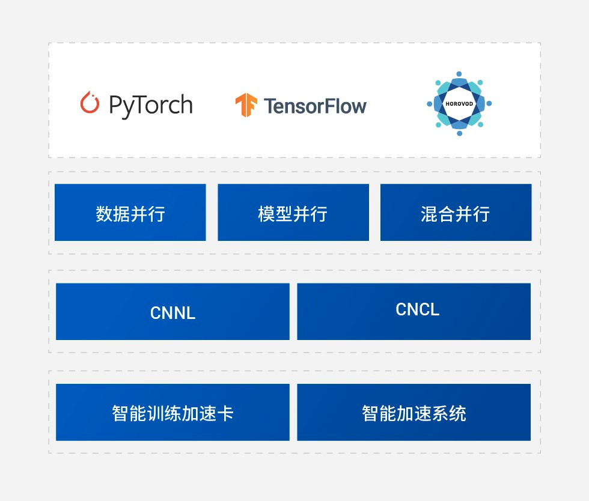

# 02C｜PyTorch 后端、异步执行与分布式训练

本篇研究训练与开发阶段的 PyTorch→torch_mlu→CNNL/BANG 算子→CNRT/驱动，以及 DDP→CNCL 通信链。结论是：官方代码提供可检查的 MLU 后端和多卡训练路径，迁移收益取决于算子覆盖、数据驻留和配套版本；尚不能据此确认 MLU220/Arm 上的训练交付，更不能确认 VLA、强化学习和机器人闭环可直接运行。数据截止2026-11-05；未安装SDK或执行训练。

## 1. 定位与版本契约

具身模型训练通常要保留自动微分、优化器和分布式数据并行，直接重写成设备内核成本高。torch_mlu 将 PyTorch 的 PrivateUse1 扩展后端接入 MLU，使模型开发仍围绕 Tensor、Module 和训练循环展开。官方 README 将 CNToolkit、CNNL、CNCL、CNCV、DALI、CNNL_Extra 与 BANGC OPS 列入依赖；这是多层交付组合，单独取得 Python 包并不意味着具备全部执行库。[TORCH](https://raw.githubusercontent.com/Cambricon/torch_mlu/d578002c0863bfa1ad30fae6b99e4fb3a79dff48/README.md)

图为 NeuWare 官网训练软件示意：框架经数据、模型、混合并行进入 CNNL/CNCL，再进入训练卡或整机。它支持软件层级定位；图中 TensorFlow/Horovod 名称不能替代各自当前版本矩阵，也不能证明多卡线性扩展。官网页未标发布日期，部分静态依赖缺失。[NEU](https://www.cambricon.com/index.php?m=content&c=index&a=lists&catid=71)

| 证据对象 | 固定范围 | 可以据此复建的内容 | 不能据此认定的内容 |
|---|---|---|---|
| torch_mlu 主仓库 | 树SHA d578002c0863；default r1.22_pt2.1.0 | PrivateUse1、设备接口和训练示例 | 2026最新稳定商业发行 |
| CONTRIBUTING.zh | r1.22_pt2.1.0、PyTorch v2.1.0示例 | 先patch并构建torch，再构建扩展 | 任意原生torch wheel无修改兼容 |
| README生命周期表 | 2024/2025规划、多个PyTorch分支 | 按分支寻找配套包 | 以过去计划证明当前支持期 |
| pytorch_modelzoo | v0.5.0、CambriconTorch1.16.0、SDK1.14 | 传统模型迁移参考 | 与torch_mlu1.22混用或VLA认证 |

以上均为官方仓库内容。README 的 `r1.12_pt2.4.0` 示例附近又出现1.22.x说明，保留文内不一致，不自行拼出兼容表。贡献说明要求 g++≥9.4.0、Python≥3.10、CMake≥3.18，并给出 NumPy1.26.x、torchvision0.16.0、torchaudio2.1.0配套建议；实际部署应冻结 OS/kernel、driver、每个设备库、torch补丁及扩展SHA，补齐硬件支持清单。官方容器被推荐，本轮未取得镜像、固件和完整二进制包。[TORCH](https://raw.githubusercontent.com/Cambricon/torch_mlu/d578002c0863bfa1ad30fae6b99e4fb3a79dff48/README.md) [TBUILD](https://raw.githubusercontent.com/Cambricon/torch_mlu/d578002c0863bfa1ad30fae6b99e4fb3a79dff48/CONTRIBUTING.zh.md) [TZOO](https://raw.githubusercontent.com/Cambricon/pytorch_modelzoo/0eb64c91f7bbf0efa25a9e997095b41bbf00aaab/README.md)

## 2. 算子回退：能跑通与可预测性能之间

PyTorch官方 PrivateUse1 教程说明，后端集成还涉及 Autograd、Autocast、Generator、DeviceGuard、序列化和设备模块等注册。教程采集页显示的通用框架版本与本篇torch2.1分支不同，这里只用于解释扩展机制，不推导寒武纪已经实现教程列出的所有功能。[PTBACK](https://pytorch.org/tutorials/advanced/privateuseone.html)

实际关键入口是 `MLUFallback.cpp`。它对 AutogradPrivateUse1 注册 fallthrough，并在未支持算子的默认路径调用 `at::native::cpu_fallback`，首次遇到该算子时发出警告，集合去重避免每次重复输出。`ENABLE_FALLBACK_TO_CPU` 默认开启，设0/OFF/off关闭；另一个 `ENABLE_MLU_FAIL_FALLBACK` 默认关闭，1/ON/on才启用设备失败回退。两个开关分别对应“没有实现”和“执行失败”，不能概括为默认自动恢复一切错误。环境读取存在静态缓存，应在进程启动前设置，不能把它当热更新接口。[FALL](https://raw.githubusercontent.com/Cambricon/torch_mlu/d578002c0863bfa1ad30fae6b99e4fb3a79dff48/torch_mlu/csrc/aten/MLUFallback.cpp)

分析：回退能降低初次迁移障碍，却可能增加设备与主机转换、同步和CPU工作量。训练前向、反向和优化器中只要存在高频回退，模型计算便未必一直驻留MLU；小张量和循环调用尤其可能被固定开销主导。本篇没有测得回退比例或速度，不能量化损失。工程验收应先收集未支持算子警告、逐项核对 dtype/layout/stride 和反向覆盖，再在关闭回退时验证关键路径。通过CPU数值对照和有限步训练损失检查后，才评估是否值得补BANG/CNNL算子。内核扩展接口与验收标准见 [02A_NeuWare_BANG_and_Runtime.md](02A_NeuWare_BANG_and_Runtime.md)。

## 3. Stream：异步提交需要显式依赖

`MLUStream.cpp` 使用延迟初始化的流池和轮转选取，每优先级池由 `kStreamsPerPoolBits=5` 得到32条软件流。当前流是线程局部状态，默认流按设备管理；32不是32个物理并行执行域。源码注释说明CNRT仅提供线程默认语义，torch_mlu另建默认流，并通过CNDrv减少CNRT建队列触发module加载的内存成本。遗留CUDA字样不代表这里在执行CUDA。[STREAM](https://raw.githubusercontent.com/Cambricon/torch_mlu/d578002c0863bfa1ad30fae6b99e4fb3a79dff48/torch_mlu/csrc/framework/core/MLUStream.cpp)

外部 `cnrtQueue_t` 可以包装为MLU流，但仅包装队列不能保证外部buffer可访问、设备/context一致或对象活到执行结束。流优先级也不等于内核抢占和截止时间保证。与HIP官方异步模型对照，两者都要求把“主机API返回”与“设备工作完成”区分，并在不同执行流间建立依赖；本篇只比较生命周期机制，没有同硬件、模型和统计口径的性能排名。[HIP](https://rocm.docs.amd.com/projects/HIP/en/latest/how-to/hip_runtime_api/asynchronous.html)

单卡训练示例将模型、loss和images/target迁至MLU，用 FakeData、ResNet50、SGD展示 forward→backward→step。`non_blocking=True` 是异步请求意图，不能单靠参数证明传输与计算已重叠；示例的整段 `time.time()` 记录也不是规范的设备kernel计时、P99或机器人训练成本报告。需要控制预热、设备同步、CPU数据加载、batch和测量区间。[Cambricon_torch_mlu_examples_training_single_card_demo_py](https://raw.githubusercontent.com/Cambricon/torch_mlu/d578002c0863bfa1ad30fae6b99e4fb3a79dff48/examples/training/single_card_demo.py)

## 4. CNCL：计算、通信和分配器共同保护张量

Python `mlu/cncl.py` 注册 `cncl` 后端到 MLU设备，Store/rank/size/timeout 进入 C++ ProcessGroupCNCL。`batch_isend_irecv` 对MLU走coalescing，对其他设备保留Gloo路径；文档残留 `torch.cuda.set_device`，本篇采用实际多卡demo中的 `torch.mlu.set_device(rank)`，不把残留例文当MLU命令。[Cambricon_torch_mlu_torch_mlu_mlu_cncl_py](https://raw.githubusercontent.com/Cambricon/torch_mlu/d578002c0863bfa1ad30fae6b99e4fb3a79dff48/torch_mlu/mlu/cncl.py) [CNCL](https://raw.githubusercontent.com/Cambricon/torch_mlu/d578002c0863bfa1ad30fae6b99e4fb3a79dff48/torch_mlu/csrc/python/ProcessGroupCNCL.cpp)

进一步追踪 `framework/distributed/process_group_cncl.cpp`：`syncStreams` 在当前计算流放置事件，让CNCL流等待，避免通信读取尚未完成的输入。collective调用用 `MLUCachingAllocator::recordStream` 记录输入的使用流，部分输出在具体操作中记录；这样缓存分配器不能在通信完成前过早复用内存。配置避免recordStream时，代码改为暂存张量引用，不能简单删掉这层保护以求速度。`WorkCNCL::synchronizeStreams` 让当前流等待通信结束事件，把结果依赖接回计算。[Cambricon_torch_mlu_torch_mlu_csrc_framework_distributed_process_group_cncl_cpp](https://raw.githubusercontent.com/Cambricon/torch_mlu/d578002c0863bfa1ad30fae6b99e4fb3a79dff48/torch_mlu/csrc/framework/distributed/process_group_cncl.cpp)

`wait(timeout)` 进入 `synchronizeInternal` 后先建立流等待；主机是否轮询到完成取决于blocking_wait分支。代码轮询使用 `timedOut()`，Work保存的是进程组选项中的 `op_timeout_`，本篇不把传入wait的任意timeout解释成已证实的逐请求截止时间。阻塞超时路径abort communicator、向Store记录并抛异常；CNCL_ASYNC_ERROR_HANDLING初值0，还受配置组合影响。`WorkCNCL::abort()` 明确抛出“not implemented”。barrier以allreduce实现，工作等待还有队列同步；设备尚未知时按rank映射可能导致hang，源码自己发出警告。训练容错应单独验证进程清理和重启，以上都不是机器人急停接口。[Cambricon_torch_mlu_torch_mlu_csrc_framework_distributed_process_group_cncl_cpp](https://raw.githubusercontent.com/Cambricon/torch_mlu/d578002c0863bfa1ad30fae6b99e4fb3a79dff48/torch_mlu/csrc/framework/distributed/process_group_cncl.cpp)

多卡demo用2进程、localhost、DistributedSampler、DDP和FakeData展示通信及ResNet50训练；点对点示例另设 `CNCL_SEND_RECV_ENABLE=1`，返回Work后wait并设备同步。它证明官方给出了可执行设计路径，未提供多节点网络拓扑、吞吐/扩展效率、精度收敛和失败恢复实测。不能把2卡语法例子延伸为具身大模型的集群验收。[Cambricon_torch_mlu_examples_training_multi_card_demo_py](https://raw.githubusercontent.com/Cambricon/torch_mlu/d578002c0863bfa1ad30fae6b99e4fb3a79dff48/examples/training/multi_card_demo.py)

## 5. 模型、许可和进入推理部署的交接

旧modelzoo列有PointPillar、AMP和distributed等CV/NLP示例，能提供传统模型参考，但其PyTorch1.6/1.9时代包关系与当前分支不同。没有取得完整VLA训练配方、机器人数据集、仿真环境、奖励函数或策略rollout适配。因此寒武纪可作为训练后端候选；是否用于具身学习应逐模型验证，不能由“支持PyTorch”直接判断。训练checkpoint需记录模型代码、权重、预处理、dtype及精度，再通过可支持的框架导出进入 [02B_MagicMind_Compilation_and_Quantization.md](02B_MagicMind_Compilation_and_Quantization.md)；本轮没有把这些独立demo衔接成系统。[TZOO](https://raw.githubusercontent.com/Cambricon/pytorch_modelzoo/0eb64c91f7bbf0efa25a9e997095b41bbf00aaab/README.md)

torch_mlu LICENSE为保留多方copyright的BSD式三条款，modelzoo为Apache2.0；许可覆盖各自代码，不能自动覆盖CNCL/CNNL等二进制、官方容器、模型权重及训练数据。交付动作应是取得精确配套包和许可、先做单卡数值验证，再做两卡通信及DDP、最后做目标模型的长时稳定性与故障注入。只有全部依赖、输入和同步契约被固定后，才能评估迁移成本和训练收益；目前无实机结论。[TLIC](https://raw.githubusercontent.com/Cambricon/torch_mlu/d578002c0863bfa1ad30fae6b99e4fb3a79dff48/LICENSE) [TZLIC](https://raw.githubusercontent.com/Cambricon/pytorch_modelzoo/0eb64c91f7bbf0efa25a9e997095b41bbf00aaab/LICENSE)

## 参考资料与本地原文

所有正文来源均为2026-11-05采集的归档快照。官网未标发布日期时不使用版权年充当版本；仓库原件URL固定于树SHA，具体提交日期未独立核验。`complete_static`对单独源码/Markdown仅指主文件原件取得，不保证其相对链接、子模块、镜像、模型权重和训练数据均已下载。

| 材料 | 原始URL与版本边界 | 本地原件 | 归档状态 |
|---|---|---|---|
| Cambricon_torch_mlu_README_md | [原文](https://raw.githubusercontent.com/Cambricon/torch_mlu/d578002c0863bfa1ad30fae6b99e4fb3a79dff48/README.md)；源码固定树SHA d578002c0863 | [原件](REFERENCES.md#ref-0fae4d369fdd9675) | complete_static |
| Cambricon_NeuWare | [原文](https://www.cambricon.com/index.php?m=content&c=index&a=lists&catid=71)；官网采集页，未标发布日期 | [原件](REFERENCES.md#ref-5678a12af89b986d) | partial_static |
| Cambricon_torch_mlu_CONTRIBUTING_zh_md | [原文](https://raw.githubusercontent.com/Cambricon/torch_mlu/d578002c0863bfa1ad30fae6b99e4fb3a79dff48/CONTRIBUTING.zh.md)；源码固定树SHA d578002c0863 | [原件](REFERENCES.md#ref-082f80bc63ea2d73) | complete_static |
| Cambricon_pytorch_modelzoo_README_md | [原文](https://raw.githubusercontent.com/Cambricon/pytorch_modelzoo/0eb64c91f7bbf0efa25a9e997095b41bbf00aaab/README.md)；源码固定树SHA 0eb64c91f7bb | [原件](REFERENCES.md#ref-8c988a787cb71623) | complete_static |
| Compare_PyTorch_Backend | [原文](https://pytorch.org/tutorials/advanced/privateuseone.html)；文档采集快照；适用版本见正文 | [原件](REFERENCES.md#ref-0922606c928f3fcd) | partial_static |
| Cambricon_torch_mlu_torch_mlu_csrc_aten_MLUFallback_cpp | [原文](https://raw.githubusercontent.com/Cambricon/torch_mlu/d578002c0863bfa1ad30fae6b99e4fb3a79dff48/torch_mlu/csrc/aten/MLUFallback.cpp)；源码固定树SHA d578002c0863 | [原件](REFERENCES.md#ref-2a1e62b052f01e16) | complete_static |
| Cambricon_torch_mlu_torch_mlu_csrc_framework_core_MLUStream_cpp | [原文](https://raw.githubusercontent.com/Cambricon/torch_mlu/d578002c0863bfa1ad30fae6b99e4fb3a79dff48/torch_mlu/csrc/framework/core/MLUStream.cpp)；源码固定树SHA d578002c0863 | [原件](REFERENCES.md#ref-996e6d9f02c97b8f) | complete_static |
| Compare_HIP_Async | [原文](https://rocm.docs.amd.com/projects/HIP/en/latest/how-to/hip_runtime_api/asynchronous.html)；文档采集快照；适用版本见正文 | [原件](REFERENCES.md#ref-5cf849602d8959af) | partial_static |
| Cambricon_torch_mlu_examples_training_single_card_demo_py | [原文](https://raw.githubusercontent.com/Cambricon/torch_mlu/d578002c0863bfa1ad30fae6b99e4fb3a79dff48/examples/training/single_card_demo.py)；源码固定树SHA d578002c0863 | [原件](REFERENCES.md#ref-b0e408efd8ad53c6) | complete_static |
| Cambricon_torch_mlu_torch_mlu_mlu_cncl_py | [原文](https://raw.githubusercontent.com/Cambricon/torch_mlu/d578002c0863bfa1ad30fae6b99e4fb3a79dff48/torch_mlu/mlu/cncl.py)；源码固定树SHA d578002c0863 | [原件](REFERENCES.md#ref-297c727050471c1c) | complete_static |
| Cambricon_torch_mlu_torch_mlu_csrc_python_ProcessGroupCNCL_cpp | [原文](https://raw.githubusercontent.com/Cambricon/torch_mlu/d578002c0863bfa1ad30fae6b99e4fb3a79dff48/torch_mlu/csrc/python/ProcessGroupCNCL.cpp)；源码固定树SHA d578002c0863 | [原件](REFERENCES.md#ref-56f1e8debe456fdc) | complete_static |
| Cambricon_torch_mlu_torch_mlu_csrc_framework_distributed_process_group_cncl_cpp | [原文](https://raw.githubusercontent.com/Cambricon/torch_mlu/d578002c0863bfa1ad30fae6b99e4fb3a79dff48/torch_mlu/csrc/framework/distributed/process_group_cncl.cpp)；源码固定树SHA d578002c0863 | [原件](REFERENCES.md#ref-9f546f4cd8cd0e25) | complete_static |
| Cambricon_torch_mlu_examples_training_multi_card_demo_py | [原文](https://raw.githubusercontent.com/Cambricon/torch_mlu/d578002c0863bfa1ad30fae6b99e4fb3a79dff48/examples/training/multi_card_demo.py)；源码固定树SHA d578002c0863 | [原件](REFERENCES.md#ref-6c860e91df3ba359) | complete_static |
| Cambricon_torch_mlu_LICENSE | [原文](https://raw.githubusercontent.com/Cambricon/torch_mlu/d578002c0863bfa1ad30fae6b99e4fb3a79dff48/LICENSE)；源码固定树SHA d578002c0863 | [原件](REFERENCES.md#ref-dbcd3f52d5b8730a) | complete_static |
| Cambricon_pytorch_modelzoo_LICENSE | [原文](https://raw.githubusercontent.com/Cambricon/pytorch_modelzoo/0eb64c91f7bbf0efa25a9e997095b41bbf00aaab/LICENSE)；源码固定树SHA 0eb64c91f7bb | [原件](REFERENCES.md#ref-910482e9711c761e) | complete_static |
