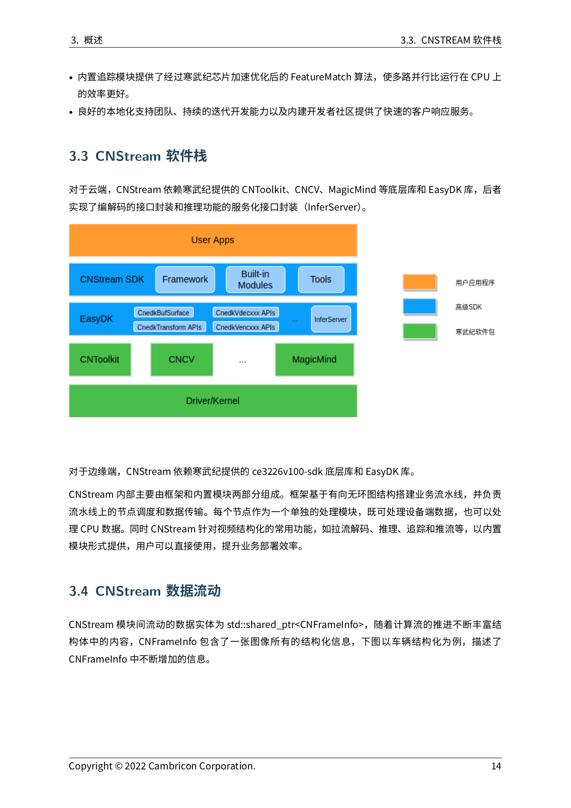
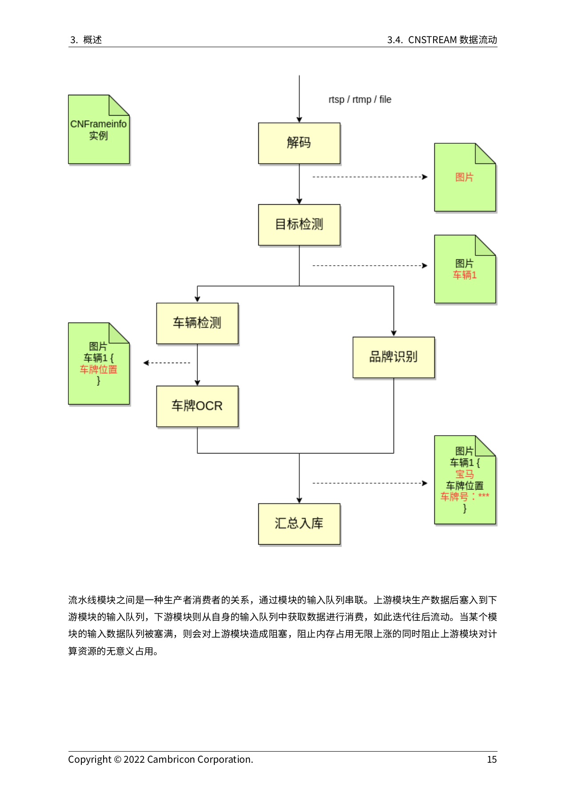
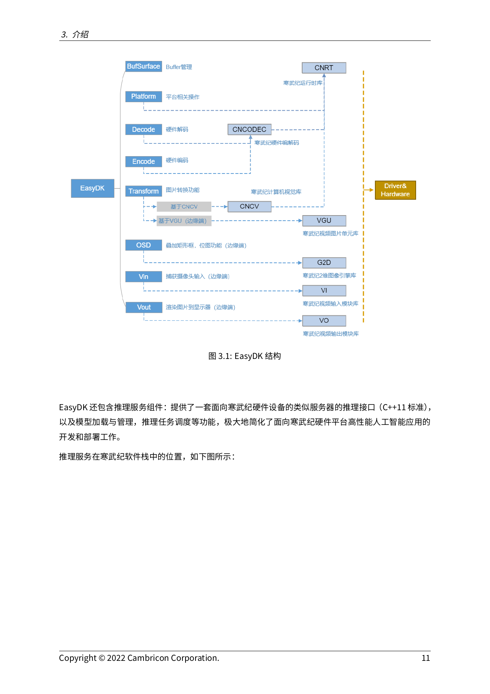

# 02D｜CNStream、EasyDK、端侧版本与机器人交接

本篇将视频输入、buffer、推理调度及输出消息作为一条链研究。寒武纪提供的CNStream/EasyDK可以减少视觉流水线集成工作；但已取得的新版边缘路线是CE3226，MLU220需要另行冻结旧栈。源码中的frame、discard、camera和priority都不能单独证明ROS适配、设备抢占或机器人安全控制。本篇仅做官方文档/代码核验，数据截止2026-11-05，未安装BSP和运行摄像头。

## 1. 历史MLU220与新版CE3226必须分开

CNStream5.3用户指南第14章记录2021-01-28发行，兼容MLU270、MLU220 M.2和Edge，限定CNToolkit1.5.0；同册第3章明确平台范围，第2章给出220检测、分类和追踪例程。它支持“历史上存在官方220软件路径”的结论，不能证明2026仍可取得全部包、获得维护或绑定任意220.SOM载板。[Cambricon_CNStream_docs_release_document_5_3_0_Cambricon-CNStream-User-Guide-CN_pdf](https://raw.githubusercontent.com/Cambricon/CNStream/24eea3eeb4220b2662814a9b7b35480ecdeacac1/docs/release_document/5.3.0/Cambricon-CNStream-User-Guide-CN.pdf)

EasyDK4.1指南的更新历史中，v4.0.0（2022-10-17）明确“不再兼容MLU200系列（MLU270/MLU220.M.2/MLU220.Edge/MLU220.SOM）”，移除v3.1所有接口及InferServer Contrib接口，其他InferServer接口除外，并改变前后处理为batch/BufSurface形式。因而“新版功能更多”不能推导“旧模组可直接升级”。这是明确的兼容断点，选型时应先决定维持220旧依赖还是迁移新硬件，再讨论上层框架。[EASYPDF](https://raw.githubusercontent.com/Cambricon/easydk/c7a2d6c1b3c656590ee9d7ef3107dde6d9b99675/docs/release_document/4.1.0/Cambricon-EasyDK-User-Guide-CN-v4.1.0.pdf)

| 软件路线 | 目标与版本 | 基础包/关键依赖 | 交付限制 |
|---|---|---|---|
| CNStream5.3 | 2021-01-28；270/220 M.2/Edge | CNToolkit1.5.0、对应EasyDK子仓 | 完整旧包、驱动、编译器未取得 |
| CNStream7.1云端370 | release章节2022-12-07 | Toolkit3.0.2、driver4.20.9、MM0.13.0 | 不能套用MM1.7公共示例版本 |
| CNStream7.1云端585 | 同一发行范围 | Toolkit3.1.1、driver5.3.6、MM0.14.0 | CNNL等剩余依赖见原表 |
| CNStream7.1 / EasyDK4.1边缘 | CE3226 | ce3226v100-sdk inference/mps；EasyDK4.1表绑定SDK1.1.0 | 包和开发指南未取得；非220 BSP |
| EasyDK4.0断点 | 2022-10-17 | 改为BufSurface与新平台接口 | 明确取消MLU200兼容 |

CNStream7.1指南封面2025-03-20与软件release章节的2022日期分开保留，不以封面日期改写发行时间。7.1依赖原表还列CNCV/CNNL/CNNL_Extra/CNLight，并要求联系厂商取得安装包；本轮未发邮件。EasyDK4.1更新记录日期2022-12-08。PDF与固定SHA源码是不同证据对象，不把当前头文件注释当作某历史二进制ABI保证。[CNSPDF](https://raw.githubusercontent.com/Cambricon/CNStream/24eea3eeb4220b2662814a9b7b35480ecdeacac1/docs/release_document/7.1.0/Cambricon-CNStream-User-Guide-CN-v7.1.0.pdf) [EASYPDF](https://raw.githubusercontent.com/Cambricon/easydk/c7a2d6c1b3c656590ee9d7ef3107dde6d9b99675/docs/release_document/4.1.0/Cambricon-EasyDK-User-Guide-CN-v4.1.0.pdf)

## 2. 架构与frame：数据随模块逐步增加

图来自CNStream7.1指南PDF第21页（印刷14页），实际打开核查。框架和内置模块之下是EasyDK的BufSurface、编解码和InferServer，再下是CNToolkit、CNCV、MagicMind及驱动。文字明确边缘依赖CE3226 SDK；这张图不证明所有层共享零拷贝内存。[CNSPDF](https://raw.githubusercontent.com/Cambricon/CNStream/24eea3eeb4220b2662814a9b7b35480ecdeacac1/docs/release_document/7.1.0/Cambricon-CNStream-User-Guide-CN-v7.1.0.pdf)

CNStream采用C++11、有向无环图、模块与输入队列。模块间实体为 `shared_ptr<CNFrameInfo>`，随着解码、检测、追踪等处理附加结构化信息。当前 `cnstream_frame.hpp` 包含stream_id、timestamp、flags、Collection、父pipeline payload；EOS/invalid/removed是数据流状态，GetStreamIndex注明用户不推荐使用。timestamp初值-1；字段存在不意味着已与相机曝光、ROS时钟或控制器时钟同步。[FRAME](https://raw.githubusercontent.com/Cambricon/CNStream/24eea3eeb4220b2662814a9b7b35480ecdeacac1/framework/include/cnstream_frame.hpp)

官方第22页（印刷15页）以车辆检测、车牌OCR和品牌识别说明frame信息累积并汇总入库。上游生产者将数据推向下游队列，队满阻塞上游以限制内存和无效资源占用。其优势在于模块复用和有界缓存，成立条件是生产/消费速率与队列深度受控；视频结构化图没有动作输出，不能按图认定具身闭环已成立。[CNSPDF](https://raw.githubusercontent.com/Cambricon/CNStream/24eea3eeb4220b2662814a9b7b35480ecdeacac1/docs/release_document/7.1.0/Cambricon-CNStream-User-Guide-CN-v7.1.0.pdf)

取得的MLU370 YOLOv3配置含队列20、parallelism1、engine_num4、batch_timeout200、RGB24、阈值0.5，路径指向MM0.13的4batch uint8模型。这些是例程配置而非最优值，文件名也不足以独立证明模型实际输入shape；需要加载模型元数据核对。增加engine可能占更多设备资源，增队列和攒batch可能延长观测年龄。模型文件及完整pipeline未取得，不能据配置直接输出吞吐结论。[CNSCFG](https://raw.githubusercontent.com/Cambricon/CNStream/24eea3eeb4220b2662814a9b7b35480ecdeacac1/samples/cns_launcher/configs/yolov3_object_detection_mlu370.json)

## 3. BufSurface：颜色、plane、内存和缓存不能省略

EasyDK4.1指南PDF第15页（印刷11页）的官方图将Decode/Encode接CNCodec，Transform接CNCV或边缘VGU，OSD/Vin/Vout接边缘图像与视频模块。它描述新平台的模块分工；相机输入箭头不是220驱动、传感器型号或载板接线的证明。[EASYPDF](https://raw.githubusercontent.com/Cambricon/easydk/c7a2d6c1b3c656590ee9d7ef3107dde6d9b99675/docs/release_document/4.1.0/Cambricon-EasyDK-User-Guide-CN-v4.1.0.pdf)

`cnedk_buf_surface.h` 的真实交接对象包含mem_type、device_id、batch_size、num_filled、surface_list及pts。每张图保存data_ptr、mapped_data_ptr和plane的pitch/offset/size；mapped指针只在指定UNIFIED/VB类型有效，不能把device pointer直接当CPU图像。当前头文件区分MLU DEVICE/PINNED、CE UNIFIED/VB与malloc SYSTEM，默认类型也随平台变化；4.1指南列出的可申请类型与当前头文件并非完全同表，部署应以绑定库和API为准。[BUF](https://raw.githubusercontent.com/Cambricon/easydk/c7a2d6c1b3c656590ee9d7ef3107dde6d9b99675/include/cnedk_buf_surface.h) [EASYPDF](https://raw.githubusercontent.com/Cambricon/easydk/c7a2d6c1b3c656590ee9d7ef3107dde6d9b99675/docs/release_document/4.1.0/Cambricon-EasyDK-User-Guide-CN-v4.1.0.pdf)

文档示例先创建buffer，必要时Copy到SYSTEM，最后Destroy；Wrapper以析构管理surface，也提供plane/stride/pts访问与池化。边缘cached内存示例要求CPU访问前SyncForCpu、CPU改写后SyncForDevice。当前头文件对SyncForDevice有效类型的注释与该cached示例措辞不同，未取得实现与BSP实测前不自行断言哪类一定可用。同步cache可见性与等待推理设备工作完成也是两件事。内存池减少反复申请，却必须等所有异步使用结束再回收；GetBufSurfaceWrapper超时可返回nullptr，应用应处理资源耗尽。[BUF](https://raw.githubusercontent.com/Cambricon/easydk/c7a2d6c1b3c656590ee9d7ef3107dde6d9b99675/include/cnedk_buf_surface.h) [EASYPDF](https://raw.githubusercontent.com/Cambricon/easydk/c7a2d6c1b3c656590ee9d7ef3107dde6d9b99675/docs/release_document/4.1.0/Cambricon-EasyDK-User-Guide-CN-v4.1.0.pdf)

旧220指南进一步给出scaler硬件前处理的具体约束：NV12/NV21输入128像素对齐，输出4通道ARGB、宽度32倍数；网络宽不匹配时需在离线模型首层处理crop。输出顺序与后处理不匹配可触发CPU重排。这里可见硬件收益来自满足格式和对齐契约，而非只开一个加速开关；新BufSurface接口不自动替代旧scaler路径。[Cambricon_CNStream_docs_release_document_5_3_0_Cambricon-CNStream-User-Guide-CN_pdf](https://raw.githubusercontent.com/Cambricon/CNStream/24eea3eeb4220b2662814a9b7b35480ecdeacac1/docs/release_document/5.3.0/Cambricon-CNStream-User-Guide-CN.pdf)

## 4. InferServer：异步、batch、超时与遗弃

InferServer提供Model、Processor、Session、Package/InferData和Observer。当前 `SessionDesc` 默认动态batch、batch_timeout100ms；0按注释意味着无限等待且仅动态策略有效，engine_num默认1。模型加载缓存按URI复用，mutable输入另传shape；产物同名更新与缓存失效应在目标版本验证，不能把URI缓存当跨SKU通用engine。[SERVER](https://raw.githubusercontent.com/Cambricon/easydk/c7a2d6c1b3c656590ee9d7ef3107dde6d9b99675/include/infer_server/cnis/infer_server.h)

4.1指南6.3.1明确：繁忙时 `Request` 和 `RequestSync` 都可能阻塞等待入队。Session错误或入队超时而未请求返回false；同步请求已发出后等结果超时则返回true、Status::TIMEOUT。所以布尔true不是“推理成功”，异步名称也不是“调用永不阻塞”。响应以请求为单位，Package内多份数据仍是一请求一响应；普通异步响应顺序与请求顺序相同。后处理可透传user_data并设置自定义输出，但额外指针对象生命周期仍由应用保证。[EASYPDF](https://raw.githubusercontent.com/Cambricon/easydk/c7a2d6c1b3c656590ee9d7ef3107dde6d9b99675/docs/release_document/4.1.0/Cambricon-EasyDK-User-Guide-CN-v4.1.0.pdf) [SERVER](https://raw.githubusercontent.com/Cambricon/easydk/c7a2d6c1b3c656590ee9d7ef3107dde6d9b99675/include/infer_server/cnis/infer_server.h)

6.3.2的 `WaitTaskDone(session,tag)` 等全部同tag任务完成；`DiscardTask` 非阻塞标记discarded，排队任务直接弃，执行中的等执行完再弃，丢弃结果不回用户。它可以避免过时结果继续进入业务，却不是kernel抢占、硬件复位或电机停机。应用还要记录“被接受、已执行、被丢弃、响应超时”的不同状态，避免把缺响应误判为任务未执行。[EASYPDF](https://raw.githubusercontent.com/Cambricon/easydk/c7a2d6c1b3c656590ee9d7ef3107dde6d9b99675/docs/release_document/4.1.0/Cambricon-EasyDK-User-Guide-CN-v4.1.0.pdf)

与 [02C_PyTorch_Backend_and_Distributed_Training.md](02C_PyTorch_Backend_and_Distributed_Training.md) 的流事件和通信等待相比，这里的调度对象是推理请求与frame；两层均需明确结束和所有权，但不能互相替代。对NVIDIA方向的比较可采用共同问题：是否能保留buffer、把预处理和模型连接、限制队列及观察延迟；本篇未取得同条件视频测试，保留机制比较，不接受指南笼统效率宣称作为加速排名。

## 5. 从视觉输出到机器人：仍需补齐的接口

7.1指南的Source支持视频/RTSP、图像、ESMemory等，camera处于边缘平台语境；EasyDK PlatformInit的VB/SYS和mipi_dev/bus/sns_clk也属于CE3226。本輪未取得220 BSP源码、OS/kernel配置、设备树、bootloader、camera/CSI驱动和传感器调校文件，也没有官方ROS2消息包、QoS/时间同步、本体SDK或运动控制器契约。因此只能将检测结果交给自定义模块的路径列为待实现，不编造官方ROS支持。[CNSPDF](https://raw.githubusercontent.com/Cambricon/CNStream/24eea3eeb4220b2662814a9b7b35480ecdeacac1/docs/release_document/7.1.0/Cambricon-CNStream-User-Guide-CN-v7.1.0.pdf) [EASYPDF](https://raw.githubusercontent.com/Cambricon/easydk/c7a2d6c1b3c656590ee9d7ef3107dde6d9b99675/docs/release_document/4.1.0/Cambricon-EasyDK-User-Guide-CN-v4.1.0.pdf)

可复建的分析方案是：从相机曝光时刻记录观测ID与时钟，经过解码、入队、preproc、推理、postproc、消息发布，到动作接受逐点追踪；输出带坐标系、标定版本、模型版本、置信度、有效期和序列号。过期结果在动作接口拒收，断流/模型异常由独立控制器处理。指南MessageHandle的EOS/FRAME_ERR/STREAM_ERR/ERROR只定义流错误，缺少控制器响应的实测，不能声称具备安全闭环。上述动作契约是分析建议，非厂商已交付功能。

CNStream profiler默认关闭，enable_profiling打开后对队列入/出、Process开始/TransmitData和pipeline进/出打桩。其E2E是pipeline边界，不包含相机曝光前、网络外部缓冲或动作执行。需要导出原始trace才能计算目标窗口P99与观测年龄；本轮没有这些样本。源码CNStream/EasyDK为Apache2.0，文档版权、设备库/固件、容器、模型权重、传感器调校及本体SDK各自另核，不能用代码LICENSE统一覆盖。[CNSPDF](https://raw.githubusercontent.com/Cambricon/CNStream/24eea3eeb4220b2662814a9b7b35480ecdeacac1/docs/release_document/7.1.0/Cambricon-CNStream-User-Guide-CN-v7.1.0.pdf) [CNSLIC](https://raw.githubusercontent.com/Cambricon/CNStream/24eea3eeb4220b2662814a9b7b35480ecdeacac1/LICENSE) [EASYLIC](https://raw.githubusercontent.com/Cambricon/easydk/c7a2d6c1b3c656590ee9d7ef3107dde6d9b99675/LICENSE)

## 参考资料与本地原文

所有正文来源均为2026-11-05采集的归档快照。官网未标发布日期时不使用版权年充当版本；仓库原件URL固定于树SHA，具体提交日期未独立核验。`complete_static`对单独源码/Markdown仅指主文件原件取得，不保证其相对链接、子模块、镜像、模型权重和训练数据均已下载。

| 材料 | 原始URL与版本边界 | 本地原件 | 归档状态 |
|---|---|---|---|
| Cambricon_CNStream_docs_release_document_5_3_0_Cambricon-CNStream-User-Guide-CN_pdf | [原文](https://raw.githubusercontent.com/Cambricon/CNStream/24eea3eeb4220b2662814a9b7b35480ecdeacac1/docs/release_document/5.3.0/Cambricon-CNStream-User-Guide-CN.pdf)；源码固定树SHA 24eea3eeb422 | [原件](REFERENCES.md#ref-b54e4c40c635d285) | complete_static |
| Cambricon_easydk_docs_release_document_4_1_0_Cambricon-EasyDK-User-Guide-CN-v4_1_0_pdf | [原文](https://raw.githubusercontent.com/Cambricon/easydk/c7a2d6c1b3c656590ee9d7ef3107dde6d9b99675/docs/release_document/4.1.0/Cambricon-EasyDK-User-Guide-CN-v4.1.0.pdf)；源码固定树SHA c7a2d6c1b3c6 | [原件](REFERENCES.md#ref-daa8edb6b1403342) | complete_static |
| Cambricon_CNStream_docs_release_document_7_1_0_Cambricon-CNStream-User-Guide-CN-v7_1_0_pdf | [原文](https://raw.githubusercontent.com/Cambricon/CNStream/24eea3eeb4220b2662814a9b7b35480ecdeacac1/docs/release_document/7.1.0/Cambricon-CNStream-User-Guide-CN-v7.1.0.pdf)；源码固定树SHA 24eea3eeb422 | [原件](REFERENCES.md#ref-28588784e57681a4) | complete_static |
| Cambricon_CNStream_framework_include_cnstream_frame_hpp | [原文](https://raw.githubusercontent.com/Cambricon/CNStream/24eea3eeb4220b2662814a9b7b35480ecdeacac1/framework/include/cnstream_frame.hpp)；源码固定树SHA 24eea3eeb422 | [原件](REFERENCES.md#ref-a415681c7a1ad08a) | complete_static |
| Cambricon_CNStream_samples_cns_launcher_configs_yolov3_object_detection_mlu370_json | [原文](https://raw.githubusercontent.com/Cambricon/CNStream/24eea3eeb4220b2662814a9b7b35480ecdeacac1/samples/cns_launcher/configs/yolov3_object_detection_mlu370.json)；源码固定树SHA 24eea3eeb422 | [原件](REFERENCES.md#ref-58dc2db82edfa85d) | complete_static |
| Cambricon_easydk_include_cnedk_buf_surface_h | [原文](https://raw.githubusercontent.com/Cambricon/easydk/c7a2d6c1b3c656590ee9d7ef3107dde6d9b99675/include/cnedk_buf_surface.h)；源码固定树SHA c7a2d6c1b3c6 | [原件](REFERENCES.md#ref-4a96ff4aca51ea48) | complete_static |
| Cambricon_easydk_include_infer_server_cnis_infer_server_h | [原文](https://raw.githubusercontent.com/Cambricon/easydk/c7a2d6c1b3c656590ee9d7ef3107dde6d9b99675/include/infer_server/cnis/infer_server.h)；源码固定树SHA c7a2d6c1b3c6 | [原件](REFERENCES.md#ref-f1f9b626151b8791) | complete_static |
| Cambricon_CNStream_LICENSE | [原文](https://raw.githubusercontent.com/Cambricon/CNStream/24eea3eeb4220b2662814a9b7b35480ecdeacac1/LICENSE)；源码固定树SHA 24eea3eeb422 | [原件](REFERENCES.md#ref-a9eb37e31b711f28) | complete_static |
| Cambricon_easydk_LICENSE | [原文](https://raw.githubusercontent.com/Cambricon/easydk/c7a2d6c1b3c656590ee9d7ef3107dde6d9b99675/LICENSE)；源码固定树SHA c7a2d6c1b3c6 | [原件](REFERENCES.md#ref-cba81b917987d0b4) | complete_static |
