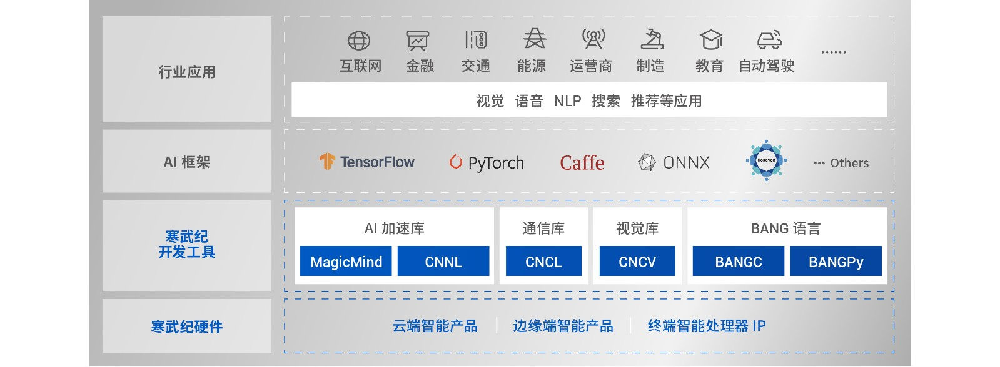
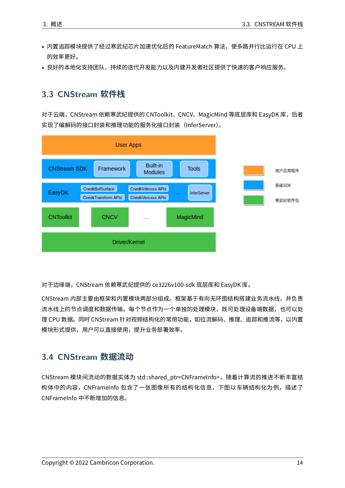

# 02｜寒武纪 Cambricon 软件栈与具身智能交付边界

调研截止：2026-11-05（Asia/Shanghai）。本章以官方官网、发行说明、开发指南与固定SHA源码建立“总览＋五专题＋索引”。01已按用户要求完成并通过审阅，本次继续02；03—09仍为此前首轮简报，本次没有补深或批准它们。正文是公开资料与代码研究，未安装厂商SDK、执行模型、启动集群或开展机器人实机测试。

**核心判断：寒武纪已公开可核验的训练后端、算子开发、图编译、视觉流水线与云端运维组件，具备作为具身系统计算后端的技术入口；完整机器人平台交付尚未由本轮证据建立。** 最实质的限制是版本与目标平台分叉：MLU220历史路线、新版CE3226边缘路线、云端MLU370/585及不同torch/SDK分支不能相互替代。选型应先确认具体设备能拿到哪套系统与运行库，再判断模型和传感器路径。

## 1. 总体分层与独立专题

图为NeuWare官网软件栈原图，已逐图打开。图示框架、MagicMind、CNNL/CNCL/CNCV、BANG语言与硬件的层级，支持“云边端、训推组合”的产品定位。官网未给完整逐SKU版本矩阵；框架图标不能证明2026持续支持全部框架、旧220 BSP、ROS2或运动控制，部分静态依赖未取得。[NEU](https://www.cambricon.com/index.php?m=content&c=index&a=lists&catid=71)

| 专题 | 已追踪的关键对象 | 输入→输出 | 对具身工程的意义 | 核验入口 |
|---|---|---|---|---|
| 02A NeuWare/BANG | descriptor、stride、tile、workspace、queue/notifier | Host/设备源码→kernel及结果 | 补算子、排查访存和同步瓶颈 | [02A_NeuWare_BANG_and_Runtime.md](02A_NeuWare_BANG_and_Runtime.md) |
| 02B MagicMind | Parser/Network、Builder/Calibrator、Model/Context | 模型与校准→序列化模型→tensor | 固定预处理、精度、shape及目标 | [02B_MagicMind_Compilation_and_Quantization.md](02B_MagicMind_Compilation_and_Quantization.md) |
| 02C PyTorch/CNCL | PrivateUse1、CPU fallback、stream、Work | Tensor/梯度→设备计算/通信 | 验证训练可迁移性与并行生命周期 | [02C_PyTorch_Backend_and_Distributed_Training.md](02C_PyTorch_Backend_and_Distributed_Training.md) |
| 02D CNStream/EasyDK | CNFrameInfo、BufSurface、Session/Package | 视频/图像→结构化视觉结果 | 串联感知、控制缓存与观测年龄 | [02D_CNStream_EasyDK_and_Robot_Handoff.md](02D_CNStream_EasyDK_and_Robot_Handoff.md) |
| 02E vLLM/运维 | platform/hijack、KV cache、Pod资源、指标 | 文本请求→文本；设备→指标 | 云端语义服务及计算运维 | [02E_vLLM_and_Cloud_Operations.md](02E_vLLM_and_Cloud_Operations.md) |

组件协作并不等于只有一套安装包。MLU-OPS公开代码依赖CNNL等设备库，MagicMind代码示例需要其二进制及目标架构，torch_mlu还绑定上游torch分支和补丁，CNStream按平台依赖EasyDK和底层SDK。开源仓库可以降低接口研究与补算子的成本；在包、版本和模型条件不一致时，这种收益可能被迁移、回退和额外复制抵消。以上层级与依赖分别依据官方开发指南、仓库README和具体构建代码。[BANG](https://raw.githubusercontent.com/Cambricon/mlu-ops/549075224cd46ac2a52e4883b51dd50fe4b1abf5/docs/BANG-C-OPS-Develop-Guide.md) [OPS](https://raw.githubusercontent.com/Cambricon/mlu-ops/549075224cd46ac2a52e4883b51dd50fe4b1abf5/README.md) [MODEL](https://raw.githubusercontent.com/Cambricon/magicmind_cloud/dc085c193c0af091f92a844cc3bfa350f1d7027f/buildin/python_common/model_process.py) [TBUILD](https://raw.githubusercontent.com/Cambricon/torch_mlu/d578002c0863bfa1ad30fae6b99e4fb3a79dff48/CONTRIBUTING.zh.md) [CNSPDF](https://raw.githubusercontent.com/Cambricon/CNStream/24eea3eeb4220b2662814a9b7b35480ecdeacac1/docs/release_document/7.1.0/Cambricon-CNStream-User-Guide-CN-v7.1.0.pdf)

## 2. 能力覆盖：提供、兼容入口和未知交付物

| 层级 | 本轮证据分类 | 已确认的交付内容 | 需要补齐的材料/验证 |
|---|---|---|---|
| OS/kernel/driver | 厂商工具说明及源码构建要求 | DKMS、CNRT/CNDRV/CNDEV；部分x86发行版 | 目标SKU的kernel、固件、签名/升级与完整安装包 |
| 端侧BSP | 历史220说明；新版CE3226文档 | 220旧例程；CE3226 SDK依赖及平台API | 220 bootloader、设备树、载板及传感器驱动 |
| 编译/SDK | 厂商工具与官方示例 | CNCC/BANG、MLU-OPS、MagicMind | 精确ABI、插件、设备包与许可 |
| 推理/训练 | 官方框架适配与示例 | MagicMind模型执行、torch_mlu/CNCL、vLLM插件 | 目标模型精度、覆盖、吞吐/延迟与稳定性 |
| 感知/数据流 | 厂商SDK | CNStream/EasyDK解码、预处理、推理、结构化结果 | 相机驱动、标定、时间同步及消息适配 |
| ROS/中间件/运动 | 自定义接口可作为分析入口；交付未知 | frame、自定义模块和错误消息 | ROS2包/QoS、坐标系、动作contract、本体SDK |
| 仿真/学习 | PyTorch通用学习入口；专用交付未知 | 单卡/DDP例程及传统modelzoo | 物理仿真、机器人资产、VLA/RL训练/rollout配方 |
| 编排/OTA/运维 | 官方K8s与exporter；OTA未知 | 设备分配/健康、硬件指标、日志配置 | 端侧镜像更新/回滚、策略状态迁移与控制器响应 |

“未知”指本轮未取得满足验证条件的资料，不断言厂商绝不存在该能力。“兼容入口”指代码提供了适配机制，并不等于认证过用户的系统。CE3226文档中的Vin、VB/SYS、mipi_dev等不能用作220.SOM传感器交付证据；K8s插件的arm64构建也不能替代端侧BSP。部分API/驱动网页受robots或访问限制未取得正文，失败保留于registry，正文只采用成功归档的开发指南与代码。[CNSPDF](https://raw.githubusercontent.com/Cambricon/CNStream/24eea3eeb4220b2662814a9b7b35480ecdeacac1/docs/release_document/7.1.0/Cambricon-CNStream-User-Guide-CN-v7.1.0.pdf) [EASYPDF](https://raw.githubusercontent.com/Cambricon/easydk/c7a2d6c1b3c656590ee9d7ef3107dde6d9b99675/docs/release_document/4.1.0/Cambricon-EasyDK-User-Guide-CN-v4.1.0.pdf) [K8S](https://raw.githubusercontent.com/Cambricon/cambricon-k8s-device-plugin/cccdd66de08ad6b8ade94d140a8cc7d63b87353f/device-plugin/README.md) [BANG](https://raw.githubusercontent.com/Cambricon/mlu-ops/549075224cd46ac2a52e4883b51dd50fe4b1abf5/docs/BANG-C-OPS-Develop-Guide.md)

机器人本体的传感器接入、状态估计、策略调用、规划与控制器是额外系统层。推理库能够产生tensor，视觉SDK能够产生frame信息，文本服务能够返回completion；目前没有证据表明这些输出自动被转换为带坐标、时间与执行状态的机器人动作。对于需要ROS2、EtherCAT或特定相机的项目，下一步应索取精确交付物与目标平台运行记录，而不是根据芯片接口或官网软件栈图判断完成集成。硬件对象和接口边界复用已审阅的 [01_Hardware_Platform.md](01_Hardware_Platform.md)，本章没有修改其事实或哈希。

## 3. 可复建版本矩阵及冲突处理

| 路线 | 目标/版本对象 | 系统与基础库条件 | 上层条件 | 本轮采用依据 |
|---|---|---|---|---|
| MLU-OPS当前快照 | SHA549075224cd4 | Toolkit≥4.1.0、driver≥6.0.3、CNNL≥1.28.0；列出x86 OS | 算子按dtype/stride/架构检查 | README及实际Abs分支 |
| torch_mlu训练示例 | SHAd578002c0863；r1.22_pt2.1.0 | CNToolkit/CNNL/CNCL等；构建工具条件 | patch PyTorch2.1再build扩展 | CONTRIBUTING；未混用其他分支 |
| MagicMind Cloud | SHAdc085c193c0a；release v1.7对应MM1.7 | 目标及设备校准、工具链待包核验 | 公共架构372/322/592；参数入口还有旧目标 | 实际get_mlu_arches断言优先 |
| 220历史视觉 | CNStream5.3，2021-01-28 | CNToolkit1.5.0与对应EasyDK | 270/220 M.2/Edge、旧离线模型 | 5.3发行/平台章节 |
| 新视觉流水线 | CNStream7.1/EasyDK4.1 | 370:Toolkit3.0.2/MM0.13；585:3.1.1/0.14；CE3226独立SDK | 新BufSurface与推理接口 | 7.1依赖表与4.0断点 |
| vLLM云端开发 | SHAdc984838c63a；v0.11.2-dev | SDK另取；torch2.9.1、torch-mlu≥1.29.1 | Ray2.51.1及修改；目标“MLU370以上” | requirements/README/平台代码 |

此矩阵是本轮实际取得的不同版本证据，**不是推荐把六行装在同一台机器**。还需记录固件、容器digest、模型/权重哈希、校准集、预处理、编译配置和库ABI，才能给出可复建环境。MLU-OPS列出的x86 OS不自动适用于Arm端侧；通过DKMS构建驱动也不等于任意实时内核有认证。[OPS](https://raw.githubusercontent.com/Cambricon/mlu-ops/549075224cd46ac2a52e4883b51dd50fe4b1abf5/README.md) [TBUILD](https://raw.githubusercontent.com/Cambricon/torch_mlu/d578002c0863bfa1ad30fae6b99e4fb3a79dff48/CONTRIBUTING.zh.md) [CLOUD](https://raw.githubusercontent.com/Cambricon/magicmind_cloud/dc085c193c0af091f92a844cc3bfa350f1d7027f/README.md) [MODEL](https://raw.githubusercontent.com/Cambricon/magicmind_cloud/dc085c193c0af091f92a844cc3bfa350f1d7027f/buildin/python_common/model_process.py) [CNSPDF](https://raw.githubusercontent.com/Cambricon/CNStream/24eea3eeb4220b2662814a9b7b35480ecdeacac1/docs/release_document/7.1.0/Cambricon-CNStream-User-Guide-CN-v7.1.0.pdf) [EASYPDF](https://raw.githubusercontent.com/Cambricon/easydk/c7a2d6c1b3c656590ee9d7ef3107dde6d9b99675/docs/release_document/4.1.0/Cambricon-EasyDK-User-Guide-CN-v4.1.0.pdf) [VREQ](https://raw.githubusercontent.com/Cambricon/vllm-mlu/dc984838c63aef3de46bbadedd82d9848a19c5d2/requirements.txt) [VLLM](https://raw.githubusercontent.com/Cambricon/vllm-mlu/dc984838c63aef3de46bbadedd82d9848a19c5d2/README.md)

关键冲突采取“保留原文、优先具体路径、限定版本”的处理：MagicMind公共参数有220，但实际架构函数不接受，不能说当前例程220可编译；Cloud v1.7明确删除TensorFlow，上方旧表仍有标志，不能认为持续兼容；CNStream7.1封面2025日期不能替代2022 release；EasyDK4.0明确取消MLU200兼容，不能拿CE3226示例补220；vLLM attention形状函数与docstring顺序不同，以函数为准并保留运行核查；exporter README未合并冲突使部分CLI仍待发布版核实。这些不是文案瑕疵列表，而是环境拼装与数据正确性风险。[PARAM](https://raw.githubusercontent.com/Cambricon/magicmind_cloud/dc085c193c0af091f92a844cc3bfa350f1d7027f/buildin/python_common/build_param.py) [MODEL](https://raw.githubusercontent.com/Cambricon/magicmind_cloud/dc085c193c0af091f92a844cc3bfa350f1d7027f/buildin/python_common/model_process.py) [CLOUD](https://raw.githubusercontent.com/Cambricon/magicmind_cloud/dc085c193c0af091f92a844cc3bfa350f1d7027f/README.md) [CNSPDF](https://raw.githubusercontent.com/Cambricon/CNStream/24eea3eeb4220b2662814a9b7b35480ecdeacac1/docs/release_document/7.1.0/Cambricon-CNStream-User-Guide-CN-v7.1.0.pdf) [EASYPDF](https://raw.githubusercontent.com/Cambricon/easydk/c7a2d6c1b3c656590ee9d7ef3107dde6d9b99675/docs/release_document/4.1.0/Cambricon-EasyDK-User-Guide-CN-v4.1.0.pdf) [ATTN](https://raw.githubusercontent.com/Cambricon/vllm-mlu/dc984838c63aef3de46bbadedd82d9848a19c5d2/vllm_mlu/v1/attention/backends/flash_attn.py) [EXPORT](https://raw.githubusercontent.com/Cambricon/mlu-exporter/648a19c7d781ada2ea693e46edc562aa57f79be4/README.md)

## 4. 模型源到传感器与动作：逐段交接

本轮沿MagicMind Edge YOLOv3追踪了一条具体文献链，其目标为CE3226；它不能改称220机器人路线。Darknet→Caffe转换文档残留非公共工具地址，公开转换入口未完整取得。后半段的Caffe解析、量化与编译代码，以及设备推理C++已归档。CNStream提供另一套视觉流水线，本轮未把两个demo实际连接；下表明确它们之间仍需实现的交接。[YOLO](https://raw.githubusercontent.com/Cambricon/magicmind_edge/04d1e858c1760439adc8dcdd146405558d9c524b/buildin/cv/detection/yolov3_caffe/README.MD) [YGEN](https://raw.githubusercontent.com/Cambricon/magicmind_edge/04d1e858c1760439adc8dcdd146405558d9c524b/buildin/cv/detection/yolov3_caffe/gen_model/gen_model.py) [YINFER](https://raw.githubusercontent.com/Cambricon/magicmind_edge/04d1e858c1760439adc8dcdd146405558d9c524b/buildin/cv/detection/yolov3_caffe/infer_cpp/src/infer.cpp)

| 阶段 | 真正的交接物 | 已核验机制 | 缺口及下一项验收 |
|---|---|---|---|
| 模型源→交换模型 | 权重、结构、anchors/类别 | 文档描述Darknet→Caffe | 转换工具/权重许可与输出一致性 |
| 解析→量化 | Network、样本/预处理、scale配置 | 416²输入、最多50校准样本、UINT8布局 | 真实相机数据分布与精度 |
| 编译→设备加载 | 序列化模型、目标/工具链、IO契约 | mtp_322、静态shape、DetectionOutput | 包/ABI、目标加载、峰值内存 |
| 输入buffer→推理结果 | tensor、queue、完成依赖、检测记录 | H2D/enqueue/QueueSync/D2H | 相机输入、buffer可达性、并发安全 |
| 结果→视觉消息 | CNFrameInfo/Collection或自定义结构 | 模块附加信息、队列与Observer | 坐标逆变换、标定、曝光时间及ROS适配 |
| 消息→动作接受 | 动作、坐标/单位、有效期、序列号 | 本轮未取得官方contract | 本体SDK、超时/过期拒收和执行反馈 |

图编译的收益可以来自融合、常量折叠、布局和内存优化，前提是数值、算子和目标支持成立；量化可能改变误差。官方ResNet50表中INT8混合FP16 TOP1比FP32低0.54个百分点，不能推导机器人成功率变化；Edge CSV的42.3246fps缺SKU/精度/batch/功率等条件，不能作为220频率。本章保留可核验原数与口径，不制造统一性能表。[MM](https://www.cambricon.com/index.php?m=content&c=index&a=lists&catid=378) [RES](https://raw.githubusercontent.com/Cambricon/magicmind_cloud/dc085c193c0af091f92a844cc3bfa350f1d7027f/buildin/cv/classification/resnet50_onnx/README.md) [YBENCH](https://raw.githubusercontent.com/Cambricon/magicmind_edge/04d1e858c1760439adc8dcdd146405558d9c524b/buildin/cv/detection/yolov3_caffe/benchmark/benchmark_ok.csv)

图为CNStream7.1指南PDF21页的官方软件栈，与上面模型链的区别是它组织frame和服务调度，而非单独模型生成。其driver/kernel图层提示部署依赖，并未提供相机到电机的完整闭环。文件中有界输入队列阻塞上游，InferServer繁忙时异步Request也可能阻塞，DiscardTask对已执行任务等待结束再弃；因此数据丢弃不能充当硬件抢占或急停。[CNSPDF](https://raw.githubusercontent.com/Cambricon/CNStream/24eea3eeb4220b2662814a9b7b35480ecdeacac1/docs/release_document/7.1.0/Cambricon-CNStream-User-Guide-CN-v7.1.0.pdf) [EASYPDF](https://raw.githubusercontent.com/Cambricon/easydk/c7a2d6c1b3c656590ee9d7ef3107dde6d9b99675/docs/release_document/4.1.0/Cambricon-EasyDK-User-Guide-CN-v4.1.0.pdf)

## 5. 性能、稳定性与跨平台比较

真正影响具身使用的往往是数据驻留、队列和观测年龄。torch_mlu未实现算子默认可CPU回退，设备执行失败回退默认关闭；这降低迁移初期门槛，却可能增加拷贝与同步，需统计关键路径覆盖。CNCL事件把计算结果接入通信流，recordStream保护allocator生命周期，但Work abort未实现；主机wait返回与设备完成取决于具体分支，不能从接口名推出实时任务取消。[FALL](https://raw.githubusercontent.com/Cambricon/torch_mlu/d578002c0863bfa1ad30fae6b99e4fb3a79dff48/torch_mlu/csrc/aten/MLUFallback.cpp) [Cambricon_torch_mlu_torch_mlu_csrc_framework_distributed_process_group_cncl_cpp](https://raw.githubusercontent.com/Cambricon/torch_mlu/d578002c0863bfa1ad30fae6b99e4fb3a79dff48/torch_mlu/csrc/framework/distributed/process_group_cncl.cpp)

图/缓存也不是固定开启的能力：vLLM平台代码在模型组合下会关闭chunked prefill/prefix，README在线命令明确enforce eager并关闭prefix cache。K8s env-share共享整卡没有提供硬实时隔离证据；exporter采样利用率与内存不等于策略时延，MLU370 cluster温度置0表示不支持。应把设备kernel时间、模型时间、pipeline时间、网络服务响应与曝光到动作时延分开，并报告平均/P99/最大值；WCET和伺服频率需要下层控制证明。[VPLAT](https://raw.githubusercontent.com/Cambricon/vllm-mlu/dc984838c63aef3de46bbadedd82d9848a19c5d2/vllm_mlu/platforms/mlu.py) [VLLM](https://raw.githubusercontent.com/Cambricon/vllm-mlu/dc984838c63aef3de46bbadedd82d9848a19c5d2/README.md) [K8S](https://raw.githubusercontent.com/Cambricon/cambricon-k8s-device-plugin/cccdd66de08ad6b8ade94d140a8cc7d63b87353f/device-plugin/README.md) [EXPORT](https://raw.githubusercontent.com/Cambricon/mlu-exporter/648a19c7d781ada2ea693e46edc562aa57f79be4/README.md)

与NVIDIA TensorRT和AMD HIP的比较以共同机制为轴：前者的模型图、量化、目标产物及runtime生命周期可与MagicMind对照，后者的Host/Device和异步stream依赖可与BANG/CNRT对照。可迁移的是数学定义、真实样本、测量方法、精度阈值和消息契约；engine、插件ABI、设备代码、片上布局与调参需要重做。当前无同模型、硬件/功率、batch、精度和链路范围的控制变量测量，因此不输出平台加速排名。各专题已给出对照原文，本总览复用归档。[TRT](https://docs.nvidia.com/deeplearning/tensorrt/latest/architecture/how-trt-works.html) [TRTQ](https://docs.nvidia.com/deeplearning/tensorrt/latest/inference-library/quantized-types-explicit-quantization.html) [HIP](https://rocm.docs.amd.com/projects/HIP/en/latest/how-to/hip_runtime_api/asynchronous.html)

可复建验证应先取得精确P/N和完整SDK/BSP，验证基本设备与内存；随后固定模型及产物契约，核浮点/量化数值与fallback，再分别测试单请求、动态shape、多请求和长时热稳定；视觉路径要同时记录曝光、入队、完成、发布及动作接受，云端要记录冷启动、TTFT、token间隔和网络故障。每次变更模型、插件、SDK、固件或硬件后重新验证，并为更新设计产物版本、cache失效与回滚方案。这里是分析形成的验收路径，不是已经获得这些运行成绩或厂商提供完整OTA。

## 6. 许可、资料与当前结论状态

代码许可逐组件处理：MLU-OPS MIT，torch_mlu为BSD式三条款，MagicMind示例、CNStream/EasyDK、vLLM/K8s/exporter为Apache2.0。模型权重、训练/校准数据、二进制SDK/runtime、固件、交叉工具链、容器基础镜像和本体SDK分别核授权，不能用源码许可证自动覆盖。公开原文和成功静态依赖存入项目唯一registry；派生PDF文本与渲染图另存，原件不改写。[OPLIC](https://raw.githubusercontent.com/Cambricon/mlu-ops/549075224cd46ac2a52e4883b51dd50fe4b1abf5/LICENSE) [TLIC](https://raw.githubusercontent.com/Cambricon/torch_mlu/d578002c0863bfa1ad30fae6b99e4fb3a79dff48/LICENSE) [MMLIC](https://raw.githubusercontent.com/Cambricon/magicmind_cloud/dc085c193c0af091f92a844cc3bfa350f1d7027f/LICENSE) [CNSLIC](https://raw.githubusercontent.com/Cambricon/CNStream/24eea3eeb4220b2662814a9b7b35480ecdeacac1/LICENSE) [EASYLIC](https://raw.githubusercontent.com/Cambricon/easydk/c7a2d6c1b3c656590ee9d7ef3107dde6d9b99675/LICENSE) [VLIC](https://raw.githubusercontent.com/Cambricon/vllm-mlu/dc984838c63aef3de46bbadedd82d9848a19c5d2/LICENSE) [KLIC](https://raw.githubusercontent.com/Cambricon/cambricon-k8s-device-plugin/cccdd66de08ad6b8ade94d140a8cc7d63b87353f/LICENSE) [EXLIC](https://raw.githubusercontent.com/Cambricon/mlu-exporter/648a19c7d781ada2ea693e46edc562aa57f79be4/LICENSE)

02A—02E与本总览各有独立证据、起始哈希基线、检查及去重记录，最终02_software_depth导出六篇引用的联合集合；专题索引见 [02_Topics_Index.md](02_Topics_Index.md)。官网及比较页面的partial_static保留可取得正文/依赖，不能声称动态交互或像素级完整；单独源码文件取得也不代表所有include、子模块、权重与镜像齐全。检查pass仅证明结构、归档和审阅记录满足要求，本轮事实与图均经过人工核验，仍未获得设备执行或机器人性能验证。

本章支持的选型动作是先按220旧栈、新CE3226边缘与云端模型服务分路线索取材料，再以实际模型与本体接口做验证。可以明确找到计算软件的入口和具体风险，尚不足以认定寒武纪已经交付完整的具身机器人平台。02研究完成后等待用户审阅；本次停在02，不启动03。

## 参考资料与本地原文

所有正文来源均为2026-11-05采集的归档快照。官网未标发布日期时不使用版权年充当版本；仓库原件URL固定于树SHA，具体提交日期未独立核验。`complete_static`对单独源码/Markdown仅指主文件原件取得，不保证其相对链接、子模块、镜像、模型权重和训练数据均已下载。

| 材料 | 原始URL与版本边界 | 本地原件 | 归档状态 |
|---|---|---|---|
| Cambricon_NeuWare | [原文](https://www.cambricon.com/index.php?m=content&c=index&a=lists&catid=71)；官网采集页，未标发布日期 | [原件](REFERENCES.md#ref-5678a12af89b986d) | partial_static |
| Cambricon_mlu-ops_docs_BANG-C-OPS-Develop-Guide_md | [原文](https://raw.githubusercontent.com/Cambricon/mlu-ops/549075224cd46ac2a52e4883b51dd50fe4b1abf5/docs/BANG-C-OPS-Develop-Guide.md)；源码固定树SHA 549075224cd4 | [原件](REFERENCES.md#ref-7613d3be6b7379e3) | complete_static |
| Cambricon_mlu-ops_README_md | [原文](https://raw.githubusercontent.com/Cambricon/mlu-ops/549075224cd46ac2a52e4883b51dd50fe4b1abf5/README.md)；源码固定树SHA 549075224cd4 | [原件](REFERENCES.md#ref-d538b567d02b0e43) | complete_static |
| Cambricon_magicmind_cloud_buildin_python_common_model_process_py | [原文](https://raw.githubusercontent.com/Cambricon/magicmind_cloud/dc085c193c0af091f92a844cc3bfa350f1d7027f/buildin/python_common/model_process.py)；源码固定树SHA dc085c193c0a | [原件](REFERENCES.md#ref-2b4eccb5eecca8ad) | complete_static |
| Cambricon_torch_mlu_CONTRIBUTING_zh_md | [原文](https://raw.githubusercontent.com/Cambricon/torch_mlu/d578002c0863bfa1ad30fae6b99e4fb3a79dff48/CONTRIBUTING.zh.md)；源码固定树SHA d578002c0863 | [原件](REFERENCES.md#ref-082f80bc63ea2d73) | complete_static |
| Cambricon_CNStream_docs_release_document_7_1_0_Cambricon-CNStream-User-Guide-CN-v7_1_0_pdf | [原文](https://raw.githubusercontent.com/Cambricon/CNStream/24eea3eeb4220b2662814a9b7b35480ecdeacac1/docs/release_document/7.1.0/Cambricon-CNStream-User-Guide-CN-v7.1.0.pdf)；源码固定树SHA 24eea3eeb422 | [原件](REFERENCES.md#ref-28588784e57681a4) | complete_static |
| Cambricon_easydk_docs_release_document_4_1_0_Cambricon-EasyDK-User-Guide-CN-v4_1_0_pdf | [原文](https://raw.githubusercontent.com/Cambricon/easydk/c7a2d6c1b3c656590ee9d7ef3107dde6d9b99675/docs/release_document/4.1.0/Cambricon-EasyDK-User-Guide-CN-v4.1.0.pdf)；源码固定树SHA c7a2d6c1b3c6 | [原件](REFERENCES.md#ref-daa8edb6b1403342) | complete_static |
| Cambricon_cambricon-k8s-device-plugin_device-plugin_README_md | [原文](https://raw.githubusercontent.com/Cambricon/cambricon-k8s-device-plugin/cccdd66de08ad6b8ade94d140a8cc7d63b87353f/device-plugin/README.md)；源码固定树SHA cccdd66de08a | [原件](REFERENCES.md#ref-7e1078bb8d3d1dc5) | complete_static |
| Cambricon_magicmind_cloud_README_md | [原文](https://raw.githubusercontent.com/Cambricon/magicmind_cloud/dc085c193c0af091f92a844cc3bfa350f1d7027f/README.md)；源码固定树SHA dc085c193c0a | [原件](REFERENCES.md#ref-4e557bab2dd565b2) | complete_static |
| Cambricon_vllm-mlu_requirements_txt | [原文](https://raw.githubusercontent.com/Cambricon/vllm-mlu/dc984838c63aef3de46bbadedd82d9848a19c5d2/requirements.txt)；源码固定树SHA dc984838c63a | [原件](REFERENCES.md#ref-edb9923345adc4fe) | complete_static |
| Cambricon_vllm-mlu_README_md | [原文](https://raw.githubusercontent.com/Cambricon/vllm-mlu/dc984838c63aef3de46bbadedd82d9848a19c5d2/README.md)；源码固定树SHA dc984838c63a | [原件](REFERENCES.md#ref-c734c5a91d456c8d) | complete_static |
| Cambricon_magicmind_cloud_buildin_python_common_build_param_py | [原文](https://raw.githubusercontent.com/Cambricon/magicmind_cloud/dc085c193c0af091f92a844cc3bfa350f1d7027f/buildin/python_common/build_param.py)；源码固定树SHA dc085c193c0a | [原件](REFERENCES.md#ref-4398884c0ddd40b5) | complete_static |
| Cambricon_vllm-mlu_vllm_mlu_v1_attention_backends_flash_attn_py | [原文](https://raw.githubusercontent.com/Cambricon/vllm-mlu/dc984838c63aef3de46bbadedd82d9848a19c5d2/vllm_mlu/v1/attention/backends/flash_attn.py)；源码固定树SHA dc984838c63a | [原件](REFERENCES.md#ref-dd4a9316eaa604ce) | complete_static |
| Cambricon_mlu-exporter_README_md | [原文](https://raw.githubusercontent.com/Cambricon/mlu-exporter/648a19c7d781ada2ea693e46edc562aa57f79be4/README.md)；源码固定树SHA 648a19c7d781 | [原件](REFERENCES.md#ref-c1f83e16add77787) | complete_static |
| Cambricon_magicmind_edge_buildin_cv_detection_yolov3_caffe_README_MD | [原文](https://raw.githubusercontent.com/Cambricon/magicmind_edge/04d1e858c1760439adc8dcdd146405558d9c524b/buildin/cv/detection/yolov3_caffe/README.MD)；源码固定树SHA 04d1e858c176 | [原件](REFERENCES.md#ref-fdc6b2314bad3a4c) | complete_static |
| Cambricon_magicmind_edge_buildin_cv_detection_yolov3_caffe_gen_model_gen_model_py | [原文](https://raw.githubusercontent.com/Cambricon/magicmind_edge/04d1e858c1760439adc8dcdd146405558d9c524b/buildin/cv/detection/yolov3_caffe/gen_model/gen_model.py)；源码固定树SHA 04d1e858c176 | [原件](REFERENCES.md#ref-3097befabf3bda7d) | complete_static |
| Cambricon_magicmind_edge_buildin_cv_detection_yolov3_caffe_infer_cpp_src_infer_cpp | [原文](https://raw.githubusercontent.com/Cambricon/magicmind_edge/04d1e858c1760439adc8dcdd146405558d9c524b/buildin/cv/detection/yolov3_caffe/infer_cpp/src/infer.cpp)；源码固定树SHA 04d1e858c176 | [原件](REFERENCES.md#ref-2dc50d58f0445218) | complete_static |
| Cambricon_MagicMind | [原文](https://www.cambricon.com/index.php?m=content&c=index&a=lists&catid=378)；官网采集页，未标发布日期 | [原件](REFERENCES.md#ref-a96dd88f52e2f212) | partial_static |
| Cambricon_magicmind_cloud_buildin_cv_classification_resnet50_onnx_README_md | [原文](https://raw.githubusercontent.com/Cambricon/magicmind_cloud/dc085c193c0af091f92a844cc3bfa350f1d7027f/buildin/cv/classification/resnet50_onnx/README.md)；源码固定树SHA dc085c193c0a | [原件](REFERENCES.md#ref-36fd2da926c86f5c) | complete_static |
| Cambricon_magicmind_edge_buildin_cv_detection_yolov3_caffe_benchmark_benchmark_ok_csv | [原文](https://raw.githubusercontent.com/Cambricon/magicmind_edge/04d1e858c1760439adc8dcdd146405558d9c524b/buildin/cv/detection/yolov3_caffe/benchmark/benchmark_ok.csv)；源码固定树SHA 04d1e858c176 | [原件](REFERENCES.md#ref-d7cdeee74442369e) | complete_static |
| Cambricon_torch_mlu_torch_mlu_csrc_aten_MLUFallback_cpp | [原文](https://raw.githubusercontent.com/Cambricon/torch_mlu/d578002c0863bfa1ad30fae6b99e4fb3a79dff48/torch_mlu/csrc/aten/MLUFallback.cpp)；源码固定树SHA d578002c0863 | [原件](REFERENCES.md#ref-2a1e62b052f01e16) | complete_static |
| Cambricon_torch_mlu_torch_mlu_csrc_framework_distributed_process_group_cncl_cpp | [原文](https://raw.githubusercontent.com/Cambricon/torch_mlu/d578002c0863bfa1ad30fae6b99e4fb3a79dff48/torch_mlu/csrc/framework/distributed/process_group_cncl.cpp)；源码固定树SHA d578002c0863 | [原件](REFERENCES.md#ref-9f546f4cd8cd0e25) | complete_static |
| Cambricon_vllm-mlu_vllm_mlu_platforms_mlu_py | [原文](https://raw.githubusercontent.com/Cambricon/vllm-mlu/dc984838c63aef3de46bbadedd82d9848a19c5d2/vllm_mlu/platforms/mlu.py)；源码固定树SHA dc984838c63a | [原件](REFERENCES.md#ref-e9d67bf7129619e6) | complete_static |
| Compare_TRT_Builder | [原文](https://docs.nvidia.com/deeplearning/tensorrt/latest/architecture/how-trt-works.html)；文档采集快照；适用版本见正文 | [原件](REFERENCES.md#ref-9df325c2c44e3de5) | complete_static |
| Compare_TRT_Quant | [原文](https://docs.nvidia.com/deeplearning/tensorrt/latest/inference-library/quantized-types-explicit-quantization.html)；文档采集快照；适用版本见正文 | [原件](REFERENCES.md#ref-f47c2746e3737567) | complete_static |
| Compare_HIP_Async | [原文](https://rocm.docs.amd.com/projects/HIP/en/latest/how-to/hip_runtime_api/asynchronous.html)；文档采集快照；适用版本见正文 | [原件](REFERENCES.md#ref-5cf849602d8959af) | partial_static |
| Cambricon_mlu-ops_LICENSE | [原文](https://raw.githubusercontent.com/Cambricon/mlu-ops/549075224cd46ac2a52e4883b51dd50fe4b1abf5/LICENSE)；源码固定树SHA 549075224cd4 | [原件](REFERENCES.md#ref-de656c3d116d3bfa) | complete_static |
| Cambricon_torch_mlu_LICENSE | [原文](https://raw.githubusercontent.com/Cambricon/torch_mlu/d578002c0863bfa1ad30fae6b99e4fb3a79dff48/LICENSE)；源码固定树SHA d578002c0863 | [原件](REFERENCES.md#ref-dbcd3f52d5b8730a) | complete_static |
| Cambricon_magicmind_cloud_LICENSE | [原文](https://raw.githubusercontent.com/Cambricon/magicmind_cloud/dc085c193c0af091f92a844cc3bfa350f1d7027f/LICENSE)；源码固定树SHA dc085c193c0a | [原件](REFERENCES.md#ref-0b1fc5b4c4105955) | complete_static |
| Cambricon_CNStream_LICENSE | [原文](https://raw.githubusercontent.com/Cambricon/CNStream/24eea3eeb4220b2662814a9b7b35480ecdeacac1/LICENSE)；源码固定树SHA 24eea3eeb422 | [原件](REFERENCES.md#ref-a9eb37e31b711f28) | complete_static |
| Cambricon_easydk_LICENSE | [原文](https://raw.githubusercontent.com/Cambricon/easydk/c7a2d6c1b3c656590ee9d7ef3107dde6d9b99675/LICENSE)；源码固定树SHA c7a2d6c1b3c6 | [原件](REFERENCES.md#ref-cba81b917987d0b4) | complete_static |
| Cambricon_vllm-mlu_LICENSE | [原文](https://raw.githubusercontent.com/Cambricon/vllm-mlu/dc984838c63aef3de46bbadedd82d9848a19c5d2/LICENSE)；源码固定树SHA dc984838c63a | [原件](REFERENCES.md#ref-067d8c234abda056) | complete_static |
| Cambricon_cambricon-k8s-device-plugin_LICENSE | [原文](https://raw.githubusercontent.com/Cambricon/cambricon-k8s-device-plugin/cccdd66de08ad6b8ade94d140a8cc7d63b87353f/LICENSE)；源码固定树SHA cccdd66de08a | [原件](REFERENCES.md#ref-b9b9f1bf135f0c4e) | complete_static |
| Cambricon_mlu-exporter_LICENSE | [原文](https://raw.githubusercontent.com/Cambricon/mlu-exporter/648a19c7d781ada2ea693e46edc562aa57f79be4/LICENSE)；源码固定树SHA 648a19c7d781 | [原件](REFERENCES.md#ref-523f12100a59e55b) | complete_static |
