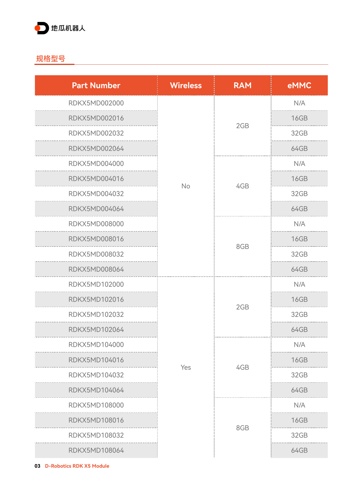
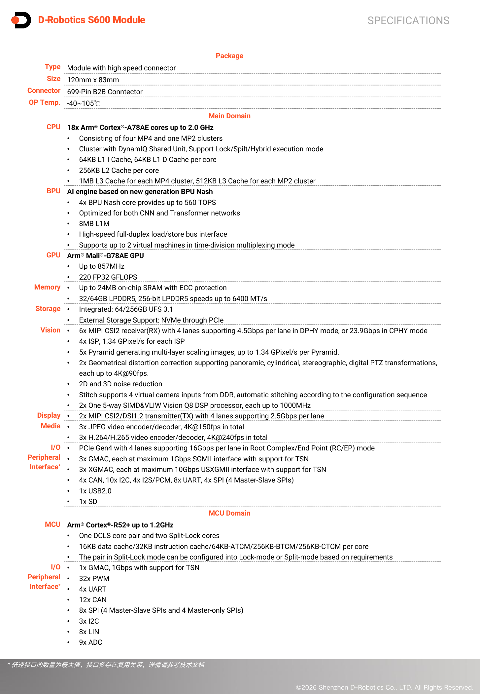
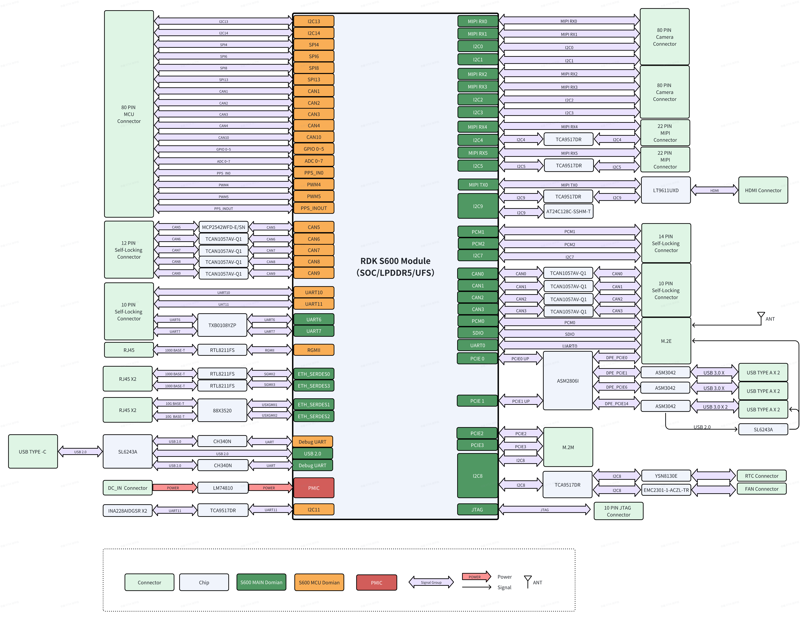
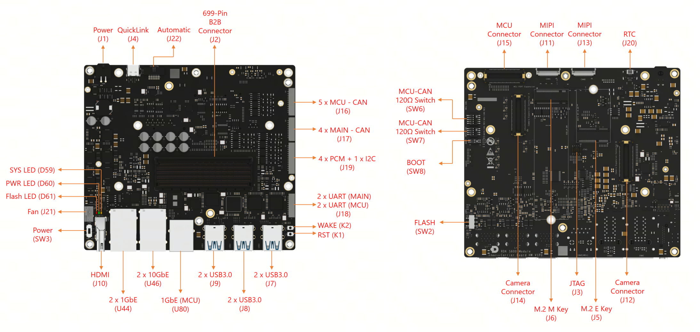
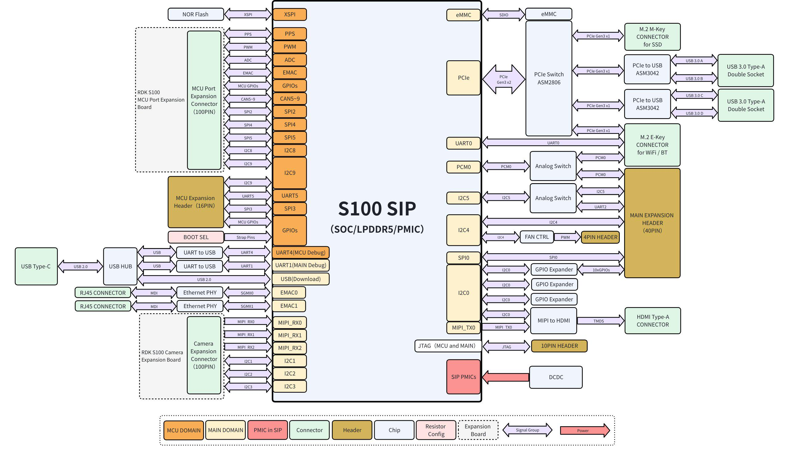
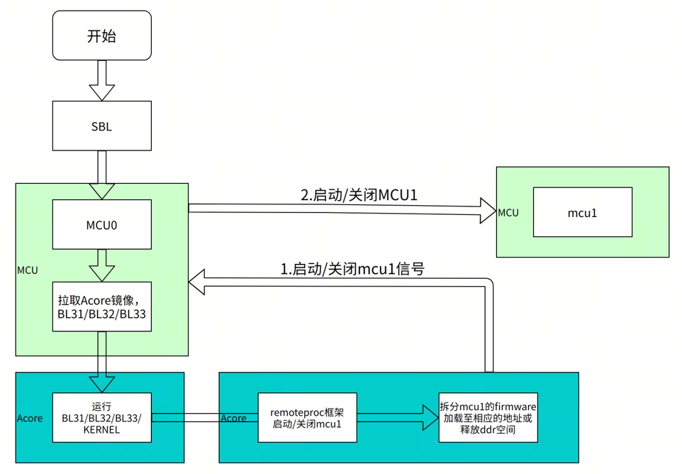
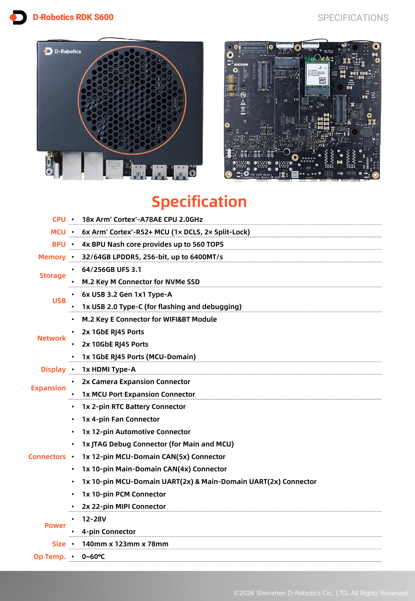

# 01 Horizon：硬件平台、计算与接口边界

> 调研截止：2026-11-05（Asia/Shanghai）。本章为待审阅样章；完成资料核验不代表用户已批准。范围为地平线相关机器人计算路线，以地瓜机器人当前 S600、S100、X5/RDK 为重点，必要旧代及征程机器人项目作为边界对照。本次为公开文献与原件核验，未进行开发板或机器人实机测试。

## 1. 结论与产品主体

Horizon 的具身硬件路线不能只写成“征程芯片加开发板”。公开产品已形成从 X5 入门计算、S100 中高算力到 S600 高带宽异构计算的梯度；量产设计还需区分 SoC、集成内存的模组、载板、开发者套件和相机/MCU 扩展板。当前样章应以 S600 为主：地平线 2026-09-18 公告明确，地瓜由地平线孵化，是重要战略合作伙伴，底层计算架构同源；S600 于 2025 年 11 月推出。由此可以确认技术与组织渊源，但不能把两家公司的交付责任、所有产品认证及车端出货量自动合并。〔1：[官方原文](https://www.horizon.auto/news/press/479) / [本地原件](REFERENCES.md#ref-8d8fe856b3583fc1)〕

S600 的关键增量是 18 个 A78AE CPU 核、4 个 Nash BPU、256-bit LPDDR5 和独立 MCU 域，以及开发套件落地的双万兆以太网和多路 CAN。其价值机制是给感知前处理、多模型推理、状态估计和运动控制提供不同执行资源，同时减轻 DDR 与外设通道瓶颈。560 TOPS INT8 是厂商算术峰值口径，现有公开简表没有给 dense/sparse 条件，也没有给目标 VLA 的端到端时延；因此不能由 TOPS 推出任务成功率、策略频率或能效排名。〔2：[官方原文](https://archive.d-robotics.cc/downloads/hardware/rdk_s600/rdk_s600/brief/drobotics_rdk_s600_module_brief_v1p0_zh.pdf) / [本地原件](REFERENCES.md#ref-9a0f74cb6cdbc9d5)〕

本章对规格采用“带硬件版本的手册与规格书优先、产品页交叉校验”的规则。S600 当前网页界面为 5.1.1，硬件主板及扩展板说明对应 V1P0，页面注明 2026-11-04 更新；软件发布索引列出 5.1.1 于 2026-10-23 发布。带 `v=5.1.0` 的入口实际显示 5.1.1，不能凭 URL query 把正文冻结为 5.1.0。S100 规格书封面为 v1.2、2025-10，资源表上传日 2026-02-10 是另一时间字段；X5 Module v1.2.0 为 2025-12。全文引用各自版本，不把采集日当发布日。〔3：[官方原文](https://developer.d-robotics.cc/rdk_s_doc/01_Quick_start/01_hardware_introduction/02_rdk_s600/01_rdk_s600_kit) / [本地原件](REFERENCES.md#ref-d4df277ff0138d75)〕 〔4：[官方原文](https://developer.d-robotics.cc/rdk_s_doc/Release_Note/s600_ReleaseNote) / [本地原件](REFERENCES.md#ref-4f56ef3d5e495526)〕 〔5：[官方原文](https://archive.d-robotics.cc/downloads/hardware/rdk_s100/rdk_s100/d_robotics_rdk_s100_board_zh_v1_2.pdf) / [本地原件](REFERENCES.md#ref-0be33395489849c0)〕 〔6：[官方原文](https://archive.d-robotics.cc/downloads/hardware/rdk_x5_module/drobotics_rdk_x5_module_zh_v1_2.pdf) / [本地原件](REFERENCES.md#ref-38f27c6106694de6)〕

## 2. 芯片、模组与套件：规格和 SKU

| 产品与层级 | 准确配置/订货标识 | CPU | BPU 与口径 | GPU/专用资源 | RAM 与集成存储 |
|---|---|---|---|---|---|
| S600 Module，需载板 | MS6X032064I / MS6X064256I | 18×A78AE，最高 2.0GHz | 4×Nash，560 TOPS INT8；稀疏条件未明 | Mali-G78AE，220 GFLOPS FP32；2×Vision Q8 DSP | 32/64GB LPDDR5，256-bit、6400MT/s；64/256GB UFS 3.1 |
| RDK S600 开发套件 V1P0 | KS6X032064C / KS6X064256C | 同模组 | 同模组 | 同模组；配载板/散热组件 | 32GB+64GB / 64GB+256GB；NVMe 可扩展 |
| RDK S100E / S100P 套件 | KS1E55Y / KS1P75Y | 6×A78AE，1.5 / 2.0GHz | 80 / 128 TOPS，当前页脚注为等效 INT8；稀疏未明 | Mali-G78AE，100 GFLOPS，精度未明；4×R52+ | 12 / 24GB LPDDR5，96-bit；64GB eMMC 5.1 |
| RDK X5 一体开发板 | RDK X5 4G / 8G | Sunrise 5，8×A55，1.5GHz | Bayes，10 TOPS INT8；稀疏未明 | GPU 32 GFLOPS，精度未明；HiFi 5 DSP | 4/8GB LPDDR4；1Gbit NAND、microSD |
| RDK X5 Module | 见下文 24 SKU 编码 | 8×A55，1.5GHz | 10 TOPS INT8 | GPU、HiFi 5 DSP | 2/4/8GB LPDDR4；0/16/32/64GB eMMC；无线可选 |
| RDK X3 / X3 Module，旧代 | X3 2G/4G；Module 以规格书订货表为准 | 4×A53，1.5GHz | 等效 5 TOPS，精度与稀疏未明确 | 本次未取得可比 GPU 指标 | 2/4GB LPDDR4；Module 有 16/32/64GB eMMC 选项 |
| RDK Ultra / Ultra Module，旧高算力路线 | 文档产品名；本次未取得完整现行订货代码 | 8×A55，1.2GHz | 等效 96 TOPS，精度与稀疏未明确 | 不能沿用 S600 GPU/MCU 规格 | 8GB LPDDR4，3200MT/s；64GB eMMC |

表中 S600 模组与套件 SKU 来自两份 V1P0 简表；S100 以 v1.2 规格书配置为准，INT8 补充来自当前产品页。X5 的 **1Gbit NAND 不是 1GB**，也不是其 Module 的 eMMC 配置。Ultra 的 96 TOPS 与 X3 的 5 TOPS 缺精度条件，不应放进统一 INT8 dense 性能排序。未从所用公开原件取得机器人产品制程、晶圆节点及封装完整热参数，本文不沿用车规同代芯片的传闻制程。〔7：[官方原文](https://archive.d-robotics.cc/downloads/hardware/rdk_s600/rdk_s600/brief/drobotics_rdk_s600_brief_v1p0_zh.pdf) / [本地原件](REFERENCES.md#ref-ecb538e7f540bc90)〕 〔8：[官方原文](https://cn.d-robotics.cc/rdkS100) / [本地原件](REFERENCES.md#ref-3467f20eef6f4d49)〕 〔9：[官方原文](https://archive.d-robotics.cc/downloads/hardware/rdk_x5/d_robotics_rdk_x5_zh_v1_1.pdf) / [本地原件](REFERENCES.md#ref-d8cc60d92b101ba9)〕 〔10：[官方原文](https://archive.d-robotics.cc/downloads/hardware/rdk_x3/RDK%20X3.pdf) / [本地原件](REFERENCES.md#ref-6c1d7b9092cf50e0)〕 〔11：[官方原文](https://archive.d-robotics.cc/downloads/hardware/rdk_x3_module/RDK%20X3%20MD.pdf) / [本地原件](REFERENCES.md#ref-b49d2f9133a606ef)〕 〔12：[官方原文](https://archive.d-robotics.cc/downloads/hardware/rdk_ultra/RDK_Ultra_Product_Brief.pdf) / [本地原件](REFERENCES.md#ref-25791fa0ae188791)〕 〔13：[官方原文](https://archive.d-robotics.cc/downloads/hardware/rdk_ultra/RDK_Ultra_Module_Product_Brief.pdf) / [本地原件](REFERENCES.md#ref-2f20da7ed2b7b78b)〕

X5 Module 规格书实际列出 24 个 SKU，可按 `RDKX5MD + 无线位 + RAM三位 + eMMC三位` 识别：无线位 0/1，RAM 002/004/008，eMMC 000/016/032/064。例如 RDKX5MD008032 是无无线、8GB RAM、32GB eMMC；RDKX5MD108064 是带无线、8GB RAM、64GB eMMC。选择无 eMMC SKU 时必须重新确认可启动介质、烧录与恢复链路。X5 普通开发板是一体板，不能把它视作可拔下的 X5 SOM；Module 才是需要独立载板的路线。〔6：[官方原文](https://archive.d-robotics.cc/downloads/hardware/rdk_x5_module/drobotics_rdk_x5_module_zh_v1_2.pdf) / [本地原件](REFERENCES.md#ref-38f27c6106694de6)〕 〔14：[官方原文](https://raw.githubusercontent.com/D-Robotics/rdk_doc/main/docs/01_Quick_start/hardware_introduction/rdk_x5.md) / [本地原件](REFERENCES.md#ref-352f9ddc762b2744)〕

图中 SKU 明确区分 RAM、eMMC 与无线；它证明可选配置存在，不证明某一配置今日有库存，也不证明软件支持到相同年份。

S600 模组简表披露 CPU 为四个 MP4 加一个 MP2 cluster，18 个物理核心；每核 64KB 指令/数据 L1、256KB L2，每 MP4 1MB L3、MP2 512KB L3。BPU 有 8MB L1M，片上 SRAM 最大 24MB 并带 ECC 保护。缓存与 SRAM 可减少中间张量反复访问 DDR，但有效收益取决于算子切分、张量布局和工作集；“SRAM 有 ECC”不能扩展为全部 LPDDR5、总线和运行软件都有端到端纠错。简表还称 BPU 可时分复用最多两个虚拟机，这只是资源调度能力陈述，不能保证两项机器人任务互不干扰。〔2：[官方原文](https://archive.d-robotics.cc/downloads/hardware/rdk_s600/rdk_s600/brief/drobotics_rdk_s600_module_brief_v1p0_zh.pdf) / [本地原件](REFERENCES.md#ref-9a0f74cb6cdbc9d5)〕

这张原页同时保留 MCU 与低速接口的冲突文字，便于追溯：页首与套件手册均为 6 个 MCU 核，但此页 MCU 明细写“一对 DCLS 加两个 Split-Lock cores”，数量表达不完整。本文确认 6 核配置，不将其解释为 6 个完全独立的业务控制器。

## 3. 内存带宽、计算峰值与真实瓶颈

共享 DDR 是 CPU、BPU、视觉前处理、编码和网络 DMA 的共同资源。带宽拓宽能缓解多相机、多模型中间特征图与策略输入竞争，但 TOPS 和 RAM 容量不能替代工作集与访问模式分析。以下为**公式推导的接口理论上限**，采用十进制 GB/s，不是模型实测。

| 平台 | 已核验 DDR 条件 | 推导公式 | 理论上限 | 可用结论与限制 |
|---|---|---|---|---|
| S600 | 256-bit，6400MT/s LPDDR5 | 256÷8×6400÷1000 | 204.8GB/s | 与产品页一致；不能承诺所有执行域同时达到 |
| S100 | 96-bit，6400MT/s LPDDR5 | 96÷8×6400÷1000 | 76.8GB/s | 共享内存峰值；不能等同 BPU 吞吐 |
| X5 Module | 32-bit，最高 4266Mbps LPDDR4 | 32÷8×4266÷1000 | 17.064GB/s | 来源为设计指南；忽略刷新、协议与访问效率 |

X5 Module 设计指南 Rev1.1（2025-11）披露上述 32-bit/4266Mbps 配置；S600 和 S100 在容量升级之外还增加总线宽度。容量决定权重、缓存和多应用能否驻留，带宽影响搬运时间；二者不可混成“更大内存必然更快”。实际 VLA 可能先受未支持算子、CPU fallback、量化精度或自回归时延限制，只有目标模型完成编译和运行追踪后，才能判断 BPU 算力还是 DDR 先饱和。〔15：[官方原文](https://archive.d-robotics.cc/downloads/hardware/rdk_x5_module/RDK%20X5%20Module%20Hardware%20Design%20Guide%20V1P1.pdf) / [本地原件](REFERENCES.md#ref-7171f88e643a10bb)〕 〔2：[官方原文](https://archive.d-robotics.cc/downloads/hardware/rdk_s600/rdk_s600/brief/drobotics_rdk_s600_module_brief_v1p0_zh.pdf) / [本地原件](REFERENCES.md#ref-9a0f74cb6cdbc9d5)〕 〔5：[官方原文](https://archive.d-robotics.cc/downloads/hardware/rdk_s100/rdk_s100/d_robotics_rdk_s100_board_zh_v1_2.pdf) / [本地原件](REFERENCES.md#ref-0be33395489849c0)〕

官方 S100 DDR 测试提供可追溯 STREAM 样例：STREAM 5.10，gcc `-O3 -fopenmp`，NTIMES=100，10,000,000 个 8-byte 元素，三数组共 228.9MiB，6 线程；使用排除首轮后的最佳时间计算 MB/s。输出 Copy 47239.8、Scale 48721.4、Add 46592.6、Triad 46431.4 MB/s；Triad 平均 0.006107s、最小 0.005169s、最大 0.008374s。它支持“该条件下 CPU 流式访问达到约 46.4GB/s”这一有限结论，不能支持 P99、WCET 或 BPU 模型吞吐。原文后段另写 Triad 42987.3 MB/s，与输出不一致；本文保留冲突，采用可见测试输出作为样例值，不把它作为验收保证。〔16：[官方原文](https://raw.githubusercontent.com/D-Robotics/rdk_doc/main/docs_s/07_Advanced_development/02_linux_development/05_hardware_unit_test/08-ddr_bandwidth.md) / [本地原件](REFERENCES.md#ref-2e72387b4295cfe3)〕

S600 视觉路径不仅有 BPU。简表列 4×ISP、每个最高 1.34GPixel/s，5×Pyramid、2×GDC，以及 2×Vision Q8 DSP；3 个 H.264/H.265 单元合计 4K@240fps，JPEG 合计 4K@150fps。硬件缩放、畸变校正和拼接可减少 CPU 前处理工作，但 ISP、编码和 BPU 的上限不能直接相加成一条完整相机链路吞吐。营销页“24 路相机”或“4K@480”也不能替代物理接线与同场景并发测试；应逐层核算 CSI lane、虚拟通道、ISP、DDR、存储和推理。〔2：[官方原文](https://archive.d-robotics.cc/downloads/hardware/rdk_s600/rdk_s600/brief/drobotics_rdk_s600_module_brief_v1p0_zh.pdf) / [本地原件](REFERENCES.md#ref-9a0f74cb6cdbc9d5)〕 〔17：[官方原文](https://cn.d-robotics.cc/rdkS600) / [本地原件](REFERENCES.md#ref-5aaffe83d6e42b57)〕

## 4. 从 SoC 信号到开发套件物理接口

S600 Module 提供 699-pin B2B 信号接口；机器人主板必须额外承担电源、PHY、USB/PCIe 桥、连接器、时钟和保护设计。SoC 规格中的三路 1Gb GMAC 加三路 10Gb XGMAC 是 MAC 信号能力，不能写成套件有六个主域 RJ45。实际 V1P0 套件是主域 2×1GbE、2×10GbE，加 MCU 域 1×1GbE。TSN 支持也需要 PHY、驱动、时间同步与调度共同成立，不等于所有端口已验证确定性时延。〔17：[官方原文](https://cn.d-robotics.cc/rdkS600) / [本地原件](REFERENCES.md#ref-5aaffe83d6e42b57)〕 〔3：[官方原文](https://developer.d-robotics.cc/rdk_s_doc/01_Quick_start/01_hardware_introduction/02_rdk_s600/01_rdk_s600_kit) / [本地原件](REFERENCES.md#ref-d4df277ff0138d75)〕

| 路径 | S600 V1P0 套件实际落地 | S100 / X5 对照 | 工程边界 |
|---|---|---|---|
| PCIe 与存储 | Key M Gen4×2 NVMe；Key E Gen3×1 | S100 SSD/USB/WiFi 共享 Gen3×2 上游；X5 需区分一体板和 Module 载板 | 插槽存在不证明任意 endpoint、容量或实时性 |
| USB | 6×USB3.2 Gen1×1 Type-A，每口5V/1A；Type-C 是 USB2 Device 烧录/调试 | S100 4个USB高速口由PCIe控制器扩展 | 多口并发受上游、控制器及供电共同限制 |
| 网络 | 2×1Gb主域+2×10Gb主域+1×1Gb MCU域 RJ45 | S100基础板2×1Gb；其MCU扩展板另有网口 | 分清不同执行域和可访问软件接口 |
| 相机 | 2×22-pin MIPI；2×80-pin扩展，每个承载2个接收接口 | S100扩展板4GMSL+2MIPI | GMSL需要外部解串器、匹配模组和线缆 |
| CAN/UART | J16有5路MCU CAN，J17有4路主域CAN；J18有2Main+2MCU UART | X5 Module载板TCAN4550为SPI到CAN路线 | 原生控制器、收发器、连接器、隔离分别核验 |
| 显示/音频 | MIPI TX经LT9611UXD桥至HDMI；J19 PCM/I2C | S100 HDMI版本资料冲突；X5载板ES8326音频 | 桥接能力不等同SoC原生HDMI或音频codec |

表格事实来自 S600 V1P0 接口章节与官方拓扑、S100 拓扑及 X5 官方硬件原文。S600 BOOT SW8 已给出 UFS/NVMe 配置；S100 较旧说明曾限制当前仅 eMMC 启动，不能将该软件状态套用于 S600。〔3：[官方原文](https://developer.d-robotics.cc/rdk_s_doc/01_Quick_start/01_hardware_introduction/02_rdk_s600/01_rdk_s600_kit) / [本地原件](REFERENCES.md#ref-d4df277ff0138d75)〕 〔18：[官方原文](https://rdk-doc.oss-cn-beijing.aliyuncs.com/doc/img/01_Quick_start/image/hardware_interface/image-rdk_s100_architecture_diagram.png) / [本地原件](REFERENCES.md#ref-f3a9074b0c428e82)〕 〔19：[官方原文](https://raw.githubusercontent.com/D-Robotics/rdk_doc/main/docs_s/01_Quick_start/01_hardware_introduction/01_rdk_s100.md) / [本地原件](REFERENCES.md#ref-bbf00e131fb43c5c)〕 〔14：[官方原文](https://raw.githubusercontent.com/D-Robotics/rdk_doc/main/docs/01_Quick_start/hardware_introduction/rdk_x5.md) / [本地原件](REFERENCES.md#ref-352f9ddc762b2744)〕

拓扑中的 PCIe0/1 通向 ASM2806I，再接 Key E 和三组 ASM3042；PCIe2/3 通向 Key M。因此六个 USB 端口不是六条独立 SoC USB3 控制器通道；应同时压测 WiFi、USB 相机和 SSD。图中还明确 CAN 的外部收发器、HDMI 桥和以太网 PHY，支持分清“集成了控制器”与“已经有物理接口”。该图没有给 PCIe switch 每个端口最终协商宽度，不能仅凭连线补出整个系统可用总吞吐。图中少数器件/信号文字也需与原理图核对，不宜直接作制造依据。

接口图用于确定 J11/J13、J12/J14、J15、J16/J17、Key M/E 和网口所在位置。图上的个别标签与接口正文不一致，例如 J19 的通道文字；本文以位号、详细引脚表和连接器型号交叉确认，不以照片标签单独定义 pinmux。

S100 的 ASM2806 上游是 Gen3×2，SSD、WiFi 和两个 USB 扩展控制器共享。机器人边录视频边推理时，即使各外设标称速率足够，共享上游也可能放大观测年龄。SSD 标称带宽、USB 单口速率和总线仲裁不能相加成整板保证。这是从官方连接结构推导出的压力测试重点，而非已测到丢帧。

引脚设计需要落实电压域。S600 Connector Application Note V1P0-20260922 中，`J1 POWER Connector` 的 B3/B4 是 DCIN、D3/D4 为 12–28V；`J21 FAN` 的 D3 为12V供电，D5/D6 是3.3V转速反馈/PWM；`J3 JTAG` 的 D3 为3.3V参考，I3 的 TMS 是1.8V。不能因外部接头参考电压为3.3V而把整组调试信号接成3.3V。表中 J22 部分描述还遗留“S100”字样，应以实物 V1P0 与 FAE 确认关键启动/电源网络。699-pin 模组完整设计细节在手册中要求联系 FAE，公开载板接头表不能替代完整 SOM 引脚设计包。〔20：[官方原文](https://archive.d-robotics.cc/downloads/hardware/rdk_s600/rdk_s600/D-Robotics_RDK_S600_Connector_Application_Note_V1P0-20260922.xlsx) / [本地原件](REFERENCES.md#ref-833a66190549586a)〕 〔3：[官方原文](https://developer.d-robotics.cc/rdk_s_doc/01_Quick_start/01_hardware_introduction/02_rdk_s600/01_rdk_s600_kit) / [本地原件](REFERENCES.md#ref-d4df277ff0138d75)〕

X5 Module 设计指南另要求 GPIO VREF pin78 接1.8V或3.3V且不能浮空，外围上电时序应避免倒灌。指南第9页为“三个连接器、260pins”，旧官方硬件 Markdown 写300pins；未经确认的引脚总数不可直接用于 PCB。该公共下载 PDF 带 Confidential/Proprietary 标记，公开可取得不等于开放硬件授权。〔15：[官方原文](https://archive.d-robotics.cc/downloads/hardware/rdk_x5_module/RDK%20X5%20Module%20Hardware%20Design%20Guide%20V1P1.pdf) / [本地原件](REFERENCES.md#ref-7171f88e643a10bb)〕 〔14：[官方原文](https://raw.githubusercontent.com/D-Robotics/rdk_doc/main/docs/01_Quick_start/hardware_introduction/rdk_x5.md) / [本地原件](REFERENCES.md#ref-352f9ddc762b2744)〕

## 5. 扩展板、控制域与安全边界

S600 相机扩展板 ES6XCAMXC 的 Rev1.0（2026-05）简表为 2×MAX96712、2×FAKRA-mini 4-in-1、共8路GMSL，尺寸60×49×17mm、工作温度0–65℃。当前 V1P0 手册明确只适配 S600；不能接到 S100，因为名称相似就推断兼容。8路是扩展板物理容量，不证明任意8款相机可同时满分辨率采集；serializer、链路速率、虚拟通道映射和已验证驱动仍需匹配。〔21：[官方原文](https://archive.d-robotics.cc/downloads/hardware/rdk_s600/rdk_s600_camera_expansion_board/drobotics_rdk_s600_camera_expansion_board_brief_v1p0_zh.pdf) / [本地原件](REFERENCES.md#ref-2dac5899bc721916)〕 〔22：[官方原文](https://developer.d-robotics.cc/rdk_s_doc/Quick_start/hardware_introduction/rdk_s600/rdk_s600_camera_expansion_board) / [本地原件](REFERENCES.md#ref-57531817dea53237)〕

S600 相机供电存在可影响集成的冲突：规格表称超过2.4A才需外部12V，详细说明及提示两处写超过2A必须外供；套件扩展接口也按12V/2A描述，单路相机最大550mA@12V。工程分析宜按较保守的2A阈值预留独立电源并向FAE确认，而不是按8×550mA直接从载板取电。外部电源最大4.8A仍不意味着8路全部满电流可无限持续：线缆压降、热环境、启动浪涌和供电切换都要纳入测试。〔22：[官方原文](https://developer.d-robotics.cc/rdk_s_doc/Quick_start/hardware_introduction/rdk_s600/rdk_s600_camera_expansion_board) / [本地原件](REFERENCES.md#ref-57531817dea53237)〕 〔3：[官方原文](https://developer.d-robotics.cc/rdk_s_doc/01_Quick_start/01_hardware_introduction/02_rdk_s600/01_rdk_s600_kit) / [本地原件](REFERENCES.md#ref-d4df277ff0138d75)〕

S600 MCU 扩展板 ES6XMCUXC 提供5路CAN FD（最高8Mbps）和BMI088 IMU，当前手册指向SPI13；30-pin有ADC/I2C/SPI等复用信号。2026-05简表写最多4ADC、尺寸70×50×12mm，而2026-11-04 V1P0网页写最多7ADC、70×70×17mm。本文以更新的版本化手册作为当前接口入口，保留简表差异；同为V1P0标签不能证明机械版本一致，结构设计和采购必须核对实物料号、机械图和pinlist。手册提示称“5个IO”却列6个上电上下拉限制引脚，也必须逐针核对。S600此板没有列S100扩展板的额外RJ45，不能跨代抄用。〔23：[官方原文](https://archive.d-robotics.cc/downloads/hardware/rdk_s600/rdk_s600_mcu_port_expansion_board/drobotics_rdk_s600_mcu_port_expansion_board_brief_v1p0_zh.pdf) / [本地原件](REFERENCES.md#ref-b5d9a88c8bd7eb33)〕 〔24：[官方原文](https://developer.d-robotics.cc/rdk_s_doc/Quick_start/hardware_introduction/rdk_s600/rdk_s600_mcu_port_expansion_board) / [本地原件](REFERENCES.md#ref-673eeb63bb69ca1c)〕 〔25：[官方原文](https://archive.d-robotics.cc/downloads/hardware/rdk_s100/rdk_s100_mcu_port_expansion_board/d_robotics_rdk_s100_mcu_port__expansion_board_zh_v1_1.pdf) / [本地原件](REFERENCES.md#ref-6a2dc864d74f31f1)〕

S100 的4个R52+运行说明披露了具体分工：MCU0负责启动与电源管理，默认验证二进制，其源码属于私有/商业范围；MCU1用于FreeRTOS业务开发。Linux remoteproc经MCU0装卸MCU1，停止时需先进入WFI再重新加载。该材料提供的是S100机制证据，不能据此断言S600六核使用相同启动链、开放相同源码或已有固定控制周期。S600简表确实写FreeRTOS开发环境、Lockstep/Split配置，但具体核分配、异常恢复及共享资源干扰仍待软件章深入。〔26：[官方原文](https://raw.githubusercontent.com/D-Robotics/rdk_doc/main/docs_s/07_Advanced_development/05_mcu_development/01_S100/01_basic_information.md) / [本地原件](REFERENCES.md#ref-2688055b3e80dade)〕 〔2：[官方原文](https://archive.d-robotics.cc/downloads/hardware/rdk_s600/rdk_s600/brief/drobotics_rdk_s600_module_brief_v1p0_zh.pdf) / [本地原件](REFERENCES.md#ref-9a0f74cb6cdbc9d5)〕

〔27：[官方原文](https://rdk-doc.oss-cn-beijing.aliyuncs.com/doc/img/07_Advanced_development/05_mcu_development/01_S100/basic_information/MCU_frame.png) / [本地原件](REFERENCES.md#ref-95d7f24bc0d01340)〕

图证明 S100 Linux→MCU0→MCU1 的加载关系，有助于理解“主域计算”和“控制域”之间的交接。它不证明 MCU 固件更新可在运动中安全执行，也不证明控制域可在主域故障时自动完成安全停机。

Lockstep 用冗余执行检测部分计算故障，Split 用独立执行增加可用计算资源，两种模式存在资源与诊断取舍；CPU核数也不等于可同时分配给业务的独立安全通道数。工业机器人要求安全停机、驱动失能和故障监测形成完整链条。现有材料不足以确认 S600 机器人平台取得 ISO 26262、SIL 或 PL 级系统认证，也不足以给出控制WCET；AE/R52+命名、TSN和ECC不能替代认证证书、安全手册与系统验证。

## 6. 供电、功耗、散热与机械温度

| 对象 | 供电/功耗证据 | 形态尺寸 | 温度原文 | 不能推出的结论 |
|---|---|---|---|---|
| S600 Module | 有独立上电、DVFS、Normal/DeepSleep/LightSleep描述；未取得定量功耗原表 | 120×83mm，699-pin B2B | OP Temp. -40–105℃ | 未给测点/降额条件，不能当整套件环境温度 |
| RDK S600 V1P0 | 输入12–28V；接口最大16A；配24V/8A适配器 | 140×123×78mm | 简表Op Temp. 0–60℃ | 192W是适配器额定输出，非芯片TDP/典型功耗 |
| S100E / P SIP场景 | 5V测量：Normal20/25W；DeepSleep0.2W、LightSleep1W | 套件规格书121×120×52.4mm | 套件0–45℃；功耗场景结温85℃ | SIP功耗非整板、非全部单元100%满载 |
| X5一体开发板 | 推荐5V/5A供电 | 85×56×20mm | -20–60℃ | 25W供电能力不等于实际负载 |
| X5 Module | 模组输入4.75–5.25V、最小3A设计要求；载板5V/5A | 55×40mm | 带无线-20–80℃，无无线最高85℃ | 芯片、无线和载板热限不同 |
| X3 / X3 Module | X3板推荐5V/3A | 板85×56×20mm；模组55×40mm | 板-20–60℃；模组带无线0–65℃、无无线最高70℃ | 不能沿用X5工业温度 |
| Ultra Module | 套件12V/5A输入口径 | 模组69.6×45mm | 模组-25–85℃ | 不证明整个开发套件具备同等热环境范围 |

表中的输入电流是电源设计条件；在缺负载曲线时不计算跨平台TOPS/W。S600模块-40–105℃与套件0–60℃应分别保留，扩展板0–65℃也不使套件上限提高。散热器、风扇、NVMe、无线模组及电源转换器都可能先达到热限，整机需在实际机壳、粉尘/进风、姿态和环境温度下验证。〔2：[官方原文](https://archive.d-robotics.cc/downloads/hardware/rdk_s600/rdk_s600/brief/drobotics_rdk_s600_module_brief_v1p0_zh.pdf) / [本地原件](REFERENCES.md#ref-9a0f74cb6cdbc9d5)〕 〔7：[官方原文](https://archive.d-robotics.cc/downloads/hardware/rdk_s600/rdk_s600/brief/drobotics_rdk_s600_brief_v1p0_zh.pdf) / [本地原件](REFERENCES.md#ref-ecb538e7f540bc90)〕 〔3：[官方原文](https://developer.d-robotics.cc/rdk_s_doc/01_Quick_start/01_hardware_introduction/02_rdk_s600/01_rdk_s600_kit) / [本地原件](REFERENCES.md#ref-d4df277ff0138d75)〕 〔28：[官方原文](https://archive.d-robotics.cc/downloads/hardware/rdk_s100/rdk_s100/S100_SIP_Typical_Scenario_Power_Consumption_V1P0_20251015.xlsx) / [本地原件](REFERENCES.md#ref-fbbb2f4f3e714687)〕 〔9：[官方原文](https://archive.d-robotics.cc/downloads/hardware/rdk_x5/d_robotics_rdk_x5_zh_v1_1.pdf) / [本地原件](REFERENCES.md#ref-d8cc60d92b101ba9)〕 〔6：[官方原文](https://archive.d-robotics.cc/downloads/hardware/rdk_x5_module/drobotics_rdk_x5_module_zh_v1_2.pdf) / [本地原件](REFERENCES.md#ref-38f27c6106694de6)〕 〔10：[官方原文](https://archive.d-robotics.cc/downloads/hardware/rdk_x3/RDK%20X3.pdf) / [本地原件](REFERENCES.md#ref-6c1d7b9092cf50e0)〕 〔11：[官方原文](https://archive.d-robotics.cc/downloads/hardware/rdk_x3_module/RDK%20X3%20MD.pdf) / [本地原件](REFERENCES.md#ref-b49d2f9133a606ef)〕 〔13：[官方原文](https://archive.d-robotics.cc/downloads/hardware/rdk_ultra/RDK_Ultra_Module_Product_Brief.pdf) / [本地原件](REFERENCES.md#ref-2f20da7ed2b7b78b)〕

S100功耗xlsx V1P0_20251015 的S100工作表给了可用条件：6个A78 CPU在E/P分别1.5/2GHz、80%负载；BPU1GHz、80%负载；DDR6400MHz栏、带宽100%；同时4路GMSL 1080p30加2路MIPI 1080p30，结温85℃，数值为Power@5V的Total SIP。Normal20/25W仅支持该组合场景，未给具体模型、board输入功率、持续时间和方差。DeepSleep为AON活跃，LightSleep为MCU活跃、DDR自刷新；唤醒时延和恢复首帧未在该表给出，不能据休眠功耗保证任务续航。〔28：[官方原文](https://archive.d-robotics.cc/downloads/hardware/rdk_s100/rdk_s100/S100_SIP_Typical_Scenario_Power_Consumption_V1P0_20251015.xlsx) / [本地原件](REFERENCES.md#ref-fbbb2f4f3e714687)〕

S600公开简表披露CPU/BPU支持DVFS、CPU/BPU/GPU可独立上电、Thermal Zone和休眠模式，说明存在功耗管理机制。官方资源页列出 `RDK_S600_Typical_Scenario_Power_Consumption_V1P0_20260428.pdf`、`RDK_S600_Module_Thermal_Design_Guide_V1P0_20260420.pdf`，以及Module Datasheet/Hardware Design Guide v1.0.2_20260923，但链接位置是FTP商业资料目录。本次只确认文件存在于官方清单，未取得正文；这属于访问/交付边界，不是“官方未披露功耗”。完成机器人电池和冷却预算前需要取得这些原件，并用指定SKU及并发负载复测。〔29：[官方原文](https://developer.d-robotics.cc/rdk_s_doc/Quick_start/download) / [本地原件](REFERENCES.md#ref-4a91716a854dddbe)〕

该页能直接核对两类网口、6个USB、12–28V输入、尺寸与0–60℃，没有给典型瓦数或TDP。它不能支持把适配器能力写成运行功耗。

## 7. 供货、价格、生命周期与相邻车端路线

| 产品路线 | 公开成熟度证据 | 生命周期/采购信息 | 当前可用判断 |
|---|---|---|---|
| S600 | 2025-11推出；当前V1P0套件手册、5.1.1发行与官方售卖渠道 | 手册链接32G/64G销售；未取得带金额的定时报价或长期供货承诺 | 可定位开发套件采购入口；批量交期、PCN/EOL、MOQ需询价 |
| S100 | E/P SKU、规格书、功耗表及扩展资料齐备 | 不把历史标价或单板价当量产SIP成本 | 可做目标模型与功耗验证；当前供货期仍需商务确认 |
| X5 Module | 完整24SKU，v1.2.0规格书 | 厂商计划至少生产到2031 | 是生产规划，不等于现货、价格锁定或BSP支持到2031 |
| X3 Module | 旧代配置与订货表 | 厂商计划至少生产到2030 | 老项目维护可评估，不据此承诺新模型长期升级 |
| Ultra | 旧版套件/Module规格原件 | 文档写至少生产到2028 | 属文档计划；未取得当前库存/EOL/软件支持承诺 |

上述生命周期来自各规格书，未取得更新PCN时保持原始计划措辞。S600官方手册授权的微雪32G页面列SKU34887，本次保存的静态正文价格位置为动态占位，未取得实际金额，故没有有效“2026-11-05、中国、人民币、含税、单台”的报价。应索取32/64G套件、量产模组、相机/MCU扩展、散热和电源分别报价，再注明数量、税、交期与售后；不能把“价格采集失败”写成“厂商不公开价格”。〔30：[官方原文](https://www.waveshare.net/shop/RDK-S600-32G.htm) / [本地原件](REFERENCES.md#ref-997e7dc8218b40e6)〕 〔3：[官方原文](https://developer.d-robotics.cc/rdk_s_doc/01_Quick_start/01_hardware_introduction/02_rdk_s600/01_rdk_s600_kit) / [本地原件](REFERENCES.md#ref-d4df277ff0138d75)〕 〔6：[官方原文](https://archive.d-robotics.cc/downloads/hardware/rdk_x5_module/drobotics_rdk_x5_module_zh_v1_2.pdf) / [本地原件](REFERENCES.md#ref-38f27c6106694de6)〕 〔11：[官方原文](https://archive.d-robotics.cc/downloads/hardware/rdk_x3_module/RDK%20X3%20MD.pdf) / [本地原件](REFERENCES.md#ref-b49d2f9133a606ef)〕 〔13：[官方原文](https://archive.d-robotics.cc/downloads/hardware/rdk_ultra/RDK_Ultra_Module_Product_Brief.pdf) / [本地原件](REFERENCES.md#ref-2f20da7ed2b7b78b)〕

地平线公告称地瓜已有20多家客户采用S600、多个项目量产出货，这是厂商对产品成熟度的陈述，未提供每款机器人在岗台数、运行小时和故障/成功率。本章不将该数量转写为机器人市场份额。征程6P是另一条相邻路线：官网560TOPS脚注明确采用1/2稀疏条件，不能用来补齐S600的稀疏口径。2026-09-11京东“独狼”第六代Plus采用征程6P的公告属于design-in；未来3–5年潜在百万规模是预期，不是已交付订单。它证明车端芯片可能进入特定机器人设计，不能替代RDK的通用可购买交付链。〔1：[官方原文](https://www.horizon.auto/news/press/479) / [本地原件](REFERENCES.md#ref-8d8fe856b3583fc1)〕 〔31：[官方原文](https://www.horizon.auto/solutions/horizon-journey/horizon-journey6) / [本地原件](REFERENCES.md#ref-1a47de2a7a2015b1)〕 〔32：[官方原文](https://www.horizon.auto/news/press/475) / [本地原件](REFERENCES.md#ref-3f232a4e286b7e21)〕

许可同样有层次：RDK文档仓库的Apache-2.0只证明该仓库许可；硬件PDF保留版权所有，X5设计指南带专有标记，S100 MCU0源码需商业获取。不能据文档开源断言芯片IP、runtime二进制、固件、原理图、BOM或第三方机器人SDK均可任意再分发。后续软件章将分别核验这些交付物，本章只确认公开资料与量产设计包之间的边界。〔33：[官方原文](https://raw.githubusercontent.com/D-Robotics/rdk_doc/main/LICENSE) / [本地原件](REFERENCES.md#ref-50e26f159fc3347a)〕 〔15：[官方原文](https://archive.d-robotics.cc/downloads/hardware/rdk_x5_module/RDK%20X5%20Module%20Hardware%20Design%20Guide%20V1P1.pdf) / [本地原件](REFERENCES.md#ref-7171f88e643a10bb)〕 〔26：[官方原文](https://raw.githubusercontent.com/D-Robotics/rdk_doc/main/docs_s/07_Advanced_development/05_mcu_development/01_S100/01_basic_information.md) / [本地原件](REFERENCES.md#ref-2688055b3e80dade)〕

## 8. 证据冲突与有条件选型

| 冲突对象 | 来源A | 来源B | 本章采用与待确认动作 |
|---|---|---|---|
| S600 DDR类型 | 芯片营销页LPDDR5x | Module/Kit简表和手册LPDDR5 | 对当前模组采用LPDDR5；量产以BOM/订货规格确认 |
| S600 CPU/架构图 | 营销简介“四核”；通用架构图64-bit DDR、MP4+MP2 | 详细表及简表18核、4BPU、256-bit | 采用详细表；不使用通用图作为S600架构证据 |
| S600 MCU明细/低速接口 | Module简表MCU明细及12CAN/8SPI/3I2C等 | 产品页6核与14CANFD/10SPI/5I2C等 | 6核成立；低速总数及复用不保证全部同时可用，需完整设计包 |
| S600 J19 | Kit简表/汇总表10-pin PCM | 详细说明、拓扑和14HF连接器为14-pin | 设计以14-pin候选核对pinlist，订货前确认 |
| S600 MCU扩展 | 2026-05简表4ADC、70×50×12mm | 2026-11-04 V1P0网页7ADC、70×70×17mm | 当前接口用更新手册，机械及ADC必须实物确认 |
| S600相机外供 | 规格表阈值2.4A | 详细说明2A，载板扩展12V2A | 按2A保守预留；确认最终设计规范 |
| S100 HDMI/外形 | 当前页HDMI1.4、120×121×51mm | v1.2书HDMI2.1、121×120×52.4mm | 不无条件声明HDMI版本能力；可见输出2560×1440@60Hz与外壳配置分开 |
| X5 Module引脚 | 旧官方Markdown300pins | Rev1.1设计指南260pins | 不直接制板，取得同版本pinmap/连接器图 |

此表来源已在对应章节提供原URL和原件；额外S600芯片页归档用于检视营销文字，不能补出未公开精度、完整电源规格和安全等级。〔34：[官方原文](https://cn.d-robotics.cc/S600) / [本地原件](REFERENCES.md#ref-ded5577c7a3f58b4)〕

选型首先由目标机器人负载而非平台数字大小驱动。低路数视觉、轻量导航和边缘网关可用X5验证，但其A55、DDR和外设资源对多模型并发的余量有限；模型必须满足Bayes工具链、内存驻留与响应时间。S100适合需要A78主域及独立MCU的中等负载原型，功耗表有明确场景，仍要测实际输入功率和相机/SSD并发。S600适合多相机、多模态与较大工作集，双万兆和更宽DDR有合理机制优势；只有目标模型可编译、量化误差可接受、热与功率预算通过时，这些资源才能转成任务收益。旧Ultra不能因96TOPS高于X5就自动优先，其CPU、内存、工具链与供货计划均属另一代。

与GPU端侧方案对照时，S600的机制重点是BPU及专用视觉单元承接适配好的计算图，CPU/MCU分担通用与控制任务；GPU平台则应核对自身算子生态、精度、内存与功率模式。没有同模型、同输入、同统计量、同功率边界的测试，本章不给与NVIDIA或其他厂商的加速/能效排名。Ultra“接口兼容Jetson Orin”只能作为硬件接口宣称，不能推断drop-in、BSP、CUDA或模型产物兼容。〔12：[官方原文](https://archive.d-robotics.cc/downloads/hardware/rdk_ultra/RDK_Ultra_Product_Brief.pdf) / [本地原件](REFERENCES.md#ref-25791fa0ae188791)〕 〔13：[官方原文](https://archive.d-robotics.cc/downloads/hardware/rdk_ultra/RDK_Ultra_Module_Product_Brief.pdf) / [本地原件](REFERENCES.md#ref-2f20da7ed2b7b78b)〕

量产前建议完成四项可复建验收：第一，冻结SOM/载板/扩展板料号、PCB版本、BSP及编译器版本，逐针核对电源域和复用；第二，以实际相机分辨率、帧率、曝光、模型batch和量化方式压测采集→前处理→推理→控制输出，记录观测年龄、P50/P99、丢帧与超时；第三，在SSD持续记录、USB/WiFi/以太网负载、MCU通信并发时测功率、结温、降频及恢复；第四，验证掉电、主域卡死、相机断链、MCU固件异常和总线错误时的停机与恢复行为。验收阈值需由机器人控制/安全需求给出，不能以厂商demo平均时延替代。

## 9. 资料归档与完成边界

原件、HTML可见正文、CSS/图片/字体等识别出的依赖、SHA256及采集时间统一进入本项目唯一registry。旧Nov3官方Markdown快照按原哈希迁移并复用，新增官方页面和简表于Nov5采集；网络恢复后使用用户提供的代理，经研究根统一下载器归档。工具部署时发现既有下载器与Skill快照不同，已检查其挑战页识别和资源处理差异后保留现有版本，未覆盖项目工具。

本章内7张官方图均实际打开核验；S600使用V1P0真实载板拓扑和PDF原页，排除营销页中与18CPU/256-bit不一致的通用架构图，也未使用失败的HTML表格截图。结构与哈希检查不能证明实机性能。归档静态完整度与缺失依赖记录见下方QA入口；可见正文取得不等于动态报价、视频、交互或像素级离线复现。

关键缺口为S600完整功耗/热设计与699-pin设计包、dense/sparse算力条件、目标模型端到端实测、确定性控制与系统安全证据、有效金额报价及长期供货/PCN承诺。公开文件间冲突已逐项保留，不以默认值填空。第01章完成后等待用户审阅，02—09没有在本轮续写。

本章使用 34 项归档来源。部分静态归档：Horizon_DRobotics_Funding_Relation（呈现依赖缺失23，全部依赖缺失25）；Horizon_Journey6_Official（呈现依赖缺失109，全部依赖缺失111）；Horizon_JD_Journey6P_DesignIn（呈现依赖缺失25，全部依赖缺失27）。这些来源可见正文已保存；缺失依赖的URL及原因留在metadata，未声称动态功能完整。

[资料索引](REFERENCES.md) · [证据与人工核验](research_state/evidence/01_Hardware_Platform.json) · [结构检查](research_state/qa/01_Hardware_Platform_check.json) · [最终去重运行](research_state/qa/01_Hardware_Platform_last_run.json)

### 引用原件联合清单

以下清单是正文实际使用来源的联合集合；每项保留原URL和本地原件，发布时间/版本见正文或原件，采集/归档细节见registry与证据JSON。

1. **Horizon_DRobotics_Funding_Relation** — [原URL](https://www.horizon.auto/news/press/479) · [归档原件](REFERENCES.md#ref-8d8fe856b3583fc1)；采集 2026-11-05T01:24:52.069141+00:00；partial_static。

2. **Horizon_S600_Module_Brief** — [原URL](https://archive.d-robotics.cc/downloads/hardware/rdk_s600/rdk_s600/brief/drobotics_rdk_s600_module_brief_v1p0_zh.pdf) · [归档原件](REFERENCES.md#ref-9a0f74cb6cdbc9d5)；采集 2026-11-05T01:37:34.257374+00:00；complete_static。

3. **Horizon_S600_Kit_Manual** — [原URL](https://developer.d-robotics.cc/rdk_s_doc/01_Quick_start/01_hardware_introduction/02_rdk_s600/01_rdk_s600_kit) · [归档原件](REFERENCES.md#ref-d4df277ff0138d75)；采集 2026-11-05T01:30:43.136257+00:00；complete_static。

4. **Horizon_S600_Release** — [原URL](https://developer.d-robotics.cc/rdk_s_doc/Release_Note/s600_ReleaseNote) · [归档原件](REFERENCES.md#ref-4f56ef3d5e495526)；采集 2026-11-05T01:30:49.304152+00:00；complete_static。

5. **Horizon_01_Datasheet_9** — [原URL](https://archive.d-robotics.cc/downloads/hardware/rdk_s100/rdk_s100/d_robotics_rdk_s100_board_zh_v1_2.pdf) · [归档原件](REFERENCES.md#ref-0be33395489849c0)；采集 2026-11-05T01:20:20.023980+00:00；complete_static。

6. **Horizon_01_Datasheet_2** — [原URL](https://archive.d-robotics.cc/downloads/hardware/rdk_x5_module/drobotics_rdk_x5_module_zh_v1_2.pdf) · [归档原件](REFERENCES.md#ref-38f27c6106694de6)；采集 2026-11-05T01:19:55.469517+00:00；complete_static。

7. **Horizon_S600_Kit_Brief** — [原URL](https://archive.d-robotics.cc/downloads/hardware/rdk_s600/rdk_s600/brief/drobotics_rdk_s600_brief_v1p0_zh.pdf) · [归档原件](REFERENCES.md#ref-ecb538e7f540bc90)；采集 2026-11-05T01:37:36.329763+00:00；complete_static。

8. **Horizon_RDK_S100_Product** — [原URL](https://cn.d-robotics.cc/rdkS100) · [归档原件](REFERENCES.md#ref-3467f20eef6f4d49)；采集 2026-11-05T01:28:26.346376+00:00；complete_static。

9. **Horizon_01_Datasheet_1** — [原URL](https://archive.d-robotics.cc/downloads/hardware/rdk_x5/d_robotics_rdk_x5_zh_v1_1.pdf) · [归档原件](REFERENCES.md#ref-d8cc60d92b101ba9)；采集 2026-11-05T01:19:51.432172+00:00；complete_static。

10. **Horizon_01_Datasheet_3** — [原URL](https://archive.d-robotics.cc/downloads/hardware/rdk_x3/RDK%20X3.pdf) · [归档原件](REFERENCES.md#ref-6c1d7b9092cf50e0)；采集 2026-11-05T01:19:58.164891+00:00；complete_static。

11. **Horizon_01_Datasheet_4** — [原URL](https://archive.d-robotics.cc/downloads/hardware/rdk_x3_module/RDK%20X3%20MD.pdf) · [归档原件](REFERENCES.md#ref-b49d2f9133a606ef)；采集 2026-11-05T01:20:04.807972+00:00；complete_static。

12. **Horizon_01_Datasheet_5** — [原URL](https://archive.d-robotics.cc/downloads/hardware/rdk_ultra/RDK_Ultra_Product_Brief.pdf) · [归档原件](REFERENCES.md#ref-25791fa0ae188791)；采集 2026-11-05T01:20:08.540640+00:00；complete_static。

13. **Horizon_01_Datasheet_6** — [原URL](https://archive.d-robotics.cc/downloads/hardware/rdk_ultra/RDK_Ultra_Module_Product_Brief.pdf) · [归档原件](REFERENCES.md#ref-2f20da7ed2b7b78b)；采集 2026-11-05T01:20:10.770472+00:00；complete_static。

14. **horizon-x5-doc** — [原URL](https://raw.githubusercontent.com/D-Robotics/rdk_doc/main/docs/01_Quick_start/hardware_introduction/rdk_x5.md) · [归档原件](REFERENCES.md#ref-352f9ddc762b2744)；采集 2026-11-03T04:21:18.831335+00:00；complete_static。

15. **Horizon_X5_Design_Guide** — [原URL](https://archive.d-robotics.cc/downloads/hardware/rdk_x5_module/RDK%20X5%20Module%20Hardware%20Design%20Guide%20V1P1.pdf) · [归档原件](REFERENCES.md#ref-7171f88e643a10bb)；采集 2026-11-05T01:23:09.521087+00:00；complete_static。

16. **Horizon_01_Pending_Doc_12** — [原URL](https://raw.githubusercontent.com/D-Robotics/rdk_doc/main/docs_s/07_Advanced_development/02_linux_development/05_hardware_unit_test/08-ddr_bandwidth.md) · [归档原件](REFERENCES.md#ref-2e72387b4295cfe3)；采集 2026-11-05T01:18:33.942269+00:00；complete_static。

17. **Horizon_RDK_S600** — [原URL](https://cn.d-robotics.cc/rdkS600) · [归档原件](REFERENCES.md#ref-5aaffe83d6e42b57)；采集 2026-11-05T01:28:18.275356+00:00；complete_static。

18. **Horizon_S100_Architecture** — [原URL](https://rdk-doc.oss-cn-beijing.aliyuncs.com/doc/img/01_Quick_start/image/hardware_interface/image-rdk_s100_architecture_diagram.png) · [归档原件](REFERENCES.md#ref-f3a9074b0c428e82)；采集 2026-11-05T01:18:45.928406+00:00；complete_static。

19. **horizon-s100-doc** — [原URL](https://raw.githubusercontent.com/D-Robotics/rdk_doc/main/docs_s/01_Quick_start/01_hardware_introduction/01_rdk_s100.md) · [归档原件](REFERENCES.md#ref-bbf00e131fb43c5c)；采集 2026-11-03T04:21:18.830711+00:00；complete_static。

20. **Horizon_S600_Pinlist** — [原URL](https://archive.d-robotics.cc/downloads/hardware/rdk_s600/rdk_s600/D-Robotics_RDK_S600_Connector_Application_Note_V1P0-20260922.xlsx) · [归档原件](REFERENCES.md#ref-833a66190549586a)；采集 2026-11-05T01:33:31.358654+00:00；complete_static。

21. **Horizon_S600_Camera_Brief** — [原URL](https://archive.d-robotics.cc/downloads/hardware/rdk_s600/rdk_s600_camera_expansion_board/drobotics_rdk_s600_camera_expansion_board_brief_v1p0_zh.pdf) · [归档原件](REFERENCES.md#ref-2dac5899bc721916)；采集 2026-11-05T01:37:38.939563+00:00；complete_static。

22. **Horizon_S600_Camera_Manual** — [原URL](https://developer.d-robotics.cc/rdk_s_doc/Quick_start/hardware_introduction/rdk_s600/rdk_s600_camera_expansion_board) · [归档原件](REFERENCES.md#ref-57531817dea53237)；采集 2026-11-05T01:33:16.456813+00:00；complete_static。

23. **Horizon_S600_MCU_Brief** — [原URL](https://archive.d-robotics.cc/downloads/hardware/rdk_s600/rdk_s600_mcu_port_expansion_board/drobotics_rdk_s600_mcu_port_expansion_board_brief_v1p0_zh.pdf) · [归档原件](REFERENCES.md#ref-b5d9a88c8bd7eb33)；采集 2026-11-05T01:37:41.444652+00:00；complete_static。

24. **Horizon_S600_MCU_Manual** — [原URL](https://developer.d-robotics.cc/rdk_s_doc/Quick_start/hardware_introduction/rdk_s600/rdk_s600_mcu_port_expansion_board) · [归档原件](REFERENCES.md#ref-673eeb63bb69ca1c)；采集 2026-11-05T01:33:21.832264+00:00；complete_static。

25. **Horizon_01_Datasheet_11** — [原URL](https://archive.d-robotics.cc/downloads/hardware/rdk_s100/rdk_s100_mcu_port_expansion_board/d_robotics_rdk_s100_mcu_port__expansion_board_zh_v1_1.pdf) · [归档原件](REFERENCES.md#ref-6a2dc864d74f31f1)；采集 2026-11-05T01:20:27.297073+00:00；complete_static。

26. **Horizon_01_Pending_Doc_13** — [原URL](https://raw.githubusercontent.com/D-Robotics/rdk_doc/main/docs_s/07_Advanced_development/05_mcu_development/01_S100/01_basic_information.md) · [归档原件](REFERENCES.md#ref-2688055b3e80dade)；采集 2026-11-05T01:18:34.920944+00:00；complete_static。

27. **Horizon_MCU_Framework** — [原URL](https://rdk-doc.oss-cn-beijing.aliyuncs.com/doc/img/07_Advanced_development/05_mcu_development/01_S100/basic_information/MCU_frame.png) · [归档原件](REFERENCES.md#ref-95d7f24bc0d01340)；采集 2026-11-05T01:23:06.597596+00:00；complete_static。

28. **Horizon_S100_Power_XLSX** — [原URL](https://archive.d-robotics.cc/downloads/hardware/rdk_s100/rdk_s100/S100_SIP_Typical_Scenario_Power_Consumption_V1P0_20251015.xlsx) · [归档原件](REFERENCES.md#ref-fbbb2f4f3e714687)；采集 2026-11-05T01:18:39.779347+00:00；complete_static。

29. **Horizon_S600_Downloads** — [原URL](https://developer.d-robotics.cc/rdk_s_doc/Quick_start/download) · [归档原件](REFERENCES.md#ref-4a91716a854dddbe)；采集 2026-11-05T01:33:26.415591+00:00；complete_static。

30. **Horizon_S600_Waveshare_Quote** — [原URL](https://www.waveshare.net/shop/RDK-S600-32G.htm) · [归档原件](REFERENCES.md#ref-997e7dc8218b40e6)；采集 2026-11-05T01:33:34.443407+00:00；complete_static。

31. **Horizon_Journey6_Official** — [原URL](https://www.horizon.auto/solutions/horizon-journey/horizon-journey6) · [归档原件](REFERENCES.md#ref-1a47de2a7a2015b1)；采集 2026-11-05T01:24:37.965795+00:00；partial_static。

32. **Horizon_JD_Journey6P_DesignIn** — [原URL](https://www.horizon.auto/news/press/475) · [归档原件](REFERENCES.md#ref-3f232a4e286b7e21)；采集 2026-11-05T01:24:46.243497+00:00；partial_static。

33. **Horizon_RDK_License** — [原URL](https://raw.githubusercontent.com/D-Robotics/rdk_doc/main/LICENSE) · [归档原件](REFERENCES.md#ref-50e26f159fc3347a)；采集 2026-11-05T01:25:03.899112+00:00；complete_static。

34. **Horizon_S600_Chip** — [原URL](https://cn.d-robotics.cc/S600) · [归档原件](REFERENCES.md#ref-ded5577c7a3f58b4)；采集 2026-11-05T01:27:56.099330+00:00；complete_static。
