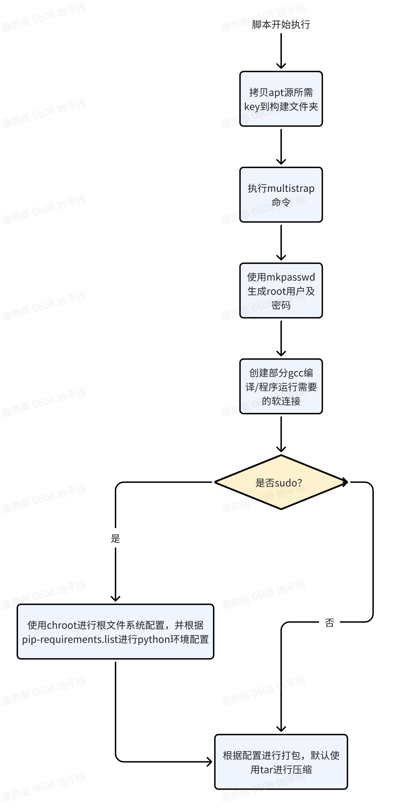
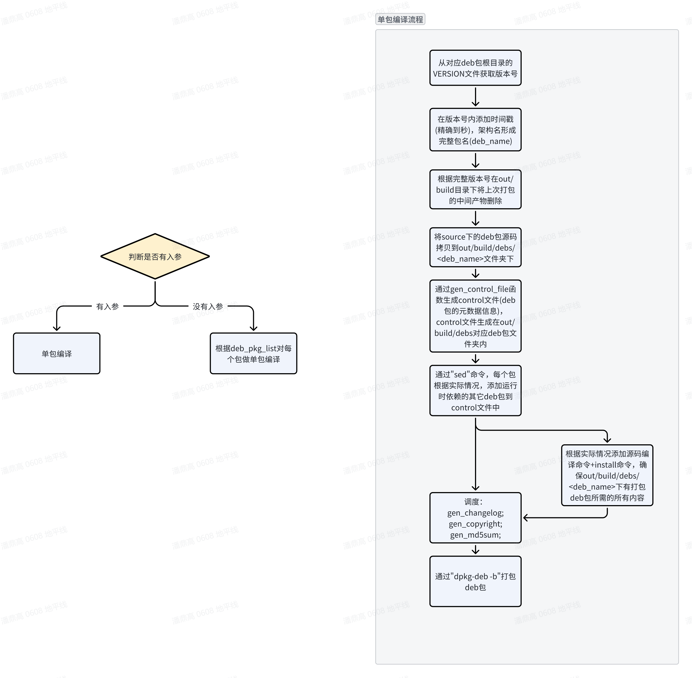

# 02A｜BSP、启动配置、实时内核与升级生命周期

> 截止2026-11-05；S600主线RDKOS5.1.1，S100为4.0.5_20260507。公开说明核验，未构建镜像或执行设备升级。

## 1. 软件版本首先是交付组合

机器人BSP需要把内核、驱动、固件、根文件系统和启动链共同冻结。S6005.1.1不是任意Ubuntu24.04加一个驱动包：官方发布说明给出板端RDKOS5.1.1（Ubuntu24.04 noble）、内核6.1.158-rt58-DR-5.1.1、U-Boot2022.04、MCU V2.0.3和aarch64工具链13.2.Rel1。Host编译Ubuntu20.04 x64与目标板Ubuntu24.04是不同环境；用目标系统版本反推Host会造成交叉库和脚本不匹配。〔1：[原文](https://developer.d-robotics.cc/rdk_s_doc/Release_Note/s600/v5_1_1) / [本地原件](REFERENCES.md#ref-10ce1a6098be10ab)〕

| 对象 | S6005.1.1 | S1004.0.5_20260507 | 工程边界 |
|---|---|---|---|
| 目标rootfs | Ubuntu24.04 noble | Ubuntu22.04 jammy | deb源与Python/ROS依赖分开 |
| Linux | 6.1.158-rt58-DR-5.1.1 | 6.1.158-rt58 | 版本字符串相近不保证驱动ABI相同 |
| Bootloader | U-Boot2022.04 | U-Boot2022.04 | 板级DTS/分区/安全配置仍不同 |
| Host编译 | Ubuntu20.04 x64 | Ubuntu20.04 x64 | 不把Host当目标平台 |
| 交叉编译器 | GNU13.2.Rel1 | GNU11.3.rel1 | kernel module与用户库分别匹配 |
| MCU | 发布说明V2.0.3 | 本次该说明未给精确版本 | 禁止按S600版本补齐 |

S100发布说明还注明修复V1P1硬件支持，所以软件验收必须记录板卡修订版；只记“S100P”不够。S600资源表在同一页面保留5.1.0及5.1.1栏目，BSP源码和MCU包位于商业交付目录；“MCU Cluster-1 SDK静态链接库”和表中“源码形式”并存，本次没有取得整个SDK包，不能保证源码完整度。商业获取要求登记、NDA和私有释放；本研究未提交机构表单或申请权限。〔2：[原文](https://raw.githubusercontent.com/D-Robotics/rdk_doc/main/docs_s/10_Release_Note/01_v4_0_5_260507.md) / [本地原件](REFERENCES.md#ref-209e21ec8b8de975)〕 〔3：[原文](https://developer.d-robotics.cc/rdk_s_doc/Quick_start/download) / [本地原件](REFERENCES.md#ref-4a91716a854dddbe)〕 〔4：[原文](https://developer.d-robotics.cc/rdk_s_doc/Advanced_development/rdk_gen) / [本地原件](REFERENCES.md#ref-daa0f17ac1774c07)〕

## 2. rootfs与deb怎样变成可启动镜像

官方构建指南采用multistrap读取APT源/包清单、下载并解包，再通过binfmt-support与chroot执行包配置。这里“文件已解压”与“包已配置”是两个状态：postinst、用户账户、服务和Python环境若未初始化，镜像可能存在文件却无法正确首次启动。`samplefs/configs`下S100选jammy配置，S600选noble配置；`make_ubuntu_samplefs.sh build <config>`显式指定比依赖文档中重复的默认桌面配置描述更可复建。〔4：[原文](https://developer.d-robotics.cc/rdk_s_doc/Advanced_development/rdk_gen) / [本地原件](REFERENCES.md#ref-daa0f17ac1774c07)〕

图保留sudo判断：使用sudo进入chroot完成配置，不使用sudo仅完成部分准备后打包。它支持构建阶段与首次启动阶段的职责区别，不证明任意裁剪包清单仍可启动。量产构建应保存APT源快照、deb版本、pip依赖、配置文件和哈希；在线APT滚动更新会使相同命令在不同日期生成不同产物。

`mk_debs.sh`处理source内的定制包，包包含LICENSE、VERSION、debian元数据与维护脚本，部分包另带drivers和动态库源码。`gen_control_file`建立元数据，Depends决定运行依赖，最后生成changelog/copyright/md5并调用dpkg-deb打包。时间戳附在版本名中有助区分产物，但不能替代源码commit及依赖锁定。文档/API核验已深入到函数与目录级；完整BSP脚本源码未取得，不能声称逐行审计了商业包实现。〔4：[原文](https://developer.d-robotics.cc/rdk_s_doc/Advanced_development/rdk_gen) / [本地原件](REFERENCES.md#ref-daa0f17ac1774c07)〕

图说明单包入口、依赖、编译和安装内容进入deb的顺序。机器人应用可被封成独立deb并进入镜像，但依赖ABI、模型/runtime版本和维护脚本失败处理要显式设计；包安装完成并不等于设备闭环健康。

`pack_image.sh`在线模式依据配置中的RDK_DPKG_DEB_PKG_LIST从APT安装包，`-l`模式使用out/product/deb_packages及预编译rootfs。离线构建有利于重现，但仅“断网”不确保可靠：本地目录如混入错误架构或旧包，仍可能生成错误镜像。分区表分别位于s100/s600板级目录，NOR基础启动内容与eMMC/UFS主存储镜像分开；指南中的通用emmc命名不能反过来否定S600实际UFS交付。〔4：[原文](https://developer.d-robotics.cc/rdk_s_doc/Advanced_development/rdk_gen) / [本地原件](REFERENCES.md#ref-daa0f17ac1774c07)〕

## 3. 启动配置、签名与实时调度的交互

`/boot/config.txt`可配置bootargs、日志级别、DTS节点和overlay。官方给出的优先级是U-Boot手动setenv > 配置文件 > 上次saveenv，配置行不自动保存为U-Boot默认环境。现场诊断因此需同时采集config.txt、启动环境和/proc/cmdline，不能只查看仓库模板。AVB使能时该配置方式不能使用，AVB默认不使能；修改启动分区与验证启动要求冲突。不能因为文档写有签名支持就宣称默认镜像具备完整验证启动。〔5：[原文](https://developer.d-robotics.cc/rdk_s_doc/System_configuration/config_txt) / [本地原件](REFERENCES.md#ref-87a7c2a149d4065b)〕

S600与S100均默认使用实时内核。官方建议cyclictest的50,000,000循环、mlock、SMP、优先级90、200μs间隔和400μs直方图范围，测的是线程唤醒延迟；它没有直接测“相机帧到电机动作”，也不是可证明的WCET。配图文件名带2023日期，正文未给与当前S6005.1.1绑定的完整SKU/固件/热状态，本文不将图片数值当S600验收指标。〔6：[原文](https://developer.d-robotics.cc/rdk_s_doc/Advanced_development/linux_development/realtime_kernel) / [本地原件](REFERENCES.md#ref-d55b805ff94a641f)〕

PREEMPT_RT改善抢占与调度行为仍需CPU亲和性、中断分配、锁页、线程优先级和总线负载共同验证。机制上，把高优先任务与GPU桌面/编码/DMA竞争分离有助稳定尾延迟；性能模式与CPU隔离不是万能选项，热降频、共享锁和驱动不可抢占区仍可能破坏时限。与其他端侧Linux平台对比应比较同负载下的调度/驱动链路，不由“内核有rt”输出硬实时排名。

温控也是执行条件。当前S600页面列19个温度传感器/thermal zone，CPU7、DDR4、BPU8，通过hwmon输入和thermal cooling device驱动CPU/BPU降频及风扇。示例95℃触发CPU/BPU降频，110℃hot、115℃关机是软件策略阈值，不能当模组工作温度规范；页面BPU部分称4个trip却枚举0–4，也应以实际sysfs和对应源码核对。sysfs动态设置重启失效。模型时延测试必须保存温度、governor、频率和风扇状态。〔7：[原文](https://developer.d-robotics.cc/rdk_s_doc/System_configuration/frequency_management) / [本地原件](REFERENCES.md#ref-dd4b866cd34257e7)〕

## 4. OTA与miniboot：两条升级路径不能混用

完整OTA对外交付底层API/实现库，如libupdate.so，完成烧写及校验；客户上层服务负责云端下载、升级政策、机群编排与结果上报。分区data.json/gpt.conf、镜像和ota_process组成升级包。A/B、备份、签名与antirollback属于配置和状态机能力，须核对实际分区是否参与、哪些状态可回退；不能自动扩展为云端产品或机器人安全升级系统。〔8：[原文](https://developer.d-robotics.cc/rdk_s_doc/Advanced_development/linux_development/OTA/ota_system) / [本地原件](REFERENCES.md#ref-51c92d21e58d7011)〕

差分升级保存旧镜像，由hpatchz还原到对向分区，官方明确“节省流量，并不节省升级时间”。flash分区、可写boot分区不支持差分，镜像需大于10M，参与的已挂载分区要求只读且noload，否则校验失败。更新基线的精确字节内容与旧包保留是前提；对新旧BSP、rootfs和模型只比较语义版本号不足以保证差分正确。preinst_<分区名>.sh/postinst_<分区名>.sh必须与base_name对应；hook异常可能中断更新。〔8：[原文](https://developer.d-robotics.cc/rdk_s_doc/Advanced_development/linux_development/OTA/ota_system) / [本地原件](REFERENCES.md#ref-51c92d21e58d7011)〕

当前miniboot手册是另一机制：`rdk-miniboot-update`在非OTA镜像上通过dd写NOR及**当前slot**的acore_cfg/bl31/optee/uboot，既不经过完整OTA两段式状态机，也不跨slot同步、不更新S600 vbmeta，没有内建自动回滚。安装hobot-miniboot deb会触发该流程，更新后重启生效；部分OHP生命周期条件拒绝在线更新。它直接关系启动能力，普通APT维护也可能触发固件写入，应纳入停机维护与电源保障，而不是当成无影响的用户包升级。〔9：[原文](https://developer.d-robotics.cc/rdk_s_doc/Advanced_development/linux_development/OTA/ota_miniboot) / [本地原件](REFERENCES.md#ref-c0fecf1465220ec5)〕

旧GitHub S100文档仍称该更新自动同步A/B、异常可回滚，与2026-11-04现行手册相冲突。本篇采用当前明确描述，保留旧原件作为版本差异证据；“保证不会变砖”不是可跨版本沿用的事实。当前手册22MB NOR约3.5分钟是示例场景耗时，不是整套OTA时长保证。〔10：[原文](https://raw.githubusercontent.com/D-Robotics/rdk_doc/main/docs_s/07_Advanced_development/02_linux_development/06_OTA/02_ota_miniboot.md) / [本地原件](REFERENCES.md#ref-43b229c9b63b9292)〕 〔9：[原文](https://developer.d-robotics.cc/rdk_s_doc/Advanced_development/linux_development/OTA/ota_miniboot) / [本地原件](REFERENCES.md#ref-c0fecf1465220ec5)〕

## 5. 已知问题、交付责任与验证动作

5.1.1列GPU加速应用因页大小不匹配崩溃、无HDMI时GDM3回退X11并使用CPU渲染、部分万兆口需固件加载后恢复性能、WiFi不支持STA/AP同时启用、MCU不支持锁步解锁。这些已知问题决定部署条件：无人值守机器人宜确认桌面服务是否必要，检查实际GPU可用性，记录网口固件及吞吐，验证网络模式切换。支持自行编译的未签名内核模块说明研发扩展能力，不等于生产签名策略已经实施。〔1：[原文](https://developer.d-robotics.cc/rdk_s_doc/Release_Note/s600/v5_1_1) / [本地原件](REFERENCES.md#ref-10ce1a6098be10ab)〕

本专题没有取得BSP完整源码commit、全部驱动许可证及签名实现，因此只确认文档机制与公开交付入口。文档仓库Apache-2.0不授予商业二进制、第三方固件或芯片IP的再分发权；包级LICENSE和对应发行源码需要单独清单。GitHub元数据请求本轮遇到API限流403，不把commit未核验写成仓库没有版本管理。〔11：[原文](https://raw.githubusercontent.com/D-Robotics/rdk_doc/main/LICENSE) / [本地原件](REFERENCES.md#ref-50e26f159fc3347a)〕 〔4：[原文](https://developer.d-robotics.cc/rdk_s_doc/Advanced_development/rdk_gen) / [本地原件](REFERENCES.md#ref-daa0f17ac1774c07)〕

可复建验证应先从指定SKU/PCB及软件BOM出发，保存rootfs包清单、kernel config/DTS和启动参数，运行冷/热启动与外围枚举，再压测相机、SSD、网络与实时线程并发。升级测试分别覆盖完整OTA失败回退和非OTA miniboot写入中断，确认启动、模型及MCU协议共同兼容。应用健康判据必须包含数据年龄与动作接口，而非仅服务进程存在。这些是建议验收步骤，本次没有执行设备写入。

## 资料与核验

本篇为公开资料与代码核验，未进行SDK安装、模型实机或机器人验收。静态归档部分缺失：无；所识别静态依赖完整，仍不保证动态内容/像素级复现。

[02资料集合](REFERENCES.md) · [证据JSON](research_state/evidence/02A_BSP_and_Lifecycle.json)

### 原件清单

1. **H02_S600_511_Release**：[原URL](https://developer.d-robotics.cc/rdk_s_doc/Release_Note/s600/v5_1_1) · [原件](REFERENCES.md#ref-10ce1a6098be10ab)；采集2026-11-05T02:22:28.834915+00:00；complete_static。

2. **H02_S100_Release**：[原URL](https://raw.githubusercontent.com/D-Robotics/rdk_doc/main/docs_s/10_Release_Note/01_v4_0_5_260507.md) · [原件](REFERENCES.md#ref-209e21ec8b8de975)；采集2026-11-05T02:22:44.604383+00:00；complete_static。

3. **Horizon_S600_Downloads**：[原URL](https://developer.d-robotics.cc/rdk_s_doc/Quick_start/download) · [原件](REFERENCES.md#ref-4a91716a854dddbe)；采集2026-11-05T01:33:26.415591+00:00；complete_static。

4. **H02_Build**：[原URL](https://developer.d-robotics.cc/rdk_s_doc/Advanced_development/rdk_gen) · [原件](REFERENCES.md#ref-daa0f17ac1774c07)；采集2026-11-05T02:23:47.406121+00:00；complete_static。

5. **H02_Config**：[原URL](https://developer.d-robotics.cc/rdk_s_doc/System_configuration/config_txt) · [原件](REFERENCES.md#ref-87a7c2a149d4065b)；采集2026-11-05T02:23:58.838893+00:00；complete_static。

6. **H02_RT**：[原URL](https://developer.d-robotics.cc/rdk_s_doc/Advanced_development/linux_development/realtime_kernel) · [原件](REFERENCES.md#ref-d55b805ff94a641f)；采集2026-11-05T02:26:04.503522+00:00；complete_static。

7. **H02_Thermal**：[原URL](https://developer.d-robotics.cc/rdk_s_doc/System_configuration/frequency_management) · [原件](REFERENCES.md#ref-dd4b866cd34257e7)；采集2026-11-05T02:24:00.777353+00:00；complete_static。

8. **H02_OTA**：[原URL](https://developer.d-robotics.cc/rdk_s_doc/Advanced_development/linux_development/OTA/ota_system) · [原件](REFERENCES.md#ref-51c92d21e58d7011)；采集2026-11-05T02:27:06.131581+00:00；complete_static。

9. **H02_Miniboot**：[原URL](https://developer.d-robotics.cc/rdk_s_doc/Advanced_development/linux_development/OTA/ota_miniboot) · [原件](REFERENCES.md#ref-c0fecf1465220ec5)；采集2026-11-05T02:27:12.762914+00:00；complete_static。

10. **H02_S100_Miniboot**：[原URL](https://raw.githubusercontent.com/D-Robotics/rdk_doc/main/docs_s/07_Advanced_development/02_linux_development/06_OTA/02_ota_miniboot.md) · [原件](REFERENCES.md#ref-43b229c9b63b9292)；采集2026-11-05T02:22:43.557021+00:00；complete_static。

11. **Horizon_RDK_License**：[原URL](https://raw.githubusercontent.com/D-Robotics/rdk_doc/main/LICENSE) · [原件](REFERENCES.md#ref-50e26f159fc3347a)；采集2026-11-05T01:25:03.899112+00:00；complete_static。
