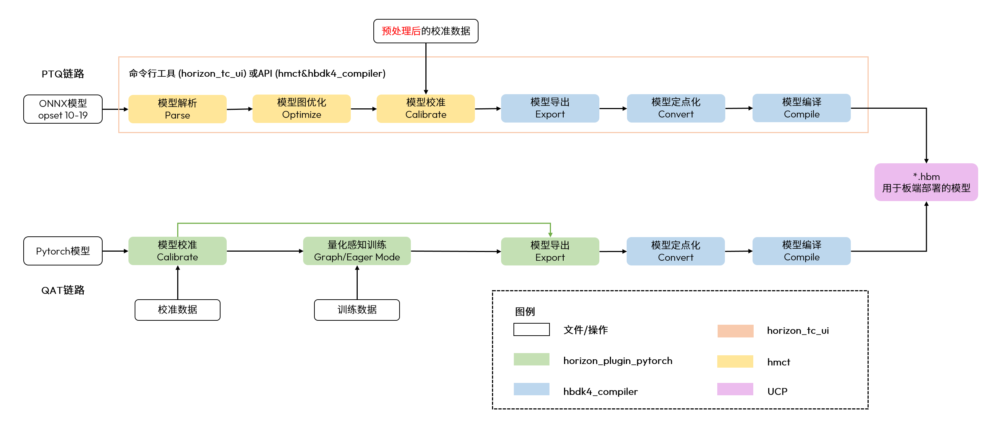
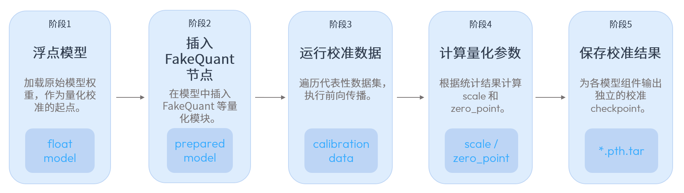

# 02B BPU 编译、量化与模型运行时

数据截止：2026-11-05。对象以 RDK S600、S100/S100P 为主，X5 用作代际迁移对照。本文核验公开手册与示例，未安装商业SDK或执行板端测试。

## 1. 可部署模型是一份软硬件契约

Horizon 的模型链路不能概括成“支持ONNX即可运行”。S系列 OpenExplorer 将源图、训练输入定义、校准统计与编译选项转成板端 HBM；运行时还需要匹配的驱动、内存和任务调度接口。OE 3.7.0 发布说明绑定S100系统4.0.5、S600系统5.1.0；S600最新公开系统说明为5.1.1，不能仅凭版本数字推断任意编译器/运行库可以互换。OE LLM 2.0.0 面向S6005.1.0及以上，支持范围应与每个模型的配置和发行包一起冻结。发布页的CPU/GPU Docker是开发机编译环境选项，不能据此证明板端GPU执行了模型。〔1：[原文](https://developer.d-robotics.cc/rdk_s_doc/Advanced_development/toolchain_development/algorithm_toolchain/overview) / [本地原件](REFERENCES.md#ref-c0a2da264e5a1fe1)〕 〔2：[原文](https://developer.d-robotics.cc/rdk_s_doc/Advanced_development/toolchain_development/LLM_Toolchain/rdk_s600/LLM_Toolchain_v2_0_0) / [本地原件](REFERENCES.md#ref-8a128218ccddb5a2)〕 〔3：[原文](https://developer.d-robotics.cc/rdk_s_doc/Release_Note/s600/v5_1_1) / [本地原件](REFERENCES.md#ref-10ce1a6098be10ab)〕

|对象|编译目标/工具|产物与执行边界|迁移需要重新核验|
|---|---|---|---|
|RDK X5|bayes-e；hb_mapper checker/makertbin|.bin；X5 DNN运行示例|算子分区、定点精度、目标运行库|
|RDK S100|nash-e；hb_compile|.hbm；DNN/UCP|输入布局、目标BSP及工具版本|
|RDK S100P|nash-m；hb_compile|.hbm；对应BPU目标|不能套用S100或S600产物|
|RDK S600|nash-p；hb_compile/hbdk4|.hbm；支持多BPU配置|核心数、缓存、模型拆分与编译配置|

目标映射来自当前OE PTQ手册；X5行只采用原文明确标注X5的章节。这里的HBM是部署模型文件格式，不能与高带宽内存硬件混同。〔4：[原文](https://developer.d-robotics.cc/oe_s_doc/static/js/async/62300.e55caad1.js) / [本地原件](REFERENCES.md#ref-6c736e923e8d396a) / [官方文档页面](https://developer.d-robotics.cc/oe_s_doc/guide/faststart/ptq_quickstart) / [离线正文](REFERENCES.md) / [渲染HTML](REFERENCES.md)〕 〔5：[原文](https://raw.githubusercontent.com/D-Robotics/rdk_doc/main/docs/07_Advanced_development/04_toolchain_development/intermediate/ptq_process.md) / [本地原件](REFERENCES.md#ref-990bc69c51b0ab57)〕 〔6：[原文](https://raw.githubusercontent.com/D-Robotics/rdk_doc/main/docs/07_Advanced_development/04_toolchain_development/intermediate/runtime_sample.md) / [本地原件](REFERENCES.md#ref-6e1d144fd5df44fe)〕

## 2. PTQ/QAT与预处理：先保证数值，再追性能

图示为官方OE转换流程，包含解析、图优化、校准、导出、定点转换和编译，也给出QAT分支。它证明两种部署路线和产物关系，未提供某模型的量化误差或加速倍率。〔7：[原文](https://developer.d-robotics.cc/oe_s_doc/static/js/async/49841.f8e6a5ca.js) / [本地原件](REFERENCES.md#ref-4d3875049ead716f) / [官方文档页面](https://developer.d-robotics.cc/oe_s_doc/guide/model_deployment_guidance/model_deployment_principle_process/model_conversion_compile) / [离线正文](REFERENCES.md) / [渲染HTML](REFERENCES.md)〕 〔8：[原文](https://developer.d-robotics.cc/oe_s_doc/static/image/model_conversion_compilation.914a0e0b.png) / [本地原件](REFERENCES.md#ref-0f9289a0555fce7d)〕

S系列先用 `hb_compile --model resnet50.onnx --march nash-p` 检查S600目标并读日志，再用 `hb_compile -c resnet50_config.yaml` 转换。配置划分model_parameters、input_parameters、calibration_parameters和compiler_parameters；这使输入语义、量化统计与设备编译不是一组隐含默认值。运行输入NV12、训练输入RGB时，input_type_rt/input_type_train差异会触发BPU预处理插入；mean、scale、std及通道/布局必须按模型训练流程核对。将应用层归一化重复做一次会改变张量，即使编译成功也不能验证精度。〔4：[原文](https://developer.d-robotics.cc/oe_s_doc/static/js/async/62300.e55caad1.js) / [本地原件](REFERENCES.md#ref-6c736e923e8d396a) / [官方文档页面](https://developer.d-robotics.cc/oe_s_doc/guide/faststart/ptq_quickstart) / [离线正文](REFERENCES.md) / [渲染HTML](REFERENCES.md)〕

手册建议约百张有代表性的校准样本，要求其内容、形状与训练预处理对应。省略cal_data_dir时的fake calibration服务于性能试验，不构成精度证据。校准应包含实际机器人光照、视角与背景分布；这后一条是工程分析，需要留出集检验，不能根据样本数量证明泛化。QAT则引入训练中的量化约束，仍须验证目标算子与输出误差，不能把“训练支持”直接当作编译器覆盖。〔4：[原文](https://developer.d-robotics.cc/oe_s_doc/static/js/async/62300.e55caad1.js) / [本地原件](REFERENCES.md#ref-6c736e923e8d396a) / [官方文档页面](https://developer.d-robotics.cc/oe_s_doc/guide/faststart/ptq_quickstart) / [离线正文](REFERENCES.md) / [渲染HTML](REFERENCES.md)〕

X5手册允许在node_info指定部分算子CPU/BPU执行及INT16配置。CPU算子可能切断BPU子图，使跨域同步和张量搬运进入关键路径；迁移时应先看分区日志再决定改图、提高局部精度或接受CPU成本。X5示例指出单BPU核限制，不能借S600四核配置声称X5多核加速。该代际文档同时包含X3和Ultra示例，gcc9.3及bayes库段落不能归到X5；明确X5构建段落使用ARM GNU11.3.rel1。〔5：[原文](https://raw.githubusercontent.com/D-Robotics/rdk_doc/main/docs/07_Advanced_development/04_toolchain_development/intermediate/ptq_process.md) / [本地原件](REFERENCES.md#ref-990bc69c51b0ab57)〕 〔6：[原文](https://raw.githubusercontent.com/D-Robotics/rdk_doc/main/docs/07_Advanced_development/04_toolchain_development/intermediate/runtime_sample.md) / [本地原件](REFERENCES.md#ref-6e1d144fd5df44fe)〕

## 3. 张量、内存与异步任务的生命周期

板端示例依次分配cached hbUCPSysMem，填充输入并CLEAN，调用hbDNNInferV2创建任务，再hbUCPSubmitTask、hbUCPWaitTaskDone，完成后INVALIDATE输出、后处理并释放任务/内存/模型。任务创建、提交成功、硬件完成是三个不同事件。Submit返回0只证明提交成功；如果提前读输出或复用输入，应用仍可能得到上次结果或覆盖正在读取的数据。〔4：[原文](https://developer.d-robotics.cc/oe_s_doc/static/js/async/62300.e55caad1.js) / [本地原件](REFERENCES.md#ref-6c736e923e8d396a) / [官方文档页面](https://developer.d-robotics.cc/oe_s_doc/guide/faststart/ptq_quickstart) / [离线正文](REFERENCES.md) / [渲染HTML](REFERENCES.md)〕 〔9：[原文](https://developer.d-robotics.cc/oe_s_doc/static/js/async/42321.211ed409.js) / [本地原件](REFERENCES.md#ref-1df8daceb6d44659) / [官方文档页面](https://developer.d-robotics.cc/oe_s_doc/guide/ucp/ucp_api_reference/ucp_api_function_interface/hbucpsubmittask) / [离线正文](REFERENCES.md) / [渲染HTML](REFERENCES.md)〕 〔10：[原文](https://developer.d-robotics.cc/oe_s_doc/static/js/async/80056.5ccac469.js) / [本地原件](REFERENCES.md#ref-6af5f91666f418e1) / [官方文档页面](https://developer.d-robotics.cc/oe_s_doc/guide/ucp/ucp_api_reference/ucp_api_function_interface/hbucpmemflush) / [离线正文](REFERENCES.md) / [渲染HTML](REFERENCES.md)〕

cached内存的CPU缓存与设备可见内容需要显式一致性维护。CLEAN用于CPU写完交设备前，INVALIDATE用于硬件写完交CPU读前。它们不能替代完成事件或线程互斥。以相机池做输入时，必须等推理完成再归还生产者；以输出复用池时，必须等消费者完成再复写。该所有权规则是由API生命周期推导的工程要求，公开样例没有证明任意ROS/DMA消息都可直接绑定。部署手册同时区分featuremap与pyramid/resizer输入来源，源类型、维度、步长和内存地址需要一起匹配。〔11：[原文](https://developer.d-robotics.cc/oe_s_doc/static/js/async/78211.f06396ae.js) / [本地原件](REFERENCES.md#ref-fc0c1298e7d37256) / [官方文档页面](https://developer.d-robotics.cc/oe_s_doc/guide/model_deployment_guidance/model_deployment_principle_process/boardside_deployment) / [离线正文](REFERENCES.md) / [渲染HTML](REFERENCES.md)〕 〔10：[原文](https://developer.d-robotics.cc/oe_s_doc/static/js/async/80056.5ccac469.js) / [本地原件](REFERENCES.md#ref-6af5f91666f418e1) / [官方文档页面](https://developer.d-robotics.cc/oe_s_doc/guide/ucp/ucp_api_reference/ucp_api_function_interface/hbucpmemflush) / [离线正文](REFERENCES.md) / [渲染HTML](REFERENCES.md)〕

动态输入的validShape/stride中-1表示应用需填实际值，不等于无限制动态形状。stride须满足相邻维度的容量约束；NV12 Y/UV宽度步长在S600需64字节对齐，其他S平台为32。原文S100宽220补到224的例子不能搬到S600。应记录逻辑宽高与存储stride并在变化时重建相应描述；只修改shape而忽略容量、缓存或下游裁剪，会形成越界和坐标映射错误。〔12：[原文](https://developer.d-robotics.cc/oe_s_doc/static/js/async/24642.789c7af3.js) / [本地原件](REFERENCES.md#ref-ab27c48f9fa3f22a) / [官方文档页面](https://developer.d-robotics.cc/oe_s_doc/guide/ucp/runtime/bpu_sdk_api/dynamic_input_introduction) / [离线正文](REFERENCES.md) / [渲染HTML](REFERENCES.md)〕

## 4. LLM/VLA：组件化校准、编译与缓存失效

图显示浮点权重→FakeQuant→代表数据前向→scale/zero-point→组件校准checkpoint。此流程是PTQ，默认校准没有训练更新原权重；离线lightcompress权重优化应另外记流程。〔13：[原文](https://developer.d-robotics.cc/oe_llm_doc/static/js/async/31346.cf7dd33f.js) / [本地原件](REFERENCES.md#ref-930c8b2648c88eba) / [官方文档页面](https://developer.d-robotics.cc/oe_llm_doc/guide/llm_compression/detailed_function_specification/model_quantization) / [离线正文](REFERENCES.md) / [渲染HTML](REFERENCES.md)〕 〔14：[原文](https://developer.d-robotics.cc/oe_llm_doc/static/image/model_quantization.c85c9c2f.png) / [本地原件](REFERENCES.md#ref-3de30ebb446bf075)〕

llm_compression读取HuggingFace/PyTorch模型；model.type选择BaseQModel，get_qconfig_setting配置observer、位宽及模块模板，horizon.quantization.prepare插入量化模块。默认HistogramObserver可替换为MinMax，敏感层可用INT16；位宽改变必须重新检查精度和编译产物。纯LLM通常是lm，VLM为visual/lm，Pi05还包括action；Qwen3.5的visual/prefill/decode是例外。LM的prefill/decode共享的校准/KV参数需要一致。ppl数据模式固定seq_len且非自回归，calibration_step会被忽略，不能据一般样例步数推导实际校准数据量。先用torch_eval比较浮点和fake-quant输出再编译，有助于区分量化误差与板端集成错误。〔15：[原文](https://developer.d-robotics.cc/oe_llm_doc/static/js/async/45012.527f3844.js) / [本地原件](REFERENCES.md#ref-22e6837d2818607a) / [官方文档页面](https://developer.d-robotics.cc/oe_llm_doc/guide/sdk_introduction) / [离线正文](REFERENCES.md) / [渲染HTML](REFERENCES.md)〕 〔13：[原文](https://developer.d-robotics.cc/oe_llm_doc/static/js/async/31346.cf7dd33f.js) / [本地原件](REFERENCES.md#ref-930c8b2648c88eba) / [官方文档页面](https://developer.d-robotics.cc/oe_llm_doc/guide/llm_compression/detailed_function_specification/model_quantization) / [离线正文](REFERENCES.md) / [渲染HTML](REFERENCES.md)〕

编译链为Export *.bc HBIR→Convert *_convert.bc与移除IO算子的*_convert_rm.bc→Compile *.hbo→Link *.hbm。Qwen2.5VL例子选择nash-p、core_num4、图像448×448、chunk512/cache1024、w8，输出视觉和语言HBM、embed_tokens.bin及tokenizer相关文件。它只是该配置的示例，不能证明所有模型均四核最优。VLA还需要action HBM与动作horizon配置，以及动作反归一化用norm_stats.json。把HBM单独复制到板端而遗漏tokenizer、嵌入或归一化统计，可能加载失败，也可能产生语义错误但数值看似正常的输出。〔16：[原文](https://developer.d-robotics.cc/oe_llm_doc/static/js/async/50188.3b7997bf.js) / [本地原件](REFERENCES.md#ref-cc21f8f5997a722f) / [官方文档页面](https://developer.d-robotics.cc/oe_llm_doc/guide/llm_compression/detailed_function_specification/model_compilation) / [离线正文](REFERENCES.md) / [渲染HTML](REFERENCES.md)〕

cache_path/cache_mode加快重复编译，但模型图或关键编译参数变化时需要清理或切换缓存。复建清单应把浮点权重、校准checkpoint、配置、工具版本和中间缓存关联；jobs32是编译并行设置，过量会竞争开发机CPU/内存，并非板端推理线程或加速倍率。runtime的InferOellmModel同步阻塞到结束，inputs/outputs必须按同一模型分配，推理期间不能清空或重排buffer；extras中的flush/invalidate索引仍要匹配真实CPU/设备数据交换。不同模型实例可分别在线程调用，不能推出同一实例自动线程安全。〔16：[原文](https://developer.d-robotics.cc/oe_llm_doc/static/js/async/50188.3b7997bf.js) / [本地原件](REFERENCES.md#ref-cc21f8f5997a722f) / [官方文档页面](https://developer.d-robotics.cc/oe_llm_doc/guide/llm_compression/detailed_function_specification/model_compilation) / [离线正文](REFERENCES.md) / [渲染HTML](REFERENCES.md)〕 〔17：[原文](https://developer.d-robotics.cc/oe_llm_doc/static/js/async/18918.9b5e8cf7.js) / [本地原件](REFERENCES.md#ref-6e1c50ed1c56a6a9) / [官方文档页面](https://developer.d-robotics.cc/oe_llm_doc/guide/model_deployment/api/advanced_api/infer/infer_oellm_model) / [离线正文](REFERENCES.md) / [渲染HTML](REFERENCES.md)〕

## 5. 官方VLA数值能支持什么

官方表为S600/Linux、w8模型的端侧数据，性能说明定义E2E包含前处理、视觉、语言、动作、后处理；内存包含Linux与ION。它未完整列出BSP、模型commit、输入shape/batch、功率、预热、样本数和均值/P99统计规则。以下保留原表精度，均为厂商公开基准而非本研究实测。〔18：[原文](https://developer.d-robotics.cc/oe_llm_doc/static/js/async/42166.bab9ba30.js) / [本地原件](REFERENCES.md#ref-512813f90d80c32d) / [官方文档页面](https://developer.d-robotics.cc/oe_llm_doc/guide/benchmark/note) / [离线正文](REFERENCES.md) / [渲染HTML](REFERENCES.md)〕 〔19：[原文](https://developer.d-robotics.cc/oe_llm_doc/static/js/async/7805.87d8031b.js) / [本地原件](REFERENCES.md#ref-6e127a5530c5176e) / [官方文档页面](https://developer.d-robotics.cc/oe_llm_doc/guide/benchmark/s600/vla_benchmark) / [离线正文](REFERENCES.md) / [渲染HTML](REFERENCES.md)〕

|模型/任务|去噪步数|E2E ms|内存GB|可比较的边界|
|---|---|---|---|---|
|Pi05/libero|2|95.894|4.7|与同模型10步对比时仍缺质量指标|
|Pi05/libero|10|142.972|4.7|action段59.077ms，2步为12.090ms|
|SmolVLA/libero|10|82.909|0.9|模型不同，任务成功率未给出|
|Spirit1.5/任务未列|10|130.133|5.8|不能视为同任务优劣排名|

Pi05的两行视觉和语言时间接近，动作去噪占用变化明显，说明迭代配置会影响执行预算；不能单纯选择较快行而忽略动作质量。毫秒倒数只是理想串行调用上限的算术推导，不是机器人伺服频率。VLA手册提供压缩、调试、C++集成及仿真示例入口，但这一证据不闭合真实传感器、状态同步、关节顺序/单位、动作安全检查及执行器反馈；02E继续追ROS接口，真实本体效果留在后续授权章节核验。〔20：[原文](https://developer.d-robotics.cc/oe_llm_doc/static/js/async/26444.95f492ac.js) / [本地原件](REFERENCES.md#ref-549ade35441bfbaf) / [官方文档页面](https://developer.d-robotics.cc/oe_llm_doc/guide/vla/vla_deployment/overview) / [离线正文](REFERENCES.md) / [渲染HTML](REFERENCES.md)〕

## 6. 对标、许可与可复建验收

与TensorRT式模型编译路线相比，共同痛点是把框架图转为设备执行产物，并用量化、布局与缓冲管理减少执行成本；这里比较机制，不提供异条件速度排名。ONNX/PyTorch源模型可作为迁移起点，目标算子分区、量化配置和HBM不能视为跨平台通用资产。普通CPU推理路径较易调试，代价是需重新测试吞吐与共享CPU干扰；BPU路径的收益在可编译覆盖、稳定输入和数据搬运受控时更可能成立。

当前OE许可是有限、非独占、不可转让/再许可且可撤销的使用授权，限制未经授权的修改、逆向、再分发和第三方披露；第三方开源组件另按其许可证。文档Apache2不覆盖商业编译器/runtime、固件、权重、训练数据或本体SDK。本文未取得完整SDK二进制和客户合同，不能据公开下载入口断定量产再分发权。〔21：[原文](https://developer.d-robotics.cc/oe_s_doc/static/js/async/5603.b7581455.js) / [本地原件](REFERENCES.md#ref-6e1dd6456b634d63) / [官方文档页面](https://developer.d-robotics.cc/oe_s_doc/guide/legalnotice/license_agreement) / [离线正文](REFERENCES.md) / [渲染HTML](REFERENCES.md)〕 〔22：[原文](https://raw.githubusercontent.com/D-Robotics/rdk_doc/main/LICENSE) / [本地原件](REFERENCES.md#ref-50e26f159fc3347a)〕

实际放行需冻结目标板/BSP、编译器/runtime、源模型与校准集哈希、shape/stride/位宽/核心数、tokenizer与norm_stats；先验证浮点→量化→板端的一致性，再测带预处理/搬运/后处理的模型时延，最后加相机、ROS、MCU与热稳定并发。异常测试覆盖超时、任务失败、动态shape切换、过期缓存及模型回退。没有这些数据时，本文结论是部署机制已可追溯，真实闭环性能仍待设备验收。

## 资料与核验

本篇为公开资料与代码核验，未进行SDK安装、模型实机或机器人验收。静态归档部分缺失：无；所识别静态依赖完整，仍不保证动态内容/像素级复现。

[02资料集合](REFERENCES.md) · [证据JSON](research_state/evidence/02B_BPU_Compiler_and_Runtime.json)

### 原件清单

1. **H02_OE37**：[原URL](https://developer.d-robotics.cc/rdk_s_doc/Advanced_development/toolchain_development/algorithm_toolchain/overview) · [原件](REFERENCES.md#ref-c0a2da264e5a1fe1)；采集2026-11-05T02:31:19.837399+00:00；complete_static。

2. **H02_LLM20**：[原URL](https://developer.d-robotics.cc/rdk_s_doc/Advanced_development/toolchain_development/LLM_Toolchain/rdk_s600/LLM_Toolchain_v2_0_0) · [原件](REFERENCES.md#ref-8a128218ccddb5a2)；采集2026-11-05T02:31:21.326452+00:00；complete_static。

3. **H02_S600_511_Release**：[原URL](https://developer.d-robotics.cc/rdk_s_doc/Release_Note/s600/v5_1_1) · [原件](REFERENCES.md#ref-10ce1a6098be10ab)；采集2026-11-05T02:22:28.834915+00:00；complete_static。

4. **H02_OE_PTQ_Content**：[原URL](https://developer.d-robotics.cc/oe_s_doc/static/js/async/62300.e55caad1.js) · [原件](REFERENCES.md#ref-6c736e923e8d396a)；采集2026-11-05T02:35:34.320117+00:00；complete_static。 / [官方文档页面](https://developer.d-robotics.cc/oe_s_doc/guide/faststart/ptq_quickstart) / [离线正文](REFERENCES.md) / [渲染HTML](REFERENCES.md)。正文由已归档的官方页面JS在完全阻断外网请求的浏览器内渲染，入口空壳HTML不作正文证据。

5. **H02_X5_PTQ**：[原URL](https://raw.githubusercontent.com/D-Robotics/rdk_doc/main/docs/07_Advanced_development/04_toolchain_development/intermediate/ptq_process.md) · [原件](REFERENCES.md#ref-990bc69c51b0ab57)；采集2026-11-05T02:40:23.519954+00:00；complete_static。

6. **H02_X5_Runtime**：[原URL](https://raw.githubusercontent.com/D-Robotics/rdk_doc/main/docs/07_Advanced_development/04_toolchain_development/intermediate/runtime_sample.md) · [原件](REFERENCES.md#ref-6e1d144fd5df44fe)；采集2026-11-05T02:40:25.873669+00:00；complete_static。

7. **H02_OE_Compile_Content**：[原URL](https://developer.d-robotics.cc/oe_s_doc/static/js/async/49841.f8e6a5ca.js) · [原件](REFERENCES.md#ref-4d3875049ead716f)；采集2026-11-05T02:35:35.779177+00:00；complete_static。 / [官方文档页面](https://developer.d-robotics.cc/oe_s_doc/guide/model_deployment_guidance/model_deployment_principle_process/model_conversion_compile) / [离线正文](REFERENCES.md) / [渲染HTML](REFERENCES.md)。正文由已归档的官方页面JS在完全阻断外网请求的浏览器内渲染，入口空壳HTML不作正文证据。

8. **H02_Dynamic_Asset_10**：[原URL](https://developer.d-robotics.cc/oe_s_doc/static/image/model_conversion_compilation.914a0e0b.png) · [原件](REFERENCES.md#ref-0f9289a0555fce7d)；采集2026-11-05T02:37:36.333171+00:00；complete_static。

9. **H02_UCP_Submit_Content**：[原URL](https://developer.d-robotics.cc/oe_s_doc/static/js/async/42321.211ed409.js) · [原件](REFERENCES.md#ref-1df8daceb6d44659)；采集2026-11-05T02:39:38.417384+00:00；complete_static。 / [官方文档页面](https://developer.d-robotics.cc/oe_s_doc/guide/ucp/ucp_api_reference/ucp_api_function_interface/hbucpsubmittask) / [离线正文](REFERENCES.md) / [渲染HTML](REFERENCES.md)。正文由已归档的官方页面JS在完全阻断外网请求的浏览器内渲染，入口空壳HTML不作正文证据。

10. **H02_UCP_Flush_Content**：[原URL](https://developer.d-robotics.cc/oe_s_doc/static/js/async/80056.5ccac469.js) · [原件](REFERENCES.md#ref-6af5f91666f418e1)；采集2026-11-05T02:39:39.612142+00:00；complete_static。 / [官方文档页面](https://developer.d-robotics.cc/oe_s_doc/guide/ucp/ucp_api_reference/ucp_api_function_interface/hbucpmemflush) / [离线正文](REFERENCES.md) / [渲染HTML](REFERENCES.md)。正文由已归档的官方页面JS在完全阻断外网请求的浏览器内渲染，入口空壳HTML不作正文证据。

11. **H02_OE_Deploy_Content**：[原URL](https://developer.d-robotics.cc/oe_s_doc/static/js/async/78211.f06396ae.js) · [原件](REFERENCES.md#ref-fc0c1298e7d37256)；采集2026-11-05T02:35:38.670257+00:00；complete_static。 / [官方文档页面](https://developer.d-robotics.cc/oe_s_doc/guide/model_deployment_guidance/model_deployment_principle_process/boardside_deployment) / [离线正文](REFERENCES.md) / [渲染HTML](REFERENCES.md)。正文由已归档的官方页面JS在完全阻断外网请求的浏览器内渲染，入口空壳HTML不作正文证据。

12. **H02_OE_Dynamic_Content**：[原URL](https://developer.d-robotics.cc/oe_s_doc/static/js/async/24642.789c7af3.js) · [原件](REFERENCES.md#ref-ab27c48f9fa3f22a)；采集2026-11-05T02:39:37.237397+00:00；complete_static。 / [官方文档页面](https://developer.d-robotics.cc/oe_s_doc/guide/ucp/runtime/bpu_sdk_api/dynamic_input_introduction) / [离线正文](REFERENCES.md) / [渲染HTML](REFERENCES.md)。正文由已归档的官方页面JS在完全阻断外网请求的浏览器内渲染，入口空壳HTML不作正文证据。

13. **H02_LLM_Quant_Content**：[原URL](https://developer.d-robotics.cc/oe_llm_doc/static/js/async/31346.cf7dd33f.js) · [原件](REFERENCES.md#ref-930c8b2648c88eba)；采集2026-11-05T02:35:41.377040+00:00；complete_static。 / [官方文档页面](https://developer.d-robotics.cc/oe_llm_doc/guide/llm_compression/detailed_function_specification/model_quantization) / [离线正文](REFERENCES.md) / [渲染HTML](REFERENCES.md)。正文由已归档的官方页面JS在完全阻断外网请求的浏览器内渲染，入口空壳HTML不作正文证据。

14. **H02_Dynamic_Asset_14**：[原URL](https://developer.d-robotics.cc/oe_llm_doc/static/image/model_quantization.c85c9c2f.png) · [原件](REFERENCES.md#ref-3de30ebb446bf075)；采集2026-11-05T02:37:44.734914+00:00；complete_static。

15. **H02_LLM_Intro_Content**：[原URL](https://developer.d-robotics.cc/oe_llm_doc/static/js/async/45012.527f3844.js) · [原件](REFERENCES.md#ref-22e6837d2818607a)；采集2026-11-05T02:35:39.899727+00:00；complete_static。 / [官方文档页面](https://developer.d-robotics.cc/oe_llm_doc/guide/sdk_introduction) / [离线正文](REFERENCES.md) / [渲染HTML](REFERENCES.md)。正文由已归档的官方页面JS在完全阻断外网请求的浏览器内渲染，入口空壳HTML不作正文证据。

16. **H02_LLM_Compile_Content**：[原URL](https://developer.d-robotics.cc/oe_llm_doc/static/js/async/50188.3b7997bf.js) · [原件](REFERENCES.md#ref-cc21f8f5997a722f)；采集2026-11-05T02:39:41.339082+00:00；complete_static。 / [官方文档页面](https://developer.d-robotics.cc/oe_llm_doc/guide/llm_compression/detailed_function_specification/model_compilation) / [离线正文](REFERENCES.md) / [渲染HTML](REFERENCES.md)。正文由已归档的官方页面JS在完全阻断外网请求的浏览器内渲染，入口空壳HTML不作正文证据。

17. **H02_LLM_Infer_Content**：[原URL](https://developer.d-robotics.cc/oe_llm_doc/static/js/async/18918.9b5e8cf7.js) · [原件](REFERENCES.md#ref-6e1c50ed1c56a6a9)；采集2026-11-05T02:35:42.686765+00:00；complete_static。 / [官方文档页面](https://developer.d-robotics.cc/oe_llm_doc/guide/model_deployment/api/advanced_api/infer/infer_oellm_model) / [离线正文](REFERENCES.md) / [渲染HTML](REFERENCES.md)。正文由已归档的官方页面JS在完全阻断外网请求的浏览器内渲染，入口空壳HTML不作正文证据。

18. **H02_LLM_Perf_Content**：[原URL](https://developer.d-robotics.cc/oe_llm_doc/static/js/async/42166.bab9ba30.js) · [原件](REFERENCES.md#ref-512813f90d80c32d)；采集2026-11-05T02:35:45.424601+00:00；complete_static。 / [官方文档页面](https://developer.d-robotics.cc/oe_llm_doc/guide/benchmark/note) / [离线正文](REFERENCES.md) / [渲染HTML](REFERENCES.md)。正文由已归档的官方页面JS在完全阻断外网请求的浏览器内渲染，入口空壳HTML不作正文证据。

19. **H02_LLM_VLABench_Content**：[原URL](https://developer.d-robotics.cc/oe_llm_doc/static/js/async/7805.87d8031b.js) · [原件](REFERENCES.md#ref-6e127a5530c5176e)；采集2026-11-05T02:35:46.860450+00:00；complete_static。 / [官方文档页面](https://developer.d-robotics.cc/oe_llm_doc/guide/benchmark/s600/vla_benchmark) / [离线正文](REFERENCES.md) / [渲染HTML](REFERENCES.md)。正文由已归档的官方页面JS在完全阻断外网请求的浏览器内渲染，入口空壳HTML不作正文证据。

20. **H02_LLM_VLA_Content**：[原URL](https://developer.d-robotics.cc/oe_llm_doc/static/js/async/26444.95f492ac.js) · [原件](REFERENCES.md#ref-549ade35441bfbaf)；采集2026-11-05T02:35:43.996285+00:00；complete_static。 / [官方文档页面](https://developer.d-robotics.cc/oe_llm_doc/guide/vla/vla_deployment/overview) / [离线正文](REFERENCES.md) / [渲染HTML](REFERENCES.md)。正文由已归档的官方页面JS在完全阻断外网请求的浏览器内渲染，入口空壳HTML不作正文证据。

21. **H02_OE_License_Content**：[原URL](https://developer.d-robotics.cc/oe_s_doc/static/js/async/5603.b7581455.js) · [原件](REFERENCES.md#ref-6e1dd6456b634d63)；采集2026-11-05T02:41:18.834829+00:00；complete_static。 / [官方文档页面](https://developer.d-robotics.cc/oe_s_doc/guide/legalnotice/license_agreement) / [离线正文](REFERENCES.md) / [渲染HTML](REFERENCES.md)。正文由已归档的官方页面JS在完全阻断外网请求的浏览器内渲染，入口空壳HTML不作正文证据。

22. **Horizon_RDK_License**：[原URL](https://raw.githubusercontent.com/D-Robotics/rdk_doc/main/LICENSE) · [原件](REFERENCES.md#ref-50e26f159fc3347a)；采集2026-11-05T01:25:03.899112+00:00；complete_static。
