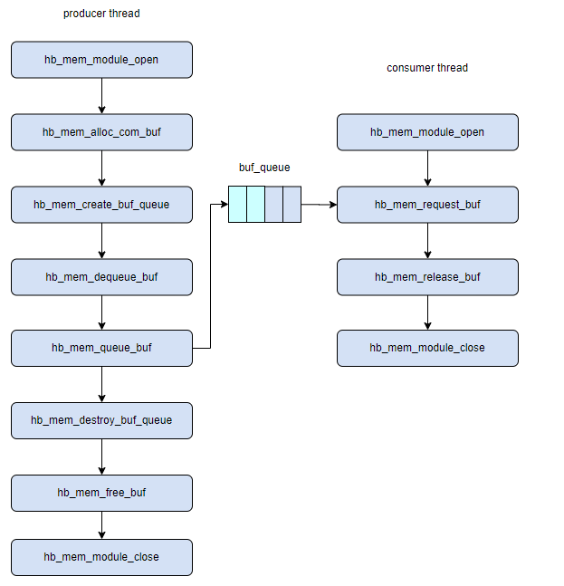
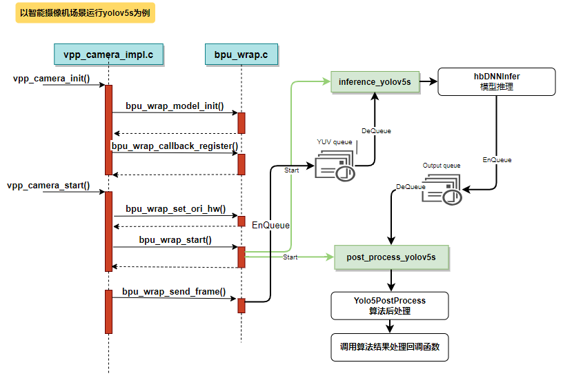

# 02C HUCP、共享内存、多媒体与VDSP执行域

数据截止：2026-11-05；以S6005.1.1文档为当前范围，复用S100历史图时明确标注。目标是把“硬件有加速器”拆成可开发、可交接、可诊断的软件链路，不扩展为03的完整传感器选型。

## 1. 媒体流水线的单位是带布局和所有权的帧

S600媒体示例依赖BSP生成的hbre头文件/库、根文件系统ffmpeg等组件，常用链接库为vpf、vio、cam、hbmem，路径在/usr/hobot/lib与include。相机配置集中在vp_sensors，单个sample用make编译，当前文档明确不支持整体编译所有sample。因此取得演示源码并不等于拥有独立于BSP的可移植媒体SDK。开发时需冻结库/头文件与sensor配置，确认载板、解串器和目标镜像对应，不能从相同函数名推断X5/S100/S600兼容。〔1：[原文](https://developer.d-robotics.cc/rdk_s_doc/Advanced_development/multimedia_development/S600_multimedia_application/overview) / [本地原件](REFERENCES.md#ref-a00c59ab9971f5e1)〕

sample_pipeline有VIN→ISP→YNR/PYM→CODEC及带GDC的组合，覆盖单路、多路和UVC采集示例。基础流水线的PYM六个输出通道中，0保留原尺寸后编码为H264，1–5分别缩小2/4/8/16/32倍，输出NV12并按16像素对齐，缩小后宽高小于32时不保存。它让同一采集帧供不同分辨率消费者使用，减少CPU重复缩放的机会；但PYM输出对齐不是BPU输入stride的同一个约束，接入02B的S60064字节规则时仍须检查实际存储布局。多路示例存在不等于最大路数在同时推理/编码时已验证。〔2：[原文](https://developer.d-robotics.cc/rdk_s_doc/Advanced_development/multimedia_development/S600_multimedia_application/sample_pipeline) / [本地原件](REFERENCES.md#ref-3ee3c8a31c4d35ab)〕

|执行域|主要对象|交接对象|成立条件与主要失效|
|---|---|---|---|
|VIN/ISP/PYM/GDC|媒体节点、通道和图像平面|NV12/原始帧、尺寸与stride|配置/布局匹配；通道缓存不足会背压|
|libhbmem/ION|共享buffer、queue/pool|share标识、引用/消费计数|消费者释放；不能只共享一个进程虚拟地址|
|DNN/UCP|tensor、任务、调度参数|输入输出设备内存及完成事件|提交≠完成；缓存维护与生命周期均正确|
|3D GPU|OpenCL kernel或GLES上下文|应用计算/绘制资源|驱动和会话匹配；X11限制另核|
|VDSP/XOS|firmware、rpmsg服务、heap|核间请求与设备可见buffer|服务单通道并发限制；固件启停有序|

本表由下列API与sample归纳，不表示所有域有一个可任意互换的buffer句柄。所谓统一计算接口需要逐个后端和内存类型核验，不能由UCP名称推导出跨GPU/VDSP自动零复制或隔离保证。〔3：[原文](https://developer.d-robotics.cc/oe_s_doc/static/js/async/42321.211ed409.js) / [本地原件](REFERENCES.md#ref-1df8daceb6d44659) / [官方文档页面](https://developer.d-robotics.cc/oe_s_doc/guide/ucp/ucp_api_reference/ucp_api_function_interface/hbucpsubmittask) / [离线正文](REFERENCES.md) / [渲染HTML](REFERENCES.md)〕 〔4：[原文](https://developer.d-robotics.cc/rdk_s_doc/Advanced_development/multimedia_development/S600_multimedia_application/hbmem_sample_guide) / [本地原件](REFERENCES.md#ref-20f8f640ea355677)〕 〔5：[原文](https://developer.d-robotics.cc/rdk_s_doc/Advanced_development/vdsp_development) / [本地原件](REFERENCES.md#ref-78fe98ada2ae2e64)〕

## 2. hbmem：共享省复制，队列约束生产与消费

该图由当前S600页面引用，原资源路径仍标S100，是接口机制示意而非S600实测。生产者open→alloc→create queue→dequeue/queue，消费者open→request/release→close；最后destroy queue/free/close。这些动作把队列槽的借用与底层内存分配分开。〔4：[原文](https://developer.d-robotics.cc/rdk_s_doc/Advanced_development/multimedia_development/S600_multimedia_application/hbmem_sample_guide) / [本地原件](REFERENCES.md#ref-20f8f640ea355677)〕

手册列出com、graphic、graphic group，以及queue/pool/share pool和多进程共享。调用libhbmem由ION分配，样例分别展示cached/noncached、不同heap、share、consume_cnt及用户态引用计数。共同痛点是图像较大且消费者多：CPU重复复制会占带宽与核心，共享对象可让消费者导入同一数据，但共享不会自动消除缓存一致性和并发访问问题。queue用于帧交接，pool控制预分配资源复用，share pool适合共享场景；具体尺寸、heap及引用处理需以实际SDK头文件确认，本文未取得整个二进制包。〔4：[原文](https://developer.d-robotics.cc/rdk_s_doc/Advanced_development/multimedia_development/S600_multimedia_application/hbmem_sample_guide) / [本地原件](REFERENCES.md#ref-20f8f640ea355677)〕

工程分析：生产者只能在所有读者结束后重用槽；消费者慢于生产者时应规定阻塞、丢旧帧或拒绝新帧策略，并保留采集时间。加深队列能缓冲短时抖动，却可能增加观测年龄。仅测平均FPS无法区分高吞吐但滞后的图像与新鲜观测。跨进程还要检查导入/退出计数与异常回收；手册样例以done日志判定功能成功，未给出进程崩溃时的长期泄漏曲线或相机并发P99。验收应监测ION占用、在途buffer数、丢帧和最大年龄，而不把一次分配成功叫作持续零复制系统。〔4：[原文](https://developer.d-robotics.cc/rdk_s_doc/Advanced_development/multimedia_development/S600_multimedia_application/hbmem_sample_guide) / [本地原件](REFERENCES.md#ref-20f8f640ea355677)〕

UCP的hbUCPMemFlush要求CPU写后CLEAN、设备写后CPU读取前INVALIDATE；它维护缓存，完成等待维护执行顺序，两者不可互相替代。DNN创建任务后仍需提交和等待；在推理期间归还相机buffer，可能使新帧覆盖旧帧。故媒体→BPU交接至少包含帧序号/采集时间、格式/平面、逻辑shape/存储stride、内存可达性、释放责任和任务状态。该契约是本文从生命周期推导的集成要求，未将两个独立sample拼成已测系统。〔6：[原文](https://developer.d-robotics.cc/oe_s_doc/static/js/async/80056.5ccac469.js) / [本地原件](REFERENCES.md#ref-6af5f91666f418e1) / [官方文档页面](https://developer.d-robotics.cc/oe_s_doc/guide/ucp/ucp_api_reference/ucp_api_function_interface/hbucpmemflush) / [离线正文](REFERENCES.md) / [渲染HTML](REFERENCES.md)〕 〔3：[原文](https://developer.d-robotics.cc/oe_s_doc/static/js/async/42321.211ed409.js) / [本地原件](REFERENCES.md#ref-1df8daceb6d44659) / [官方文档页面](https://developer.d-robotics.cc/oe_s_doc/guide/ucp/ucp_api_reference/ucp_api_function_interface/hbucpsubmittask) / [离线正文](REFERENCES.md) / [渲染HTML](REFERENCES.md)〕

## 3. Sunrise camera：有用的应用骨架与文档冲突

图以yolov5s为例，显示模型初始化与回调注册、YUV队列、推理、输出队列、后处理和回调。它能解释媒体与推理线程分工，不能证明回调输出是ROS消息、动作命令或实时闭环。〔7：[原文](https://developer.d-robotics.cc/rdk_s_doc/Advanced_development/multimedia_development/S600_multimedia_application/sunrise_camera_develop_guide) / [本地原件](REFERENCES.md#ref-f2a7faecf95c530e)〕

Sunrise camera把communicate事件总线、common工具、Platform与Transport分层。sdk_cmd_register/unregister管理命令，sdk_cmd_impl转发到已注册且使能的模块，未注册命令失败。vpp_ops_t定义init_param/init/start/stop/uninit和参数读写；这使场景可沿统一生命周期扩展。文档称其“微核/插件架构”指应用组织方式，不是Linux内核变成微内核，也不能由静态插件登记推出进程级故障隔离。Transport包装RTSP、WebSocket和ZLMediaKit，结果主要供Web显示。〔7：[原文](https://developer.d-robotics.cc/rdk_s_doc/Advanced_development/multimedia_development/S600_multimedia_application/sunrise_camera_develop_guide) / [本地原件](REFERENCES.md#ref-f2a7faecf95c530e)〕

添加模型的路径是准备目标模型→登记bpu_models名称/文件/推理函数/后处理函数→创建输出tensor→处理YUV→输出队列→生成JSON并回调。检测框必须从缩放图映射回原图；分类类别表与模型也需配套。文档示例用五组输出buffer轮转，解释为假设后处理快于推理的简化处理。生产系统必须以实际消费者完成事件管理复用，不能把固定五组视为无条件安全。〔7：[原文](https://developer.d-robotics.cc/rdk_s_doc/Advanced_development/multimedia_development/S600_multimedia_application/sunrise_camera_develop_guide) / [本地原件](REFERENCES.md#ref-f2a7faecf95c530e)〕

当前页面有明显混代内容：一处把bin描述为PTQ、hbm描述为QAT，代码同时出现HB_BPU_runModel和hbDNNInfer。当前OE转换图明确PTQ和QAT都可产出hbm，且S600 PTQ示例用hbDNNInferV2/UCP。这是文档冲突，本文采用当前OE目标部署流程；Sunrise段只据其架构和队列机制，不将片段当作S6005.1.1可直接编译的完整代码。复建需取得对应发布包源码和编译日志，而不是按网页片段拼接。〔8：[原文](https://developer.d-robotics.cc/oe_s_doc/static/js/async/49841.f8e6a5ca.js) / [本地原件](REFERENCES.md#ref-4d3875049ead716f) / [官方文档页面](https://developer.d-robotics.cc/oe_s_doc/guide/model_deployment_guidance/model_deployment_principle_process/model_conversion_compile) / [离线正文](REFERENCES.md) / [渲染HTML](REFERENCES.md)〕 〔9：[原文](https://developer.d-robotics.cc/oe_s_doc/static/js/async/62300.e55caad1.js) / [本地原件](REFERENCES.md#ref-6c736e923e8d396a) / [官方文档页面](https://developer.d-robotics.cc/oe_s_doc/guide/faststart/ptq_quickstart) / [离线正文](REFERENCES.md) / [渲染HTML](REFERENCES.md)〕 〔7：[原文](https://developer.d-robotics.cc/rdk_s_doc/Advanced_development/multimedia_development/S600_multimedia_application/sunrise_camera_develop_guide) / [本地原件](REFERENCES.md#ref-f2a7faecf95c530e)〕

## 4. GPU与VDSP：可执行接口、资源约束和诊断

S600提供OpenCL矩阵乘和OpenGLES贝塞尔曲线示例。矩阵日志为CPU0.997923s、OpenCL0.038153s，但页面缺矩阵大小、BSP/频率、传输包含范围、重复统计及功率，不能转成整模型加速排名。GLES示例需要HDMI/Wayland会话，跨用户运行需要对应WAYLAND_DISPLAY。S6005.1.1发布说明同时列出GPU应用页大小不匹配可能崩溃、无HDMI转X11时CPU渲染以及X11 GPU加速不支持；OpenCL示例存在和桌面加速可用是不同问题。〔10：[原文](https://developer.d-robotics.cc/rdk_s_doc/Advanced_development/multimedia_development/S600_multimedia_application/sample_gpu_3d) / [本地原件](REFERENCES.md#ref-ade84e05b1bf5f74)〕 〔11：[原文](https://developer.d-robotics.cc/rdk_s_doc/Release_Note/s600/v5_1_1) / [本地原件](REFERENCES.md#ref-10ce1a6098be10ab)〕

S600有两个VDSP，VDSP1只适用双核平台。Linux默认不启动VDSP firmware，需remoteproc_vdsp0/1设置firmware与start/stop，读取version/state；libvdsp.so提供程序化控制。ARM侧连接预设rpmsg服务，DSP侧初始化XOS并响应请求，同一服务通道不支持多进程/线程并发收发。应用若并行处理相机帧，必须串行化该通道或按文档支持的服务分配请求，不能只增加CPU线程。VDSP heap提供初始化、分配、释放及状态API，CPU虚拟地址不能直接当DSP可用地址。〔5：[原文](https://developer.d-robotics.cc/rdk_s_doc/Advanced_development/vdsp_development) / [本地原件](REFERENCES.md#ref-78fe98ada2ae2e64)〕

VDSP心跳默认关闭，可启用100ms周期、连续丢七次后诊断并reset；这个规则是监控阈值，不是700ms最坏危险响应承诺。FW日志共享串口可能阻塞BL31/optee等日志并触发watchdog；共享内存落盘日志又不是实时的。诊断须把事件发生、写入及落盘时刻分开。退出/休眠前检查固件已停止，避免仍有设备访问时卸载资源。源码、Vision_Q8 build包和Xplorer调试资料需联系厂商，本文只取得公开手册；Cadence工具/IP、库和固件许可不由RDK文档Apache2覆盖。〔5：[原文](https://developer.d-robotics.cc/rdk_s_doc/Advanced_development/vdsp_development) / [本地原件](REFERENCES.md#ref-78fe98ada2ae2e64)〕 〔12：[原文](https://raw.githubusercontent.com/D-Robotics/rdk_doc/main/LICENSE) / [本地原件](REFERENCES.md#ref-50e26f159fc3347a)〕

## 5. 对标与验证路径

与通用V4L2/DMA-BUF类共享、GStreamer流水线或GPU计算接口相比，主要收益机制同样是专用媒体处理、减少复制和预分配缓冲；迁移资产是帧格式、时间戳和处理算法，vpf/hbmem/remoteproc实例及厂商固件配置需要重做。若应用只用USB采集与CPU算法，标准接口可以降低专用库耦合，但不能据此断言性能相同。这里没有同板同负载测量，只作机制比较。

复建先固定S600镜像与hbre/runtime/firmware，单模块验证再搭媒体→BPU→消费者。检查布局、裁剪映射、缓存与队列释放；加编码/Web/ROS并发和热稳定后，记录端到端时延分布、帧年龄、ION泄漏、丢帧及VDSP超时恢复。对GPU样例补齐矩阵和传输口径，对VDSP同时保存FW版本与ARM库。公开资料未提供这些组合测试，因此可确认的软件接口和应用骨架仍需要产品级集成验收。

## 资料与核验

本篇为公开资料与代码核验，未进行SDK安装、模型实机或机器人验收。静态归档部分缺失：无；所识别静态依赖完整，仍不保证动态内容/像素级复现。

[02资料集合](REFERENCES.md) · [证据JSON](research_state/evidence/02C_HUCP_and_Multimedia.json)

### 原件清单

1. **H02_Media_Overview**：[原URL](https://developer.d-robotics.cc/rdk_s_doc/Advanced_development/multimedia_development/S600_multimedia_application/overview) · [原件](REFERENCES.md#ref-a00c59ab9971f5e1)；采集2026-11-05T02:50:28.752862+00:00；complete_static。

2. **H02_Pipeline**：[原URL](https://developer.d-robotics.cc/rdk_s_doc/Advanced_development/multimedia_development/S600_multimedia_application/sample_pipeline) · [原件](REFERENCES.md#ref-3ee3c8a31c4d35ab)；采集2026-11-05T02:50:17.344706+00:00；complete_static。

3. **H02_UCP_Submit_Content**：[原URL](https://developer.d-robotics.cc/oe_s_doc/static/js/async/42321.211ed409.js) · [原件](REFERENCES.md#ref-1df8daceb6d44659)；采集2026-11-05T02:39:38.417384+00:00；complete_static。 / [官方文档页面](https://developer.d-robotics.cc/oe_s_doc/guide/ucp/ucp_api_reference/ucp_api_function_interface/hbucpsubmittask) / [离线正文](REFERENCES.md) / [渲染HTML](REFERENCES.md)。正文由已归档的官方页面JS在完全阻断外网请求的浏览器内渲染，入口空壳HTML不作正文证据。

4. **H02_Hbmem**：[原URL](https://developer.d-robotics.cc/rdk_s_doc/Advanced_development/multimedia_development/S600_multimedia_application/hbmem_sample_guide) · [原件](REFERENCES.md#ref-20f8f640ea355677)；采集2026-11-05T02:50:19.144296+00:00；complete_static。

5. **H02_VDSP**：[原URL](https://developer.d-robotics.cc/rdk_s_doc/Advanced_development/vdsp_development) · [原件](REFERENCES.md#ref-78fe98ada2ae2e64)；采集2026-11-05T02:49:35.103744+00:00；complete_static。

6. **H02_UCP_Flush_Content**：[原URL](https://developer.d-robotics.cc/oe_s_doc/static/js/async/80056.5ccac469.js) · [原件](REFERENCES.md#ref-6af5f91666f418e1)；采集2026-11-05T02:39:39.612142+00:00；complete_static。 / [官方文档页面](https://developer.d-robotics.cc/oe_s_doc/guide/ucp/ucp_api_reference/ucp_api_function_interface/hbucpmemflush) / [离线正文](REFERENCES.md) / [渲染HTML](REFERENCES.md)。正文由已归档的官方页面JS在完全阻断外网请求的浏览器内渲染，入口空壳HTML不作正文证据。

7. **H02_Sunrise**：[原URL](https://developer.d-robotics.cc/rdk_s_doc/Advanced_development/multimedia_development/S600_multimedia_application/sunrise_camera_develop_guide) · [原件](REFERENCES.md#ref-f2a7faecf95c530e)；采集2026-11-05T02:50:22.838601+00:00；complete_static。

8. **H02_OE_Compile_Content**：[原URL](https://developer.d-robotics.cc/oe_s_doc/static/js/async/49841.f8e6a5ca.js) · [原件](REFERENCES.md#ref-4d3875049ead716f)；采集2026-11-05T02:35:35.779177+00:00；complete_static。 / [官方文档页面](https://developer.d-robotics.cc/oe_s_doc/guide/model_deployment_guidance/model_deployment_principle_process/model_conversion_compile) / [离线正文](REFERENCES.md) / [渲染HTML](REFERENCES.md)。正文由已归档的官方页面JS在完全阻断外网请求的浏览器内渲染，入口空壳HTML不作正文证据。

9. **H02_OE_PTQ_Content**：[原URL](https://developer.d-robotics.cc/oe_s_doc/static/js/async/62300.e55caad1.js) · [原件](REFERENCES.md#ref-6c736e923e8d396a)；采集2026-11-05T02:35:34.320117+00:00；complete_static。 / [官方文档页面](https://developer.d-robotics.cc/oe_s_doc/guide/faststart/ptq_quickstart) / [离线正文](REFERENCES.md) / [渲染HTML](REFERENCES.md)。正文由已归档的官方页面JS在完全阻断外网请求的浏览器内渲染，入口空壳HTML不作正文证据。

10. **H02_GPU**：[原URL](https://developer.d-robotics.cc/rdk_s_doc/Advanced_development/multimedia_development/S600_multimedia_application/sample_gpu_3d) · [原件](REFERENCES.md#ref-ade84e05b1bf5f74)；采集2026-11-05T02:50:26.732725+00:00；complete_static。

11. **H02_S600_511_Release**：[原URL](https://developer.d-robotics.cc/rdk_s_doc/Release_Note/s600/v5_1_1) · [原件](REFERENCES.md#ref-10ce1a6098be10ab)；采集2026-11-05T02:22:28.834915+00:00；complete_static。

12. **Horizon_RDK_License**：[原URL](https://raw.githubusercontent.com/D-Robotics/rdk_doc/main/LICENSE) · [原件](REFERENCES.md#ref-50e26f159fc3347a)；采集2026-11-05T01:25:03.899112+00:00；complete_static。
