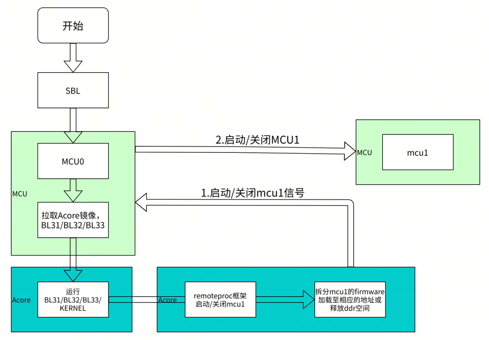
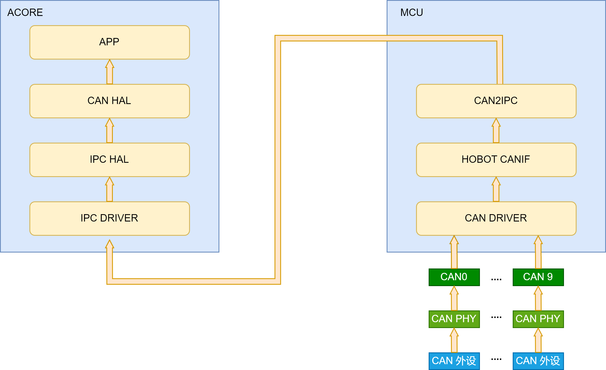

# 02D MCU、FreeRTOS、IPC与工业通信

数据截止：2026-11-05；当前S6005.1.1系统MCU版本2.0.3，S100仅作必要版本对照。MCU0/MCU1在手册中表示系统职责分区，不能据两个名称推断芯片只有两颗物理实时核。本文核验固件与控制接口，不把总线sample当本体闭环验收。〔1：[原文](https://developer.d-robotics.cc/rdk_s_doc/Release_Note/s600/v5_1_1) / [本地原件](REFERENCES.md#ref-10ce1a6098be10ab)〕

## 1. Linux与实时业务域的分工及交付边界

该图原资源为S100，当前S600手册复用相同的启动职责说明：SBL/MCU0拉起Acore，Linux remoteproc解析MCU1固件并经MCU0通知启停。它支持控制关系，不能证明不同SKU的内存地址、物理核数或启动时延相同。〔2：[原文](https://developer.d-robotics.cc/rdk_s_doc/Advanced_development/mcu_development/basic_information) / [本地原件](REFERENCES.md#ref-ab43a50619e45bdc)〕

MCU0承担Acore/MCU1启动及电源管理，社区交付验证过的bin并不默认释放其源码；MCU1承担可定制业务，FreeRTOS与应用任务为下层控制提供执行载体。代码结构页进一步明确MCU0编译、McalCdd、Service、Platform为企业版专有；社区包包括Build、Config、Include、Library静态库、OpenSource、samples和Target。因此“MCU1开源”不能扩展为全部驱动、电源服务和固件开放源码。商业包需申请及NDA，本文没有取得，缺口是未取得正式交付物，不是厂商没有控制域软件。〔2：[原文](https://developer.d-robotics.cc/rdk_s_doc/Advanced_development/mcu_development/basic_information) / [本地原件](REFERENCES.md#ref-ab43a50619e45bdc)〕 〔3：[原文](https://developer.d-robotics.cc/rdk_s_doc/Advanced_development/mcu_development/code_release) / [本地原件](REFERENCES.md#ref-68065d5ada57af84)〕

快速入门列FreeRTOS Kernel V10.0.1、gcc-arm-none-eabi10.3~2021.10与构建Python3.8.10，主机建议Ubuntu22.04。这些是MCU构建环境，与S600目标Ubuntu24.04和BSP构建机配置不同。编译系统基于SCons，入口build_freertos.py经SConstruct、settings、gcc_arm.py及平台YAML决定文件、编译/链接选项，Linker/gcc/S600的链接脚本约束部署地址。S600输出含ELF/BIN/MAP和debug/release分支；不能只保存最终bin而丢失符号、链接映射和配置。系统说明称基于SCons3.0.0，而安装步骤要求scons≥4.0.0，属于文档环境差异，应按实际SDK依赖及构建日志冻结版本，不能声称全文有唯一无冲突构建组合。〔4：[原文](https://developer.d-robotics.cc/rdk_s_doc/Advanced_development/mcu_development/MCU_build_system) / [本地原件](REFERENCES.md#ref-fe879fe4b8426e53)〕 〔2：[原文](https://developer.d-robotics.cc/rdk_s_doc/Advanced_development/mcu_development/basic_information) / [本地原件](REFERENCES.md#ref-ab43a50619e45bdc)〕

## 2. 固件生命周期、任务与资源所有权

MCU1 ELF放/lib/firmware，向remoteproc_mcu0的firmware/state写目标文件及start/stop。stop后再次start必须等待进入WFI，否则固件重载可能覆盖仍在执行的SRAM代码并导致挂死；软件启停不等于对业务核独立硬件掉电。alive约每秒更新，cpuloads读取也需约一秒拷贝，它们适合诊断，不适合证明毫秒动作截止期限。复建应记录MCU/SBL版本、固件哈希、debug或release和实际启动状态，不能用一个alive字符串代表全控制系统正常。〔2：[原文](https://developer.d-robotics.cc/rdk_s_doc/Advanced_development/mcu_development/basic_information) / [本地原件](REFERENCES.md#ref-ab43a50619e45bdc)〕

FreeRTOS按main中完成硬件、系统和任务创建后启动调度器；Task_Hal.c创建Startup一次性任务以及BSW/ASW周期任务，应用处理落在HorizonTask.c等文件。IPC系统中断建议高于普通功能中断。把算法调用放入一个周期任务并不保证它在每周期内完成：中断嵌套、DMA争抢、临界区、日志与共享内存访问都可能占预算。Linux PREEMPT_RT与MCU FreeRTOS是两个执行域，前者cyclictest的观测值不能作后者WCET。〔5：[原文](https://developer.d-robotics.cc/rdk_s_doc/Advanced_development/mcu_development/FreeRTOS_development) / [本地原件](REFERENCES.md#ref-339c03655f0ece0d)〕

|契约|必须一致的对象|典型失效|部署动作|
|---|---|---|---|
|固件启停|ELF/链接地址、MCU0与MCU1版本|未WFI即覆盖固件|等待停止确认，保存旧固件与恢复路径|
|IPC实例|控制/数据地址、Channel ID、池大小、receive_coreid|端点配置不一致或中断被别核抢占|核对双方配置并按Instance分配|
|CAN转发|控制器、IPC映射、打包、时间域|丢包/合包延迟、错误数据年龄|核验计数与时钟同步，测时延分布|
|EtherCAT过程数据|主站context、IOmap/PDO、状态与WKC|映射错、非OP或低WKC|检查状态/工作计数及错误恢复|
|定时/看门狗|时钟频率、tick值、触发期限、临界区|旧频率参数、喂狗与业务脱节|换算实际单位并做过期/故障测试|

## 3. IPC与IpcBox：配置是协议的一部分

Ipc_MDMA_SendMsg要求buffer地址16字节对齐；发送轮询DMA前关闭DMA中断，接收时DMA/IPC中断优先级一致。只有两个MDMA发送通道，多核多任务需自旋锁或关中断控制抢占。IPC多核分配按Instance，不能把同实例不同Channel当成可独立交给任意核；初始化在DMA之后，双端地址、池和Channel配置必须相同，receive_coreid与中断使能核也须对应。示例S100寄存器地址不能用于S600。〔6：[原文](https://developer.d-robotics.cc/rdk_s_doc/Advanced_development/mcu_development/mcu_ipc) / [本地原件](REFERENCES.md#ref-975898a4eb7147a2)〕

IpcBox在Acore↔IPC↔MCU↔外设之间透传RunCmd/SPI/I2C/UART。S1004.0.4-Beta到4.0.5-Beta重构了包结构、IPC通道与默认配置，故更新Linux用户库与MCU固件需要成套。IpcBoxPacket_t含magic、version、checksum、length、cmd及data，建议128字节包使data在64字节对齐分配中保持对齐；该64字节建议与MDMA16字节最低要求不同。透传默认关闭以免占用外设，运行时打开要确认资源归属。RunCmd中断回调入队，常驻线程解析执行再返回，这种队列分工避免把全部业务压在中断里，但没有提供无界请求下的时延保证。〔6：[原文](https://developer.d-robotics.cc/rdk_s_doc/Advanced_development/mcu_development/mcu_ipc) / [本地原件](REFERENCES.md#ref-975898a4eb7147a2)〕

## 4. CAN路径与Linux SocketCAN的版本差异

图标CAN0–9是S100范围，只用于解释MCU CANIF/CAN2IPC→IPC→Acore CANHAL数据路径。S600具体控制器和载板引出数量采用当前文字说明，不能从旧图外推。〔7：[原文](https://developer.d-robotics.cc/rdk_s_doc/Advanced_development/mcu_development/mcu_can) / [本地原件](REFERENCES.md#ref-71ba84d58f4beadf)〕

S600 MCU域16路控制器，文档默认使能CAN1–10，开发板引出10路：MCU小板5路、底板5路。控制器上限、驱动启用和物理接口是不同数量。最高8M为控制器能力，受transceiver限制实验室只验证至5M，不当成8M整链路保证；不支持TTCAN，同一控制器不可多个核同时使用。文档中的CAN终端“开环/闭环”措辞不用于推导通用布线规则，实际应按总线拓扑和两端终端设计验收。〔7：[原文](https://developer.d-robotics.cc/rdk_s_doc/Advanced_development/mcu_development/mcu_can) / [本地原件](REFERENCES.md#ref-71ba84d58f4beadf)〕

CAN2IPC支持正确性/丢包/超时检测，合包策略减少高频小块转发的CPU成本但引入等待；MCU打时间戳、Acore读取本地时间做超时报警，前提是MCU RTC与Acore phc0同步。CANHAL同通道不支持多进程/线程读写。S6005.1.1新增SocketCAN访问MCU CAN、扩展帧和远程帧，并修复CAN filter等问题。因此不能沿旧CANHAL说明写成“Linux没有SocketCAN”；旧库多线程限制也不能未经源码核对直接套到新的内核路径。应用应冻结所选接口和映射，分别测试bus-off、帧丢失、时间同步失效及恢复。〔7：[原文](https://developer.d-robotics.cc/rdk_s_doc/Advanced_development/mcu_development/mcu_can) / [本地原件](REFERENCES.md#ref-71ba84d58f4beadf)〕 〔1：[原文](https://developer.d-robotics.cc/rdk_s_doc/Release_Note/s600/v5_1_1) / [本地原件](REFERENCES.md#ref-10ce1a6098be10ab)〕

## 5. EtherCAT、定时与故障处置

MCU EtherCAT移植SOEM：core处理配置、状态机、邮箱与DC；OSAL适配FreeRTOS；OSHW通过McalCdd Eth_Transmit/Eth_Receive_ethercat收发0x88A4帧。ecx_contextt保存端口、从站列表、分组和DCtime，ecx_config_map_group将PDO映射到IOmap；send/receive_processdata的WKC与期望值比较，必要时检查从站状态、恢复或重配。INIT→PRE_OP→SAFE_OP→OP明确区分配置和实际输出状态，SDO邮箱不是周期PDO替代物。DC的PI对齐机制用于时钟同步，仍须测漂移、误差和周期抖动。〔8：[原文](https://developer.d-robotics.cc/rdk_s_doc/Advanced_development/mcu_development/mcu_ethercat) / [本地原件](REFERENCES.md#ref-55e8507927e44f5e)〕

样例说明默认1000µs、ECAT_RT每1ms PDO、ECAT_CHK每10ms诊断，并约10秒后清理。**同页日志却写1000000µs**，与默认1ms冲突；本文保留差异，只认配置说明，不把日志当作1kHz实测。S6005.1.1新增MCU EtherCAT多字节sample和Linux EtherCAT主内核线程绑核支持，这两个实现域不能合并成一条已验收总线。公开手册未给目标驱动器、PDO字节、从站数、同步误差、P99/WCET、丢帧率及压力条件，也未取得移植SOEM确切commit/随包许可；不能据开源名称断定商业包全部许可。〔8：[原文](https://developer.d-robotics.cc/rdk_s_doc/Advanced_development/mcu_development/mcu_ethercat) / [本地原件](REFERENCES.md#ref-55e8507927e44f5e)〕 〔1：[原文](https://developer.d-robotics.cc/rdk_s_doc/Release_Note/s600/v5_1_1) / [本地原件](REFERENCES.md#ref-10ce1a6098be10ab)〕

GPT在S100为6实例、S600为10实例，各4个32bit channel；sample时钟S100200MHz、S60040MHz。Gpt_StartTimer的Value是tick，复制旧平台数值会改变期限。连续模式向下计数；one-shot需按文档停止/重配并核实际实现。Wdgx_Init/SetMode/SetTriggerCondition为非重入接口，timeout单位ms，临界区由应用结合部署填充；看门狗不能靠无条件后台喂养掩盖业务挂死。S6005.1.1还修复MCU timer精度，量产测试必须包含匹配版本。〔9：[原文](https://developer.d-robotics.cc/rdk_s_doc/Advanced_development/mcu_development/mcu_timer) / [本地原件](REFERENCES.md#ref-15b2c17ccadc5740)〕 〔10：[原文](https://developer.d-robotics.cc/rdk_s_doc/Advanced_development/mcu_development/mcu_watchdog) / [本地原件](REFERENCES.md#ref-1b97b81b8bf75e89)〕 〔1：[原文](https://developer.d-robotics.cc/rdk_s_doc/Release_Note/s600/v5_1_1) / [本地原件](REFERENCES.md#ref-10ce1a6098be10ab)〕

## 6. 机制对标与放行证据

与独立实时控制器相比，片上MCU/IPC减少外部链路和板间协议，但仍共处一套供电、启动和软件维护关系；不能仅凭分域推断全部故障隔离。Linux总线主站方便上层集成，MCU周期任务更容易控制执行集合，两者都需证明中断、网络、IPC和动作处理预算。源模型输出必须经状态同步、单位/关节顺序、限幅、超时和下游保护映射到命令；目前公开sample未闭合此动作契约。

可复建验证应保存Linux/BSP、MCU0/1固件、静态库、配置/链接脚本及源码版本；先验证启停/资源映射，再测IPC和总线并发，再加入BPU/媒体/热负载。记录PDO与命令年龄、最坏观测延迟、WKC异常、丢包、超时及复位后的输出行为。FreeRTOS代码、MCAL静态库、固件、SOEM移植和客户本体协议分别核许可；商业/NDA交付未取得的边界必须留到供应商正式交付确认。文献核验不能替代这些设备与机器人测试。〔3：[原文](https://developer.d-robotics.cc/rdk_s_doc/Advanced_development/mcu_development/code_release) / [本地原件](REFERENCES.md#ref-68065d5ada57af84)〕

## 资料与核验

本篇为公开资料与代码核验，未进行SDK安装、模型实机或机器人验收。静态归档部分缺失：无；所识别静态依赖完整，仍不保证动态内容/像素级复现。

[02资料集合](REFERENCES.md) · [证据JSON](research_state/evidence/02D_MCU_and_Industrial_Communication.json)

### 原件清单

1. **H02_S600_511_Release**：[原URL](https://developer.d-robotics.cc/rdk_s_doc/Release_Note/s600/v5_1_1) · [原件](REFERENCES.md#ref-10ce1a6098be10ab)；采集2026-11-05T02:22:28.834915+00:00；complete_static。

2. **H02_MCU_Info**：[原URL](https://developer.d-robotics.cc/rdk_s_doc/Advanced_development/mcu_development/basic_information) · [原件](REFERENCES.md#ref-ab43a50619e45bdc)；采集2026-11-05T02:53:20.377310+00:00；complete_static。

3. **H02_MCU_Code**：[原URL](https://developer.d-robotics.cc/rdk_s_doc/Advanced_development/mcu_development/code_release) · [原件](REFERENCES.md#ref-68065d5ada57af84)；采集2026-11-05T02:53:28.804982+00:00；complete_static。

4. **H02_MCU_Build**：[原URL](https://developer.d-robotics.cc/rdk_s_doc/Advanced_development/mcu_development/MCU_build_system) · [原件](REFERENCES.md#ref-fe879fe4b8426e53)；采集2026-11-05T02:53:31.360759+00:00；complete_static。

5. **H02_FreeRTOS**：[原URL](https://developer.d-robotics.cc/rdk_s_doc/Advanced_development/mcu_development/FreeRTOS_development) · [原件](REFERENCES.md#ref-339c03655f0ece0d)；采集2026-11-05T02:53:34.499375+00:00；complete_static。

6. **H02_IPC**：[原URL](https://developer.d-robotics.cc/rdk_s_doc/Advanced_development/mcu_development/mcu_ipc) · [原件](REFERENCES.md#ref-975898a4eb7147a2)；采集2026-11-05T02:53:38.614163+00:00；complete_static。

7. **H02_CAN**：[原URL](https://developer.d-robotics.cc/rdk_s_doc/Advanced_development/mcu_development/mcu_can) · [原件](REFERENCES.md#ref-71ba84d58f4beadf)；采集2026-11-05T02:53:41.785147+00:00；complete_static。

8. **H02_EtherCAT**：[原URL](https://developer.d-robotics.cc/rdk_s_doc/Advanced_development/mcu_development/mcu_ethercat) · [原件](REFERENCES.md#ref-55e8507927e44f5e)；采集2026-11-05T02:53:49.329436+00:00；complete_static。

9. **H02_Timer**：[原URL](https://developer.d-robotics.cc/rdk_s_doc/Advanced_development/mcu_development/mcu_timer) · [原件](REFERENCES.md#ref-15b2c17ccadc5740)；采集2026-11-05T02:53:53.833845+00:00；complete_static。

10. **H02_Watchdog**：[原URL](https://developer.d-robotics.cc/rdk_s_doc/Advanced_development/mcu_development/mcu_watchdog) · [原件](REFERENCES.md#ref-1b97b81b8bf75e89)；采集2026-11-05T02:53:51.616573+00:00；complete_static。
