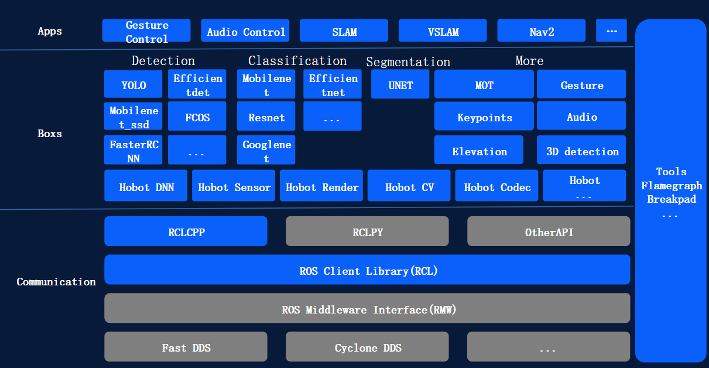
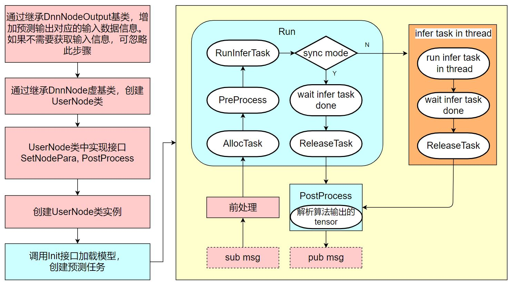

# 02E TogetheROS.Bot、消息生命周期与机器人应用链

数据截止：2026-11-05。TROS是D-Robotics提供的ROS2组件、算法包和应用示例集合；以下按实际SKU和发行版区分，未把旧X3/X5应用自动视为S600适配，未开展机器人实测。

## 1. 软件分层和可复建版本

图将Communication的RCL/RMW/DDS、Boxs的传感器/推理/CV/编解码和Apps分层。图列Nav2、VSLAM等表示整个产品体系，具体SKU支持必须再查功能矩阵与实例页；蓝色优化块不证明所有DDS、Python和网络路径都零复制。〔1：[原文](https://developer.d-robotics.cc/tros_doc/tros) / [本地原件](REFERENCES.md#ref-59b673f457eb83c2)〕

当前传感器文档明确S100/S100P运行Ubuntu22.04/Humble、S600运行Ubuntu24.04/Jazzy；安装包分别tros-humble和tros-jazzy，环境脚本为/opt/tros/humble或jazzy/setup.bash。手册页眉3.0.0是文档选择值，不能当板端deb版本。Jazzy发行记录2.5.4（2026-05-19）明确适配S600系统SDK5.1.0；2.5.1对应5.0.1并新增YOLO、DOSOD、人体跟踪等。S600 BSP现在5.1.1，本文未取得对应完整apt依赖闭包/回归记录，不能推断所有2.5.4组件在新镜像上已测。旧安装原文的Foxy2.0.0/Humble2.2.0是示例，未作为当前版本。〔2：[原文](https://developer.d-robotics.cc/tros_doc/quick_demo/demo_sensor) / [本地原件](REFERENCES.md#ref-d7494a221f0c3960)〕 〔3：[原文](https://developer.d-robotics.cc/tros_doc/quick_start/install_tros) / [本地原件](REFERENCES.md#ref-710139a1a62d0142)〕 〔4：[原文](https://developer.d-robotics.cc/tros_doc/quick_start/changelog) / [本地原件](REFERENCES.md#ref-aae5750928c41e90)〕 〔5：[原文](https://developer.d-robotics.cc/rdk_s_doc/Release_Note/s600/v5_1_1) / [本地原件](REFERENCES.md#ref-10ce1a6098be10ab)〕

|对象|核验版本/适用范围|交付关系|保留的缺口|
|---|---|---|---|
|S600 TROS|Jazzy2.5.4明确适配SDK5.1.0|apt包及Jazzy环境|5.1.1成套依赖与实机回归未取得|
|S100 TROS|Ubuntu22.04/Humble|按目标发行记录安装|不能用X5条目替代S100更新|
|hobot_dnn仓库|commit 7647b62c975a97c8d3b627b0ded82302d7b128de|固定commit文档/API/package原件|未与S600发行deb逐文件比对|
|dnn_node包|package.xml2.6.3；含S600依赖条件|ROS封装依赖hobot-dnn|README环境仍只列至S100，存在覆盖差异|
|Nav2/人体跟随案例|Nav2列X3/X5/S100，跟随列X3/X5|第三方框架与官方示例|未列S600，不据通用ROS兼容补适配|

固定commit从官方仓库HTML的currentOid取得，再下载该commit的README、API、流程图和package.xml；因此不是把develop浮动分支当复建标识。README的S100依赖列ucp3.7.3、X5列dnn1.23.5，不能与OE3.7.0编译工具版本混为一个版本号；package支持条件也不足以证明相应源码/模型在板端验收。〔6：[原文](https://github.com/D-Robotics/hobot_dnn) / [本地原件](REFERENCES.md#ref-184399abf6dfb979)〕 〔7：[原文](https://raw.githubusercontent.com/D-Robotics/hobot_dnn/7647b62c975a97c8d3b627b0ded82302d7b128de/dnn_node/README_cn.md) / [本地原件](REFERENCES.md#ref-c481192af9210f8a)〕 〔8：[原文](https://raw.githubusercontent.com/D-Robotics/hobot_dnn/7647b62c975a97c8d3b627b0ded82302d7b128de/dnn_node/package.xml) / [本地原件](REFERENCES.md#ref-3f9cd1b8b8ad1eac)〕 〔9：[原文](https://developer.d-robotics.cc/tros_doc/apps/navigation2) / [本地原件](REFERENCES.md#ref-60f9282395328216)〕 〔10：[原文](https://developer.d-robotics.cc/tros_doc/apps/car_tracking) / [本地原件](REFERENCES.md#ref-f91ef5585c3f3188)〕

## 2. DnnNode：封装任务管理，不封装全部机器人语义

图显示继承DnnNode及DnnNodeOutput、配置/Init、订阅与前处理、AllocTask、同步或线程执行、ReleaseTask、PostProcess和发布。它支持任务/消息生命周期；图和API未包含关节控制器或安全输出模块。〔11：[原文](https://raw.githubusercontent.com/D-Robotics/hobot_dnn/7647b62c975a97c8d3b627b0ded82302d7b128de/dnn_node/docs/dnnnode_workflow.jpg) / [本地原件](REFERENCES.md#ref-fb69d4af75d84169)〕 〔12：[原文](https://raw.githubusercontent.com/D-Robotics/hobot_dnn/7647b62c975a97c8d3b627b0ded82302d7b128de/dnn_node/docs/API-Manual/API-Manual.md) / [本地原件](REFERENCES.md#ref-7c44f803e5c3369a)〕

用户实现SetNodePara配置model_file/model_name、ModelInferType或ModelRoiInferType、task_num等，再调用Init。ROI类型适用于图像加目标框输入，普通图像任务用ModelInferType。Run有DNNInput和DNNTensor重载，模型输入不是任意ROS图像字节流；需要格式、尺寸和前处理匹配。GetNV12PyramidFromNV12Img在输入小于模型时padding、较大时截左上区域，不是自动保留整张图的resize；若目标会位于边缘，需明确resize/crop策略及后处理坐标逆映射。〔7：[原文](https://raw.githubusercontent.com/D-Robotics/hobot_dnn/7647b62c975a97c8d3b627b0ded82302d7b128de/dnn_node/README_cn.md) / [本地原件](REFERENCES.md#ref-c481192af9210f8a)〕 〔12：[原文](https://raw.githubusercontent.com/D-Robotics/hobot_dnn/7647b62c975a97c8d3b627b0ded82302d7b128de/dnn_node/docs/API-Manual/API-Manual.md) / [本地原件](REFERENCES.md#ref-7c44f803e5c3369a)〕

task_num默认2，在Init预创建任务，可提高多帧并行使用率，但不能直接降低单帧响应时间。API中的alloctask_timeout_ms默认-1表示一直等待，infer_timeout_ms默认20000毫秒；DnnNodePara内timeout_ms100又是不同配置对象。机器人应用应显式设等待预算与过期策略，不能把库默认20秒超时当动作可接受期限。异步Run默认不等结果返回，经线程池执行后释放任务并回调PostProcess，输出可能乱序；msg_header用于匹配输入，需保存序号和采集时间并丢弃过期结果。同步模式阻塞到推理和后处理结束，也不自动获得硬实时保证。〔12：[原文](https://raw.githubusercontent.com/D-Robotics/hobot_dnn/7647b62c975a97c8d3b627b0ded82302d7b128de/dnn_node/docs/API-Manual/API-Manual.md) / [本地原件](REFERENCES.md#ref-7c44f803e5c3369a)〕 〔7：[原文](https://raw.githubusercontent.com/D-Robotics/hobot_dnn/7647b62c975a97c8d3b627b0ded82302d7b128de/dnn_node/README_cn.md) / [本地原件](REFERENCES.md#ref-c481192af9210f8a)〕

rt_stat中的infer_time_ms是当前帧推理统计，FPS以一秒窗口更新；它未自动包括传感器曝光、ROS排队、控制器和执行器。发行记录曾修复多线程耗时计算与X5统计错误，说明指标解释必须绑定版本。多算法融合节点对PerceptionTargets做时间对齐与去重，OneEuroFilter减少框/点抖动；它们有利于上层使用但也引入匹配/滤波延迟，不能由“融合”推出传感器已同硬件时间同步。〔7：[原文](https://raw.githubusercontent.com/D-Robotics/hobot_dnn/7647b62c975a97c8d3b627b0ded82302d7b128de/dnn_node/README_cn.md) / [本地原件](REFERENCES.md#ref-c481192af9210f8a)〕 〔4：[原文](https://developer.d-robotics.cc/tros_doc/quick_start/changelog) / [本地原件](REFERENCES.md#ref-aae5750928c41e90)〕

## 3. 零拷贝的版本、借用和QoS约束

Foxy通过hbmem扩展create_publisher_hbmem/create_subscription_hbmem；Humble及后续使用ROS2 loaned message路径。Jazzy示例设置rmw_fastrtps_cpp、FASTRTPS_DEFAULT_PROFILES_FILE指向/opt/tros/jazzy/lib/hobot_shm/config/shm_fastdds.xml、RMW_FASTRTPS_USE_QOS_FROM_XML=1及ROS_DISABLE_LOANED_MESSAGES=0。借用对象需检查is_valid，填充后publish(std::move(...))即不可再用；订阅消息有效期仅在回调，异步BPU若要保留数据必须重新明确借用/所有权机制，不能把回调指针直接存到线程池。〔13：[原文](https://developer.d-robotics.cc/tros_doc/tros_dev/zero_copy) / [本地原件](REFERENCES.md#ref-67a9b5a547288889)〕

示例消息是固定4194304字节data，40ms定时发布，以同机steady_clock微秒时间戳计算发布到回调的延时。限制包括同设备进程间、固定sizeof、不能含string或动态数组、History只KEEP_LAST且总内存限制256M；Humble及后续推荐BEST_EFFORT，RELIABLE在多种通信方式下有稳定性问题。这个256M是手册该机制限制，不是所有DDS统一上限。样例日志998–1768µs未绑定S600/BSP/统计条件，不能当S600P99或网络延迟。跨设备需另走通信协议，共享内存不能跨PC传图。ROS上游配置页面本次被挑战页拒收，未作为正文证据；这里采用实际取得的TROS代码与配置说明，不把访问失败写成上游未公开。〔13：[原文](https://developer.d-robotics.cc/tros_doc/tros_dev/zero_copy) / [本地原件](REFERENCES.md#ref-67a9b5a547288889)〕

工程分析：BEST_EFFORT适合允许丢帧的高带宽观测，但动作命令的可靠性、期限和反馈应单独设计；RELIABLE排队也不保证数据新鲜。传输优化只有在生产/消费共享域、固定布局、足够池容量和正确释放时成立。整体CPU占用或摄像头→BPU零复制还要核02C内存可达性与缓存，借用API的存在本身不证明DMA输入完全没有复制。

## 4. 从模型产物到感知与动作：能闭合到哪里

S600的可追踪链为PyTorch/ONNX→OE校准/量化→nash-p HBM→匹配DNN/UCP运行库→媒体帧/张量→ROS结构化感知。前段的模型、tokenizer、校准和norm_stats在02B已有独立契约，传感器端S600/Jazzy的USB节点可发布/image并经codec生成/image_mjpeg供Web；相机内参需标定文件，不加载内参不影响预览却影响几何算法。DnnNode固定commit提供前处理/Run/后处理接口，README和当前体验页对S600覆盖不足，本文没有把接口示例拼成已测S600链。HBM到具体S600 dnn_node发行包的版本、消息格式与真实控制适配仍需取得。〔14：[原文](https://developer.d-robotics.cc/oe_s_doc/static/js/async/62300.e55caad1.js) / [本地原件](REFERENCES.md#ref-6c736e923e8d396a) / [官方文档页面](https://developer.d-robotics.cc/oe_s_doc/guide/faststart/ptq_quickstart) / [离线正文](REFERENCES.md) / [渲染HTML](REFERENCES.md)〕 〔2：[原文](https://developer.d-robotics.cc/tros_doc/quick_demo/demo_sensor) / [本地原件](REFERENCES.md#ref-d7494a221f0c3960)〕 〔12：[原文](https://raw.githubusercontent.com/D-Robotics/hobot_dnn/7647b62c975a97c8d3b627b0ded82302d7b128de/dnn_node/docs/API-Manual/API-Manual.md) / [本地原件](REFERENCES.md#ref-7c44f803e5c3369a)〕

现有更完整动作示例是X3/X5人体跟随：MIPI/USB输入→人体检测跟踪→选择框宽最大的对象作为“最近人体”→跟随策略→/cmd_vel→PC Gazebo虚拟小车。原文列/hobot_mono2d_body_detection感知消息、/image预览和/cmd_vel运动指令；日志linear0.3m/s是指令值，另一echo示例为0.5，不能当物理行走速度实测。基于框宽估距离是该示例启发式，并不等于有深度估计或避碰验证。网页称指令也可用于实物，但未提供目标底盘控制器、单位转换、watchdog、急停、失联、续写保持行为与商业任务成功率。〔10：[原文](https://developer.d-robotics.cc/tros_doc/apps/car_tracking) / [本地原件](REFERENCES.md#ref-f91ef5585c3f3188)〕

对VLA而言，action HBM输出还需动作反归一化、horizon/chunk解释、本体状态同步和关节映射，才能交MCU/EtherCAT/CAN控制。现有跟随cmd_vel示例不能证明Pi05已接入这些控制器；两条独立应用不能合成S600机器人成功证据。验证必须贯穿采集年龄、策略结果年龄、动作期限、控制周期及反馈；上层节点停止发布并不保证下游立即停机。〔15：[原文](https://developer.d-robotics.cc/oe_llm_doc/static/js/async/50188.3b7997bf.js) / [本地原件](REFERENCES.md#ref-cc21f8f5997a722f) / [官方文档页面](https://developer.d-robotics.cc/oe_llm_doc/guide/llm_compression/detailed_function_specification/model_compilation) / [离线正文](REFERENCES.md) / [渲染HTML](REFERENCES.md)〕 〔16：[原文](https://developer.d-robotics.cc/rdk_s_doc/Advanced_development/mcu_development/mcu_ipc) / [本地原件](REFERENCES.md#ref-975898a4eb7147a2)〕 〔17：[原文](https://developer.d-robotics.cc/rdk_s_doc/Advanced_development/mcu_development/mcu_ethercat) / [本地原件](REFERENCES.md#ref-55e8507927e44f5e)〕

## 5. 仿真、数据与部署边界

SLAM示例支持S600/Jazzy：RDK运行SLAM-Toolbox，PC运行Gazebo/Turtlebot3与Rviz2，通过网络观察建图；它不是RDK内建物理仿真器。Nav2页面当前只列X3/X5/S100；不能据同为ROS2宣称S600已有同等已核验导航示例。SLAM页面的Jazzy选项沿用ros-gazebo-*与Turtlebot3命令，但未给确切Gazebo发行/包版本及验证记录，本文只认该架构和文档支持声明，不声称命令在Jazzy实机复现成功。PC图片回灌测试前处理/模型，Gazebo测试ROS/算法联调，两者均不足以验证真实接触、驱动器和sim-to-real。〔18：[原文](https://developer.d-robotics.cc/tros_doc/apps/slam) / [本地原件](REFERENCES.md#ref-6c32780a16320f9f)〕 〔9：[原文](https://developer.d-robotics.cc/tros_doc/apps/navigation2) / [本地原件](REFERENCES.md#ref-60f9282395328216)〕

TROS提供调试、回灌、消息融合、模型包与应用启动配置；本文未取得统一数据采集→标注→训练→策略版本注册→机器人调度的完整MLOps服务、车队编排API或通用VLA本体动作SDK。不能把Apps或apt升级叫作完整数据平台/OTA：BSP的libupdate与MCU固件更新另见02A/02D，量产需把deb、配置、模型、标定和固件作为一致发布集，并在失败时恢复成套版本。〔1：[原文](https://developer.d-robotics.cc/tros_doc/tros) / [本地原件](REFERENCES.md#ref-59b673f457eb83c2)〕 〔3：[原文](https://developer.d-robotics.cc/tros_doc/quick_start/install_tros) / [本地原件](REFERENCES.md#ref-710139a1a62d0142)〕

## 6. 机制比较、许可与验收

与原生ROS2集成相比，TROS的价值在厂商媒体/BPU封装、预建模型包和示例减少设备胶水代码；Humble/Jazzy沿标准loaned message可以复用ROS工具，但专用tensor/hbmem与模型产物仍需适配。与其他厂商加速ROS组件比较，应核对应SKU的消息协商、内存导入、调度和模型覆盖，不据一个微秒日志作跨平台排序。

固定commit的dnn_node package.xml声明Apache License2.0，版本2.6.3；这是ROS封装包的许可声明，不能覆盖hobot-dnn商业二进制、MCU库/固件、模型权重、数据及Gazebo资产。仓库未逐文件完成依赖许可证审计，模型许可也未在02逐个验收，故量产再分发需补完整清单。〔8：[原文](https://raw.githubusercontent.com/D-Robotics/hobot_dnn/7647b62c975a97c8d3b627b0ded82302d7b128de/dnn_node/package.xml) / [本地原件](REFERENCES.md#ref-3f9cd1b8b8ad1eac)〕

复建应锁SKU/BSP/ROS发行、apt完整版本/依赖、RMW配置、源码commit、编译器/runtime、模型与标定哈希；先回灌校验数值，再接传感器和ROS，最后动作消费者。测量拆为推理、队列等待、消息传输、感知年龄、策略及控制延迟；故障覆盖借用失败、乱序、超时、断网、节点崩溃和控制器保持/停机。公开资料提供可解释接口与示例，未完成这些测试，因此本文不报告已安装、已跑模型或已验收机器人。

## 资料与核验

本篇为公开资料与代码核验，未进行SDK安装、模型实机或机器人验收。静态归档部分缺失：[{'source_id': 'H02_DNN_Repo', 'missing_presentation': 1, 'missing_all': 1}]。

[02资料集合](REFERENCES.md) · [证据JSON](research_state/evidence/02E_TogetheROS_and_Robot_Pipeline.json)

### 原件清单

1. **H02_TROS_Manual**：[原URL](https://developer.d-robotics.cc/tros_doc/tros) · [原件](REFERENCES.md#ref-59b673f457eb83c2)；采集2026-11-05T02:56:47.330531+00:00；complete_static。

2. **H02_TROS_Sensor**：[原URL](https://developer.d-robotics.cc/tros_doc/quick_demo/demo_sensor) · [原件](REFERENCES.md#ref-d7494a221f0c3960)；采集2026-11-05T02:57:47.388991+00:00；complete_static。

3. **H02_TROS_CurrentInstall**：[原URL](https://developer.d-robotics.cc/tros_doc/quick_start/install_tros) · [原件](REFERENCES.md#ref-710139a1a62d0142)；采集2026-11-05T02:58:33.743843+00:00；complete_static。

4. **H02_TROS_Release**：[原URL](https://developer.d-robotics.cc/tros_doc/quick_start/changelog) · [原件](REFERENCES.md#ref-aae5750928c41e90)；采集2026-11-05T02:58:35.520706+00:00；complete_static。

5. **H02_S600_511_Release**：[原URL](https://developer.d-robotics.cc/rdk_s_doc/Release_Note/s600/v5_1_1) · [原件](REFERENCES.md#ref-10ce1a6098be10ab)；采集2026-11-05T02:22:28.834915+00:00；complete_static。

6. **H02_DNN_Repo**：[原URL](https://github.com/D-Robotics/hobot_dnn) · [原件](REFERENCES.md#ref-184399abf6dfb979)；采集2026-11-05T02:58:48.364118+00:00；partial_static。

7. **H02_DNN_Pinned_Readme**：[原URL](https://raw.githubusercontent.com/D-Robotics/hobot_dnn/7647b62c975a97c8d3b627b0ded82302d7b128de/dnn_node/README_cn.md) · [原件](REFERENCES.md#ref-c481192af9210f8a)；采集2026-11-05T03:02:08.871803+00:00；complete_static。

8. **H02_DNN_Package**：[原URL](https://raw.githubusercontent.com/D-Robotics/hobot_dnn/7647b62c975a97c8d3b627b0ded82302d7b128de/dnn_node/package.xml) · [原件](REFERENCES.md#ref-3f9cd1b8b8ad1eac)；采集2026-11-05T03:02:16.025582+00:00；complete_static。

9. **H02_Navigation**：[原URL](https://developer.d-robotics.cc/tros_doc/apps/navigation2) · [原件](REFERENCES.md#ref-60f9282395328216)；采集2026-11-05T03:00:00.520744+00:00；complete_static。

10. **H02_Car_Tracking**：[原URL](https://developer.d-robotics.cc/tros_doc/apps/car_tracking) · [原件](REFERENCES.md#ref-f91ef5585c3f3188)；采集2026-11-05T03:03:32.544670+00:00；complete_static。

11. **H02_DNN_Flow**：[原URL](https://raw.githubusercontent.com/D-Robotics/hobot_dnn/7647b62c975a97c8d3b627b0ded82302d7b128de/dnn_node/docs/dnnnode_workflow.jpg) · [原件](REFERENCES.md#ref-fb69d4af75d84169)；采集2026-11-05T03:02:14.169775+00:00；complete_static。

12. **H02_DNN_API**：[原URL](https://raw.githubusercontent.com/D-Robotics/hobot_dnn/7647b62c975a97c8d3b627b0ded82302d7b128de/dnn_node/docs/API-Manual/API-Manual.md) · [原件](REFERENCES.md#ref-7c44f803e5c3369a)；采集2026-11-05T03:02:11.138494+00:00；complete_static。

13. **H02_TROS_Zero**：[原URL](https://developer.d-robotics.cc/tros_doc/tros_dev/zero_copy) · [原件](REFERENCES.md#ref-67a9b5a547288889)；采集2026-11-05T02:57:36.949634+00:00；complete_static。

14. **H02_OE_PTQ_Content**：[原URL](https://developer.d-robotics.cc/oe_s_doc/static/js/async/62300.e55caad1.js) · [原件](REFERENCES.md#ref-6c736e923e8d396a)；采集2026-11-05T02:35:34.320117+00:00；complete_static。 / [官方文档页面](https://developer.d-robotics.cc/oe_s_doc/guide/faststart/ptq_quickstart) / [离线正文](REFERENCES.md) / [渲染HTML](REFERENCES.md)。正文由已归档的官方页面JS在完全阻断外网请求的浏览器内渲染，入口空壳HTML不作正文证据。

15. **H02_LLM_Compile_Content**：[原URL](https://developer.d-robotics.cc/oe_llm_doc/static/js/async/50188.3b7997bf.js) · [原件](REFERENCES.md#ref-cc21f8f5997a722f)；采集2026-11-05T02:39:41.339082+00:00；complete_static。 / [官方文档页面](https://developer.d-robotics.cc/oe_llm_doc/guide/llm_compression/detailed_function_specification/model_compilation) / [离线正文](REFERENCES.md) / [渲染HTML](REFERENCES.md)。正文由已归档的官方页面JS在完全阻断外网请求的浏览器内渲染，入口空壳HTML不作正文证据。

16. **H02_IPC**：[原URL](https://developer.d-robotics.cc/rdk_s_doc/Advanced_development/mcu_development/mcu_ipc) · [原件](REFERENCES.md#ref-975898a4eb7147a2)；采集2026-11-05T02:53:38.614163+00:00；complete_static。

17. **H02_EtherCAT**：[原URL](https://developer.d-robotics.cc/rdk_s_doc/Advanced_development/mcu_development/mcu_ethercat) · [原件](REFERENCES.md#ref-55e8507927e44f5e)；采集2026-11-05T02:53:49.329436+00:00；complete_static。

18. **H02_TROS_SLAM**：[原URL](https://developer.d-robotics.cc/tros_doc/apps/slam) · [原件](REFERENCES.md#ref-6c32780a16320f9f)；采集2026-11-05T02:57:44.453730+00:00；complete_static。
