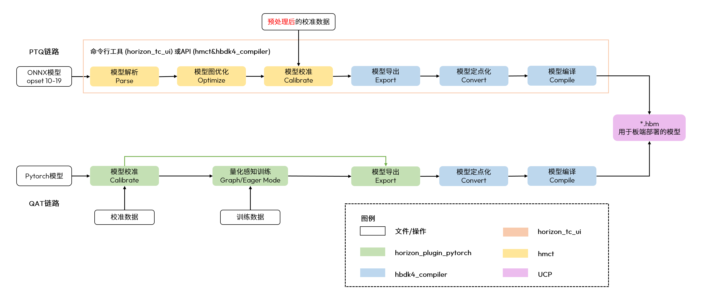
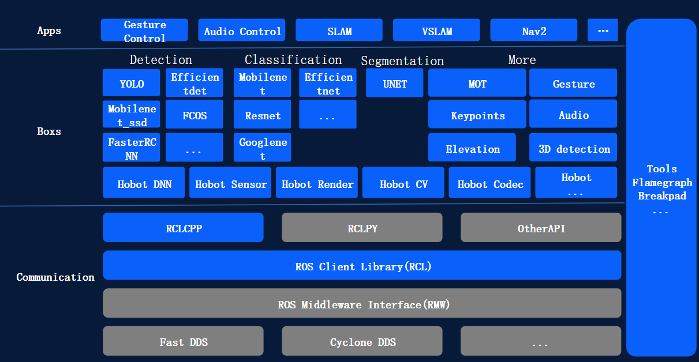

# 02 Horizon / D-Robotics 具身智能软件栈总览

数据截止：2026-11-05。本章以RDK S600为当前主力、S100/S100P为相邻平台、X5为必要迁移对照；Horizon汽车软件体系不自动作为D-Robotics机器人SDK能力。交付为本总览、五个独立专题与[专题索引](02_Topics_Index.md)，01已审阅，03—09保留原文件。

## 1. 软件能力与产品成熟度

这套平台的可用性来自BSP、BPU工具链、媒体/共享内存、实时MCU和ROS组件之间的配合。厂商提供公开文档、镜像/包下载及sample，社区源码和商业静态库/固件并存；第三方ROS2、SLAM-Toolbox、Gazebo及模型框架是可集成依赖。软件接口证据足以分析部署和数据流，完整商业SDK、板端并发实测及本体验收本次未取得，不能由“支持模型/总线”直接推出闭环机器人可交付。〔1：[原文](https://developer.d-robotics.cc/rdk_s_doc/Advanced_development/mcu_development/code_release) / [本地原件](REFERENCES.md#ref-68065d5ada57af84)〕 〔2：[原文](https://developer.d-robotics.cc/tros_doc/tros) / [本地原件](REFERENCES.md#ref-59b673f457eb83c2)〕

|软件层|厂商实际组件|输入→输出|主要专题|已核验与交付边界|
|---|---|---|---|---|
|OS/BSP与运维|Ubuntu、RT内核、U-Boot、deb构建、libupdate|源码/配置→镜像/分区/升级包|02A|公开构建/OTA说明；商业源包未取得|
|编译/模型运行|OpenExplorer、OE LLM、DNN/UCP|ONNX/PyTorch→校准→HBM→tensor|02B|目标/量化/API已核；性能为厂商表|
|媒体与专用域|vpf/vio/cam、hbmem、GPU、VDSP|frame/buffer→缩放/编码/推理输入|02C|样例和生命周期；组合P99未取得|
|实时与工业通信|FreeRTOS、MCAL静态库、IPC、CAN、SOEM移植|固件/请求→外设/过程数据|02D|配置/API/样例；WCET/安全验收未取得|
|ROS与机器人应用|TROS、hobot_sensor/dnn/codec/cv、Boxs/Apps|图像/感知消息→策略/动作消息|02E|SKU矩阵与部分案例；S600全链路有缺口|

每层需要向下一层交付有版本、布局和所有权的对象：模型HBM不是裸权重，图像不是只有宽高，动作不是只给一个浮点数组。共享内存和异步调度减少复制及等待的潜力，成立于模型可编译、缓存维护正确、消费者完成后再复用及调度预算受控；任一边界失配都可能使峰值算力与实际吞吐脱节。这个判断来自公开机制分析，未给出同条件平台排名。〔3：[原文](https://developer.d-robotics.cc/oe_s_doc/static/js/async/62300.e55caad1.js) / [本地原件](REFERENCES.md#ref-6c736e923e8d396a) / [官方文档页面](https://developer.d-robotics.cc/oe_s_doc/guide/faststart/ptq_quickstart) / [离线正文](REFERENCES.md) / [渲染HTML](REFERENCES.md)〕 〔4：[原文](https://developer.d-robotics.cc/rdk_s_doc/Advanced_development/multimedia_development/S600_multimedia_application/hbmem_sample_guide) / [本地原件](REFERENCES.md#ref-20f8f640ea355677)〕 〔5：[原文](https://developer.d-robotics.cc/rdk_s_doc/Advanced_development/mcu_development/mcu_ipc) / [本地原件](REFERENCES.md#ref-975898a4eb7147a2)〕

## 2. 版本矩阵：文档、系统、工具与包分别冻结

|目标/组件|当前取得的明确版本|绑定条件|不能据此推导|
|---|---|---|---|
|S600 BSP|5.1.1；Ubuntu24.04；kernel6.1.158-rt58-DR-5.1.1|U-Boot2022.04；MCU2.0.3|软件温度阈值不是产品环境温度|
|S100 BSP|4.0.5_20260507；Ubuntu22.04；kernel6.1.158-rt58|对应发行说明与PCB适配|不能套S600库/固件|
|OpenExplorer|3.7.0发布页|列S1004.0.5、S6005.1.0|不是任意新版运行库的兼容证明|
|OE LLM|2.0.0|S6005.1.0及以上；模型配置独立|通用模型支持不证明真实动作成功|
|TROS Jazzy|2.5.4（2026-05-19）|明确适配S600系统SDK5.1.0|文档页眉3.0.0不是安装包版本|
|dnn_node源码包|2.6.3；固定commit原件|包条件含S600，README环境覆盖不完整|未与S600发布deb逐文件对应|

上述版本来自各自官方记录。采集时间不是发布日期，下载页、通用手册与平台绑定发行说明并不完全同步。对S6005.1.1与OE/TROS5.1.0绑定差异，应取得成套依赖和回归结果；不把尚未取得的验证写成“不兼容”。重建时记录源码commit、deb版本与依赖、compiler/runtime、固件、模型/校准哈希及标定配置。〔6：[原文](https://developer.d-robotics.cc/rdk_s_doc/Release_Note/s600/v5_1_1) / [本地原件](REFERENCES.md#ref-10ce1a6098be10ab)〕 〔7：[原文](https://raw.githubusercontent.com/D-Robotics/rdk_doc/main/docs_s/10_Release_Note/01_v4_0_5_260507.md) / [本地原件](REFERENCES.md#ref-209e21ec8b8de975)〕 〔8：[原文](https://developer.d-robotics.cc/rdk_s_doc/Advanced_development/toolchain_development/algorithm_toolchain/overview) / [本地原件](REFERENCES.md#ref-c0a2da264e5a1fe1)〕 〔9：[原文](https://developer.d-robotics.cc/rdk_s_doc/Advanced_development/toolchain_development/LLM_Toolchain/rdk_s600/LLM_Toolchain_v2_0_0) / [本地原件](REFERENCES.md#ref-8a128218ccddb5a2)〕 〔10：[原文](https://developer.d-robotics.cc/tros_doc/quick_start/changelog) / [本地原件](REFERENCES.md#ref-aae5750928c41e90)〕 〔11：[原文](https://raw.githubusercontent.com/D-Robotics/hobot_dnn/7647b62c975a97c8d3b627b0ded82302d7b128de/dnn_node/package.xml) / [本地原件](REFERENCES.md#ref-3f9cd1b8b8ad1eac)〕

## 3. 从模型源到观测和动作的交接

图来自当前OE手册，PTQ和QAT均可导出hbm；图中文字通过白底合成完整保留。它支持编译链路，不提供精度/速度或机器人收益。[02B](02B_BPU_Compiler_and_Runtime.md)核对了nash-e/m/p与X5 bayes-e目标、预处理、校准、动态stride和运行时任务。〔12：[原文](https://developer.d-robotics.cc/oe_s_doc/static/js/async/49841.f8e6a5ca.js) / [本地原件](REFERENCES.md#ref-4d3875049ead716f) / [官方文档页面](https://developer.d-robotics.cc/oe_s_doc/guide/model_deployment_guidance/model_deployment_principle_process/model_conversion_compile) / [离线正文](REFERENCES.md) / [渲染HTML](REFERENCES.md)〕 〔13：[原文](https://developer.d-robotics.cc/oe_s_doc/static/image/model_conversion_compilation.914a0e0b.png) / [本地原件](REFERENCES.md#ref-0f9289a0555fce7d)〕

一条可追踪的S600路径是ONNX/PyTorch→代表数据校准或QAT→nash-p编译HBM→匹配BSP/DNN/UCP→设备tensor→媒体/ROS感知。视觉语言及VLA进一步拆visual、prefill/decode、action等组件，tokenizer、嵌入和动作norm_stats属于部署集；改变图/参数时清理或切换编译缓存。原文件、校准配置和缓存不能不带版本地复用。摄像头帧交给BPU前还须核NV12平面、逻辑shape、stride、预处理与缓存；CLEAN、提交、等待、INVALIDATE分别解决不同问题。〔14：[原文](https://developer.d-robotics.cc/oe_llm_doc/static/js/async/50188.3b7997bf.js) / [本地原件](REFERENCES.md#ref-cc21f8f5997a722f) / [官方文档页面](https://developer.d-robotics.cc/oe_llm_doc/guide/llm_compression/detailed_function_specification/model_compilation) / [离线正文](REFERENCES.md) / [渲染HTML](REFERENCES.md)〕 〔15：[原文](https://developer.d-robotics.cc/oe_s_doc/static/js/async/24642.789c7af3.js) / [本地原件](REFERENCES.md#ref-ab27c48f9fa3f22a) / [官方文档页面](https://developer.d-robotics.cc/oe_s_doc/guide/ucp/runtime/bpu_sdk_api/dynamic_input_introduction) / [离线正文](REFERENCES.md) / [渲染HTML](REFERENCES.md)〕 〔16：[原文](https://developer.d-robotics.cc/oe_s_doc/static/js/async/80056.5ccac469.js) / [本地原件](REFERENCES.md#ref-6af5f91666f418e1) / [官方文档页面](https://developer.d-robotics.cc/oe_s_doc/guide/ucp/ucp_api_reference/ucp_api_function_interface/hbucpmemflush) / [离线正文](REFERENCES.md) / [渲染HTML](REFERENCES.md)〕

|交接边界|必须交付的契约|当前能支持的结论|仍需补的证据|
|---|---|---|---|
|训练/编译→板端|目标march、HBM、量化与输入配置、工具版本|目标部署机制可追溯|具体模型板端精度/长时性能|
|媒体→推理|帧序号/时间、格式/stride、内存句柄、完成/释放责任|样例API与队列结构明确|跨库导入及并发零复制实测|
|推理→ROS|tensor后处理、Header配对、消息类型/QoS|DnnNode同步/异步与回调已核|S600发行包和实际模型绑定|
|ROS/VLA→控制|坐标/frame、关节/单位、horizon、状态/期限|cmd_vel示例和action产物分别存在|统一VLA本体动作SDK与闭环验证|
|Linux→MCU/总线|固件、IPC双端配置、PDO/CAN映射、时间域|工业接口与状态机已核|从站/驱动器配置、WCET和故障输出|

官方X3/X5人体跟随App已串联图像、人体检测、策略及/cmd_vel到PC虚拟小车，S600/Jazzy另有传感器与SLAM示例；这些不是同一系统测试。当前Nav2和跟随实例未列S600，DnnNode README与包条件也存在覆盖差异。本章列出可复用机制和缺口，没有把独立demo拼成S600 VLA机器人。真实本体的坐标、关节顺序、限幅、超时和反馈契约将决定接入成本，不能由ROS API兼容补齐。〔17：[原文](https://developer.d-robotics.cc/tros_doc/apps/car_tracking) / [本地原件](REFERENCES.md#ref-f91ef5585c3f3188)〕 〔18：[原文](https://developer.d-robotics.cc/tros_doc/quick_demo/demo_sensor) / [本地原件](REFERENCES.md#ref-d7494a221f0c3960)〕 〔19：[原文](https://developer.d-robotics.cc/tros_doc/apps/slam) / [本地原件](REFERENCES.md#ref-6c32780a16320f9f)〕 〔20：[原文](https://developer.d-robotics.cc/tros_doc/apps/navigation2) / [本地原件](REFERENCES.md#ref-60f9282395328216)〕 〔21：[原文](https://raw.githubusercontent.com/D-Robotics/hobot_dnn/7647b62c975a97c8d3b627b0ded82302d7b128de/dnn_node/README_cn.md) / [本地原件](REFERENCES.md#ref-c481192af9210f8a)〕

## 4. 各执行域的收益与失效机制

[02A](02A_BSP_and_Lifecycle.md)解释rootfs/deb构建、启动配置、AVB、热管理和OTA。BSP构建主机与板端OS不同；系统分区、应用deb和MCU/VDSP固件应作为一致发布集。当前miniboot文档明确直接写NOR且没有内建回滚，与旧S100GitHub说明冲突，不能以“OTA支持”替代每个分区的恢复路径。libupdate提供升级能力，客户云端编排、成功判定和模型/配置一致性仍要集成。〔22：[原文](https://developer.d-robotics.cc/rdk_s_doc/Advanced_development/linux_development/OTA/ota_miniboot) / [本地原件](REFERENCES.md#ref-c0fecf1465220ec5)〕 〔23：[原文](https://developer.d-robotics.cc/rdk_s_doc/Advanced_development/linux_development/OTA/ota_system) / [本地原件](REFERENCES.md#ref-51c92d21e58d7011)〕 〔24：[原文](https://developer.d-robotics.cc/rdk_s_doc/Advanced_development/rdk_gen) / [本地原件](REFERENCES.md#ref-daa0f17ac1774c07)〕

[02C](02C_HUCP_and_Multimedia.md)追踪媒体节点、hbmem队列与Sunrise应用线程。PYM多尺寸输出能减少CPU重复处理，共享池能减少分配/复制；慢消费者增加观测年龄，固定轮转buffer不能替代完成事件。GPU有OpenCL/GLES样例，S6005.1.1也列页大小崩溃风险及X11加速限制；VDSP需要手动加载固件、rpmsg服务单通道串行及有序退出，源码/工具包有商业交付边界。〔25：[原文](https://developer.d-robotics.cc/rdk_s_doc/Advanced_development/multimedia_development/S600_multimedia_application/sample_pipeline) / [本地原件](REFERENCES.md#ref-3ee3c8a31c4d35ab)〕 〔26：[原文](https://developer.d-robotics.cc/rdk_s_doc/Advanced_development/multimedia_development/S600_multimedia_application/sunrise_camera_develop_guide) / [本地原件](REFERENCES.md#ref-f2a7faecf95c530e)〕 〔27：[原文](https://developer.d-robotics.cc/rdk_s_doc/Advanced_development/multimedia_development/S600_multimedia_application/sample_gpu_3d) / [本地原件](REFERENCES.md#ref-ade84e05b1bf5f74)〕 〔28：[原文](https://developer.d-robotics.cc/rdk_s_doc/Advanced_development/vdsp_development) / [本地原件](REFERENCES.md#ref-78fe98ada2ae2e64)〕 〔6：[原文](https://developer.d-robotics.cc/rdk_s_doc/Release_Note/s600/v5_1_1) / [本地原件](REFERENCES.md#ref-10ce1a6098be10ab)〕

[02D](02D_MCU_and_Industrial_Communication.md)解释MCU0系统职责、MCU1业务、IPC地址/通道/中断与DMA资源、CAN转发及EtherCAT状态机。S6005.1.1新增SocketCAN访问MCU CAN、EtherCAT线程绑核和多字节sample，不能延用旧章“未验证支持”的笼统结论；但FreeRTOS周期任务、DC同步或CAN最高速率都不等于完整控制WCET。EtherCAT默认1ms与同页1000000µs日志冲突已保留。〔5：[原文](https://developer.d-robotics.cc/rdk_s_doc/Advanced_development/mcu_development/mcu_ipc) / [本地原件](REFERENCES.md#ref-975898a4eb7147a2)〕 〔29：[原文](https://developer.d-robotics.cc/rdk_s_doc/Advanced_development/mcu_development/mcu_can) / [本地原件](REFERENCES.md#ref-71ba84d58f4beadf)〕 〔30：[原文](https://developer.d-robotics.cc/rdk_s_doc/Advanced_development/mcu_development/mcu_ethercat) / [本地原件](REFERENCES.md#ref-55e8507927e44f5e)〕 〔6：[原文](https://developer.d-robotics.cc/rdk_s_doc/Release_Note/s600/v5_1_1) / [本地原件](REFERENCES.md#ref-10ce1a6098be10ab)〕

[02E](02E_TogetheROS_and_Robot_Pipeline.md)解释ROS封装、消息借用与模型/动作交接。Foxy用hbmem扩展，Humble/Jazzy用ROS2 loaned message配置，固定消息与同设备约束不能跨网络延用；异步DNN可能乱序，任务申请默认可无限等待。吞吐优化可能增加等待和过期结果，必须同时跟踪帧年龄与动作期限。图列的是平台体系，其SKU支持采用具体页面验证。〔2：[原文](https://developer.d-robotics.cc/tros_doc/tros) / [本地原件](REFERENCES.md#ref-59b673f457eb83c2)〕 〔31：[原文](https://developer.d-robotics.cc/tros_doc/tros_dev/zero_copy) / [本地原件](REFERENCES.md#ref-67a9b5a547288889)〕 〔32：[原文](https://raw.githubusercontent.com/D-Robotics/hobot_dnn/7647b62c975a97c8d3b627b0ded82302d7b128de/dnn_node/docs/API-Manual/API-Manual.md) / [本地原件](REFERENCES.md#ref-7c44f803e5c3369a)〕

## 5. 性能、仿真/学习与数据编排边界

官方S600 VLA w8表中Pi05/libero去噪2步95.894ms、10步142.972ms，内存均4.7GB；E2E包含前处理、视觉、语言、动作、后处理。缺少模型commit、shape/batch、功率、预热/样本和统计规则，不能当P99或伺服频率，且没有对应任务质量指标。GPU矩阵与ROS消息日志也是各自示例口径，不能据其除法输出跨平台加速排名。验收应拆模型耗时、传输/排队、感知年龄、策略和下层控制频率，再测共享资源/温度干扰。〔33：[原文](https://developer.d-robotics.cc/oe_llm_doc/static/js/async/42166.bab9ba30.js) / [本地原件](REFERENCES.md#ref-512813f90d80c32d) / [官方文档页面](https://developer.d-robotics.cc/oe_llm_doc/guide/benchmark/note) / [离线正文](REFERENCES.md) / [渲染HTML](REFERENCES.md)〕 〔34：[原文](https://developer.d-robotics.cc/oe_llm_doc/static/js/async/7805.87d8031b.js) / [本地原件](REFERENCES.md#ref-6e127a5530c5176e) / [官方文档页面](https://developer.d-robotics.cc/oe_llm_doc/guide/benchmark/s600/vla_benchmark) / [离线正文](REFERENCES.md) / [渲染HTML](REFERENCES.md)〕 〔27：[原文](https://developer.d-robotics.cc/rdk_s_doc/Advanced_development/multimedia_development/S600_multimedia_application/sample_gpu_3d) / [本地原件](REFERENCES.md#ref-ade84e05b1bf5f74)〕 〔31：[原文](https://developer.d-robotics.cc/tros_doc/tros_dev/zero_copy) / [本地原件](REFERENCES.md#ref-67a9b5a547288889)〕

官方提供PC Gazebo与板端SLAM/ROS联调，模型/图片回灌、PTQ/QAT及VLA集成入口。这些分别服务于仿真联调、推理调试和压缩部署。本章未取得完整物理/接触训练平台、统一训练数据治理、车队编排及通用本体VLA动作SDK，不能把x86软件回灌叫作完整硬件仿真，也不能把apt升级和Boxs叫作统一MLOps。仿真、模型地图和本体实绩将在后续授权章独立调研，当前只报告已取得的软件入口及断点。〔19：[原文](https://developer.d-robotics.cc/tros_doc/apps/slam) / [本地原件](REFERENCES.md#ref-6c32780a16320f9f)〕 〔35：[原文](https://developer.d-robotics.cc/oe_llm_doc/static/js/async/26444.95f492ac.js) / [本地原件](REFERENCES.md#ref-549ade35441bfbaf) / [官方文档页面](https://developer.d-robotics.cc/oe_llm_doc/guide/vla/vla_deployment/overview) / [离线正文](REFERENCES.md) / [渲染HTML](REFERENCES.md)〕 〔2：[原文](https://developer.d-robotics.cc/tros_doc/tros) / [本地原件](REFERENCES.md#ref-59b673f457eb83c2)〕

## 6. 许可与工程放行

RDK文档许可、dnn_node封装包Apache2声明、商业OE/runtime授权、MCAL静态库/固件、模型权重/数据及第三方仿真资产必须分别核对。OE协议包含有限不可转让/再许可等边界；MCU企业包需NDA，本次未申请。公众下载和示例支持不自动授予量产再分发权，也不证明安全认证。本章仅做公开文献与源码/API核验。〔36：[原文](https://raw.githubusercontent.com/D-Robotics/rdk_doc/main/LICENSE) / [本地原件](REFERENCES.md#ref-50e26f159fc3347a)〕 〔11：[原文](https://raw.githubusercontent.com/D-Robotics/hobot_dnn/7647b62c975a97c8d3b627b0ded82302d7b128de/dnn_node/package.xml) / [本地原件](REFERENCES.md#ref-3f9cd1b8b8ad1eac)〕 〔37：[原文](https://developer.d-robotics.cc/oe_s_doc/static/js/async/5603.b7581455.js) / [本地原件](REFERENCES.md#ref-6e1dd6456b634d63) / [官方文档页面](https://developer.d-robotics.cc/oe_s_doc/guide/legalnotice/license_agreement) / [离线正文](REFERENCES.md) / [渲染HTML](REFERENCES.md)〕 〔1：[原文](https://developer.d-robotics.cc/rdk_s_doc/Advanced_development/mcu_development/code_release) / [本地原件](REFERENCES.md#ref-68065d5ada57af84)〕

选型动作应是建立成套版本基线，先验证浮点/量化/板端输出，再打通frame/tensor/message/action；随后测试媒体、推理、ROS和MCU并发、温度稳定、时间同步和异常恢复。固定传感器/模型能控制编译及搬运成本，若需要频繁换模型/跨SKU迁移，则算子覆盖、校准和本体接口重验成本会增加。缺完整SDK与设备测试时，可以决定原型开发路径，尚不能对量产闭环性能作承诺。

## 资料与核验

本篇为公开资料与代码核验，未进行SDK安装、模型实机或机器人验收。静态归档部分缺失：无；所识别静态依赖完整，仍不保证动态内容/像素级复现。

[02资料集合](REFERENCES.md) · [证据JSON](research_state/evidence/02_Software_Stack.json)

### 原件清单

1. **H02_MCU_Code**：[原URL](https://developer.d-robotics.cc/rdk_s_doc/Advanced_development/mcu_development/code_release) · [原件](REFERENCES.md#ref-68065d5ada57af84)；采集2026-11-05T02:53:28.804982+00:00；complete_static。

2. **H02_TROS_Manual**：[原URL](https://developer.d-robotics.cc/tros_doc/tros) · [原件](REFERENCES.md#ref-59b673f457eb83c2)；采集2026-11-05T02:56:47.330531+00:00；complete_static。

3. **H02_OE_PTQ_Content**：[原URL](https://developer.d-robotics.cc/oe_s_doc/static/js/async/62300.e55caad1.js) · [原件](REFERENCES.md#ref-6c736e923e8d396a)；采集2026-11-05T02:35:34.320117+00:00；complete_static。 / [官方文档页面](https://developer.d-robotics.cc/oe_s_doc/guide/faststart/ptq_quickstart) / [离线正文](REFERENCES.md) / [渲染HTML](REFERENCES.md)。正文由已归档的官方页面JS在完全阻断外网请求的浏览器内渲染，入口空壳HTML不作正文证据。

4. **H02_Hbmem**：[原URL](https://developer.d-robotics.cc/rdk_s_doc/Advanced_development/multimedia_development/S600_multimedia_application/hbmem_sample_guide) · [原件](REFERENCES.md#ref-20f8f640ea355677)；采集2026-11-05T02:50:19.144296+00:00；complete_static。

5. **H02_IPC**：[原URL](https://developer.d-robotics.cc/rdk_s_doc/Advanced_development/mcu_development/mcu_ipc) · [原件](REFERENCES.md#ref-975898a4eb7147a2)；采集2026-11-05T02:53:38.614163+00:00；complete_static。

6. **H02_S600_511_Release**：[原URL](https://developer.d-robotics.cc/rdk_s_doc/Release_Note/s600/v5_1_1) · [原件](REFERENCES.md#ref-10ce1a6098be10ab)；采集2026-11-05T02:22:28.834915+00:00；complete_static。

7. **H02_S100_Release**：[原URL](https://raw.githubusercontent.com/D-Robotics/rdk_doc/main/docs_s/10_Release_Note/01_v4_0_5_260507.md) · [原件](REFERENCES.md#ref-209e21ec8b8de975)；采集2026-11-05T02:22:44.604383+00:00；complete_static。

8. **H02_OE37**：[原URL](https://developer.d-robotics.cc/rdk_s_doc/Advanced_development/toolchain_development/algorithm_toolchain/overview) · [原件](REFERENCES.md#ref-c0a2da264e5a1fe1)；采集2026-11-05T02:31:19.837399+00:00；complete_static。

9. **H02_LLM20**：[原URL](https://developer.d-robotics.cc/rdk_s_doc/Advanced_development/toolchain_development/LLM_Toolchain/rdk_s600/LLM_Toolchain_v2_0_0) · [原件](REFERENCES.md#ref-8a128218ccddb5a2)；采集2026-11-05T02:31:21.326452+00:00；complete_static。

10. **H02_TROS_Release**：[原URL](https://developer.d-robotics.cc/tros_doc/quick_start/changelog) · [原件](REFERENCES.md#ref-aae5750928c41e90)；采集2026-11-05T02:58:35.520706+00:00；complete_static。

11. **H02_DNN_Package**：[原URL](https://raw.githubusercontent.com/D-Robotics/hobot_dnn/7647b62c975a97c8d3b627b0ded82302d7b128de/dnn_node/package.xml) · [原件](REFERENCES.md#ref-3f9cd1b8b8ad1eac)；采集2026-11-05T03:02:16.025582+00:00；complete_static。

12. **H02_OE_Compile_Content**：[原URL](https://developer.d-robotics.cc/oe_s_doc/static/js/async/49841.f8e6a5ca.js) · [原件](REFERENCES.md#ref-4d3875049ead716f)；采集2026-11-05T02:35:35.779177+00:00；complete_static。 / [官方文档页面](https://developer.d-robotics.cc/oe_s_doc/guide/model_deployment_guidance/model_deployment_principle_process/model_conversion_compile) / [离线正文](REFERENCES.md) / [渲染HTML](REFERENCES.md)。正文由已归档的官方页面JS在完全阻断外网请求的浏览器内渲染，入口空壳HTML不作正文证据。

13. **H02_Dynamic_Asset_10**：[原URL](https://developer.d-robotics.cc/oe_s_doc/static/image/model_conversion_compilation.914a0e0b.png) · [原件](REFERENCES.md#ref-0f9289a0555fce7d)；采集2026-11-05T02:37:36.333171+00:00；complete_static。

14. **H02_LLM_Compile_Content**：[原URL](https://developer.d-robotics.cc/oe_llm_doc/static/js/async/50188.3b7997bf.js) · [原件](REFERENCES.md#ref-cc21f8f5997a722f)；采集2026-11-05T02:39:41.339082+00:00；complete_static。 / [官方文档页面](https://developer.d-robotics.cc/oe_llm_doc/guide/llm_compression/detailed_function_specification/model_compilation) / [离线正文](REFERENCES.md) / [渲染HTML](REFERENCES.md)。正文由已归档的官方页面JS在完全阻断外网请求的浏览器内渲染，入口空壳HTML不作正文证据。

15. **H02_OE_Dynamic_Content**：[原URL](https://developer.d-robotics.cc/oe_s_doc/static/js/async/24642.789c7af3.js) · [原件](REFERENCES.md#ref-ab27c48f9fa3f22a)；采集2026-11-05T02:39:37.237397+00:00；complete_static。 / [官方文档页面](https://developer.d-robotics.cc/oe_s_doc/guide/ucp/runtime/bpu_sdk_api/dynamic_input_introduction) / [离线正文](REFERENCES.md) / [渲染HTML](REFERENCES.md)。正文由已归档的官方页面JS在完全阻断外网请求的浏览器内渲染，入口空壳HTML不作正文证据。

16. **H02_UCP_Flush_Content**：[原URL](https://developer.d-robotics.cc/oe_s_doc/static/js/async/80056.5ccac469.js) · [原件](REFERENCES.md#ref-6af5f91666f418e1)；采集2026-11-05T02:39:39.612142+00:00；complete_static。 / [官方文档页面](https://developer.d-robotics.cc/oe_s_doc/guide/ucp/ucp_api_reference/ucp_api_function_interface/hbucpmemflush) / [离线正文](REFERENCES.md) / [渲染HTML](REFERENCES.md)。正文由已归档的官方页面JS在完全阻断外网请求的浏览器内渲染，入口空壳HTML不作正文证据。

17. **H02_Car_Tracking**：[原URL](https://developer.d-robotics.cc/tros_doc/apps/car_tracking) · [原件](REFERENCES.md#ref-f91ef5585c3f3188)；采集2026-11-05T03:03:32.544670+00:00；complete_static。

18. **H02_TROS_Sensor**：[原URL](https://developer.d-robotics.cc/tros_doc/quick_demo/demo_sensor) · [原件](REFERENCES.md#ref-d7494a221f0c3960)；采集2026-11-05T02:57:47.388991+00:00；complete_static。

19. **H02_TROS_SLAM**：[原URL](https://developer.d-robotics.cc/tros_doc/apps/slam) · [原件](REFERENCES.md#ref-6c32780a16320f9f)；采集2026-11-05T02:57:44.453730+00:00；complete_static。

20. **H02_Navigation**：[原URL](https://developer.d-robotics.cc/tros_doc/apps/navigation2) · [原件](REFERENCES.md#ref-60f9282395328216)；采集2026-11-05T03:00:00.520744+00:00；complete_static。

21. **H02_DNN_Pinned_Readme**：[原URL](https://raw.githubusercontent.com/D-Robotics/hobot_dnn/7647b62c975a97c8d3b627b0ded82302d7b128de/dnn_node/README_cn.md) · [原件](REFERENCES.md#ref-c481192af9210f8a)；采集2026-11-05T03:02:08.871803+00:00；complete_static。

22. **H02_Miniboot**：[原URL](https://developer.d-robotics.cc/rdk_s_doc/Advanced_development/linux_development/OTA/ota_miniboot) · [原件](REFERENCES.md#ref-c0fecf1465220ec5)；采集2026-11-05T02:27:12.762914+00:00；complete_static。

23. **H02_OTA**：[原URL](https://developer.d-robotics.cc/rdk_s_doc/Advanced_development/linux_development/OTA/ota_system) · [原件](REFERENCES.md#ref-51c92d21e58d7011)；采集2026-11-05T02:27:06.131581+00:00；complete_static。

24. **H02_Build**：[原URL](https://developer.d-robotics.cc/rdk_s_doc/Advanced_development/rdk_gen) · [原件](REFERENCES.md#ref-daa0f17ac1774c07)；采集2026-11-05T02:23:47.406121+00:00；complete_static。

25. **H02_Pipeline**：[原URL](https://developer.d-robotics.cc/rdk_s_doc/Advanced_development/multimedia_development/S600_multimedia_application/sample_pipeline) · [原件](REFERENCES.md#ref-3ee3c8a31c4d35ab)；采集2026-11-05T02:50:17.344706+00:00；complete_static。

26. **H02_Sunrise**：[原URL](https://developer.d-robotics.cc/rdk_s_doc/Advanced_development/multimedia_development/S600_multimedia_application/sunrise_camera_develop_guide) · [原件](REFERENCES.md#ref-f2a7faecf95c530e)；采集2026-11-05T02:50:22.838601+00:00；complete_static。

27. **H02_GPU**：[原URL](https://developer.d-robotics.cc/rdk_s_doc/Advanced_development/multimedia_development/S600_multimedia_application/sample_gpu_3d) · [原件](REFERENCES.md#ref-ade84e05b1bf5f74)；采集2026-11-05T02:50:26.732725+00:00；complete_static。

28. **H02_VDSP**：[原URL](https://developer.d-robotics.cc/rdk_s_doc/Advanced_development/vdsp_development) · [原件](REFERENCES.md#ref-78fe98ada2ae2e64)；采集2026-11-05T02:49:35.103744+00:00；complete_static。

29. **H02_CAN**：[原URL](https://developer.d-robotics.cc/rdk_s_doc/Advanced_development/mcu_development/mcu_can) · [原件](REFERENCES.md#ref-71ba84d58f4beadf)；采集2026-11-05T02:53:41.785147+00:00；complete_static。

30. **H02_EtherCAT**：[原URL](https://developer.d-robotics.cc/rdk_s_doc/Advanced_development/mcu_development/mcu_ethercat) · [原件](REFERENCES.md#ref-55e8507927e44f5e)；采集2026-11-05T02:53:49.329436+00:00；complete_static。

31. **H02_TROS_Zero**：[原URL](https://developer.d-robotics.cc/tros_doc/tros_dev/zero_copy) · [原件](REFERENCES.md#ref-67a9b5a547288889)；采集2026-11-05T02:57:36.949634+00:00；complete_static。

32. **H02_DNN_API**：[原URL](https://raw.githubusercontent.com/D-Robotics/hobot_dnn/7647b62c975a97c8d3b627b0ded82302d7b128de/dnn_node/docs/API-Manual/API-Manual.md) · [原件](REFERENCES.md#ref-7c44f803e5c3369a)；采集2026-11-05T03:02:11.138494+00:00；complete_static。

33. **H02_LLM_Perf_Content**：[原URL](https://developer.d-robotics.cc/oe_llm_doc/static/js/async/42166.bab9ba30.js) · [原件](REFERENCES.md#ref-512813f90d80c32d)；采集2026-11-05T02:35:45.424601+00:00；complete_static。 / [官方文档页面](https://developer.d-robotics.cc/oe_llm_doc/guide/benchmark/note) / [离线正文](REFERENCES.md) / [渲染HTML](REFERENCES.md)。正文由已归档的官方页面JS在完全阻断外网请求的浏览器内渲染，入口空壳HTML不作正文证据。

34. **H02_LLM_VLABench_Content**：[原URL](https://developer.d-robotics.cc/oe_llm_doc/static/js/async/7805.87d8031b.js) · [原件](REFERENCES.md#ref-6e127a5530c5176e)；采集2026-11-05T02:35:46.860450+00:00；complete_static。 / [官方文档页面](https://developer.d-robotics.cc/oe_llm_doc/guide/benchmark/s600/vla_benchmark) / [离线正文](REFERENCES.md) / [渲染HTML](REFERENCES.md)。正文由已归档的官方页面JS在完全阻断外网请求的浏览器内渲染，入口空壳HTML不作正文证据。

35. **H02_LLM_VLA_Content**：[原URL](https://developer.d-robotics.cc/oe_llm_doc/static/js/async/26444.95f492ac.js) · [原件](REFERENCES.md#ref-549ade35441bfbaf)；采集2026-11-05T02:35:43.996285+00:00；complete_static。 / [官方文档页面](https://developer.d-robotics.cc/oe_llm_doc/guide/vla/vla_deployment/overview) / [离线正文](REFERENCES.md) / [渲染HTML](REFERENCES.md)。正文由已归档的官方页面JS在完全阻断外网请求的浏览器内渲染，入口空壳HTML不作正文证据。

36. **Horizon_RDK_License**：[原URL](https://raw.githubusercontent.com/D-Robotics/rdk_doc/main/LICENSE) · [原件](REFERENCES.md#ref-50e26f159fc3347a)；采集2026-11-05T01:25:03.899112+00:00；complete_static。

37. **H02_OE_License_Content**：[原URL](https://developer.d-robotics.cc/oe_s_doc/static/js/async/5603.b7581455.js) · [原件](REFERENCES.md#ref-6e1dd6456b634d63)；采集2026-11-05T02:41:18.834829+00:00；complete_static。 / [官方文档页面](https://developer.d-robotics.cc/oe_s_doc/guide/legalnotice/license_agreement) / [离线正文](REFERENCES.md) / [渲染HTML](REFERENCES.md)。正文由已归档的官方页面JS在完全阻断外网请求的浏览器内渲染，入口空壳HTML不作正文证据。
