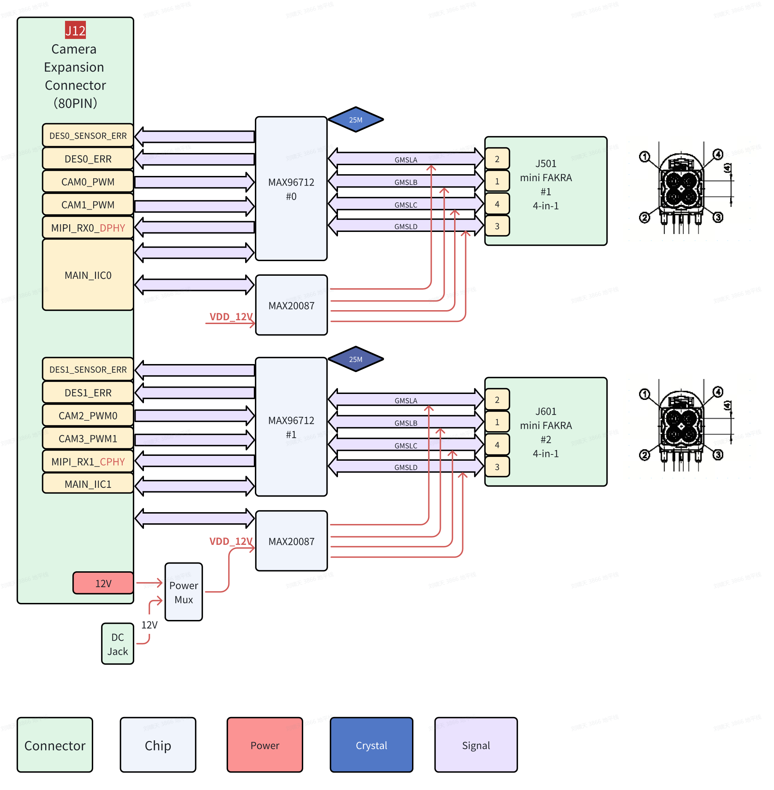
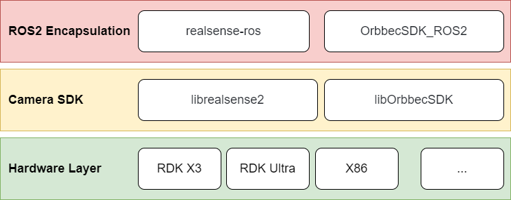
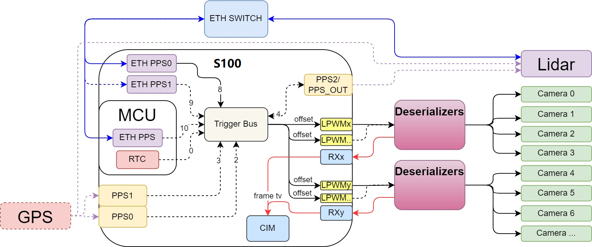

# Horizon / D-Robotics：传感器接入与观测时间契约

资料截止：2026-11-05。当前以S600 5.1.1硬件手册为主，S100同步实例与X5传感器教程单独注明适用对象。

## 接入能力应拆成五层

平台的强项是相机采集、媒体处理与BPU之间有具体交接机制，但连接器数量不能代替完整传感器能力。采购前须分别确认SoC接收PHY、载板布线、外部解串与供电、传感器驱动、模型和ROS节点。S600相机扩展板V1P0使用两颗MAX96712，各接四路GMSL2；八路是外部扩展板能力，主板通过80针连接器承接MIPI CSI、GPIO和电源，不能称芯片内置八路GMSL。官方明确此板仅适配S600，不能据名称近似与S100互换。〔1：[原文](https://developer.d-robotics.cc/rdk_s_doc/Quick_start/hardware_introduction/rdk_s600/rdk_s600_camera_expansion_board) / [本地原件](REFERENCES.md#ref-57531817dea53237)〕

图中两条接收支路分别标注DPHY和CPHY，另有PWM、错误信号、I2C与同轴供电。它说明高速数据、触发和电源是不同路径，不证明所有相机组合在最大分辨率同时运行。手册规格表写外接电源阈值2.4A，而接口正文写超过2A必须外供电，存在冲突；每路550mA@12V及总供电限制还需一起检查。在获得厂商澄清前，工程设计按较保守2A条件准备独立供电并实测浪涌，不能把差异改成一个“统一规格”。〔1：[原文](https://developer.d-robotics.cc/rdk_s_doc/Quick_start/hardware_introduction/rdk_s600/rdk_s600_camera_expansion_board) / [本地原件](REFERENCES.md#ref-57531817dea53237)〕

| 传感器/接口 | 已取得证据 | 数据接入层 | 版本与未完成部分 |
|---|---|---|---|
| S600 GMSL2 RGB | 两颗MAX96712及八路接口 | 外部解串→MIPI→采集/ISP | V1P0；相机清单及多路满载需复验 |
| USB RGB/深度 | TROS相机SDK＋ROS包装教程 | USB驱动→厂商SDK→ROS图像/点云 | RealSense教程列X3/X5，不能推到S600 |
| X5双目＋ICM42688 | I2C/IIO、LPWM与GDC教程 | 双目图像＋IMU话题 | X5镜像3.4.1+；在线VIO未证明 |
| LiDAR | S100相机/雷达共同授时方案 | Ethernet＋gPTP/PPS | 给连接方案，未给全部雷达型号矩阵 |
| Radar/ToF | 通用总线接入可能性 | 外部设备协议与驱动 | 未取得S600指定型号驱动验收 |
| 力矩/触觉/关节 | MCU CAN/IPC基础 | 总线→MCU→IPC→应用 | 未取得统一传感器标定/单位SDK |

表中的“未取得”指本次资料不足，不能解释为硬件不存在相应能力。TROS教程证明的软件安装链有价值，但其支持表比页面标题更重要：RealSense与Orbbec路线需ARM64相机SDK，再装ROS wrapper；点云、IR与RGB默认开关不同，深度对齐还需显式参数。ZED实例列X5，启动的是双目图像发布和校正，不能由此宣布完整ZED SDK、位置跟踪与深度算法均已移植。〔2：[原文](https://developer.d-robotics.cc/tros_doc/quick_demo/demo_sensor) / [本地原件](REFERENCES.md#ref-d7494a221f0c3960)〕

该图的硬件标签包含旧平台和x86，是分层原理图。它支持“厂商SDK先于ROS包装”的结论，不是S600兼容认证表。为复建应保存相机序列号、固件、USB拓扑、SDK与wrapper commit、BSP、图像模式和内参，而不是只记录apt命令。

## 同步机制：共同时间轴与共同曝光分开

官方当前S600页眉下的同步正文仍主要描述S100：三个LPWM模块，每个四通道，同模块只能选一种触发源；跨模块用同源PPS对齐。触发经过解串器和SerDes反向通道到传感器FSYNC，图像到CIM时在Frame Start打时间戳。这个链条能够明确硬件相位控制发生在哪里，但不能因为页眉变成5.1.1就把S100所有寄存器和偏移参数套入S600。〔3：[原文](https://developer.d-robotics.cc/rdk_s_doc/Advanced_development/multimedia_development/multimedia_development/camerasync) / [本地原件](REFERENCES.md#ref-ccb05c49965cfca1)〕 〔4：[原文](https://raw.githubusercontent.com/D-Robotics/rdk_doc/main/docs_s/07_Advanced_development/03_multimedia_development/01_S100/05_camerasync.md) / [本地原件](REFERENCES.md#ref-0baae7da112c5c48)〕

图中实线表示示例采用路径，虚线是可选连接：网络授时对齐LiDAR与主板，ETH PPS经Trigger Bus、LPWM、解串器同步相机。该图不是多传感器误差实测。S100的ptp4l用于同步PHC，phc2sys关联Linux系统时间；PHC、RTC与应用时钟域需按配置确认。仅给消息Header赋当前系统时间，会隐藏采样时刻与排队等待，不能等同硬件时间戳。〔5：[原文](https://raw.githubusercontent.com/D-Robotics/rdk_doc/main/docs_s/07_Advanced_development/02_linux_development/04_driver_development_s100/12_driver_timesync.md) / [本地原件](REFERENCES.md#ref-d19eb348eab46666)〕

具体例子以10Hz雷达和30fps AR0820为条件，ETH PPS0 fixed mode有536.871ms偏移，教程计算LPWM offset约29.8ms，并用config_index bit9及解串器trig_pin使能同步。这些数字是特定模式配置，不是通用同步误差或S600推荐值。曝光同步、出图同步也不同：曝光时刻一致时，自动曝光时长仍可能让Frame Start不同；shutter sync旨在固定出图时刻。rolling shutter的行间时间差不会因为帧头同步自然消失，融合还需传感器读出模型。〔3：[原文](https://developer.d-robotics.cc/rdk_s_doc/Advanced_development/multimedia_development/multimedia_development/camerasync) / [本地原件](REFERENCES.md#ref-ccb05c49965cfca1)〕

## 图像与惯性数据怎样进入模型

S100 bring-up描述V4L2 subdev及serdes_ctx，其中lane_num、data_type、dst_vc和I2C地址映射决定外部链路如何接入。解串/加串操作作为函数集合供sensor driver使用，不能只连同轴线后由通用USB节点自动识别。进入媒体管线后，应核对ISP输出格式、PYM缩放层、NV12的Y/UV平面stride和buffer所有权，再把模型需要的张量交给BPU。缓存CLEAN/INVALIDATE与提交等待是独立契约；异步任务未完成时回收相机帧会造成结果错误，而不仅是性能下降。〔6：[原文](https://raw.githubusercontent.com/D-Robotics/rdk_doc/main/docs_s/07_Advanced_development/03_multimedia_development/01_S100/02_camera_bringup.md) / [本地原件](REFERENCES.md#ref-d733777254f677df)〕 〔7：[原文](https://developer.d-robotics.cc/rdk_s_doc/Advanced_development/multimedia_development/S600_multimedia_application/sample_pipeline) / [本地原件](REFERENCES.md#ref-3ee3c8a31c4d35ab)〕 〔8：[原文](https://developer.d-robotics.cc/rdk_s_doc/Advanced_development/multimedia_development/S600_multimedia_application/hbmem_sample_guide) / [本地原件](REFERENCES.md#ref-20f8f640ea355677)〕

TROS零拷贝主要减少同设备消息传输复制，在固定消息、共享内存配置和引用寿命成立时有效。它不取消USB驱动、图像校正或BPU预处理的潜在复制，也不解决跨设备时钟偏移。选择BEST_EFFORT与有限KEEP_LAST是时效取舍：允许丢旧帧以维持当前观测；选择可靠传输也必须限制队列与超时，否则积压可能让“完整送达”的数据失去控制价值。〔9：[原文](https://developer.d-robotics.cc/tros_doc/tros_dev/zero_copy) / [本地原件](REFERENCES.md#ref-67a9b5a547288889)〕

X5 ICM42688通过I2C注册为陀螺仪和加速度计两个IIO设备，序号应从name确认，不能硬编码device1/2。双目教程明确角速度rad/s、线加速度m/s²；使用LPWM、realtime时间戳、GDC和NV12/bgr8输出。其OpenVINS流程明确当时不支持在线VIO，需要录rosbag后在PC计算，示例标定矩阵和时间偏移只属于该相机实例。不可复制到另一装配，也不可把离线轨迹图称X5端侧实时定位。〔10：[原文](https://raw.githubusercontent.com/D-Robotics/rdk_doc/main/docs/03_Basic_Application/07_accessory_instructions/rdk_x5/imu/icm42688.md) / [本地原件](REFERENCES.md#ref-5132325ebe5b4f27)〕 〔11：[原文](https://raw.githubusercontent.com/D-Robotics/rdk_doc/main/docs/05_Robot_development/03_boxs/spatial/stereo_imu_cam.md) / [本地原件](REFERENCES.md#ref-e7be96dfb60fb57d)〕

## 吞吐、背压与验收

分析计算：单路1920×1080、30fps、紧密NV12有效载荷为1920×1080×1.5×30＝93.312MB/s，八路746.496MB/s；RAW12相同尺寸帧率有效位数也为每像素12bit，但CSI封包、blanking、stride和中间RGB展开均不同，不能据这个巧合推导相同总线负载。一次CPU整帧复制还会增加读写流量；多级ISP/PYM/编码、模型并发和录包需要共同计入内存带宽。这是下界假设计算，没有给平台跑分。

可复建验收先用单路固定模式核对丢帧、帧编号、采样/Frame Start/发布时间，再加入第二路、LiDAR和IMU，记录共同时间轴偏差及热稳态下观测年龄分布。观测年龄定义为消费时刻减代表采样时刻；时间戳语义必须先一致，不能拿Frame Start直接减曝光结束而不解释。故障注入包括拔线、PPS消失、时钟跳变、SDK重启、队列耗尽和模型超时，检查恢复后的标定和帧配对。力矩与触觉另需零偏、饱和、温漂、坐标和单位契约。当前证据支持相机及部分外围路线评估，尚不能放行八路相机＋雷达＋VLA＋执行器的确定性闭环。

## 资料与核验

本篇为公开资料与代码核验，未进行SDK安装、模型实机或机器人验收。静态归档部分缺失：无；所识别静态依赖完整，仍不保证动态内容/像素级复现。

[资料总索引](REFERENCES.md) · [证据JSON](research_state/evidence/03_Sensor_Integration.json)

### 原件清单

1. **Horizon_S600_Camera_Manual**：[原URL](https://developer.d-robotics.cc/rdk_s_doc/Quick_start/hardware_introduction/rdk_s600/rdk_s600_camera_expansion_board) · [原件](REFERENCES.md#ref-57531817dea53237)；采集2026-11-05T01:33:16.456813+00:00；complete_static。

2. **H02_TROS_Sensor**：[原URL](https://developer.d-robotics.cc/tros_doc/quick_demo/demo_sensor) · [原件](REFERENCES.md#ref-d7494a221f0c3960)；采集2026-11-05T02:57:47.388991+00:00；complete_static。

3. **H03_Current_Sync**：[原URL](https://developer.d-robotics.cc/rdk_s_doc/Advanced_development/multimedia_development/multimedia_development/camerasync) · [原件](REFERENCES.md#ref-ccb05c49965cfca1)；采集2026-11-05T04:01:08.411541+00:00；complete_static。

4. **H03_S100_Sync**：[原URL](https://raw.githubusercontent.com/D-Robotics/rdk_doc/main/docs_s/07_Advanced_development/03_multimedia_development/01_S100/05_camerasync.md) · [原件](REFERENCES.md#ref-0baae7da112c5c48)；采集2026-11-05T04:00:47.079893+00:00；complete_static。

5. **H03_S100_Time**：[原URL](https://raw.githubusercontent.com/D-Robotics/rdk_doc/main/docs_s/07_Advanced_development/02_linux_development/04_driver_development_s100/12_driver_timesync.md) · [原件](REFERENCES.md#ref-d19eb348eab46666)；采集2026-11-05T04:00:48.272509+00:00；complete_static。

6. **H03_S100_Bringup**：[原URL](https://raw.githubusercontent.com/D-Robotics/rdk_doc/main/docs_s/07_Advanced_development/03_multimedia_development/01_S100/02_camera_bringup.md) · [原件](REFERENCES.md#ref-d733777254f677df)；采集2026-11-05T04:00:49.699447+00:00；complete_static。

7. **H02_Pipeline**：[原URL](https://developer.d-robotics.cc/rdk_s_doc/Advanced_development/multimedia_development/S600_multimedia_application/sample_pipeline) · [原件](REFERENCES.md#ref-3ee3c8a31c4d35ab)；采集2026-11-05T02:50:17.344706+00:00；complete_static。

8. **H02_Hbmem**：[原URL](https://developer.d-robotics.cc/rdk_s_doc/Advanced_development/multimedia_development/S600_multimedia_application/hbmem_sample_guide) · [原件](REFERENCES.md#ref-20f8f640ea355677)；采集2026-11-05T02:50:19.144296+00:00；complete_static。

9. **H02_TROS_Zero**：[原URL](https://developer.d-robotics.cc/tros_doc/tros_dev/zero_copy) · [原件](REFERENCES.md#ref-67a9b5a547288889)；采集2026-11-05T02:57:36.949634+00:00；complete_static。

10. **H03_X5_IMU**：[原URL](https://raw.githubusercontent.com/D-Robotics/rdk_doc/main/docs/03_Basic_Application/07_accessory_instructions/rdk_x5/imu/icm42688.md) · [原件](REFERENCES.md#ref-5132325ebe5b4f27)；采集2026-11-05T04:00:50.664528+00:00；complete_static。

11. **H03_Stereo**：[原URL](https://raw.githubusercontent.com/D-Robotics/rdk_doc/main/docs/05_Robot_development/03_boxs/spatial/stereo_imu_cam.md) · [原件](REFERENCES.md#ref-e7be96dfb60fb57d)；采集2026-11-05T04:00:51.704523+00:00；complete_static。
