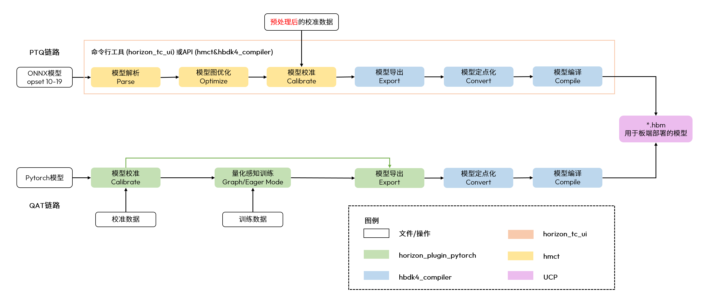
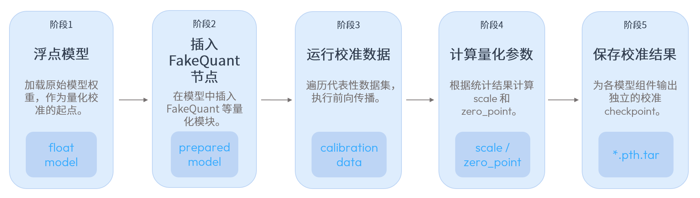

# Horizon / D-Robotics：AI任务地图、模型与部署条件

截止2026-11-05。平台部署证据采用官方OE LLM 2.0.0文档；模型作者资料采用本次归档的main快照，未锁定的main不能称固定发布版。

## 从任务反查可交付模型

平台已从传统视觉推理扩展到语言、多模态与动作策略，但不同模型的“支持”证据等级差异很大。本文把官方板端性能、官方接入示例、上游模型研究和待移植模型分别标出。模型在Hugging Face存在，只说明有分发入口，不能证明BPU算子、量化精度、内存和机器人任务已通过验证。当前官方VLA框架仅随S600发布，S100/S100P包暂不支持VLA部署；不能把S100上的LLM示例或X5视觉检测当成相同动作能力。〔1：[原文](https://developer.d-robotics.cc/oe_llm_doc/static/js/async/26444.95f492ac.js) / [本地原件](REFERENCES.md#ref-549ade35441bfbaf) / [官方文档页面](https://developer.d-robotics.cc/oe_llm_doc/guide/vla/vla_deployment/overview) / [离线正文](REFERENCES.md) / [渲染HTML](REFERENCES.md)〕

| 类型/任务 | 模型精确对象 | 模态/规模 | 平台证据 | 作者资料与模型卡入口 |
|---|---|---|---|---|
| 语言/任务推理 | Qwen3-4B；另有Instruct-2507 | 文本，4B名称口径 | S600官方w4性能表 | Qwen官方仓库；HF标识`Qwen/Qwen3-4B` |
| 多模态理解 | Qwen2.5-VL-3B-Instruct | 图像＋语言，3B名称口径 | S600官方448×448测量 | Qwen2.5-VL仓库；HF标识`Qwen/Qwen2.5-VL-3B-Instruct` |
| 操作VLA | Pi0/Pi0.5 LIBERO/shoes/hammer档 | 图像＋语言＋本体状态→动作chunk | S600 SDK接入与w8测量 | Physical-Intelligence/openpi；官方权重由其README指向 |
| 小型VLA | SmolVLA，LIBERO任务档 | 图像＋语言＋状态→动作 | S600接入与w8测量 | LeRobot；HF标识`lerobot/smolvla_base` |
| VLA | Spirit1.5 | 多模态→动作 | S600官方130.133ms表项 | 未取得唯一上游模型卡及参数/许可闭包 |
| 操作对照 | OpenVLA openvla-7b | 视觉语言→动作，7B | 作者复现路线，未取得S600映射 | openvla/openvla；HF标识`openvla/openvla-7b` |

表中前三类部署事实分别来自官方性能与示例正文，作者身份、模型说明来自相应仓库。Hugging Face的三份原始模型卡下载失败，本文没有引用失败响应作为模型卡；标识取作者仓库所指对象，完整链接可从这些已归档仓库进入。参数量用名称口径，未核对每个本地量化权重的精确参数、commit与训练数据分母。〔2：[原文](https://developer.d-robotics.cc/oe_llm_doc/static/js/async/10373.6f8e6afd.js) / [本地原件](REFERENCES.md#ref-36f326b2114f4367) / [官方文档页面](https://developer.d-robotics.cc/oe_llm_doc/guide/benchmark/s600/llm_benchmark) / [离线正文](REFERENCES.md) / [渲染HTML](REFERENCES.md)〕 〔3：[原文](https://developer.d-robotics.cc/oe_llm_doc/static/js/async/31148.999de9b3.js) / [本地原件](REFERENCES.md#ref-a0efe3034ce0333c) / [官方文档页面](https://developer.d-robotics.cc/oe_llm_doc/guide/benchmark/s600/vlm_benchmark) / [离线正文](REFERENCES.md) / [渲染HTML](REFERENCES.md)〕 〔4：[原文](https://raw.githubusercontent.com/Physical-Intelligence/openpi/main/README.md) / [本地原件](REFERENCES.md#ref-93ae0cec36eeb1cd)〕 〔5：[原文](https://raw.githubusercontent.com/QwenLM/Qwen3/main/README.md) / [本地原件](REFERENCES.md#ref-b9bbb5444339f19a)〕 〔6：[原文](https://raw.githubusercontent.com/QwenLM/Qwen2.5-VL/main/README.md) / [本地原件](REFERENCES.md#ref-46b8ae57b384c788)〕 〔7：[原文](https://raw.githubusercontent.com/huggingface/lerobot/main/README.md) / [本地原件](REFERENCES.md#ref-ff1eedfea7364372)〕 〔8：[原文](https://raw.githubusercontent.com/openvla/openvla/main/README.md) / [本地原件](REFERENCES.md#ref-4a932803c0397a9f)〕

| 其他任务 | 代表研究/方法 | 已有平台路线 | 尚未证明 |
|---|---|---|---|
| 2D感知/检测 | TROS DNN检测与多任务感知示例 | 传感器→DnnNode→结果消息 | 当前S600所有模型精度/负载矩阵 |
| 深度/3D/VIO | 双目深度、OpenVINS | X5双目采集；PC离线VIO | S600实时重建/动态定位质量 |
| 模仿与扩散策略 | Diffusion Policy | 作者训练/仿真代码可研究 | 此仓库在S600的编译与闭环 |
| 世界模型/视频预测 | LeRobot目录的VLA-JEPA等研究 | 上游生态候选 | 官方BPU量化/训练/生成benchmark |
| 强化/全身/运动 | 学习策略与传统MPC、IK对照 | 通用ROS/MCU接口可衔接 | 指定本体策略训练及控制频率 |
| 导航/规划/agent | SLAM、Nav2和文本模型编排 | 官方导航教程与语言推理 | 完整自主任务成功率与故障回退 |

这些任务应按需求选取，不能把传统轨迹优化称基础模型。LeRobot主分支列有多类策略与世界模型，是上游可调查对象；这不意味着其目录全在地瓜平台获得适配。DNN及双目教程证明输入输出路径，Nav2证明传统导航路线，均不是所有任务统一MLOps的证据。〔9：[原文](https://developer.d-robotics.cc/tros_doc/quick_demo/ai_predict) / [本地原件](REFERENCES.md#ref-3d2ee67b7727f008)〕 〔10：[原文](https://raw.githubusercontent.com/D-Robotics/rdk_doc/main/docs/05_Robot_development/03_boxs/spatial/stereo_imu_cam.md) / [本地原件](REFERENCES.md#ref-e7be96dfb60fb57d)〕 〔11：[原文](https://raw.githubusercontent.com/real-stanford/diffusion_policy/main/README.md) / [本地原件](REFERENCES.md#ref-ede4a40dcadbce0c)〕 〔7：[原文](https://raw.githubusercontent.com/huggingface/lerobot/main/README.md) / [本地原件](REFERENCES.md#ref-ff1eedfea7364372)〕 〔12：[原文](https://developer.d-robotics.cc/tros_doc/apps/navigation2) / [本地原件](REFERENCES.md#ref-60f9282395328216)〕

## VLA链条的关键交接

Pi0/Pi0.5官方示例描述三路图像按image_mask参与：预处理→指令拼接/分词→state归一化→SigLIP视觉编码→语言推理→flow-matching去噪→action反归一化及可选滤波。LIBERO配置是两路有效图、224×224视觉HBM、raw_state_size=8、raw_action_size=7、action_horizon=10，模型文件名含nash-p与核数。这里的10是单次输出动作帧数，不能理解成10Hz控制；第三路被掩码屏蔽也不意味着所有输入都能任意改shape。模型不随发布包分发，获取HBM、norm_stats和训练约定是单独步骤。〔13：[原文](https://developer.d-robotics.cc/oe_llm_doc/static/js/async/95984.ae5bd0da.js) / [本地原件](REFERENCES.md#ref-7fbbb66205a2a9ed) / [官方文档页面](https://developer.d-robotics.cc/oe_llm_doc/guide/vla/vla_deployment/vla_sample/pi0_pi05_demo) / [离线正文](REFERENCES.md) / [渲染HTML](REFERENCES.md)〕

上游openpi提供flow-based Pi0、autoregressive Pi0-FAST和Pi0.5，而当前仓库明确Pi0.5只支持flow-matching head。不能将FAST动作tokenizer性能套到这里的扩散去噪部署；作者也明确不同本体适配可能失败。其10k+小时预训练数据为作者描述，不能视为当前S600任务权重的确切训练集合，更不能据此推导真实操作泛化。〔4：[原文](https://raw.githubusercontent.com/Physical-Intelligence/openpi/main/README.md) / [本地原件](REFERENCES.md#ref-93ae0cec36eeb1cd)〕

SDK配置的model_runner.visual/lm/action指定三个HBM，backends各阶段核列表必须与编译核数一致。norm_stats的state/actions维度必须覆盖原始状态与动作宽度；mean/std、分位数与min-max方式不能混用。Pi0.5 LIBERO示例采用绝对动作和分位数归一化，其他档位还有state文本注入；同名模型换任务也需换统计文件。文档中SmolVLA归一化选择说明存在通用开关与模型表的差异，实际以对应发布包实现和训练配置复核。Spirit关闭前后处理时输出模型域[60,32] fp16，开启时输出物理域[60,20]，不能将padding维直接送给执行器。〔14：[原文](https://developer.d-robotics.cc/oe_llm_doc/static/js/async/76569.5bd6179e.js) / [本地原件](REFERENCES.md#ref-5a02b6b9a1f6c236) / [官方文档页面](https://developer.d-robotics.cc/oe_llm_doc/guide/vla/vla_deployment/vla_sample/config_basic) / [离线正文](REFERENCES.md) / [渲染HTML](REFERENCES.md)〕 〔15：[原文](https://developer.d-robotics.cc/oe_llm_doc/static/js/async/69682.47fbe501.js) / [本地原件](REFERENCES.md#ref-19cbe192a8e14702) / [官方文档页面](https://developer.d-robotics.cc/oe_llm_doc/guide/vla/vla_deployment/vla_sample/smolvla_demo) / [离线正文](REFERENCES.md) / [渲染HTML](REFERENCES.md)〕

该图显示校准/训练数据分别进入PTQ/QAT，再转换编译HBM。ONNX范围是图示对应版本声明，不能据此保证任意新模型算子。〔16：[原文](https://developer.d-robotics.cc/oe_s_doc/static/image/model_conversion_compilation.914a0e0b.png) / [本地原件](REFERENCES.md#ref-0f9289a0555fce7d)〕

图中FakeQuant、代表性数据、scale/zero_point和各组件checkpoint是精度风险的定位点。对具身任务，校准应覆盖不同相机光照、语言长度和本体状态；只用随机输入检查耗时无法验证动作质量。最终HBIR转换、.hbo链接与HBM需绑定compiler/runtime；缓存也随图和编译条件失效。本文完成资料核验，未取得并运行这些商业二进制。〔17：[原文](https://developer.d-robotics.cc/oe_llm_doc/static/image/model_quantization.c85c9c2f.png) / [本地原件](REFERENCES.md#ref-3de30ebb446bf075)〕 〔18：[原文](https://developer.d-robotics.cc/oe_llm_doc/static/js/async/31346.cf7dd33f.js) / [本地原件](REFERENCES.md#ref-930c8b2648c88eba) / [官方文档页面](https://developer.d-robotics.cc/oe_llm_doc/guide/llm_compression/detailed_function_specification/model_quantization) / [离线正文](REFERENCES.md) / [渲染HTML](REFERENCES.md)〕 〔19：[原文](https://developer.d-robotics.cc/oe_llm_doc/static/js/async/50188.3b7997bf.js) / [本地原件](REFERENCES.md#ref-cc21f8f5997a722f) / [官方文档页面](https://developer.d-robotics.cc/oe_llm_doc/guide/llm_compression/detailed_function_specification/model_compilation) / [离线正文](REFERENCES.md) / [渲染HTML](REFERENCES.md)〕

## 性能证据与不能外推的结论

| S600官方表项 | 条件 | 测量值 | 不能推导 |
|---|---|---|---|
| Qwen3-4B标准模式 | 四核；w4；prefill256/context2048 | TTFT72ms；48.3TPS；5.4GB | 真实agent任务成功/P99 |
| Qwen2.5-VL-3B-Instruct | 四核w4；448×448；sequence512/context2048 | ViT43ms；TTFT156ms；62.7TPS；5.5GB | 多相机VLA吞吐 |
| Pi05 LIBERO | w8；2去噪步 | E2E95.894ms；4.7GB | 实机成功率、伺服频率 |
| Pi05 LIBERO | w8；10去噪步 | E2E142.972ms；4.7GB | 两步与十步同等质量 |
| SmolVLA LIBERO | w8；10去噪步 | E2E82.909ms；0.9GB | 比Pi05更优的真实泛化 |

E2E按文档包括前处理、视觉、语言、动作和后处理；Linux及ION内存合计是该表口径。仍缺功率、热稳态、样本/预热、P99及任务质量，模型权重commit也未完整给出。不能把毫秒倒数写成底层伺服频率。投机采样上限TPS依赖接受率与文本可预测性，还可能提高首字时间和内存；选型应测任务分布，不取范围最大值作稳定收益。〔20：[原文](https://developer.d-robotics.cc/oe_llm_doc/static/js/async/42166.bab9ba30.js) / [本地原件](REFERENCES.md#ref-512813f90d80c32d) / [官方文档页面](https://developer.d-robotics.cc/oe_llm_doc/guide/benchmark/note) / [离线正文](REFERENCES.md) / [渲染HTML](REFERENCES.md)〕 〔2：[原文](https://developer.d-robotics.cc/oe_llm_doc/static/js/async/10373.6f8e6afd.js) / [本地原件](REFERENCES.md#ref-36f326b2114f4367) / [官方文档页面](https://developer.d-robotics.cc/oe_llm_doc/guide/benchmark/s600/llm_benchmark) / [离线正文](REFERENCES.md) / [渲染HTML](REFERENCES.md)〕 〔3：[原文](https://developer.d-robotics.cc/oe_llm_doc/static/js/async/31148.999de9b3.js) / [本地原件](REFERENCES.md#ref-a0efe3034ce0333c) / [官方文档页面](https://developer.d-robotics.cc/oe_llm_doc/guide/benchmark/s600/vlm_benchmark) / [离线正文](REFERENCES.md) / [渲染HTML](REFERENCES.md)〕 〔21：[原文](https://developer.d-robotics.cc/oe_llm_doc/static/js/async/7805.87d8031b.js) / [本地原件](REFERENCES.md#ref-6e127a5530c5176e) / [官方文档页面](https://developer.d-robotics.cc/oe_llm_doc/guide/benchmark/s600/vla_benchmark) / [离线正文](REFERENCES.md) / [渲染HTML](REFERENCES.md)〕

## 许可与工程放行

openpi代码许可证为Apache2，LeRobot代码为Apache2，OpenVLA仓库许可证为MIT；这三者都不能替代其权重、基础语言视觉模型、训练数据和任务资产许可。Qwen3官方README声明开放权重Apache2，仍应按实际下载的精确模型核对；Qwen2.5-VL、SmolVLA和Spirit本次没有取得完整模型卡闭包，不补造授权。OE商业许可及部署包获取范围单独审核。〔22：[原文](https://raw.githubusercontent.com/Physical-Intelligence/openpi/main/LICENSE) / [本地原件](REFERENCES.md#ref-e7710e649d1b8e41)〕 〔23：[原文](https://raw.githubusercontent.com/huggingface/lerobot/main/LICENSE) / [本地原件](REFERENCES.md#ref-b31a4316deb136be)〕 〔24：[原文](https://raw.githubusercontent.com/openvla/openvla/main/LICENSE) / [本地原件](REFERENCES.md#ref-32d1ac6602c5dcc5)〕 〔5：[原文](https://raw.githubusercontent.com/QwenLM/Qwen3/main/README.md) / [本地原件](REFERENCES.md#ref-b9bbb5444339f19a)〕 〔25：[原文](https://developer.d-robotics.cc/oe_s_doc/static/js/async/5603.b7581455.js) / [本地原件](REFERENCES.md#ref-6e1dd6456b634d63) / [官方文档页面](https://developer.d-robotics.cc/oe_s_doc/guide/legalnotice/license_agreement) / [离线正文](REFERENCES.md) / [渲染HTML](REFERENCES.md)〕

建议用一个任务贯通采集→数据清洗/标定→云端或工作站训练→组件量化→HBM编译→端侧运行→控制器验收→监测回退。发布清单同时锁定模型、统计文件、tokenizer、固件、ROS和本体坐标/单位。上线前比较浮点与量化策略在真实留出集的成功、介入、失效行为，再测多模型争抢BPU/内存与采集线程的尾时延。当前证据足以启动S600端侧策略评估，未证明端侧训练、统一模型编排或任意机器人动作安全。

## 资料与核验

本篇为公开资料与代码核验，未进行SDK安装、模型实机或机器人验收。静态归档部分缺失：无；所识别静态依赖完整，仍不保证动态内容/像素级复现。

[资料总索引](REFERENCES.md) · [证据JSON](research_state/evidence/04_AI_Capabilities.json)

### 原件清单

1. **H02_LLM_VLA_Content**：[原URL](https://developer.d-robotics.cc/oe_llm_doc/static/js/async/26444.95f492ac.js) · [原件](REFERENCES.md#ref-549ade35441bfbaf)；采集2026-11-05T02:35:43.996285+00:00；complete_static。 / [官方文档页面](https://developer.d-robotics.cc/oe_llm_doc/guide/vla/vla_deployment/overview) / [离线正文](REFERENCES.md) / [渲染HTML](REFERENCES.md)。正文由已归档的官方页面JS在完全阻断外网请求的浏览器内渲染，入口空壳HTML不作正文证据。

2. **H04_LLM_Bench_Content**：[原URL](https://developer.d-robotics.cc/oe_llm_doc/static/js/async/10373.6f8e6afd.js) · [原件](REFERENCES.md#ref-36f326b2114f4367)；采集2026-11-05T04:06:57.764252+00:00；complete_static。 / [官方文档页面](https://developer.d-robotics.cc/oe_llm_doc/guide/benchmark/s600/llm_benchmark) / [离线正文](REFERENCES.md) / [渲染HTML](REFERENCES.md)。正文由已归档的官方页面JS在完全阻断外网请求的浏览器内渲染，入口空壳HTML不作正文证据。

3. **H04_VLM_Bench_Content**：[原URL](https://developer.d-robotics.cc/oe_llm_doc/static/js/async/31148.999de9b3.js) · [原件](REFERENCES.md#ref-a0efe3034ce0333c)；采集2026-11-05T04:06:58.983091+00:00；complete_static。 / [官方文档页面](https://developer.d-robotics.cc/oe_llm_doc/guide/benchmark/s600/vlm_benchmark) / [离线正文](REFERENCES.md) / [渲染HTML](REFERENCES.md)。正文由已归档的官方页面JS在完全阻断外网请求的浏览器内渲染，入口空壳HTML不作正文证据。

4. **H04_Openpi**：[原URL](https://raw.githubusercontent.com/Physical-Intelligence/openpi/main/README.md) · [原件](REFERENCES.md#ref-93ae0cec36eeb1cd)；采集2026-11-05T04:05:09.411026+00:00；complete_static。

5. **H04_Qwen3**：[原URL](https://raw.githubusercontent.com/QwenLM/Qwen3/main/README.md) · [原件](REFERENCES.md#ref-b9bbb5444339f19a)；采集2026-11-05T04:05:36.797809+00:00；complete_static。

6. **H04_Qwen25VL**：[原URL](https://raw.githubusercontent.com/QwenLM/Qwen2.5-VL/main/README.md) · [原件](REFERENCES.md#ref-46b8ae57b384c788)；采集2026-11-05T04:05:37.954965+00:00；complete_static。

7. **H04_LeRobot**：[原URL](https://raw.githubusercontent.com/huggingface/lerobot/main/README.md) · [原件](REFERENCES.md#ref-ff1eedfea7364372)；采集2026-11-05T04:05:38.884712+00:00；complete_static。

8. **H04_OpenVLA**：[原URL](https://raw.githubusercontent.com/openvla/openvla/main/README.md) · [原件](REFERENCES.md#ref-4a932803c0397a9f)；采集2026-11-05T04:05:10.872712+00:00；complete_static。

9. **H02_TROS_DNN**：[原URL](https://developer.d-robotics.cc/tros_doc/quick_demo/ai_predict) · [原件](REFERENCES.md#ref-3d2ee67b7727f008)；采集2026-11-05T02:57:39.083613+00:00；complete_static。

10. **H03_Stereo**：[原URL](https://raw.githubusercontent.com/D-Robotics/rdk_doc/main/docs/05_Robot_development/03_boxs/spatial/stereo_imu_cam.md) · [原件](REFERENCES.md#ref-e7be96dfb60fb57d)；采集2026-11-05T04:00:51.704523+00:00；complete_static。

11. **H04_Diffusion**：[原URL](https://raw.githubusercontent.com/real-stanford/diffusion_policy/main/README.md) · [原件](REFERENCES.md#ref-ede4a40dcadbce0c)；采集2026-11-05T04:05:11.993050+00:00；complete_static。

12. **H02_Navigation**：[原URL](https://developer.d-robotics.cc/tros_doc/apps/navigation2) · [原件](REFERENCES.md#ref-60f9282395328216)；采集2026-11-05T03:00:00.520744+00:00；complete_static。

13. **H04_Pi0_Content**：[原URL](https://developer.d-robotics.cc/oe_llm_doc/static/js/async/95984.ae5bd0da.js) · [原件](REFERENCES.md#ref-7fbbb66205a2a9ed)；采集2026-11-05T04:06:40.566793+00:00；complete_static。 / [官方文档页面](https://developer.d-robotics.cc/oe_llm_doc/guide/vla/vla_deployment/vla_sample/pi0_pi05_demo) / [离线正文](REFERENCES.md) / [渲染HTML](REFERENCES.md)。正文由已归档的官方页面JS在完全阻断外网请求的浏览器内渲染，入口空壳HTML不作正文证据。

14. **H04_Config_Content**：[原URL](https://developer.d-robotics.cc/oe_llm_doc/static/js/async/76569.5bd6179e.js) · [原件](REFERENCES.md#ref-5a02b6b9a1f6c236)；采集2026-11-05T04:06:43.664446+00:00；complete_static。 / [官方文档页面](https://developer.d-robotics.cc/oe_llm_doc/guide/vla/vla_deployment/vla_sample/config_basic) / [离线正文](REFERENCES.md) / [渲染HTML](REFERENCES.md)。正文由已归档的官方页面JS在完全阻断外网请求的浏览器内渲染，入口空壳HTML不作正文证据。

15. **H04_Smol_Content**：[原URL](https://developer.d-robotics.cc/oe_llm_doc/static/js/async/69682.47fbe501.js) · [原件](REFERENCES.md#ref-19cbe192a8e14702)；采集2026-11-05T04:06:42.042047+00:00；complete_static。 / [官方文档页面](https://developer.d-robotics.cc/oe_llm_doc/guide/vla/vla_deployment/vla_sample/smolvla_demo) / [离线正文](REFERENCES.md) / [渲染HTML](REFERENCES.md)。正文由已归档的官方页面JS在完全阻断外网请求的浏览器内渲染，入口空壳HTML不作正文证据。

16. **H02_Dynamic_Asset_10**：[原URL](https://developer.d-robotics.cc/oe_s_doc/static/image/model_conversion_compilation.914a0e0b.png) · [原件](REFERENCES.md#ref-0f9289a0555fce7d)；采集2026-11-05T02:37:36.333171+00:00；complete_static。

17. **H02_Dynamic_Asset_14**：[原URL](https://developer.d-robotics.cc/oe_llm_doc/static/image/model_quantization.c85c9c2f.png) · [原件](REFERENCES.md#ref-3de30ebb446bf075)；采集2026-11-05T02:37:44.734914+00:00；complete_static。

18. **H02_LLM_Quant_Content**：[原URL](https://developer.d-robotics.cc/oe_llm_doc/static/js/async/31346.cf7dd33f.js) · [原件](REFERENCES.md#ref-930c8b2648c88eba)；采集2026-11-05T02:35:41.377040+00:00；complete_static。 / [官方文档页面](https://developer.d-robotics.cc/oe_llm_doc/guide/llm_compression/detailed_function_specification/model_quantization) / [离线正文](REFERENCES.md) / [渲染HTML](REFERENCES.md)。正文由已归档的官方页面JS在完全阻断外网请求的浏览器内渲染，入口空壳HTML不作正文证据。

19. **H02_LLM_Compile_Content**：[原URL](https://developer.d-robotics.cc/oe_llm_doc/static/js/async/50188.3b7997bf.js) · [原件](REFERENCES.md#ref-cc21f8f5997a722f)；采集2026-11-05T02:39:41.339082+00:00；complete_static。 / [官方文档页面](https://developer.d-robotics.cc/oe_llm_doc/guide/llm_compression/detailed_function_specification/model_compilation) / [离线正文](REFERENCES.md) / [渲染HTML](REFERENCES.md)。正文由已归档的官方页面JS在完全阻断外网请求的浏览器内渲染，入口空壳HTML不作正文证据。

20. **H02_LLM_Perf_Content**：[原URL](https://developer.d-robotics.cc/oe_llm_doc/static/js/async/42166.bab9ba30.js) · [原件](REFERENCES.md#ref-512813f90d80c32d)；采集2026-11-05T02:35:45.424601+00:00；complete_static。 / [官方文档页面](https://developer.d-robotics.cc/oe_llm_doc/guide/benchmark/note) / [离线正文](REFERENCES.md) / [渲染HTML](REFERENCES.md)。正文由已归档的官方页面JS在完全阻断外网请求的浏览器内渲染，入口空壳HTML不作正文证据。

21. **H02_LLM_VLABench_Content**：[原URL](https://developer.d-robotics.cc/oe_llm_doc/static/js/async/7805.87d8031b.js) · [原件](REFERENCES.md#ref-6e127a5530c5176e)；采集2026-11-05T02:35:46.860450+00:00；complete_static。 / [官方文档页面](https://developer.d-robotics.cc/oe_llm_doc/guide/benchmark/s600/vla_benchmark) / [离线正文](REFERENCES.md) / [渲染HTML](REFERENCES.md)。正文由已归档的官方页面JS在完全阻断外网请求的浏览器内渲染，入口空壳HTML不作正文证据。

22. **H04_Openpi_License**：[原URL](https://raw.githubusercontent.com/Physical-Intelligence/openpi/main/LICENSE) · [原件](REFERENCES.md#ref-e7710e649d1b8e41)；采集2026-11-05T04:07:36.489475+00:00；complete_static。

23. **H04_LeRobot_License**：[原URL](https://raw.githubusercontent.com/huggingface/lerobot/main/LICENSE) · [原件](REFERENCES.md#ref-b31a4316deb136be)；采集2026-11-05T04:07:38.457953+00:00；complete_static。

24. **H04_OpenVLA_License**：[原URL](https://raw.githubusercontent.com/openvla/openvla/main/LICENSE) · [原件](REFERENCES.md#ref-32d1ac6602c5dcc5)；采集2026-11-05T04:07:39.414558+00:00；complete_static。

25. **H02_OE_License_Content**：[原URL](https://developer.d-robotics.cc/oe_s_doc/static/js/async/5603.b7581455.js) · [原件](REFERENCES.md#ref-6e1dd6456b634d63)；采集2026-11-05T02:41:18.834829+00:00；complete_static。 / [官方文档页面](https://developer.d-robotics.cc/oe_s_doc/guide/legalnotice/license_agreement) / [离线正文](REFERENCES.md) / [渲染HTML](REFERENCES.md)。正文由已归档的官方页面JS在完全阻断外网请求的浏览器内渲染，入口空壳HTML不作正文证据。
