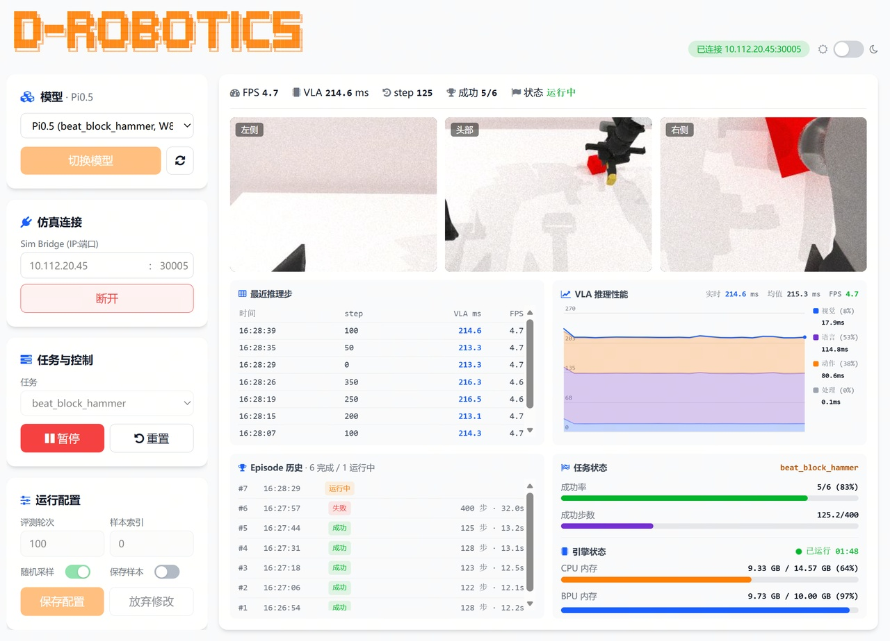

# Horizon / D-Robotics：仿真环境、板端联调与Sim-to-Real边界

截止2026-11-05；依据OE LLM 2.0.0动态文档正文及TROS教程，文档已离线渲染并保留JS原件与哈希。本研究没有启动Docker、SDK或机器人。

## 已有的是两类可复建路线

当前官方VLA部署文档明确给出RoboTwin/SAPIEN与LIBERO/MuJoCo两条仿真路线，属于在第三方引擎上提供容器和板端桥接，不是自研通用物理引擎。RoboTwin指向D-Robotics/RoboTwin的pi0pub分支，包含eval与sim_bridge；LIBERO官方配套remote容器仅带仿真评测，不带模型。传统导航则由PC运行Gazebo/TurtleBot3，RDK运行Nav2。三者解决的验证问题不同，不能统称端侧仿真训练平台。〔1：[原文](https://developer.d-robotics.cc/oe_llm_doc/static/js/async/96352.bec46241.js) / [本地原件](REFERENCES.md#ref-7a55bacca877cdcc) / [官方文档页面](https://developer.d-robotics.cc/oe_llm_doc/guide/vla/vla_deployment/sim_loop/overview) / [离线正文](REFERENCES.md) / [渲染HTML](REFERENCES.md)〕 〔2：[原文](https://developer.d-robotics.cc/oe_llm_doc/static/js/async/79035.d86b3263.js) / [本地原件](REFERENCES.md#ref-fa35342380225a8f) / [官方文档页面](https://developer.d-robotics.cc/oe_llm_doc/guide/vla/vla_deployment/sim_loop/robotwin) / [离线正文](REFERENCES.md) / [渲染HTML](REFERENCES.md)〕 〔3：[原文](https://developer.d-robotics.cc/oe_llm_doc/static/js/async/92345.21a93ef0.js) / [本地原件](REFERENCES.md#ref-1bf6a062516dcd70) / [官方文档页面](https://developer.d-robotics.cc/oe_llm_doc/guide/vla/vla_deployment/sim_loop/libero) / [离线正文](REFERENCES.md) / [渲染HTML](REFERENCES.md)〕 〔4：[原文](https://developer.d-robotics.cc/tros_doc/apps/navigation2) / [本地原件](REFERENCES.md#ref-60f9282395328216)〕

| 路线 | 仿真/模型在哪里 | 交接与输出 | 能证明与不能证明 |
|---|---|---|---|
| RoboTwin独立Eval | 工作站容器中仿真与Pi0策略 | task/config/model/seed/gpu_id | 策略仿真评测；不是板端成绩 |
| RoboTwin Sim Bridge | PC仿真；S600模型 | protobuf观测/动作＋控制面 | 板端参与闭环；仍非真实本体 |
| LIBERO remote | PC评测；外部推理引擎 | TCP＋逐episode JSON/MD | 可做任务分母清晰评测；无实机泛化保证 |
| TROS Nav2/Gazebo | PC物理环境；RDK导航 | ROS2 /clock、地图、TF与速度命令 | 导航链路联调；不证明S600/Jazzy全栈 |
| Stub/Mock | 无物理引擎或零动作 | 协议及REST/SSE | 验证连接与格式；不证明动作策略质量 |

## 数据面、控制面与模型生命周期

官方规定仿真容器作为TCP服务端，板端oellm_vla_serving作为客户端主动连接。帧是四字节大端长度前缀加protobuf MultiModalInput消息体，支持FLOAT64、UINT8、STRING和FLOAT32。默认数据面30005，RoboTwin另有30006控制面。这意味着真实图像、文本、状态和动作需按schema解释，不能把任意JSON关节列表发到数据面。网络分包与半包处理、字节序和长度上限要由交付代码确认；本文没有拿到协议实现的全部安全及超时行为。〔1：[原文](https://developer.d-robotics.cc/oe_llm_doc/static/js/async/96352.bec46241.js) / [本地原件](REFERENCES.md#ref-7a55bacca877cdcc) / [官方文档页面](https://developer.d-robotics.cc/oe_llm_doc/guide/vla/vla_deployment/sim_loop/overview) / [离线正文](REFERENCES.md) / [渲染HTML](REFERENCES.md)〕

板端HTTP默认8080，vla_models.json注册模型ID、oellm_config、demo_config、ready和missing_files。切换模型会先卸载当前模型再加载目标；ready只是文件是否就绪，不能当精度和任务适配认证。/api/sim/connect负责建立连接，/api/sim/control控制推理，/api/sim/stream使用SSE推送图像、阶段耗时和事件。网页可观察内存与状态，但这是示例级运行时管理，尚无证据说明具有实验血缘、权限隔离、批量机队发布和自动模型回退。〔5：[原文](https://developer.d-robotics.cc/oe_llm_doc/static/js/async/31387.81c0759b.js) / [本地原件](REFERENCES.md#ref-ca44276c4b742a02) / [官方文档页面](https://developer.d-robotics.cc/oe_llm_doc/guide/vla/vla_deployment/sim_loop/vla_serving) / [离线正文](REFERENCES.md) / [渲染HTML](REFERENCES.md)〕

该官方原图展示观测视角、任务次数、耗时与CPU/BPU内存，而非物理引擎框图。截图中的5/6、约214.6ms、FPS4.7只是界面瞬间，没有模型commit、完整seed和测试配置，不能当可审计成功率benchmark，也不能和04表内不同任务档直接比较。界面把成功次数与推理耗时并列有助于定位，正式评测仍须保留逐episode原始数据。〔6：[原文](https://developer.d-robotics.cc/oe_llm_doc/static/image/vla_serve.51c667cf.jpg) / [本地原件](REFERENCES.md#ref-6ec6605d35ff83f4)〕

## LIBERO：评测分母比演示视频更重要

配套容器提供libero_spatial、libero_goal、libero_object、libero_10或all，默认每任务50 episodes。先启动容器等待连接，再启动板端推理；远端模型模式不携带tokenizer和norm_stats，因此它们应在推理侧与HBM一致。上游LIBERO用任务语言、BDDL文件与初始状态创建OffScreenRenderEnv，表明任务不仅是图片分类，还包含物体关系和终止条件。官方预置容器使用latest标签，本次未下载多GB镜像或资产，未获得image digest，不能把命令称已经复现。〔3：[原文](https://developer.d-robotics.cc/oe_llm_doc/static/js/async/92345.21a93ef0.js) / [本地原件](REFERENCES.md#ref-1bf6a062516dcd70) / [官方文档页面](https://developer.d-robotics.cc/oe_llm_doc/guide/vla/vla_deployment/sim_loop/libero) / [离线正文](REFERENCES.md) / [渲染HTML](REFERENCES.md)〕 〔7：[原文](https://raw.githubusercontent.com/Lifelong-Robot-Learning/LIBERO/master/README.md) / [本地原件](REFERENCES.md#ref-69c657d453ca6e88)〕

结果JSON包含参数、逐suite/任务成功率、episode步数、成功标志、错误和视频名。正式对比必须保留失败与异常，不丢掉连不上板或超时的episode。文档明确同名回放视频直接覆盖，每任务只留最后一次；因此要按run/seed/episode改名或另存，不能依靠最后视频证明全部运行。无板mock引擎输出零动作只验证TCP；即使日志顺利结束，也不代表S600推理正确。

## RoboTwin：工作站评测与硬件参与测试分开

官方镜像robotwin-pi0-cu128需外挂资产，文档把资源入口留在resolve_resource_x86.md，正文的prefix并不是可直接下载地址。镜像curobo默认为RTX40系sm_89编译，RTX30、A100、H100需按实际计算能力重编；这说明仿真、运动规划及渲染仍依赖工作站GPU和工具链，不能据端侧BPU算力估计训练速度。独立eval.sh在工作站评估Pi0/Pi0.5，Sim Bridge才连接板端，两种记录必须标注。〔2：[原文](https://developer.d-robotics.cc/oe_llm_doc/static/js/async/79035.d86b3263.js) / [本地原件](REFERENCES.md#ref-fa35342380225a8f) / [官方文档页面](https://developer.d-robotics.cc/oe_llm_doc/guide/vla/vla_deployment/sim_loop/robotwin) / [离线正文](REFERENCES.md) / [渲染HTML](REFERENCES.md)〕

run_bridge.sh默认任务beat_block_hammer、pi0_step=50、state_dim=14，还允许指定instruction和端口。此处状态宽度与04的LIBERO8维示例不同，不能复用同一norm_stats而省略映射。StubSimEnv无SAPIEN依赖，mock_board还可模拟网页和REST/SSE，这两种仅用于接口调试。分支README许可声明MIT不能覆盖下载的mesh、纹理、物体模型、镜像中的第三方二进制和训练数据。〔2：[原文](https://developer.d-robotics.cc/oe_llm_doc/static/js/async/79035.d86b3263.js) / [本地原件](REFERENCES.md#ref-fa35342380225a8f) / [官方文档页面](https://developer.d-robotics.cc/oe_llm_doc/guide/vla/vla_deployment/sim_loop/robotwin) / [离线正文](REFERENCES.md) / [渲染HTML](REFERENCES.md)〕 〔8：[原文](https://raw.githubusercontent.com/D-Robotics/RoboTwin/pi0pub/README.md) / [本地原件](REFERENCES.md#ref-470f911af9987249)〕

## 时间步、物理和传感器可信度

分析：一次策略调用给出多个动作后，仿真可能逐步执行chunk，也可能每若干tick重规划。必须分别记录physics dt、控制周期、相机频率、policy周期和真实墙钟耗时。等待TCP时如果仿真暂停，策略看起来能完成任务，但真实机器人在等待期间仍运动；因此还应增加“连续物理推进＋真实延迟注入”试验。官方桥接概览没有给完整步进调度和丢帧/超时规范，pi0_step不是已证明的物理dt，不能由它推出实时因子。

MuJoCo擅长关节结构与接触动力学，XML编译后的低层预分配结构服务于仿真执行；这不意味着每个资产质量、摩擦、阻尼和接触设置都准确。SAPIEN路线的可见纹理与光照也不能代替相机曝光、rolling shutter、噪声、深度孔洞和LiDAR扫描模型。对端侧模型要独立随机化相机外参、光照、目标尺度、延迟和状态偏差，再用真实测量的电机饱和、死区、质量与摩擦校正仿真参数。本文没有取得统一官方域随机化分布、传感器噪声标定或仿真到真实留出成功率。〔9：[原文](https://raw.githubusercontent.com/google-deepmind/mujoco/main/README.md) / [本地原件](REFERENCES.md#ref-256fd316f8826a33)〕 〔2：[原文](https://developer.d-robotics.cc/oe_llm_doc/static/js/async/79035.d86b3263.js) / [本地原件](REFERENCES.md#ref-fa35342380225a8f) / [官方文档页面](https://developer.d-robotics.cc/oe_llm_doc/guide/vla/vla_deployment/sim_loop/robotwin) / [离线正文](REFERENCES.md) / [渲染HTML](REFERENCES.md)〕

Gazebo/Nav2教程明确use_sim_time=True，并由PC提供TurtleBot3世界与地图，RDK运行导航。应保证TF、消息Header与/clock同域，仿真暂停不能和系统realtime混用。教程列X3/X5/S100/P的Foxy/Humble，未列S600/Jazzy；沿用旧命令前要核对Gazebo版本及ROS桥，不能由ROS2兼容推导完整依赖闭包。〔4：[原文](https://developer.d-robotics.cc/tros_doc/apps/navigation2) / [本地原件](REFERENCES.md#ref-60f9282395328216)〕

## 可复建放行方案与许可

先固定容器digest、资产版本、模型/统计/tokenizer哈希、BSP/compiler/runtime、GPU及驱动；用mock检查schema，再比较工作站浮点与板端量化在相同seed下的输入、阶段张量、动作和成功。随后加入带宽限制、帧延迟、断线重连、模型切换和热负载，记录总墙钟/仿真时间、超时、P99与动作年龄。最后在真实本体留出任务上测成功/尝试、人工介入与碰撞，才允许讨论sim-to-real收益。

上游LIBERO README分别列代码MIT与数据CC BY4.0，数据应按实际下载版本核对；MuJoCo README说明核心Apache2与内置third-party notices需保留。容器下载可用不等于整包许可审核完成。本次完成文档级路线与协议核验，未取得场景资产授权闭包、完整物理/渲染benchmark或实机泛化。〔7：[原文](https://raw.githubusercontent.com/Lifelong-Robot-Learning/LIBERO/master/README.md) / [本地原件](REFERENCES.md#ref-69c657d453ca6e88)〕 〔9：[原文](https://raw.githubusercontent.com/google-deepmind/mujoco/main/README.md) / [本地原件](REFERENCES.md#ref-256fd316f8826a33)〕

## 资料与核验

本篇为公开资料与代码核验，未进行SDK安装、模型实机或机器人验收。静态归档部分缺失：无；所识别静态依赖完整，仍不保证动态内容/像素级复现。

[资料总索引](REFERENCES.md) · [证据JSON](research_state/evidence/05_Simulation_Environment.json)

### 原件清单

1. **H05_Sim_Content**：[原URL](https://developer.d-robotics.cc/oe_llm_doc/static/js/async/96352.bec46241.js) · [原件](REFERENCES.md#ref-7a55bacca877cdcc)；采集2026-11-05T04:10:29.696620+00:00；complete_static。 / [官方文档页面](https://developer.d-robotics.cc/oe_llm_doc/guide/vla/vla_deployment/sim_loop/overview) / [离线正文](REFERENCES.md) / [渲染HTML](REFERENCES.md)。正文由已归档的官方页面JS在完全阻断外网请求的浏览器内渲染，入口空壳HTML不作正文证据。

2. **H05_RoboTwin_Content**：[原URL](https://developer.d-robotics.cc/oe_llm_doc/static/js/async/79035.d86b3263.js) · [原件](REFERENCES.md#ref-fa35342380225a8f)；采集2026-11-05T04:10:32.572747+00:00；complete_static。 / [官方文档页面](https://developer.d-robotics.cc/oe_llm_doc/guide/vla/vla_deployment/sim_loop/robotwin) / [离线正文](REFERENCES.md) / [渲染HTML](REFERENCES.md)。正文由已归档的官方页面JS在完全阻断外网请求的浏览器内渲染，入口空壳HTML不作正文证据。

3. **H05_LIBERO_Content**：[原URL](https://developer.d-robotics.cc/oe_llm_doc/static/js/async/92345.21a93ef0.js) · [原件](REFERENCES.md#ref-1bf6a062516dcd70)；采集2026-11-05T04:10:31.300490+00:00；complete_static。 / [官方文档页面](https://developer.d-robotics.cc/oe_llm_doc/guide/vla/vla_deployment/sim_loop/libero) / [离线正文](REFERENCES.md) / [渲染HTML](REFERENCES.md)。正文由已归档的官方页面JS在完全阻断外网请求的浏览器内渲染，入口空壳HTML不作正文证据。

4. **H02_Navigation**：[原URL](https://developer.d-robotics.cc/tros_doc/apps/navigation2) · [原件](REFERENCES.md#ref-60f9282395328216)；采集2026-11-05T03:00:00.520744+00:00；complete_static。

5. **H05_Serving_Content**：[原URL](https://developer.d-robotics.cc/oe_llm_doc/static/js/async/31387.81c0759b.js) · [原件](REFERENCES.md#ref-ca44276c4b742a02)；采集2026-11-05T04:10:33.756959+00:00；complete_static。 / [官方文档页面](https://developer.d-robotics.cc/oe_llm_doc/guide/vla/vla_deployment/sim_loop/vla_serving) / [离线正文](REFERENCES.md) / [渲染HTML](REFERENCES.md)。正文由已归档的官方页面JS在完全阻断外网请求的浏览器内渲染，入口空壳HTML不作正文证据。

6. **H05_Serving_Figure**：[原URL](https://developer.d-robotics.cc/oe_llm_doc/static/image/vla_serve.51c667cf.jpg) · [原件](REFERENCES.md#ref-6ec6605d35ff83f4)；采集2026-11-05T04:11:08.681002+00:00；complete_static。

7. **H05_LIBERO_Repo**：[原URL](https://raw.githubusercontent.com/Lifelong-Robot-Learning/LIBERO/master/README.md) · [原件](REFERENCES.md#ref-69c657d453ca6e88)；采集2026-11-05T04:11:20.881084+00:00；complete_static。

8. **H05_RoboTwin_Repo**：[原URL](https://raw.githubusercontent.com/D-Robotics/RoboTwin/pi0pub/README.md) · [原件](REFERENCES.md#ref-470f911af9987249)；采集2026-11-05T04:11:19.913272+00:00；complete_static。

9. **H05_MuJoCo**：[原URL](https://raw.githubusercontent.com/google-deepmind/mujoco/main/README.md) · [原件](REFERENCES.md#ref-256fd316f8826a33)；采集2026-11-05T04:11:21.786429+00:00；complete_static。
