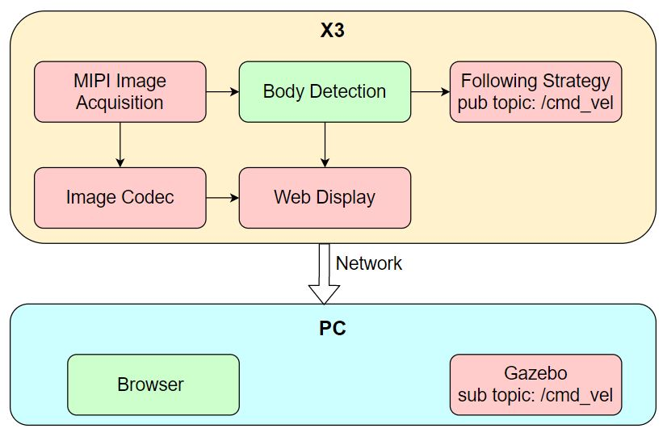

# Horizon / D-Robotics：机器人本体适配与商业成熟度

截止2026-11-05。地平线征程无人物流与地瓜旭日/RDK具身路线分别调查；同源BPU不代表SDK、本体或商业交付完全相同。

## 案例地图与证据等级

具体机器人适配要同时辨认客户、产品代际、芯片、软件交付和任务状态。当前最明确的公开产品级链条是京东“独狼”第六代智能配送车Plus版与征程6P的定点公告；S600具有多家采用公告及VLA接入，但本次未取得逐家机器人SKU、SDK与控制实现。表内不将客户名替代机器人型号。〔1：[原文](https://www.horizon.auto/news/press/475) / [本地原件](REFERENCES.md#ref-3f232a4e286b7e21)〕 〔2：[原文](https://www.horizon.auto/news/press/479) / [本地原件](REFERENCES.md#ref-8d8fe856b3583fc1)〕

| 案例 | 芯片/平台 | 可确认状态与日期 | 任务 | 缺失的放行证据 |
|---|---|---|---|---|
| 京东独狼六代Plus | 征程6P | 地平线2026-09-11公告项目定点 | L4智能配送车 | 该代实际交付台数、道路暴露与介入 |
| 嬴彻Taurus平台 | 征程6M | 同公告称已量产交付 | 干线运输计算平台 | 不是机器人型号；客户侧配置与运营分母 |
| 卡尔动力/行深智能 | 征程6P | 公告称打造/开发L4方案 | 无人货运/物流 | 准确车代、BSP、交付验收与收益 |
| 它石智航/千寻/自变量等 | 旭日S600 | 2026-09融资公告称20余家采用 | 人形/轮式/3C等分类 | 逐家本体SKU、动作契约、台数与成功率 |
| Pi0/Pi05/SmolVLA预置 | RDK S600 | SDK部署＋仿真桥接 | 操作策略评估 | 具体真实机器人接入与留出任务 |
| 人体跟随App | X3/X5 TROS | 官方应用教程 | 感知→/cmd_vel→PC Gazebo | 真实底盘和紧急停机验收 |

## 京东案例：定点具有价值，规模预测不等于运营

地平线公告明确征程6P将为独狼六代Plus提供智能驾驶算力，属于design-in证据。公告描述更大参数Transformer/BEV与多模态感知的潜在价值，但没有给该车的传感器型号、模型commit、温度/功率、闭环时延或新旧路线的成功率对照。560TOPS是芯片宣称，不能换算配送单量或续航。技术影响机制是为感知与决策提供更多资源；能否兑现要看模型有效吞吐、内存、车体供电散热和长尾场景回归。

公告把京东历史常态化运营与本次定点放在一起，并预测未来3—5年这一合作场景“有望百万辆”。历史园区、校园、乡村部署并不证明六代Plus已在相同规模运行，预测也不是采购合同或收入确认。公告中征程家族累计1500万片覆盖乘用车与多代产品，不能当无人配送或具身芯片出货。真正商业核验须由客户提供该代交付时间、地区、车辆数、累计有效运行小时、任务尝试、事故/介入和人工成本。本文没有这些分母，因此不计算ROI。〔1：[原文](https://www.horizon.auto/news/press/475) / [本地原件](REFERENCES.md#ref-3f232a4e286b7e21)〕

## S600客户采用与本体SDK缺口

2026-09-18融资新闻称S600自2025-11发布后半年内获20余家采用，列它石智航、千寻、自变量、智在无界、优必选、帕西尼等；同时称多数项目进入量产级出货。本文把它保留为供应方公开宣称，不把“多数”扩展成所有名单逐家已量产，更不据此指认某款人形的执行器和策略。客户覆盖率超过50%没有给统计总体，不能当具身市场份额。〔2：[原文](https://www.horizon.auto/news/press/479) / [本地原件](REFERENCES.md#ref-8d8fe856b3583fc1)〕

S600产品页称多个VLA部署验证和HIL能力，说明厂商在推进从模型到任务验证，但本体成功标准及测试报告未给出。产品页列HoloBrain、LingBot-VLA、X-VLA等，当前已核验SDK预置接入列Pi0/Pi05、SmolVLA、Spirit，两种覆盖范围不能强行合并成完全相同的交付清单。应逐模型向厂商索取目标BSP、模型文件、配置、接入库、任务记录与许可。〔3：[原文](https://cn.d-robotics.cc/rdkS600) / [本地原件](REFERENCES.md#ref-5aaffe83d6e42b57)〕 〔4：[原文](https://developer.d-robotics.cc/oe_llm_doc/static/js/async/26444.95f492ac.js) / [本地原件](REFERENCES.md#ref-549ade35441bfbaf) / [官方文档页面](https://developer.d-robotics.cc/oe_llm_doc/guide/vla/vla_deployment/overview) / [离线正文](REFERENCES.md) / [渲染HTML](REFERENCES.md)〕

## 从动作张量到执行器的真实契约

VLA SDK已公开可操作的契约层：VlaImageView包含data、byte_size、dtype、颜色空间、布局和宽高，属于前处理读取的零拷贝视图，调用方仍须保证像素存活；不能把这个对象理解为跨相机/ROS/BPU所有阶段都不复制。VlaRequestInputs包含图像、prompt/token_ids、state、state_raw、skip_image_preproc、prev_chunk和inference_delay。state_raw默认false，数据归一化的责任不能凭文件扩展名推断。〔5：[原文](https://developer.d-robotics.cc/oe_llm_doc/static/js/async/40340.5dcdb5a2.js) / [本地原件](REFERENCES.md#ref-01c9167b06b3a111) / [官方文档页面](https://developer.d-robotics.cc/oe_llm_doc/guide/vla/vla_deployment/vla_api/vla_types) / [离线正文](REFERENCES.md) / [渲染HTML](REFERENCES.md)〕

VlaActionOutput分别携带action_shape、后处理FP64动作与模型原始FP16。FP16在vector<uint16_t>中是位表示，不应当整数关节位置。输出[horizon,dim]只是张量契约，控制适配层还须知道关节顺序、夹爪维、米/弧度/比例、位置或速度、绝对或增量、末端坐标系和参考姿态。04的LIBERO7维动作不能直接匹配RoboTwin双臂14维状态；配置中宽度相同也不证明单位和坐标相同。没有模型训练约定与本体映射表，所谓“可直接执行”只在正确适配的控制器条件下成立。〔5：[原文](https://developer.d-robotics.cc/oe_llm_doc/static/js/async/40340.5dcdb5a2.js) / [本地原件](REFERENCES.md#ref-01c9167b06b3a111) / [官方文档页面](https://developer.d-robotics.cc/oe_llm_doc/guide/vla/vla_deployment/vla_api/vla_types) / [离线正文](REFERENCES.md) / [渲染HTML](REFERENCES.md)〕 〔6：[原文](https://developer.d-robotics.cc/oe_llm_doc/static/js/async/76569.5bd6179e.js) / [本地原件](REFERENCES.md#ref-5a02b6b9a1f6c236) / [官方文档页面](https://developer.d-robotics.cc/oe_llm_doc/guide/vla/vla_deployment/vla_sample/config_basic) / [离线正文](REFERENCES.md) / [渲染HTML](REFERENCES.md)〕 〔7：[原文](https://developer.d-robotics.cc/oe_llm_doc/static/js/async/79035.d86b3263.js) / [本地原件](REFERENCES.md#ref-fa35342380225a8f) / [官方文档页面](https://developer.d-robotics.cc/oe_llm_doc/guide/vla/vla_deployment/sim_loop/robotwin) / [离线正文](REFERENCES.md) / [渲染HTML](REFERENCES.md)〕

策略接口VlaPolicy的Init/Run在同一实例由runtime序列化，不同实例可并行；ParseVlaRequest核对图像数，错误返回kErrInvalidParam。多实例并行是软件接口允许，不是共享BPU、DDR及传感器资源的P99保证。request_id可用于匹配响应，但还需要采样时间、动作有效期、过期丢弃和执行反馈，避免乱序响应覆写新动作。〔8：[原文](https://developer.d-robotics.cc/oe_llm_doc/static/js/async/19278.822b0fe1.js) / [本地原件](REFERENCES.md#ref-632603fd58f659e6) / [官方文档页面](https://developer.d-robotics.cc/oe_llm_doc/guide/vla/vla_deployment/vla_api/framework_layer/vla_policy) / [离线正文](REFERENCES.md) / [渲染HTML](REFERENCES.md)〕

## chunk、滤波、RTC与下层控制分层

官方动作滤波支持Pi0/Pi05和SmolVLA，Spirit暂不支持；预置配置type=none、fs=0即禁用。Butterworth、One Euro和EMA改变平滑及相位，max_velocity只在指定两阶段滤波路径生效，不能替代电机电流/加速度/关节限位和碰撞保护。默认fs25是参数，不是已测伺服频率；EMA系数和截频应与实际更新周期一致。〔9：[原文](https://developer.d-robotics.cc/oe_llm_doc/static/js/async/85974.f71f5f7e.js) / [本地原件](REFERENCES.md#ref-f56beb82eada2273) / [官方文档页面](https://developer.d-robotics.cc/oe_llm_doc/guide/vla/vla_deployment/vla_sample/config_advanced) / [离线正文](REFERENCES.md) / [渲染HTML](REFERENCES.md)〕

warm-start仅用于Pi0.5 flow-matching，缓存上一轮chunk混合新噪声，replan_steps控制缓存左移；RTC在去噪环施加prefix attention引导，两者互斥且RTC要求host侧多步。文档称RTC为Retrieval-Time Correction，本文沿用其名称，不把它和系统时钟RTC混淆。control_frequency默认30用于流逝时间折算缓存偏移，inference_delay整数的实际时间/步单位还要按实现确认，不能直接读成毫秒。减少去噪提高调用速度时要同时测动作连续性和任务成功，缓存来自旧任务、重置或模型切换后尤其需要清除。〔9：[原文](https://developer.d-robotics.cc/oe_llm_doc/static/js/async/85974.f71f5f7e.js) / [本地原件](REFERENCES.md#ref-f56beb82eada2273) / [官方文档页面](https://developer.d-robotics.cc/oe_llm_doc/guide/vla/vla_deployment/vla_sample/config_advanced) / [离线正文](REFERENCES.md) / [渲染HTML](REFERENCES.md)〕

## 可观察的端到端实例与安全边界

图中RDK人体检测后发布/cmd_vel，PC Gazebo接收。教程以检测框宽最大选择目标，日志0.3m/s和另一次echo0.5m/s是命令示例，不是同条件实测车速。框宽受人体尺寸、遮挡和标定影响，不是度量距离。图能证明数据流，不能证明避障、速度闭环、真实追踪成功或VLA。本体集成还需底盘驱动、反馈和超时停车。〔10：[原文](https://developer.d-robotics.cc/tros_doc/apps/car_tracking) / [本地原件](REFERENCES.md#ref-f91ef5585c3f3188)〕

MCU CAN/EtherCAT/IPC提供更低层通道，但总线控制器数量与实验室最高波特率不能当完整电机网络能力。官方SOEM示例周期文字与日志存在1000µs/1000000µs差异，不能据此认定1kHz确定性运动。MCU与Linux分域有助分工，仍需验证内存/DMA干扰、IPC超时及故障降级；WDG非重入等限制也要在应用处理。〔11：[原文](https://developer.d-robotics.cc/rdk_s_doc/Advanced_development/mcu_development/mcu_can) / [本地原件](REFERENCES.md#ref-71ba84d58f4beadf)〕 〔12：[原文](https://developer.d-robotics.cc/rdk_s_doc/Advanced_development/mcu_development/mcu_ethercat) / [本地原件](REFERENCES.md#ref-55e8507927e44f5e)〕 〔13：[原文](https://developer.d-robotics.cc/rdk_s_doc/Advanced_development/mcu_development/mcu_ipc) / [本地原件](REFERENCES.md#ref-975898a4eb7147a2)〕 〔14：[原文](https://developer.d-robotics.cc/rdk_s_doc/Advanced_development/mcu_development/mcu_watchdog) / [本地原件](REFERENCES.md#ref-1b97b81b8bf75e89)〕

放行建议按“离线张量对齐→仿真同seed→低速真实本体→全负载热稳态→长时间任务运营”逐步取证。每一步保留模型与统计文件哈希、坐标/单位、policy周期、控制周期、总线周期和执行器servo周期。注入相机消失、状态过期、断线、推理超时及重启，验证下游安全停止和恢复条件；上层停止发布不代表执行器停止。芯片可靠性设计、自然语言能力和动作滤波均不能单独赋予整机安全等级。当前最可靠的结论是已有具体定点与端侧接入路线，而完整本体SDK、确定性控制与商业收益仍需客户验收材料。

## 资料与核验

本篇为公开资料与代码核验，未进行SDK安装、模型实机或机器人验收。静态归档部分缺失：[{'source_id': 'Horizon_JD_Journey6P_DesignIn', 'missing_presentation': 25, 'missing_all': 27}, {'source_id': 'Horizon_DRobotics_Funding_Relation', 'missing_presentation': 23, 'missing_all': 25}]。

[资料总索引](REFERENCES.md) · [证据JSON](research_state/evidence/06_Robot_Integration.json)

### 原件清单

1. **Horizon_JD_Journey6P_DesignIn**：[原URL](https://www.horizon.auto/news/press/475) · [原件](REFERENCES.md#ref-3f232a4e286b7e21)；采集2026-11-05T01:24:46.243497+00:00；partial_static。

2. **Horizon_DRobotics_Funding_Relation**：[原URL](https://www.horizon.auto/news/press/479) · [原件](REFERENCES.md#ref-8d8fe856b3583fc1)；采集2026-11-05T01:24:52.069141+00:00；partial_static。

3. **Horizon_RDK_S600**：[原URL](https://cn.d-robotics.cc/rdkS600) · [原件](REFERENCES.md#ref-5aaffe83d6e42b57)；采集2026-11-05T01:28:18.275356+00:00；complete_static。

4. **H02_LLM_VLA_Content**：[原URL](https://developer.d-robotics.cc/oe_llm_doc/static/js/async/26444.95f492ac.js) · [原件](REFERENCES.md#ref-549ade35441bfbaf)；采集2026-11-05T02:35:43.996285+00:00；complete_static。 / [官方文档页面](https://developer.d-robotics.cc/oe_llm_doc/guide/vla/vla_deployment/overview) / [离线正文](REFERENCES.md) / [渲染HTML](REFERENCES.md)。正文由已归档的官方页面JS在完全阻断外网请求的浏览器内渲染，入口空壳HTML不作正文证据。

5. **H06_Types_Content**：[原URL](https://developer.d-robotics.cc/oe_llm_doc/static/js/async/40340.5dcdb5a2.js) · [原件](REFERENCES.md#ref-01c9167b06b3a111)；采集2026-11-05T04:14:34.642090+00:00；complete_static。 / [官方文档页面](https://developer.d-robotics.cc/oe_llm_doc/guide/vla/vla_deployment/vla_api/vla_types) / [离线正文](REFERENCES.md) / [渲染HTML](REFERENCES.md)。正文由已归档的官方页面JS在完全阻断外网请求的浏览器内渲染，入口空壳HTML不作正文证据。

6. **H04_Config_Content**：[原URL](https://developer.d-robotics.cc/oe_llm_doc/static/js/async/76569.5bd6179e.js) · [原件](REFERENCES.md#ref-5a02b6b9a1f6c236)；采集2026-11-05T04:06:43.664446+00:00；complete_static。 / [官方文档页面](https://developer.d-robotics.cc/oe_llm_doc/guide/vla/vla_deployment/vla_sample/config_basic) / [离线正文](REFERENCES.md) / [渲染HTML](REFERENCES.md)。正文由已归档的官方页面JS在完全阻断外网请求的浏览器内渲染，入口空壳HTML不作正文证据。

7. **H05_RoboTwin_Content**：[原URL](https://developer.d-robotics.cc/oe_llm_doc/static/js/async/79035.d86b3263.js) · [原件](REFERENCES.md#ref-fa35342380225a8f)；采集2026-11-05T04:10:32.572747+00:00；complete_static。 / [官方文档页面](https://developer.d-robotics.cc/oe_llm_doc/guide/vla/vla_deployment/sim_loop/robotwin) / [离线正文](REFERENCES.md) / [渲染HTML](REFERENCES.md)。正文由已归档的官方页面JS在完全阻断外网请求的浏览器内渲染，入口空壳HTML不作正文证据。

8. **H06_Policy_Content**：[原URL](https://developer.d-robotics.cc/oe_llm_doc/static/js/async/19278.822b0fe1.js) · [原件](REFERENCES.md#ref-632603fd58f659e6)；采集2026-11-05T04:14:36.070994+00:00；complete_static。 / [官方文档页面](https://developer.d-robotics.cc/oe_llm_doc/guide/vla/vla_deployment/vla_api/framework_layer/vla_policy) / [离线正文](REFERENCES.md) / [渲染HTML](REFERENCES.md)。正文由已归档的官方页面JS在完全阻断外网请求的浏览器内渲染，入口空壳HTML不作正文证据。

9. **H06_Advanced_Content**：[原URL](https://developer.d-robotics.cc/oe_llm_doc/static/js/async/85974.f71f5f7e.js) · [原件](REFERENCES.md#ref-f56beb82eada2273)；采集2026-11-05T04:14:37.423633+00:00；complete_static。 / [官方文档页面](https://developer.d-robotics.cc/oe_llm_doc/guide/vla/vla_deployment/vla_sample/config_advanced) / [离线正文](REFERENCES.md) / [渲染HTML](REFERENCES.md)。正文由已归档的官方页面JS在完全阻断外网请求的浏览器内渲染，入口空壳HTML不作正文证据。

10. **H02_Car_Tracking**：[原URL](https://developer.d-robotics.cc/tros_doc/apps/car_tracking) · [原件](REFERENCES.md#ref-f91ef5585c3f3188)；采集2026-11-05T03:03:32.544670+00:00；complete_static。

11. **H02_CAN**：[原URL](https://developer.d-robotics.cc/rdk_s_doc/Advanced_development/mcu_development/mcu_can) · [原件](REFERENCES.md#ref-71ba84d58f4beadf)；采集2026-11-05T02:53:41.785147+00:00；complete_static。

12. **H02_EtherCAT**：[原URL](https://developer.d-robotics.cc/rdk_s_doc/Advanced_development/mcu_development/mcu_ethercat) · [原件](REFERENCES.md#ref-55e8507927e44f5e)；采集2026-11-05T02:53:49.329436+00:00；complete_static。

13. **H02_IPC**：[原URL](https://developer.d-robotics.cc/rdk_s_doc/Advanced_development/mcu_development/mcu_ipc) · [原件](REFERENCES.md#ref-975898a4eb7147a2)；采集2026-11-05T02:53:38.614163+00:00；complete_static。

14. **H02_Watchdog**：[原URL](https://developer.d-robotics.cc/rdk_s_doc/Advanced_development/mcu_development/mcu_watchdog) · [原件](REFERENCES.md#ref-1b97b81b8bf75e89)；采集2026-11-05T02:53:51.616573+00:00；complete_static。
