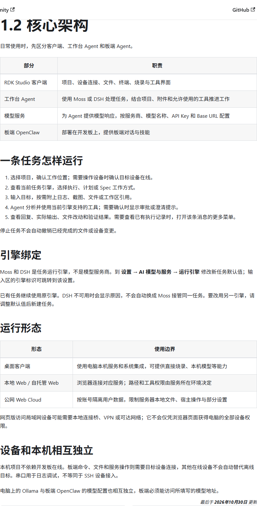

# Horizon / D-Robotics：生态分工、开发工具与量产责任

截止2026-11-05。生态规模、产品采用、软件可交付与正式供应承诺分别判断；本次没有购买设备或向伙伴发送消息。

## 生态的可用价值在具体交接

地瓜面向旭日/RDK提供芯片、板卡、BSP、OE与TROS，地平线通过同源底层架构在车载/无人物流延展。融资公告把地瓜称地平线孵化的机器人公司及战略伙伴，不能据此把两家所有客户、收入、许可与供货责任合并。旭日累计800万片与征程累计1500万片也属于不同产品家族；品牌关联不是同一计量口径。〔1：[原文](https://www.horizon.auto/news/press/479) / [本地原件](REFERENCES.md#ref-8d8fe856b3583fc1)〕 〔2：[原文](https://www.horizon.auto/news/press/475) / [本地原件](REFERENCES.md#ref-3f232a4e286b7e21)〕

| 伙伴/资源 | 提供什么 | 实际接口与对象 | 对选型的意义与缺口 |
|---|---|---|---|
| 地瓜官方RDK/OE/TROS | 板卡、BSP、量化部署、ROS封装 | S600/S100/X5不同BSP与HBM | 缩短原型时间；商业交付与版本回归需确认 |
| Waveshare微雪 | S600开发套件销售入口 | RDK-S600-32G，SKU34887 | 可购买渠道；动态价格/交期未取得有效报价 |
| Orbbec奥比中光 | 深度相机与SDK | USB/UVC/OpenNI、ARM64、ROS包装 | 型号与SDK代际要匹配；S600/Jazzy矩阵未取得 |
| Physical Intelligence/LeRobot | VLA模型与训练/数据工具 | openpi/策略→地瓜量化HBM→SDK | 上游资产可研究；权重/数据许可单独核 |
| RoboTwin/LIBERO | 仿真任务与评测 | PC容器→protobuf→板端服务 | 给闭环评测路线；资产/容器digest未锁 |
| 京东/具身客户名单 | 产品需求与design-in/采用 | 征程6P独狼六代Plus；S600客户公告 | 商业机会明确；台数/效果不能由名单推导 |
| 高校/创客/DGP/DDC | 教育、赛事、孵化与展示 | 开发者项目、工作坊、供应链对接 | 降低人才/原型门槛；不是量产认证 |

## Orbbec：传感器生态的接口和许可都需穿透

Orbbec官方SDK main是v1路线，README称兼容旧OpenNI设备，v2针对新的UVC设备且不再支持旧OpenNI协议。其平台表列ARM64 Ubuntu18.04/20.04/22.04，不能自动扩成S600 Ubuntu24.04/Jazzy认证。RDK教程给先安装SDK再包装ROS、发布深度和RGB及显式对齐参数，说明双方在应用层能形成路径；实际型号、固件、USB带宽和wrapper分支仍是单独合同。此次OrbbecSDK_ROS2的main README下载失败，未用失败正文支持兼容结论。〔3：[原文](https://raw.githubusercontent.com/orbbec/OrbbecSDK/main/README.md) / [本地原件](REFERENCES.md#ref-b96795c0527db9b9)〕 〔4：[原文](https://developer.d-robotics.cc/tros_doc/quick_demo/demo_sensor) / [本地原件](REFERENCES.md#ref-d7494a221f0c3960)〕

许可文件进一步区分仓库MIT与lib目录中的SDK库二进制：库可用于Orbbec产品，禁止修改、反编译/逆向及用于其他厂商产品，并列第三方库许可。这是很具体的生态锁定边界，不能写成“全SDK MIT，可任意改成自有相机”。迁移到v2要重新审计对应版本，不把v1二进制条款平移到所有未来开源实现。〔5：[原文](https://raw.githubusercontent.com/orbbec/OrbbecSDK/main/LICENSE.txt) / [本地原件](REFERENCES.md#ref-177fdf04da2487aa)〕

## RDK Studio与Agent工具链：新增可核验交付层

旧Studio页面已在2026-11-04注明旧版下架，链接新手册。新手册以1.5.0功能基线描述，但明确安装包是否发布、是否升级以发布入口为准，因此本文只认定手册基线，不宣称已安装最新二进制。新架构区分Studio客户端、工作台Agent、模型服务与板端OpenClaw，Moss/DSH是任务引擎而不是模型服务商。客户端管理项目/文件/终端/烧录；模型响应可按服务商、模型名与地址配置；板端对话和技能依赖设备连接。〔6：[原文](https://developer.d-robotics.cc/rdk_s_doc/Quick_start/rdk_studio) / [本地原件](REFERENCES.md#ref-cf0a322a5ec0e640)〕 〔7：[原文](https://developer.d-robotics.cc/rdk_studio_doc/product-intro/version-notes) / [本地原件](REFERENCES.md#ref-27e572c2d622b87d)〕 〔8：[原文](https://developer.d-robotics.cc/rdk_studio_doc/product-intro/architecture) / [本地原件](REFERENCES.md#ref-d1ed94170ef58e8a)〕

图中“停止任务不会自动撤销已完成文件或设备变更”以及任务引擎绑定是重要运行语义。它能帮助团队用开发助手管理项目和工具，但不证明机器人运行时自动安全回退。手册还写不同形态的权限边界：桌面访问本机系统；自托管Web由服务环境决定路径权限；公网Cloud按账号隔离并限制宿主操作。访问局域网设备还需网络桥或VPN。本次不使用账户、API Key或部署这些服务，云服务的数据处理条款与SLA仍未取得。

硬件手册明确S600使用XBurn手动烧录，不用TF镜像或应用内S100写入；SSH接入与串口日志不同。通用Linux、Jetson、Raspberry Pi和Rockchip可作为远端主机，不能因为能SSH就获得RDK专属BPU/烧录能力。其hbm示例把板型产物区分，但与已核验X5传统.bin和当前HBM格式存在术语泛化，工程应以目标OE/BSP产物要求为准。〔9：[原文](https://developer.d-robotics.cc/rdk_studio_doc/product-intro/supported-hardware) / [本地原件](REFERENCES.md#ref-548243694a798996)〕 〔10：[原文](https://raw.githubusercontent.com/D-Robotics/rdk_doc/main/docs/07_Advanced_development/04_toolchain_development/intermediate/ptq_process.md) / [本地原件](REFERENCES.md#ref-990bc69c51b0ab57)〕

## 开源模型、ROS与仿真伙伴的责任

openpi提供模型源与微调路线，LeRobot提供数据采集和策略生态；地瓜在端侧做组件校准、编译和VLA运行时。数据集格式与训练工具兼容并不意味着动作统计文件、tokenizer或关节顺序自动匹配。公开代码许可也不能覆盖基础模型权重和训练数据。TROS开源DnnNode封装可降低推理节点编写成本，但固定commit与apt发行包仍需逐文件对应，页眉文档版本不能替代deb版本。〔11：[原文](https://raw.githubusercontent.com/Physical-Intelligence/openpi/main/README.md) / [本地原件](REFERENCES.md#ref-93ae0cec36eeb1cd)〕 〔12：[原文](https://raw.githubusercontent.com/huggingface/lerobot/main/README.md) / [本地原件](REFERENCES.md#ref-ff1eedfea7364372)〕 〔13：[原文](https://raw.githubusercontent.com/D-Robotics/hobot_dnn/7647b62c975a97c8d3b627b0ded82302d7b128de/dnn_node/README_cn.md) / [本地原件](REFERENCES.md#ref-c481192af9210f8a)〕 〔14：[原文](https://raw.githubusercontent.com/D-Robotics/hobot_dnn/7647b62c975a97c8d3b627b0ded82302d7b128de/dnn_node/package.xml) / [本地原件](REFERENCES.md#ref-3f9cd1b8b8ad1eac)〕 〔15：[原文](https://developer.d-robotics.cc/tros_doc/quick_start/changelog) / [本地原件](REFERENCES.md#ref-aae5750928c41e90)〕

RoboTwin的pi0pub分支和LIBERO remote把工作站环境与端侧算力连接，解决板端策略评估的实际问题；仍依赖SAPIEN/MuJoCo、工作站GPU、curobo编译、容器与资产。平台宣传“端云全链路”可以作为方向，但不能把所有目录入口写成完成统一数据血缘、调度和量产发布。当前Serving的模型注册和Studio开发任务管理各有价值，尚未取得跨训练/仿真/真实机队的统一实验与OTA闭环证据。〔16：[原文](https://developer.d-robotics.cc/oe_llm_doc/static/js/async/79035.d86b3263.js) / [本地原件](REFERENCES.md#ref-fa35342380225a8f) / [官方文档页面](https://developer.d-robotics.cc/oe_llm_doc/guide/vla/vla_deployment/sim_loop/robotwin) / [离线正文](REFERENCES.md) / [渲染HTML](REFERENCES.md)〕 〔17：[原文](https://developer.d-robotics.cc/oe_llm_doc/static/js/async/92345.21a93ef0.js) / [本地原件](REFERENCES.md#ref-1bf6a062516dcd70) / [官方文档页面](https://developer.d-robotics.cc/oe_llm_doc/guide/vla/vla_deployment/sim_loop/libero) / [离线正文](REFERENCES.md) / [渲染HTML](REFERENCES.md)〕 〔18：[原文](https://developer.d-robotics.cc/oe_llm_doc/static/js/async/31387.81c0759b.js) / [本地原件](REFERENCES.md#ref-ca44276c4b742a02) / [官方文档页面](https://developer.d-robotics.cc/oe_llm_doc/guide/vla/vla_deployment/sim_loop/vla_serving) / [离线正文](REFERENCES.md) / [渲染HTML](REFERENCES.md)〕

## 教育孵化与活动成熟度

官方开发者页面展示Aruibot、空地协同、桌面机器狗、遥操作机械臂、双臂和安全皮肤等作品，证明社区覆盖多种探索方向，但未给每件作品的芯片代际、源码commit、运营数据与安全验收。不能把作品标题中的K8S集群负载均衡等功能当官方平台统一编排能力。DGP融资新闻称提供研发、供应链选型、推广和融资支持，列一批创新企业；这是孵化服务证据，不是每家产品订单/销量。〔19：[原文](https://cn.d-robotics.cc/developer) / [本地原件](REFERENCES.md#ref-bd48591082dfca7e)〕 〔1：[原文](https://www.horizon.auto/news/press/479) / [本地原件](REFERENCES.md#ref-8d8fe856b3583fc1)〕

DDC2026页面安排12月5—7日上海活动，包含RoboParty开源人形、RDK Agent、VBot及黑客松工作坊；截止日是11月5日，活动尚未发生，页面“敬请期待”嘉宾也未完全发布。只能记录计划与邀请，不描述参加人数、作品完成或培训效果。新闻中的10万开发者、500家创客及500所院校为厂商累计宣称，没有活跃用户、下载或统计方法，不能当技术支持响应率或商业采用率。〔20：[原文](https://cn.d-robotics.cc/ddc/2026) / [本地原件](REFERENCES.md#ref-30f04aac0f53e338)〕 〔1：[原文](https://www.horizon.auto/news/press/479) / [本地原件](REFERENCES.md#ref-8d8fe856b3583fc1)〕

## 从原型转向量产应锁定的责任

官方RDK首页提供生态项目对接中心，按架构评估、模块适配、批量采购与联合开发分级响应，说明商业协同入口存在；模块Owner和问题闭环不是公开SLA、固定保修期或长期供货承诺。采购要分别确认芯片/SOM、载板、相机、软件二进制及本体集成的责任主体。Waveshare页面有版本选择和退换入口，但价格变量未渲染为可核验金额，本文不引用购物占位符计算BOM。〔21：[原文](https://developer.d-robotics.cc/rdk_s_doc/RDK?v=5.1.0&p=RDK+S600) / [本地原件](REFERENCES.md#ref-a12897b0cc077f3d)〕 〔22：[原文](https://www.waveshare.net/shop/RDK-S600-32G.htm) / [本地原件](REFERENCES.md#ref-997e7dc8218b40e6)〕

量产清单应包含PCB/连接器版本、刷机/产测镜像哈希、序列号追溯、密钥配置、热设计、备件与维修周期。OTA还需确认rootfs及miniboot不同回退语义，不能把apt能更新称断电安全升级。PCN/EOL、最低订购、交期、关键BSP支持周期和漏洞修复窗口未取得正式承诺，应在采购前设为交付条件，而不是根据融资规模推断稳定供应。〔23：[原文](https://developer.d-robotics.cc/rdk_s_doc/Advanced_development/rdk_gen) / [本地原件](REFERENCES.md#ref-daa0f17ac1774c07)〕 〔24：[原文](https://developer.d-robotics.cc/rdk_s_doc/Advanced_development/linux_development/OTA/ota_system) / [本地原件](REFERENCES.md#ref-51c92d21e58d7011)〕 〔25：[原文](https://developer.d-robotics.cc/rdk_s_doc/Advanced_development/linux_development/OTA/ota_miniboot) / [本地原件](REFERENCES.md#ref-c0fecf1465220ec5)〕

“自主可控”也要分层：BPU与部署工具有本土研发主体，CPU/GPU公开使用Arm IP，GMSL板用ADI/Maxim器件，模型/OS/编译训练环境存在国际开源与GPU依赖。未取得完整制造封装/软件源码和商业IP清单，不能给国产化率。对有本地供应需求的项目，应形成可替换部件表、可重建源码范围和供应责任合同；对研发项目，优先验证模型与数据迁移成本。生态价值最终体现在可交付的接口及持续维护，而非伙伴logo数量。〔26：[原文](https://cn.d-robotics.cc/rdkS600) / [本地原件](REFERENCES.md#ref-5aaffe83d6e42b57)〕 〔27：[原文](https://developer.d-robotics.cc/rdk_s_doc/Quick_start/hardware_introduction/rdk_s600/rdk_s600_camera_expansion_board) / [本地原件](REFERENCES.md#ref-57531817dea53237)〕 〔28：[原文](https://developer.d-robotics.cc/rdk_s_doc/Advanced_development/mcu_development/code_release) / [本地原件](REFERENCES.md#ref-68065d5ada57af84)〕

## 资料与核验

本篇为公开资料与代码核验，未进行SDK安装、模型实机或机器人验收。静态归档部分缺失：[{'source_id': 'Horizon_DRobotics_Funding_Relation', 'missing_presentation': 23, 'missing_all': 25}, {'source_id': 'Horizon_JD_Journey6P_DesignIn', 'missing_presentation': 25, 'missing_all': 27}]。

[资料总索引](REFERENCES.md) · [证据JSON](research_state/evidence/07_Ecosystem.json)

### 原件清单

1. **Horizon_DRobotics_Funding_Relation**：[原URL](https://www.horizon.auto/news/press/479) · [原件](REFERENCES.md#ref-8d8fe856b3583fc1)；采集2026-11-05T01:24:52.069141+00:00；partial_static。

2. **Horizon_JD_Journey6P_DesignIn**：[原URL](https://www.horizon.auto/news/press/475) · [原件](REFERENCES.md#ref-3f232a4e286b7e21)；采集2026-11-05T01:24:46.243497+00:00；partial_static。

3. **H07_OrbbecSDK**：[原URL](https://raw.githubusercontent.com/orbbec/OrbbecSDK/main/README.md) · [原件](REFERENCES.md#ref-b96795c0527db9b9)；采集2026-11-05T04:18:04.833812+00:00；complete_static。

4. **H02_TROS_Sensor**：[原URL](https://developer.d-robotics.cc/tros_doc/quick_demo/demo_sensor) · [原件](REFERENCES.md#ref-d7494a221f0c3960)；采集2026-11-05T02:57:47.388991+00:00；complete_static。

5. **H07_Orbbec_License**：[原URL](https://raw.githubusercontent.com/orbbec/OrbbecSDK/main/LICENSE.txt) · [原件](REFERENCES.md#ref-177fdf04da2487aa)；采集2026-11-05T04:19:00.560135+00:00；complete_static。

6. **H07_Studio**：[原URL](https://developer.d-robotics.cc/rdk_s_doc/Quick_start/rdk_studio) · [原件](REFERENCES.md#ref-cf0a322a5ec0e640)；采集2026-11-05T04:18:16.041066+00:00；complete_static。

7. **H07_Studio_Version**：[原URL](https://developer.d-robotics.cc/rdk_studio_doc/product-intro/version-notes) · [原件](REFERENCES.md#ref-27e572c2d622b87d)；采集2026-11-05T04:20:07.154610+00:00；complete_static。

8. **H07_Studio_Arch**：[原URL](https://developer.d-robotics.cc/rdk_studio_doc/product-intro/architecture) · [原件](REFERENCES.md#ref-d1ed94170ef58e8a)；采集2026-11-05T04:20:05.907531+00:00；complete_static。

9. **H07_Studio_Hardware**：[原URL](https://developer.d-robotics.cc/rdk_studio_doc/product-intro/supported-hardware) · [原件](REFERENCES.md#ref-548243694a798996)；采集2026-11-05T04:20:08.568183+00:00；complete_static。

10. **H02_X5_PTQ**：[原URL](https://raw.githubusercontent.com/D-Robotics/rdk_doc/main/docs/07_Advanced_development/04_toolchain_development/intermediate/ptq_process.md) · [原件](REFERENCES.md#ref-990bc69c51b0ab57)；采集2026-11-05T02:40:23.519954+00:00；complete_static。

11. **H04_Openpi**：[原URL](https://raw.githubusercontent.com/Physical-Intelligence/openpi/main/README.md) · [原件](REFERENCES.md#ref-93ae0cec36eeb1cd)；采集2026-11-05T04:05:09.411026+00:00；complete_static。

12. **H04_LeRobot**：[原URL](https://raw.githubusercontent.com/huggingface/lerobot/main/README.md) · [原件](REFERENCES.md#ref-ff1eedfea7364372)；采集2026-11-05T04:05:38.884712+00:00；complete_static。

13. **H02_DNN_Pinned_Readme**：[原URL](https://raw.githubusercontent.com/D-Robotics/hobot_dnn/7647b62c975a97c8d3b627b0ded82302d7b128de/dnn_node/README_cn.md) · [原件](REFERENCES.md#ref-c481192af9210f8a)；采集2026-11-05T03:02:08.871803+00:00；complete_static。

14. **H02_DNN_Package**：[原URL](https://raw.githubusercontent.com/D-Robotics/hobot_dnn/7647b62c975a97c8d3b627b0ded82302d7b128de/dnn_node/package.xml) · [原件](REFERENCES.md#ref-3f9cd1b8b8ad1eac)；采集2026-11-05T03:02:16.025582+00:00；complete_static。

15. **H02_TROS_Release**：[原URL](https://developer.d-robotics.cc/tros_doc/quick_start/changelog) · [原件](REFERENCES.md#ref-aae5750928c41e90)；采集2026-11-05T02:58:35.520706+00:00；complete_static。

16. **H05_RoboTwin_Content**：[原URL](https://developer.d-robotics.cc/oe_llm_doc/static/js/async/79035.d86b3263.js) · [原件](REFERENCES.md#ref-fa35342380225a8f)；采集2026-11-05T04:10:32.572747+00:00；complete_static。 / [官方文档页面](https://developer.d-robotics.cc/oe_llm_doc/guide/vla/vla_deployment/sim_loop/robotwin) / [离线正文](REFERENCES.md) / [渲染HTML](REFERENCES.md)。正文由已归档的官方页面JS在完全阻断外网请求的浏览器内渲染，入口空壳HTML不作正文证据。

17. **H05_LIBERO_Content**：[原URL](https://developer.d-robotics.cc/oe_llm_doc/static/js/async/92345.21a93ef0.js) · [原件](REFERENCES.md#ref-1bf6a062516dcd70)；采集2026-11-05T04:10:31.300490+00:00；complete_static。 / [官方文档页面](https://developer.d-robotics.cc/oe_llm_doc/guide/vla/vla_deployment/sim_loop/libero) / [离线正文](REFERENCES.md) / [渲染HTML](REFERENCES.md)。正文由已归档的官方页面JS在完全阻断外网请求的浏览器内渲染，入口空壳HTML不作正文证据。

18. **H05_Serving_Content**：[原URL](https://developer.d-robotics.cc/oe_llm_doc/static/js/async/31387.81c0759b.js) · [原件](REFERENCES.md#ref-ca44276c4b742a02)；采集2026-11-05T04:10:33.756959+00:00；complete_static。 / [官方文档页面](https://developer.d-robotics.cc/oe_llm_doc/guide/vla/vla_deployment/sim_loop/vla_serving) / [离线正文](REFERENCES.md) / [渲染HTML](REFERENCES.md)。正文由已归档的官方页面JS在完全阻断外网请求的浏览器内渲染，入口空壳HTML不作正文证据。

19. **H07_Developer**：[原URL](https://cn.d-robotics.cc/developer) · [原件](REFERENCES.md#ref-bd48591082dfca7e)；采集2026-11-05T04:17:33.119481+00:00；complete_static。

20. **H06_DDC**：[原URL](https://cn.d-robotics.cc/ddc/2026) · [原件](REFERENCES.md#ref-30f04aac0f53e338)；采集2026-11-05T04:15:20.453597+00:00；complete_static。

21. **Horizon_S600_Docs_v510**：[原URL](https://developer.d-robotics.cc/rdk_s_doc/RDK?v=5.1.0&p=RDK+S600) · [原件](REFERENCES.md#ref-a12897b0cc077f3d)；采集2026-11-05T01:29:32.147349+00:00；complete_static。

22. **Horizon_S600_Waveshare_Quote**：[原URL](https://www.waveshare.net/shop/RDK-S600-32G.htm) · [原件](REFERENCES.md#ref-997e7dc8218b40e6)；采集2026-11-05T01:33:34.443407+00:00；complete_static。

23. **H02_Build**：[原URL](https://developer.d-robotics.cc/rdk_s_doc/Advanced_development/rdk_gen) · [原件](REFERENCES.md#ref-daa0f17ac1774c07)；采集2026-11-05T02:23:47.406121+00:00；complete_static。

24. **H02_OTA**：[原URL](https://developer.d-robotics.cc/rdk_s_doc/Advanced_development/linux_development/OTA/ota_system) · [原件](REFERENCES.md#ref-51c92d21e58d7011)；采集2026-11-05T02:27:06.131581+00:00；complete_static。

25. **H02_Miniboot**：[原URL](https://developer.d-robotics.cc/rdk_s_doc/Advanced_development/linux_development/OTA/ota_miniboot) · [原件](REFERENCES.md#ref-c0fecf1465220ec5)；采集2026-11-05T02:27:12.762914+00:00；complete_static。

26. **Horizon_RDK_S600**：[原URL](https://cn.d-robotics.cc/rdkS600) · [原件](REFERENCES.md#ref-5aaffe83d6e42b57)；采集2026-11-05T01:28:18.275356+00:00；complete_static。

27. **Horizon_S600_Camera_Manual**：[原URL](https://developer.d-robotics.cc/rdk_s_doc/Quick_start/hardware_introduction/rdk_s600/rdk_s600_camera_expansion_board) · [原件](REFERENCES.md#ref-57531817dea53237)；采集2026-11-05T01:33:16.456813+00:00；complete_static。

28. **H02_MCU_Code**：[原URL](https://developer.d-robotics.cc/rdk_s_doc/Advanced_development/mcu_development/code_release) · [原件](REFERENCES.md#ref-68065d5ada57af84)；采集2026-11-05T02:53:28.804982+00:00；complete_static。
