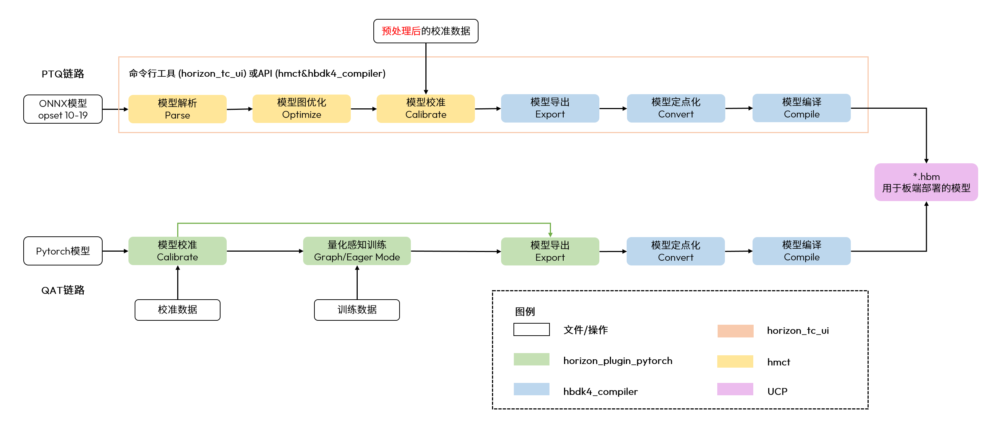
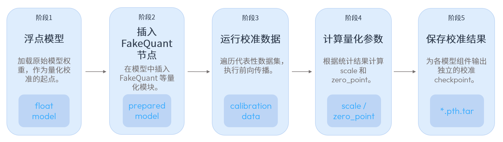

# 08A：BPU计算、编译部署与量化资产

截止2026-11-05；机制依据OE/LLM公开手册与API。护城河分析不把厂商性能表当独立实测，不公开推断未披露的BPU微架构。

## 痛点与可累积资产

具身端侧首先受模型内存、带宽与部署可重建性约束，而非只看峰值乘加数量。S600产品页描述四核Nash BPU、INT8峰值560TOPS和256-bit LPDDR5带宽204.8GB/s，这些规格使较大VLM/VLA具备候选运行空间；没有dense/sparse及目标模型算子占比，就不能以峰值估算任务吞吐。本专题认为更可检验的优势是BPU与组件量化、HBIR编译、UCP运行时和任务配置一起形成部署资产。其成本随目标模型和软件版本而变，不是普适加速保证。〔1：[原文](https://cn.d-robotics.cc/rdkS600) / [本地原件](REFERENCES.md#ref-5aaffe83d6e42b57)〕

X5传统路线采用bayes-e和hb_mapper的.bin；S100/S100P/S600属于nash-e/nash-m/nash-p目标及HBM路线，产物不可因同源架构混用。HBM在这里是部署文件，不是高带宽堆叠内存。compiler/runtime/BSP和核数应进入发布清单，重新编译是平台迁移的一部分。模型源码或ONNX可以作为迁移起点，而最终指令产物、缓存和性能配置是目标相关资产。〔2：[原文](https://raw.githubusercontent.com/D-Robotics/rdk_doc/main/docs/07_Advanced_development/04_toolchain_development/intermediate/ptq_process.md) / [本地原件](REFERENCES.md#ref-990bc69c51b0ab57)〕 〔3：[原文](https://developer.d-robotics.cc/oe_s_doc/static/js/async/62300.e55caad1.js) / [本地原件](REFERENCES.md#ref-6c736e923e8d396a) / [官方文档页面](https://developer.d-robotics.cc/oe_s_doc/guide/faststart/ptq_quickstart) / [离线正文](REFERENCES.md) / [渲染HTML](REFERENCES.md)〕 〔4：[原文](https://developer.d-robotics.cc/oe_llm_doc/static/js/async/95984.ae5bd0da.js) / [本地原件](REFERENCES.md#ref-7fbbb66205a2a9ed) / [官方文档页面](https://developer.d-robotics.cc/oe_llm_doc/guide/vla/vla_deployment/vla_sample/pi0_pi05_demo) / [离线正文](REFERENCES.md) / [渲染HTML](REFERENCES.md)〕

## 量化如何影响真实动作

图示ONNX解析、图优化、校准、定点化与编译，以及PyTorch量化感知路线，说明部署不是把模型文件直接复制到BPU。校准数据应与运行时预处理一致；否则训练RGB归一化而输入NV12或裁剪不一致，会把图像误差带入语言与动作阶段。此图是对应OE版本流程，不说明所有新算子自动支持。〔5：[原文](https://developer.d-robotics.cc/oe_s_doc/static/image/model_conversion_compilation.914a0e0b.png) / [本地原件](REFERENCES.md#ref-0f9289a0555fce7d)〕 〔3：[原文](https://developer.d-robotics.cc/oe_s_doc/static/js/async/62300.e55caad1.js) / [本地原件](REFERENCES.md#ref-6c736e923e8d396a) / [官方文档页面](https://developer.d-robotics.cc/oe_s_doc/guide/faststart/ptq_quickstart) / [离线正文](REFERENCES.md) / [渲染HTML](REFERENCES.md)〕

LLM工具通过get_qconfig_setting指定位宽、observer和冻结范围，再prepare插入FakeQuant，代表数据前向统计scale/zero_point，按visual/lm等组件保存checkpoint。默认HistogramObserver与可选MinMaxObserver面对激活分布有不同取舍；敏感层可用INT16，其余保留INT8。这里的核心不是“位宽越低越好”，而是误差可按模块定位，并以模型质量和内存成本验证收益。公共图里的checkpoint也不等于最终HBM。〔6：[原文](https://developer.d-robotics.cc/oe_llm_doc/static/image/model_quantization.c85c9c2f.png) / [本地原件](REFERENCES.md#ref-3de30ebb446bf075)〕 〔7：[原文](https://developer.d-robotics.cc/oe_llm_doc/static/js/async/31346.cf7dd33f.js) / [本地原件](REFERENCES.md#ref-930c8b2648c88eba) / [官方文档页面](https://developer.d-robotics.cc/oe_llm_doc/guide/llm_compression/detailed_function_specification/model_quantization) / [离线正文](REFERENCES.md) / [渲染HTML](REFERENCES.md)〕

共享模式下prefill/decode共用lm校准和KV量化参数，部分架构又需要分别列visual/prefill/decode。应根据模型注册实现确认，而非把一个YAML改模型名后期待所有阶段相同。具身策略的状态范围、夹爪开闭、视角遮挡和语言长度都可能改变校准分布；少量固定图片或fake calibration只能验证流程与性能，不能证明动作在分布外安全。量化误差既要看中间tensor，也要在同任务真实留出集看成功、介入和失效。

## 编译分阶段留下可排障对象

官方LLM链条Export产生.bc伪量化HBIR，Convert生成量化.bc，再经remove_io_op摘掉图边界量化/反量化节点；Compile产生单段.hbo，Link把多个HBO组成HBM。这个分层允许对比Torch伪量化、转换后语义和设备执行，缩小问题来源。若边界节点被摘掉，调用方尤其需确认输入输出采用哪种量化语义，不能仅依据外部文件FP16或FP64猜值域。〔8：[原文](https://developer.d-robotics.cc/oe_llm_doc/static/js/async/50188.3b7997bf.js) / [本地原件](REFERENCES.md#ref-cc21f8f5997a722f) / [官方文档页面](https://developer.d-robotics.cc/oe_llm_doc/guide/llm_compression/detailed_function_specification/model_compilation) / [离线正文](REFERENCES.md) / [渲染HTML](REFERENCES.md)〕

示例配置core_num、max_l2m_size、opt_level、embed_dtype、return_all_logits及HPC/SPU开关是编译条件，不是无需验证的速度开关。core_num=4的模型与单核视觉模型、运行时核列表需匹配；扩大核数可能挤占另一个感知模型资源。jobs是编译并行参数，与板端策略并发或机器人路数无关。rmsnorm_version名含cuda也不能证明该阶段在板端Mali上使用CUDA，它属于工具配置语义，应追对应实现。

cache_path/cache_mode可复用HBDK编译缓存，减少重复构建时间；更换模型图、量化配置或编译参数时应清理/切换cache以避免混用。编译加速是开发效率指标，不是板端单帧推理加速。缺少完整源码时，至少应保存输入模型、校准产物、配置、编译工具版本和输出哈希，让升级可回归，而不是只保存“运行成功”的终端截图。〔8：[原文](https://developer.d-robotics.cc/oe_llm_doc/static/js/async/50188.3b7997bf.js) / [本地原件](REFERENCES.md#ref-cc21f8f5997a722f) / [官方文档页面](https://developer.d-robotics.cc/oe_llm_doc/guide/llm_compression/detailed_function_specification/model_compilation) / [离线正文](REFERENCES.md) / [渲染HTML](REFERENCES.md)〕

## 动态输入与核分配的边界

动态validShape或stride的-1需由应用填入实际尺寸，并满足stride的逐维覆盖关系。S600 Y/UV宽方向要求64字节对齐，其他目标32；S100宽220→stride224例子不能原样用于S600。stride表达内存步距，与有效像素数量不同，视图、缓存和分配大小都须匹配。错误padding可能表现为精度异常而非直接报错，因此应保存输入dump与对齐描述。动态输入能力并不自动证明任意shape的编译覆盖或最优性能。〔9：[原文](https://developer.d-robotics.cc/oe_s_doc/static/js/async/24642.789c7af3.js) / [本地原件](REFERENCES.md#ref-ab27c48f9fa3f22a) / [官方文档页面](https://developer.d-robotics.cc/oe_s_doc/guide/ucp/runtime/bpu_sdk_api/dynamic_input_introduction) / [离线正文](REFERENCES.md) / [渲染HTML](REFERENCES.md)〕

Pi05 LIBERO示例视觉单核HBM、语言/动作四核HBM，并指定阶段backends；这是具体任务的资源分配配置。VLA一次推理分成视觉、语言与动作，语言和动作阶段可能占主要时间，单独优化视觉不一定显著改变总E2E。官方w8表中两步95.894ms、十步142.972ms的变化主要对应动作去噪，但精度与任务成功没有配套记录。不能把较低步数选择自动写成“同质量加速”。〔4：[原文](https://developer.d-robotics.cc/oe_llm_doc/static/js/async/95984.ae5bd0da.js) / [本地原件](REFERENCES.md#ref-7fbbb66205a2a9ed) / [官方文档页面](https://developer.d-robotics.cc/oe_llm_doc/guide/vla/vla_deployment/vla_sample/pi0_pi05_demo) / [离线正文](REFERENCES.md) / [渲染HTML](REFERENCES.md)〕 〔10：[原文](https://developer.d-robotics.cc/oe_llm_doc/static/js/async/7805.87d8031b.js) / [本地原件](REFERENCES.md#ref-6e127a5530c5176e) / [官方文档页面](https://developer.d-robotics.cc/oe_llm_doc/guide/benchmark/s600/vla_benchmark) / [离线正文](REFERENCES.md) / [渲染HTML](REFERENCES.md)〕

## 对标同类部署机制

| 痛点 | 地瓜已取得机制 | TensorRT同类机制 | 迁移与失效条件 |
|---|---|---|---|
| 固定低位宽语义 | FakeQuant/observer→HBIR→HBM | 显式Q/DQ与量化图 | 可迁移训练知识，校准与支持格式需重核 |
| 动态输入 | validShape/stride与Y/UV对齐 | optimization profile与context实际shape | 不能只复制动态维符号，内存/范围需重建 |
| 部署产物 | 目标march/HBO/HBM及核数 | 目标相关serialized engine | 二进制/缓存不可假定跨设备通用 |
| 系统并发 | UCP提交与多阶段BPU核分配 | execution context及GPU资源管理 | 都需负载/内存/尾时延实测 |

TensorRT官方显式量化文档解释Q/DQ固定量化与反量化语义；动态输入文档要求先选optimization profile，再设置context形状，并核对输出shape。它与地瓜都在解决模型图和实际执行之间的契约，但硬件、格式、算子与缓存边界不同。支持矩阵还说明serialized engine的可移植限制，不能将其“兼容模式”概念套成HBM已具同等能力。本文只作机制对照，未做相同模型、精度、功率和热状态的设备比较。〔11：[原文](https://docs.nvidia.com/deeplearning/tensorrt/latest/inference-library/quantized-types-explicit-quantization.html) / [本地原件](REFERENCES.md#ref-f47c2746e3737567)〕 〔12：[原文](https://docs.nvidia.com/deeplearning/tensorrt/latest/inference-library/dynamic-shapes-basics.html) / [本地原件](REFERENCES.md#ref-a3672262cfb447b8)〕 〔13：[原文](https://docs.nvidia.com/deeplearning/tensorrt/latest/getting-started/support-matrix.html) / [本地原件](REFERENCES.md#ref-3b68f26af8646cbc)〕 〔14：[原文](https://docs.nvidia.com/deeplearning/tensorrt/latest/architecture/architecture-overview.html) / [本地原件](REFERENCES.md#ref-d4c513c2460d0b2a)〕

## 优势成立的条件与放行证据

分析：若团队的主任务落在官方支持模型/算子范围，且能接受目标相关编译，已有组件量化和VLA配置会减少集成摸索；模型持续变化、依赖自定义算子或要求端侧训练时，需要更多适配成本。护城河可来自长期积累的算子实现、校准模板、回归集与商业支持，但公开资料无法直接量化其中不可替代程度。开源文档和封装不代表编译器/二进制许可全部开放，商业OE交付需单独审核。〔15：[原文](https://developer.d-robotics.cc/oe_s_doc/static/js/async/5603.b7581455.js) / [本地原件](REFERENCES.md#ref-6e1dd6456b634d63) / [官方文档页面](https://developer.d-robotics.cc/oe_s_doc/guide/legalnotice/license_agreement) / [离线正文](REFERENCES.md) / [渲染HTML](REFERENCES.md)〕

可检验方案先固定同一模型与留出集，比较浮点、伪量化、转换HBIR与HBM阶段；记录权重/激活精度、真实shape、核数、内存、首帧/稳态/P99及任务质量。然后与媒体采集、ROS和其他模型并发，在功率和热稳定条件下测试。只有任务质量、时效和系统成本同时达标，才能把峰值和配置优势转成产品选型依据。当前资料证明可追踪部署机制与官方示例性能，未证明所有模型的效率排名、闭环WCET或真实成功率。

## 资料与核验

本篇为公开资料与代码核验，未进行SDK安装、模型实机或机器人验收。静态归档部分缺失：无；所识别静态依赖完整，仍不保证动态内容/像素级复现。

[资料总索引](REFERENCES.md) · [证据JSON](research_state/evidence/08A_Compute_Compilation_and_Quantization.json)

### 原件清单

1. **Horizon_RDK_S600**：[原URL](https://cn.d-robotics.cc/rdkS600) · [原件](REFERENCES.md#ref-5aaffe83d6e42b57)；采集2026-11-05T01:28:18.275356+00:00；complete_static。

2. **H02_X5_PTQ**：[原URL](https://raw.githubusercontent.com/D-Robotics/rdk_doc/main/docs/07_Advanced_development/04_toolchain_development/intermediate/ptq_process.md) · [原件](REFERENCES.md#ref-990bc69c51b0ab57)；采集2026-11-05T02:40:23.519954+00:00；complete_static。

3. **H02_OE_PTQ_Content**：[原URL](https://developer.d-robotics.cc/oe_s_doc/static/js/async/62300.e55caad1.js) · [原件](REFERENCES.md#ref-6c736e923e8d396a)；采集2026-11-05T02:35:34.320117+00:00；complete_static。 / [官方文档页面](https://developer.d-robotics.cc/oe_s_doc/guide/faststart/ptq_quickstart) / [离线正文](REFERENCES.md) / [渲染HTML](REFERENCES.md)。正文由已归档的官方页面JS在完全阻断外网请求的浏览器内渲染，入口空壳HTML不作正文证据。

4. **H04_Pi0_Content**：[原URL](https://developer.d-robotics.cc/oe_llm_doc/static/js/async/95984.ae5bd0da.js) · [原件](REFERENCES.md#ref-7fbbb66205a2a9ed)；采集2026-11-05T04:06:40.566793+00:00；complete_static。 / [官方文档页面](https://developer.d-robotics.cc/oe_llm_doc/guide/vla/vla_deployment/vla_sample/pi0_pi05_demo) / [离线正文](REFERENCES.md) / [渲染HTML](REFERENCES.md)。正文由已归档的官方页面JS在完全阻断外网请求的浏览器内渲染，入口空壳HTML不作正文证据。

5. **H02_Dynamic_Asset_10**：[原URL](https://developer.d-robotics.cc/oe_s_doc/static/image/model_conversion_compilation.914a0e0b.png) · [原件](REFERENCES.md#ref-0f9289a0555fce7d)；采集2026-11-05T02:37:36.333171+00:00；complete_static。

6. **H02_Dynamic_Asset_14**：[原URL](https://developer.d-robotics.cc/oe_llm_doc/static/image/model_quantization.c85c9c2f.png) · [原件](REFERENCES.md#ref-3de30ebb446bf075)；采集2026-11-05T02:37:44.734914+00:00；complete_static。

7. **H02_LLM_Quant_Content**：[原URL](https://developer.d-robotics.cc/oe_llm_doc/static/js/async/31346.cf7dd33f.js) · [原件](REFERENCES.md#ref-930c8b2648c88eba)；采集2026-11-05T02:35:41.377040+00:00；complete_static。 / [官方文档页面](https://developer.d-robotics.cc/oe_llm_doc/guide/llm_compression/detailed_function_specification/model_quantization) / [离线正文](REFERENCES.md) / [渲染HTML](REFERENCES.md)。正文由已归档的官方页面JS在完全阻断外网请求的浏览器内渲染，入口空壳HTML不作正文证据。

8. **H02_LLM_Compile_Content**：[原URL](https://developer.d-robotics.cc/oe_llm_doc/static/js/async/50188.3b7997bf.js) · [原件](REFERENCES.md#ref-cc21f8f5997a722f)；采集2026-11-05T02:39:41.339082+00:00；complete_static。 / [官方文档页面](https://developer.d-robotics.cc/oe_llm_doc/guide/llm_compression/detailed_function_specification/model_compilation) / [离线正文](REFERENCES.md) / [渲染HTML](REFERENCES.md)。正文由已归档的官方页面JS在完全阻断外网请求的浏览器内渲染，入口空壳HTML不作正文证据。

9. **H02_OE_Dynamic_Content**：[原URL](https://developer.d-robotics.cc/oe_s_doc/static/js/async/24642.789c7af3.js) · [原件](REFERENCES.md#ref-ab27c48f9fa3f22a)；采集2026-11-05T02:39:37.237397+00:00；complete_static。 / [官方文档页面](https://developer.d-robotics.cc/oe_s_doc/guide/ucp/runtime/bpu_sdk_api/dynamic_input_introduction) / [离线正文](REFERENCES.md) / [渲染HTML](REFERENCES.md)。正文由已归档的官方页面JS在完全阻断外网请求的浏览器内渲染，入口空壳HTML不作正文证据。

10. **H02_LLM_VLABench_Content**：[原URL](https://developer.d-robotics.cc/oe_llm_doc/static/js/async/7805.87d8031b.js) · [原件](REFERENCES.md#ref-6e127a5530c5176e)；采集2026-11-05T02:35:46.860450+00:00；complete_static。 / [官方文档页面](https://developer.d-robotics.cc/oe_llm_doc/guide/benchmark/s600/vla_benchmark) / [离线正文](REFERENCES.md) / [渲染HTML](REFERENCES.md)。正文由已归档的官方页面JS在完全阻断外网请求的浏览器内渲染，入口空壳HTML不作正文证据。

11. **H08_TRT_Quant**：[原URL](https://docs.nvidia.com/deeplearning/tensorrt/latest/inference-library/quantized-types-explicit-quantization.html) · [原件](REFERENCES.md#ref-f47c2746e3737567)；采集2026-11-05T04:23:45.260453+00:00；complete_static。

12. **H08_TRT_Dynamic**：[原URL](https://docs.nvidia.com/deeplearning/tensorrt/latest/inference-library/dynamic-shapes-basics.html) · [原件](REFERENCES.md#ref-a3672262cfb447b8)；采集2026-11-05T04:23:44.222902+00:00；complete_static。

13. **H08_TRT_Support**：[原URL](https://docs.nvidia.com/deeplearning/tensorrt/latest/getting-started/support-matrix.html) · [原件](REFERENCES.md#ref-3b68f26af8646cbc)；采集2026-11-05T04:24:01.456092+00:00；complete_static。

14. **H08_TRT_Arch**：[原URL](https://docs.nvidia.com/deeplearning/tensorrt/latest/architecture/architecture-overview.html) · [原件](REFERENCES.md#ref-d4c513c2460d0b2a)；采集2026-11-05T04:23:27.906480+00:00；complete_static。

15. **H02_OE_License_Content**：[原URL](https://developer.d-robotics.cc/oe_s_doc/static/js/async/5603.b7581455.js) · [原件](REFERENCES.md#ref-6e1dd6456b634d63)；采集2026-11-05T02:41:18.834829+00:00；complete_static。 / [官方文档页面](https://developer.d-robotics.cc/oe_s_doc/guide/legalnotice/license_agreement) / [离线正文](REFERENCES.md) / [渲染HTML](REFERENCES.md)。正文由已归档的官方页面JS在完全阻断外网请求的浏览器内渲染，入口空壳HTML不作正文证据。
