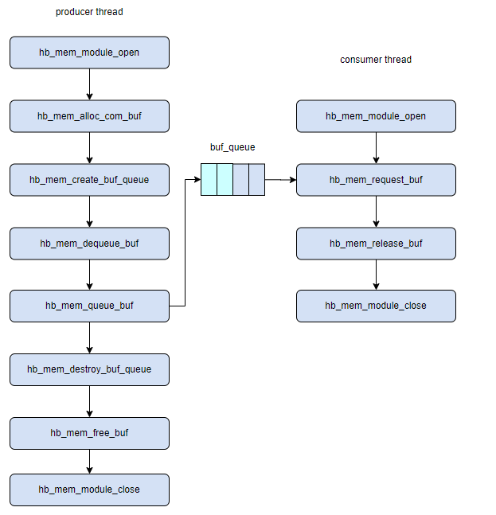
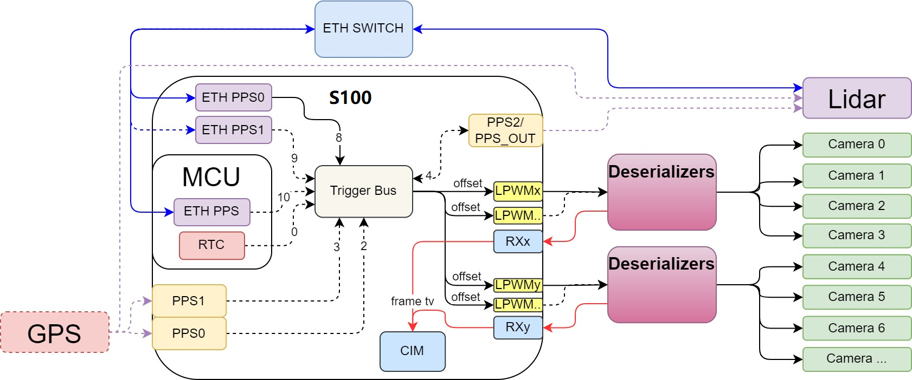

# 08B：传感器、共享内存与观测时间路径

截止2026-11-05。沿采集→媒体→张量→ROS/策略追踪对象寿命与时钟；S100同步实例、S600媒体和TROS发行约束分别注明。

## 真正的瓶颈在数据年龄与所有权

高峰值计算平台也可能因复制、排队和时间戳错误使用过期图像。平台价值要看传感器输入能否保留正确采样时间、以正确布局进入推理，并在动作有效期内完成交接。S600已有VIN/ISP/PYM及媒体sample，hbmem给图像/通用buffer、队列、池与跨进程共享；这些模块为减少不必要搬运提供机制。它们的组合不是“全链条天然零拷贝”的证据，像素格式转换、几何校正、模型输入和远端协议仍可能分配新buffer。〔1：[原文](https://developer.d-robotics.cc/rdk_s_doc/Advanced_development/multimedia_development/S600_multimedia_application/sample_pipeline) / [本地原件](REFERENCES.md#ref-3ee3c8a31c4d35ab)〕 〔2：[原文](https://developer.d-robotics.cc/rdk_s_doc/Advanced_development/multimedia_development/S600_multimedia_application/hbmem_sample_guide) / [本地原件](REFERENCES.md#ref-20f8f640ea355677)〕

## hbmem的对象寿命如何进入性能问题

图中生产者open→alloc→create queue→dequeue/queue，消费者request→release，最后销毁队列、free及close。它把“谁可以复用哪块内存”显式化；指针相同不等于可同时写。图来自当前S600 hbmem页，但图片目录保留S100旧路径，支持API流程说明，不证明当前版本所有线程/进程组合均完成压力测试。〔2：[原文](https://developer.d-robotics.cc/rdk_s_doc/Advanced_development/multimedia_development/S600_multimedia_application/hbmem_sample_guide) / [本地原件](REFERENCES.md#ref-20f8f640ea355677)〕

libhbmem依赖ION分配，com buffer、graphic buffer和group表达不同对象；pool减少重复申请，queue管理传递，share pool支持共享。引用计数和consumer count关系到何时可释放，不能让一个慢消费者持有整池无限阻塞生产。sample列跨进程共享与增加用户态引用计数，正文却省略了多项运行结果，不能由“最后done”判断异常回收和资源泄漏都正确。

分析：若每帧93.312MB/s有效NV12载荷的一路1080p30图像额外做完整CPU复制，读源与写目标都消耗带宽，实际内存流量至少再增约186.624MB/s，不含cache/stride/写分配影响。多相机还叠加ISP/PYM和模型中间tensor。节省复制可释放带宽和CPU，但不直接等于整模型相同倍数加速；模型主要受计算时，收益可能有限，热稳态和并发才是关键放行条件。

## 缓存一致性是正确性契约

UCP的hbUCPMemFlush明确CPU写完cached输入后用CLEAN写回；设备写完后用INVALIDATE让CPU读到新内容。文档定义INVALIDATE是Clean＋Invalidate组合，并警告CPU脏cache未先写回时，随后可能覆盖设备已写入的数据。这意味着读写所有权转换前必须先完成正确方向的同步，不能把一个“flush”放在任意阶段作为万能修复。非cached映射也不取消设备完成等待和buffer生命周期。〔3：[原文](https://developer.d-robotics.cc/oe_s_doc/static/js/async/80056.5ccac469.js) / [本地原件](REFERENCES.md#ref-6af5f91666f418e1) / [官方文档页面](https://developer.d-robotics.cc/oe_s_doc/guide/ucp/ucp_api_reference/ucp_api_function_interface/hbucpmemflush) / [离线正文](REFERENCES.md) / [渲染HTML](REFERENCES.md)〕

hbDNNInferV2建立任务后，hbUCPSubmitTask把任务交调度器，返回成功仅表示API提交成功；必须等待设备完成后才能读取、复用或释放输入输出。多核BPU与多消费者共享同一张量时，应为每个在途任务保持引用和完成标记；仅靠ROS callback返回无法证明BPU已不再读取。适配层要把帧ID、tensor指针/布局、task句柄和完成时间关联起来，否则测得低耗时可能实际上读了旧缓存。〔4：[原文](https://developer.d-robotics.cc/oe_s_doc/static/js/async/78211.f06396ae.js) / [本地原件](REFERENCES.md#ref-fc0c1298e7d37256) / [官方文档页面](https://developer.d-robotics.cc/oe_s_doc/guide/model_deployment_guidance/model_deployment_principle_process/boardside_deployment) / [离线正文](REFERENCES.md) / [渲染HTML](REFERENCES.md)〕 〔5：[原文](https://developer.d-robotics.cc/oe_s_doc/static/js/async/42321.211ed409.js) / [本地原件](REFERENCES.md#ref-1df8daceb6d44659) / [官方文档页面](https://developer.d-robotics.cc/oe_s_doc/guide/ucp/ucp_api_reference/ucp_api_function_interface/hbucpsubmittask) / [离线正文](REFERENCES.md) / [渲染HTML](REFERENCES.md)〕

动态Y/UV输入需正确填写validShape和stride；S600要求宽方向64对齐。padding后的分配大小和有效图像ROI不同，PYM输出通道也有目标sample约束。官方多路管线有mipi host与link port的配置限制，某例只允许host0/2；不能把单路sample允许的host集合或SoC接收器数量合并成任意多路应用组合。按实际载板和传感器配置复建，比只数接口更可靠。〔6：[原文](https://developer.d-robotics.cc/oe_s_doc/static/js/async/24642.789c7af3.js) / [本地原件](REFERENCES.md#ref-ab27c48f9fa3f22a) / [官方文档页面](https://developer.d-robotics.cc/oe_s_doc/guide/ucp/runtime/bpu_sdk_api/dynamic_input_introduction) / [离线正文](REFERENCES.md) / [渲染HTML](REFERENCES.md)〕 〔1：[原文](https://developer.d-robotics.cc/rdk_s_doc/Advanced_development/multimedia_development/S600_multimedia_application/sample_pipeline) / [本地原件](REFERENCES.md#ref-3ee3c8a31c4d35ab)〕

## ROS零拷贝的成立与失效

TROS Foxy使用hbmem扩展；Humble/Jazzy使用ROS2 loaned message/FastDDS共享内存配置。借出的消息先检查is_valid，发布后不可再访问，订阅消息仅回调期有效。固定sizeof消息不能带string或动态数组；KEEP_LAST受内存约束，文档写最大占用256M，建议BEST_EFFORT且同设备进程间使用，不支持跨设备。〔7：[原文](https://developer.d-robotics.cc/tros_doc/tros_dev/zero_copy) / [本地原件](REFERENCES.md#ref-67a9b5a547288889)〕

这与VLA请求带可变图像列表、prompt和状态向量形成明显接口边界：不能把完整VlaRequestInputs直接宣称可用固定ROS loaned消息传输。可以传固定尺寸像素载荷或描述符，再在策略层创建视图，但必须保证底层buffer活到推理结束；回调期借用对象不能简单存到异步队列。若改为复制获得独立寿命，应如实计入耗时，不为维持“零拷贝”标签牺牲正确性。〔8：[原文](https://developer.d-robotics.cc/oe_llm_doc/static/js/async/40340.5dcdb5a2.js) / [本地原件](REFERENCES.md#ref-01c9167b06b3a111) / [官方文档页面](https://developer.d-robotics.cc/oe_llm_doc/guide/vla/vla_deployment/vla_api/vla_types) / [离线正文](REFERENCES.md) / [渲染HTML](REFERENCES.md)〕

分析：队列长度越大，历史保留越多，却可能让最旧帧年龄随负载增长。用于录像的完整交付与用于控制的最新观测是不同目标；可拆存储与控制消费者，并为后者设置截止时间和旧帧丢弃。QoS可靠性不是时效保证，有限池也不是自动背压策略；需要测池耗尽、借用失败与订阅端崩溃后资源回收。

## 共同时间轴如何连接共同出图

网络授时、ETH PPS、LPWM、SerDes反向触发与CIM帧头时间戳是不同环节。ptp4l对齐PHC，phc2sys关联系统时间；LPWM控制传感器相位。S100示例ETH PPS0 fixed mode的536.871ms偏移需计算offset，10Hz雷达/30fps相机对齐也有特定模组同步模式。当前页面标题位于S600 5.1.1手册，正文仍写S100，不能给S600寄存器配置盖适用章。〔9：[原文](https://developer.d-robotics.cc/rdk_s_doc/Advanced_development/multimedia_development/multimedia_development/camerasync) / [本地原件](REFERENCES.md#ref-ccb05c49965cfca1)〕 〔10：[原文](https://raw.githubusercontent.com/D-Robotics/rdk_doc/main/docs_s/07_Advanced_development/02_linux_development/04_driver_development_s100/12_driver_timesync.md) / [本地原件](REFERENCES.md#ref-d19eb348eab46666)〕

曝光起点、曝光结束、rolling shutter逐行读取、Frame Start、发布与消费是不同时间语义。共同帧头时间不能自动保证同一物理曝光；LiDAR一帧点云也横跨扫描时间，需要逐点去畸变与外参。时间源消失、PHC校时跳变和系统时钟域转换都会影响年龄计算。若时间戳来自steady_clock，只能在已明确的同一时钟域相减，不能直接与UTC或另设备的steady_clock相减。官方PTP配置给机制与参数，没有提供完整多传感器误差分布。〔11：[原文](https://linuxptp.nwtime.org/documentation/ptp4l/) / [本地原件](REFERENCES.md#ref-31f47f73b6d38e04)〕 〔9：[原文](https://developer.d-robotics.cc/rdk_s_doc/Advanced_development/multimedia_development/multimedia_development/camerasync) / [本地原件](REFERENCES.md#ref-ccb05c49965cfca1)〕 〔7：[原文](https://developer.d-robotics.cc/tros_doc/tros_dev/zero_copy) / [本地原件](REFERENCES.md#ref-67a9b5a547288889)〕

## 跨域搬运与竞品机制对照

MCU IPC还有MDMA地址16字节对齐、仅两个发送通道、按Instance分核的约束。多核发送须协调资源，双端地址、Channel与池一致；共享内存不等于无带宽成本，更不自动保证Linux/BPU流量不会干扰控制域。这个可见约束适合在架构设计阶段预留独立池和有界消息，而非把大图像经控制IPC转运。〔12：[原文](https://developer.d-robotics.cc/rdk_s_doc/Advanced_development/mcu_development/mcu_ipc) / [本地原件](REFERENCES.md#ref-975898a4eb7147a2)〕

| 问题 | 本平台机制 | 同类对照 | 不能跨平台推导 |
|---|---|---|---|
| CPU/加速器共享数据 | hbmem/ION＋显式flush＋任务等待 | CUDA unified/system memory | 同址不代表同样一致性/迁移行为 |
| 不同设备共同时间 | PHC/PTP/PPS＋LPWM | LinuxPTP通用配置 | 有PTP软件不等于所有NIC硬件授时 |
| 进程间图像传输 | TROS固定消息loaned/FastDDS | ROS共享内存机制 | 回调有效期不能延伸到任意异步处理 |

CUDA官方文档同样区分内存的放置、迁移与系统/驱动能力，ATS/HMM和受限unified memory的条件不同。因此“共享地址空间”不是与地瓜显式缓存管理完全相同的行为；迁移资产主要是对布局、寿命和同步的设计，而不是直接复用API。LinuxPTP也有硬件/软件timestamp和延迟机制选项，需按交换机/NIC网络核对。本文没有同条件数据搬运bench，不比较绝对延迟排名。〔13：[原文](https://docs.nvidia.com/cuda/cuda-programming-guide/02-basics/understanding-memory.html) / [本地原件](REFERENCES.md#ref-453cf4bfa7cf193e)〕 〔11：[原文](https://linuxptp.nwtime.org/documentation/ptp4l/) / [本地原件](REFERENCES.md#ref-31f47f73b6d38e04)〕

## 护城河与可检验边界

分析：若摄像头、ISP/PYM、BPU和ROS能在目标系统中共享有界buffer并保留时间语义，平台可降低整合工作量；优势依赖应用遵守布局/缓存/引用规则。要求跨设备、任意动态消息、全量录像及持续低尾延迟时，需额外架构设计。公开机制证明可优化路径，未证明所有负载组合或唯一不可替代优势。

验证应同时记录Frame Start/代表采样、入池/出池、提交/完成、发布/消费和动作有效期，形成帧到任务的追踪表；热稳态测丢帧、积压、P99年龄与CPU/DDR负载，再注入订阅端退出、设备超时、PPS丢失和时钟重同步。保证没有脏cache覆盖、旧帧误配和泄漏后，才评估减少复制的收益。本次为文献/API核验，尚无实机并发或误差实测。

## 资料与核验

本篇为公开资料与代码核验，未进行SDK安装、模型实机或机器人验收。静态归档部分缺失：无；所识别静态依赖完整，仍不保证动态内容/像素级复现。

[资料总索引](REFERENCES.md) · [证据JSON](research_state/evidence/08B_Sensor_Memory_and_Time.json)

### 原件清单

1. **H02_Pipeline**：[原URL](https://developer.d-robotics.cc/rdk_s_doc/Advanced_development/multimedia_development/S600_multimedia_application/sample_pipeline) · [原件](REFERENCES.md#ref-3ee3c8a31c4d35ab)；采集2026-11-05T02:50:17.344706+00:00；complete_static。

2. **H02_Hbmem**：[原URL](https://developer.d-robotics.cc/rdk_s_doc/Advanced_development/multimedia_development/S600_multimedia_application/hbmem_sample_guide) · [原件](REFERENCES.md#ref-20f8f640ea355677)；采集2026-11-05T02:50:19.144296+00:00；complete_static。

3. **H02_UCP_Flush_Content**：[原URL](https://developer.d-robotics.cc/oe_s_doc/static/js/async/80056.5ccac469.js) · [原件](REFERENCES.md#ref-6af5f91666f418e1)；采集2026-11-05T02:39:39.612142+00:00；complete_static。 / [官方文档页面](https://developer.d-robotics.cc/oe_s_doc/guide/ucp/ucp_api_reference/ucp_api_function_interface/hbucpmemflush) / [离线正文](REFERENCES.md) / [渲染HTML](REFERENCES.md)。正文由已归档的官方页面JS在完全阻断外网请求的浏览器内渲染，入口空壳HTML不作正文证据。

4. **H02_OE_Deploy_Content**：[原URL](https://developer.d-robotics.cc/oe_s_doc/static/js/async/78211.f06396ae.js) · [原件](REFERENCES.md#ref-fc0c1298e7d37256)；采集2026-11-05T02:35:38.670257+00:00；complete_static。 / [官方文档页面](https://developer.d-robotics.cc/oe_s_doc/guide/model_deployment_guidance/model_deployment_principle_process/boardside_deployment) / [离线正文](REFERENCES.md) / [渲染HTML](REFERENCES.md)。正文由已归档的官方页面JS在完全阻断外网请求的浏览器内渲染，入口空壳HTML不作正文证据。

5. **H02_UCP_Submit_Content**：[原URL](https://developer.d-robotics.cc/oe_s_doc/static/js/async/42321.211ed409.js) · [原件](REFERENCES.md#ref-1df8daceb6d44659)；采集2026-11-05T02:39:38.417384+00:00；complete_static。 / [官方文档页面](https://developer.d-robotics.cc/oe_s_doc/guide/ucp/ucp_api_reference/ucp_api_function_interface/hbucpsubmittask) / [离线正文](REFERENCES.md) / [渲染HTML](REFERENCES.md)。正文由已归档的官方页面JS在完全阻断外网请求的浏览器内渲染，入口空壳HTML不作正文证据。

6. **H02_OE_Dynamic_Content**：[原URL](https://developer.d-robotics.cc/oe_s_doc/static/js/async/24642.789c7af3.js) · [原件](REFERENCES.md#ref-ab27c48f9fa3f22a)；采集2026-11-05T02:39:37.237397+00:00；complete_static。 / [官方文档页面](https://developer.d-robotics.cc/oe_s_doc/guide/ucp/runtime/bpu_sdk_api/dynamic_input_introduction) / [离线正文](REFERENCES.md) / [渲染HTML](REFERENCES.md)。正文由已归档的官方页面JS在完全阻断外网请求的浏览器内渲染，入口空壳HTML不作正文证据。

7. **H02_TROS_Zero**：[原URL](https://developer.d-robotics.cc/tros_doc/tros_dev/zero_copy) · [原件](REFERENCES.md#ref-67a9b5a547288889)；采集2026-11-05T02:57:36.949634+00:00；complete_static。

8. **H06_Types_Content**：[原URL](https://developer.d-robotics.cc/oe_llm_doc/static/js/async/40340.5dcdb5a2.js) · [原件](REFERENCES.md#ref-01c9167b06b3a111)；采集2026-11-05T04:14:34.642090+00:00；complete_static。 / [官方文档页面](https://developer.d-robotics.cc/oe_llm_doc/guide/vla/vla_deployment/vla_api/vla_types) / [离线正文](REFERENCES.md) / [渲染HTML](REFERENCES.md)。正文由已归档的官方页面JS在完全阻断外网请求的浏览器内渲染，入口空壳HTML不作正文证据。

9. **H03_Current_Sync**：[原URL](https://developer.d-robotics.cc/rdk_s_doc/Advanced_development/multimedia_development/multimedia_development/camerasync) · [原件](REFERENCES.md#ref-ccb05c49965cfca1)；采集2026-11-05T04:01:08.411541+00:00；complete_static。

10. **H03_S100_Time**：[原URL](https://raw.githubusercontent.com/D-Robotics/rdk_doc/main/docs_s/07_Advanced_development/02_linux_development/04_driver_development_s100/12_driver_timesync.md) · [原件](REFERENCES.md#ref-d19eb348eab46666)；采集2026-11-05T04:00:48.272509+00:00；complete_static。

11. **H08_LinuxPTP**：[原URL](https://linuxptp.nwtime.org/documentation/ptp4l/) · [原件](REFERENCES.md#ref-31f47f73b6d38e04)；采集2026-11-05T04:26:09.858264+00:00；complete_static。

12. **H02_IPC**：[原URL](https://developer.d-robotics.cc/rdk_s_doc/Advanced_development/mcu_development/mcu_ipc) · [原件](REFERENCES.md#ref-975898a4eb7147a2)；采集2026-11-05T02:53:38.614163+00:00；complete_static。

13. **H08_CUDA_Memory**：[原URL](https://docs.nvidia.com/cuda/cuda-programming-guide/02-basics/understanding-memory.html) · [原件](REFERENCES.md#ref-453cf4bfa7cf193e)；采集2026-11-05T04:25:54.646134+00:00；complete_static。
