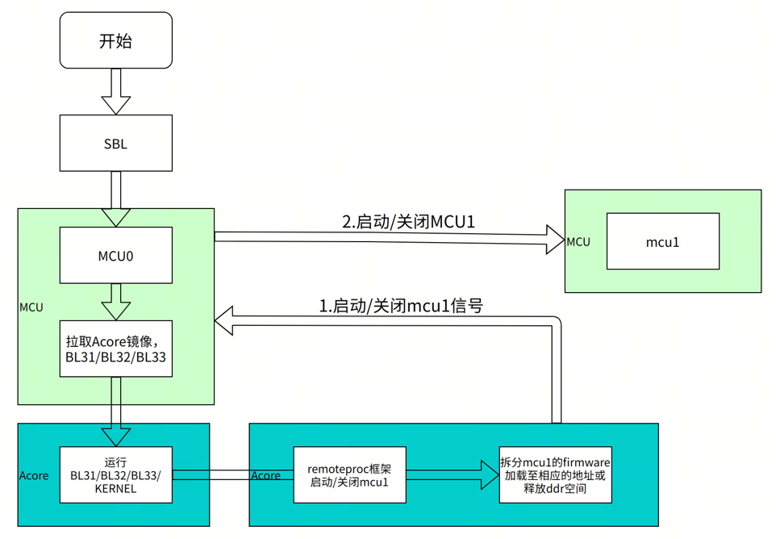

# 08C：实时域、可信启动与生命周期

截止2026-11-05。以S600当前5.1.1发行组合为目标，旧S100实例只作明确标注的机制参考。本文检查控制对象和更新状态，不把车规IP或内核名称等同机器人系统认证。

## 从推理结果到有界控制

机器人的危险通常发生在推理之外：任务超时仍继续执行旧轨迹、通信断开后执行器保持最后指令、恢复时模型与MCU协议不一致。S600将Linux应用域与R52+ MCU业务域分开，为把感知和策略计算与周期控制分工提供了架构基础。MCU0负责启动Acore、MCU1及电源管理，MCU1承载业务，FreeRTOS版本为Kernel V10.0.1。这个分工能降低Linux应用阻塞直接占用业务线程的风险，但共享电源、内存与外围资源还需证明互不干扰。〔1：[原文](https://developer.d-robotics.cc/rdk_s_doc/Advanced_development/mcu_development/basic_information) / [本地原件](REFERENCES.md#ref-ab43a50619e45bdc)〕

图来自当前手册引用的官方MCU框架图，资源路径保留S100命名，支持MCU0/MCU1/Acore控制关系的解读，不证明S600每条异常响应已完成安全验证。remoteproc的请求经MCU0控制MCU1，应用能发起启停，不等于拥有独立硬件故障切断路径。

业务接口应传有界指令而非大图像：每条命令包含序号、生成时间、有效截止时间、关节顺序、单位、速度/力矩限制和状态确认。策略输出horizon与控制线程周期不同，控制器还要执行插值、约束及过期拒收。VLA SDK给模型与物理动作数据类型，却不统一所有机器人关节契约；因此可见推理接口不能直接证明闭环可靠性。〔2：[原文](https://developer.d-robotics.cc/oe_llm_doc/static/js/async/40340.5dcdb5a2.js) / [本地原件](REFERENCES.md#ref-01c9167b06b3a111) / [官方文档页面](https://developer.d-robotics.cc/oe_llm_doc/guide/vla/vla_deployment/vla_api/vla_types) / [离线正文](REFERENCES.md) / [渲染HTML](REFERENCES.md)〕 〔3：[原文](https://developer.d-robotics.cc/rdk_s_doc/Advanced_development/mcu_development/mcu_ipc) / [本地原件](REFERENCES.md#ref-975898a4eb7147a2)〕

## 实时隔离必须追到资源与恢复

MCU IPC按Instance分核，MDMA发送buffer要求16字节对齐，发送通道只有两个，多任务须自旋锁或关中断协调。双端Instance、地址、Channel和buffer设置须一致。关中断避免竞争也可能延长其他中断响应；无限等待DMA或过大的临界区会破坏控制时限。需要把最坏消息大小、在途数量和等待超时固定下来，再测BPU/相机/存储同时繁忙时的控制尾延迟。〔3：[原文](https://developer.d-robotics.cc/rdk_s_doc/Advanced_development/mcu_development/mcu_ipc) / [本地原件](REFERENCES.md#ref-975898a4eb7147a2)〕

MCU1停止后必须等进入wfi再启动，否则新firmware可能覆写仍执行的SRAM代码，造成挂死。alive状态每秒更新，cpuloads统计也有约一秒延迟，所以这些sysfs节点适合诊断，不能当亚毫秒保护输入。系统恢复要经历停止接受命令、确认执行器安全状态、停止任务、确认WFI、装载、握手、重新校验状态等阶段；其中执行器状态确认是产品设计要求，本次没有取得其实现证据。〔1：[原文](https://developer.d-robotics.cc/rdk_s_doc/Advanced_development/mcu_development/basic_information) / [本地原件](REFERENCES.md#ref-ab43a50619e45bdc)〕

GPT低层定义S100/S100P六个instance，S600/S300十个，每个四个channel，寄存器基址和中断向量不同。多定时通道提高配置空间，不直接证明每个应用均有可用独占资源。发布说明还记录修复MCU定时器精度问题，并称当前不支持锁步解锁；必须冻结固件版本再做控制时间验证，不能拿旧示例结果套新固件。〔4：[原文](https://developer.d-robotics.cc/rdk_s_doc/Advanced_development/mcu_development/mcu_timer) / [本地原件](REFERENCES.md#ref-15b2c17ccadc5740)〕 〔5：[原文](https://developer.d-robotics.cc/rdk_s_doc/Release_Note/s600/v5_1_1) / [本地原件](REFERENCES.md#ref-10ce1a6098be10ab)〕

Acore看门狗超时的MCU参考处理先置g_need_reset，再由OS任务约延时5秒触发SoC长复位。它说明恢复动作的路径，也说明“有看门狗”不意味着危险运动在超时瞬间停止。电机驱动看门狗、独立急停与制动的反应窗口需要另给证据；本次没有操作实际设备，不把参考长复位流程当安全停机响应保证。〔6：[原文](https://developer.d-robotics.cc/rdk_s_doc/Advanced_development/mcu_development/mcu_watchdog) / [本地原件](REFERENCES.md#ref-1b97b81b8bf75e89)〕

## PREEMPT_RT与热状态的实际含义

S6005.1.1绑定Linux6.1.158-rt58-DR-5.1.1、RDKOS Ubuntu24.04和MCU V2.0.3。cyclictest范例使用mlock、SMP、优先级90、200微秒周期、五千万循环，测线程唤醒延迟。配图没有给与当前S600绑定的完整热/负载/版本条件，不能作为WCET、整机响应或长期无漏期证明。CPU亲和性、IRQ分配、优先级反转、驱动临界区和DMA争用要一起核对。〔5：[原文](https://developer.d-robotics.cc/rdk_s_doc/Release_Note/s600/v5_1_1) / [本地原件](REFERENCES.md#ref-10ce1a6098be10ab)〕 〔7：[原文](https://developer.d-robotics.cc/rdk_s_doc/Advanced_development/linux_development/realtime_kernel) / [本地原件](REFERENCES.md#ref-d55b805ff94a641f)〕

当前S600温控页列19个传感器：CPU七个、DDR四个、BPU八个；示例95℃降频、110℃hot、115℃关机属于软件策略阈值，不是产品环境温度额定值。页面BPU称四个trip却枚举0至4，须以板端配置核实。热降频会使平均推理时延和控制数据年龄改变，应同时记录温度、频率、风扇与丢期，而非只在冷启动测一次。〔8：[原文](https://developer.d-robotics.cc/rdk_s_doc/System_configuration/frequency_management) / [本地原件](REFERENCES.md#ref-dd4b866cd34257e7)〕

## 验证启动与可维护性的边界

构建配置有pack_avb_img.sh、have_anti_ver及安全/非安全镜像字段，能表达签名打包和antirollback相关配置。config.txt指南同时说明AVB默认不使能，启用后不能使用修改启动分区的此配置方式。由这些公开机制只能确认配置入口，不能确认量产设备熔丝、密钥注入、调试口限制、密钥轮换和防回滚计数策略已经实施。antirollback防降级与A/B失败回退也不同，错误配置可能阻断预期恢复路径。〔9：[原文](https://developer.d-robotics.cc/rdk_s_doc/Advanced_development/rdk_gen) / [本地原件](REFERENCES.md#ref-daa0f17ac1774c07)〕 〔10：[原文](https://developer.d-robotics.cc/rdk_s_doc/System_configuration/config_txt) / [本地原件](REFERENCES.md#ref-87a7c2a149d4065b)〕

| 路径 | 公开机制 | 故障边界 | 产品验收动作 |
|---|---|---|---|
| 完整OTA | 分区烧写、校验、切slot、成功标记 | 烧写成功不等于应用健康 | 测失败启动、健康检查、回退与协议兼容 |
| miniboot在线更新 | NOR整片直写、存储当前slot直写 | 无内建自动回滚，中断可无法启动 | 保电源、备恢复工具、独立停机窗口 |
| MCU固件替换 | remoteproc经MCU0启停MCU1 | 未等WFI可覆写执行中代码 | 确认停止、版本握手及执行器状态 |

OTA参考服务通过otaRequestStart发起子进程烧写，otaSetPartition设置下次slot，重启后otaCheckUpdate校验、otaMarkOTASuccessful标记。云端下载、策略和上报属于客户服务职责；健康判据要包含传感器、模型、MCU协议和执行器，不仅进程存在。差分依赖旧分区精确字节，官方指出节省流量不节省升级时间。〔11：[原文](https://developer.d-robotics.cc/rdk_s_doc/Advanced_development/linux_development/OTA/ota_system) / [本地原件](REFERENCES.md#ref-51c92d21e58d7011)〕

当前miniboot直接覆盖NOR，包括BAK和A/B，不经过OTA两段式状态机；存储只改当前slot的部分启动分区，S600 vbmeta不参与此流程。旧S100文档称自动同步及回滚，与当前明确说明冲突，采用当前描述并保留旧证据。OHP阶段拒绝在线升级意味着生命周期阶段会改变服务方式，现场维护需在采购时锁定恢复权限与工具。〔12：[原文](https://developer.d-robotics.cc/rdk_s_doc/Advanced_development/linux_development/OTA/ota_miniboot) / [本地原件](REFERENCES.md#ref-c0fecf1465220ec5)〕 〔13：[原文](https://raw.githubusercontent.com/D-Robotics/rdk_doc/main/docs_s/07_Advanced_development/02_linux_development/06_OTA/02_ota_miniboot.md) / [本地原件](REFERENCES.md#ref-43b229c9b63b9292)〕

## 可替代机制、源码边界与护城河

NVIDIA Isaac ROS Deploy的Safety Controller可串在ros2_control控制链中，处理原始命令、混合及域外检测；官方明确它不构成功能安全认证架构，不能作为安全关键部署的唯一保护。与本平台比较，应比较动作限幅、状态监控和故障接口的实际实现，不能由软件名或R52+核推出安全等级，也不能把该ROS组件与IGX硬件安全产品混为一谈。该页两项静态呈现依赖缺失，正文有效。〔14：[原文](https://nvidia-isaac-ros.github.io/repositories_and_packages/isaac_ros_deploy/concepts/safety.html) / [本地原件](REFERENCES.md#ref-029d4bca29febcf3)〕

FreeRTOS、Linux实时内核和A/B更新是可复用系统技术，不能单独作为专属壁垒。平台整合价值在于厂商已提供跨域启动、IPC、外围驱动、版本和升级接口，可减少从零集成工作。对同类平台应比较目标SKU上的隔离、诊断、签名及故障恢复交付，而不是比较宣传中是否出现“安全”。本平台公开资料未给足认证安全手册、FMEDA、WCET或整机证书，当前比较只能停在机制和交付边界。

MCU0编译及McalCdd/Service/Platform部分为企业版专有，获取要求登记、NDA和私有释放；MCU1社区业务源码不代表整个MCAL、固件或IP均开源。正式项目必须取得包级许可、源码及可重建范围、修复责任和支持期限。未取得商业包意味着无法完成完整实现审计，这是本文取得范围的限制，不能改写为厂商没有相应交付。〔15：[原文](https://developer.d-robotics.cc/rdk_s_doc/Advanced_development/mcu_development/code_release) / [本地原件](REFERENCES.md#ref-68065d5ada57af84)〕 〔16：[原文](https://developer.d-robotics.cc/rdk_s_doc/Advanced_development/mcu_development/FreeRTOS_development) / [本地原件](REFERENCES.md#ref-339c03655f0ece0d)〕

建议先定义危险响应预算、控制周期和失效状态，再冻结软硬件BOM；测热稳态并发、锁竞争、总线拥塞与任务失联，注入MCU重启、应用退出、错误动作、OTA掉电和签名拒绝。只有故障检测、停止与恢复均落在产品要求内，实时域整合才转化为可用优势。本次完成文献/API核验，未测实机WCET、危险停止或量产密钥流程。

## 资料与核验

本篇为公开资料与代码核验，未进行SDK安装、模型实机或机器人验收。静态归档部分缺失：[{'source_id': 'H08_Isaac_Safety', 'missing_presentation': 2, 'missing_all': 2}]。

[资料总索引](REFERENCES.md) · [证据JSON](research_state/evidence/08C_Real_Time_Trust_and_Lifecycle.json)

### 原件清单

1. **H02_MCU_Info**：[原URL](https://developer.d-robotics.cc/rdk_s_doc/Advanced_development/mcu_development/basic_information) · [原件](REFERENCES.md#ref-ab43a50619e45bdc)；采集2026-11-05T02:53:20.377310+00:00；complete_static。

2. **H06_Types_Content**：[原URL](https://developer.d-robotics.cc/oe_llm_doc/static/js/async/40340.5dcdb5a2.js) · [原件](REFERENCES.md#ref-01c9167b06b3a111)；采集2026-11-05T04:14:34.642090+00:00；complete_static。 / [官方文档页面](https://developer.d-robotics.cc/oe_llm_doc/guide/vla/vla_deployment/vla_api/vla_types) / [离线正文](REFERENCES.md) / [渲染HTML](REFERENCES.md)。正文由已归档的官方页面JS在完全阻断外网请求的浏览器内渲染，入口空壳HTML不作正文证据。

3. **H02_IPC**：[原URL](https://developer.d-robotics.cc/rdk_s_doc/Advanced_development/mcu_development/mcu_ipc) · [原件](REFERENCES.md#ref-975898a4eb7147a2)；采集2026-11-05T02:53:38.614163+00:00；complete_static。

4. **H02_Timer**：[原URL](https://developer.d-robotics.cc/rdk_s_doc/Advanced_development/mcu_development/mcu_timer) · [原件](REFERENCES.md#ref-15b2c17ccadc5740)；采集2026-11-05T02:53:53.833845+00:00；complete_static。

5. **H02_S600_511_Release**：[原URL](https://developer.d-robotics.cc/rdk_s_doc/Release_Note/s600/v5_1_1) · [原件](REFERENCES.md#ref-10ce1a6098be10ab)；采集2026-11-05T02:22:28.834915+00:00；complete_static。

6. **H02_Watchdog**：[原URL](https://developer.d-robotics.cc/rdk_s_doc/Advanced_development/mcu_development/mcu_watchdog) · [原件](REFERENCES.md#ref-1b97b81b8bf75e89)；采集2026-11-05T02:53:51.616573+00:00；complete_static。

7. **H02_RT**：[原URL](https://developer.d-robotics.cc/rdk_s_doc/Advanced_development/linux_development/realtime_kernel) · [原件](REFERENCES.md#ref-d55b805ff94a641f)；采集2026-11-05T02:26:04.503522+00:00；complete_static。

8. **H02_Thermal**：[原URL](https://developer.d-robotics.cc/rdk_s_doc/System_configuration/frequency_management) · [原件](REFERENCES.md#ref-dd4b866cd34257e7)；采集2026-11-05T02:24:00.777353+00:00；complete_static。

9. **H02_Build**：[原URL](https://developer.d-robotics.cc/rdk_s_doc/Advanced_development/rdk_gen) · [原件](REFERENCES.md#ref-daa0f17ac1774c07)；采集2026-11-05T02:23:47.406121+00:00；complete_static。

10. **H02_Config**：[原URL](https://developer.d-robotics.cc/rdk_s_doc/System_configuration/config_txt) · [原件](REFERENCES.md#ref-87a7c2a149d4065b)；采集2026-11-05T02:23:58.838893+00:00；complete_static。

11. **H02_OTA**：[原URL](https://developer.d-robotics.cc/rdk_s_doc/Advanced_development/linux_development/OTA/ota_system) · [原件](REFERENCES.md#ref-51c92d21e58d7011)；采集2026-11-05T02:27:06.131581+00:00；complete_static。

12. **H02_Miniboot**：[原URL](https://developer.d-robotics.cc/rdk_s_doc/Advanced_development/linux_development/OTA/ota_miniboot) · [原件](REFERENCES.md#ref-c0fecf1465220ec5)；采集2026-11-05T02:27:12.762914+00:00；complete_static。

13. **H02_S100_Miniboot**：[原URL](https://raw.githubusercontent.com/D-Robotics/rdk_doc/main/docs_s/07_Advanced_development/02_linux_development/06_OTA/02_ota_miniboot.md) · [原件](REFERENCES.md#ref-43b229c9b63b9292)；采集2026-11-05T02:22:43.557021+00:00；complete_static。

14. **H08_Isaac_Safety**：[原URL](https://nvidia-isaac-ros.github.io/repositories_and_packages/isaac_ros_deploy/concepts/safety.html) · [原件](REFERENCES.md#ref-029d4bca29febcf3)；采集2026-11-05T04:31:06.909719+00:00；partial_static。

15. **H02_MCU_Code**：[原URL](https://developer.d-robotics.cc/rdk_s_doc/Advanced_development/mcu_development/code_release) · [原件](REFERENCES.md#ref-68065d5ada57af84)；采集2026-11-05T02:53:28.804982+00:00；complete_static。

16. **H02_FreeRTOS**：[原URL](https://developer.d-robotics.cc/rdk_s_doc/Advanced_development/mcu_development/FreeRTOS_development) · [原件](REFERENCES.md#ref-339c03655f0ece0d)；采集2026-11-05T02:53:34.499375+00:00；complete_static。
