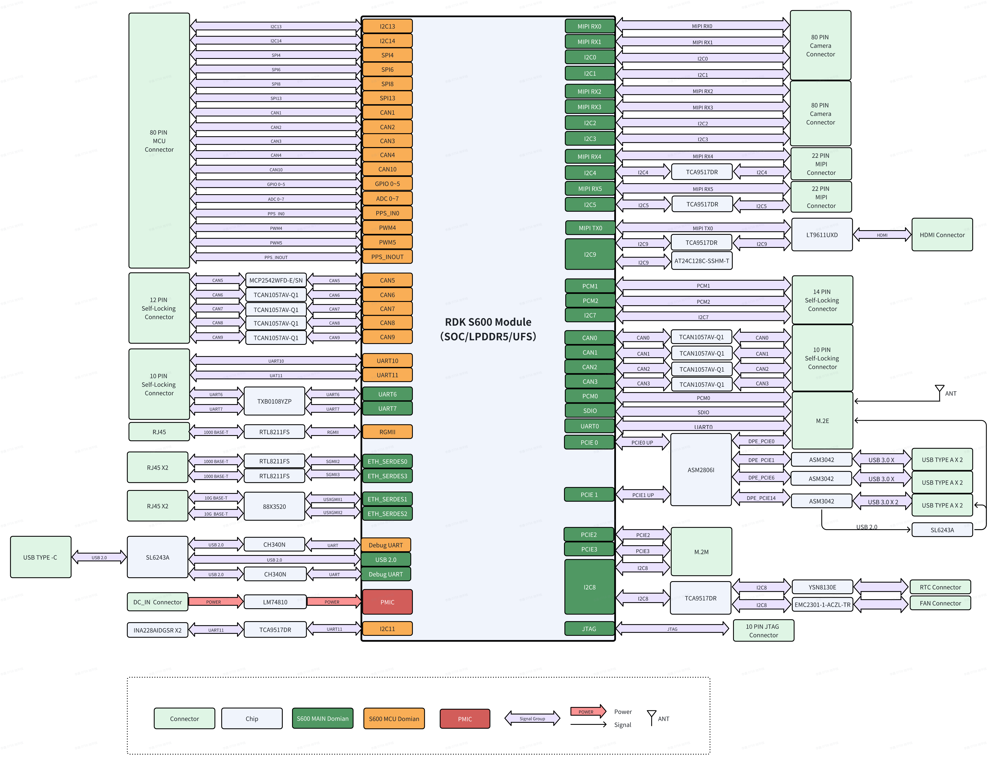

# 08：核心技术护城河总览

截止2026-11-05。这里的护城河指能持续降低目标产品集成与维护成本的能力，判断依据是公开机制、版本约束与可审计交付。本文不把峰值、开源仓库或合作数量直接当不可替代竞争优势。旧08_Proprietary_Technologies.md保留为历史稿，新总览与08A—08C组成当前研究入口。

## 判断单位是可发布的机器人系统

S600的四核Nash BPU、LPDDR5和Linux/MCU域构成较完整的端侧计算候选。官方列560TOPS@INT8、204.8GB/s带宽，32GB与64GB模组有不同存储配置；这些是硬件资源说明，不能代入未给dense/sparse、实际功率与算子占比的任务吞吐计算。真正需要回答的是：相同留出任务、同样可接受动作误差、目标热状态下，能否把观察、策略和控制组成稳定且可更新的交付。〔1：[原文](https://cn.d-robotics.cc/rdkS600) / [本地原件](REFERENCES.md#ref-5aaffe83d6e42b57)〕

图来自套件手册V1P0，展示模组、载板及扩展路径，读图时应把模组资源与载板连接器分开。相机扩展上的MAX96712把GMSL转换后接MIPI，不能把外部解串器当SoC原生GMSL PHY。拓扑能定位协同模块，但不能证明任意满接口并发、热稳定或安全隔离。〔2：[原文](https://developer.d-robotics.cc/rdk_s_doc/01_Quick_start/01_hardware_introduction/02_rdk_s600/01_rdk_s600_kit) / [本地原件](REFERENCES.md#ref-d4df277ff0138d75)〕 〔3：[原文](https://developer.d-robotics.cc/rdk_s_doc/Quick_start/hardware_introduction/rdk_s600/rdk_s600_camera_expansion_board) / [本地原件](REFERENCES.md#ref-57531817dea53237)〕

## 三条能力链与证据等级

| 能力链 | 当前可核验对象 | 潜在累积资产 | 优势成立条件 | 未跨过的边界 |
|---|---|---|---|---|
| 模型计算与部署 | observer、HBIR、HBO/HBM、核配置、UCP | 算子实现、校准模板、性能回归 | 模型与精度落在支持范围 | 未证明任意模型或端侧训练效率 |
| 感知与内存 | VIN/ISP/PYM、hbmem、stride/flush、时间接口 | 传感器驱动、buffer与标定配置 | 布局/寿命/时间语义共同正确 | 未测多传感器误差及端到端P99 |
| 控制与维护 | MCU分工、IPC、RT、OTA与启动配置 | 固件组合、异常与升级回归 | 实时预算和恢复路径已验证 | 未取得系统安全/WCET/全部商业源码 |

表中“潜在资产”属于分析，公开文档证明存在接口和样例，不证明内部投入、覆盖率或唯一性。具体机制分别在08A、08B和08C追踪。产业价值来自把它们长期维护成可重建组合，而不是让开发者不断靠未锁定的latest镜像和临时配置运行。〔4：[原文](https://developer.d-robotics.cc/oe_llm_doc/static/js/async/50188.3b7997bf.js) / [本地原件](REFERENCES.md#ref-cc21f8f5997a722f) / [官方文档页面](https://developer.d-robotics.cc/oe_llm_doc/guide/llm_compression/detailed_function_specification/model_compilation) / [离线正文](REFERENCES.md) / [渲染HTML](REFERENCES.md)〕 〔5：[原文](https://developer.d-robotics.cc/rdk_s_doc/Advanced_development/multimedia_development/S600_multimedia_application/hbmem_sample_guide) / [本地原件](REFERENCES.md#ref-20f8f640ea355677)〕 〔6：[原文](https://developer.d-robotics.cc/rdk_s_doc/Advanced_development/mcu_development/basic_information) / [本地原件](REFERENCES.md#ref-ab43a50619e45bdc)〕

## 编译资产如何形成优势，也如何产生迁移成本

量化和编译链可在浮点模型、伪量化、转换图与板端产物之间定位误差。共享prefill/decode校准、敏感层INT16和组件级配置使团队能围绕具体模型优化内存及质量。HBM、核数、编译缓存与运行时相互依赖，带来可管理的部署对象，也带来目标相关重编成本。X5的.bin与S600 HBM不是通用交换文件，迁移应保留模型、预处理、校准集和任务评估，而非只搬二进制。〔7：[原文](https://developer.d-robotics.cc/oe_llm_doc/static/js/async/31346.cf7dd33f.js) / [本地原件](REFERENCES.md#ref-930c8b2648c88eba) / [官方文档页面](https://developer.d-robotics.cc/oe_llm_doc/guide/llm_compression/detailed_function_specification/model_quantization) / [离线正文](REFERENCES.md) / [渲染HTML](REFERENCES.md)〕 〔4：[原文](https://developer.d-robotics.cc/oe_llm_doc/static/js/async/50188.3b7997bf.js) / [本地原件](REFERENCES.md#ref-cc21f8f5997a722f) / [官方文档页面](https://developer.d-robotics.cc/oe_llm_doc/guide/llm_compression/detailed_function_specification/model_compilation) / [离线正文](REFERENCES.md) / [渲染HTML](REFERENCES.md)〕 〔8：[原文](https://raw.githubusercontent.com/D-Robotics/rdk_doc/main/docs/07_Advanced_development/04_toolchain_development/intermediate/ptq_process.md) / [本地原件](REFERENCES.md#ref-990bc69c51b0ab57)〕

官方Pi05 LIBERO w8两步95.894ms、十步142.972ms是特定任务配置下的模型耗时；缺少功率、热状态、样本分布和同任务成功率。较少去噪步数可能降低计算，也可能改变动作质量，因此不能宣称同质量倍数加速，不能倒数成为伺服频率。优势需在保持任务质量后比较持续时效和系统成本。〔9：[原文](https://developer.d-robotics.cc/oe_llm_doc/static/js/async/7805.87d8031b.js) / [本地原件](REFERENCES.md#ref-6e127a5530c5176e) / [官方文档页面](https://developer.d-robotics.cc/oe_llm_doc/guide/benchmark/s600/vla_benchmark) / [离线正文](REFERENCES.md) / [渲染HTML](REFERENCES.md)〕 〔10：[原文](https://developer.d-robotics.cc/oe_llm_doc/static/js/async/95984.ae5bd0da.js) / [本地原件](REFERENCES.md#ref-7fbbb66205a2a9ed) / [官方文档页面](https://developer.d-robotics.cc/oe_llm_doc/guide/vla/vla_deployment/vla_sample/pi0_pi05_demo) / [离线正文](REFERENCES.md) / [渲染HTML](REFERENCES.md)〕

与TensorRT比较，两者都有图语义、动态输入和目标产物的约束；可迁移的是训练/校准知识及评估方法，接口、格式与执行资源要重核。S600针对支持模型的已有配置可能减少初始摸索；依赖自定义GPU kernel、频繁变更算子或板端训练的团队，需要评估重写和fallback开销。本次没有同条件设备比较，不能给整体效率排名。〔11：[原文](https://docs.nvidia.com/deeplearning/tensorrt/latest/inference-library/quantized-types-explicit-quantization.html) / [本地原件](REFERENCES.md#ref-f47c2746e3737567)〕 〔12：[原文](https://docs.nvidia.com/deeplearning/tensorrt/latest/inference-library/dynamic-shapes-basics.html) / [本地原件](REFERENCES.md#ref-a3672262cfb447b8)〕 〔13：[原文](https://docs.nvidia.com/deeplearning/tensorrt/latest/getting-started/support-matrix.html) / [本地原件](REFERENCES.md#ref-3b68f26af8646cbc)〕

## 数据路径的价值必须以新鲜且正确的观察验证

hbmem池/队列、UCP缓存同步与TROS共享消息提供减少复制的手段。机制价值在于让图像在正确生命周期内进入模型，应用仍须处理stride、像素格式、设备完成等待及借用有效期。INVALIDATE含Clean＋Invalidate，CPU脏cache需在设备移交前正确写回；异步推理不能无限延长订阅回调借用对象。节省搬运可能缓解DDR/CPU压力，却不自动等于模型同比加速。〔5：[原文](https://developer.d-robotics.cc/rdk_s_doc/Advanced_development/multimedia_development/S600_multimedia_application/hbmem_sample_guide) / [本地原件](REFERENCES.md#ref-20f8f640ea355677)〕 〔14：[原文](https://developer.d-robotics.cc/oe_s_doc/static/js/async/80056.5ccac469.js) / [本地原件](REFERENCES.md#ref-6af5f91666f418e1) / [官方文档页面](https://developer.d-robotics.cc/oe_s_doc/guide/ucp/ucp_api_reference/ucp_api_function_interface/hbucpmemflush) / [离线正文](REFERENCES.md) / [渲染HTML](REFERENCES.md)〕 〔15：[原文](https://developer.d-robotics.cc/tros_doc/tros_dev/zero_copy) / [本地原件](REFERENCES.md#ref-67a9b5a547288889)〕

时间路径也必须分清共同时间轴与共同曝光。当前S600同步页面正文保留S100参数，本轮保留这个SKU冲突，不将固定PPS偏移或寄存器套到S600。厂商24路相机最高接入宣称与载板实际八路GMSL、任意模组兼容及多路并发实测不同。只有帧ID、代表采样时间、推理完成和动作有效期关联后，数据路径优化才具有可测意义。〔16：[原文](https://developer.d-robotics.cc/rdk_s_doc/Advanced_development/multimedia_development/multimedia_development/camerasync) / [本地原件](REFERENCES.md#ref-ccb05c49965cfca1)〕 〔1：[原文](https://cn.d-robotics.cc/rdkS600) / [本地原件](REFERENCES.md#ref-5aaffe83d6e42b57)〕 〔3：[原文](https://developer.d-robotics.cc/rdk_s_doc/Quick_start/hardware_introduction/rdk_s600/rdk_s600_camera_expansion_board) / [本地原件](REFERENCES.md#ref-57531817dea53237)〕

## 实时与生命周期的壁垒来自回归闭包

MCU业务域有助于控制分工，但MDMA有限资源、启停WFI要求、热降频和共享依赖都限制确定性。cyclictest测的是线程唤醒；独立核和实时内核名称不能替代控制WCET或危险停止。NVIDIA的软件Safety Controller同样明确不构成功能安全认证架构，故跨平台选型应比较目标产品的故障闭环交付，不用品牌简化认证责任。〔17：[原文](https://developer.d-robotics.cc/rdk_s_doc/Advanced_development/mcu_development/mcu_ipc) / [本地原件](REFERENCES.md#ref-975898a4eb7147a2)〕 〔18：[原文](https://developer.d-robotics.cc/rdk_s_doc/Advanced_development/linux_development/realtime_kernel) / [本地原件](REFERENCES.md#ref-d55b805ff94a641f)〕 〔19：[原文](https://nvidia-isaac-ros.github.io/repositories_and_packages/isaac_ros_deploy/concepts/safety.html) / [本地原件](REFERENCES.md#ref-029d4bca29febcf3)〕

完整OTA有烧写、校验、slot状态与成功标记；当前miniboot直写NOR无内建回滚。把两者纳入独立维护路径、绑定模型与MCU协议、持续验证失败恢复，可能形成较高的工程积累价值。MCU0与部分驱动服务商业交付要求NDA；社区源码不足以完成整体审计。可获得源码范围、修复责任和长期支持是否匹配项目，是优势能否转成产品的前提。〔20：[原文](https://developer.d-robotics.cc/rdk_s_doc/Advanced_development/linux_development/OTA/ota_system) / [本地原件](REFERENCES.md#ref-51c92d21e58d7011)〕 〔21：[原文](https://developer.d-robotics.cc/rdk_s_doc/Advanced_development/linux_development/OTA/ota_miniboot) / [本地原件](REFERENCES.md#ref-c0fecf1465220ec5)〕 〔22：[原文](https://developer.d-robotics.cc/rdk_s_doc/Advanced_development/mcu_development/code_release) / [本地原件](REFERENCES.md#ref-68065d5ada57af84)〕

## 从可用平台到可持续竞争优势

分析：面向已支持VLA/VLM、多相机并发和本地集成的团队，硬件与工具链的组合值得优先概念验证；原型成功后应累计输入回放、量化误差、时间追踪、热负载和故障回归。模型、传感器、本体或BSP升级时，重新跑同一组留出任务，让平台资产成为可重复证据。这比保留一次成功演示更能降低后续维护风险。

可替代性来自通用Linux/ROS/FreeRTOS、作者开源模型及第三方仿真；这些不是独家资产。更难替代的部分可能是具体BPU算子、驱动优化、量产回归和支持响应，但本轮未取得内部覆盖数据，不能量化壁垒强度。其商业意义还取决于报价、供货、NRE、许可与维护期限，交由09结合客户状态和成本变量评估。

建议放行顺序是模型质量与许可、目标板数据路径、真实动作接口、热稳态并发、失效恢复、正式量产交付。当前已核验公开机制及厂商性能配置，缺实机和商业闭包；对要求严格安全认证、自定义算子大量变更或成熟机队长期运维的项目，应先补齐证据再下采购判断。本章结论是有条件的集成优势候选，不能把平台营销完整度当机器人产品成熟度。

## 资料与核验

本篇为公开资料与代码核验，未进行SDK安装、模型实机或机器人验收。静态归档部分缺失：[{'source_id': 'H08_Isaac_Safety', 'missing_presentation': 2, 'missing_all': 2}]。

[资料总索引](REFERENCES.md) · [证据JSON](research_state/evidence/08_Core_Technology_Moat.json)

### 原件清单

1. **Horizon_RDK_S600**：[原URL](https://cn.d-robotics.cc/rdkS600) · [原件](REFERENCES.md#ref-5aaffe83d6e42b57)；采集2026-11-05T01:28:18.275356+00:00；complete_static。

2. **Horizon_S600_Kit_Manual**：[原URL](https://developer.d-robotics.cc/rdk_s_doc/01_Quick_start/01_hardware_introduction/02_rdk_s600/01_rdk_s600_kit) · [原件](REFERENCES.md#ref-d4df277ff0138d75)；采集2026-11-05T01:30:43.136257+00:00；complete_static。

3. **Horizon_S600_Camera_Manual**：[原URL](https://developer.d-robotics.cc/rdk_s_doc/Quick_start/hardware_introduction/rdk_s600/rdk_s600_camera_expansion_board) · [原件](REFERENCES.md#ref-57531817dea53237)；采集2026-11-05T01:33:16.456813+00:00；complete_static。

4. **H02_LLM_Compile_Content**：[原URL](https://developer.d-robotics.cc/oe_llm_doc/static/js/async/50188.3b7997bf.js) · [原件](REFERENCES.md#ref-cc21f8f5997a722f)；采集2026-11-05T02:39:41.339082+00:00；complete_static。 / [官方文档页面](https://developer.d-robotics.cc/oe_llm_doc/guide/llm_compression/detailed_function_specification/model_compilation) / [离线正文](REFERENCES.md) / [渲染HTML](REFERENCES.md)。正文由已归档的官方页面JS在完全阻断外网请求的浏览器内渲染，入口空壳HTML不作正文证据。

5. **H02_Hbmem**：[原URL](https://developer.d-robotics.cc/rdk_s_doc/Advanced_development/multimedia_development/S600_multimedia_application/hbmem_sample_guide) · [原件](REFERENCES.md#ref-20f8f640ea355677)；采集2026-11-05T02:50:19.144296+00:00；complete_static。

6. **H02_MCU_Info**：[原URL](https://developer.d-robotics.cc/rdk_s_doc/Advanced_development/mcu_development/basic_information) · [原件](REFERENCES.md#ref-ab43a50619e45bdc)；采集2026-11-05T02:53:20.377310+00:00；complete_static。

7. **H02_LLM_Quant_Content**：[原URL](https://developer.d-robotics.cc/oe_llm_doc/static/js/async/31346.cf7dd33f.js) · [原件](REFERENCES.md#ref-930c8b2648c88eba)；采集2026-11-05T02:35:41.377040+00:00；complete_static。 / [官方文档页面](https://developer.d-robotics.cc/oe_llm_doc/guide/llm_compression/detailed_function_specification/model_quantization) / [离线正文](REFERENCES.md) / [渲染HTML](REFERENCES.md)。正文由已归档的官方页面JS在完全阻断外网请求的浏览器内渲染，入口空壳HTML不作正文证据。

8. **H02_X5_PTQ**：[原URL](https://raw.githubusercontent.com/D-Robotics/rdk_doc/main/docs/07_Advanced_development/04_toolchain_development/intermediate/ptq_process.md) · [原件](REFERENCES.md#ref-990bc69c51b0ab57)；采集2026-11-05T02:40:23.519954+00:00；complete_static。

9. **H02_LLM_VLABench_Content**：[原URL](https://developer.d-robotics.cc/oe_llm_doc/static/js/async/7805.87d8031b.js) · [原件](REFERENCES.md#ref-6e127a5530c5176e)；采集2026-11-05T02:35:46.860450+00:00；complete_static。 / [官方文档页面](https://developer.d-robotics.cc/oe_llm_doc/guide/benchmark/s600/vla_benchmark) / [离线正文](REFERENCES.md) / [渲染HTML](REFERENCES.md)。正文由已归档的官方页面JS在完全阻断外网请求的浏览器内渲染，入口空壳HTML不作正文证据。

10. **H04_Pi0_Content**：[原URL](https://developer.d-robotics.cc/oe_llm_doc/static/js/async/95984.ae5bd0da.js) · [原件](REFERENCES.md#ref-7fbbb66205a2a9ed)；采集2026-11-05T04:06:40.566793+00:00；complete_static。 / [官方文档页面](https://developer.d-robotics.cc/oe_llm_doc/guide/vla/vla_deployment/vla_sample/pi0_pi05_demo) / [离线正文](REFERENCES.md) / [渲染HTML](REFERENCES.md)。正文由已归档的官方页面JS在完全阻断外网请求的浏览器内渲染，入口空壳HTML不作正文证据。

11. **H08_TRT_Quant**：[原URL](https://docs.nvidia.com/deeplearning/tensorrt/latest/inference-library/quantized-types-explicit-quantization.html) · [原件](REFERENCES.md#ref-f47c2746e3737567)；采集2026-11-05T04:23:45.260453+00:00；complete_static。

12. **H08_TRT_Dynamic**：[原URL](https://docs.nvidia.com/deeplearning/tensorrt/latest/inference-library/dynamic-shapes-basics.html) · [原件](REFERENCES.md#ref-a3672262cfb447b8)；采集2026-11-05T04:23:44.222902+00:00；complete_static。

13. **H08_TRT_Support**：[原URL](https://docs.nvidia.com/deeplearning/tensorrt/latest/getting-started/support-matrix.html) · [原件](REFERENCES.md#ref-3b68f26af8646cbc)；采集2026-11-05T04:24:01.456092+00:00；complete_static。

14. **H02_UCP_Flush_Content**：[原URL](https://developer.d-robotics.cc/oe_s_doc/static/js/async/80056.5ccac469.js) · [原件](REFERENCES.md#ref-6af5f91666f418e1)；采集2026-11-05T02:39:39.612142+00:00；complete_static。 / [官方文档页面](https://developer.d-robotics.cc/oe_s_doc/guide/ucp/ucp_api_reference/ucp_api_function_interface/hbucpmemflush) / [离线正文](REFERENCES.md) / [渲染HTML](REFERENCES.md)。正文由已归档的官方页面JS在完全阻断外网请求的浏览器内渲染，入口空壳HTML不作正文证据。

15. **H02_TROS_Zero**：[原URL](https://developer.d-robotics.cc/tros_doc/tros_dev/zero_copy) · [原件](REFERENCES.md#ref-67a9b5a547288889)；采集2026-11-05T02:57:36.949634+00:00；complete_static。

16. **H03_Current_Sync**：[原URL](https://developer.d-robotics.cc/rdk_s_doc/Advanced_development/multimedia_development/multimedia_development/camerasync) · [原件](REFERENCES.md#ref-ccb05c49965cfca1)；采集2026-11-05T04:01:08.411541+00:00；complete_static。

17. **H02_IPC**：[原URL](https://developer.d-robotics.cc/rdk_s_doc/Advanced_development/mcu_development/mcu_ipc) · [原件](REFERENCES.md#ref-975898a4eb7147a2)；采集2026-11-05T02:53:38.614163+00:00；complete_static。

18. **H02_RT**：[原URL](https://developer.d-robotics.cc/rdk_s_doc/Advanced_development/linux_development/realtime_kernel) · [原件](REFERENCES.md#ref-d55b805ff94a641f)；采集2026-11-05T02:26:04.503522+00:00；complete_static。

19. **H08_Isaac_Safety**：[原URL](https://nvidia-isaac-ros.github.io/repositories_and_packages/isaac_ros_deploy/concepts/safety.html) · [原件](REFERENCES.md#ref-029d4bca29febcf3)；采集2026-11-05T04:31:06.909719+00:00；partial_static。

20. **H02_OTA**：[原URL](https://developer.d-robotics.cc/rdk_s_doc/Advanced_development/linux_development/OTA/ota_system) · [原件](REFERENCES.md#ref-51c92d21e58d7011)；采集2026-11-05T02:27:06.131581+00:00；complete_static。

21. **H02_Miniboot**：[原URL](https://developer.d-robotics.cc/rdk_s_doc/Advanced_development/linux_development/OTA/ota_miniboot) · [原件](REFERENCES.md#ref-c0fecf1465220ec5)；采集2026-11-05T02:27:12.762914+00:00；complete_static。

22. **H02_MCU_Code**：[原URL](https://developer.d-robotics.cc/rdk_s_doc/Advanced_development/mcu_development/code_release) · [原件](REFERENCES.md#ref-68065d5ada57af84)；采集2026-11-05T02:53:28.804982+00:00；complete_static。
