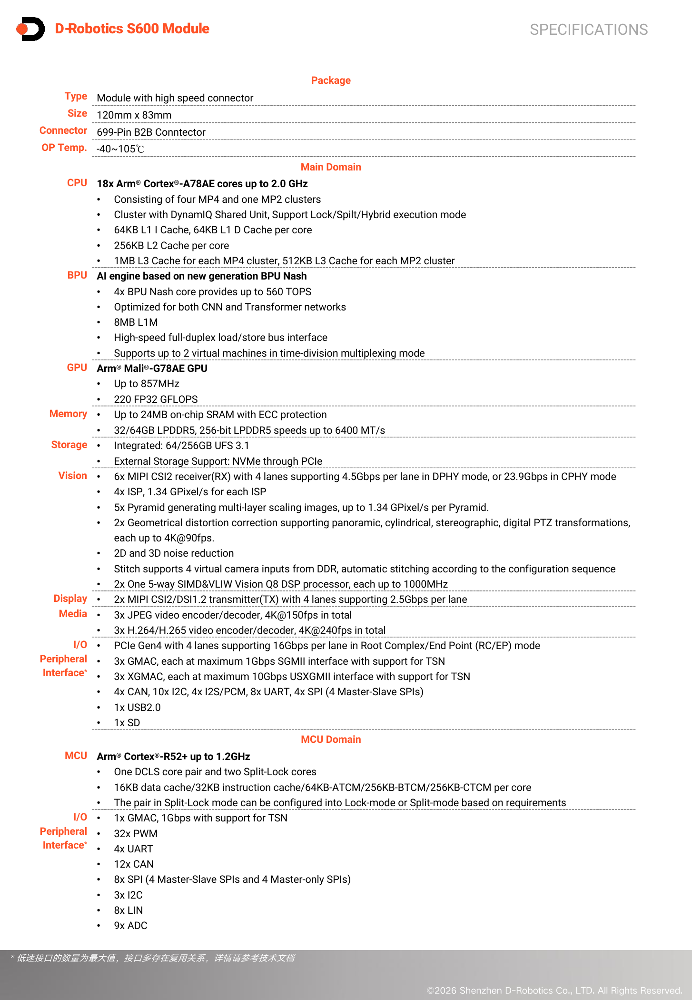

# 09：SWOT、商业证据与条件选型

截止2026-11-05。对象是地平线相关技术与地瓜机器人端侧平台，主目标S600，必要时明确比较X5/S100及征程6P。结论面向科研原型和产品选型，既考虑计算与集成，也考虑采购、服务、许可与数据运营。事实、厂商宣称、情景推导和未取得材料分别表述。

## 市场证据必须先明确主体与分母

2026-09-18地平线公告称，地瓜机器人9月17日完成4亿美元C轮融资，并说明其由地平线孵化、底层架构同源、保持合作。融资代表资金和发展计划，不代表项目盈利、客户合同或可保证的长期供货。地瓜营收“同比数倍增长”未给基数、金额和分部口径，不能据此测算具身业务收入或毛利。地平线汽车业务与地瓜机器人主体也不能合并作采购信用或服务责任判断。〔1：[原文](https://www.horizon.auto/news/press/479) / [本地原件](REFERENCES.md#ref-8d8fe856b3583fc1)〕

同一公告称旭日系列累计出货超过800万片、S600获20余家采用、具身客户覆盖率超过50%、多数项目进入量产级出货。这些均标为厂商宣称：旭日累计跨代跨应用，不能归为S600机器人出货；覆盖率未给总体客户数、地区、抽样方法或芯片数量分母，不能当芯片份额、整机份额或在岗安装率。伙伴采用与量产阶段有积极信号，但逐家本体SKU、交付量、暴露小时和收益尚缺。〔1：[原文](https://www.horizon.auto/news/press/479) / [本地原件](REFERENCES.md#ref-8d8fe856b3583fc1)〕

本轮扩查官方业绩报告目录（仅作检索过程记录，不作财务数字证据），正文只有导航与嵌入报告入口，官方指向horizon.vislan.com的嵌入页下载失败；未取得财报正文。目录不是业绩数据证据，因此本文不填公司总收入、利润或具身分部数字。此处属于资料未取得，并非认定厂商没有财报。未取得可比独立行业分母，也不使用公司宣传构造市占率排名。市场决策可先以目标客户任务、量产阶段和可签合同评价，不能以800万或50%替代目标市场验证。〔2：[原文](https://www.horizon.auto/investor-relations/report) / [本地原件](REFERENCES.md#ref-0f1def09c000bfbc)〕

| 商业信号 | 可支持的结论 | 不能支持的结论 | 下一步证据 |
|---|---|---|---|
| S60020余家采用，厂商公告 | 存在公开采用与合作信号 | 逐家出货量、收益、所有本体兼容 | 本体SKU、合同/交付及版本 |
| 旭日累计800万，厂商公告 | 旭日系列历史规模宣称 | S600具身销量或安装份额 | 分代/地区/应用统计 |
| 征程6P京东定点 | 具体产品项目的design-in | 百万辆现有订单或已交付 | 验收节点、数量、运营效果 |
| C轮融资4亿美元 | 公布融资与平台建设计划 | 项目盈利及供应保证 | 供应主体与正式支持条款 |

## 具体商业案例的成立与限制

2026-09-11地平线公告：征程6P获得京东物流无人车项目定点，将为“独狼”第六代智能配送车Plus版提供算力。这是可定位本体代际的design-in，不能换写成S600已在京东部署。文中“未来3至5年有望达到百万辆”是预测，不是合同、交付或在岗数量；京东此前在园区、校园和道路的运营也不能自动归因这代芯片。实际价值可能来自大参数感知决策和供应多元化，但未给同路线、同任务、同载荷的前后成本/介入/续航数据，不能算ROI。〔3：[原文](https://www.horizon.auto/news/press/475) / [本地原件](REFERENCES.md#ref-3f232a4e286b7e21)〕

采购动作应要求客户或整机方说明本体型号、芯片/模组、BSP、算法与控制器的发布组合，提供该代交付台数、工作时数、每任务人工介入和故障统计。医院累计配送或车辆历史运营规模若与新方案无可审计对应，只能作任务市场背景。这个边界保护选型：已有规模验证值得追查，却不替代新SKU自己的验证。

## SWOT：从事实到动作

优势方面，S600公开四核BPU、32/64GB内存、媒体与MCU域，已取得组件量化、HBIR/HBM、VLA配置及传感器文档。对受支持模型、愿意冻结版本的团队，组合可能减少从零拼接驱动、模型与控制接口的工时。优势成立要保持任务质量、确保热稳态和动作契约，动作是先完成目标板闭环概念验证，再比较系统成本。560TOPS的精度口径不能直接换成实测任务速度，开发样例也不能当量产安全验证。〔4：[原文](https://cn.d-robotics.cc/rdkS600) / [本地原件](REFERENCES.md#ref-5aaffe83d6e42b57)〕 〔5：[原文](https://developer.d-robotics.cc/oe_llm_doc/static/js/async/50188.3b7997bf.js) / [本地原件](REFERENCES.md#ref-cc21f8f5997a722f) / [官方文档页面](https://developer.d-robotics.cc/oe_llm_doc/guide/llm_compression/detailed_function_specification/model_compilation) / [离线正文](REFERENCES.md) / [渲染HTML](REFERENCES.md)〕 〔6：[原文](https://developer.d-robotics.cc/oe_llm_doc/static/js/async/95984.ae5bd0da.js) / [本地原件](REFERENCES.md#ref-7fbbb66205a2a9ed) / [官方文档页面](https://developer.d-robotics.cc/oe_llm_doc/guide/vla/vla_deployment/vla_sample/pi0_pi05_demo) / [离线正文](REFERENCES.md) / [渲染HTML](REFERENCES.md)〕

短板方面，公开材料存在S100/S600同步参数混用、不同SDK绑定版本、EtherCAT周期日志冲突和升级机制差异；完整商业MCAL、MCU0与部分驱动服务未取得。影响是集成团队需增加版本回归、问题定位和许可谈判成本。大量自定义算子、频繁换模型或端侧训练需求会放大迁移开销；应在采购前验证关键算子并取得商业交付清单，不能把所有框架“理论可运行”写成已优化支持。〔7：[原文](https://developer.d-robotics.cc/rdk_s_doc/Advanced_development/multimedia_development/multimedia_development/camerasync) / [本地原件](REFERENCES.md#ref-ccb05c49965cfca1)〕 〔8：[原文](https://developer.d-robotics.cc/rdk_s_doc/Advanced_development/mcu_development/mcu_ethercat) / [本地原件](REFERENCES.md#ref-55e8507927e44f5e)〕 〔9：[原文](https://developer.d-robotics.cc/rdk_s_doc/Advanced_development/mcu_development/code_release) / [本地原件](REFERENCES.md#ref-68065d5ada57af84)〕 〔10：[原文](https://developer.d-robotics.cc/rdk_s_doc/Advanced_development/linux_development/OTA/ota_miniboot) / [本地原件](REFERENCES.md#ref-c0fecf1465220ec5)〕

机会属于情景：若国内操作、移动及消费机器人团队需要较大模型端侧推理和本地支持，现有生态与官方路线有助缩短原型周期；端侧处理也可能减少网络依赖和不必要的数据回传。机会是否转化为订单取决于任务收益、价格、交期与支持承诺，融资和开发者数量只是背景。DGP计划公开研发/供应链/推广支持方向，但不形成目标项目已获得补贴或固定服务权益。〔1：[原文](https://www.horizon.auto/news/press/479) / [本地原件](REFERENCES.md#ref-8d8fe856b3583fc1)〕 〔11：[原文](https://cn.d-robotics.cc/developer) / [本地原件](REFERENCES.md#ref-bd48591082dfca7e)〕

威胁同样是情景：作者模型和算子快速变化、第三方传感器版本升级、通用GPU生态已有资产，可能提高BPU迁移维护成本；量产团队若缺PCN/EOL、备件或恢复权限，停机损失可能超过模组价差。Arm IP、ADI/Maxim器件、开源工具及云GPU构成外部依赖，不能按公司所在地推国产化率。当前未取得对具体S600 SKU、目的地区、最终用户和用途的完整贸易分类与限制核验，不能宣称天然豁免或把数据中心限制套到全部端侧芯片。〔12：[原文](https://developer.d-robotics.cc/rdk_s_doc/Quick_start/hardware_introduction/rdk_s600/rdk_s600_camera_expansion_board) / [本地原件](REFERENCES.md#ref-57531817dea53237)〕 〔13：[原文](https://developer.d-robotics.cc/rdk_s_doc/Advanced_development/mcu_development/basic_information) / [本地原件](REFERENCES.md#ref-ab43a50619e45bdc)〕 〔14：[原文](https://raw.githubusercontent.com/D-Robotics/RoboTwin/pi0pub/README.md) / [本地原件](REFERENCES.md#ref-470f911af9987249)〕

## 采购对象与成本模型

图为官方模组规格原页，32GB/64GB配置帮助界定采购对象；它不包括整机电池、相机、载板、散热、线束和软件服务。模组宽温说明也不能替代载板及整机环境验证。报价应准确到模组/套件、容量、修订版、数量、币种、税费、交付地区、有效期和交期。〔15：[原文](https://archive.d-robotics.cc/downloads/hardware/rdk_s600/rdk_s600/brief/drobotics_rdk_s600_module_brief_v1p0_zh.pdf) / [本地原件](REFERENCES.md#ref-9a0f74cb6cdbc9d5)〕

渠道RDK-S600-32G页面显示型号与32/64GB入口，但归档价格仍是tax/price动态占位符，无法核验金额、阶梯价和税。本文不填虚构价格，也不由购物按钮推现货。量产应向供应主体取得正式报价、NRE及软件授权、保修/RMA、MOQ、备件、PCN提前量、EOL最后购买和支持期；开发板购入与长期供货合同是不同交付。〔16：[原文](https://www.waveshare.net/shop/RDK-S600-32G.htm) / [本地原件](REFERENCES.md#ref-997e7dc8218b40e6)〕 〔17：[原文](https://developer.d-robotics.cc/rdk_s_doc/Quick_start/download) / [本地原件](REFERENCES.md#ref-4a91716a854dddbe)〕

分析用未折现的可比较TCO，所有钱采用同一币种：TCO = N×(P模块+P载板+P传感器+P散热供电+P其他BOM) + C_NRE + C软件许可 + Y×C年度维护 + N×Y×H×W系统/1000×P电 + C云训练/存储 + C停机。N是台数，Y是年数，H是每台每年的工作小时，W系统是同任务平均系统瓦数，P电是每千瓦时价格。各项未知保留变量；不以芯片峰值功率或模组功率替代系统功耗，TCO也不等于新增业务收益。

| 输入 | 单位/口径 | 当前证据 | 对结论的影响 |
|---|---|---|---|
| 模组及配套BOM | 同地区税口径元/台 | 有SKU，金额未核验 | 无法判定采购价差 |
| NRE/许可/维护 | 元/项目或元/年 | 商业包需申请，价格未取得 | 小批量可能被固定费用主导 |
| 热稳态功耗 | W/整系统/同任务 | 未测 | 不可给续航或电费排名 |
| 任务工作量 | 小时/台年、成功任务数 | 本体运营数据未取得 | 无法计算每成功任务成本 |
| 停机与人工介入 | 小时、工时、元/次 | 未取得 | 可能超过硬件差价 |

显式假设敏感性例：N=100台、Y=3年、H=2000小时/台年，两方案仅平均系统功耗相差10W，P电=1元/kWh，则三年差额为6000元，即每台60元。数字仅解释模型，不是任何平台实测或报价。模组差价每台100元对应总额10000元，但一次集成返工、人工值守或停车事件可能改变排序，需填真实发生率和费用。没有收益、人工节约、成功任务与停机数据时不输出ROI或回本期。

## 中国数据与服务政策边界

《个人信息保护法》2021-11-01施行，第二十八条列生物识别、医疗健康、行踪轨迹等敏感个人信息，后续条款规定特定目的、充分必要及相应同意/保护要求。第三十八至四十条涉及跨境提供的条件与例外框架。机器人采集人员图像、位置和家庭/医疗场景信息时，需要按实际可识别性、处理目的和部署链评估；本地推理能减少回传，却不自动消除日志、遥操作、训练集及云备份的个人信息处理。本文核验法条，不声称已完成所有现行配套规定或具体项目的法律适用审查。〔18：[原文](https://www.cac.gov.cn/2021-08/20/c_1631050028355286.htm) / [本地原件](REFERENCES.md#ref-ec116706ee1c8f17)〕

《生成式人工智能服务管理暂行办法》2023-08-15施行，第二条针对向境内公众提供生成文本、图片、音频、视频等服务；企业/教育科研等研发应用而未向公众提供此类服务，不适用本办法规定。不能因为机器人用了VLA就给所有内部工业控制套上公众服务流程；面向公众的语言/多模态交互则需核对服务实质、训练数据及用户输入保护等条款。代码、模型权重、数据和二进制许可仍分别审查，使用国产芯片也不自动取得作者数据或权重的商用权。〔19：[原文](https://www.cac.gov.cn/2023-07/13/c_1690898327029107.htm) / [本地原件](REFERENCES.md#ref-4d0c17a97aa7b944)〕 〔20：[原文](https://raw.githubusercontent.com/Physical-Intelligence/openpi/main/LICENSE) / [本地原件](REFERENCES.md#ref-e7710e649d1b8e41)〕 〔21：[原文](https://raw.githubusercontent.com/huggingface/lerobot/main/LICENSE) / [本地原件](REFERENCES.md#ref-b31a4316deb136be)〕

## 场景选择与放行证据

| 应用 | 候选判断 | 成立条件 | 放行证据 |
|---|---|---|---|
| 科研/教学 | X5/S100或S600按模型选 | 可接受适配，锁定镜像与许可 | 模型复现、接口与实验可重建 |
| VLA操作 | S600值得优先PoC | 相机/状态/动作匹配，量化质量保持 | 真机留出成功、介入、时延与碰撞保护 |
| 物流AMR | 分开评估RDK与征程方案 | 导航/本体SDK在目标版本验证 | 路线/载荷/人混行运行及故障数据 |
| 固定视觉 | 按任务评估较小平台 | 模型/相机满足即可 | 漏检误检、吞吐、热稳态和恢复 |
| 消费/家庭 | 端侧多模态候选 | 成本/噪声/电池/隐私同时满足 | 整机续航、服务/数据链与更新 |
| 工业控制 | 感知域与受控执行器分工 | 有界控制、维护和环境条件 | 周期/尾延迟、总线、EMC与失效 |
| 安全关键 | 暂不凭公开材料放行 | 正式安全包与系统设计完成 | 证书适用范围、诊断/停止与WCET |

这些是有条件选型动作，不是应用成熟度认证。S600当前VLA SDK包、X5/S100 ROS样例与征程6P本体定点属于不同证据链，不能合成一个“全场景已验证”结论。模拟LIBERO/RoboTwin可用于部署与策略回归，但还需真实传感器、动力学、控制和留出任务验证。〔6：[原文](https://developer.d-robotics.cc/oe_llm_doc/static/js/async/95984.ae5bd0da.js) / [本地原件](REFERENCES.md#ref-7fbbb66205a2a9ed) / [官方文档页面](https://developer.d-robotics.cc/oe_llm_doc/guide/vla/vla_deployment/vla_sample/pi0_pi05_demo) / [离线正文](REFERENCES.md) / [渲染HTML](REFERENCES.md)〕 〔22：[原文](https://developer.d-robotics.cc/oe_llm_doc/static/js/async/96352.bec46241.js) / [本地原件](REFERENCES.md#ref-7a55bacca877cdcc) / [官方文档页面](https://developer.d-robotics.cc/oe_llm_doc/guide/vla/vla_deployment/sim_loop/overview) / [离线正文](REFERENCES.md) / [渲染HTML](REFERENCES.md)〕 〔23：[原文](https://raw.githubusercontent.com/D-Robotics/rdk_doc/main/docs/05_Robot_development/01_quick_start/install_tros.md) / [本地原件](REFERENCES.md#ref-2216222950f5189f)〕 〔3：[原文](https://www.horizon.auto/news/press/475) / [本地原件](REFERENCES.md#ref-3f232a4e286b7e21)〕

最终建议把正式采购放在四类证据之后：模型与许可契约完整；目标SKU在热稳态、多模型/多传感器并发下满足数据年龄与任务质量；控制失联/错误动作/更新失败能停止并恢复；供应及维护责任可签且成本变量可填。当前平台具有值得验证的软硬件整合路线，公开材料仍不足以直接证明任务ROI、安全关键适用或长期交付优势。本轮完成资料研究，实机与合同缺口如实留在结论和状态中。

## 资料与核验

本篇为公开资料与代码核验，未进行SDK安装、模型实机或机器人验收。静态归档部分缺失：[{'source_id': 'Horizon_DRobotics_Funding_Relation', 'missing_presentation': 23, 'missing_all': 25}, {'source_id': 'H09_Reports_Index', 'missing_presentation': 19, 'missing_all': 21}, {'source_id': 'Horizon_JD_Journey6P_DesignIn', 'missing_presentation': 25, 'missing_all': 27}]。

[资料总索引](REFERENCES.md) · [证据JSON](research_state/evidence/09_SWOT_Analysis.json)

### 原件清单

1. **Horizon_DRobotics_Funding_Relation**：[原URL](https://www.horizon.auto/news/press/479) · [原件](REFERENCES.md#ref-8d8fe856b3583fc1)；采集2026-11-05T01:24:52.069141+00:00；partial_static。

2. **H09_Reports_Index**：[原URL](https://www.horizon.auto/investor-relations/report) · [原件](REFERENCES.md#ref-0f1def09c000bfbc)；采集2026-11-05T04:36:31.253663+00:00；partial_static。

3. **Horizon_JD_Journey6P_DesignIn**：[原URL](https://www.horizon.auto/news/press/475) · [原件](REFERENCES.md#ref-3f232a4e286b7e21)；采集2026-11-05T01:24:46.243497+00:00；partial_static。

4. **Horizon_RDK_S600**：[原URL](https://cn.d-robotics.cc/rdkS600) · [原件](REFERENCES.md#ref-5aaffe83d6e42b57)；采集2026-11-05T01:28:18.275356+00:00；complete_static。

5. **H02_LLM_Compile_Content**：[原URL](https://developer.d-robotics.cc/oe_llm_doc/static/js/async/50188.3b7997bf.js) · [原件](REFERENCES.md#ref-cc21f8f5997a722f)；采集2026-11-05T02:39:41.339082+00:00；complete_static。 / [官方文档页面](https://developer.d-robotics.cc/oe_llm_doc/guide/llm_compression/detailed_function_specification/model_compilation) / [离线正文](REFERENCES.md) / [渲染HTML](REFERENCES.md)。正文由已归档的官方页面JS在完全阻断外网请求的浏览器内渲染，入口空壳HTML不作正文证据。

6. **H04_Pi0_Content**：[原URL](https://developer.d-robotics.cc/oe_llm_doc/static/js/async/95984.ae5bd0da.js) · [原件](REFERENCES.md#ref-7fbbb66205a2a9ed)；采集2026-11-05T04:06:40.566793+00:00；complete_static。 / [官方文档页面](https://developer.d-robotics.cc/oe_llm_doc/guide/vla/vla_deployment/vla_sample/pi0_pi05_demo) / [离线正文](REFERENCES.md) / [渲染HTML](REFERENCES.md)。正文由已归档的官方页面JS在完全阻断外网请求的浏览器内渲染，入口空壳HTML不作正文证据。

7. **H03_Current_Sync**：[原URL](https://developer.d-robotics.cc/rdk_s_doc/Advanced_development/multimedia_development/multimedia_development/camerasync) · [原件](REFERENCES.md#ref-ccb05c49965cfca1)；采集2026-11-05T04:01:08.411541+00:00；complete_static。

8. **H02_EtherCAT**：[原URL](https://developer.d-robotics.cc/rdk_s_doc/Advanced_development/mcu_development/mcu_ethercat) · [原件](REFERENCES.md#ref-55e8507927e44f5e)；采集2026-11-05T02:53:49.329436+00:00；complete_static。

9. **H02_MCU_Code**：[原URL](https://developer.d-robotics.cc/rdk_s_doc/Advanced_development/mcu_development/code_release) · [原件](REFERENCES.md#ref-68065d5ada57af84)；采集2026-11-05T02:53:28.804982+00:00；complete_static。

10. **H02_Miniboot**：[原URL](https://developer.d-robotics.cc/rdk_s_doc/Advanced_development/linux_development/OTA/ota_miniboot) · [原件](REFERENCES.md#ref-c0fecf1465220ec5)；采集2026-11-05T02:27:12.762914+00:00；complete_static。

11. **H07_Developer**：[原URL](https://cn.d-robotics.cc/developer) · [原件](REFERENCES.md#ref-bd48591082dfca7e)；采集2026-11-05T04:17:33.119481+00:00；complete_static。

12. **Horizon_S600_Camera_Manual**：[原URL](https://developer.d-robotics.cc/rdk_s_doc/Quick_start/hardware_introduction/rdk_s600/rdk_s600_camera_expansion_board) · [原件](REFERENCES.md#ref-57531817dea53237)；采集2026-11-05T01:33:16.456813+00:00；complete_static。

13. **H02_MCU_Info**：[原URL](https://developer.d-robotics.cc/rdk_s_doc/Advanced_development/mcu_development/basic_information) · [原件](REFERENCES.md#ref-ab43a50619e45bdc)；采集2026-11-05T02:53:20.377310+00:00；complete_static。

14. **H05_RoboTwin_Repo**：[原URL](https://raw.githubusercontent.com/D-Robotics/RoboTwin/pi0pub/README.md) · [原件](REFERENCES.md#ref-470f911af9987249)；采集2026-11-05T04:11:19.913272+00:00；complete_static。

15. **Horizon_S600_Module_Brief**：[原URL](https://archive.d-robotics.cc/downloads/hardware/rdk_s600/rdk_s600/brief/drobotics_rdk_s600_module_brief_v1p0_zh.pdf) · [原件](REFERENCES.md#ref-9a0f74cb6cdbc9d5)；采集2026-11-05T01:37:34.257374+00:00；complete_static。

16. **Horizon_S600_Waveshare_Quote**：[原URL](https://www.waveshare.net/shop/RDK-S600-32G.htm) · [原件](REFERENCES.md#ref-997e7dc8218b40e6)；采集2026-11-05T01:33:34.443407+00:00；complete_static。

17. **Horizon_S600_Downloads**：[原URL](https://developer.d-robotics.cc/rdk_s_doc/Quick_start/download) · [原件](REFERENCES.md#ref-4a91716a854dddbe)；采集2026-11-05T01:33:26.415591+00:00；complete_static。

18. **H09_PIPL_CAC**：[原URL](https://www.cac.gov.cn/2021-08/20/c_1631050028355286.htm) · [原件](REFERENCES.md#ref-ec116706ee1c8f17)；采集2026-11-05T04:36:33.918452+00:00；complete_static。

19. **H09_GenAI**：[原URL](https://www.cac.gov.cn/2023-07/13/c_1690898327029107.htm) · [原件](REFERENCES.md#ref-4d0c17a97aa7b944)；采集2026-11-05T04:35:56.876251+00:00；complete_static。

20. **H04_Openpi_License**：[原URL](https://raw.githubusercontent.com/Physical-Intelligence/openpi/main/LICENSE) · [原件](REFERENCES.md#ref-e7710e649d1b8e41)；采集2026-11-05T04:07:36.489475+00:00；complete_static。

21. **H04_LeRobot_License**：[原URL](https://raw.githubusercontent.com/huggingface/lerobot/main/LICENSE) · [原件](REFERENCES.md#ref-b31a4316deb136be)；采集2026-11-05T04:07:38.457953+00:00；complete_static。

22. **H05_Sim_Content**：[原URL](https://developer.d-robotics.cc/oe_llm_doc/static/js/async/96352.bec46241.js) · [原件](REFERENCES.md#ref-7a55bacca877cdcc)；采集2026-11-05T04:10:29.696620+00:00；complete_static。 / [官方文档页面](https://developer.d-robotics.cc/oe_llm_doc/guide/vla/vla_deployment/sim_loop/overview) / [离线正文](REFERENCES.md) / [渲染HTML](REFERENCES.md)。正文由已归档的官方页面JS在完全阻断外网请求的浏览器内渲染，入口空壳HTML不作正文证据。

23. **H02_TROS_Install**：[原URL](https://raw.githubusercontent.com/D-Robotics/rdk_doc/main/docs/05_Robot_development/01_quick_start/install_tros.md) · [原件](REFERENCES.md#ref-2216222950f5189f)；采集2026-11-05T02:57:03.184927+00:00；complete_static。
