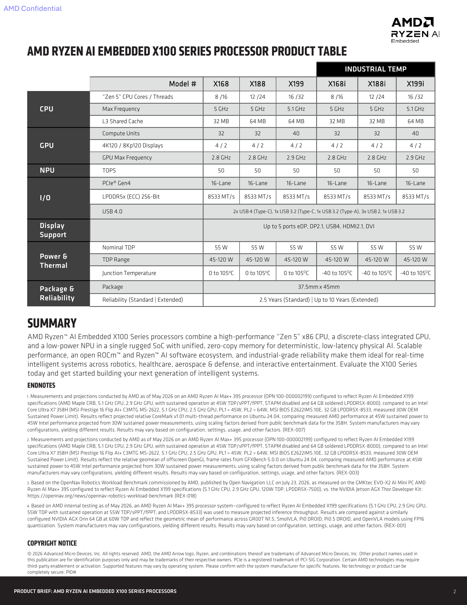
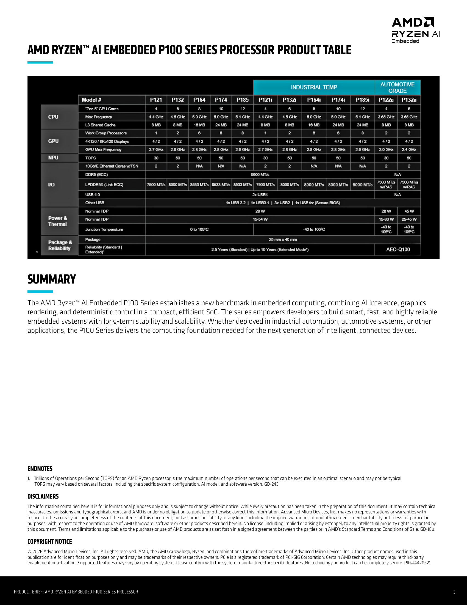
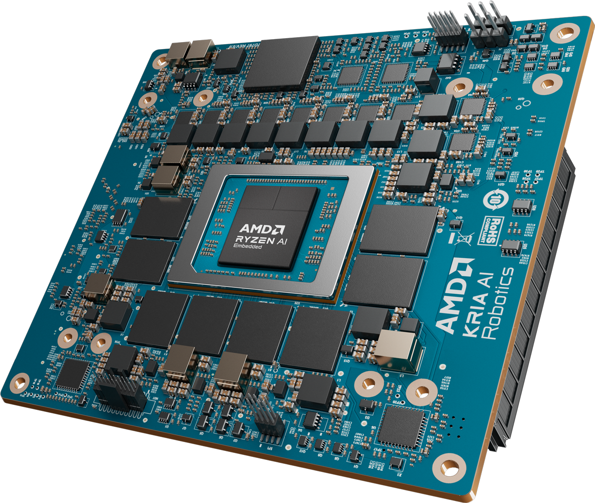
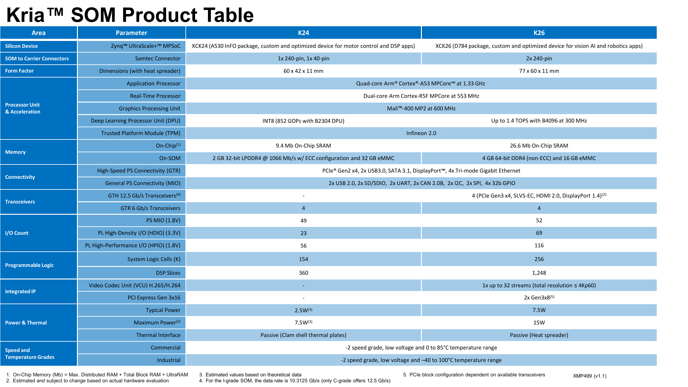
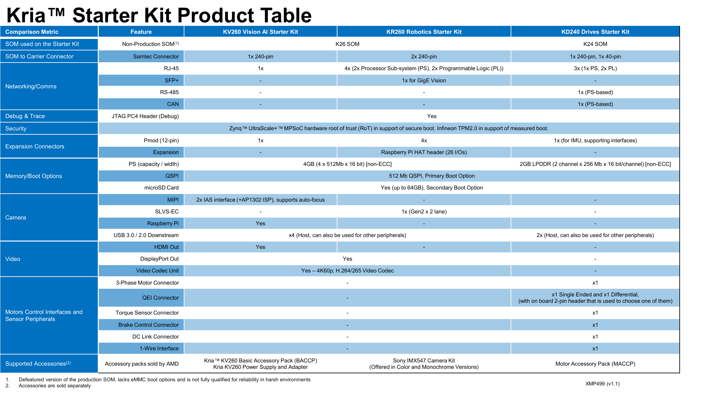
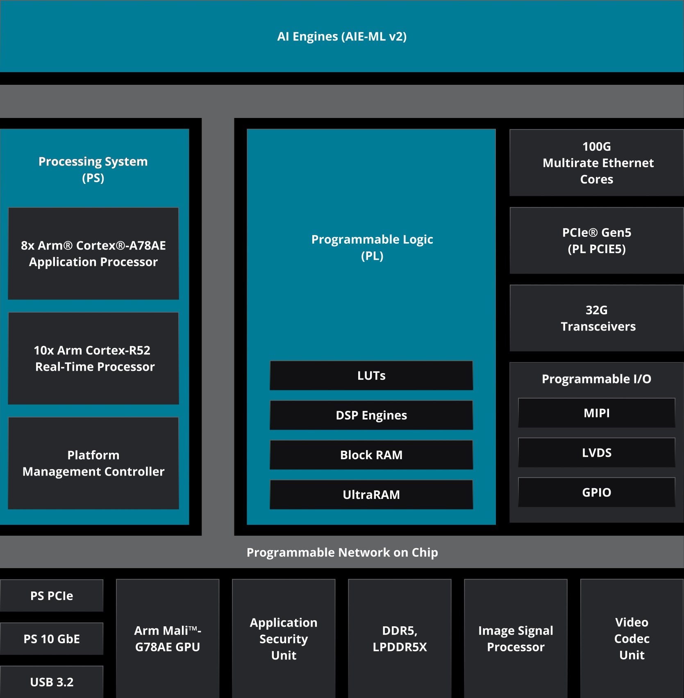
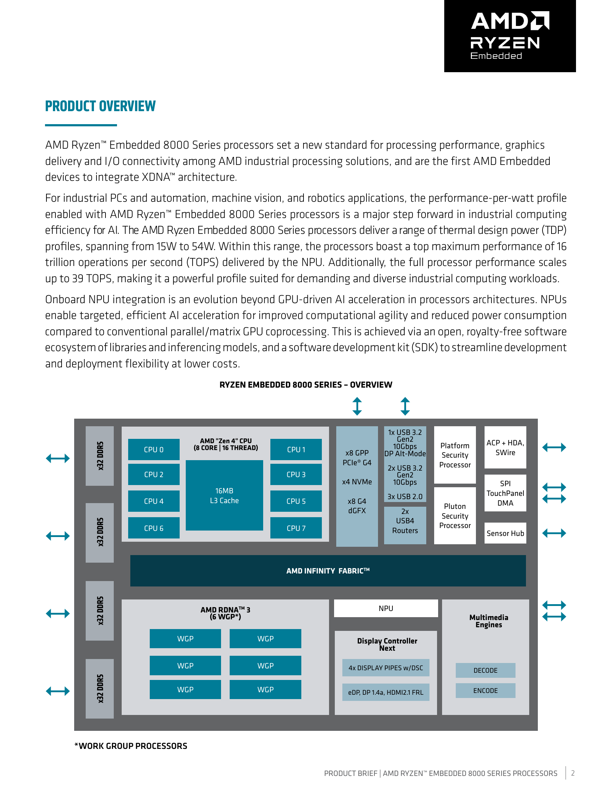

# AMD 具身智能硬件平台：逐型号规格、数据路径与工程选型

资料截止：2026-11-04（Asia/Shanghai）。本章为 01 审阅稿；02—09 尚未开展。本报告依据已取得的官方产品页、产品简报、选型表及注明资助关系的第三方测试，不包含本次实机测试。正文引用编号对应文末的原始 URL、版本说明与本地 HTML/PDF 原件；采集日不代表资料发布日期。

## 1. 选型结论与研究范围

**AMD 的具身智能硬件应按“大脑计算、传感与控制、开发训练”分层选择。** Ryzen AI Embedded X100 把较强的 x86 CPU、RDNA 3.5 GPU、XDNA 2 NPU 与大容量共享内存放在同一 SoC；P100 面向更低功率、不同 CPU/GPU 档位的嵌入式系统；Kria K24/K26 和 Versal 更适合需要可编程传感通道、确定性数据处理与工业控制的设计。新版 Kria AI 将 X100 SOM 与含 FPGA 的机器人载板组合，属于另一条 x86 平台路线。Instinct 和 Radeon AI PRO 服务训练、微调或开发主机，不能把服务器卡的 HBM 与千瓦级板功率套到机器人端侧。定位依据：[S01 AMD机器人方案](https://www.amd.com/en/solutions/robotics.html)、[S02 Kria AI方案与脚注](https://www.amd.com/en/products/system-on-modules/kria/ai.html)、[S03 Versal AI Edge Gen2规格](https://www.amd.com/en/products/adaptive-socs-and-fpgas/versal/gen2/ai-edge-series.html)、[S04 Radeon AI PRO产品与使用边界](https://www.amd.com/en/products/graphics/workstations/radeon-ai-pro.html)。

本章覆盖 X168/X188/X199 及工业款、P100 全部十二款、Kria K24/K26 C/I 生产 SOM 与 KV260/KR260/KD240 开发套件、Kria AI Robotics Developer Platform、Versal AI Edge Gen 2 六款及 VEK385，并以 Gen 1/VEK280、Ryzen Embedded 8000/V3000/V2000 解释存量工程差异。开发训练侧单列 Ryzen AI Max+ 395、Radeon AI PRO R9700、Instinct MI350X/MI355X/MI350P。不会把 AMD 的全部 CPU、GPU、FPGA 或汽车芯片目录视为机器人主力清单。

**优先检查可用内存、持续功率与接口路径，然后看模型实际能使用的计算引擎。** X100 的 NPU TOPS、K24 的 DPU INT8 GOPS、Versal 的 MX6 TOPS 和 Instinct 的 FP16 矩阵 PFLOPS，含义及执行路径不同；总系统 TOPS 也不是一个模型可独占的加速器吞吐。只有固定模型、精度、输入、并发、功率和热状态的测量才支持速度比较。以下场景建议均为基于证据的工程分析。

| 系统层次 | 相关平台 | 硬件主要作用 | 选型首先核验 | 当前证据边界 |
|---|---|---|---|---|
| 大容量机器人主计算 | X100 / Kria AI | CPU 规划与调度；GPU 多模态推理；NPU 常驻小模型 | 实际可用 RAM、长期热稳定、目标载板接口 | 部分 benchmark 用 Max+ 395 代理；开发平台仍 Notify Me |
| 较低功率边缘计算 | P100 / Embedded 8000 | x86 业务与控制、图形、端侧推理 | 精确 SKU、内存设计、功率档、网络 MAC | P100 高核数款不含表中双 10GbE；量产计划需采购确认 |
| 传感、工业网络、关节控制 | K24/K26 / Versal | PL、DSP、DPU/AIE 与 Arm PS 分工 | FPGA 资源、IP、引脚复用、实时与安全边界 | 开发板接口不等于裸 SoC；整机认证不能由芯片能力推出 |
| 存量 x86 控制/网关 | V3000 / V2000 | CPU 与网络、旧图形/视频设计 | 是否需外置 AI GPU、供货与 BSP | V3000 无集成 GPU/NPU；旧代不等于已 EOL |
| 开发与训练主机 | Max+ 395 / R9700 / MI350 | 模型调试、微调、大模型训练和推理 | 主机拓扑、显存、散热、软件目标设备 | 工作站/服务器结果不能直接证明机器人板的闭环能力 |

## 2. Ryzen AI Embedded X100：高内存带宽的 x86 主计算

### 2.1 全部六款及工业边界

下表来自当前系列页、X199 精确 SKU 页和官网公开链接的 X100 brief。CPU/GPU 为最高频率，不能解释为任意 cTDP 下全资源同时持续达到。NPU 标称最高 50 TOPS；所取规格未完整注明对应位宽及 dense/sparse 条件，因此保留厂商口径，不与其他平台直接排名。[S05 X100系列规格](https://www.amd.com/en/products/embedded/ryzen-ai/x100-series.html)、[S06 X199精确SKU规格](https://www.amd.com/en/products/embedded/ryzen-ai/x100-series/ryzen-ai-embedded-x199.html)、[S07 X100产品brief](https://www.amd.com/content/dam/amd/en/documents/products/embedded/ryzen/ryzen-ai-embedded-x100-series-product-brief.pdf)。

| SKU | Zen 5 核/线程 | CPU 最高 GHz | RDNA 3.5 CU / 最高 GHz | XDNA 2 NPU TOPS | 名义 / 可配 TDP W | 结温范围 °C |
|---|---|---|---|---|---|---|
| X168 | 8/16 | 5.0 | 32 / 2.8 | 50 | 55 / 45–120 | 0–105 |
| X188 | 12/24 | 5.0 | 32 / 2.8 | 50 | 55 / 45–120 | 0–105 |
| X199 | 16/32 | 5.1 | 40 / 2.9 | 50 | 55 / 45–120 | 0–105 |
| X168i | 8/16 | 5.0 | 32 / 2.8 | 50 | 55 / 45–120 | −40–105 |
| X188i | 12/24 | 5.0 | 32 / 2.8 | 50 | 55 / 45–120 | −40–105 |
| X199i | 16/32 | 5.1 | 40 / 2.9 | 50 | 55 / 45–120 | −40–105 |

系列资料列 LPDDR5X-8533、256bit、最高 128GB、PCIe Gen4 共 16 lane，以及 37.5×45mm 封装；X199 页明确 FP11 BGA、8 channel Link-ECC。SoC 的内存控制器能力不表示芯片内含 128GB RAM，实际容量由 SOM/主板装配决定。本文未取得 X100 独立制程说明，不从 Max+ 395 相近架构推填制程。X199 的 Last Time Buy 列 **2037**，并列 “Recommended for new designs: Yes”；这是该 SKU 当前页面的供货规划字段，不证明全系列同一日历 EOL，也不是现货承诺。[S07 X100产品brief](https://www.amd.com/content/dam/amd/en/documents/products/embedded/ryzen/ryzen-ai-embedded-x100-series-product-brief.pdf)、[S06 X199精确SKU规格](https://www.amd.com/en/products/embedded/ryzen-ai/x100-series/ryzen-ai-embedded-x199.html)。

图中有实质版本异常：文件仍带 **“AMD Confidential”**，末尾 PID 未填写、未列正式 revision。本文是在官网公开产品链接取得该文件，其 PDF 元数据创建于 2026-07-20；元数据不能当正式发布日期，也不能据此把它当量产承诺。X188i 的 L3 在该表为 32MB，而 X188 为 64MB，本章不自行“纠错”为同值。关键共性另用当前系列/SKU 页交叉核对；差异进入第 9 节。[S07 X100产品brief](https://www.amd.com/content/dam/amd/en/documents/products/embedded/ryzen/ryzen-ai-embedded-x100-series-product-brief.pdf)。

### 2.2 CPU/GPU/NPU 与统一内存的实际作用

X100 的主要工程价值是共享较大的外部内存池。分析上，CPU 可承担 Nav2、轨迹优化、容器/agent 调度；GPU 承担视觉编码和较大的 VLM/VLA；NPU 可承接适合其算子与编译路径的常驻检测任务。厂商“unified, zero-copy memory”描述提供减少 CPU↔独立显卡复制的架构基础，**不能证明任意相机驱动、图像格式与 runtime 自动零拷贝，也不保证 GPU/NPU 无转换或同步成本**。模型张量布局、buffer 所有权、页映射和跨引擎同步仍需在目标 BSP 验证。[S07 X100产品brief](https://www.amd.com/content/dam/amd/en/documents/products/embedded/ryzen/ryzen-ai-embedded-x100-series-product-brief.pdf)。

分析计算：8533MT/s×256bit÷8≈**273.1GB/s**，与厂商 273GB/s 对应，是外存理论峰值。CPU、GPU、NPU、显示与 DMA 会争用内存及功率；实际可持续读写带宽与单流解码速度不能由峰值直接确定。同样，厂商“200B+ 参数模型”需明确量化、上下文和可用 GPU 内存。只算权重，`M=N×b/8`：200B 模型 FP16 约 400GB，INT8 约 200GB，4bit 约 100GB；均为十进制估算，尚未含 scale、KV cache、视觉编码器、激活和工作区。128GB 名义 RAM 不保证任意 200B 模型可运行，更不保证实时动作生成。[S07 X100产品brief](https://www.amd.com/content/dam/amd/en/documents/products/embedded/ryzen/ryzen-ai-embedded-x100-series-product-brief.pdf)。

接口应以芯片与载板两级读表。X199 SKU 页列 2×USB4、2×USB3.2、3×USB2、I2C/SMBus/SPI/UART、Gen4 16 lane，而 **Ethernet 为 N/A**。新版 Kria AI 上的多路 RJ45/CAN/FAKRA 不应写成 X199 原生端口。X199 页视频为最高 4K60 编解码、单屏 8K60，显示接口 DP2.0/eDP1.4/HDMI2.1；brief 写四路 4K120/两路 8K120、最多五 ports，接口文本也不同。本文不统一成“支持八路 8K 摄像头”；视频吞吐、显示管线与相机采集是三类不同能力。[S06 X199精确SKU规格](https://www.amd.com/en/products/embedded/ryzen-ai/x100-series/ryzen-ai-embedded-x199.html)、[S07 X100产品brief](https://www.amd.com/content/dam/amd/en/documents/products/embedded/ryzen/ryzen-ai-embedded-x100-series-product-brief.pdf)。

## 3. Ryzen AI Embedded P100：按型号选择功率、GPU 和工业网络

### 3.1 十二款计算规格

P100 为 4nm、Zen 5/5c、RDNA 3.5、XDNA 2，25×40mm BGA 封装。表中 GPU 用 **CU**；brief 用 WGP，RDNA 3.5 这里 1 WGP 对应 2 CU，不能把 P185 的 8 WGP 写成 8 CU。普通/i SKU 的名义 TDP 为 28W、可配 15–54W，车规另列。[S08 P100系列规格](https://www.amd.com/en/products/embedded/ryzen-ai/p100-series.html)、[S09 P100产品brief](https://www.amd.com/content/dam/amd/en/documents/products/embedded/ryzen/ryzen-embedded-p100-series-product-brief.pdf)。

| SKU | CPU 核/线程 | CPU 最高 GHz | GPU CU / 最高 GHz | NPU 最高 TOPS | 名义 / 可配 TDP W | 结温 °C |
|---|---|---|---|---|---|---|
| P121 | 4/8 | 4.4 | 2 / 2.7 | 30 | 28 / 15–54 | 0–105 |
| P132 | 6/12 | 4.5 | 4 / 2.8 | 50 | 28 / 15–54 | 0–105 |
| P164 | 8/16 | 5.0 | 12 / 2.8 | 50 | 28 / 15–54 | 0–105 |
| P174 | 10/20 | 5.0 | 12 / 2.8 | 50 | 28 / 15–54 | 0–105 |
| P185 | 12/24 | 5.1 | 16 / 2.9 | 50 | 28 / 15–54 | 0–105 |
| P121i | 4/8 | 4.4 | 2 / 2.7 | 30 | 28 / 15–54 | −40–105 |
| P132i | 6/12 | 4.5 | 4 / 2.8 | 50 | 28 / 15–54 | −40–105 |
| P164i | 8/16 | 5.0 | 12 / 2.8 | 50 | 28 / 15–54 | −40–105 |
| P174i | 10/20 | 5.0 | 12 / 2.8 | 50 | 28 / 15–54 | −40–105 |
| P185i | 12/24 | 5.1 | 16 / 2.9 | 50 | 28 / 15–54 | −40–105 |
| P122a | 4/8 | PDF 3.65 / 网页 3.7 | 4 / 2.0 | 30 | 28 / 15–30 | −40–105 |
| P132a | 6/12 | PDF 3.65 / 网页 3.7 | 4 / 2.4 | 50 | 45 / 25–45 | −40–105 |

车规频率保留 PDF 与当前网页显示精度的差异；若按一位小数展示，两者接近，但本文不把其原因认定为已经确认的四舍五入修订。NPU TOPS 的完整精度/稀疏条件仍未取得。brief 首页一处把 80 TOPS 写为 “dedicated AI”，但同页解释为 CPU+GPU+NPU 的 **80 total system TOPS**，第 2/3 页 NPU 明确最高 50。59/80 都不能当单独 NPU 算力。[S09 P100产品brief](https://www.amd.com/content/dam/amd/en/documents/products/embedded/ryzen/ryzen-embedded-p100-series-product-brief.pdf)、[S08 P100系列规格](https://www.amd.com/en/products/embedded/ryzen-ai/p100-series.html)。

### 3.2 内存与 10GbE/TSN 的 SKU 差异

| 型号组 | DDR5 | LPDDR5X / ECC 口径 | SoC 双 10GbE/TSN | 工程含义 |
|---|---|---|---|---|
| P121 / P121i | 5600，ECC | 7500，Link-ECC | 有，2 cores | 较少 GPU CU，偏 CPU/工业网络组合 |
| P132 / P132i | 5600，ECC | 8000，Link-ECC | 有，2 cores | CPU/GPU 比 P121 增加，保留网络能力 |
| P164/P174/P185 | 5600，ECC | 8533，Link-ECC | 表列 N/A | 较强 GPU 不同时意味着原生 TSN MAC |
| P164i/P174i/P185i | 5600，ECC | 8000，Link-ECC | 表列 N/A | 工业款外存速率不能套普通款 8533 |
| P122a / P132a | N/A | 7500，Link-ECC，带 RAS | 有，2 cores | 车规与普通款的内存/USB/TDP 有区别 |

数据率单位均为 MT/s，依据 brief 第 3 页。汽车款 USB4 为 N/A；普通/i款列 2×USB4。P100 支持 PCIe Gen4，但本文尚未取得全部 SKU 的完整引脚复用、容量上限、通道拓扑与同时工作矩阵，不推填成 X100 的 256bit/128GB/273GB/s。Link-ECC 也不能直接等同整个内存系统、所有位翻转均有相同纠错覆盖。[S09 P100产品brief](https://www.amd.com/content/dam/amd/en/documents/products/embedded/ryzen/ryzen-embedded-p100-series-product-brief.pdf)。

此图支持“同系列存在网络、内存速率和车规差异”，不能将正文高层 “10Gb Ethernet” 口号推广到所有 SKU。2 个 Ethernet cores 要形成可用 RJ45 仍依赖 PHY、磁性器件、布线、驱动；TSN 还涉及时间同步、门控、流量配置及网络对端，不自动证明 EtherCAT 主站性能或关节伺服频率。

### 3.3 供货、可靠性与 24/7 的边界

2026-03-09 官方扩展公告记录：8–12 核款当时 sampling，预计 2026 年 7 月 production shipments；4–6 核款预计 Q2 量产。公告也笼统称伙伴 production solutions，并介绍 Advantech/congatec/Kontron。到本次采集日这些计划已过，但**经过计划日期不等于本章已确认每款在售、现货或所有 i/a款交付**。逐型号订单与伙伴整机配置应由采购确认。[S10 P100扩展与供货计划公告](https://www.amd.com/en/blogs/2026/amd-expands-ryzen-ai-embedded-p100-for-edge-ai.html)。

brief 区分标准 2.5 年与 extended mode 最高 10 年可靠性，并另称 10 年产品生命周期；工业结温也仅适用于 i/a款。BIOS extended reliability 模式、预期工作寿命、可供货规划、保修与软件支持期必须分别签定，不能把“24/7”理解成不限温度/利用率的十年担保。X100 同样存在标准/延长模式，需取得正式配置说明后验证性能与可靠性约束。[S09 P100产品brief](https://www.amd.com/content/dam/amd/en/documents/products/embedded/ryzen/ryzen-embedded-p100-series-product-brief.pdf)、[S07 X100产品brief](https://www.amd.com/content/dam/amd/en/documents/products/embedded/ryzen/ryzen-ai-embedded-x100-series-product-brief.pdf)。

## 4. 新版 Kria AI：X199 SOM、机器人载板和 FPGA 的分工

### 4.1 与 K26/K24 的架构区别

当前 Kria AI SOM 采用 Ryzen AI Embedded X100、COM-HPC 形态、由伙伴生态提供。它将 CPU、GPU、NPU 和共享内存集中作为机器人大脑；K26/K24 则采用 Zynq UltraScale+ MPSoC 的 Arm PS 与 PL。同名 Kria 不证明连接器、BSP、bitstream 或镜像兼容，迁移要按 x86/Arm 以及 GPU/NPU/PL 的不同执行路径重新确认。[S02 Kria AI方案与脚注](https://www.amd.com/en/products/system-on-modules/kria/ai.html)。

图为 SOM 近景渲染，显示处理器与周边元件布局，没有可核验的端口标注；它不能证明载板的 FAKRA/RJ45/USB 数量，也不能替代实物尺寸或 BOM。具体接口以下表的开发平台页为证据。

### 4.2 Kria AI Robotics Developer Platform 的可核验配置

| 层次 / 功能 | 当前官网配置 | 归属与工程约束 |
|---|---|---|
| 主计算 | X199，16核；GPU 60 FP16 TFLOPS，NPU最高50 TOPS | GPU值为厂商峰值；未完整给稀疏/功率条件，不当应用吞吐 |
| 内存与形态 | 64/128GB LPDDR5X；SOM+载板+散热外壳 | 不表示裸X199内含RAM；整机尺寸/持续功率本文未取得 |
| FPGA | 载板 Spartan UltraScale+ | 属载板；确切 FPGA SKU、资源、bitstream 与 BOM 未取得 |
| 以太网 | 2×1/2.5/5GbE RJ45；2×1GbE RJ45（EtherCAT/TSN）；1×QSFP “10GbE (x4)” | 原文保留，不改称100GbE，也不保证4路同时满速 |
| 现场总线 | 2×CAN-FD、1×RS485 | 接口电气与协议栈/周期性能仍需目标平台验证 |
| 相机 | FAKRA x4 GMSL2/3 + FAKRA x4 GMSL1/2 | 最多8路连接；需解串器、传感器驱动与并发数据路径证据 |
| USB / 显示 | 2×USB4 Type-C、3×USB3.2 Type-C、2×USB2 Type-A；2×MiniDP | 载板外部插座；不能当X199裸SoC原生数量 |
| 扩展与存储 | Oculink PCIe、M.2 NVMe 2280 Key M、M.2 WiFi/BT 2230 Key E、Pmod、IMU | 标有拆外壳访问；未证明NVMe/无线模组实际随套件附送 |

依据当前开发平台页；另列 audio jack 和 A2B 音频总线。[S11 Kria AI开发平台规格](https://www.amd.com/en/products/system-on-modules/kria/ai/robotics-developer-platform.html)。FAKRA 是连接形态，GMSL 是链路，不等同 MIPI sensor 已直接接在 X199；SOM↔FPGA/解串器↔CPU/GPU 的 DMA、时间戳、buffer 和带宽图尚未完整公开取得。因此“8相机输入”只作为端口能力，不把它乘以某帧率作为已测吞吐。

当前页面的操作入口是 **Notify Me**，本文未取得公开价格、准确订购 P/N、确定交期、环境温度或整机功耗。Kria AI landing 称 production-ready、可向伙伴购买 SOM，但这是平台定位与销售路径，不能替代本款开发平台在售证明。原型阶段可将它列为评估候选；确定交付项目需取得具体伙伴 SOM 和载板的生产资质、BSP、热设计及报价。[S02 Kria AI方案与脚注](https://www.amd.com/en/products/system-on-modules/kria/ai.html)、[S11 Kria AI开发平台规格](https://www.amd.com/en/products/system-on-modules/kria/ai/robotics-developer-platform.html)。

## 5. Kria K24/K26：成熟生产 SOM 与开发套件

### 5.1 模组计算、内存与可编程资源

下面以可归档的 XMP499 v1.1（©2023–2025，原件未列明确发布日期）选型表、SOM brief 与当前产品页交叉核对。主处理器频率及 K24 功率存在版本冲突，保留而不拼出不存在的“最佳规格”。[S12 Kria选型表XMP499 v1.1](https://docs.amd.com/api/khub/documents/lwwUFdfst1gWnYUxm9b4PA/content?Ft-Calling-App=ft%2Fturnkey-portal&Ft-Calling-App-Version=5.4.8)、[S13 K26产品brief](https://www.amd.com/content/dam/amd/en/documents/products/som/kria/k26/k26-product-brief.pdf)、[S14 K24产品brief](https://www.amd.com/content/dam/amd/en/documents/products/som/kria/k24/2269838-kria-k24-som-product-brief.pdf)、[S15 K26 Commercial商品/规格](https://www.amd.com/en/products/system-on-modules/kria/k26/k26c-commercial.html)、[S16 K24 Commercial商品/规格](https://www.amd.com/en/products/system-on-modules/kria/k24/k24c-commercial.html)。

| 生产 SOM | CPU / 实时核 / 图形 | AI 执行器 | PL / DSP / 片内 SRAM | 板载 RAM / eMMC | 尺寸与连接器 |
|---|---|---|---|---|---|
| K26 C/I | XCK26；4×A53、2×R5F、Mali-400 MP2 | PL DPU B4096@300MHz，最高1.4 TOPS；brief写INT8 | 256K逻辑单元；1248 DSP；26.6Mb | 4GB 64bit DDR4非ECC；16GB eMMC | 77×60×11mm；2×240pin |
| K24 C/I | XCK24；4×A53、2×R5F、Mali-400 MP2 | PL DPU B2304，INT8 852 GOPS=0.852 TOPS | 154K逻辑单元；360 DSP；9.4Mb | 2GB 32bit LPDDR4；32GB eMMC；仅I款可ECC | 60×42×11mm；240pin+40pin |

SRAM 单位是 **Mb（兆位）**，不等于 MB；它为分布式 RAM/BRAM/UltraRAM 的资源总计，不是一块任意 GPU 可用显存。Mali-400 是图形处理器，DPU 则以配置好的 PL 设计执行模型，不能称 K26 集成 XDNA 硬 NPU。DPU 峰值不足以证明任何 Transformer/VLA 可高效映射；还要看算子、片内复用、外存和 PL 时序。上述 TOPS 的完整 dense/sparse 定义在所取表中未给，不能与新 NPU 值直接排名。[S12 Kria选型表XMP499 v1.1](https://docs.amd.com/api/khub/documents/lwwUFdfst1gWnYUxm9b4PA/content?Ft-Calling-App=ft%2Fturnkey-portal&Ft-Calling-App-Version=5.4.8)、[S13 K26产品brief](https://www.amd.com/content/dam/amd/en/documents/products/som/kria/k26/k26-product-brief.pdf)。

K26 有 H.264/H.265 VCU，可达最多 32 streams，但**总分辨率≤4K60**；不能写成32路4K60。K24 无同一 VCU。K26 的4条GTH在C级最高12.5Gb/s，I级为10.3125Gb/s（选型表脚注）；不能把网页未分等级的12.5Gb/s套到工业款。表中另有 PCIe “Gen3x16 / 2xGen3x8” IP行，同时只有4条GTH，脚注明配置受收发器数量限制，因此不按IP块标题推导可用外部x16链路。[S12 Kria选型表XMP499 v1.1](https://docs.amd.com/api/khub/documents/lwwUFdfst1gWnYUxm9b4PA/content?Ft-Calling-App=ft%2Fturnkey-portal&Ft-Calling-App-Version=5.4.8)。

K24 brief 称与 K26 connector compatible，减少载板改动，但连接器兼容不证明信号资源、引脚用途、供电、PL容量及 bitstream 可无修改互换。K26 的“最多15相机/40Gb网络”和 K24 的“最多三电机”是接口/IP与自定义载板能力上限；需外部 PHY、传感器/电机功率级及相应 IP，不是模组自带这些插座或三套逆变器。[S13 K26产品brief](https://www.amd.com/content/dam/amd/en/documents/products/som/kria/k26/k26-product-brief.pdf)、[S14 K24产品brief](https://www.amd.com/content/dam/amd/en/documents/products/som/kria/k24/2269838-kria-k24-som-product-brief.pdf)。

### 5.2 温度、功率、保修和供货的不同口径

| 对象 | 温度证据 | 功率证据 | 保修 / 预期工作寿命 | 可供货规划 |
|---|---|---|---|---|
| K26 C | C级0–85°C器件温度范围；非环境温度承诺 | 典型7.5W、最大15W | 2年 / 5年 | brief称10年 |
| K26 I | I级−40–100°C器件温度范围；非环境温度承诺 | 同一表典型7.5W、最大15W | 3年 / 10年 | brief称10年 |
| K24 C | C级0–85°C；完整热手册本文未取得 | 网页典型5W/估算最大10W；PSG估算2.5/7.5W | 2年 / 5年 | brief称10年 |
| K24 I | I级−40–100°C；完整热手册本文未取得 | 同上；负载与版本须确认 | 3年 / 10年 | brief称10年 |
| KV260 / KR260 | 官网开发套件范围0–35°C | 风扇+散热器；KR260附12V36W电源 | 开发套件页面90天；无生产寿命承诺 | 商品页交期另列 |
| KD240 | 官网0–35°C room temp. | 被动散热；计算、逆变器和电机负载须分计 | 官网比较表未给确定保修值 | 商品页交期另列 |

来源：[S15 K26 Commercial商品/规格](https://www.amd.com/en/products/system-on-modules/kria/k26/k26c-commercial.html)、[S17 K26 Industrial商品/规格](https://www.amd.com/en/products/system-on-modules/kria/k26/k26i-industrial.html)、[S16 K24 Commercial商品/规格](https://www.amd.com/en/products/system-on-modules/kria/k24/k24c-commercial.html)、[S18 K24 Industrial商品/规格](https://www.amd.com/en/products/system-on-modules/kria/k24/k24i-industrial.html)、[S13 K26产品brief](https://www.amd.com/content/dam/amd/en/documents/products/som/kria/k26/k26-product-brief.pdf)、[S14 K24产品brief](https://www.amd.com/content/dam/amd/en/documents/products/som/kria/k24/2269838-kria-k24-som-product-brief.pdf)、[S19 KR260商品/规格](https://www.amd.com/en/products/system-on-modules/kria/k26/kr260-robotics-starter-kit.html)、[S20 KD240商品/规格](https://www.amd.com/en/products/system-on-modules/kria/k24/kd240-drives-starter-kit.html)。SOM网页/brief部分只写 Operating Temp Range，本文保留器件级范围，不当机器人空气温度；结温、散热板测点、风道和降频边界尚需正式热手册落实。K26完整DS987与UG1090附件归档受robots限制，未列为有效证据，也未用其未归档数值补齐本表。

K24 brief 的“2.5W”脚注是2023年8月加载启动bitstream的 default/idle测量；对比Nano10W/TX2 15W的公开default/idle值不能证明同模型负载下节电倍数。PSG的最大值也注明理论估算；不能据此把7.5W作为任何电机控制设计保证。模组散热板只是热接口，机器人密闭机壳仍需导热路径。[S14 K24产品brief](https://www.amd.com/content/dam/amd/en/documents/products/som/kria/k24/2269838-kria-k24-som-product-brief.pdf)、[S12 Kria选型表XMP499 v1.1](https://docs.amd.com/api/khub/documents/lwwUFdfst1gWnYUxm9b4PA/content?Ft-Calling-App=ft%2Fturnkey-portal&Ft-Calling-App-Version=5.4.8)。

### 5.3 KV260、KR260、KD240 的实际接口与生产迁移

| 开发套件 | 板上内存 / 启动 | 网络与传感器 | 控制与扩展 | 尺寸 / 散热 | 主要用途 |
|---|---|---|---|---|---|
| KV260 | 4GB DDR4非ECC；512Mb QSPI+microSD | 1GbE；2IAS MIPI+1Pi相机；AP1302 ISP；4USB | 1Pmod；HDMI1.4、DP1.2a | 119×140×36mm；主动风扇 | 视觉应用验证 |
| KR260 | 4GB DDR4非ECC；512Mb QSPI+microSD | 4RJ45（2PS+2PL）；SFP+10G；SLVS-EC Gen2 x2lane；4USB | 4Pmod；Pi HAT 26I/O；DP1.2a | 119×140×36mm；主动风扇 | 工业网络与机器人感知 |
| KD240 | 2GB LPDDR4非ECC；512Mb QSPI+microSD | 3RJ45（1PS+2PL）；2USB | CAN、RS485、3相电机、QEI、制动、力矩、DC link、1-wire | 124×142×37mm，237g；被动 | 驱动与电机控制验证 |

依据 [S21 KV260产品brief](https://www.amd.com/content/dam/amd/en/documents/products/som/kria/k26/kv260-product-brief.pdf)、[S22 KR260产品brief](https://www.amd.com/content/dam/amd/en/documents/products/som/kria/k26/kr260-product-brief.pdf)、[S20 KD240商品/规格](https://www.amd.com/en/products/system-on-modules/kria/k24/kd240-drives-starter-kit.html)。KR260 的TSN示例强调IEEE802.1AS和两个带switch的TSN端口；真实工业协议需要对应PL设计/IP和网络配置，Pmod能接扩展不等于板上原生RS485。KD240有单轴功率级/编码器接口，不应从K24“三电机”能力推成套件三轴。[S22 KR260产品brief](https://www.amd.com/content/dam/amd/en/documents/products/som/kria/k26/kr260-product-brief.pdf)、[S14 K24产品brief](https://www.amd.com/content/dam/amd/en/documents/products/som/kria/k24/2269838-kria-k24-som-product-brief.pdf)。

图脚注明开发套件使用 **non-production SOM**，缺少生产SOM的eMMC且未完整做恶劣环境可靠性资格。因此生产 K26 的16GB、K24的32GB eMMC不能写为套件标配，工业SOM温度/寿命也不能套到整块开发载板。开发转量产需要生产SOM、自定义载板、散热、电源、启动介质、产测、EMC与维护流程；现成Ubuntu/ROS演示只减少原型成本。[S12 Kria选型表XMP499 v1.1](https://docs.amd.com/api/khub/documents/lwwUFdfst1gWnYUxm9b4PA/content?Ft-Calling-App=ft%2Fturnkey-portal&Ft-Calling-App-Version=5.4.8)。

K24“单轴最多2倍低延迟、轴数增加最多7倍”来自2023年8月AMD内部分析：TI公开TMDS64EVM控制回路结果与KD240上Qdesys设计FOC比较。算法、实现和平台均不同，缺少同编译选项、完整时序分布与故障条件，不能当所有机器人伺服的通用收益。[S14 K24产品brief](https://www.amd.com/content/dam/amd/en/documents/products/som/kria/k24/2269838-kria-k24-som-product-brief.pdf)。

## 6. Versal AI Edge：传感预处理到 AI 再到控制的异构 SoC

### 6.1 Gen 2 六款的资源与精度

Versal 的 AI 主力是 AIE-ML v2；Mali-G78AE 是显示/HMI图形GPU。当前系列页分别给INT8 dense、INT8 max sparsity、MX6 dense，必须保留。下列为公开峰值，不代表全应用吞吐；各SKU可用频率/电压/速度等级与整芯片功耗需完整器件数据表确定。[S03 Versal AI Edge Gen2规格](https://www.amd.com/en/products/adaptive-socs-and-fpgas/versal/gen2/ai-edge-series.html)。

| SKU | A78AE / R52 核 | AIE-MLv2 tiles | INT8 dense TOPS | INT8 max sparsity TOPS | MX6 dense TOPS | LPDDR5X最高GB/s | VCU / ISP tiles |
|---|---|---|---|---|---|---|---|
| 2VE3304 | 4 / 4 | 24 | 31 | 61 | 61 | 102 | 0 / 0 |
| 2VE3358 | 8 / 10 | 24 | 31 | 61 | 61 | 102 | 1 / 1 |
| 2VE3504 | 4 / 4 | 96 | 123 | 246 | 246 | 136 | 0 / 0 |
| 2VE3558 | 8 / 10 | 96 | 123 | 246 | 246 | 136 | 1 / 3 |
| 2VE3804 | 4 / 4 | 144 | 184 | 369 | 369 | 170 | 0 / 0 |
| 2VE3858 | 8 / 10 | 144 | 184 | 369 | 369 | 170 | 1 / 3 |

同一AI档位的“04/58”差异不只CPU核数，还包括硬ISP/VCU。最高SKU有1,188,040逻辑单元、2064 DSP、97Mb PL memory，5个外存控制器；较小SKU不能套这些资源。SoC支持DDR5-6400/LPDDR5X-8533，需要外部RAM；本章未取得裸SoC制程、全部封装尺寸、分温度等级功耗、逐SKU价格与确定交期，不填入评估板数据冒充芯片数据。[S03 Versal AI Edge Gen2规格](https://www.amd.com/en/products/adaptive-socs-and-fpgas/versal/gen2/ai-edge-series.html)、[S23 Versal Gen2产品brief](https://www.amd.com/content/dam/amd/en/documents/products/adaptive-socs-and-fpgas/versal/versal-ai-edge-gen2-product-brief.pdf)。

### 6.2 数据流与端到端加速成立条件

图展示最高资源组合：传感器信号进入可编程I/O与PL，可先完成采样整理、滤波、像素转换或融合；AIE-MLv2承担映射后的神经网络/信号计算；PS的A78AE承担应用后处理与规划，R52承担隔离后的实时任务；NoC连接PS、PL、外存控制器及硬IP。**此图不是六款共同资源图**，例如“04”没有图示硬ISP/VCU。若模型需要多次落外存、CPU处理不支持算子或转换buffer，PL/AIE峰值提升可能不能减少总延迟。[S03 Versal AI Edge Gen2规格](https://www.amd.com/en/products/adaptive-socs-and-fpgas/versal/gen2/ai-edge-series.html)、[S23 Versal Gen2产品brief](https://www.amd.com/content/dam/amd/en/documents/products/adaptive-socs-and-fpgas/versal/versal-ai-edge-gen2-product-brief.pdf)。

Gen2新增硬ISP每tile宣称>1Gpix/s、最多5camera streams，最高3 tiles；VCU支持HEVC/AVC 4K60、4:4:4、12bit、多流时分复用。它们是处理器IP能力，不能直接等价于最高SKU载板有15个摄像头插座，或15路任意高分辨率视频同时推理。100G多速率MAC可配1×100G、2×50G、1×40G、4×25G或4×10G；PS/PL的PCIe与高速收发器仍受资源配置约束，不能把所有可选模式相加成同时带宽。[S23 Versal Gen2产品brief](https://www.amd.com/content/dam/amd/en/documents/products/adaptive-socs-and-fpgas/versal/versal-ai-edge-gen2-product-brief.pdf)。

“最高3倍TOPS/W”在2024 brief明确为预硅估算：**Gen2 MX6 对 Gen1 INT8**，以2行8列子阵列、1GHz、0.7V、100°C结温、典型工艺、60%vector load等条件推算，性能预测时点为2024年3月。它不是同精度模型的实测3倍能效，也不是机器人整机续航倍数。CPU“10倍scalar compute”同样为高速度等级、特定频率与核配置的DMIPS估算，不当真实Nav2加速。[S23 Versal Gen2产品brief](https://www.amd.com/content/dam/amd/en/documents/products/adaptive-socs-and-fpgas/versal/versal-ai-edge-gen2-product-brief.pdf)。

PS→NoC→DDR的ASIL D/SIL3设计目标、lockstep与安全处理器使系统安全设计有基础，但芯片随机/系统故障能力不等于整机已安全认证；任务软件、传感器诊断、关节执行、急停、失效策略及认证包仍需整机证据。NoC QoS和R52实时核也不自动证明包含Linux、网络与模型推理的总链路WCET。[S23 Versal Gen2产品brief](https://www.amd.com/content/dam/amd/en/documents/products/adaptive-socs-and-fpgas/versal/versal-ai-edge-gen2-product-brief.pdf)。

### 6.3 VEK385 与 Gen1/VEK280 的工程差异

| 评估板 | 器件 / 核心资源 | 板载外存 | 主要外部接口 | 板尺寸 / 环境温度 | 供电口径 |
|---|---|---|---|---|---|
| VEK385 | XC2VE3858-2MSESSVA2112；8A78AE+10R52；144AIE-MLv2；184 INT8 dense TOPS | 20GB、160bit；功能区写LPDDR5X，细表写LPDDR5@8533Mb/s | 4CAN-FD；FMC+；SFP28+QSFP28；HDMI2.1输入/输出；PCIe物理x8 | 241.3×203.2mm；0–45°C空气环境 | 附180W12V电源，不是实测板功耗 |
| VEK280 | VE2802；2A72+2R5F；304AIE-ML；Gen1 | 12GB、192bit LPDDR4@3700Mb/s | 2CAN-FD；FMC+；SFP28；HDMI2.1；PCIeGen4x16 | 240.5×186.4mm；0–45°C空气环境 | 同样附180W12V电源 |

依据 [S24 VEK385评估套件规格](https://www.amd.com/en/products/adaptive-socs-and-fpgas/evaluation-boards/vek385.html)、[S25 VEK280评估套件规格](https://www.amd.com/en/products/adaptive-socs-and-fpgas/evaluation-boards/vek280.html)。VEK385 PCIe物理x8，协议可为Gen5x4或Gen4/3x8，取决于IP配置，不是Gen5x8。两块均明确不用于批量生产、未要求完整生产可靠性资格，不能把其商品在售状态推成全部SoC量产状态。

Gen1 brief列VE2002/2102/2202/2302/2602/1752/2802的INT8 dense为5/8/16/23/101/101/202TOPS；它采用AIE-ML原生INT8/BF16、A72/R5F，不能套Gen2的A78AE/R52/MX6与硬ISP。VEK280页另列“Total AI Compute(INT8)228TOPS”，没有同样dense口径，本文不替换成202或认定同指标矛盾已解决；页内device尾缀出现-2MSE与-2LSE、许可名称也有明显模板异常，订购/工具权限需按实际板号确认。[S26 Versal Gen1产品brief](https://www.amd.com/content/dam/amd/en/documents/products/adaptive-socs-and-fpgas/versal/amd-versal-ai-edge-product-brief.pdf)、[S25 VEK280评估套件规格](https://www.amd.com/en/products/adaptive-socs-and-fpgas/evaluation-boards/vek280.html)。

## 7. Embedded 8000、V3000、V2000：新方案与存量方案的边界

### 7.1 Embedded 8000 四款

8000为TSMC4nm、Zen4、RDNA3、第一代XDNA NPU。NPU最高16TOPS、总系统最高39TOPS；同样不当单一模型39TOPS。专门brief列PCIe **Gen4×20lane**，与Ryzen Embedded总览页8000行写Gen5存在冲突，本章以具体产品brief/框图为工程依据。[S27 Embedded8000产品brief](https://www.amd.com/content/dam/amd/en/documents/products/embedded/ryzen/amd-ryzen-embedded-8000-product-brief.pdf)、[S28 Ryzen Embedded家族总览](https://www.amd.com/en/products/embedded/ryzen.html)。

| SKU / Embedded OPN | CPU 核/线程 / 最高GHz | GPU WGP（CU） | 名义 / 可配TDP W | DDR5 / 封装 | 生命周期口径 |
|---|---|---|---|---|---|
| 8845HS / 100-000001316E | 8/16 / 5.1 | 6（12） | 45 / 35–54 | ECC5600；FP7r2，25×35mm | Extended 10-years |
| 8645HS / 100-000001315E | 6/12 / 5.0 | 4（8） | 45 / 35–54 | 同上 | 同上 |
| 8840U / 100-000001317E | 8/16 / 5.1 | 6（12） | 28 / 15–30 | 同上 | 同上 |
| 8640U / 100-000001318E | 6/12 / 4.9 | 4（8） | 28 / 15–30 | 同上 | 同上 |

此处是Embedded OPN，不应随意用相同名称的消费笔记本SKU寿命或BIOS替代。理论带宽分析：5600MT/s×128bit÷8=89.6GB/s，低于X100的273GB/s峰值，但接口宽度差异不能直接推出模型速度比。本次取得brief未给逐SKU完整环境/热范围、容量上限和采购单价，需要目标主板资料补齐。[S27 Embedded8000产品brief](https://www.amd.com/content/dam/amd/en/documents/products/embedded/ryzen/amd-ryzen-embedded-8000-product-brief.pdf)。

图能核验CPU/GPU/NPU、Infinity Fabric、外存、视频及PCIe路径；其GPU标 **6WGP**，对应最高款12CU，较小款为4WGP。图中的PCIe块为x8GPP+x4NVMe+x8dGFX共20lane Gen4，也不表示任意主板有三组同时可用插槽。

### 7.2 V3000：CPU与网络，不含集成 AI GPU

V3000为Zen3、6nm；专门框图没有集成GPU/NPU，是CPU/网络/存储计算平台。DDR5双64bit最高4800、ECC、Gen4共20lane、2×10GbE MAC需外部PHY；FP7r2 25×35mm。分析峰值外存4800×128÷8=76.8GB/s。总Ryzen Embedded家族页给V3000图形/显示内容与专门brief不一致，本章采用后者，不把它列为内置Vega/RDNA推理APU。[S29 V3000产品brief](https://www.amd.com/content/dam/amd/en/documents/products/embedded/ryzen/ryzen-embedded-v3000-series-product-brief.pdf)、[S28 Ryzen Embedded家族总览](https://www.amd.com/en/products/embedded/ryzen.html)。

| SKU | CPU 核/线程 | 基频 / 最高GHz | 名义 / 可配TDP W | 结温°C | 内存 / PCIe / 网络 |
|---|---|---|---|---|---|
| V3C48 | 8/16 | 3.3 / 3.8 | 45 / 35–54 | 0–105 | DDR5-4800 ECC；20LGen4；2×10GbE MAC |
| V3C44 | 4/8 | 3.5 / 3.8 | 45 / 35–54 | 0–105 | 同上 |
| V3C18I | 8/16 | 1.9 / 3.8 | 15 / 10–25 | −40–105 | 同上 |
| V3C18 | 8/16 | 1.9 / 3.8 | 15 / 10–25 | 0–105 | 同上 |
| V3C16 | 6/12 | 2.0 / 3.8 | 15 / 10–25 | 0–105 | 同上 |
| V3C14 | 4/8 | 2.3 / 3.8 | 15 / 10–25 | 0–105 | 同上 |

当前系列页内嵌表少V3C18，而PDF列有，本章保留为PDF所支持的SKU，实际供货待确认。若需要VLM/VLA，应增加独立GPU或与另一AI节点分工；PCIe复制、外置卡供电、主板尺寸和散热均进入BOM，不能仅用V3000 15W当整机AI功率。[S30 V3000当前系列表](https://www.amd.com/en/products/embedded/ryzen/ryzen-v3000-series.html)、[S29 V3000产品brief](https://www.amd.com/content/dam/amd/en/documents/products/embedded/ryzen/ryzen-embedded-v3000-series-product-brief.pdf)。

### 7.3 V2000：旧图形路线和车规例外

V2000为Zen2、7nm、Radeon Vega图形，无XDNA NPU；FP6 25×35mm、Gen3最高20lane。普通款DDR4-3200双64bit ECC，brief列总容量最高64GB；车规V2A46则LPDDR4X-4267、最高32GB、无DRAM ECC，不能推广车规特征到普通款。[S31 V2000产品brief](https://www.amd.com/content/dam/amd/en/documents/products/embedded/ryzen/v2000-product-brief.pdf)。

| SKU | CPU 核/线程 | CPU最高GHz | 图形核心 / 最高GHz | 默认 / cTDP W | 内存 / 结温°C |
|---|---|---|---|---|---|
| V2748 | 8/16 | 4.25 | 7 / 1.6 | 45 / 35–54 | DDR4-3200 ECC；0–105 |
| V2546 | 6/12 | 3.95 | 6 / 1.5 | 45 / 35–54 | 同上 |
| V2718 | 8/16 | 4.15 | 7 / 1.6 | 15 / 10–25 | 同上 |
| V2516 | 6/12 | 3.95 | 6 / 1.5 | 15 / 10–25 | 同上 |
| V2A46 | 6/12 | 3.2 | 7 / 1.5 | 45 / 35–54 | LPDDR4X-4267非ECC；−40–105；AEC-Q100 |

最高单线程boost带brief的80°C条件，不是全部核心长期频率。普通款理论DDR带宽为51.2GB/s；车规LPDDR配置不能当普通DIMM的可替换选项。车规才有图示1GbE集成功能，普通款网络依赖外部器件。brief称最长10年planned availability，没有统一日历EOL，本章不把“旧架构”解释为停止供货。已验证的存量导航/HMI可继续按BSP与采购约束维护；新大模型设计则需评估GPU支持和实际显存/内存路径。[S31 V2000产品brief](https://www.amd.com/content/dam/amd/en/documents/products/embedded/ryzen/v2000-product-brief.pdf)。

## 8. 开发、微调与训练硬件：与机器人本体分开计算

### 8.1 Ryzen AI Max+ 395 与 Radeon AI PRO R9700

Max+395是X100若干测试使用的代理，产品页明确为笔记本/桌面处理器：16核Zen5、40CU Radeon8060S、最高60FP16 TFLOPS、50NPUTOPS、126总TOPS，名义55W/cTDP45–120W，256bit LPDDR5X-8000最高128GB，理论256GB/s。CPU/IOD为TSMC4nm、3die，Tjmax100°C。它的内存速率、温度、OPN和供货属性不能替代X199/i。[S32 Ryzen AI Max+395精确产品页](https://www.amd.com/en/products/processors/laptop/ryzen/ai-300-series/amd-ryzen-ai-max-plus-395.html)。

R9700是RDNA4工作站显卡，64CU、128第二代AI accelerators、32GB GDDR6。AMD官方设置指南Rev2.0和Sapphire实际板卡页可交叉核验显存与配置；Sapphire SKU **32358-01** 为blower主动风冷、双槽266.7×111×39mm、12V-2x6、300W板功率、PCIe5x16，256bit/20Gbps给640GB/s。不能将同站R9700S被动款的散热属性套到这块卡。[S33 R9700官方ROCm指南Rev2.0](https://www.amd.com/content/dam/amd/en/documents/products/graphics/workstation/radeon-ai-pro-rocm-pytorch-guide.pdf)、[S34 Sapphire R9700板卡规格](https://www.sapphiretech.com/en/commercial/radeon-ai-pro-r9700)。

| 开发候选 | 主内存/显存 | 可核验计算口径 | 供电/形态 | 对具身研发的意义与限制 |
|---|---|---|---|---|
| Max+395系统 | 最高128GB共享LPDDR5X；256GB/s理论 | 最高60FP16 TFLOPS；50NPUTOPS，条件未完整 | APU45–120W；具体miniPC总功耗另计 | 适合共享大内存原型；不是工业X199实物验证 |
| Sapphire R9700 32358-01 | 32GB GDDR6；640GB/s峰值 | 页面95.7FP16 TFLOPS、1531INT4 TOPS；sparse条件未齐 | 300W；PCIe卡主动blower | 模型调试/微调；显存容量和主机带宽限制模型规模 |
| 多R9700工作站 | 每卡32GB；容量依模型分片 | AMD有4GPU并发LLM结果 | 电源、插槽、CPU拓扑、P2P需确认 | 不等于一块自动连续128GB显存，也不保证线性扩展 |

来源同上。未明确稀疏口径的FP16/INT4峰值不与Versal/Instinct做数值排名。R9700指南第12–14页要求检测H2D/D2H/P2P带宽及Re-Size BAR，说明多卡能力依赖主机配置；不能只把卡数乘以显存与算力。该指南只是一份特定ROCm7.1.1/PyTorch nightly环境路径，本文未执行安装，不认为所有模型与机器人目标GPU均被认证。[S33 R9700官方ROCm指南Rev2.0](https://www.amd.com/content/dam/amd/en/documents/products/graphics/workstation/radeon-ai-pro-rocm-pytorch-guide.pdf)。

AMD当前页面GD-239d明确R9700所属工作站类卡未设计/验证为数据中心用途（说明另有R9600/R9000S例外）；所以R9700不能仅因partner server列表就当Instinct的受验证替代。[S04 Radeon AI PRO产品与使用边界](https://www.amd.com/en/products/graphics/workstations/radeon-ai-pro.html)。历史MSRP $1299来自指南RPW-506 **2025-10-01**口径；本次未取得2026-11-04实际订单价，不标为当前报价。性能“最高5倍”来自2025年5月LM Studio/Vulkan与NVIDIA CUDA不同backend、量化大模型内存容量差异、三次平均并剔除长thinking边缘情况；它不是同runtime机器人推理收益。[S33 R9700官方ROCm指南Rev2.0](https://www.amd.com/content/dam/amd/en/documents/products/graphics/workstation/radeon-ai-pro-rocm-pytorch-guide.pdf)。

### 8.2 Instinct MI350 系列

| SKU | 架构 / CU | HBM / 峰值带宽 | FP16矩阵非稀疏 / 结构稀疏 PFLOPS | FP32 TFLOPS | 板功率 / 形态 | 当前状态依据 |
|---|---|---|---|---|---|---|
| MI350X | CDNA4 / 256；3nm与6nm | 288GB HBM3E / 8TB/s；全芯片ECC | 2.3 / 4.6 | 144.2 | TBP1000W；OAM；PCIe5x16 | 官网Launch2025-06-12 |
| MI355X | CDNA4 / 256；3nm与6nm | 288GB HBM3E / 8TB/s；全芯片ECC | 2.5 / 5.0 | 157.3 | TBP1400W；OAM；PCIe5x16 | 官网Launch2025-06-12 |
| MI350P | CDNA4 / 128；3nm与6nm | 144GB HBM3E / 4TB/s；全芯片ECC | 1.15 / 2.3 | 72 | 最大TBP600W，可配450W；PCIe5x16双槽267mm被动 | 系列预览信息；未取得确定量产交期 |

依据精确产品页 [S35 MI350X精确产品页](https://www.amd.com/en/products/accelerators/instinct/mi350/mi350x.html)、[S36 MI355X精确产品页](https://www.amd.com/en/products/accelerators/instinct/mi350/mi355x.html)、[S37 MI350P精确产品页](https://www.amd.com/en/products/accelerators/instinct/mi350/mi350p.html)，状态交叉参照 [S38 Instinct MI350系列状态](https://www.amd.com/en/products/accelerators/instinct/mi350.html)。FP16是矩阵峰值，不能与FP32向量路径混淆；结构稀疏数需要满足相应稀疏模式。MI350P显存/带宽是X款的一半，不能套288GB/8TB/s。OAM需要专用基板与服务器；被动卡需要系统风道，“无板载风扇”不等于无需散热。

Instinct适合大模型训练、数据处理和较大规模服务，具体适用仿真还要确认引擎的GPU后端与图形/物理路径。本章没有给出每卡机器人并行环境数、VLA训练时长或集群价格：这些需要场景、训练配置与OEM整机证据。多卡Infinity Fabric链路不自动形成无代价的单一显存池；训练还占优化器状态、梯度、激活和通信缓存，不能只用参数权重大小决定卡数。[S35 MI350X精确产品页](https://www.amd.com/en/products/accelerators/instinct/mi350/mi350x.html)、[S36 MI355X精确产品页](https://www.amd.com/en/products/accelerators/instinct/mi350/mi355x.html)。

## 9. 性能证据、版本冲突与采购状态

### 9.1 X100 宣传数字的原始测量条件

| 厂商/第三方主张 | 原始条件 | 可支持的结论 | 不能支持的结论 |
|---|---|---|---|
| X199 CPU最高2.1倍 | 2026年5月Max+395代理，MapleCRB、64GB8000、45W；Intel X7 358H实测30W再推算45W；CoreMark1.01、Ubuntu24.04 | 特定代理/推算下多线程相对结果 | 两款量产CPU同功耗实测；机器人控制2.1倍 |
| GPU最高1.7倍 | 同类代理与Intel功率推算；GFXBench5 offscreen OpenGL几何平均 | 特定图形benchmark结果 | VLA1.7倍、NPU1.7倍或全部渲染任务 |
| VLA最高1.3倍 | Max+395代理X199，55W/LPDDR8533；AGXOrin64GB60W；FP16；五模型几何平均 | AMD内部投影推理吞吐 | 本体任务成功率、单模型P99、policy/servo频率 |
| 实时miss约少3.4倍 | OpenNav在环仿真；Max+395120W vs Thor130W | 特定并发机器人软件负载调度差异 | 硬实时保证、量产X199全部功率/温度条件 |
| 并发agents234 vs104 | mimik与AMD合作设计级模型；X100部分参数用最近公开SKU代入 | 指定架构/工作流假设下资源容量分析 | 234个机器人实机、在岗机队或所有agent模型 |

依据X100 brief第2页脚注REX-007/003/001/018及合作来源。[S07 X100产品brief](https://www.amd.com/content/dam/amd/en/documents/products/embedded/ryzen/ryzen-ai-embedded-x100-series-product-brief.pdf)、[S39 OpenNav机器人负载测试](https://opennav.org/news/opennav-robotics-workload-benchmark)、[S40 mimik容量模型与方法](https://www.mimik.com/agentix-compute-benchmarking)。五个VLA为GR00T N1.5、SmolVLA、Pi0 DROID、Pi0.5 DROID、OpenVLA；材料未给完整batch、输入shape、warmup、每模型时延和任务精度。不能只由几何平均推导每个模型都快1.3倍。

Kria AI的“8000 decisions/s”脚注具体指Bosch Rexroth controller在X100上的 **CPU实时控制回路125µs**，不是VLA大模型每125µs生成动作；同一脚注另称embedL Pi0.5 GPU推理<100ms。本文未取得这两项的完整测试实现、统计分布及本体数据，保留为官网宣称，不当包含传感器、总线、执行器的WCET或伺服频率。[S02 Kria AI方案与脚注](https://www.amd.com/en/products/system-on-modules/kria/ai.html)。

### 9.2 OpenNav：比微基准更有用，但仍为平台在环仿真

OpenNav于2026-07-23发布，公开说明与AMD合作、benchmark独立执行；AMD明确commissioned。因此本章分类为 **AMD资助/合作的第三方测试**，并非完全无资助关系的独立实验。测试机器作为机器人计算节点，另一机器运行仿真与输入，尽量隔离仿真负载。任务为18万平方英尺仓库、2m/s叉车，包含2路30Hz安全2D LiDAR、3路10Hz3D LiDAR、3路10Hz320×240 RGBD、1路5Hz640×480 RGB、100HzIMU、导航/避碰/速度平滑/轨迹规划，并加入测得的驱动负载。Gemma4.0 31B Q4_K_M用于场景理解与行为树调整。[S39 OpenNav机器人负载测试](https://opennav.org/news/opennav-robotics-workload-benchmark)。

| 指标（15分钟窗口） | Max+395 / Strix Halo | Jetson Thor | AGX Orin | 正确解释 |
|---|---|---|---|---|
| 页面Max TDP | 120W | 130W | 65W | 功率配置口径，不是整机电池实测能量 |
| 平均CPU利用率 | 18.1% | 49.8% | 93.6% | 不同核数/架构的占用，不能当CPU纯速度比 |
| 完成VLM queries / 请求 | 34/47 | 25/35 | 0 | 查询完成，不是抓取/配送成功次数 |
| control-loop misses/s | 0.45 | 1.6 | 5.8 | 平均调度错过次数，不是WCET或安全失败概率 |
| 仿真missions | 全部完成 | 全部完成 | 3/10 | 仿真任务完成；不是现场商业运营证据 |

原文称misses少3.4倍，而显示四舍五入后的1.6/0.45≈3.56；本文保留原文与显示值，不补出未经取得的精确底层数据。StrixHalo和Thor均存在miss，作者指出线程优先级仍可改善；不能把较少miss写成“无丢周期”或已实现硬实时。TDP不等于测得整机功耗，“按TDP归一化的能效”也不是机器人续航。公开文章给不同query数与跨场景差异，不能用34/25简单宣布所有VLM快36%。[S39 OpenNav机器人负载测试](https://opennav.org/news/opennav-robotics-workload-benchmark)。

当前完整technical PDF的GitHub原始链接下载被重定向目标访问规则拒绝，本文没有绕过；本表由已完整归档的公开文章支持。完整数据集、低功率结果、详细测量统计与复现commit尚未归档核验，不能将本文描述为已重跑测试。mimik的234/104、内存与fleet数字也明确为modeled/illustrative；真实workflow trace不把容量模型变成234agents实测。[S40 mimik容量模型与方法](https://www.mimik.com/agentix-compute-benchmarking)。

### 9.3 影响工程决策的公开资料冲突

| 对象 / 项 | 资料A | 资料B | 本章处理 / 仍需取得 |
|---|---|---|---|
| X100 brief修订 | 官网公开下载；带Confidential、无正式revision/PID | 当前系列与X199规格页 | 共性交叉核对；正式版与量产规格待确认 |
| X199显示/USB | SKU页DP2.0、单8K60、USB3.2×2 | brief DP2.1、4K120/8K120、USB文本不同 | 不取较大值拼接；按目标端口与正式手册确认 |
| P100汽车CPU | PDF表3.65GHz | 当前HTML3.7GHz | 保留显示精度差异，不替厂商确定修订原因 |
| K26 CPU/R5/GPU | 当前网页1.5GHz/600MHz/667MHz | PSG2025表1.33GHz/553MHz/600MHz | 两组分别列示；正式速度等级/运行配置待确认 |
| K24功率 | 网页典型5W/最大10W估算 | PSG典型2.5W/最大7.5W估算 | 不选最低值作为保证；需同bitstream实测 |
| K24内存速率 | 表写1066Mb/s | 未取得完整手册消歧 | 保留原单位，不强算成精确GB/s |
| Embedded家族总览 | 8000写Gen5；V3000有图形/显示 | 各专门brief/框图为Gen4；V3000无GPU | 采用具体资料，不沿用总览表错误推广 |
| VEK385内存 / VEK280器件 | 功能区LPDDR5X / featured device -2MSE | 细表LPDDR5 / what's inside -2LSE | 不忽略命名异常；以实际BOM与板号消歧 |

证据对应 [S06 X199精确SKU规格](https://www.amd.com/en/products/embedded/ryzen-ai/x100-series/ryzen-ai-embedded-x199.html)、[S07 X100产品brief](https://www.amd.com/content/dam/amd/en/documents/products/embedded/ryzen/ryzen-ai-embedded-x100-series-product-brief.pdf)、[S08 P100系列规格](https://www.amd.com/en/products/embedded/ryzen-ai/p100-series.html)、[S09 P100产品brief](https://www.amd.com/content/dam/amd/en/documents/products/embedded/ryzen/ryzen-embedded-p100-series-product-brief.pdf)、[S15 K26 Commercial商品/规格](https://www.amd.com/en/products/system-on-modules/kria/k26/k26c-commercial.html)、[S12 Kria选型表XMP499 v1.1](https://docs.amd.com/api/khub/documents/lwwUFdfst1gWnYUxm9b4PA/content?Ft-Calling-App=ft%2Fturnkey-portal&Ft-Calling-App-Version=5.4.8)、[S16 K24 Commercial商品/规格](https://www.amd.com/en/products/system-on-modules/kria/k24/k24c-commercial.html)、[S27 Embedded8000产品brief](https://www.amd.com/content/dam/amd/en/documents/products/embedded/ryzen/amd-ryzen-embedded-8000-product-brief.pdf)、[S29 V3000产品brief](https://www.amd.com/content/dam/amd/en/documents/products/embedded/ryzen/ryzen-embedded-v3000-series-product-brief.pdf)、[S28 Ryzen Embedded家族总览](https://www.amd.com/en/products/embedded/ryzen.html)、[S24 VEK385评估套件规格](https://www.amd.com/en/products/adaptive-socs-and-fpgas/evaluation-boards/vek385.html)、[S25 VEK280评估套件规格](https://www.amd.com/en/products/adaptive-socs-and-fpgas/evaluation-boards/vek280.html)。保留冲突不是认为所有资料同样适用；选型先采用准确SKU、明确revision和目标板配置，无法消歧时通过样品与供应商书面确认。

### 9.4 本次可核验的采购价格与交期

以下为2026-11-04采集英文商品页显示的USD价格/MSRP及交期；购买区域、数量阶梯、税费、运费、库存地点未明确，**不是中国含税价、千片报价或下单可交付承诺**。

| 产品 | 订购P/N | 页面USD | 显示交期 | 配置/状态备注 | 证据 |
|---|---|---|---|---|---|
| K26 Commercial | SM-K26-XCL2GC | 325 | 26周 | 生产SOM，须配载板/散热系统 | [S15 K26 Commercial商品/规格](https://www.amd.com/en/products/system-on-modules/kria/k26/k26c-commercial.html) |
| K26 Industrial | SM-K26-XCL2GI | 450 | 26周 | 工业SOM，不等于工业整机 | [S17 K26 Industrial商品/规格](https://www.amd.com/en/products/system-on-modules/kria/k26/k26i-industrial.html) |
| K24 Commercial | SM-K24-XCL2GC | 250 | 6周 | 非ECC配置 | [S16 K24 Commercial商品/规格](https://www.amd.com/en/products/system-on-modules/kria/k24/k24c-commercial.html) |
| K24 Industrial | SM-K24-XCL2GI | 350 | 6周 | 支持ECC配置 | [S18 K24 Industrial商品/规格](https://www.amd.com/en/products/system-on-modules/kria/k24/k24i-industrial.html) |
| KV260 | SK-KV260-G | 249 | 26周 | 电源另购 | [S41 KV260商品/规格](https://www.amd.com/en/products/system-on-modules/kria/k26/kv260-vision-starter-kit.html) |
| KR260 | SK-KR260-G | 349 | 26周 | 附12V36W电源；相机另购 | [S19 KR260商品/规格](https://www.amd.com/en/products/system-on-modules/kria/k26/kr260-robotics-starter-kit.html) |
| KD240 | SK-KD240-G | 399 | 6周 | 电机附件另购 | [S20 KD240商品/规格](https://www.amd.com/en/products/system-on-modules/kria/k24/kd240-drives-starter-kit.html) |
| VEK385 | EK-VEK385-G | 15,995 | 28周 | 评估用途 | [S24 VEK385评估套件规格](https://www.amd.com/en/products/adaptive-socs-and-fpgas/evaluation-boards/vek385.html) |
| VEK280 | EK-VEK280-G | 6,995 | 8周 | Gen1评估用途 | [S25 VEK280评估套件规格](https://www.amd.com/en/products/adaptive-socs-and-fpgas/evaluation-boards/vek280.html) |

X100/P100芯片与伙伴SOM、Kria AI开发平台、MI350 OEM服务器和Max+395主机本次未取得同条件报价。R9700历史$1299 MSRP已在8.1注明时点。不能用K26工业款比商业款多$125就计算整机生命周期ROI；正式量产BOM还包括载板、RAM/存储差异、PHY/相机桥、散热、电源、线束、产测、BSP维护、备件与订单数量。本文不编造AMD机器人平台市占率、量产台数或TCO节省百分比。

## 10. 条件选型与硬件验收建议

### 10.1 场景到平台的选择动作

| 场景 / 瓶颈 | 优先评估路线 | 事实如何影响方案 | 优势成立条件 | 放行前动作 |
|---|---|---|---|---|
| CPU规划重、较大VLM/VLA、多任务AMR | X100 / Kria AI | 多Zen5核心与较大共享内存减少双主机需求 | 目标GPU路径可用；长期功率/散热与供货已确认 | 用量产SOM重跑并发Nav2+模型，记录miss、尾延迟、能量 |
| 15–54W预算的移动/工业边缘 | P100 | 多档CPU/GPU可按负载取舍 | 模型RAM与NPU/GPU算子可映射 | 按精确SKU选网口/外存；不要默认高核数款有TSN |
| 已有工业PC/HMI与小型感知 | Embedded8000 | x86、图形、16TOPS NPU与长期规划 | 既有BSP、模型与功率档满足目标 | 确认Embedded OPN，测热稳定与驱动支持 |
| 多路工业视觉、定制高速接口 | K26 / Versal | PL可整理数据，DPU/AIE映射合适模型 | 有FPGA/IP工程资源；模型与时序可收敛 | 验证端口同时启用、DMA、时间戳、buffer背压 |
| 多轴/关节驱动、固定控制回路 | K24 / Versal实时核+PL | 与大模型分开承担确定性流水线 | 控制算法、电气与故障边界固定 | 使用实际功率级与编码器测完整回路，验证异常停机 |
| 存量网关/CPU节点 | V3000 / V2000 | 保持既有网络/图形与低改造成本 | 软件和供货继续满足项目寿命 | 不凭代际淘汰；若加AI卡测复制/功耗/BOM |
| 本地模型微调、研发验证 | Max+395 / R9700 | 大共享RAM或32GB显存便于原型 | 目标模型/backend支持；主机P2P/供电合格 | 固定框架/模型版本，核对显存峰值与端侧迁移差异 |
| 大模型训练或服务 | Instinct OEM系统 | HBM和矩阵能力容纳较大训练工作集 | 软件栈、网络、散热和OEM支持成立 | 依据实际训练配方与集群拓扑测吞吐，不只乘卡数 |

以上为分析建议，由前述规格与有限benchmark支持；不是厂家针对每个机器人型号的认证名单。基础模型可用性、ROS加速库、传感器驱动与仿真后端的完整支持矩阵留待获批后的02—06逐章核验，不先把框架兼容宣传认定为本体适配完成。

### 10.2 热、内存、总线和实时的联合验证

功耗预算应至少分处理器/SOM、载板PHY/桥接器/SSD、相机、无线、风扇和执行器；cTDP、TBP、电源额定输出和电池能量不同。分析例：36W电源可给KR260供电，不证明板实际一直36W；180W评估板电源也不证明Versal芯片功耗180W。用实际DC输入功率积分才可估算任务能量，续航还取决于电机、路径、载荷与电池可用容量。建议先完成最高环境温度下的持续并发负载，观察结温/板测点、频率、功率限制、帧丢失与miss随时间变化，避免只用冷机首分钟成绩选型。

内存验收应记录启动后可用容量、模型权重、KV cache、地图/点云、图像buffer、推理workspace及OS余量。带宽验收按真实像素格式与DMA路径计算并测量。例如分析假设8路1920×1080、30fps、RGB8未压缩，纯像素约`8×1920×1080×30×3=1.493GB/s`；还不含协议、padding、复制与多次模型读写。这个值只说明输入字节率，不是Kria AI已证明的8路1080p30能力，FAKRA链路和软件处理链仍要分别验证。

实时验收把相机采集、感知/策略调用、轨迹规划、controller update、总线周期和电机伺服逐段定义。不能由1/模型毫秒数宣称控制频率，P99也不能当WCET。混合关键任务集中一颗SoC可减少组件，但增加共享内存、缓存、功率与调度干扰；是否采用R52/R5F/PL或独立控制器，应依据故障域与停止策略决定。测试必须包含GPU满载、存储/网络压力、线程优先级、异常输入与控制超时，并单独核验模型停写后下游行为。

## 11. 资料归档、自检与当前缺口

本章全部有效原文通过研究根toolkit统一下载器保存到AMD唯一 `reference_metrial`，HTML独立目录保留原始响应、可读正文及可识别的CSS/图片/字体依赖；PDF保留完整原文件。网页大多为 **partial_static**，存在呈现资源缺失；动态API、视频和交互不保证离线可用。正文可见文本与原响应一致性、原件/图片哈希及所有本地链接在交付检查中核验，但这些不证明像素级还原或事实语义自动正确。

本章使用七幅有证据价值的官方图/表，均已实际打开核查；PDF全页渲染保留标题、脚注、单位与完整PDF，未裁去X100修订标记。PSG渲染曾提示字体替代，逐图打开后表格文字与脚注可读。机器人宣传插画已查看但未放正文，以免将场景图当产品适配证据。

实质缺口分为三类：第一，访问受限或内容不足——K26 DS987/UG1090附件被robots拒绝、OpenNav完整PDF重定向被规则拒绝，两个docs门户快照仅为导航shell，均不进入有效引用；第二，需版本消歧——X100公开brief修订、K26频率、K24功率、8000/V3000家族总表、VEK内存/器件命名；第三，尚未取得目标交付/实测——Kria AI具体订单与BOM、逐P100量产状态、部分裸SoC功耗/封装/热条件、模型完整benchmark及真实本体运营数据。缺口不统一写为“厂商未披露”，访问失败尤其不说明官方不存在资料。

资料图表版权归原作者；AMD brief明确不由资料授予知识产权许可，产品手册公开不等于全部IP/SDK/模型权重可自由商用。VEK套件页面提到device/node-locked工具及一年updates，也不等于永久全器件许可。代码、runtime、权重、数据、资产和本体SDK的逐项许可将按章节继续核验；本章不据“开放生态”给整套许可结论。[S23 Versal Gen2产品brief](https://www.amd.com/content/dam/amd/en/documents/products/adaptive-socs-and-fpgas/versal/versal-ai-edge-gen2-product-brief.pdf)、[S33 R9700官方ROCm指南Rev2.0](https://www.amd.com/content/dam/amd/en/documents/products/graphics/workstation/radeon-ai-pro-rocm-pytorch-guide.pdf)、[S24 VEK385评估套件规格](https://www.amd.com/en/products/adaptive-socs-and-fpgas/evaluation-boards/vek385.html)。

交付随附本章证据JSON、逐图原件/衍生哈希、下载清单、自动检查结果和最终默认复用运行日志。结构检查通过只证明报告结构、归档和人工审阅记录满足规则，不能宣称实机认证。当前只完成01；用户审阅通过后再开始02的软件栈深度调研。

## 参考资料与本地原件

全部材料采集于2026-11-04；未标明确发布日期/修订的网页仅代表该日快照。下表给原站URL与本地HTML/PDF，完整响应、HTTP、哈希与缺失依赖见各材料metadata及唯一registry。正文S编号与本表一致。

| 编号 / 原文URL | 日期、版本与资料性质 | 本地原件 | 归档状态 |
|---|---|---|---|
| [S01 AMD机器人方案](https://www.amd.com/en/solutions/robotics.html) | 网页未标明确发布日期/revision；本次快照 | [HTML/PDF原件](REFERENCES.md#ref-1d122095ffc2b0d2) | partial_static |
| [S02 Kria AI方案与脚注](https://www.amd.com/en/products/system-on-modules/kria/ai.html) | 网页未标明确发布日期/revision；本次快照 | [HTML/PDF原件](REFERENCES.md#ref-7353530316c6a6c9) | partial_static |
| [S03 Versal AI Edge Gen2规格](https://www.amd.com/en/products/adaptive-socs-and-fpgas/versal/gen2/ai-edge-series.html) | 网页未标明确发布日期/revision；本次快照 | [HTML/PDF原件](REFERENCES.md#ref-b67212c82b7a1fee) | partial_static |
| [S04 Radeon AI PRO产品与使用边界](https://www.amd.com/en/products/graphics/workstations/radeon-ai-pro.html) | 网页未标明确发布日期/revision；本次快照 | [HTML/PDF原件](REFERENCES.md#ref-13a5c808eaffbeee) | partial_static |
| [S05 X100系列规格](https://www.amd.com/en/products/embedded/ryzen-ai/x100-series.html) | 网页未标明确发布日期/revision；本次快照 | [HTML/PDF原件](REFERENCES.md#ref-4f1c446a039cb382) | partial_static |
| [S06 X199精确SKU规格](https://www.amd.com/en/products/embedded/ryzen-ai/x100-series/ryzen-ai-embedded-x199.html) | 网页未标明确发布日期/revision；本次快照 | [HTML/PDF原件](REFERENCES.md#ref-41d273d3f78862f2) | partial_static |
| [S07 X100产品brief](https://www.amd.com/content/dam/amd/en/documents/products/embedded/ryzen/ryzen-ai-embedded-x100-series-product-brief.pdf) | ©2026；2页；未列正式revision/PID，带Confidential；元数据2026-07-20不作发布日期 | [HTML/PDF原件](REFERENCES.md#ref-5cf52536576a9a8c) | complete_static |
| [S08 P100系列规格](https://www.amd.com/en/products/embedded/ryzen-ai/p100-series.html) | 网页未标明确发布日期/revision；本次快照 | [HTML/PDF原件](REFERENCES.md#ref-0eef19c6ba93278c) | partial_static |
| [S09 P100产品brief](https://www.amd.com/content/dam/amd/en/documents/products/embedded/ryzen/ryzen-embedded-p100-series-product-brief.pdf) | ©2026；PID4420321；3页；未列revision | [HTML/PDF原件](REFERENCES.md#ref-f68f3378e95db615) | complete_static |
| [S10 P100扩展与供货计划公告](https://www.amd.com/en/blogs/2026/amd-expands-ryzen-ai-embedded-p100-for-edge-ai.html) | 2026-03-09公告；供货句为当时计划 | [HTML/PDF原件](REFERENCES.md#ref-3d639f2a265fe194) | partial_static |
| [S11 Kria AI开发平台规格](https://www.amd.com/en/products/system-on-modules/kria/ai/robotics-developer-platform.html) | 网页未标明确发布日期/revision；本次快照 | [HTML/PDF原件](REFERENCES.md#ref-fffec690feed8269) | partial_static |
| [S12 Kria选型表XMP499 v1.1](https://docs.amd.com/api/khub/documents/lwwUFdfst1gWnYUxm9b4PA/content?Ft-Calling-App=ft%2Fturnkey-portal&Ft-Calling-App-Version=5.4.8) | XMP499 v1.1；©2023–2025；6页；原件未列明确发布日期 | [HTML/PDF原件](REFERENCES.md#ref-9695b489b26476b4) | complete_static |
| [S13 K26产品brief](https://www.amd.com/content/dam/amd/en/documents/products/som/kria/k26/k26-product-brief.pdf) | ©2023；PID2045205-B；2页 | [HTML/PDF原件](REFERENCES.md#ref-92decd38361d4ff2) | complete_static |
| [S14 K24产品brief](https://www.amd.com/content/dam/amd/en/documents/products/som/kria/k24/2269838-kria-k24-som-product-brief.pdf) | ©2023；PID2269838；2页；测试2023-08 | [HTML/PDF原件](REFERENCES.md#ref-eae8f02d72cb26c6) | complete_static |
| [S15 K26 Commercial商品/规格](https://www.amd.com/en/products/system-on-modules/kria/k26/k26c-commercial.html) | 网页未标明确发布日期/revision；本次快照 | [HTML/PDF原件](REFERENCES.md#ref-c1aacc4713c0350b) | partial_static |
| [S16 K24 Commercial商品/规格](https://www.amd.com/en/products/system-on-modules/kria/k24/k24c-commercial.html) | 网页未标明确发布日期/revision；本次快照 | [HTML/PDF原件](REFERENCES.md#ref-075d1504e682e687) | partial_static |
| [S17 K26 Industrial商品/规格](https://www.amd.com/en/products/system-on-modules/kria/k26/k26i-industrial.html) | 网页未标明确发布日期/revision；本次快照 | [HTML/PDF原件](REFERENCES.md#ref-0757b0334feb2277) | partial_static |
| [S18 K24 Industrial商品/规格](https://www.amd.com/en/products/system-on-modules/kria/k24/k24i-industrial.html) | 网页未标明确发布日期/revision；本次快照 | [HTML/PDF原件](REFERENCES.md#ref-4d3fa334daf3e292) | partial_static |
| [S19 KR260商品/规格](https://www.amd.com/en/products/system-on-modules/kria/k26/kr260-robotics-starter-kit.html) | 网页未标明确发布日期/revision；本次快照 | [HTML/PDF原件](REFERENCES.md#ref-38007a715153d4af) | partial_static |
| [S20 KD240商品/规格](https://www.amd.com/en/products/system-on-modules/kria/k24/kd240-drives-starter-kit.html) | 网页未标明确发布日期/revision；本次快照 | [HTML/PDF原件](REFERENCES.md#ref-0d2d5a82f6ef2d54) | partial_static |
| [S21 KV260产品brief](https://www.amd.com/content/dam/amd/en/documents/products/som/kria/k26/kv260-product-brief.pdf) | ©2025；2页；未列正式revision | [HTML/PDF原件](REFERENCES.md#ref-83ea2c977a721e93) | complete_static |
| [S22 KR260产品brief](https://www.amd.com/content/dam/amd/en/documents/products/som/kria/k26/kr260-product-brief.pdf) | ©2023；PID2045205-A；2页 | [HTML/PDF原件](REFERENCES.md#ref-8d6cdad5c01f8fcb) | complete_static |
| [S23 Versal Gen2产品brief](https://www.amd.com/content/dam/amd/en/documents/products/adaptive-socs-and-fpgas/versal/versal-ai-edge-gen2-product-brief.pdf) | ©2024；PID3070664；3页；部分预测2024-03 | [HTML/PDF原件](REFERENCES.md#ref-42bfa84e87fc0e0c) | complete_static |
| [S24 VEK385评估套件规格](https://www.amd.com/en/products/adaptive-socs-and-fpgas/evaluation-boards/vek385.html) | 网页未标明确发布日期/revision；本次快照 | [HTML/PDF原件](REFERENCES.md#ref-a629f2c03e80c27d) | partial_static |
| [S25 VEK280评估套件规格](https://www.amd.com/en/products/adaptive-socs-and-fpgas/evaluation-boards/vek280.html) | 网页未标明确发布日期/revision；本次快照 | [HTML/PDF原件](REFERENCES.md#ref-e2db2c2f564c1a06) | partial_static |
| [S26 Versal Gen1产品brief](https://www.amd.com/content/dam/amd/en/documents/products/adaptive-socs-and-fpgas/versal/amd-versal-ai-edge-product-brief.pdf) | ©2024；PID2790031；2页 | [HTML/PDF原件](REFERENCES.md#ref-f298d2021159f44d) | complete_static |
| [S27 Embedded8000产品brief](https://www.amd.com/content/dam/amd/en/documents/products/embedded/ryzen/amd-ryzen-embedded-8000-product-brief.pdf) | ©2024；PID242578894-A；4页 | [HTML/PDF原件](REFERENCES.md#ref-e34ec22d13d825e4) | complete_static |
| [S28 Ryzen Embedded家族总览](https://www.amd.com/en/products/embedded/ryzen.html) | 网页未标明确发布日期/revision；本次快照 | [HTML/PDF原件](REFERENCES.md#ref-8eb60c1dbd1f1b13) | partial_static |
| [S29 V3000产品brief](https://www.amd.com/content/dam/amd/en/documents/products/embedded/ryzen/ryzen-embedded-v3000-series-product-brief.pdf) | ©2023；PID221639364-B；3页 | [HTML/PDF原件](REFERENCES.md#ref-52a249e508382470) | complete_static |
| [S30 V3000当前系列表](https://www.amd.com/en/products/embedded/ryzen/ryzen-v3000-series.html) | 网页未标明确发布日期/revision；本次快照 | [HTML/PDF原件](REFERENCES.md#ref-df7ab46c24809f87) | partial_static |
| [S31 V2000产品brief](https://www.amd.com/content/dam/amd/en/documents/products/embedded/ryzen/v2000-product-brief.pdf) | ©2023；PID20650345-B；4页 | [HTML/PDF原件](REFERENCES.md#ref-e8d324592d225fc1) | complete_static |
| [S32 Ryzen AI Max+395精确产品页](https://www.amd.com/en/products/processors/laptop/ryzen/ai-300-series/amd-ryzen-ai-max-plus-395.html) | 网页未标明确发布日期/revision；本次快照 | [HTML/PDF原件](REFERENCES.md#ref-6d3fa52ed6236ec2) | partial_static |
| [S33 R9700官方ROCm指南Rev2.0](https://www.amd.com/content/dam/amd/en/documents/products/graphics/workstation/radeon-ai-pro-rocm-pytorch-guide.pdf) | Rev2.0；©2026；18页；ROCm7.1.1、PyTorch2.11 nightly；历史MSRP截至2025-10-01 | [HTML/PDF原件](REFERENCES.md#ref-f1d2dec021b5a1ff) | complete_static |
| [S34 Sapphire R9700板卡规格](https://www.sapphiretech.com/en/commercial/radeon-ai-pro-r9700) | 当前板卡SKU32358-01；未标更新日 | [HTML/PDF原件](REFERENCES.md#ref-3f934e2d309b3817) | partial_static |
| [S35 MI350X精确产品页](https://www.amd.com/en/products/accelerators/instinct/mi350/mi350x.html) | 页面Launch2025-06-12；当前规格快照 | [HTML/PDF原件](REFERENCES.md#ref-918e143f4ae59526) | partial_static |
| [S36 MI355X精确产品页](https://www.amd.com/en/products/accelerators/instinct/mi350/mi355x.html) | 页面Launch2025-06-12；当前规格快照 | [HTML/PDF原件](REFERENCES.md#ref-780b66f499f7b7f7) | partial_static |
| [S37 MI350P精确产品页](https://www.amd.com/en/products/accelerators/instinct/mi350/mi350p.html) | 当前规格/预览；未取得确定交期 | [HTML/PDF原件](REFERENCES.md#ref-3169e5a40951d92f) | partial_static |
| [S38 Instinct MI350系列状态](https://www.amd.com/en/products/accelerators/instinct/mi350.html) | 网页未标明确发布日期/revision；本次快照 | [HTML/PDF原件](REFERENCES.md#ref-e8aa4d799ac7efbe) | partial_static |
| [S39 OpenNav机器人负载测试](https://opennav.org/news/opennav-robotics-workload-benchmark) | 2026-07-23，Steven Macenski；AMD合作/资助，第三方独立执行 | [HTML/PDF原件](REFERENCES.md#ref-6f04b8c8b396c18f) | complete_static |
| [S40 mimik容量模型与方法](https://www.mimik.com/agentix-compute-benchmarking) | 合作公告2026-07；当前方法页；设计级模型与trace，非全容量实測 | [HTML/PDF原件](REFERENCES.md#ref-1d17f598e2eac68a) | complete_static |
| [S41 KV260商品/规格](https://www.amd.com/en/products/system-on-modules/kria/k26/kv260-vision-starter-kit.html) | 网页未标明确发布日期/revision；本次快照 | [HTML/PDF原件](REFERENCES.md#ref-758b998a2b6400ac) | partial_static |

归档缺失详情与去重证明见本章QA文件；失败候选留作研究日志，不作为有效参考来源。
