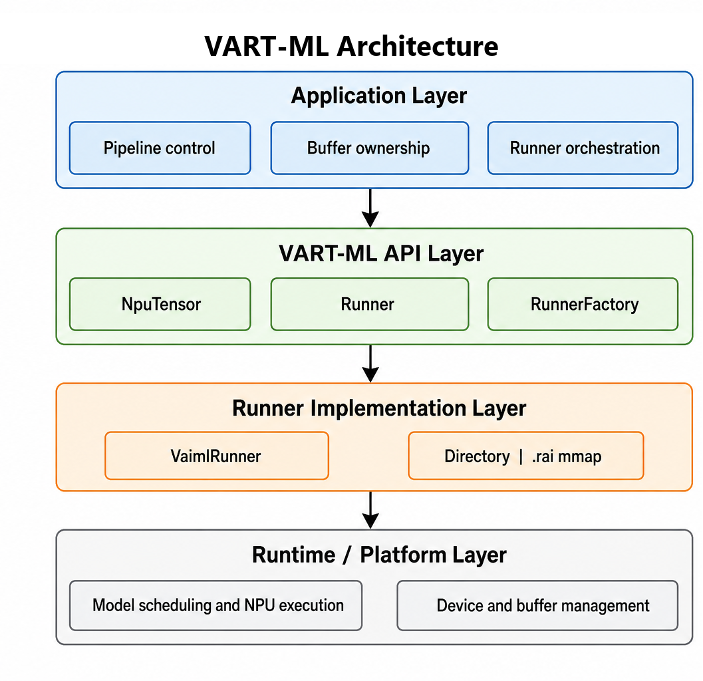
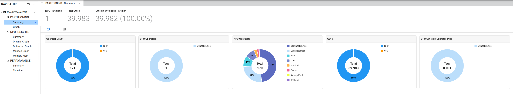
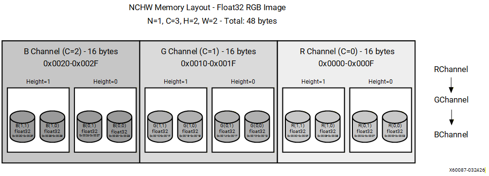
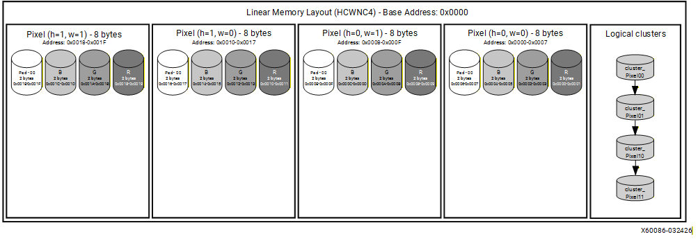
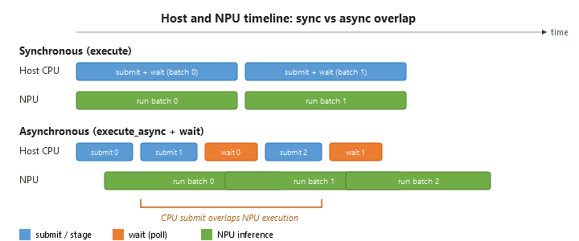

# AMD 软件专题 02C：Versal Gen2 编译器、张量边界与 VART 执行机制

本专题从 ONNX→VAIML 编译→.rai/目录→VART/ORT→前后处理的链条，分析编译器怎样分配 AIE、减少 DDR 搬运，以及应用必须兑现哪些张量和生命周期条件。范围为 Vitis AI Gen2 6.3 公开指南；不把 Gen1 DPU/.xmodel、Ryzen VAI EP、服务器 GPU runtime 混为同一 ABI。没有在 VEK385 上实测。[S01 Vitis AI Gen2 6.3 release notes](https://vitisai.docs.amd.com/projects/gen2/en/latest/docs/release_notes/release_notes_section.html)

## 1. 编译与运行对象：一条模型链有两种部署路线

在 host 容器内创建带 VitisAIExecutionProvider 的 ORT session，会按 JSON device/target/pass 编译。device 必须是目标芯片，例如 ve2-xc2ve3858；target VAIML 是编译路线而非 exact SKU。ORT 是这里的编译入口，不等于目标板应用必须依赖 ORT。[S02 Gen2 ONNX离线编译](https://vitisai.docs.amd.com/projects/gen2/en/latest/docs/model_compilation/compiling.html) [S03 AMD_VAI_EP_Config](https://vitisai.docs.amd.com/projects/gen2/en/latest/docs/model_compilation/ep-config-file.html)

| 部署路线 | 编译配置/产物 | CPU 执行范围 | 工程取舍 |
|---|---|---|---|
| ORT + VAI EP | standard passes；源 ONNX、配置、匹配 cache | ORT 提供广泛 CPU operators | 框架接入方便，需测边界转换 |
| VART-ML 全 NPU | standard passes；.rai 或完整目录 | 不提供该配置下的 CPU fallback | 较直接的设备/内存控制，unsupported会报错 |
| VART-ML CPU partition | 增加 CPU/connectivity/cache passes | 编译器明确支持的 CPU operator集合 | 减少 ORT 依赖，不能执行任意 ONNX CPU算子 |

依据：[S04 Gen2编译期CPU分区](https://vitisai.docs.amd.com/projects/gen2/en/latest/docs/model_compilation/cpu_partition.html) [S05 Gen2 ORT/VART ML执行选择](https://vitisai.docs.amd.com/projects/gen2/en/latest/docs/model_deployment/model-inference.html)。CPU-partition 产物不受 ORT 支持；不能临时换 runtime 解决模型错误。fallback 在这些描述中是图映射方式，不是设备故障后的机器人功能安全接管。

**图1，原站：** [S06 Gen2 VART ML张量/所有权/线程模型](https://vitisai.docs.amd.com/projects/gen2/en/latest/docs/appendix/ml-architecture-overview.html)。图把 pipeline control、buffer ownership、runner orchestration 放在应用层；API 层包含 NpuTensor、Runner、RunnerFactory。.rai mmap 是模型加载机制，不证明采集到推理的数据路径已零拷贝。

## 2. 编译 pass 的职责与 offload 阈值

CPU-partition 顺序为 init→vaiml_partition→vaiml_cpu_partition→vaiml_connectivity→vaiml_create_cache。init 验证环境/模型，主分区识别 NPU 子图，CPU pass 承接受支持的剩余算子，connectivity 连接跨分区张量，cache pass 产出可执行档案。pass 在定义数组和 targets 执行序列均需一致，缺任一环不能靠 runtime自动补出数据流。[S04 Gen2编译期CPU分区](https://vitisai.docs.amd.com/projects/gen2/en/latest/docs/model_compilation/cpu_partition.html)

threshold_gops_percent 默认2，影响小子图是否 offload。配置页把 GOPS 展开成“每秒”，但输出页明确它是子图占模型 GOP 运算量的百分比：本研究采用输出/summary 的计算量定义，不把阈值解释为现场 measured TOPS。支持算子数、支持 GOP、实际 offload 数和 offload GOP 都是不同字段；编译失败、小于阈值或子图数上限可让本来支持的算子回 CPU。[S03 AMD_VAI_EP_Config](https://vitisai.docs.amd.com/projects/gen2/en/latest/docs/model_compilation/ep-config-file.html) [S07 Gen2 .rai/cache与编译报告](https://vitisai.docs.amd.com/projects/gen2/en/latest/docs/model_compilation/output.html)

**图2，原站：** [S08 AMD_VAI_Partition_Analyzer](https://vitisai.docs.amd.com/projects/gen2/en/latest/docs/ai_analyzer/partitioning.html)。截图171个算子，其中1个 CPU；GOP 显示39.983总量、39.982 offload，舍入为100.00%。这是界面示例，仍有 CPU 算子，不是100% runtime时间在NPU。截图无完整模型/功耗/采样条件，不能作为本体性能结果。

**分析：**将每个候选子图的计算时间与 layout、dtype、DMA、同步成本一起评估；降低阈值可增加 offload，但也可能制造更多小分区。运算量少的动态后处理可能在 CPU 占较长时间。实际优化应观察“CPU Because”、边界张量字节和时间线，不能只追求 offload百分比。

## 3. AIE 存储层级、kernel chaining 与并行资源

优化级1偏稳定/固定或ping-pong buffer；级2增加 chaining 和 L2 memory tile 分配，L2不够退到 DDR；级3更激进，但文档明确 Early Access。chaining 将操作连接起来，减少中间结果往返外存，优势来自数据驻留，条件是容量、依赖及算子组合允许。文档并未提供每个模型的缓存命中/时延保证。[S03 AMD_VAI_EP_Config](https://vitisai.docs.amd.com/projects/gen2/en/latest/docs/model_compilation/ep-config-file.html)

**分析下界：**理想执行时间不小于 `max(运算量/有效计算率, 外存字节/有效带宽)`，另外还有不可重叠开销。融合可能减少外存字节，却增加活跃工作集；更高优化级不保证高并发下 P99 更低。编译 summary 示例的415.2秒属于 wall-clock编译时间，含 FE、BE/AIE compile及overhead，不是模型 inference latency，示例 MyModel 也没有真实任务定义。[S07 Gen2 .rai/cache与编译报告](https://vitisai.docs.amd.com/projects/gen2/en/latest/docs/model_compilation/output.html)

DP 复制整个模型处理不同输入，各副本按层 lockstep，并可共享权重 DMA 通道；TP 将一次请求拆到多个 compute block。每个4×4 block为16 AIE tiles（相关3558/3858配置），总占用按 `dp_size×tp_size×16` 估算并受设备/overlay约束。**这与GPU多卡TP、vLLM KV复制的资源对象不同。**[S09 Gen2 DP/TP与资源配置](https://vitisai.docs.amd.com/projects/gen2/en/latest/docs/model_compilation/multi-tenancy-user-guide.html)

| 配置/目标 | 并行意义 | 优势条件与失效情况 |
|---|---|---|
| DP>1 | 单模型多个请求，层级同步 | 多路吞吐；锁步可能集中DDR峰值，或等慢输入 |
| TP>1 | 一次请求跨多个block协作 | 低请求时延/单block容量不足；跨块调度有代价 |
| 多个DP=1实例 | 由独立host线程/实例驱动 | 访存相位错开可能平滑带宽；OS错峰不是确定性保证 |
| tp_size=0 | 编译器按目标/overlay选择 | 3858文档默认解析为6；看日志，不能假定总是占满9块 |

依据：[S09 Gen2 DP/TP与资源配置](https://vitisai.docs.amd.com/projects/gen2/en/latest/docs/model_compilation/multi-tenancy-user-guide.html) [S03 AMD_VAI_EP_Config](https://vitisai.docs.amd.com/projects/gen2/en/latest/docs/model_compilation/ep-config-file.html)。文档既列3858最高9块配置，又推荐6块默认/目标方案，保留差异并按具体overlay/编译日志核实。多个模型空间/时间共享仍要核对 placement、共享列和context-switch；DP大小本身不是隔离策略。

静态batch>1支持有限，上限6；override_batch_size 将其按batch1编译，runtime可串行处理外层batch。另设DP才可能并行，故“输入batch4”不等于4路同时完成。VART get_batch_size 表示外层vector的槽位数，每个HW tensor buffer中N=1，不能自行合并为一个N=4内存块。[S03 AMD_VAI_EP_Config](https://vitisai.docs.amd.com/projects/gen2/en/latest/docs/model_compilation/ep-config-file.html) [S10 Gen2 VART应用开发与零拷贝](https://vitisai.docs.amd.com/projects/gen2/en/latest/docs/appendix/vart_app_guide.html)

## 4. 张量布局：逻辑 shape 到物理地址

NCHW以通道平面存储，NHWC把同一像素的通道放在一起。HCWNCx将通道分成x=4/8块：物理shape为 `[H,ceil(C/x),W,N,x]`，补齐最后通道块。这不是只改shape标签的reshape，数据排列和padding都需要真实变换。[S11 AMD_VAI_Tensor_Formats](https://vitisai.docs.amd.com/projects/gen2/en/latest/docs/misc/tensor_formats.html)

**图3/4，原站：** [S11 AMD_VAI_Tensor_Formats](https://vitisai.docs.amd.com/projects/gen2/en/latest/docs/misc/tensor_formats.html)。图3标FP32、2×2 RGB共48bytes；图4文件名含float32，但图内每通道标bf16、2bytes、每像素8bytes，**不能将两图字节差额全归因布局**。两图仅说明平面/通道块以及padding的组织，dtype必须读图内标签和实际模型metadata。

**分析地址式**，对标准HCWNCx连续布局：`offset = ((((h*ceil(C/x)+floor(c/x))*W+w)*N+n)*x+c%x)`，再乘元素字节数；实际 NpuTensorInfo 的 strides/size 优先。RGB的C=3补到4，若dtype相同，元素存储膨胀为4/3；这不含stride对齐或额外buffer，不能推成整模型内存增长33%。

flexmlrt-hsi.json 保存cpu_shape/dtype/format、hw_shape/dtype/format及转换。use-hsi-json-file只是 best-effort 请求，须与编译后报告比对。更关键的是 rt_transformations：存在时接管该张量转换链，format字符串不再决定实际packing，示例hw_format可能仍写NCHW而hw_shape已是HCWNC8。输入quantize必须在前，输出dequantize在后；pad/reshape/transpose/slice共同决定实际数据流。[S11 AMD_VAI_Tensor_Formats](https://vitisai.docs.amd.com/projects/gen2/en/latest/docs/misc/tensor_formats.html)

因此不能根据CNN/Transformer名称猜layout；应用要保留转换链、scale、padding、stride和memory bank。没有逐项核验就把DMA-FD接上，可能获得“快而错误”的推理结果。

## 5. 量化参数必须贯穿编译和前后处理

默认编译产物未嵌入每tensor的scale/zero-point，get_quant_parameters可能返回默认值。ORT+EP从源ONNX取参数，VART路径则要在编译时启 `edge-quantization-in-rt=1` 与 `SkipDequantizeRemoval`，或手动从源图传入。两项必须在编译时生效，不能给已有.rai补runtime开关假装修复。[S12 AMD_VAI_Quant_Pipeline](https://vitisai.docs.amd.com/projects/gen2/en/latest/docs/appendix/vart_quantization_pipeline.html)

VART-X preprocess quant-scale-factor采用输入scale的倒数；postprocess quant-scale-factors按输出tensor顺序排列；手动JSON可覆盖runner值。输入乘 `1/s` 与输出乘 `s` 要分清，zero-point也不能漏。混合dtype另看HSI，默认HW buffer可能要求BF16而非原FP32。VitisAI6.3量化绑定Quark0.12的VINT8和Int32Bias=False等配置，不应照搬Ryzen A8W8的INT32bias设置。[S12 AMD_VAI_Quant_Pipeline](https://vitisai.docs.amd.com/projects/gen2/en/latest/docs/appendix/vart_quantization_pipeline.html) [S13 Gen2 VINT8/BF16量化配置](https://vitisai.docs.amd.com/projects/gen2/en/latest/docs/model_quantization/model_quantization.html)

本次仅核查配置与机制，未测量化收益。官方输出评估工具的SSIM路径要求最多二维数组；多通道空间输出应逐二维plane保存，不能为通过工具随意flatten而改变SSIM的含义。

## 6. 零拷贝的两个条件与内存生命周期

RunnerFactory创建Runner，get_tensors_info区分CPU/HW view；HW为NPU原生格式，无内部转换；CPU为标准模型格式，Runner内部copy/convert。输入输出可分别选，per-tensor覆盖用于CPU-only边界：CPU子图端口不存在HW view，强行全局HW会让create_runner失败。[S10 Gen2 VART应用开发与零拷贝](https://vitisai.docs.amd.com/projects/gen2/en/latest/docs/appendix/vart_app_guide.html)

| 缓冲组合 | API路径/行为 | 必须兑现的条件 |
|---|---|---|
| HW + XRT BO/DMA-FD/CMA | 可直接交给设备 | layout/dtype/stride匹配、可访问、生命周期/同步正确 |
| CPU + NONCMA | Runner复制/转换 | 指针及内容有效，计入copy成本 |
| HW + NONCMA | 构造时抛错 | 普通malloc不等设备可访问内存 |
| 用户包装NpuTensor | 不接管buffer所有权 | caller保留到tensor/job结束 |
| Runner分配/子tensor | RAII/共享父buffer | 子view offset/范围符合API，不能提前复用底层内容 |

依据：[S10 Gen2 VART应用开发与零拷贝](https://vitisai.docs.amd.com/projects/gen2/en/latest/docs/appendix/vart_app_guide.html)。Tensor Formats页开头承认CPU view自动转换，后文又笼统说VART不自动转换；本文以明确CPU/HW选项和应用API为准，后者仅用于默认HW路径。类似地，应用页“wait返回后safe reuse”的示例注释太宽：若返回JOB_PENDING仍未完成，不可释放或覆写buffer。

前处理VideoFrame若已为HW布局，可以export DMA-BUF再包装NpuTensor；否则map为CPU view触发copy。**分析：**零拷贝只消除这条边界的重复复制，不消除PL写DDR、NPU读DDR、layout计算及缓存同步；.rai mmap也属于模型加载，不能替代传感器buffer的可访问性证明。

## 7. 异步队列、状态与背压

execute阻塞当前线程；execute_async返回JobHandle；wait(handle,timeout)的JOB_PENDING表示仍运行，RESOURCE_UNAVAILABLE表示内部槽满；callback由内部worker线程调用。每个in-flight job要独立I/O buffer，只有真正完成后才能回收。不能在超时后直接借给下一帧；应用须定义停止提交、drain和错误处理，而本文未取得通用强制取消/复位保证。[S14 Gen2异步执行及样例边界](https://vitisai.docs.amd.com/projects/gen2/en/latest/docs/advanced_concepts/async_execution.html) [S10 Gen2 VART应用开发与零拷贝](https://vitisai.docs.amd.com/projects/gen2/en/latest/docs/appendix/vart_app_guide.html)

**图5，原站：** [S14 Gen2异步执行及样例边界](https://vitisai.docs.amd.com/projects/gen2/en/latest/docs/advanced_concepts/async_execution.html)。图没有数值刻度，只说明host staging/submit可与NPU重叠，不能估算固定倍数。vart_infer_async默认2个in-flight槽、只支持单输入，读取一个batch后重复提交；`-n 20`不是20张新相机帧，benchmark也不包括真实采集/输入更新。这类结果应与新帧pipeline的观测年龄、排队和P99分开。

## 8. Custom op：软件补算子需要同时实现搬运和计算

每个custom op包含YAML、AIE C++ kernel、Python tiler。kernel实现单核计算并接收lp_params；tiler通过TileBy及L3↔L2↔L1 transfers安排张量分块和数据运动，set_kernel_function_name必须匹配真实符号。仅写算术函数无法定义内存容量、边界块、通信和多核调度。[S15 AMD_VAI_Custom_Ops](https://vitisai.docs.amd.com/projects/gen2/en/latest/docs/additional_information/custom_ops/custom_ops_introduction.html)

注册有两步：compiler的custom_ops key为domain.op_type并指向YAML；ORT创建session前register_dynamic_custom_ops_to_onnxruntime声明domain/name/input/output schema。schema注册不实现CPU reference，也不证明AIE kernel正确。板端要保留修改后的ONNX、cache、配置、op目录、schema和reference inputs；相对路径必须匹配运行目录。[S16 AMD_VAI_Custom_Infer](https://vitisai.docs.amd.com/projects/gen2/en/latest/docs/additional_information/custom_ops/custom_ops_running_inference.html)

**分析验收：**测试边界shape、padding、dtype/scale、极值、各tile分块与多输入，分别对CPU reference、simulation和板端结果。官方把完整architecture/tiling reference放在发行容器中，本次未取得那些包内文件；不能宣称已完成所有kernel约束核验，AI辅助生成也不等数值或性能认证。

## 9. 性能验证、对标及生产边界

先用Analyzer定位算子/分区、AIE compute/IO bound和接口读写，再用DDRMC counters查物理DDR通道。Tcl流程先初始化、运行workload、在运行期间采样，生成DDR0…DDR4的CSV；接口流量与物理控制器流量是两种观测位置。官方CSV是示例且缺完整采样/单位条件，本文不从这些数值构造芯片带宽排名。[S17 AMD_VAI_DDR_Profiling](https://vitisai.docs.amd.com/projects/gen2/en/latest/docs/ai_analyzer/runtime_ddr_profiling_utility.html) [S03 AMD_VAI_EP_Config](https://vitisai.docs.amd.com/projects/gen2/en/latest/docs/model_compilation/ep-config-file.html)

与TensorRT比较，双方都有图优化、数值边界和目标产物；Versal进一步要求AIE/PL平台、tiler及HW布局契约，TensorRT插件/engine不能直接复用。是否有利取决于流式预处理、算子覆盖与整链DDR成本，没有同模型同功耗实测时只作机制比较。[S18 Compare_TRT_Builder](https://docs.nvidia.com/deeplearning/tensorrt/latest/architecture/how-trt-works.html) [S19 Compare_TRT_Quant](https://docs.nvidia.com/deeplearning/tensorrt/latest/inference-library/quantized-types-explicit-quantization.html)

复建应固定VitisAI6.3、Vivado/Vitis2026.1、Python3.12、PyTorch2.5.1、ONNX1.16.1、ORT1.28、Quark0.12、exact board revision/PDI/overlay与runtime；推荐opset20、21/22部分支持、>22不支持。VEK385 RevA/B用preproduction silicon，MIPI streaming reference的DisplayPort输出仅RevB；不能外推所有模组。编译需AIE-MLv2 license，构建reference需Vivado相应license；级3EA和硬件评估状态不能当量产放行。[S20 Gen2 6.3主机/软件/板级要求](https://vitisai.docs.amd.com/projects/gen2/en/latest/docs/setup_and_installation/system_requirements.html) [S21 Gen2 compiler/Vivado许可](https://vitisai.docs.amd.com/projects/gen2/en/latest/docs/additional_information/license.html) [S01 Vitis AI Gen2 6.3 release notes](https://vitisai.docs.amd.com/projects/gen2/en/latest/docs/release_notes/release_notes_section.html)

建议以标准ORT作为数值基线，再比较CPU/HW view、chaining、DP/TP与新帧异步，保存编译summary/HSI/scale、产物哈希、P50/P99/超时、DDR/功耗/热稳态以及真实任务结果。原模型、配置、板端固件、库和buffer契约应一同交付；本次未取得这些实机日志及完整包内许可，未开展模型/刷板/闭环测试。

## 参考资料与本地原件

下表S编号对应正文。原响应/哈希/采集时间和缺失依赖见metadata；partial_static保留可读正文，不保证动态交互/像素保真。既有2026-11-03 NVIDIA响应仅用于机制对标，其他材料采集于2026-11-04。

| 原站来源 | 日期/版本/使用条件 | 本地原件与metadata | 归档状态 |
|---|---|---|---|
| [S01 Vitis AI Gen2 6.3 release notes](https://vitisai.docs.amd.com/projects/gen2/en/latest/docs/release_notes/release_notes_section.html) | Gen2 6.3 public guide；Vivado/Vitis 2026.1；Rev-A/B评估硅片 | [HTML/PDF](REFERENCES.md#ref-8269bceb49539365) · [metadata](REFERENCES.md#ref-8269bceb49539365) | complete_static |
| [S02 Gen2 ONNX离线编译](https://vitisai.docs.amd.com/projects/gen2/en/latest/docs/model_compilation/compiling.html) | Gen2 6.3 public guide；Vivado/Vitis 2026.1；Rev-A/B评估硅片 | [HTML/PDF](REFERENCES.md#ref-34b3e81780846804) · [metadata](REFERENCES.md#ref-34b3e81780846804) | complete_static |
| [S03 AMD_VAI_EP_Config](https://vitisai.docs.amd.com/projects/gen2/en/latest/docs/model_compilation/ep-config-file.html) | VitisAI Gen2 6.3 public guide；目标/overlay/精度分别固定 | [HTML/PDF](REFERENCES.md#ref-a3cb640b1e9ddc41) · [metadata](REFERENCES.md#ref-a3cb640b1e9ddc41) | complete_static |
| [S04 Gen2编译期CPU分区](https://vitisai.docs.amd.com/projects/gen2/en/latest/docs/model_compilation/cpu_partition.html) | Gen2 6.3 public guide；Vivado/Vitis 2026.1；Rev-A/B评估硅片 | [HTML/PDF](REFERENCES.md#ref-5643d40f79a4557e) · [metadata](REFERENCES.md#ref-5643d40f79a4557e) | complete_static |
| [S05 Gen2 ORT/VART ML执行选择](https://vitisai.docs.amd.com/projects/gen2/en/latest/docs/model_deployment/model-inference.html) | Gen2 6.3 public guide；Vivado/Vitis 2026.1；Rev-A/B评估硅片 | [HTML/PDF](REFERENCES.md#ref-b20df62a639e21f9) · [metadata](REFERENCES.md#ref-b20df62a639e21f9) | complete_static |
| [S06 Gen2 VART ML张量/所有权/线程模型](https://vitisai.docs.amd.com/projects/gen2/en/latest/docs/appendix/ml-architecture-overview.html) | Gen2 6.3 public guide；Vivado/Vitis 2026.1；Rev-A/B评估硅片 | [HTML/PDF](REFERENCES.md#ref-b867b657782bdc40) · [metadata](REFERENCES.md#ref-b867b657782bdc40) | complete_static |
| [S07 Gen2 .rai/cache与编译报告](https://vitisai.docs.amd.com/projects/gen2/en/latest/docs/model_compilation/output.html) | Gen2 6.3 public guide；Vivado/Vitis 2026.1；Rev-A/B评估硅片 | [HTML/PDF](REFERENCES.md#ref-2c2e1405bc84b31f) · [metadata](REFERENCES.md#ref-2c2e1405bc84b31f) | complete_static |
| [S08 AMD_VAI_Partition_Analyzer](https://vitisai.docs.amd.com/projects/gen2/en/latest/docs/ai_analyzer/partitioning.html) | VitisAI Gen2 6.3 public guide；目标/overlay/精度分别固定 | [HTML/PDF](REFERENCES.md#ref-2e258ca85c504c08) · [metadata](REFERENCES.md#ref-2e258ca85c504c08) | complete_static |
| [S09 Gen2 DP/TP与资源配置](https://vitisai.docs.amd.com/projects/gen2/en/latest/docs/model_compilation/multi-tenancy-user-guide.html) | Gen2 6.3 public guide；Vivado/Vitis 2026.1；Rev-A/B评估硅片 | [HTML/PDF](REFERENCES.md#ref-02b353db51206eb3) · [metadata](REFERENCES.md#ref-02b353db51206eb3) | complete_static |
| [S10 Gen2 VART应用开发与零拷贝](https://vitisai.docs.amd.com/projects/gen2/en/latest/docs/appendix/vart_app_guide.html) | Gen2 6.3 public guide；Vivado/Vitis 2026.1；Rev-A/B评估硅片 | [HTML/PDF](REFERENCES.md#ref-ac4eac67a33411e1) · [metadata](REFERENCES.md#ref-ac4eac67a33411e1) | complete_static |
| [S11 AMD_VAI_Tensor_Formats](https://vitisai.docs.amd.com/projects/gen2/en/latest/docs/misc/tensor_formats.html) | VitisAI Gen2 6.3 public guide；目标/overlay/精度分别固定 | [HTML/PDF](REFERENCES.md#ref-aec125dfb6f54880) · [metadata](REFERENCES.md#ref-aec125dfb6f54880) | complete_static |
| [S12 AMD_VAI_Quant_Pipeline](https://vitisai.docs.amd.com/projects/gen2/en/latest/docs/appendix/vart_quantization_pipeline.html) | VitisAI Gen2 6.3 public guide；目标/overlay/精度分别固定 | [HTML/PDF](REFERENCES.md#ref-9e4369995e24c258) · [metadata](REFERENCES.md#ref-9e4369995e24c258) | complete_static |
| [S13 Gen2 VINT8/BF16量化配置](https://vitisai.docs.amd.com/projects/gen2/en/latest/docs/model_quantization/model_quantization.html) | Gen2 6.3 public guide；Vivado/Vitis 2026.1；Rev-A/B评估硅片 | [HTML/PDF](REFERENCES.md#ref-a5dd309344ebfb8d) · [metadata](REFERENCES.md#ref-a5dd309344ebfb8d) | complete_static |
| [S14 Gen2异步执行及样例边界](https://vitisai.docs.amd.com/projects/gen2/en/latest/docs/advanced_concepts/async_execution.html) | Gen2 6.3 public guide；Vivado/Vitis 2026.1；Rev-A/B评估硅片 | [HTML/PDF](REFERENCES.md#ref-a5b950f414554940) · [metadata](REFERENCES.md#ref-a5b950f414554940) | complete_static |
| [S15 AMD_VAI_Custom_Ops](https://vitisai.docs.amd.com/projects/gen2/en/latest/docs/additional_information/custom_ops/custom_ops_introduction.html) | VitisAI Gen2 6.3 public guide；目标/overlay/精度分别固定 | [HTML/PDF](REFERENCES.md#ref-1f320b36f994e3ae) · [metadata](REFERENCES.md#ref-1f320b36f994e3ae) | complete_static |
| [S16 AMD_VAI_Custom_Infer](https://vitisai.docs.amd.com/projects/gen2/en/latest/docs/additional_information/custom_ops/custom_ops_running_inference.html) | VitisAI Gen2 6.3 public guide；目标/overlay/精度分别固定 | [HTML/PDF](REFERENCES.md#ref-9345ee8f865efba4) · [metadata](REFERENCES.md#ref-9345ee8f865efba4) | complete_static |
| [S17 AMD_VAI_DDR_Profiling](https://vitisai.docs.amd.com/projects/gen2/en/latest/docs/ai_analyzer/runtime_ddr_profiling_utility.html) | VitisAI Gen2 6.3 public guide；目标/overlay/精度分别固定 | [HTML/PDF](REFERENCES.md#ref-df27e5b5edbcc8f3) · [metadata](REFERENCES.md#ref-df27e5b5edbcc8f3) | complete_static |
| [S18 Compare_TRT_Builder](https://docs.nvidia.com/deeplearning/tensorrt/latest/architecture/how-trt-works.html) | NVIDIA官方资料用于机制对标；导入2026-11-03已有原响应或本次取得，不套AMD目标 | [HTML/PDF](REFERENCES.md#ref-9df325c2c44e3de5) · [metadata](REFERENCES.md#ref-9df325c2c44e3de5) | complete_static |
| [S19 Compare_TRT_Quant](https://docs.nvidia.com/deeplearning/tensorrt/latest/inference-library/quantized-types-explicit-quantization.html) | NVIDIA官方资料用于机制对标；导入2026-11-03已有原响应或本次取得，不套AMD目标 | [HTML/PDF](REFERENCES.md#ref-f47c2746e3737567) · [metadata](REFERENCES.md#ref-f47c2746e3737567) | complete_static |
| [S20 Gen2 6.3主机/软件/板级要求](https://vitisai.docs.amd.com/projects/gen2/en/latest/docs/setup_and_installation/system_requirements.html) | Gen2 6.3 public guide；Vivado/Vitis 2026.1；Rev-A/B评估硅片 | [HTML/PDF](REFERENCES.md#ref-d237d68ec5e7cd91) · [metadata](REFERENCES.md#ref-d237d68ec5e7cd91) | complete_static |
| [S21 Gen2 compiler/Vivado许可](https://vitisai.docs.amd.com/projects/gen2/en/latest/docs/additional_information/license.html) | Gen2 6.3 public guide；Vivado/Vitis 2026.1；Rev-A/B评估硅片 | [HTML/PDF](REFERENCES.md#ref-dec853df79d7793c) · [metadata](REFERENCES.md#ref-dec853df79d7793c) | complete_static |

[主张、图源与人工核验记录](research_state/evidence/02C_Versal_Compiler_and_Runtime.json) · [完整引用及依赖清单](research_state/depth_02/02C_Versal_Compiler_and_Runtime_sources.json)。本专题未执行SDK安装、模型训练/推理、刷板或机器人闭环测试。
