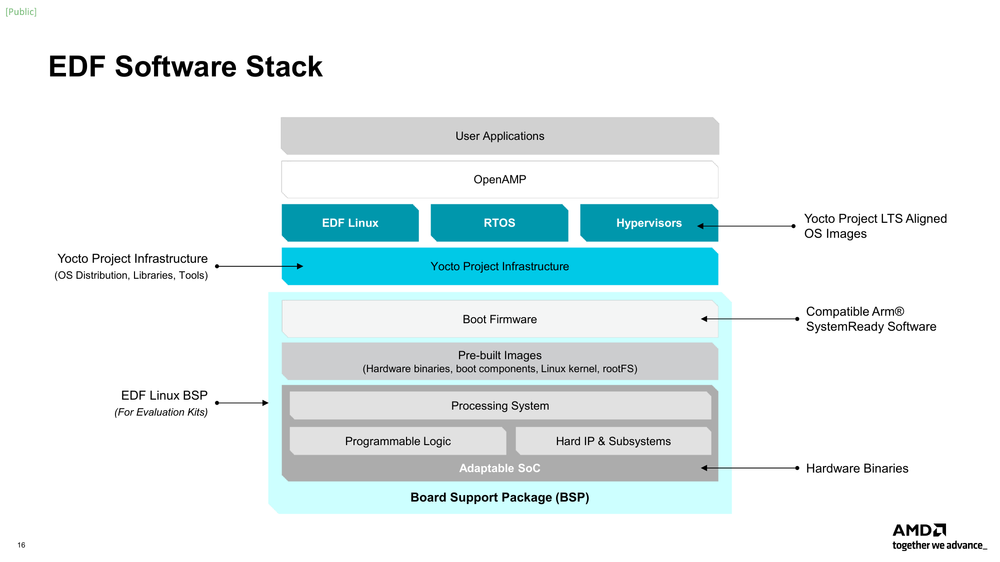
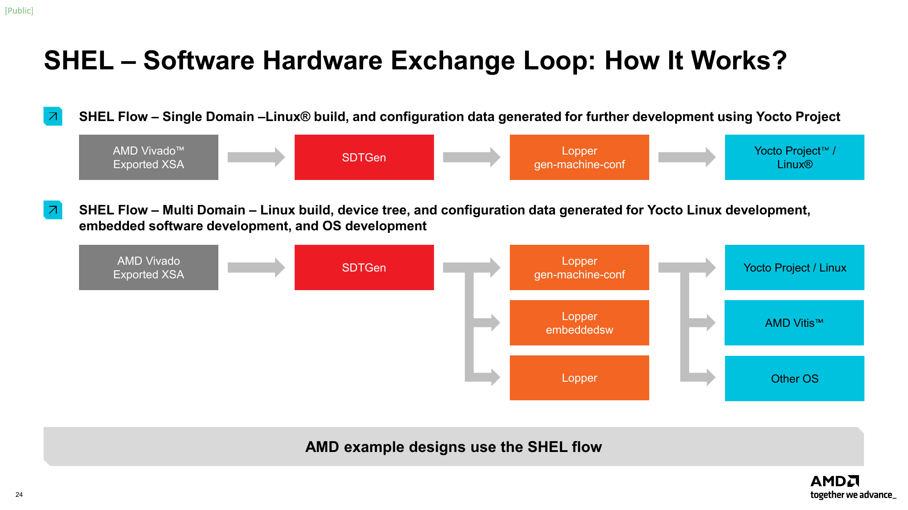
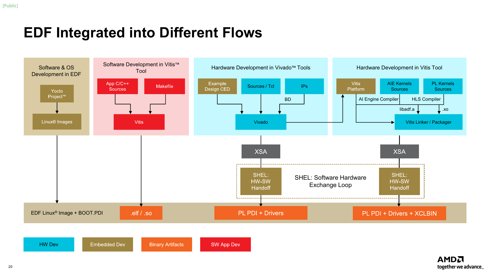

# AMD 软件专题 02D：EDF、SHEL、Yocto BSP 与多执行域的一致性交付

EDF 不只是一个 Linux 镜像，而是把硬件描述、系统软件构建和板端装载连接起来的参考开发框架。其价值在于可复建的软硬件交接；量产维护仍由产品团队或 OSV 承担。本文研究 26.06.1-rev3 文档快照：v26.06.1 仅重建部分 v26.06 产物，不能把网页版本当所有下载二进制的新版本。[S01 EDF v26.06.1产物/版本/主机要求](https://edf.docs.amd.com/en/latest/downloads-and-release-notes.html) [S02 EDF从原型到生产维护指南](https://edf.docs.amd.com/en/latest/moving-from-amd-software-stacks-to-production-deployment.html)

## 1. 先分清产物、构建环境和目标系统

EDF包含预构建boot firmware、common disk image、交叉SDK、Yocto layers及多域固件路径。common image面向CPU家族，要与board-specific boot firmware结合；custom board可复用构建流程，但不能保证评估板镜像直接启动。SDK能支持目标应用交叉编译，不自动包含载板自定义驱动和整套FPGA design。[S01 EDF v26.06.1产物/版本/主机要求](https://edf.docs.amd.com/en/latest/downloads-and-release-notes.html)

**图1，原站PDF第16页：** [S03 EDF产品概览PDF](https://www.amd.com/content/dam/amd/en/documents/products/software-tools/embedded-development-framework-product-overview.pdf)，September2025。用于说明Boot Firmware/Yocto/RTOS/OpenAMP的分层；“LTS Aligned”是上游基线关系，不能解释成AMD对产品提供长期维护或安全认证。当前责任边界以2026生产指南为准。

| 对象 | 输入/输出 | 负责的事情 | 不能代替 |
|---|---|---|---|
| Vivado/Vitis 平台 | XSA、PDI、XCLBIN等 | 硬件/IP/地址/时钟及加速器实现 | rootfs、长期更新服务 |
| SHEL | SDT+domain→machine/DTS | 软硬件资源描述转换 | 板上功能/时序验收 |
| Yocto/BitBake | layers/recipes→images/ELFs/SDK | 构建、依赖、打包 | runtime调度和现场运维 |
| EDF host build container | host工具环境 | 减少host包差异 | EDF源树或target OCI应用 |
| board image/runtime | boot、driver、固件、应用 | 实际装载执行 | 所有载板、硬实时和OTA保障 |

依据：[S04 AMD_EDF_Build_Container](https://edf.docs.amd.com/en/latest/osdev/build-edf-yocto-with-the-edf-build-container.html) [S05 XSA到SDT/Yocto machine流程](https://edf.docs.amd.com/en/latest/shel/using-the-shel-flow-to-create-a-yocto-project-machine-configuration-from-a-xsa-file.html) [S01 EDF v26.06.1产物/版本/主机要求](https://edf.docs.amd.com/en/latest/downloads-and-release-notes.html)。

## 2. SHEL：硬件描述如何进入 Linux 与 RTOS

路径是Vivado导出XSA→SDTGen生成System Device Tree→gen-machine-conf内部调用Lopper做转换→Yocto MACHINE/DTS→image。SDT描述整体芯片和资源，Linux DT是某OS的消费视图；不能把完整SDT直接当经典Linux DT。官方提供parse-sdt生成`conf/dts/<machine>/<cpu>-linux.dts`，适用于自己的构建系统，仍须验证driver binding和board-specific配置。[S05 XSA到SDT/Yocto machine流程](https://edf.docs.amd.com/en/latest/shel/using-the-shel-flow-to-create-a-yocto-project-machine-configuration-from-a-xsa-file.html) [S06 AMD_EDF_Device_Tree](https://edf.docs.amd.com/en/latest/shel/obtaining-linux-device-trees-from-the-shel-flow.html)

**图2，原站PDF第24页：** [S03 EDF产品概览PDF](https://www.amd.com/content/dam/amd/en/documents/products/software-tools/embedded-development-framework-product-overview.pdf)。旧图描述单域和多域数据交接；当前教程把Lopper包含在gen-machine-conf调用中，不是每次必须额外手动运行。图未证明所有OS/peripheral都已有驱动。

domain YAML把“硬件有什么”与“软件怎样分资源”分开。base定义处理器/OS，board overlay增加memory/console，OpenAMP/libmetal overlay定义IPC。--domain-file按序组合；**domain name是合并key**，APU_Linux若写成别名会产生另一个域而不是覆盖。每个域条目包括openamp,domain-v1，cpus/mask/mode、os,type、memory、access、reserved-memory等各司其职。[S07 EDF多domain/资源/通信YAML](https://edf.docs.amd.com/en/latest/osdev/domain-yaml-integration-and-development.html)

**分析：**这样可在不改硬件设计的前提下调整CMA或RPU firmware区域，但前提是实际硬件地址/设备归属支持该划分。YAML模板的cpumask与family表不等于全部SKU的CPU数量，本文不据此改写01的硬件规格；生成的DT和目标芯片仍需核对。

## 3. 多域内存与IPC：不能只说“Linux加RTOS”

OpenAMP overlay把Linux remoteproc固件装载与RPMsg通信关系描述到shared carveouts/mailbox/timer；libmetal overlay为裸机域提供低层共享memory/descriptor、UIO和IPI。TCM/SRAM用于实时处理器工作集，DDR区域可用于ELF、resource table、vrings和payload。reserved-memory/no-map避免Linux一般分配使用特定区，CMA则提供DMA连续分配，两者不能互相当同义词。[S07 EDF多domain/资源/通信YAML](https://edf.docs.amd.com/en/latest/osdev/domain-yaml-integration-and-development.html)

| 域间资源 | 文档的Gen2 2VE/2VM示例 | 用途和限制 |
|---|---|---|
| rsctbl/ddrboot | 256B resource table、384KB DDR boot region | 固件装载关系；不是ELF文件体积上限的简单等式 |
| vdev0vring0/1 | 每个16KB | 两方向descriptor/control结构；不是payload容量 |
| vdev0buffer | 256KB；其他family可到1MB | RPMsg payload shared buffer；不推出无拷贝大图像吞吐 |
| R52 core0 TCM | ATCM64KB/BTCM32KB/CTCM32KB模板 | 与实际linker、domain、工作集匹配 |
| libmetal域 | ELF384KB、双descriptor16KB、data256KB | 另一域的UIO/共享内存路径；非所有域共用 |

来源：[S07 EDF多domain/资源/通信YAML](https://edf.docs.amd.com/en/latest/osdev/domain-yaml-integration-and-development.html)。这些是指定overlay示例，不是任意Versal/Ryzen设备均具有的通道布局。起始地址、容量、方向、IPI名字和ELF linker placement必须一同交接；不仅检查“总RAM够不够”。

**机制分析：**典型共享内存发布顺序需要producer写payload→按内存属性做必要cache clean/ordering→发布descriptor→通知consumer；consumer收到通知→必要invalidate/acquire→读取有效数据→归还buffer。本文未取得每个目标的cache属性和fence实现，不能把这一分析序列当所有OpenAMP驱动的现成API。共享DRAM、UIO、消息抵达分别不证明缓存一致性和数据ownership。应从绑定驱动/固件实现核验memory mapping、cache maintenance、ring索引/溢出、通知丢失和重启后的旧descriptor处理。

对机器人，RPU适合承接周期任务/状态校验等独立职责，但Linux命令到RPU仍有IPC、调度和共享DDR干扰。给RPU保留内存不等于提供WCET、故障隔离或功能安全认证；须进一步核查实际访问控制、DMA权限、共享外设和超时响应。

## 4. Yocto 多配置如何把固件加入 rootfs

产品推荐选board-specific MACHINE一次bitbake构建：IMAGE_INSTALL引入Linux-side包装recipe→FW_MCDEPENDS指向RPU multiconfig的do_deploy→固件构建部署→包装recipe的do_install复制到rootfs→edf-platform-disk-image组装WIC。它使Linux和RPU产物在同一依赖图中构建，减少手动copy造成版本漂移。[S08 AMD_EDF_Custom_Firmware](https://edf.docs.amd.com/en/latest/osdev/installing-custom-firmware-into-edf-yocto-linux-images.html)

VEK385 RevB示例使用 `versal-2ve-2vm-vek385-revb-multidomain`，openamp-zephyr-demo依赖cortexr52-0-zephyr；同板-sdt-seg只有另一组multiconfig，可能因缺BBMULTICONFIG触发SkipRecipe，最后找不到ELF。Gen1/Kria的FreeRTOS路径用openamp-fw.inc、BBCLASSEXTEND生成baremetal/freertos variant，不可把R52例子的目标名照搬R5。[S08 AMD_EDF_Custom_Firmware](https://edf.docs.amd.com/en/latest/osdev/installing-custom-firmware-into-edf-yocto-linux-images.html)

验证要查看rootfs tarball中的实际 `/lib/firmware/xilinx/<board>/rpu/0/*.elf` 与板端加载名，而不只看bitbake整体exit code。官方指出common-MACHINE rootfs和board firmware分开的方式主要用于发布demo/评估；产品确需此结构时要先构建per-board固件包，再作为recipe纳入common rootfs。直接拷贝到运行板的修改在重新刷镜像后丢失，适合开发迭代，不能作为交付记录。

## 5. remoteproc/RPMsg 的真实装载与验收路径

新归档的Gen2 Zephyr/Gen1 FreeRTOS官方demo进一步给出：先查remoteproc设备→dfx-mgr-client -listPackage/-filter识别本板固件→按-loadByName加载→dmesg确认remote processor up→测RPMsg→-unloadByName→确认stopped。旧-load参数要求numeric ID，名字要用-loadByName。-filter依EEPROM识别，在Kria识别SoM前缀而非载板，不能因此证明任意carrier兼容。[S09 AMD_EDF_OpenAMP_Zephyr](https://edf.docs.amd.com/en/latest/discovery/openamp-rpu-firmware-demo-zephyr.html) [S10 AMD_EDF_OpenAMP_FreeRTOS](https://edf.docs.amd.com/en/latest/discovery/openamp-rpu-firmware-demo-freertos.html)

| 官方实例 | 执行接口 | 可确认什么 | 尚不能确认什么 |
|---|---|---|---|
| VEK385 Zephyr | RPMsg-backed `/dev/ttyRPMSG0`，echo文本 | Linux/R52通信和固件装载演示 | 新图像流的延迟/P99、实时控制 |
| VEK280 FreeRTOS echo | echo_test绑定rpmsg_chrdev并创建endpoint | 各payload send/receive演示 | 总线伺服周期、最坏延迟 |
| Kria family | 相应k26/k24 RPU firmware前缀 | 当前参考路径的family适配 | 新Kria AI平台suite版本/载板验收 |

依据同上；FreeRTOS日志包含10.6.1、OpenAMP1.9.0、libmetal1.9.1，是该示例transcript的组合，不是所有EDF组件的通用最新版本。echo_test持续运行，Ctrl-C只停止Linux测试程序；随后unload才停止RPU。**分析：**产品应分别定义host断链、RPU任务仍运行、输出保持、设备复位后的行为，不能把“上层进程退出”当执行器已停机。

## 6. Segmented configuration 与 DFX 的设备树一致性

Module由硬件binary及可被软件理解的DT组成。segmented在先启动基础系统后加载其余硬件；DFX涉及可替换区域。SDTGen的pl.dtsi要与postboot module对应，从基础system-top.dtsi移除，转换为overlay并编译，配对Versal PDI或ZynqMP binary。仅在DFX路径要求shell.json；不能把所有segmented包都说成必须有它。[S11 Segmented configuration与DFX区别](https://edf.docs.amd.com/en/latest/seg/segmented-configuration-or-dynamic-function-exchange.html) [S12 EDF segmented PL装载与firmware](https://edf.docs.amd.com/en/latest/seg/amd-edf-segmented-configuration-using-amd-yocto-project-recipes.html)

**图3，原站PDF第20页：** [S03 EDF产品概览PDF](https://www.amd.com/content/dam/amd/en/documents/products/software-tools/embedded-development-framework-product-overview.pdf)。图将Linux/BOOT.PDI、应用ELF/SO、PL PDI+driver、PL PDI+driver+XCLBIN区分；它说明交付集合，不能证明这些产物跨版本自由组合。

**分析装载契约：**PDI/DTBO/driver/用户API共享的地址、IRQ、clock/reset和DMA接口应来自同一硬件构建；错误DT可能访问不存在的寄存器，错误buffer映射可能导致数据损坏。卸载前停止新提交、完成/终止在途DMA、释放设备使用者，重新装载后重新发现接口。官方通用页要求避免crash/undefined behavior，本文未取得所有IP的quiesce/reset实现和通用无中断热换保证；这些动作是验收设计，不能声称EDF自动替所有应用完成。

## 7. 可复建源树、host容器和缓存

host容器 `xilinx/edf:ubuntu2204-26.06`提供工具包，**不含EDF源树**；工作空间、downloads和sstate须host挂载。target侧hello-world/GMIO container是另一类tag。固定release tag比latest好，但要达到更强复现仍记录image digest、source manifest/commit、layers和配置。Dockerfile/build pipeline暂未公开是文档明确的缺口，本次未取得container本体，不宣称已验证环境逐包一致。[S04 AMD_EDF_Build_Container](https://edf.docs.amd.com/en/latest/osdev/build-edf-yocto-with-the-edf-build-container.html)

在user layer用.bbappend覆盖SRC_URI/SRCREV，不直接改AMD layer。SRCREV固定完整40位commit；AUTOREV跟分支头不适合release复建。externalsrc便于本地修改、绕过fetch/unpack，但削弱source signature/sstate检测；release应回到固定source/commit重新构建。不能用“用了Docker+cache”替代源内容可追溯性。[S13 AMD_EDF_Components](https://edf.docs.amd.com/en/latest/yocto/building-components-from-source.html)

**交付建议：**保存XSA/SDT/domain YAML、生成DTS/machine、repo manifest及各SHA、recipe overrides、构建容器digest、kernel/config/modules、PDI/DTBO/ELF、rootfs/SDK、source/license manifest和功能测试。CMA与RPU carveout调整后至少检查地址范围不重叠、driver配置可用、固件实际linker落区和IPC重启状态；本次只完成资料核验。

## 8. 更新、维护与竞品机制对标

EDF release页的board-specific OSPI boot firmware包含recovery loader和A/B update mechanism，但生产指南同时明确没有维护的update feed、SLA更新和完整产品安全机制。二者不矛盾：**boot分区恢复机制不是整套rootfs/应用/模型/密钥生命周期服务**。本次未取得该A/B机制对所有板/断电/回滚的完整测试。[S01 EDF v26.06.1产物/版本/主机要求](https://edf.docs.amd.com/en/latest/downloads-and-release-notes.html) [S02 EDF从原型到生产维护指南](https://edf.docs.amd.com/en/latest/moving-from-amd-software-stacks-to-production-deployment.html)

NVIDIA Jetson OTA同样需要BSP版本、partition layout、目标板和更新工具约束，不能把镜像可刷写视为所有应用一致性和恢复问题已解决。Versal另有PL hardware description和RPU固件耦合，变更集合更多；这种机制差异不能直接推成某一方运维成本排名。[S14 Compare_Jetson_OTA](https://docs.nvidia.com/jetson/archives/r39.2.1/DeveloperGuide/SD/SoftwarePackagesAndTheUpdateMechanism.html)

AMD生产指南明确其不是OSV，硬件生命周期不等软件支持期；用户需自维护或与商业OSV订合同。kernel LTS baseline、仓库名字带LTS、半年度更新都不能当本产品漏洞响应SLA。许可也分kernel/bootloader/RTOS/layers、工具/IP、binary和应用；release页列source/license tarball，但本次未下载数GB包，不宣称逐文件许可齐备或安全boot已配置。[S02 EDF从原型到生产维护指南](https://edf.docs.amd.com/en/latest/moving-from-amd-software-stacks-to-production-deployment.html) [S01 EDF v26.06.1产物/版本/主机要求](https://edf.docs.amd.com/en/latest/downloads-and-release-notes.html)

可复建验证计划包括：生成Linux/RPU双域DT并静态查区域；构建rootfs验证ELF路径；按官方demo核验装载/通信/停止；再测真实payload的往返、排队、超时和重启；最后在并发DMA/热稳定下测周期任务与动作输出。QEMU有助验证启动/配置，不能证明真实DDR/中断/板载I/O时序。未完成这些实机证据之前，EDF应定位为开发底座，而非已验证的机器人量产控制平台。

## 参考资料与本地原件

下表S编号对应正文。原响应/哈希/采集时间和缺失依赖见metadata；partial_static保留可读正文，不保证动态交互/像素保真。既有2026-11-03 NVIDIA响应仅用于机制对标，其他材料采集于2026-11-04。

| 原站来源 | 日期/版本/使用条件 | 本地原件与metadata | 归档状态 |
|---|---|---|---|
| [S01 EDF v26.06.1产物/版本/主机要求](https://edf.docs.amd.com/en/latest/downloads-and-release-notes.html) | EDF 26.06.1-rev3文档快照；release v26.06.1仅部分重建 | [HTML/PDF](REFERENCES.md#ref-805718888ba875b0) · [metadata](REFERENCES.md#ref-805718888ba875b0) | complete_static |
| [S02 EDF从原型到生产维护指南](https://edf.docs.amd.com/en/latest/moving-from-amd-software-stacks-to-production-deployment.html) | EDF 26.06.1-rev3文档快照；release v26.06.1仅部分重建 | [HTML/PDF](REFERENCES.md#ref-c93d09e25f993c7a) · [metadata](REFERENCES.md#ref-c93d09e25f993c7a) | complete_static |
| [S03 EDF产品概览PDF](https://www.amd.com/content/dam/amd/en/documents/products/software-tools/embedded-development-framework-product-overview.pdf) | Sept 2025；28页；方法图，不作为2026支持矩阵 | [HTML/PDF](REFERENCES.md#ref-a24a3e9e38348fb8) · [metadata](REFERENCES.md#ref-a24a3e9e38348fb8) | complete_static |
| [S04 AMD_EDF_Build_Container](https://edf.docs.amd.com/en/latest/osdev/build-edf-yocto-with-the-edf-build-container.html) | EDF26.06.1-rev3文档，评估参考发行，非OSV长期支持 | [HTML/PDF](REFERENCES.md#ref-7ee2d31bb6fbf324) · [metadata](REFERENCES.md#ref-7ee2d31bb6fbf324) | complete_static |
| [S05 XSA到SDT/Yocto machine流程](https://edf.docs.amd.com/en/latest/shel/using-the-shel-flow-to-create-a-yocto-project-machine-configuration-from-a-xsa-file.html) | EDF 26.06.1-rev3文档快照；release v26.06.1仅部分重建 | [HTML/PDF](REFERENCES.md#ref-d5517b0dc3c293f5) · [metadata](REFERENCES.md#ref-d5517b0dc3c293f5) | complete_static |
| [S06 AMD_EDF_Device_Tree](https://edf.docs.amd.com/en/latest/shel/obtaining-linux-device-trees-from-the-shel-flow.html) | EDF26.06.1-rev3文档，评估参考发行，非OSV长期支持 | [HTML/PDF](REFERENCES.md#ref-f34089a4561d5a26) · [metadata](REFERENCES.md#ref-f34089a4561d5a26) | complete_static |
| [S07 EDF多domain/资源/通信YAML](https://edf.docs.amd.com/en/latest/osdev/domain-yaml-integration-and-development.html) | EDF 26.06.1-rev3文档快照；release v26.06.1仅部分重建 | [HTML/PDF](REFERENCES.md#ref-3e5c09c7147686e3) · [metadata](REFERENCES.md#ref-3e5c09c7147686e3) | complete_static |
| [S08 AMD_EDF_Custom_Firmware](https://edf.docs.amd.com/en/latest/osdev/installing-custom-firmware-into-edf-yocto-linux-images.html) | EDF26.06.1-rev3文档，评估参考发行，非OSV长期支持 | [HTML/PDF](REFERENCES.md#ref-eed7f08a79341840) · [metadata](REFERENCES.md#ref-eed7f08a79341840) | complete_static |
| [S09 AMD_EDF_OpenAMP_Zephyr](https://edf.docs.amd.com/en/latest/discovery/openamp-rpu-firmware-demo-zephyr.html) | EDF26.06.1-rev3文档，评估参考发行，非OSV长期支持 | [HTML/PDF](REFERENCES.md#ref-0b63b8042e4931e0) · [metadata](REFERENCES.md#ref-0b63b8042e4931e0) | complete_static |
| [S10 AMD_EDF_OpenAMP_FreeRTOS](https://edf.docs.amd.com/en/latest/discovery/openamp-rpu-firmware-demo-freertos.html) | EDF26.06.1-rev3文档，评估参考发行，非OSV长期支持 | [HTML/PDF](REFERENCES.md#ref-b61916dd92184f89) · [metadata](REFERENCES.md#ref-b61916dd92184f89) | complete_static |
| [S11 Segmented configuration与DFX区别](https://edf.docs.amd.com/en/latest/seg/segmented-configuration-or-dynamic-function-exchange.html) | EDF 26.06.1-rev3文档快照；release v26.06.1仅部分重建 | [HTML/PDF](REFERENCES.md#ref-6266e36b64ca923a) · [metadata](REFERENCES.md#ref-6266e36b64ca923a) | complete_static |
| [S12 EDF segmented PL装载与firmware](https://edf.docs.amd.com/en/latest/seg/amd-edf-segmented-configuration-using-amd-yocto-project-recipes.html) | EDF 26.06.1-rev3文档快照；release v26.06.1仅部分重建 | [HTML/PDF](REFERENCES.md#ref-66ccb32d4be9da76) · [metadata](REFERENCES.md#ref-66ccb32d4be9da76) | complete_static |
| [S13 AMD_EDF_Components](https://edf.docs.amd.com/en/latest/yocto/building-components-from-source.html) | EDF26.06.1-rev3文档，评估参考发行，非OSV长期支持 | [HTML/PDF](REFERENCES.md#ref-85042ad719751d8d) · [metadata](REFERENCES.md#ref-85042ad719751d8d) | complete_static |
| [S14 Compare_Jetson_OTA](https://docs.nvidia.com/jetson/archives/r39.2.1/DeveloperGuide/SD/SoftwarePackagesAndTheUpdateMechanism.html) | NVIDIA官方资料用于机制对标；导入2026-11-03已有原响应或本次取得，不套AMD目标 | [HTML/PDF](REFERENCES.md#ref-fe91dd3e519be888) · [metadata](REFERENCES.md#ref-fe91dd3e519be888) | complete_static |

[主张、图源与人工核验记录](research_state/evidence/02D_EDF_BSP_and_Execution_Domains.json) · [完整引用及依赖清单](research_state/depth_02/02D_EDF_BSP_and_Execution_Domains_sources.json)。本专题未执行SDK安装、模型训练/推理、刷板或机器人闭环测试。
