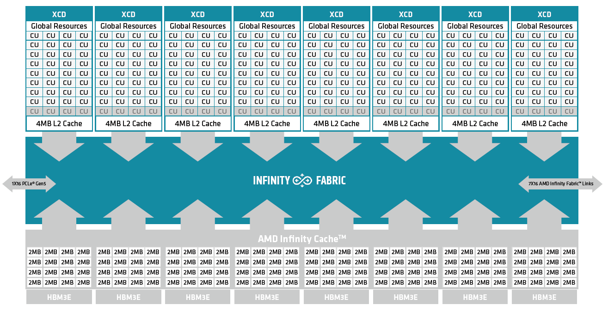
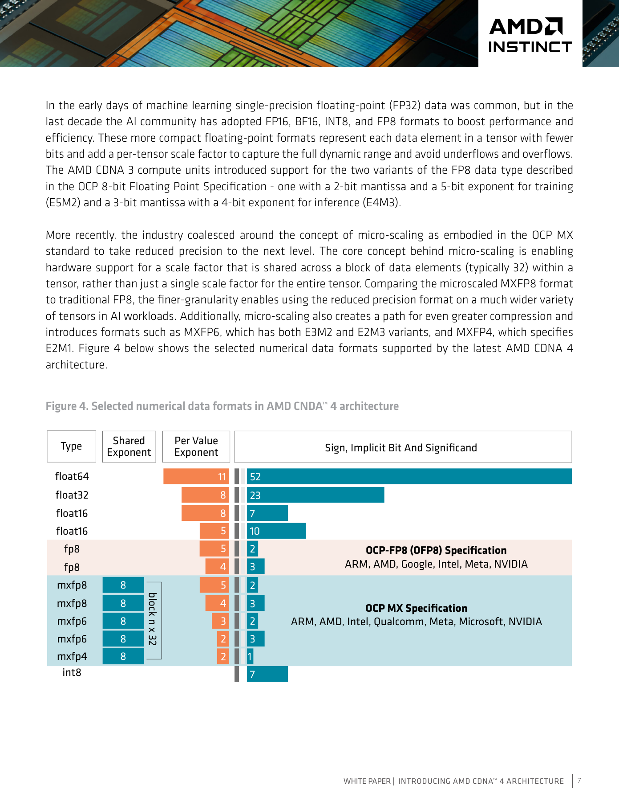
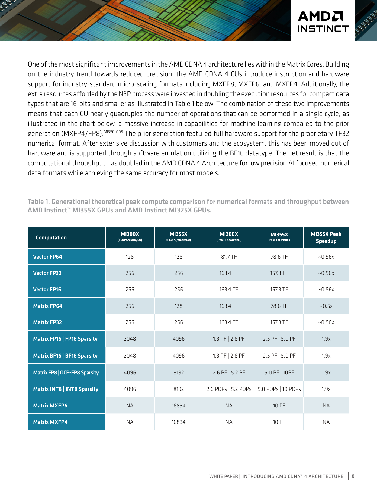
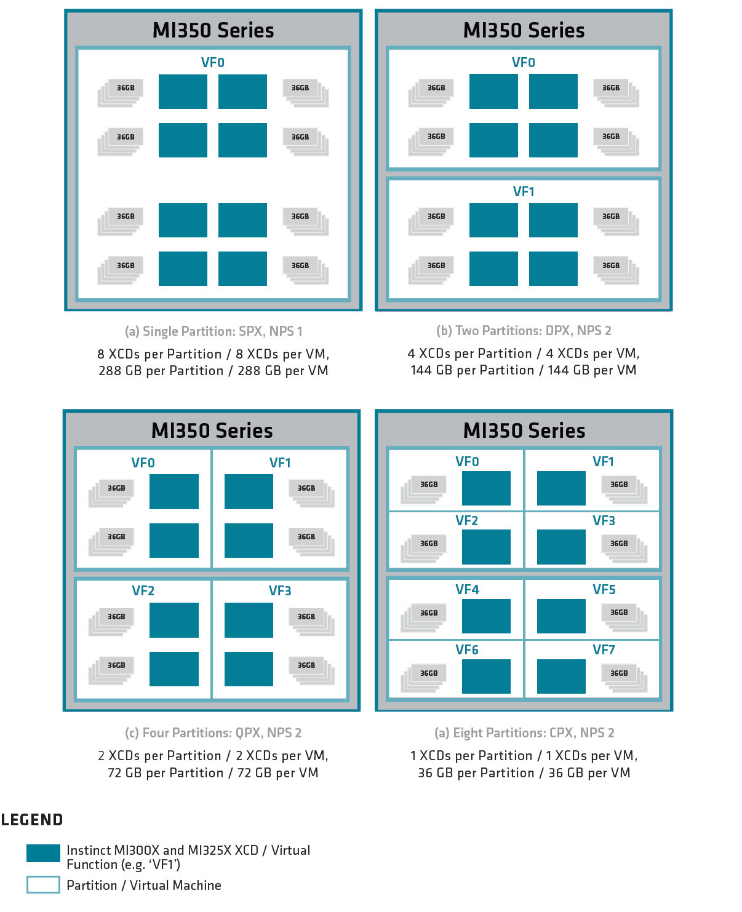

# 08A 核心技术专题：CDNA4 数值格式、GPU 数据复用与可控执行

数据截止：2026-11-04。本专题从 CDNA4 原始白皮书、HIP API 与 CK Tile实现解释 AMD GPU路线的技术积累。白皮书为 PID2258402-D（2026-09-28）；归档网页标 ROCm Core SDK10.1.0、HIP7.16.0、CK1.3.0，这些是取得的文档标识，不能替代目标安装包release或推断所有产品均支持。端侧RDNA/APU与数据中心CDNA分别判断，完整环境矩阵见02A。

## 1. 痛点：算力、容量、数据流和执行期限同时约束具身模型

视觉编码器、attention、动作生成、点云和仿真具有不同运算强度。大模型可因权重/KV装不下被迫跨卡，短策略则可能被小kernel提交、拷贝和排队拖慢；碰撞/图遍历有分支发散，未必受矩阵峰值限制。AMD的GPU能力应拆为数值格式及matrix core、片上数据复用、芯粒/HBM分区、软件图执行四层。[S01 AMD_HIP_Model](https://rocm.docs.amd.com/projects/HIP/en/latest/understand/programming_model.html)、[S02 CDNA4架构白皮书](https://www.amd.com/content/dam/amd/en/documents/instinct-tech-docs/white-papers/amd-cdna-4-architecture-whitepaper.pdf)。

| 机制 | 解决的主要瓶颈 | 优势成立条件 | 失效条件 |
|---|---|---|---|
| OCP MX低精度matrix指令 | 矩阵计算和权重带宽 | 算子支持、误差可接受、scale/布局匹配 | 转换耗时、敏感层失真、向量算子占主导 |
| LDS/寄存器tile复用 | 重复global读取 | 规则矩阵、bank/线程映射正确 | bank conflict、padding/寄存器挤占驻留量 |
| 大HBM及NPS/XCD分区 | 容量与跨IOD访问 | 工作集/任务划分与拓扑一致 | 错误NUMA放置、跨分区通信、共享设施争用 |
| HIP Graph与内存池 | 周期性提交/分配 | 稳定执行图、合法pointer生命周期 | 不支持capture、动态结构、首帧编译/迁移 |
| AITER/vLLM调度 | attention/KV及服务吞吐 | 支持模型/设备、并发模式合适 | 以批量吞吐优化损害单机器人响应期限 |

技术价值是增加可优化空间，尚不能推出闭环成功率、硬实时或机队ROI。

## 2. CDNA4：计算芯粒与 I/O 芯粒分开演进

MI350X/MI355X由8个XCD、2个IOD及8栈HBM3E构成，XCD采用TSMC N3P、IOD采用N6。计算逻辑与cache/互联/内存控制器采用不同工艺，支持独立演进；这是已公开设计事实，良率和单位成本收益仍需制造数据，不能由chiplet名词计算毛利。每XCD物理36CU、32个active，总active256，不把物理288CU当可用数。[S03 MI350微架构](https://rocm.docs.amd.com/en/latest/reference/gpu-arch/mi350.html)。

图显示XCD的4MB L2经Infinity Fabric连接IOD侧Infinity Cache与HBM，并非端侧X100结构。CDNA4每CU LDS160KB、读取256B/clock；L1 vector cache32KB，XCD L2为4MB，IOD总Infinity Cache256MB。LDS增加让tile有更大复用空间并可降低VGPR搬运，但更大的tile也会占用更多LDS/寄存器，不等于所有kernel occupancy更高。[S02 CDNA4架构白皮书](https://www.amd.com/content/dam/amd/en/documents/instinct-tech-docs/white-papers/amd-cdna-4-architecture-whitepaper.pdf) p9。

MI355X的288GB HBM3E、8TB/s都是容量与理论带宽，1400W为GPU功率上限且使用直接液冷；MI350X1000W风冷的系统条件不同。数据训练/仿真放在服务器，不能把这些带宽和功率套给移动机器人的APU。对于大模型，容量优势可能减少tensor parallel拆分，但是否降低总时延需包含collective、batch、模型精度与服务排队。

## 3. OCP MX：块级scale如何改善低位宽表达

### 3.1 数值与存储关系

白皮书p7图将per-value exponent/significand与共享scale分开。MX以通常32元素一块共享8位scale，比每tensor单scale细；MXFP4元素为E2M1，MXFP6有E3M2/E2M3，MXFP8有E4M3/E5M2。表达可写为 **分析形式** `x_i≈s_b×q_i`：同块元素共享s_b，元素q_i仍是小浮点数；这不是每个值有完整FP16指数，也不是把INT4换一个名字。[S02 CDNA4架构白皮书](https://www.amd.com/content/dam/amd/en/documents/instinct-tech-docs/white-papers/amd-cdna-4-architecture-whitepaper.pdf) p7—8。

分析：若32个FP4元素密排并附8bit scale，理想payload为32×4+8=136bit，即4.25bit/元素，相对纯16bit理想压缩16/4.25≈3.76倍。这个计算不含padding、alignment、转置备用副本、未量化层、激活/KV及workspace，不是模型总显存下降3.76倍。相同scale遇到单个outlier可能压缩其他小值的有效精度，分块轴、校准和舍入方式须与kernel一致。

转换链需追踪原权重→分块/scale选择→低精度packing→目标GEMM→高精度累加与后处理。Tensor转置可能改变分块方向，不能只转置低精度数据而沿用错误scale。量化误差不能只验语言bench：具身动作头的小位置/旋转变化、接触阈值、gripper模式及长horizon累积误差须单独留出验证。本文没有取得指定VLA全部层在MXFP4上执行的证明。

### 3.2 理论性能与证据冲突

| MI355X指标 | 官方数值与口径 | 可得结论 | 不可得结论 |
|---|---|---|---|
| Matrix BF16/FP16 | 2.5PF dense；5.0PF sparsity | 该矩阵格式理论峰值 | 所有模型吞吐翻倍 |
| OCP-FP8 | 5.0PF dense；10PF sparsity | 8bit矩阵理论能力 | VLA动作精度与10PF应用吞吐 |
| MXFP8 | 5.0PF | microscaling8bit理论峰值 | 与FP8同数值质量 |
| MXFP6/MXFP4 | 10PF | 小格式matrix理论峰值 | 单策略或闭环任务加速 |
| Vector FP32 | 157.3TF | 独立向量路径峰值 | 可用10PF替代后处理预算 |

依据白皮书p18与微架构网页。白皮书p3、p20出现“10 TFLOP/s”，与p18的10PF及官网冲突；p8表题写MI325X，列名却是MI300X，MX行每CU数写16834。保留原件，不自行修成新官方数字，本文采用可交叉核对的MI355X单SKU表，不依该表推旧代精确倍数。p21 MI350-052的7.7倍比较是MI355X DPX+NPS2的FP4与MI325X QPX+NPS4的FP8，同时改变精度/分区，不能当同精度模型加速。

图保留表题/列名冲突。白皮书还指出CDNA4的TF32改为BF16软件模拟，不是延续同一种硬件指令；依赖原TF32数值和性能的代码要重新测试。[S02 CDNA4架构白皮书](https://www.amd.com/content/dam/amd/en/documents/instinct-tech-docs/white-papers/amd-cdna-4-architecture-whitepaper.pdf) p8。

## 4. CK Tile：从 global→LDS→register→MFMA 的具体优化

CK Tile MI300 GEMM教程用朴素16×16输出tile解释global traffic：256threads各取2K值，总512K loads；理想唯一A/B输入只有32K值，数据重复读取可达16倍。该推导是教程矩阵理想读取次数，不是所有应用可提速16倍。tile把数据协作载入LDS，循环重用，MFMA在register fragments执行，ping-pong/double buffer把下一tile读取与当前计算重叠。[S04 CK Tile MI300 GEMM教程](https://rocm.docs.amd.com/projects/composable_kernel/en/latest/conceptual/ck_tile/hardware/gemm_optimization.html)。

核心不是只调用MFMA。producer完成LDS写、consumer读之前需同步，切换buffer前不能覆盖正在读的数据；global访问要coalesced，LDS访问要避免bank conflict。CK指南将LDS描述为32或64banks依架构而定，每bank4B；32bank示例 `bank=(byte_address/4) mod32` 不能直接套所有代际。

对`ds_read_b128`，文档列8个特定lane groups；写无冲突不代表读无冲突。padding能改变stride映射但额外占LDS，降低可驻留tile数；XOR preshuffle可在不增加存储的情况下重排列，但必须让后续MFMA/读取使用一致映射。教程64lane、FP16、KPerBlock64/KPack8是具体例子，不当RDNA32lane或MXFP4的通用参数。[S05 CK Tile LDS bank指南](https://rocm.docs.amd.com/projects/composable_kernel/en/latest/conceptual/ck_tile/hardware/lds_bank_conflicts.html)。

CK GEMM教程还用M4864/N4096说明调度覆盖304CU，但文字“tile256×64”与随后M/256×N/256公式不一致，且CU/Wave说明是教程简化；本研究不复制其设置为MI355X可复建性能配置。正确动作是保存实际kernel/commit、M/N/K、布局、dtype、边界mask、编译器资源报告，测LDS conflict、VGPR、stall、带宽及持续耗时。该教程提供机制，不提供目标机器人完整benchmark。

hipBLASLt提供灵活GEMM接口，离线tuning应记录真实shape/stride、batch、transpose、dtype、epilogue、GPU及workspace限制，再选满足限制的solution，不能只按M/N/K抄最快值。tuning结果和solution index依library/kernel版本，升级后应重新核；与TensorRT builder选tactic类似，二者降低不同层开销，文件格式不可互换。[S06 AMD08_HipBLASLt](https://rocm.docs.amd.com/projects/hipBLASLt/en/latest)、[S07 AMD08_HipBLASLt_Tune](https://rocm.docs.amd.com/projects/hipBLASLt/en/latest/how-to/how-to-use-hipblaslt-offline-tuning.html)、[S08 Compare_TRT_Builder](https://docs.nvidia.com/deeplearning/tensorrt/latest/architecture/how-trt-works.html)。

## 5. HBM分区、统一寻址与帧buffer生命周期

图示SPX/NPS1、DPX/NPS2、QPX/NPS2、CPX/NPS2，其中完整288GB可分144/72/36GB示例。图legend残留MI300X/MI325X而标题是MI350，保留该瑕疵，支持结论以同页正文为准。NPS2将内存按IOD分为两池，可减少跨IOD traffic；compute partitions按XCD边界划分。软件隐藏device不是空间分区：ROCm指南明确环境变量可被应用重置，不能隔离不可信程序。[S03 MI350微架构](https://rocm.docs.amd.com/en/latest/reference/gpu-arch/mi350.html)、[S09 AMD_ROCm_Isolation](https://rocm.docs.amd.com/en/latest/reference/system-optimization/gpu-isolation.html)。

即使空间分区隔开计算资源，也不能直接给机器人WCET：共享host、互联、网卡、存储、热/电源和reset范围仍需配置与验证；该机制用于服务器多任务资源安排，不能推广X100具备同样partition。

HIP unified address是CPU/GPU可访问同地址的概念，managed memory是page迁移实现，两者不等于本地高带宽。HMM、HSA_XNACK、设备属性和虚拟化条件决定是否支持按访问迁移；文档对MI200 SR-IOV特别列XNACK不可用。zero-copy pinned host可被GPU读取但数据仍过互联。首触page fault、超额迁移和CPU/GPU交替写导致抖动，须独立记录cold和warm。[S10 HIP统一内存与设备条件](https://rocm.docs.amd.com/projects/HIP/en/latest/how-to/hip_runtime_api/memory_management/unified_memory.html)。

帧buffer应从capture ownership到GPU引用、完成通知、CPU可见、消费者归还建立生命周期。HIP文档表中`hipStreamWaitEvent`只是stream依赖，coarse host visibility为No；`hipEventSynchronize`取决event release scope，`hipEventReleaseToSystem`才明确system release。same-DRAM、线程队列或API返回都不替代cache/coherence和数据竞争检查。[S11 AMD_HIP_Coherence](https://rocm.docs.amd.com/projects/HIP/en/latest/how-to/hip_runtime_api/memory_management/coherence_control.html)。

## 6. Graph、内存池与在线服务：减少开销同时保留期限

HIP Graph先生成依赖节点、instantiate，再反复launch；它压缩提交开销，不会自动融合模型或加速传感器到动作链。capture不执行被捕获设备操作，普通host代码不会自动变成图节点；library graph-safe表的MIOpen、rocDecode等状态需按包验证，不能因有GraphAPI就全图捕获。[S12 AMD_HIP_Graphs](https://rocm.docs.amd.com/projects/HIP/en/latest/how-to/hip_runtime_api/hipgraph.html)、[S13 AMD_ROCm_GraphSafe](https://rocm.docs.amd.com/en/latest/reference/graph-safe-support.html)。

`hipMallocAsync/hipFreeAsync`限定allocation→use→free的stream顺序，跨stream消费需显式event依赖；内存池release threshold和reserved/used高水位影响是否保留已释放内存。提前free仍会造成use-after-free；为了少分配保留pool也可能挤占VLA/KV。该优化适合循环调用稳定策略，但最稳妥的实时阶段应把编译/权重加载/主要分配移到arm之前，失败时拒绝使能。[S14 AMD_HIP_Allocator](https://rocm.docs.amd.com/projects/HIP/en/latest/how-to/hip_runtime_api/memory_management/stream_ordered_allocator.html)。

vLLM/AITER指南分别给低并发与高并发attention布局，部分参数建议并发≥32，与单机器人batch1目标不同。`max-num-seqs`、token预算、memory utilization、graph mode决定KV与排队；提高tokens/s可能增加TTFT和视觉观测年龄。权重量化、KV量化、vision编码优化是三个独立步骤，不能用weight-only下降推整个内存相同比例。[S15 AMD_vLLM_Optimization](https://rocm.docs.amd.com/projects/ai-ecosystem/en/latest/optimization/vllm-v1-optimization.html)。

## 7. 同类对标、迁移与放行

CUDA Graph同样通过预建立依赖压缩反复提交；TensorRT在模型图层选择可执行实现/精度/融合，INT4 weight-only反量化再高精度GEMM不是AMD MX matrix格式。应对齐所解决瓶颈而非比较产品名；HIPIFY减少源码API迁移工作，不能修复写死32lane、特有指令/插件、不同packing或数值误差。[S16 Compare_CUDA_Graphs](https://docs.nvidia.com/cuda/cuda-programming-guide/04-special-topics/cuda-graphs.html)、[S08 Compare_TRT_Builder](https://docs.nvidia.com/deeplearning/tensorrt/latest/architecture/how-trt-works.html)、[S17 Compare_TRT_Quant](https://docs.nvidia.com/deeplearning/tensorrt/latest/inference-library/quantized-types-explicit-quantization.html)、[S18 HIPIFY迁移工具](https://rocm.docs.amd.com/projects/HIPIFY/en/latest/)。

放行协议应按模型/设备/软件组合保存数值误差、动作合法性、cold启动、warm P50/P95/P99、内存峰值、并发/热稳态、cancel与过期观测丢弃记录；硬实时还需独立时限与失效保护论证。ROCm/HIP及library采用逐组件许可，代码开源不等于模型、权重、runtime包与专利全部可随意再分发。[S19 HIP许可](https://rocm.docs.amd.com/projects/HIP/en/latest/license.html)、[S20 ROCm组件混合许可](https://rocm.docs.amd.com/en/latest/about/license.html)。本专题得到硬件/机制与官方理论上限证据，没有新增真机性能测试；技术积累的可用收益以目标任务验证为前提。

## 参考资料与本地原件

S编号对应正文原URL。每项有原响应、HTML/PDF及metadata和依赖。partial_static表示已取得可读正文但部分静态依赖缺失，不保证像素或动态交互完整。发布时间/版本与采集时间分开，导入既有原响应的来源保留原采集时间；没有将失败页/导航壳作为有效证据。

| 原始来源 | 版本/日期/条件 | 本地原件与metadata | 归档状态 |
|---|---|---|---|
| [S01 AMD_HIP_Model](https://rocm.docs.amd.com/projects/HIP/en/latest/understand/programming_model.html) | 官方公开快照；版本/适用条件见正文，采集日期不等发布日期 | [HTML/PDF/源码原件](REFERENCES.md#ref-b375803d7ee408be) · [metadata](REFERENCES.md#ref-b375803d7ee408be) | partial_static |
| [S02 CDNA4架构白皮书](https://www.amd.com/content/dam/amd/en/documents/instinct-tech-docs/white-papers/amd-cdna-4-architecture-whitepaper.pdf) | PID2258402-D，2026-09-28 | [HTML/PDF/源码原件](REFERENCES.md#ref-3cf28c503c62dd2b) · [metadata](REFERENCES.md#ref-3cf28c503c62dd2b) | complete_static |
| [S03 MI350微架构](https://rocm.docs.amd.com/en/latest/reference/gpu-arch/mi350.html) | 归档页面标ROCm10.1.0；原表口径见正文 | [HTML/PDF/源码原件](REFERENCES.md#ref-c4dd48c6cf36185a) · [metadata](REFERENCES.md#ref-c4dd48c6cf36185a) | partial_static |
| [S04 CK Tile MI300 GEMM教程](https://rocm.docs.amd.com/projects/composable_kernel/en/latest/conceptual/ck_tile/hardware/gemm_optimization.html) | CK1.3.0文档快照，MI300示例 | [HTML/PDF/源码原件](REFERENCES.md#ref-0627b13abeeab3a0) · [metadata](REFERENCES.md#ref-0627b13abeeab3a0) | partial_static |
| [S05 CK Tile LDS bank指南](https://rocm.docs.amd.com/projects/composable_kernel/en/latest/conceptual/ck_tile/hardware/lds_bank_conflicts.html) | CK1.3.0文档快照 | [HTML/PDF/源码原件](REFERENCES.md#ref-b93f01d6a94ce5fd) · [metadata](REFERENCES.md#ref-b93f01d6a94ce5fd) | partial_static |
| [S06 AMD08_HipBLASLt](https://rocm.docs.amd.com/projects/hipBLASLt/en/latest) | 官方公开快照；版本/适用条件见正文，采集日期不等发布日期 | [HTML/PDF/源码原件](REFERENCES.md#ref-907f2e988ea1d747) · [metadata](REFERENCES.md#ref-907f2e988ea1d747) | partial_static |
| [S07 AMD08_HipBLASLt_Tune](https://rocm.docs.amd.com/projects/hipBLASLt/en/latest/how-to/how-to-use-hipblaslt-offline-tuning.html) | 官方公开快照；版本/适用条件见正文，采集日期不等发布日期 | [HTML/PDF/源码原件](REFERENCES.md#ref-7bf8151cbeb8bc57) · [metadata](REFERENCES.md#ref-7bf8151cbeb8bc57) | partial_static |
| [S08 Compare_TRT_Builder](https://docs.nvidia.com/deeplearning/tensorrt/latest/architecture/how-trt-works.html) | 官方公开快照；版本/适用条件见正文，采集日期不等发布日期 | [HTML/PDF/源码原件](REFERENCES.md#ref-9df325c2c44e3de5) · [metadata](REFERENCES.md#ref-9df325c2c44e3de5) | complete_static |
| [S09 AMD_ROCm_Isolation](https://rocm.docs.amd.com/en/latest/reference/system-optimization/gpu-isolation.html) | 官方公开快照；版本/适用条件见正文，采集日期不等发布日期 | [HTML/PDF/源码原件](REFERENCES.md#ref-1cdb1b1fdce406a8) · [metadata](REFERENCES.md#ref-1cdb1b1fdce406a8) | partial_static |
| [S10 HIP统一内存与设备条件](https://rocm.docs.amd.com/projects/HIP/en/latest/how-to/hip_runtime_api/memory_management/unified_memory.html) | HIP/HIPIFY latest快照；10.1矩阵HIP7.16.0、HIPIFY10.1.0；硬件特性有条件 | [HTML/PDF/源码原件](REFERENCES.md#ref-37f458b46d3d4e56) · [metadata](REFERENCES.md#ref-37f458b46d3d4e56) | partial_static |
| [S11 AMD_HIP_Coherence](https://rocm.docs.amd.com/projects/HIP/en/latest/how-to/hip_runtime_api/memory_management/coherence_control.html) | 官方公开快照；版本/适用条件见正文，采集日期不等发布日期 | [HTML/PDF/源码原件](REFERENCES.md#ref-eb09a8ddbe431291) · [metadata](REFERENCES.md#ref-eb09a8ddbe431291) | partial_static |
| [S12 AMD_HIP_Graphs](https://rocm.docs.amd.com/projects/HIP/en/latest/how-to/hip_runtime_api/hipgraph.html) | 官方公开快照；版本/适用条件见正文，采集日期不等发布日期 | [HTML/PDF/源码原件](REFERENCES.md#ref-0077a3438456f5e6) · [metadata](REFERENCES.md#ref-0077a3438456f5e6) | partial_static |
| [S13 AMD_ROCm_GraphSafe](https://rocm.docs.amd.com/en/latest/reference/graph-safe-support.html) | 官方公开快照；版本/适用条件见正文，采集日期不等发布日期 | [HTML/PDF/源码原件](REFERENCES.md#ref-a7417a67a3e2d520) · [metadata](REFERENCES.md#ref-a7417a67a3e2d520) | partial_static |
| [S14 AMD_HIP_Allocator](https://rocm.docs.amd.com/projects/HIP/en/latest/how-to/hip_runtime_api/memory_management/stream_ordered_allocator.html) | 官方公开快照；版本/适用条件见正文，采集日期不等发布日期 | [HTML/PDF/源码原件](REFERENCES.md#ref-56beb352829aef22) · [metadata](REFERENCES.md#ref-56beb352829aef22) | partial_static |
| [S15 AMD_vLLM_Optimization](https://rocm.docs.amd.com/projects/ai-ecosystem/en/latest/optimization/vllm-v1-optimization.html) | 官方公开快照；版本/适用条件见正文，采集日期不等发布日期 | [HTML/PDF/源码原件](REFERENCES.md#ref-8e43533d5f7ce6bf) · [metadata](REFERENCES.md#ref-8e43533d5f7ce6bf) | partial_static |
| [S16 Compare_CUDA_Graphs](https://docs.nvidia.com/cuda/cuda-programming-guide/04-special-topics/cuda-graphs.html) | 官方公开快照；版本/适用条件见正文，采集日期不等发布日期 | [HTML/PDF/源码原件](REFERENCES.md#ref-64fc09301027cc35) · [metadata](REFERENCES.md#ref-64fc09301027cc35) | complete_static |
| [S17 Compare_TRT_Quant](https://docs.nvidia.com/deeplearning/tensorrt/latest/inference-library/quantized-types-explicit-quantization.html) | 官方公开快照；版本/适用条件见正文，采集日期不等发布日期 | [HTML/PDF/源码原件](REFERENCES.md#ref-f47c2746e3737567) · [metadata](REFERENCES.md#ref-f47c2746e3737567) | complete_static |
| [S18 HIPIFY迁移工具](https://rocm.docs.amd.com/projects/HIPIFY/en/latest/) | HIP/HIPIFY latest快照；10.1矩阵HIP7.16.0、HIPIFY10.1.0；硬件特性有条件 | [HTML/PDF/源码原件](REFERENCES.md#ref-dea51c8601d2ef3c) · [metadata](REFERENCES.md#ref-dea51c8601d2ef3c) | partial_static |
| [S19 HIP许可](https://rocm.docs.amd.com/projects/HIP/en/latest/license.html) | HIP/HIPIFY latest快照；10.1矩阵HIP7.16.0、HIPIFY10.1.0；硬件特性有条件 | [HTML/PDF/源码原件](REFERENCES.md#ref-9c42ef4afff326cd) · [metadata](REFERENCES.md#ref-9c42ef4afff326cd) | partial_static |
| [S20 ROCm组件混合许可](https://rocm.docs.amd.com/en/latest/about/license.html) | ROCm Core SDK10.1.0 latest快照；独立组件/旧发行另辨 | [HTML/PDF/源码原件](REFERENCES.md#ref-79d59a12ff9a6fe3) · [metadata](REFERENCES.md#ref-79d59a12ff9a6fe3) | partial_static |

[主张、图源及人工核验](research_state/evidence/08A_GPU_Memory_and_Execution.json) · [引用完整清单](research_state/depth_08/08A_GPU_Memory_and_Execution_sources.json) · [专题资料索引](REFERENCES.md)。本次未安装SDK/训练模型/刷板/接本体实测，测量与交付范围以正文为准。
