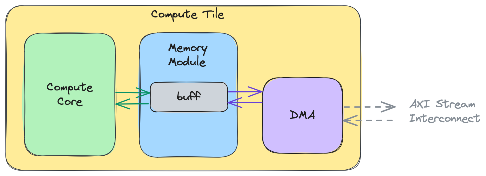
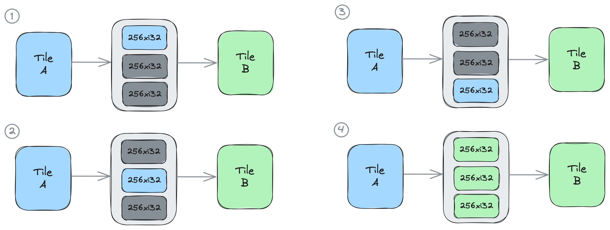

# 08B 核心技术专题：XDNA 数值路径、IRON 编译与显式数据流

资料截止：2026-11-04。研究对象为 Ryzen AI 的 XDNA/AIE2、XDNA2/AIE2P，以及官方 IRON / MLIR-AIE 工具链公开快照。源码 main、网站 latest 与目标产品 BSP 是不同版本对象；本专题不把笔记本 NPU 示例直接认定为 Embedded X100/X199 的交付支持。软件发行边界与 ONNX 路线详见 [02B](02B_RyzenAI_Compilation_and_Quantization.md)。

## 1. 技术定位：把算子图变成可编排的片上数据流

具身感知常有重复的图像 tile、卷积、矩阵乘、滤波和张量重排。如果每一步都写回外部 DRAM，再由通用处理器重新提交，下游算子可能一直等待数据。XDNA 的价值是让局部计算、存储与流式互联协同；优势必须在数据复用、布局和工作集匹配时才成立，不能由 NPU TOPS 直接推出低时延或低整机功耗。

官方将 IRON 定位为 close-to-metal Python 工具，可控制 tile placement、data movement、vectorized compute，并明确它 **补充** Ryzen AI Software Platform。ONNX Runtime / VitisAI EP 以模型图和支持算子为接口；IRON 以 Worker、ObjectFifo、Runtime、Program 与单核代码为接口。后者允许信号处理和定制算子探索，但工程师也接管了数据量、布局、同步和编译正确性的责任。[S01 IRON官方源码与安装说明](https://github.com/Xilinx/mlir-aie)、[S02 AMD08_IRON_Latest_Home](https://xilinx.github.io/mlir-aie/latest/)。

| 路线 | 用户输入 | 主要控制对象 | 成立条件 | 必须额外验证 |
|---|---|---|---|---|
| Ryzen AI 推理工具 | ONNX、量化配置 | EP分区、支持算子、缓存 | 模型在目标版本可编译 | fallback、转换、并发与动作误差 |
| IRON / MLIR-AIE | Python数据流、C++ kernel | tile、FIFO、DMA、单核向量化 | kernel/布局与设备阵列匹配 | token平衡、DMA资源、buffer安全 |
| GPU/HIP | 通用并行kernel与库 | wave、LDS、graph、内存 | 分支/动态任务或大工作集适合GPU | GPU争用、拷贝、首触迁移 |

上述是机制比较，没有同任务、同功耗的独立测试，不能给出速度排名。IRON 不是完整 VLA 导出器、ROS 本体 SDK 或安全控制器。

## 2. 阵列与内存：为什么“有 NPU”仍需要数据规划

官方架构参考列出 Phoenix/Hawk Point 为 AIE2/XDNA，4×4 compute tiles；Strix/Krackan Point 为 AIE2P/XDNA2，8×4。每列由 row0 Shim、row1 Mem、row2—5 Compute 构成。这里的行列来自具体 IRON device class，不代表所有 AMD 嵌入式 SKU 开放同样资源。参考文档用约64KB L1、约512KB L2和不同访问周期作 rule-of-thumb；这些不是目标芯片完整 datasheet 的精确时延保证。[S03 AMD08_IRON_Architecture](https://github.com/Xilinx/mlir-aie/blob/main/skills/aie-iron-design/references/architecture.md)、[S04 AMD08_IRON_Devices](https://github.com/Xilinx/mlir-aie/blob/main/docs/Devices.md)。

分析数据路径：host/DDR→Shim DMA→Mem tile 中转/拆分→Compute tile 本地buffer→向量kernel→反向drain。把权重或中间结果留在局部存储能减少重复 DRAM 流量，但 tile 容量还要容纳栈、多个 FIFO、双buffer和kernel临时值。单个矩阵装得下不等于所有并发算子装得下；增加 Worker 也会增加 DMA 通道、路由和存储压力。

图把core与DMA共享memory module、DMA与AXI stream连接分开。数据仍要搬运，不能把ObjectFIFO的逻辑连接理解成无需物理传输。拥有直接共享内存访问的tile可以选共享路径；否则由DMA流传输，transport设置影响lowering。图未给各SKU全部内存bank、延迟或cache一致性。

## 3. 数值格式：先区分模型量化与阵列编程

Ryzen AI 的量化接口中，Quark A8W8 使用 INT8 激活/权重和 INT32 bias、float scales；A16W8 使用 INT16 激活、INT8 权重及 INT32 bias、float scales。指南称 A16W8 通常改善准确度而 A8W8 更有性能优势，这是算法/实现的通常趋势，不是目标 VLA 的实测。XINT8 的 power-of-two scale 与上述 float scale 也不能混成一种格式。[S05 AMD_Quark_A16W8](https://quark.docs.amd.com/latest/supported_accelerators/ryzenai/tutorial_a8w8_and_a16w8_quantize.html)、[S06 AMD_Quark_XINT8](https://quark.docs.amd.com/latest/supported_accelerators/ryzenai/tutorial_xint8_quantize.html)。

分析量化形式 `x≈s(q−z)` 只是解释 scale/zero-point 的数学关系，不代表每个目标 kernel 均接受任意 z、scale、轴或 bit width。激活16bit会增加数据搬运和buffer占用；权重8bit并不保证动作头、softmax、归一化和 KV 都8bit执行。是否走 BF16、低精度或 CPU fallback，必须读取最终分区和编译报告，再核实际运行。IRON 示例中的 int32 加法只说明编程路径，不支持“全模型 INT32 最优”的结论。

对具身模型，校准数据应覆盖相机曝光/深度噪声、遮挡、语言与本体状态，并给动作平移、旋转、gripper离散状态和接触阶段设置留出验证。仅比较 tensor MSE 或语言分数不能确认机器人任务成功；多步动作误差会通过实际动力学累积。未经目标包核实，不把 Quark 可输出格式等同阵列硬件已优化支持。

## 4. ObjectFIFO：逻辑对象、物理buffer与锁不是一回事

ObjectFifo 是一个 producer 到一个或多个 consumer 的有序对象连接，默认 depth=2，表示双buffer；所有对象必须具有同样 obj_type，名称需要唯一。高层编译器从 Worker 使用的 producer/consumer handle 推导端点，底层 AIE dialect 则可直接指定 tile、depth、datatype 和布局。多 producer 不受该抽象支持；广播也不是自动增加输入处理吞吐。[S07 AMD08_IRON_Dataflow](https://xilinx.github.io/mlir-aie/latest/programming_guide/section-2/section-2a/)。

图中深度3的256×i32对象依次被 producer 取得，之后 consumer 可取得多个对象；图解释对象所有权顺序，没有提供带宽或周期数。`acquire(n)` 给出当前最老的 n 个可访问对象，`release(n)` 从最老到最新归还。两个 acquire 连续调用且没有 release，可能返回同一组对象，不能当“又消费了 n 个新帧”。保留对象可以实现滑动窗口，但必须把保留量计入 FIFO 容量。

分析：如果下游因模型慢而长期持有输入，producer会因无空buffer等待；把depth从2加到8只增加容量，不能消除平均服务速率不足，还可能增加观测年龄。多consumer的生命周期须以最慢消费者及具体 lowering 为准；不能在首个消费者完成后让相机复用所有共享buffer。实际算法需核每条边的生产/消费量、初始化token和循环终止条件，防止环路相互等待。

### 布局与路由：把张量访问顺序变成通信配置

`to_stream` 指定producer侧发送顺序，`from_stream_per_cons` 指定各consumer侧写入顺序，底层对应dimensionsToStream/FromStreamPerConsumer。分析地址关系可写成 `offset+Σ(i_k×stride_k)`，仅为索引解释；实际单位、extent与硬件限制须按API核对。重排适合以DMA改变局部tile布局，避免专门transpose kernel，但必须验证padding、边界、完整覆盖和越界，尤其不连续相机stride与NCHW/NHWC输入不能只交换shape标签。[S07 AMD08_IRON_Dataflow](https://xilinx.github.io/mlir-aie/latest/programming_guide/section-2/section-2a/)。

`Transport.dma()` 强制DMA，`Transport.shared_mem()`要求可共享访问，packet flow可共享stream。路由工具输出每个flow的路径，可用于核查跨tile连接；route生成耗时和path length是编译指标，不是在线推理时延。共享stream可能增加竞争，而独立flow仍受物理通道数量限制。进一步layout/lowering/tracing独立指南本轮因robots检查的网络连接失败未取得，未列为引用；这里仅使用已归档FIFO、DMA与routing正文。[S08 AMD08_IRON_Routing](https://xilinx.github.io/mlir-aie/latest/programming_guide/routing/)。

## 5. DMA任务：完成token、队列容量与BD复用三层约束

`shim_dma_single_bd_task` 将 host mem、ObjectFIFO shim allocation、offset/sizes/strides 与 transfer_len 编成任务。`issue_token=True` 才允许对任务等待完成；创建描述符、启动任务、等待任务和回收 BD 是不同操作。sizes 从右到左解释，内三维定义单 BD 搬运，外维通过重复或多个任务处理。指南 `[2,3,4,8,16]` 示例使 `[4,8,16]` BD 执行6次；不能仅按数组维数认定硬件一次支持所有维度。[S09 AMD08_IRON_DMA](https://xilinx.github.io/mlir-aie/latest/programming_guide/section-2/section-2d/DMATasks/)。

`dma_free_task(X)` 不进行同步，在 X 完成前释放导致 race。可在等待 Y 后释放 X，但前提是数据依赖能证明 Y 完成必然意味着 X 完成；两个任务名字相近或同时启动不能成为证明。aiecc 的 unsafe BD reuse warning 只分析它掌握的 runtime sequence，跨core/跨tile完成关系可能保守报错；关闭 warning 不会修复生命周期错误。

最有实际意义的边界是 DMA task queue：指南明确 AIE2 每channel最多4个 outstanding transfers，队列本身 **没有背压**，满时 push 被丢弃，等待被丢任务或下游数据可能永久阻塞。Strix 示例中14次连续push随consumer快慢出现相反结果，8次1KB与8次8KB的表现也不同；没有完整测量环境，不能拿这些例子当性能bench。

编译器默认会在可能满的push前轮询 live occupancy。分析：这防止丢提交，但新增等待时延，且不能解除应用自身死锁。`dma_await_task` 消费channel最老的completion token，并非根据 operand 名称任意等待队列中的某一项。放行前应限制每channel started-but-not-awaited数量，验证缓慢/停止consumer、丢帧、重新加载和超时恢复；单次正确输出不能证明长时间推理稳定。

| 层次 | 正常契约 | 失效机制 | 应检查的记录 |
|---|---|---|---|
| FIFO对象 | acquire→访问→release | 覆盖仍被持有对象、token不平衡 | 对象量、depth、各consumer释放 |
| DMA队列 | 入队数和完成顺序有界 | 满队列丢任务或poll永久等待 | 每channel occupancy、await/token |
| BD资源 | 任务完成后回收 | descriptor复用破坏进行中任务 | BD编号、依赖证明、编译warning |
| 机器人任务 | 新观测→策略→期限内执行 | 使用陈旧观测或动作持续保持 | capture age、超时、独立停机路径 |

## 6. JIT与缓存：首次调用不是稳态推理

`@iron.jit` 经 MLIR-AIE 与 Peano 生成 xclbin、instruction stream，再由运行时加载。第一次调用可能包含编译和建立 NPUKernel/XRT context，后续相同recipe才命中缓存。`CompileTime[T]` 值改变可以产生新编译；只有程序显式实现的 runtime值才是运行期变化，不能把 compile-time shape 当动态shape免费支持。[S10 AMD08_IRON_Compile](https://xilinx.github.io/mlir-aie/latest/programming_guide/compilation_stages/)。

recipe_hash用于配置身份，artifact_hash用于产物新鲜度；把一份旧缓存文件复制到新系统不能代替compiler、kernel、device、driver与源码的匹配。指南允许 `.specialize(...).compile()` 提前构建，导出 xclbin/insts，且 PDI被封装于xclbin，单独PDI不是 IRON runtime直接输入。应在机器人使能前完成编译、加载、预热及代表输入检查，并把冷启动与稳态统计分别记录。

JIT调用路径通常先验证 positional tensor 与已编译 signature 的元素数量；但多个runtime_sequence没有唯一根、某些不DMA的参数会跳过检查。直接 `NPUKernel(xclbin,insts)` 绕过 CompileTime metadata，也没有该tensor验证，用户负责shape/dtype/参数顺序。即使数量正确，坐标frame、颜色通道、stride、量化scale或关节顺序仍可能错误，这些语义不由元素数量检查保障。

## 7. 版本、许可与竞争边界

官方安装脚本尽量使 mlir_aie wheel 对应当前仓库 release/commit；找不到会报错，因为 example与compiler不匹配容易产生难调问题。另有 Peano/llvm-aie wheel、Python requirements 和实际驱动，应作为可复建版本集保存；本文读取的是公开快照，尚未下载和运行完整包。该仓库同时保留可选 xchesscc / Vitis AIE Essentials 1.3 Early Access 安装路径，不能把其中旧EA说明当当前通用SDK门槛。[S01 IRON官方源码与安装说明](https://github.com/Xilinx/mlir-aie)。

项目 LICENSE 为 Apache2.0 with LLVM exceptions，不能因此认定 Vitis专有工具、firmware、所有third_party、模型权重和本体SDK具有相同许可。使用 Peano开源单核路径与购买专有compiler路径是不同交付选择，必须对最终二进制逐层列SBOM。[S11 AMD08_IRON_License](https://github.com/Xilinx/mlir-aie/blob/main/LICENSE)、[S12 Ryzen AI EULA与第三方条款](https://ryzenai.docs.amd.com/en/latest/licenses.html)。

IRON论文公开摘要的约26%平均代码行数减少是设计表达效率分析，并有Halstead指标；不是NPU功耗下降、模型加速或机器人成功率。该论文为arXiv:2504.18430v1，2025-04-25，声明accepted FCCM25；本次只取得摘要页，未以它补齐全套kernel性能。[S13 IRON程序接口论文摘要](https://arxiv.org/abs/2504.18430)。

与 GPU 的 LDS/graph 对照，IRON 的FIFO、tile placement和显式DMA更直接暴露流式片上调度；GPU路线在动态并行和通用library上有另一组便利。两者共享“数据复用需要布局与生命周期一致”的原则，但内存池、HIP Graph和ObjectFIFO不是可互换API。优势条件是稳定kernel、局部复用充分、布局可固定，代价是更专业的编译/路由调试和版本锁定；对于频繁改变相机数量、动态token和动作horizon的VLA，应先验证主流EP，再用IRON补经测量确认的瓶颈。

## 8. 可复建验收路径

先固定目标SKU、开放tile、OS/kernel、driver/firmware、XRT、IRON/Peano与源码commit；保存输入shape/dtype、布局、tile/FIFO/BD配置、生成MLIR、产物hash和警告。先用CPU参考核数值，再以最小矩阵/滤波核观察DMA和kernel时段，逐步加入上游采集与下游模型。最后注入慢consumer、队列拥塞、输入尺寸错误与重加载，记录cold/warm、完整capture-to-action P99、观测age和持续热条件。

这是一条可执行的验证设计，本文没有给出实机结果。没有取得 Embedded X199 的完整IRON BSP支持合同、指定VLA全算子图或本体闭环测量；因此结论是 XDNA提供可深入控制的数据流工具与优化空间，是否形成产品优势由上述完整链路证据决定。

## 参考资料与本地原件

S编号对应正文原URL。每项有原响应、HTML/PDF及metadata和依赖。partial_static表示已取得可读正文但部分静态依赖缺失，不保证像素或动态交互完整。发布时间/版本与采集时间分开，导入既有原响应的来源保留原采集时间；没有将失败页/导航壳作为有效证据。

| 原始来源 | 版本/日期/条件 | 本地原件与metadata | 归档状态 |
|---|---|---|---|
| [S01 IRON官方源码与安装说明](https://github.com/Xilinx/mlir-aie) | 2026-11-04采集main快照；实际release另验 | [HTML/PDF/源码原件](REFERENCES.md#ref-d8a68a736295ae54) · [metadata](REFERENCES.md#ref-d8a68a736295ae54) | partial_static |
| [S02 AMD08_IRON_Latest_Home](https://xilinx.github.io/mlir-aie/latest/) | 官方公开快照；版本/适用条件见正文，采集日期不等发布日期 | [HTML/PDF/源码原件](REFERENCES.md#ref-d3aec3ce521a7f4c) · [metadata](REFERENCES.md#ref-d3aec3ce521a7f4c) | complete_static |
| [S03 AMD08_IRON_Architecture](https://github.com/Xilinx/mlir-aie/blob/main/skills/aie-iron-design/references/architecture.md) | 官方公开快照；版本/适用条件见正文，采集日期不等发布日期 | [HTML/PDF/源码原件](REFERENCES.md#ref-c23530c876cdd5b8) · [metadata](REFERENCES.md#ref-c23530c876cdd5b8) | partial_static |
| [S04 AMD08_IRON_Devices](https://github.com/Xilinx/mlir-aie/blob/main/docs/Devices.md) | 官方公开快照；版本/适用条件见正文，采集日期不等发布日期 | [HTML/PDF/源码原件](REFERENCES.md#ref-194dfcfdf81c0673) · [metadata](REFERENCES.md#ref-194dfcfdf81c0673) | partial_static |
| [S05 AMD_Quark_A16W8](https://quark.docs.amd.com/latest/supported_accelerators/ryzenai/tutorial_a8w8_and_a16w8_quantize.html) | 官方公开快照；版本/适用条件见正文，采集日期不等发布日期 | [HTML/PDF/源码原件](REFERENCES.md#ref-52bdde32508629c8) · [metadata](REFERENCES.md#ref-52bdde32508629c8) | partial_static |
| [S06 AMD_Quark_XINT8](https://quark.docs.amd.com/latest/supported_accelerators/ryzenai/tutorial_xint8_quantize.html) | 官方公开快照；版本/适用条件见正文，采集日期不等发布日期 | [HTML/PDF/源码原件](REFERENCES.md#ref-da39f2f8b3488490) · [metadata](REFERENCES.md#ref-da39f2f8b3488490) | partial_static |
| [S07 AMD08_IRON_Dataflow](https://xilinx.github.io/mlir-aie/latest/programming_guide/section-2/section-2a/) | 官方公开快照；版本/适用条件见正文，采集日期不等发布日期 | [HTML/PDF/源码原件](REFERENCES.md#ref-637e26cd5aab37a1) · [metadata](REFERENCES.md#ref-637e26cd5aab37a1) | complete_static |
| [S08 AMD08_IRON_Routing](https://xilinx.github.io/mlir-aie/latest/programming_guide/routing/) | 官方公开快照；版本/适用条件见正文，采集日期不等发布日期 | [HTML/PDF/源码原件](REFERENCES.md#ref-ef0c8e12040d0db3) · [metadata](REFERENCES.md#ref-ef0c8e12040d0db3) | complete_static |
| [S09 AMD08_IRON_DMA](https://xilinx.github.io/mlir-aie/latest/programming_guide/section-2/section-2d/DMATasks/) | 官方公开快照；版本/适用条件见正文，采集日期不等发布日期 | [HTML/PDF/源码原件](REFERENCES.md#ref-d111f72ab7a785e8) · [metadata](REFERENCES.md#ref-d111f72ab7a785e8) | complete_static |
| [S10 AMD08_IRON_Compile](https://xilinx.github.io/mlir-aie/latest/programming_guide/compilation_stages/) | 官方公开快照；版本/适用条件见正文，采集日期不等发布日期 | [HTML/PDF/源码原件](REFERENCES.md#ref-2223a32b0d2cffaf) · [metadata](REFERENCES.md#ref-2223a32b0d2cffaf) | complete_static |
| [S11 AMD08_IRON_License](https://github.com/Xilinx/mlir-aie/blob/main/LICENSE) | 官方公开快照；版本/适用条件见正文，采集日期不等发布日期 | [HTML/PDF/源码原件](REFERENCES.md#ref-c8bea0c624cf4216) · [metadata](REFERENCES.md#ref-c8bea0c624cf4216) | partial_static |
| [S12 Ryzen AI EULA与第三方条款](https://ryzenai.docs.amd.com/en/latest/licenses.html) | Ryzen AI 1.9.0 latest文档快照；各页旧示例/已知问题另标 | [HTML/PDF/源码原件](REFERENCES.md#ref-ad9f946ca3641851) · [metadata](REFERENCES.md#ref-ad9f946ca3641851) | partial_static |
| [S13 IRON程序接口论文摘要](https://arxiv.org/abs/2504.18430) | arXiv2504.18430v1，2025-04-25；仅摘要页 | [HTML/PDF/源码原件](REFERENCES.md#ref-e99e08ee5929569d) · [metadata](REFERENCES.md#ref-e99e08ee5929569d) | complete_static |

[主张、图源及人工核验](research_state/evidence/08B_XDNA_Numerics_and_Dataflow.json) · [引用完整清单](research_state/depth_08/08B_XDNA_Numerics_and_Dataflow_sources.json) · [专题资料索引](REFERENCES.md)。本次未安装SDK/训练模型/刷板/接本体实测，测量与交付范围以正文为准。
