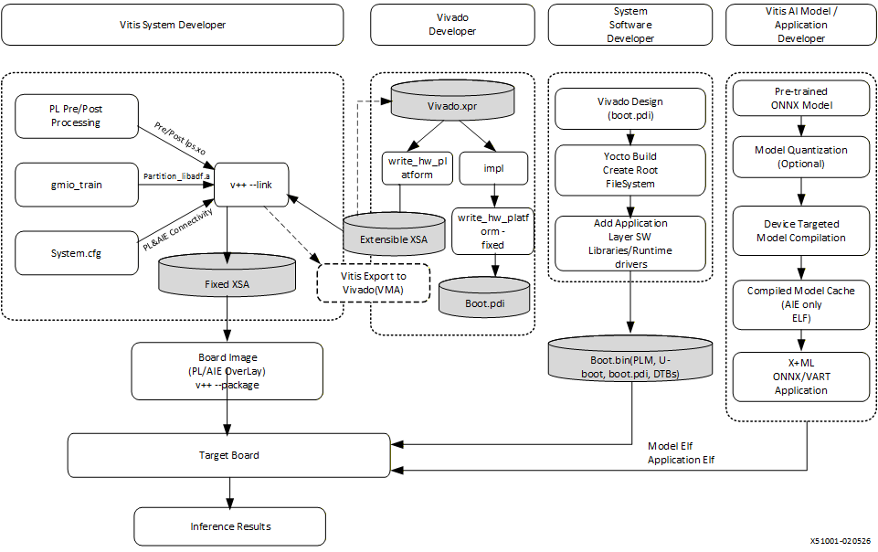
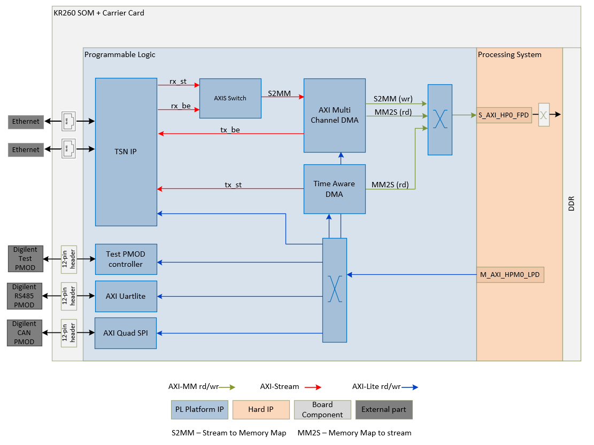
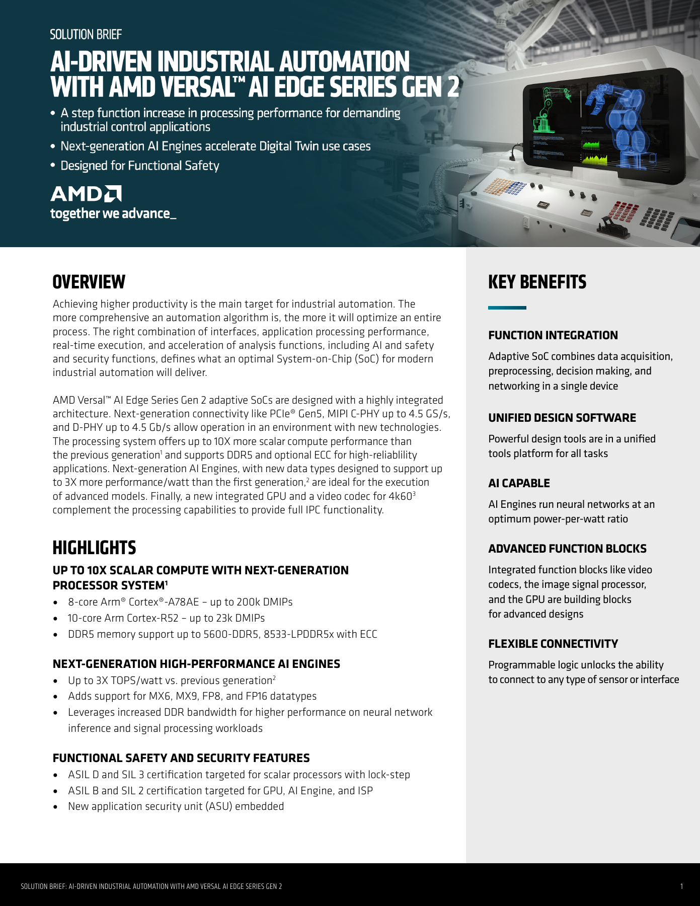

# 08C 核心技术专题：Versal 异构数据流、实时执行域与系统生命周期

资料截止2026-11-04。对象包括 Versal AI Edge Gen2、Vitis AI Gen2公开文档、EDF26.06.1-rev3及Kria TSN参考设计。Gen2芯片、Kria K24/K26和不同板卡示例分别解释；不能把Kria的IP配置认定为全部Versal的原生能力。实现流程详见 [02C](02C_Versal_Compiler_and_Runtime.md)、[02D](02D_EDF_BSP_and_Execution_Domains.md)，本专题关注机制何时转化为可交付优势。

## 1. 痛点：感知、推理、控制与更新有不同约束

图像采集与滤波适合流式并行，网络模型需要张量计算与内存复用，任务编排有复杂分支，执行器控制则要求期限与故障响应。把所有工作集中到一个通用CPU会产生搬运和调度负担，但把所有工作放到加速器也可能因算子不支持而失效。Versal将PL、AIE、应用CPU、实时CPU及NoC放在同一异构系统，给工程师更多配置自由；同时增加软硬件版本、内存所有权和故障域的一致性责任。[S01 Versal Gen2产品brief](https://www.amd.com/content/dam/amd/en/documents/products/adaptive-socs-and-fpgas/versal/versal-ai-edge-gen2-product-brief.pdf)。

产品brief列AIE-MLv2新增FP8、FP16、MX6、MX9，MX6/MX9为共享指数格式；这与08A的CDNA4 OCP MX不应按名称直接等同。本文未取得其完整位编码、共享块大小、舍入及所有kernel数值规则，因此不推导精确压缩率或宣称VLA动作头已支持。brief的“up to3×TOPS/watt”是MX6对首代INT8的预测，2row×8column子阵列、1GHz、0.7V、100°C junction、typical process、60%vector load，并注明预测截至March2024。格式与代际同时变化，不能当同精度量产系统能效实测。

## 2. 软件与硬件并行构建，必须在目标板汇合

图将Vivado平台、Vitis PL/AIE连接、Yocto系统软件及模型编译四条路径汇合到target board。它解释为什么ONNX与模型cache不足以组成系统；board image还要包括overlay、boot、drivers和runtime。图中仍保留“AIE only ELF/Model ELF”，当前6.3默认模型产物采用.rai，不能把图中文字当当前产物格式的唯一依据。[S02 VEK385参考系统架构](https://vitisai.docs.amd.com/projects/gen2/en/latest/docs/integrated_system_reference%20design/system.html)、[S03 Gen2 .rai/cache与编译报告](https://vitisai.docs.amd.com/projects/gen2/en/latest/docs/model_compilation/output.html)。

分析数据链：输入端口→PL/ISP预处理→DDR或片上存储→AIE推理→CPU/PL后处理→控制域/外部驱动。PL可以实现固定数据路的低延迟并行，NoC提供可配置QoS以优先关键流量；具体地址、时钟、位宽、burst与缓冲深度仍由设计决定。没有NoC资源配置与目标workload测量，无法把产品brief的QoS描述换算成capture-to-action期限。

## 3. 分块、融合与custom op：计算函数之外还要定义搬运

Vitis AI提供编译优化和DP/TP配置。DP复制模型处理不同输入，各副本按层lockstep；TP把一次请求分到多个compute block，可用于容量或延迟问题。具体4×4block配置与设备/overlay绑定，`tp_size=0`是自动选择标志，不能乘0算资源，也不能认定总是占满全部阵列。[S04 Gen2 DP/TP与资源配置](https://vitisai.docs.amd.com/projects/gen2/en/latest/docs/model_compilation/multi-tenancy-user-guide.html)、[S05 AMD_VAI_EP_Config](https://vitisai.docs.amd.com/projects/gen2/en/latest/docs/model_compilation/ep-config-file.html)。

分析：DP改善多请求吞吐的条件是输入供应与共享DDR足够；锁步可能把多个副本的权重读取集中到同一时段。TP增加片内并行也增加分块、传输与汇总开销，小算子可能得不偿失。融合减少中间tensor写回，但增加同时活跃的buffer和局部资源，吞吐最优配置未必是单机器人P99最优配置。与GPU TP比较时应核资源对象：这里是片上AIE blocks，不能套用跨GPU通信模型或倍数。

custom op包含YAML、C++ kernel和Python tiler。tiler通过TensorVar、TileBy、`set_l3_to_l2_transfer`、`set_l2_to_l1_transfer`及反向路径定义存储与搬运，再设置kernel符号、参数和调用次数。算术函数正确只解决单核计算，不能保证边界tile、padding、数据覆盖或通信正确。compiler注册`domain.op_type`的YAML，ORT在session创建前注册schema；schema只是解析接口，不是CPU参考实现，更不是数值认证。[S06 AMD_VAI_Custom_Ops](https://vitisai.docs.amd.com/projects/gen2/en/latest/docs/additional_information/custom_ops/custom_ops_introduction.html)、[S07 AMD_VAI_Custom_Infer](https://vitisai.docs.amd.com/projects/gen2/en/latest/docs/additional_information/custom_ops/custom_ops_running_inference.html)。

实际优势来自可根据稳定任务生成专用数据路，代价是保存YAML、kernel、tiler、修改后的ONNX、compiler配置及overlay的组合。包内完整architecture/tiling reference未在本次取得，不能宣称完成全部custom-kernel约束验证。

## 4. 张量与零拷贝：布局、地址、所有权三项同时成立

HCWNCx以channel块存储，标准物理维为`[H,ceil(C/x),W,N,x]`。分析：C=3补到4且dtype相同时，元素数增加4/3，未含对齐或其他tensor；不能把这解释成全模型内存增长33%。HSI里的rt_transformations可接管转换链，不能根据hw_format字符串忽略实际pad/transpose/reshape。[S08 AMD_VAI_Tensor_Formats](https://vitisai.docs.amd.com/projects/gen2/en/latest/docs/misc/tensor_formats.html)。

VART的HW view配XRT BO、DMA-FD或CMA才可能直接使用设备buffer；HW+普通NONCMA会抛错，CPU view涉及转换/复制。用户构造NpuTensor不接管buffer所有权，caller必须保留有效内存。same DDR、能导出FD和“zero-copy”名称都不证明目标NPU能访问正确layout。[S09 Gen2 VART ML张量/所有权/线程模型](https://vitisai.docs.amd.com/projects/gen2/en/latest/docs/appendix/ml-architecture-overview.html)、[S10 Gen2 VART应用开发与零拷贝](https://vitisai.docs.amd.com/projects/gen2/en/latest/docs/appendix/vart_app_guide.html)。

| 条件 | 成立后的价值 | 常见失效 | 验证动作 |
|---|---|---|---|
| layout/dtype/stride匹配 | 省去边界转换 | 只改shape，忘padding/scale | CPU参考与完整HSI比对 |
| buffer设备可访问 | 避免中间复制 | 普通malloc被当CMA | allocator/FD/bank核对 |
| 生命周期与同步正确 | 支持重叠执行 | pending后覆写/提前释放 | 独立in-flight buffer及完成状态 |
| DDR与NoC资源充足 | 提升并发利用率 | 相机、CPU、AIE争用 | 同时采样流量及观测age |

输入量化/输出反量化还要带源ONNX的scale/zero-point；默认cache未必嵌入参数。VART路径需要编译选项或手动传入，不能从默认返回值猜参数。异步`wait`返回JOB_PENDING不允许复用buffer；RESOURCE_UNAVAILABLE是资源满，应用必须决定等待、丢弃旧帧或拒绝新任务。非通用取消API不能自行推成“超时即停止NPU”。[S11 AMD_VAI_Quant_Pipeline](https://vitisai.docs.amd.com/projects/gen2/en/latest/docs/appendix/vart_quantization_pipeline.html)、[S12 Gen2异步执行及样例边界](https://vitisai.docs.amd.com/projects/gen2/en/latest/docs/advanced_concepts/async_execution.html)。

## 5. 多执行域：描述资源不是证明隔离

EDF通过XSA→SDTGen→SDT→Lopper/gen-machine-conf→MACHINE/DTS把硬件交给Linux和RTOS。domain YAML支持processor cluster/cpumask、secure/EL、access、reserved-memory、RPMsg relation、mailbox与carveouts。`no-map`排除Linux常规memory map，但不能凭一个字段证明所有DMA、特权软件与硬件主设备都无法访问该范围。[S13 XSA到SDT/Yocto machine流程](https://edf.docs.amd.com/en/latest/shel/using-the-shel-flow-to-create-a-yocto-project-machine-configuration-from-a-xsa-file.html)、[S14 EDF多domain/资源/通信YAML](https://edf.docs.amd.com/en/latest/osdev/domain-yaml-integration-and-development.html)。

分析执行链：Linux任务提出请求→共享buffer/vring→mailbox通知→RTOS读取并执行→完成消息。地址/size、cache维护、barrier、消息序号及超时属于端到端契约。OpenAMP echo、matrix或proxy演示证明示例通信路径；不能推出最坏延迟、Linux崩溃后的控制连续性或已完成工业保护功能。示例日志有remoteproc上电/停止，Linux echo_test可Ctrl-C结束，这不等于独立电机硬件已停机。[S15 AMD_EDF_OpenAMP_FreeRTOS](https://edf.docs.amd.com/en/latest/discovery/openamp-rpu-firmware-demo-freertos.html)、[S16 AMD_EDF_OpenAMP_Zephyr](https://edf.docs.amd.com/en/latest/discovery/openamp-rpu-firmware-demo-zephyr.html)。

为机器人配置时应分别定义policy调用、controller周期、总线发送与电机servo周期。分析：即使RTOS有固定周期，DDR/NoC仲裁、共享锁、DMA、缓存失效、异常与复位仍可能影响deadline；只有资源配置、压力测量和失效设计才能证明适用条件。lockstep可用于检测部分随机硬件故障，但两个核运行同一错误算法不会自动发现软件逻辑错误。

## 6. TSN：PTP时间与Qbv门控为何还不够

TADMA按PTP时间与Qbv时隙从DDR取scheduled流量，MCDMA处理一般流量，TSN IP完成网络发送。图清楚显示DMA读DDR与PS控制路径，因此即使网络门控准确，数据也必须在时隙前准备好；算法未完成不会被TSN变成准时有效输出。[S17 AMD_TSN_HW](https://xilinx.github.io/kria-apps-docs/kr260/ros2_multinode_communication_via_tsn/0_3/build/html/docs/hw_arch_platform.html)、[S18 AMD_TSN_SW](https://xilinx.github.io/kria-apps-docs/kr260/ros2_multinode_communication_via_tsn/0_3/build/html/docs/sw_arch_platform.html)。

参考设计在KR260/KD240都有PTP、Qbv和frame preemption；KD240从2026.1起关闭802.1CB及Qci以回收K24面积/路由余量。不能根据KR260清单给KD240承诺同样冗余/过滤功能。相关PG275/PG316需要Documentation Lounge访问，本次未取得完整付费/受限IP指南，公开架构也不证明实际项目拥有许可。

分析时序预算应把传感器capture、曝光/读取、预处理、推理、消息准备、等时隙、传输、控制器和执行器分开。PTP同步时钟不能自动修正rolling shutter、相机内部曝光时刻或所有domain时间戳；门控表要与流量、周期、guard band和链路速度一致。时隙丢失可能等待下个周期，故平均网络latency不够，应检查丢包、时钟失锁、grandmaster切换与慢producer。公开设计提供PMOD信号供示波器量同步/latency，尚未提供本研究目标机器人的完整WCET证明。[S19 AMD_TSN_Intro](https://xilinx.github.io/kria-apps-docs/kr260/ros2_multinode_communication_via_tsn/0_3/build/html/docs/introduction.html)。

## 7. 安全与安全认证：机制、目标和证书分别判断

工业brief明确scalar lock-step目标ASIL D/SIL3，GPU/AIE/ISP目标ASIL B/SIL2；产品brief使用random/systematic不同层次的表述。必须取得准确SKU、revision、证书范围、safety manual、诊断覆盖与集成假设才能决定项目适用性。100kDMIPs也是指定A78AE lockstep配置的pre-silicon估计，不能当ROS或机器人控制实测。[S20 AMD_Versal_Gen2_Industrial](https://www.amd.com/content/dam/amd/en/documents/products/adaptive-socs-and-fpgas/versal/versal-ai-edge-gen2-industrial-solution-brief.pdf)、[S01 Versal Gen2产品brief](https://www.amd.com/content/dam/amd/en/documents/products/adaptive-socs-and-fpgas/versal/versal-ai-edge-gen2-product-brief.pdf)。

产品brief列PMC管理secure boot/device services，ASU提供runtime HSM，DDR inline crypto支持AES-XTS或AES-GCM。这些是组件功能事实；本文未取得目标平台完整key provisioning、撤销、防回滚、debug锁定、算法模式与认证范围，不能编造完整信任链。分析层面，启动认证检查软件来源，内存加密保护特定数据路径，两者不自动限制授权程序的逻辑错误，也不替代碰撞保护、急停或失效安全控制。

## 8. 更新与DFX：可重配置的收益以一致性为代价

EDF把Segmented Configuration与DFX区分；PL描述由SDTGen导出，post-boot模块与设备树需要对应，Versal采用PDI而ZynqMP采用相关bin路径。文档`/lib/firmware/xilinx`与后文`xlinx`存在拼写差异，不能直接复制后者部署。[S21 Segmented configuration与DFX区别](https://edf.docs.amd.com/en/latest/seg/segmented-configuration-or-dynamic-function-exchange.html)、[S22 EDF segmented PL装载与firmware](https://edf.docs.amd.com/en/latest/seg/amd-edf-segmented-configuration-using-amd-yocto-project-recipes.html)。

分析：从旧加速器切换到新加速器前应停止新提交、等待/隔离旧DMA、确保buffer和设备使用者退出，再按验证流程加载匹配硬件、DT、driver与模型；具体平台支持哪些热切换行为须另验。它可能允许算法现场升级或复用PL资源，但切换耗时、错误恢复与安全状态未公开时，不能宣称零中断控制。

生产指南明确EDF是开发基础，持续安全/bug维护由产品团队或商业OSV承担。Yocto可生成SPDX SBOM并进行CVE扫描，扫描不等补丁已测试，也不覆盖默认未纳入清单的firmware、模型、第三方IP和本体SDK。[S23 EDF从原型到生产维护指南](https://edf.docs.amd.com/en/latest/moving-from-amd-software-stacks-to-production-deployment.html)。完整发布应绑定boot/PL/RTOS/rootfs/model/schema及校准数据的兼容组合，验证更新中断、断电和回退；本文不因能运行dfx-mgr而认定具备量产OTA服务。

## 9. 优势条件、竞争机制与放行证据

Versal适合稳定的多路工业感知、固定数据路、定制I/O和明确实时域分工；它提供PL+片上阵列+处理器的联合优化空间。相较通用GPU路线，更多接口和数据流可硬件定制，但需要FPGA时序收敛、BSP、模型编译和现场维护人员；相较MCU/独立控制器，模型能力更丰富，但不能据此取消独立安全控制。没有同任务实测不列倍数排名。

放行应先固定模型与动作语义，核查阵列/PL/DDR配置和工具版本，测采集到执行的完整age、P99与持续热条件；再注入CPU高负载、DDR争用、IPC停滞、TSN失锁、推理超时和更新失败，观察独立保护路径。官方峰值/预测与demo只作为设计线索；最终WCET、安全证据与运营收益目前仍需目标系统验证。

## 参考资料与本地原件

S编号对应正文原URL。每项有原响应、HTML/PDF及metadata和依赖。partial_static表示已取得可读正文但部分静态依赖缺失，不保证像素或动态交互完整。发布时间/版本与采集时间分开，导入既有原响应的来源保留原采集时间；没有将失败页/导航壳作为有效证据。

| 原始来源 | 版本/日期/条件 | 本地原件与metadata | 归档状态 |
|---|---|---|---|
| [S01 Versal Gen2产品brief](https://www.amd.com/content/dam/amd/en/documents/products/adaptive-socs-and-fpgas/versal/versal-ai-edge-gen2-product-brief.pdf) | ©2024；PID3070664；3页；部分预测2024-03 | [HTML/PDF/源码原件](REFERENCES.md#ref-42bfa84e87fc0e0c) · [metadata](REFERENCES.md#ref-42bfa84e87fc0e0c) | complete_static |
| [S02 VEK385参考系统架构](https://vitisai.docs.amd.com/projects/gen2/en/latest/docs/integrated_system_reference%20design/system.html) | Gen2 6.3 public guide；Vivado/Vitis 2026.1；Rev-A/B评估硅片 | [HTML/PDF/源码原件](REFERENCES.md#ref-1f9caa805643de0a) · [metadata](REFERENCES.md#ref-1f9caa805643de0a) | complete_static |
| [S03 Gen2 .rai/cache与编译报告](https://vitisai.docs.amd.com/projects/gen2/en/latest/docs/model_compilation/output.html) | Gen2 6.3 public guide；Vivado/Vitis 2026.1；Rev-A/B评估硅片 | [HTML/PDF/源码原件](REFERENCES.md#ref-2c2e1405bc84b31f) · [metadata](REFERENCES.md#ref-2c2e1405bc84b31f) | complete_static |
| [S04 Gen2 DP/TP与资源配置](https://vitisai.docs.amd.com/projects/gen2/en/latest/docs/model_compilation/multi-tenancy-user-guide.html) | Gen2 6.3 public guide；Vivado/Vitis 2026.1；Rev-A/B评估硅片 | [HTML/PDF/源码原件](REFERENCES.md#ref-02b353db51206eb3) · [metadata](REFERENCES.md#ref-02b353db51206eb3) | complete_static |
| [S05 AMD_VAI_EP_Config](https://vitisai.docs.amd.com/projects/gen2/en/latest/docs/model_compilation/ep-config-file.html) | 官方公开快照；版本/适用条件见正文，采集日期不等发布日期 | [HTML/PDF/源码原件](REFERENCES.md#ref-a3cb640b1e9ddc41) · [metadata](REFERENCES.md#ref-a3cb640b1e9ddc41) | complete_static |
| [S06 AMD_VAI_Custom_Ops](https://vitisai.docs.amd.com/projects/gen2/en/latest/docs/additional_information/custom_ops/custom_ops_introduction.html) | 官方公开快照；版本/适用条件见正文，采集日期不等发布日期 | [HTML/PDF/源码原件](REFERENCES.md#ref-1f320b36f994e3ae) · [metadata](REFERENCES.md#ref-1f320b36f994e3ae) | complete_static |
| [S07 AMD_VAI_Custom_Infer](https://vitisai.docs.amd.com/projects/gen2/en/latest/docs/additional_information/custom_ops/custom_ops_running_inference.html) | 官方公开快照；版本/适用条件见正文，采集日期不等发布日期 | [HTML/PDF/源码原件](REFERENCES.md#ref-9345ee8f865efba4) · [metadata](REFERENCES.md#ref-9345ee8f865efba4) | complete_static |
| [S08 AMD_VAI_Tensor_Formats](https://vitisai.docs.amd.com/projects/gen2/en/latest/docs/misc/tensor_formats.html) | 官方公开快照；版本/适用条件见正文，采集日期不等发布日期 | [HTML/PDF/源码原件](REFERENCES.md#ref-aec125dfb6f54880) · [metadata](REFERENCES.md#ref-aec125dfb6f54880) | complete_static |
| [S09 Gen2 VART ML张量/所有权/线程模型](https://vitisai.docs.amd.com/projects/gen2/en/latest/docs/appendix/ml-architecture-overview.html) | Gen2 6.3 public guide；Vivado/Vitis 2026.1；Rev-A/B评估硅片 | [HTML/PDF/源码原件](REFERENCES.md#ref-b867b657782bdc40) · [metadata](REFERENCES.md#ref-b867b657782bdc40) | complete_static |
| [S10 Gen2 VART应用开发与零拷贝](https://vitisai.docs.amd.com/projects/gen2/en/latest/docs/appendix/vart_app_guide.html) | Gen2 6.3 public guide；Vivado/Vitis 2026.1；Rev-A/B评估硅片 | [HTML/PDF/源码原件](REFERENCES.md#ref-ac4eac67a33411e1) · [metadata](REFERENCES.md#ref-ac4eac67a33411e1) | complete_static |
| [S11 AMD_VAI_Quant_Pipeline](https://vitisai.docs.amd.com/projects/gen2/en/latest/docs/appendix/vart_quantization_pipeline.html) | 官方公开快照；版本/适用条件见正文，采集日期不等发布日期 | [HTML/PDF/源码原件](REFERENCES.md#ref-9e4369995e24c258) · [metadata](REFERENCES.md#ref-9e4369995e24c258) | complete_static |
| [S12 Gen2异步执行及样例边界](https://vitisai.docs.amd.com/projects/gen2/en/latest/docs/advanced_concepts/async_execution.html) | Gen2 6.3 public guide；Vivado/Vitis 2026.1；Rev-A/B评估硅片 | [HTML/PDF/源码原件](REFERENCES.md#ref-a5b950f414554940) · [metadata](REFERENCES.md#ref-a5b950f414554940) | complete_static |
| [S13 XSA到SDT/Yocto machine流程](https://edf.docs.amd.com/en/latest/shel/using-the-shel-flow-to-create-a-yocto-project-machine-configuration-from-a-xsa-file.html) | EDF 26.06.1-rev3文档快照；release v26.06.1仅部分重建 | [HTML/PDF/源码原件](REFERENCES.md#ref-d5517b0dc3c293f5) · [metadata](REFERENCES.md#ref-d5517b0dc3c293f5) | complete_static |
| [S14 EDF多domain/资源/通信YAML](https://edf.docs.amd.com/en/latest/osdev/domain-yaml-integration-and-development.html) | EDF 26.06.1-rev3文档快照；release v26.06.1仅部分重建 | [HTML/PDF/源码原件](REFERENCES.md#ref-3e5c09c7147686e3) · [metadata](REFERENCES.md#ref-3e5c09c7147686e3) | complete_static |
| [S15 AMD_EDF_OpenAMP_FreeRTOS](https://edf.docs.amd.com/en/latest/discovery/openamp-rpu-firmware-demo-freertos.html) | 官方公开快照；版本/适用条件见正文，采集日期不等发布日期 | [HTML/PDF/源码原件](REFERENCES.md#ref-b61916dd92184f89) · [metadata](REFERENCES.md#ref-b61916dd92184f89) | complete_static |
| [S16 AMD_EDF_OpenAMP_Zephyr](https://edf.docs.amd.com/en/latest/discovery/openamp-rpu-firmware-demo-zephyr.html) | 官方公开快照；版本/适用条件见正文，采集日期不等发布日期 | [HTML/PDF/源码原件](REFERENCES.md#ref-0b63b8042e4931e0) · [metadata](REFERENCES.md#ref-0b63b8042e4931e0) | complete_static |
| [S17 AMD_TSN_HW](https://xilinx.github.io/kria-apps-docs/kr260/ros2_multinode_communication_via_tsn/0_3/build/html/docs/hw_arch_platform.html) | 官方公开快照；版本/适用条件见正文，采集日期不等发布日期 | [HTML/PDF/源码原件](REFERENCES.md#ref-5963c5dfcbb51f61) · [metadata](REFERENCES.md#ref-5963c5dfcbb51f61) | partial_static |
| [S18 AMD_TSN_SW](https://xilinx.github.io/kria-apps-docs/kr260/ros2_multinode_communication_via_tsn/0_3/build/html/docs/sw_arch_platform.html) | 官方公开快照；版本/适用条件见正文，采集日期不等发布日期 | [HTML/PDF/源码原件](REFERENCES.md#ref-868c5a65ce5a4028) · [metadata](REFERENCES.md#ref-868c5a65ce5a4028) | partial_static |
| [S19 AMD_TSN_Intro](https://xilinx.github.io/kria-apps-docs/kr260/ros2_multinode_communication_via_tsn/0_3/build/html/docs/introduction.html) | 官方公开快照；版本/适用条件见正文，采集日期不等发布日期 | [HTML/PDF/源码原件](REFERENCES.md#ref-864e8edb679c4b1d) · [metadata](REFERENCES.md#ref-864e8edb679c4b1d) | partial_static |
| [S20 AMD_Versal_Gen2_Industrial](https://www.amd.com/content/dam/amd/en/documents/products/adaptive-socs-and-fpgas/versal/versal-ai-edge-gen2-industrial-solution-brief.pdf) | 官方公开快照；版本/适用条件见正文，采集日期不等发布日期 | [HTML/PDF/源码原件](REFERENCES.md#ref-f02e5a12a026db64) · [metadata](REFERENCES.md#ref-f02e5a12a026db64) | complete_static |
| [S21 Segmented configuration与DFX区别](https://edf.docs.amd.com/en/latest/seg/segmented-configuration-or-dynamic-function-exchange.html) | EDF 26.06.1-rev3文档快照；release v26.06.1仅部分重建 | [HTML/PDF/源码原件](REFERENCES.md#ref-6266e36b64ca923a) · [metadata](REFERENCES.md#ref-6266e36b64ca923a) | complete_static |
| [S22 EDF segmented PL装载与firmware](https://edf.docs.amd.com/en/latest/seg/amd-edf-segmented-configuration-using-amd-yocto-project-recipes.html) | EDF 26.06.1-rev3文档快照；release v26.06.1仅部分重建 | [HTML/PDF/源码原件](REFERENCES.md#ref-66ccb32d4be9da76) · [metadata](REFERENCES.md#ref-66ccb32d4be9da76) | complete_static |
| [S23 EDF从原型到生产维护指南](https://edf.docs.amd.com/en/latest/moving-from-amd-software-stacks-to-production-deployment.html) | EDF 26.06.1-rev3文档快照；release v26.06.1仅部分重建 | [HTML/PDF/源码原件](REFERENCES.md#ref-c93d09e25f993c7a) · [metadata](REFERENCES.md#ref-c93d09e25f993c7a) | complete_static |

[主张、图源及人工核验](research_state/evidence/08C_Versal_Dataflow_RealTime_and_Lifecycle.json) · [引用完整清单](research_state/depth_08/08C_Versal_Dataflow_RealTime_and_Lifecycle_sources.json) · [专题资料索引](REFERENCES.md)。本次未安装SDK/训练模型/刷板/接本体实测，测量与交付范围以正文为准。
