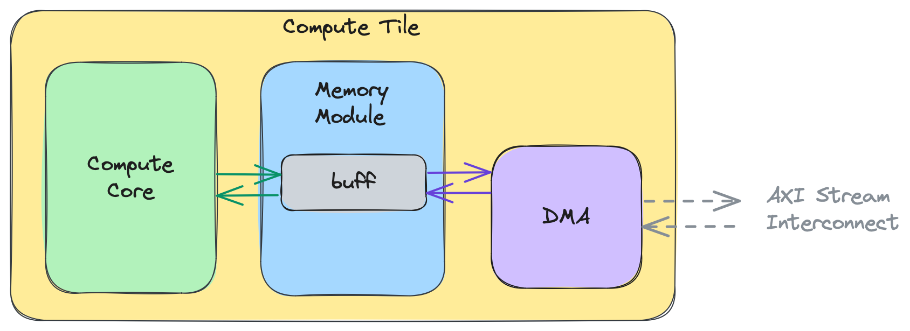
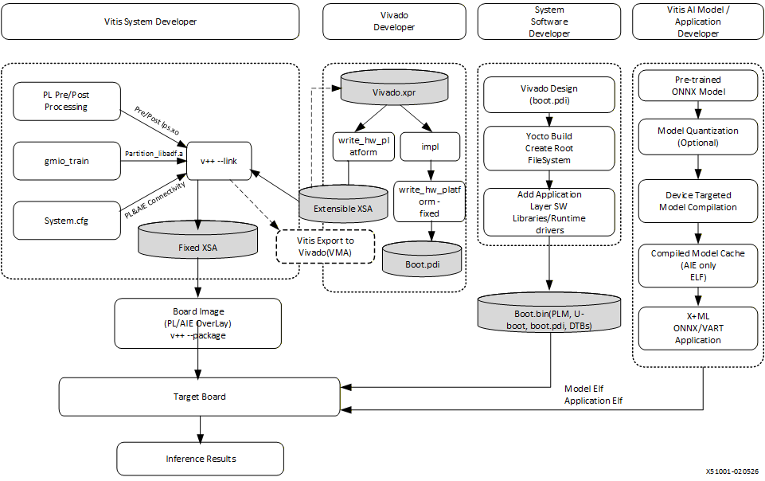

# 08 AMD 核心技术护城河：能力地图与成立条件

资料截止2026-11-04。AMD具身平台的核心积累可以分为GPU通用并行与数值格式、XDNA片上数据流、Versal可编程异构系统，以及软硬件交付生态。它们对应不同产品与工作负载；本章给证据地图，详细原理与主张核验保存在独立专题。护城河在这里指客户难以轻易替换的实现与交付能力，是基于公开证据的分析判断，不是市场份额排名。

## 1. 三个专题及阅读入口

| 专题 | 核心问题 | 深入到的机制 | 主要证据 | 成立/失效边界 |
|---|---|---|---|---|
| [08A GPU数值与执行](08A_GPU_Memory_and_Execution.md) | 大模型容量、带宽和提交开销 | CDNA4/OCP MX、LDS bank、HBM分区、HMM/fence、Graph/pool | 白皮书、HIP API、CK Tile指南 | 格式/kernel/拓扑匹配；服务器能力不套端侧 |
| [08B XDNA与IRON](08B_XDNA_Numerics_and_Dataflow.md) | NPU片上计算与传输如何协作 | tile/Worker/FIFO、layout、DMA token/BD/queue、JIT缓存 | 官方源码、编程/编译/DMA指南 | 局部复用与同步正确；动态图/拥塞/版本有代价 |
| [08C Versal系统](08C_Versal_Dataflow_RealTime_and_Lifecycle.md) | 感知、推理、控制和更新如何交付 | PL/AIE/NoC、custom tiler、HSI、OpenAMP、TSN、DFX/维护 | Gen2 brief、VART/EDF/IP架构 | 专用数据路及团队能力；目标认证/WCET另验 |

三个专题都沿痛点→模块/数据流→API或实现→收益条件→测量口径→对标→限制展开。数值冲突、版本冲突和未取得的受限资料保留在正文与证据JSON，没有以更多文字替代不存在的实测。

## 2. GPU：硬件规模与软件控制需要同时兑现

CDNA4提供多XCD/IOD、HBM与新的低位宽matrix路径；MI355X的容量/理论带宽有助于减少大模型分拆或跨卡通信，但它是高功率服务器卡，不能放进移动机器人功耗预算。MXFP4共享scale可减少理想存储和矩阵计算量，实际收益仍取决于block布局、kernel、未量化层、workspace与动作误差。[S01 CDNA4架构白皮书](https://www.amd.com/content/dam/amd/en/documents/instinct-tech-docs/white-papers/amd-cdna-4-architecture-whitepaper.pdf)、[S02 MI350微架构](https://rocm.docs.amd.com/en/latest/reference/gpu-arch/mi350.html)。

CK Tile把global→LDS→register→MFMA的数据复用暴露为可调实现。bank conflict、VGPR/LDS占用与驻留量可能让看似更大tile反而变慢；HIP Graph减少提交，内存池减少分配，但都不能替代sensor timestamp和执行器响应。unified memory可迁移与pinned memory可访问也不等高带宽，首触fault要与warm推理区分。[S03 CK Tile LDS bank指南](https://rocm.docs.amd.com/projects/composable_kernel/en/latest/conceptual/ck_tile/hardware/lds_bank_conflicts.html)、[S04 AMD_HIP_Graphs](https://rocm.docs.amd.com/projects/HIP/en/latest/how-to/hip_runtime_api/hipgraph.html)、[S05 HIP统一内存与设备条件](https://rocm.docs.amd.com/projects/HIP/en/latest/how-to/hip_runtime_api/memory_management/unified_memory.html)。

分析替换成本来自训练/推理库、kernel tuning、数值校准与运行环境。公开API和源码给迁移者更多可见性，同时现有CUDA扩展、特定仿真backend或目标Radeon/APU支持矩阵可能增加移植工作。不能把HIPIFY语法转换当所有模型性能、插件、kernel与本体应用都已迁移。

## 3. XDNA：直接控制片上数据流的价值与责任

图说明NPU局部计算和DMA共同访问memory，再通过stream连接其他tile。IRON可把专用filter/GEMM/张量重排表达为Worker、FIFO和Runtime，让工程师控制局部复用和搬运；它补充主流Ryzen AI推理工具，不替代模型框架或完整机器人runtime。[S06 AMD08_IRON_Latest_Home](https://xilinx.github.io/mlir-aie/latest/)、[S07 IRON官方源码与安装说明](https://github.com/Xilinx/mlir-aie)。

该官方tile图来自ObjectFIFO编程指南，说明同步和数据搬运的实现对象；没有在线模型性能刻度。[S08 AMD08_IRON_Dataflow](https://xilinx.github.io/mlir-aie/latest/programming_guide/section-2/section-2a/)。

该路径的优势条件是工作集、布局与固定kernel相匹配。反面条件也很具体：FIFO token不平衡、descriptor提前复用、DMA队列溢出或compile-time参数频繁变化，都可能把局部算力优势转成阻塞与冷启动。指南对AIE2每channel队列4深度及无背压有明确说明，编译器会为潜在满队列插入poll；这改善正确性但不能宣布WCET有界。[S09 AMD08_IRON_DMA](https://xilinx.github.io/mlir-aie/latest/programming_guide/section-2/section-2d/DMATasks/)、[S10 AMD08_IRON_Compile](https://xilinx.github.io/mlir-aie/latest/programming_guide/compilation_stages/)。

分析：可控制空间增加了定制优化能力，也要求维护源码/wheel/Peano/driver组合。若产品需频繁更换模型、相机数或horizon，先用主流EP验证支持，只有测到具体瓶颈时才引入低层定制。未取得X199完整IRON BSP交付证据的地方保留为未知。

## 4. Versal：可定制接口与异构计算形成系统级空间

图将PL/AIE design、Vivado平台、Yocto和模型编译汇合到board；其中ELF文字有版本残留，当前产物以6.3.rai文档为准。这个结构支持“硬件前处理与模型协同优化”，不能证明任意预训练模型均完整映射AIE。custom op还必须同时实现kernel、tiler与schema注册；HSI/layout和buffer所有权决定能否真实省复制。[S11 VEK385参考系统架构](https://vitisai.docs.amd.com/projects/gen2/en/latest/docs/integrated_system_reference%20design/system.html)、[S12 Gen2 .rai/cache与编译报告](https://vitisai.docs.amd.com/projects/gen2/en/latest/docs/model_compilation/output.html)、[S13 AMD_VAI_Custom_Ops](https://vitisai.docs.amd.com/projects/gen2/en/latest/docs/additional_information/custom_ops/custom_ops_introduction.html)、[S14 Gen2 VART ML张量/所有权/线程模型](https://vitisai.docs.amd.com/projects/gen2/en/latest/docs/appendix/ml-architecture-overview.html)。

PL适合稳定并行的数据路，AIE适合张量/信号处理，应用CPU处理复杂编排，实时域可承担有明确契约的控制任务。OpenAMP的资源描述与消息路径不自动构成全面隔离；TSN按时间发数据也不能使尚未完成的模型准时输出。Gen2的ASIL/SIL表述存在目标/设计条件，必须取得具体SKU证书、安全手册和集成假设才可用于认证项目。[S15 EDF多domain/资源/通信YAML](https://edf.docs.amd.com/en/latest/osdev/domain-yaml-integration-and-development.html)、[S16 AMD_TSN_HW](https://xilinx.github.io/kria-apps-docs/kr260/ros2_multinode_communication_via_tsn/0_3/build/html/docs/hw_arch_platform.html)、[S17 AMD_Versal_Gen2_Industrial](https://www.amd.com/content/dam/amd/en/documents/products/adaptive-socs-and-fpgas/versal/versal-ai-edge-gen2-industrial-solution-brief.pdf)。

分析替换成本包括IP、时序收敛、载板、BSP、工具链、模型布局和产测，而不是单个芯片价格。可重配置允许迭代，也使更新必须绑定boot/PL/driver/RTOS/model兼容组。若团队没有FPGA/BSP和维护责任，通用方案可能更容易交付；没有同条件TCO不能断言Versal必然更贵或更省。

## 5. 对标与性能证据应分层

| 同一痛点 | AMD公开机制 | 对标维度 | 不能直接比较的字段 |
|---|---|---|---|
| 低精度带宽 | CDNA4 MX、Quark及Gen2格式 | scale/块大小、kernel、敏感层误差 | MX/INT4/NVFP4名称或跨精度峰值 |
| 周期执行开销 | HIP Graph、pool、预编译 | 稳态提交、内存、动态变化 | graph存在不等端到端时延 |
| 流式数据复用 | IRON tile/FIFO、Versal tiler/PL | 数据量、布局、sync、工作集 | TOPS不等有效吞吐 |
| 资源/控制期限 | GPU partition、EDF domains、TSN | 隔离范围、共享设施、失效响应 | 空间分区/PTP不等整机WCET |
| 产品可维护性 | SOM/伙伴、SHEL/Yocto、OSV | 版本集、PCN、备件、SLA | 生命周期规划不等软件订阅 |

详细友商机制比较及原始官方链接放在专题；这里不重复配置。GPU matrix峰值、片上带宽、模型吞吐、任务成功、安全响应和运营收益属于不同层，只有测量端点、输入、dtype、power、batch、版本一致才可讨论数值优劣。无同条件数据时保持机制比较。

## 6. 护城河结论与仍需证明的部分

公开证据支持AMD在通用GPU、片上阵列编译、FPGA接口及异构系统构建方面有可深入利用的技术积累。它们让服务器训练、端侧推理与工业前端有多种组合，优势不是所有产品共享一个自动完成的机器人栈。对客户而言，真正难替换的是已经验证的kernel、校准数据、载板/BSP、工具版本和长期交付责任；品牌入口与源码仓库数量不足以证明这一点。

主要短板条件是跨SKU支持分散、动态图/算子/布局仍需核验、未来开发平台完整料号与交期未取得，以及认证/运营成功证据不足。EDF生产指南明确长期安全维护由产品团队或商业OSV承担，源码可得并不自动生成服务合同。[S18 EDF从原型到生产维护指南](https://edf.docs.amd.com/en/latest/moving-from-amd-software-stacks-to-production-deployment.html)。

本章未做SDK安装、板端benchmark、真机或运营实验。A/B/C专题保留完整引用、原图哈希、人工核验、结构检查与零网络请求的最终复用记录；部分HTML依赖缺失及新增资料连接失败已披露。下一章把这些事实转成市场、交付、成本和场景的条件选型，仍不以技术能力代替商业ROI。

## 参考资料与本地原件

S编号对应正文原URL。每项有原响应、HTML/PDF及metadata和依赖。partial_static表示已取得可读正文但部分静态依赖缺失，不保证像素或动态交互完整。发布时间/版本与采集时间分开，导入既有原响应的来源保留原采集时间；没有将失败页/导航壳作为有效证据。

| 原始来源 | 版本/日期/条件 | 本地原件与metadata | 归档状态 |
|---|---|---|---|
| [S01 CDNA4架构白皮书](https://www.amd.com/content/dam/amd/en/documents/instinct-tech-docs/white-papers/amd-cdna-4-architecture-whitepaper.pdf) | PID2258402-D，2026-09-28 | [HTML/PDF/源码原件](REFERENCES.md#ref-3cf28c503c62dd2b) · [metadata](REFERENCES.md#ref-3cf28c503c62dd2b) | complete_static |
| [S02 MI350微架构](https://rocm.docs.amd.com/en/latest/reference/gpu-arch/mi350.html) | 归档页面标ROCm10.1.0；原表口径见正文 | [HTML/PDF/源码原件](REFERENCES.md#ref-c4dd48c6cf36185a) · [metadata](REFERENCES.md#ref-c4dd48c6cf36185a) | partial_static |
| [S03 CK Tile LDS bank指南](https://rocm.docs.amd.com/projects/composable_kernel/en/latest/conceptual/ck_tile/hardware/lds_bank_conflicts.html) | CK1.3.0文档快照 | [HTML/PDF/源码原件](REFERENCES.md#ref-b93f01d6a94ce5fd) · [metadata](REFERENCES.md#ref-b93f01d6a94ce5fd) | partial_static |
| [S04 AMD_HIP_Graphs](https://rocm.docs.amd.com/projects/HIP/en/latest/how-to/hip_runtime_api/hipgraph.html) | 官方公开快照；版本/适用条件见正文，采集日期不等发布日期 | [HTML/PDF/源码原件](REFERENCES.md#ref-0077a3438456f5e6) · [metadata](REFERENCES.md#ref-0077a3438456f5e6) | partial_static |
| [S05 HIP统一内存与设备条件](https://rocm.docs.amd.com/projects/HIP/en/latest/how-to/hip_runtime_api/memory_management/unified_memory.html) | HIP/HIPIFY latest快照；10.1矩阵HIP7.16.0、HIPIFY10.1.0；硬件特性有条件 | [HTML/PDF/源码原件](REFERENCES.md#ref-37f458b46d3d4e56) · [metadata](REFERENCES.md#ref-37f458b46d3d4e56) | partial_static |
| [S06 AMD08_IRON_Latest_Home](https://xilinx.github.io/mlir-aie/latest/) | 官方公开快照；版本/适用条件见正文，采集日期不等发布日期 | [HTML/PDF/源码原件](REFERENCES.md#ref-d3aec3ce521a7f4c) · [metadata](REFERENCES.md#ref-d3aec3ce521a7f4c) | complete_static |
| [S07 IRON官方源码与安装说明](https://github.com/Xilinx/mlir-aie) | 2026-11-04采集main快照；实际release另验 | [HTML/PDF/源码原件](REFERENCES.md#ref-d8a68a736295ae54) · [metadata](REFERENCES.md#ref-d8a68a736295ae54) | partial_static |
| [S08 AMD08_IRON_Dataflow](https://xilinx.github.io/mlir-aie/latest/programming_guide/section-2/section-2a/) | 官方公开快照；版本/适用条件见正文，采集日期不等发布日期 | [HTML/PDF/源码原件](REFERENCES.md#ref-637e26cd5aab37a1) · [metadata](REFERENCES.md#ref-637e26cd5aab37a1) | complete_static |
| [S09 AMD08_IRON_DMA](https://xilinx.github.io/mlir-aie/latest/programming_guide/section-2/section-2d/DMATasks/) | 官方公开快照；版本/适用条件见正文，采集日期不等发布日期 | [HTML/PDF/源码原件](REFERENCES.md#ref-d111f72ab7a785e8) · [metadata](REFERENCES.md#ref-d111f72ab7a785e8) | complete_static |
| [S10 AMD08_IRON_Compile](https://xilinx.github.io/mlir-aie/latest/programming_guide/compilation_stages/) | 官方公开快照；版本/适用条件见正文，采集日期不等发布日期 | [HTML/PDF/源码原件](REFERENCES.md#ref-2223a32b0d2cffaf) · [metadata](REFERENCES.md#ref-2223a32b0d2cffaf) | complete_static |
| [S11 VEK385参考系统架构](https://vitisai.docs.amd.com/projects/gen2/en/latest/docs/integrated_system_reference%20design/system.html) | Gen2 6.3 public guide；Vivado/Vitis 2026.1；Rev-A/B评估硅片 | [HTML/PDF/源码原件](REFERENCES.md#ref-1f9caa805643de0a) · [metadata](REFERENCES.md#ref-1f9caa805643de0a) | complete_static |
| [S12 Gen2 .rai/cache与编译报告](https://vitisai.docs.amd.com/projects/gen2/en/latest/docs/model_compilation/output.html) | Gen2 6.3 public guide；Vivado/Vitis 2026.1；Rev-A/B评估硅片 | [HTML/PDF/源码原件](REFERENCES.md#ref-2c2e1405bc84b31f) · [metadata](REFERENCES.md#ref-2c2e1405bc84b31f) | complete_static |
| [S13 AMD_VAI_Custom_Ops](https://vitisai.docs.amd.com/projects/gen2/en/latest/docs/additional_information/custom_ops/custom_ops_introduction.html) | 官方公开快照；版本/适用条件见正文，采集日期不等发布日期 | [HTML/PDF/源码原件](REFERENCES.md#ref-1f320b36f994e3ae) · [metadata](REFERENCES.md#ref-1f320b36f994e3ae) | complete_static |
| [S14 Gen2 VART ML张量/所有权/线程模型](https://vitisai.docs.amd.com/projects/gen2/en/latest/docs/appendix/ml-architecture-overview.html) | Gen2 6.3 public guide；Vivado/Vitis 2026.1；Rev-A/B评估硅片 | [HTML/PDF/源码原件](REFERENCES.md#ref-b867b657782bdc40) · [metadata](REFERENCES.md#ref-b867b657782bdc40) | complete_static |
| [S15 EDF多domain/资源/通信YAML](https://edf.docs.amd.com/en/latest/osdev/domain-yaml-integration-and-development.html) | EDF 26.06.1-rev3文档快照；release v26.06.1仅部分重建 | [HTML/PDF/源码原件](REFERENCES.md#ref-3e5c09c7147686e3) · [metadata](REFERENCES.md#ref-3e5c09c7147686e3) | complete_static |
| [S16 AMD_TSN_HW](https://xilinx.github.io/kria-apps-docs/kr260/ros2_multinode_communication_via_tsn/0_3/build/html/docs/hw_arch_platform.html) | 官方公开快照；版本/适用条件见正文，采集日期不等发布日期 | [HTML/PDF/源码原件](REFERENCES.md#ref-5963c5dfcbb51f61) · [metadata](REFERENCES.md#ref-5963c5dfcbb51f61) | partial_static |
| [S17 AMD_Versal_Gen2_Industrial](https://www.amd.com/content/dam/amd/en/documents/products/adaptive-socs-and-fpgas/versal/versal-ai-edge-gen2-industrial-solution-brief.pdf) | 官方公开快照；版本/适用条件见正文，采集日期不等发布日期 | [HTML/PDF/源码原件](REFERENCES.md#ref-f02e5a12a026db64) · [metadata](REFERENCES.md#ref-f02e5a12a026db64) | complete_static |
| [S18 EDF从原型到生产维护指南](https://edf.docs.amd.com/en/latest/moving-from-amd-software-stacks-to-production-deployment.html) | EDF 26.06.1-rev3文档快照；release v26.06.1仅部分重建 | [HTML/PDF/源码原件](REFERENCES.md#ref-c93d09e25f993c7a) · [metadata](REFERENCES.md#ref-c93d09e25f993c7a) | complete_static |

[主张、图源及人工核验](research_state/evidence/08_Core_Technology_Moat.json) · [引用完整清单](research_state/depth_08/08_Core_Technology_Moat_sources.json) · [专题资料索引](REFERENCES.md)。本次未安装SDK/训练模型/刷板/接本体实测，测量与交付范围以正文为准。
