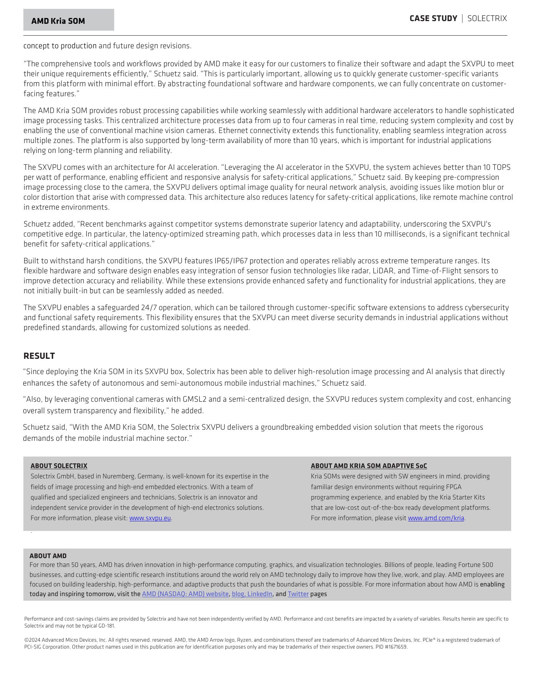
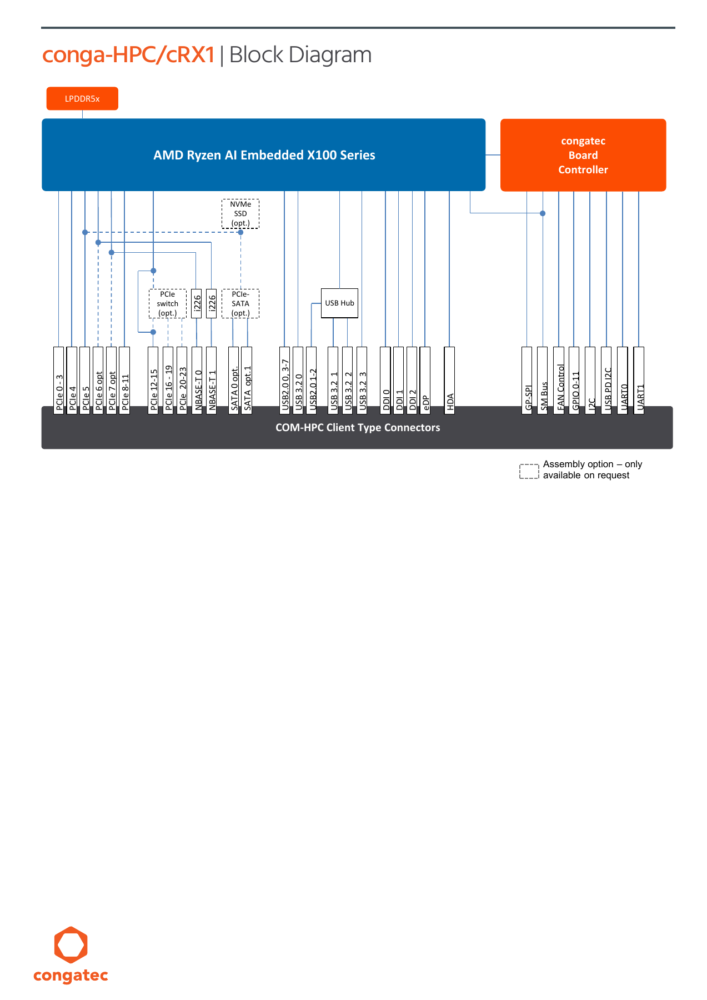

# 09 AMD 具身智能平台 SWOT、成本与条件选型

资料截止2026-11-04。本文吸收已完成01—08，研究从模型科研、机器人部署到工业量产的选型条件。结论：AMD值得进入候选范围的方向包括已有ROCm路径的训练/推理、可验证的x86端侧部署，以及能利用PL/AIE与定制接口的工业感知；是否采用应由任务契约、目标SKU支持、闭环表现和交付责任共同决定。本文没有机器人市占率、独立TCO或现场ROI实测，不给品牌综合排名。

## 1. 市场口径：平台能力、采用和运营收入不能混算

AMD覆盖服务器GPU、嵌入式APU、FPGA/Adaptive SoC和SOM等对象，robotics入口也包含模型、仿真和伙伴。它支持多种部署组合，但产品目录数量不是机器人安装量，更不是芯片市占率。[S01 AMD机器人方案](https://www.amd.com/en/solutions/robotics.html)。若讨论市场份额，至少需要限定机器人种类、地域、年份、出货或存量、主计算芯片还是辅助器件，以及统计分母。一个系统同时使用AMD CPU、其他AI加速器和外部安全控制器时，也不能给多个品牌各计一台独占主平台。

本次尝试定位AMD年报/SEC原件与监管原文；检索结果和取得状态保存于research_state，未取得有效正文的材料不进入参考表。不填公司最新收入、具身业务收入或市场份额；公司总收入、Data Center或Embedded segment即使取得，也仍需另有分拆依据才能当具身市场规模。现有客户case主要证明具体产品采用与演示，不能替代完整商业营收或市场统计。

本轮四个定位入口均因robots核查连接不可用而失败，不能认定网站已公开禁止访问，也不能称AMD未披露财报；详见[外部原文取得缺口与日志](research_state/depth_09/external_evidence_gaps.json)。市场份额/当期财务与地区法规属于明确未核验项，后续取得原文后才可补作数值或法律适用判断。

分析采购结构应分为：研究者购买GPU/开发板；OEM采购芯片/SOM并承担载板与BSP；集成商采购工业视觉盒/计算机并结合现场系统；运营方采购整机和服务。AMD在不同层的替换成本和竞争者不同。服务器训练卡便宜或容量大，不直接意味着某一AMR整机更便宜；工业SOM价格也不能代表自主操作系统总成本。

## 2. 用具体案例约束商业判断

| 系统/案例 | 状态与时间 | 技术/商业意义 | 已有收益口径 | 不可推导项 |
|---|---|---|---|---|
| XArm6→Ryzen AI300 Mini-PC | AMD真机演示，2026-09-29 | 训练、双相机与策略可组成真实链 | 40Hz policy，特定绿色块任务 | NPU已运行全部模型、任务成功率、量产 |
| Koch/LeRobot/π0 | 官方教学/真机路径，2025-07-14 | 模仿学习工具与端侧部署可探索 | 特定放块任务的示例 | 广泛操作泛化、运营ROI |
| Solectrix SXVPU/Kria | 工业视觉设备采用，case版权2024 | 四相机、额外加速器与工业盒整合 | 厂商称<10ms streaming、>10TOPS/W | 芯片单独收益、制动全链P99、机队规模 |
| STW HPX.ai-vision/ZynqMP | 客户工业控制器case，版权2025 | 多相机/辅助驾驶与可扩展硬件 | 定性易扩展/集成收益 | 车型/台数、无人运营、具体认证 |
| Robotec RoSi/Kria | HIL/demo案例 | 仿真与硬件加速实验闭环 | 原件明确完成demo | 商业在岗、实际任务ROI |
| GENE.01/Data Factory | 合作公告，首hub计划2027Q4 | onboard计算与服务器数据基础设施 | 规划5000m²首设施 | 已投产、准确onboard SKU、合同/机队 |

上述依原始来源：[S02 AMD06_XArm_Sim2Real](https://rocm.blogs.amd.com/artificial-intelligence/sim2real-rl-instinct/README.html)、[S03 AMD04_LeRobot_Blog](https://rocm.blogs.amd.com/artificial-intelligence/rocm-lerobot/README.html)、[S04 Solectrix SXVPU官方案例](https://www.amd.com/content/dam/amd/en/documents/resources/case-studies/solectrix-case-study.pdf)、[S05 STW HPX.ai-vision官方案例](https://www.amd.com/content/dam/amd/en/documents/resources/case-studies/stw-case-study.pdf)、[S06 AMD06_Robotec_PDF](https://www.amd.com/content/dam/amd/en/documents/resources/case-studies/robotec-ai-case-study.pdf)、[S07 AMD06_GB_Factory_PR](https://www.prnewswire.com/news-releases/generative-bionics-to-build-europes-largest-physical-ai-data-factory-and-advance-european-humanoid-sovereignty-with-amd-ai-infrastructure-302914868.html)；技术与接口细节见 [06本体适配](06_Robot_Integration.md)。公开计划与真实演示不同于已交付、在岗运营和可归因收益。

图为Solectrix case第2页。正文明确Kria与additional hardware accelerators协作，脚注说性能和cost-savings由Solectrix提供且未经AMD独立验证。<10ms未给完整相机模式、统计量和动作端点；不能套给其他Kria载板或把它写成实机避障收益。它提供的是“产品化视觉前端可降低集成工作的线索”，采购动作是索取相机/固件配置、端点定义与现场验收结果。

XArm6案例中40Hz为策略调用，小MLP及传统HSV/深度块定位、双D435i标定和阶段机共同形成任务链；没有公开provider/SKU、成功分母、持续暴露和人工介入。不能把一次拾取视频转写成100%任务成功率，或把RyzenAI名称认定为NPU功耗优势。GENE.01公告的AMD onboard compute和Helios计划也要分开，5000m²是设施面积而非机器人数量。

## 3. Strengths：优势必须指定可成立的任务

**S1 训练容量与可优化GPU路径。** CDNA4/MI350提供大HBM、低精度matrix和ROCm库，具身模型工作集大或需大量仿真时可能减少模型分拆。影响机制是少跨卡通信、更多局部计算或批量吞吐；成立条件是框架/kernel和精度可用，失效条件是关键CUDA扩展、仿真backend或目标模型不支持。选型动作是用实际模型shape、显存、batch与任务指标比较完整训练成本，不能用PF峰值选择本体端侧。[S08 AMD08_MI350_Architecture](https://rocm.docs.amd.com/en/latest/reference/gpu-arch/mi350.html)、[S09 AMD08_CDNA4_Whitepaper](https://www.amd.com/content/dam/amd/en/documents/instinct-tech-docs/white-papers/amd-cdna-4-architecture-whitepaper.pdf)。

**S2 x86端侧与工业模块路径。** 工业APU/module可以承接CPU任务、常规I/O和一定GPU/NPU加速，已有congatec cRX1等产品对象。价值在于减少为PC软件与工业接口重做平台的工作，但ROCm/RyzenAI的支持还要到具体SKU、OS、driver和model revision核验。模块可换机械形态不保证模型engine可跨代运行。[S10 congatec cRX1 datasheet](https://www.congatec.com/fileadmin/user_upload/Documents/Datasheets/conga-HPC_cRX1.pdf)、[S11 Ryzen AI release/known issues](https://ryzenai.docs.amd.com/en/latest/relnotes.html)。

**S3 PL/AIE专用数据路与接口自由度。** 稳定工业感知/前处理可利用PL及片上tile减少冗余搬运，并自定义接口/并行。优势条件是团队能完成时序、BSP、layout与buffer验收；动态模型快速迭代或小批量原型可能消耗更多工程资源。以任务数据流决定是否定制，而不是因可编程就承诺所有相机/传感器即插即用。[S12 Versal Gen2产品brief](https://www.amd.com/content/dam/amd/en/documents/products/adaptive-socs-and-fpgas/versal/versal-ai-edge-gen2-product-brief.pdf)、[S13 AMD_VAI_Custom_Ops](https://vitisai.docs.amd.com/projects/gen2/en/latest/docs/additional_information/custom_ops/custom_ops_introduction.html)。

**S4 可读工具链和软硬件交接。** IRON的FIFO/DMA、SHEL/Yocto和公开API方便查问题及固定构建环境。其收益是更可追踪的优化与交付，不是开源自动降低所有成本。应保留源码/工具版本、SBOM、模型/校准和正式支持合同。[S14 AMD08_IRON_Repo](https://github.com/Xilinx/mlir-aie)、[S15 XSA到SDT/Yocto machine流程](https://edf.docs.amd.com/en/latest/shel/using-the-shel-flow-to-create-a-yocto-project-machine-configuration-from-a-xsa-file.html)、[S16 EDF从原型到生产维护指南](https://edf.docs.amd.com/en/latest/moving-from-amd-software-stacks-to-production-deployment.html)。

## 4. Weaknesses：短板如何转成项目风险

**W1 支持矩阵分散。** 数据中心GPU、Radeon/APU、Ryzen NPU和Versal的包/编译/runtime不同，HF模型存在不等目标设备优化支持。影响是迁移、量化、fallback和并发验证工作增加；若团队以统一engine跨SKU部署为前提，会遇到格式与版本风险。动作是维护SKU—OS—driver—compiler—model—provider矩阵，并把失败算子和临时CPU路径计入完整age。[S11 Ryzen AI release/known issues](https://ryzenai.docs.amd.com/en/latest/relnotes.html)、[S17 Gen2 .rai/cache与编译报告](https://vitisai.docs.amd.com/projects/gen2/en/latest/docs/model_compilation/output.html)；模型证据详见 [04模型地图](04_AI_Capabilities.md)。

**W2 产品路线图与量产合同之间仍有缺口。** Kria AI robotics developer platform页面当前仍有Notify Me，本文未取得完整订货P/N、正式交期、报价、载板/BSP和全部模型manifest。X100/P100相关能力应在具体产品与交付物上证明，不能以新平台的宣传图给产品项目承诺采购日期。动作是设置样机和正式版本里程碑，未取得交付对象时保留备选平台。[S18 Kria AI机器人开发平台](https://www.amd.com/en/products/system-on-modules/kria/ai/robotics-developer-platform.html)。

**W3 真实闭环与长期运营数据不足。** 可读案例缺成功分母、P99/故障暴露、续航和人工介入；这限制对未知任务商业收益的判断。并非证明方案不能用，而是不能根据demo放行量产。动作是以目标任务测试、代表环境、持续运行和故障注入补证，先定义失效处置再增加模型复杂度。

**W4 维护责任需自建或购买。** EDF生产指南区分self-maintained与commercial distribution，持续安全更新由产品团队或商业OSV负责。模型runtime、FPGA IP、sensor SDK、BIOS/firmware和模型许可还要逐层核验。若采购只预算芯片而没有支持/安全维护，会把成本转移到产品后期。动作是合同明确CVE响应、版本回退、PCN/EOL通知、备件、RMA及当地问题升级。[S16 EDF从原型到生产维护指南](https://edf.docs.amd.com/en/latest/moving-from-amd-software-stacks-to-production-deployment.html)、[S19 AMD07_WindRiver_Linux](https://www.windriver.com/products/embedded/linux)。

## 5. Opportunities与Threats：按情景处理

| 类型/情景 | 公开事实基础 | 影响机制 | 成立或失效条件 | 选型动作 |
|---|---|---|---|---|
| O 工业视觉定制 | SXVPU/STW产品case | 伙伴承担相机/前端/机盒集成 | 输入、环境与已测配置接近 | 对照端点与正式验收包 |
| O 模型/仿真可移植 | ROCm/Genesis/O3DE等路线 | 可探索不同硬件部署 | 引擎backend/资产和模型许可可用 | 按固定commit实测任务 |
| O 欧洲人形数据设施 | GENE.01/Helios计划 | 联动数据、仿真和训练 | 资金/设施/交付按计划兑现 | 跟踪合同与实际在岗结果 |
| T 开发生态迁移 | 特定模型/插件有后端要求 | 迁移耗时压缩项目窗口 | 核心库未支持或性能不足 | 关键依赖先做小范围POC |
| T 快速版本变化 | latest文档与BSP不同 | engine/driver/ABI兼容风险 | 未固定版本/缺长期分支 | 签版矩阵及升级回归 |
| T 区域/供应变化 | 工业采购与跨区交付依赖合同 | SKU获取、服务和备件变化 | 区域/终端用途/法规变化 | 正式料号与合规/交期确认 |

仿真路线依据[S20 AMD05_Genesis_Blog](https://rocm.blogs.amd.com/artificial-intelligence/rocm-genesis/README.html)、[S21 AMD05_O3DE_Concepts](https://docs.o3de.org/docs/user-guide/interactivity/robotics/concepts-and-components-overview/)；本章将它们用于可移植性情景，不把训练demo、渲染FPS或资产逼真度转写成sim-to-real成功率。供应、市场和政策情景均不赋虚构概率，也不使用未经统计的市占率。

## 6. 报价、供货和TCO：从可核查输入开始

### 6.1 公开模组价格只是一项输入

| 对象 | 准确料号 | 公开价/币种 | 网页lead time | 应用与商业条件 |
|---|---|---|---|---|
| K24 Commercial | SM-K24-XCL2GC | USD250 MSRP | 6weeks | 商业级；非整机BOM |
| K24 Industrial | SM-K24-XCL2GI | USD350 MSRP | 6weeks | 工业级；正式等级/合同确认 |
| K26 Commercial | SM-K26-XCL2GC | USD325 MSRP | 26weeks | 商业级；非现货保证 |
| K26 Industrial | SM-K26-XCL2GI | USD450 MSRP | 26weeks | 工业级；非软件支持订阅 |

价格来自2026-11-04采集的英语公开页面，网页未给该价格对应数量阶梯、含税、交付地区或币种转换合同；因此只作公开单项MSRP记录，不视为中国到货采购报价。lead time是采集时网页标注，不是本研究已下单或供应商承诺。[S22 K24 Commercial商品/规格](https://www.amd.com/en/products/system-on-modules/kria/k24/k24c-commercial.html)、[S23 K24 Industrial商品/规格](https://www.amd.com/en/products/system-on-modules/kria/k24/k24i-industrial.html)、[S24 K26 Commercial商品/规格](https://www.amd.com/en/products/system-on-modules/kria/k26/k26c-commercial.html)、[S25 K26 Industrial商品/规格](https://www.amd.com/en/products/system-on-modules/kria/k26/k26i-industrial.html)。不同器件能力/环境不同，差价不是同条件性能价格比。K26页面expected product lifetime、保修和Solectrix案例中的长期availability是不同概念，不能互相替代。

### 6.2 系统BOM与支持成本的实际对象

图为datasheet第2页。CPU之外还有LPDDR5x、网卡、USB hub、板控制器与可选PCIe switch/SSD/SATA，且载板另购；选择选配会改变接口、BOM及驱动责任。它说明“芯片/SOM价格≠机器人计算子系统价格”，不提供这些组件的单价。[S10 congatec cRX1 datasheet](https://www.congatec.com/fileadmin/user_upload/Documents/Datasheets/conga-HPC_cRX1.pdf)。

同一币种下，**分析模型**：`TCO=C_NRE+N×(C_module+C_carrier+C_bridge+C_RAMstorage+C_thermal+C_power+C_license+C_test+C_spare)+Σ_y(C_support,y+C_cloud,y+C_energy,y+C_repair,y+C_downtime,y)`。N为部署台数，C_NRE含软件移植、FPGA/载板、标定、验证与认证。报价已包含的项必须剔除，避免把模组内存/支持重复计费；税、汇率、折现和残值若使用，也需明确时点与假设。本文没有用户台数、实际BOM、失效率、工时、服务价格或业务收益，不输出一个伪精确TCO总额。

能耗应积分整个计算子系统实际功率，覆盖idle/运行/充电效率及散热；芯片TDP不是平均系统功耗。人为介入/停机成本应由运营日志和可归因对照估计，不能由“更快模型”或“工业级”补齐。服务器训练成本另计GPU小时、CPU/RAM、存储、网络、冷却/机房与云租赁，不能把全部云设施成本平均给任意一台机器人。

### 6.3 可复算敏感性，全部标明假设

分析假设：100台、3年、每年260天、每日16小时；两候选计算子系统实际平均功率差20W；电价1RMB/kWh。能耗成本差=`100×0.020×16×260×3×1=24960RMB`，每台249.6RMB。这只是功率差敏感性，不是AMD实测省电。若移植多500小时、综合工时费300RMB/h，额外NRE为150000RMB，远大于该假设能耗差；因此在该假设下单凭省电不能抵消移植工时。实际功率/工时和其他项可能改变结果。

独立USD例子：100个K26I与K26C的公开模组价差为`100×(450−325)=12500USD`，只是不同等级的模组价差；不能减去上段RMB成本，也不能当机器人ROI。若环境要求工业等级，商业级本来就可能不是合格候选。上述输入、公式和结果保存在[成本假设与复算记录](research_state/depth_09/tco_calculations.json)，无隐藏报价或排名。

## 7. 区域政策、许可与安全应用的边界

本次尝试取得美国EAR part742及欧盟AI Act正式入口，网络/访问失败的原文不作为已核验法规。因此不判断MI350、X100或Kria在某地区当前是否可出口，不断言指定机器人属于高风险AI或具备安全认证。应按采购时点核准确SKU/出口分类、目的地、终端用户/用途、再出口与当地部署责任，取得正式依据；数据中心GPU规则不能自动套所有端侧产品。

代码、模型权重、训练数据、runtime/firmware、FPGA IP、场景资产和本体SDK逐对象审阅。MIT/Apache仓库可读不使所有依赖统一开放许可；模型可下载也不自动允许商业再分发、数据收集或把客户场景用于训练。欧盟合作方的“sovereignty”是公告中的战略表述，不能证明全部CPU IP、晶圆制造、工具、模型和运营数据由本地自主控制。这里的动作来自交付分析，未冒充法律结论。

功能安全应用需要独立风险/失效设计。Gen2工业brief使用certification targeted，产品功能也不能替代机器人整机证书；TSN、watchdog或ros2_control fallback分别有适用条件。安全制动/保护端点应实际接线并验证，不能把停止策略输出当保证电机停机。[S26 AMD_Versal_Gen2_Industrial](https://www.amd.com/content/dam/amd/en/documents/products/adaptive-socs-and-fpgas/versal/versal-ai-edge-gen2-industrial-solution-brief.pdf)、[S27 AMD07_ROS2_Control](https://control.ros.org/jazzy/doc/ros2_control/controller_manager/doc/userdoc.html)。

## 8. 场景条件选型矩阵

| 场景 | 可进入候选的AMD路线 | 成立条件 | 优先验证项 | 失败时选型动作 |
|---|---|---|---|---|
| 模型科研/训练 | Instinct+ROCm | 框架、kernel、精度满足模型 | 收敛、GPU小时、容量/通信 | 关键扩展无法复建则换后端 |
| VLA操作机器人 | 支持的GPU/APU；NPU逐模型验 | 模态/动作图与本体adapter可用 | action/chunk、完整age/P99/成功率 | 未支持算子先保留CPU/GPU备选 |
| 物流AMR | x86工业模块+独立控制 | Nav/传感器/BSP/热设计匹配 | 并发、地图时效、失联/障碍响应 | 接入/期限不满足则调整计算分工 |
| 固定工业视觉 | Kria/Versal或伙伴视觉盒 | 固定输入/模型与接口可优化 | 并发吞吐、layout、相机同步 | 小批量难摊NRE则用成熟整机 |
| 电驱/确定数据路 | K24/PL及实时域 | 固定算法、时序与保护明确 | 最坏期限、反馈链、独立保护 | 未证安全条件则保留专用控制器 |
| 消费/轻量移动 | 适用APU/NPU/小模组 | 功耗、成本、形态与SDK支持 | 实际功率、待机、内存/启动 | BOM/散热超限则选更小计算对象 |
| 工业/安全系统 | Versal/工业模块作为子系统 | 正式资料、认证范围与责任齐备 | 故障注入、CVE/更新、长期维护 | 证据不齐不得以demo替代放行 |

矩阵是分析性条件，不是所有这些场景已有量产认证。AMD以外的候选也应使用同一输入/功耗/环境/任务契约比较，避免要求一个品牌更严格或更宽松。某路线在一类任务表现好，不能外推给自由语言操作、接触密集抓取或大规模长期运营。

## 9. 从POC到量产的放行证据

首先签清任务：相机/语言/本体状态、坐标frame/单位、动作绝对值或delta、horizon/chunk与有效期、下层频率、回退和安全端点。然后固定目标SKU、载板、BSP/driver/compiler、模型和许可，确保核心算子/接口在正式包上可复建。第三步测目标设备采集+推理+通信+执行的并发、冷启动、热稳定、age与统计分布；P99仍不等WCET，安全用途应另证最坏界限。

接着按任务留出场景统计尝试次数、成功/失败、人工介入、持续暴露和故障响应，避免仅测模型离线分数。最后确认供应交期、产测、刷机、版本升级/回退、CVE/SLA、PCN/EOL、备件和RMA。哪一环尚缺证据就保留为待放行条件，不把技术可行变成已证明商业收益。

现阶段AMD的公开材料支持多条有具体实现依据的候选路线，同时目标VLA全图、X199/Kria AI完整交付、WCET/认证与运营数据仍不足。优先利用已有团队能力和验证过的伙伴产品，用代表任务证明收益，再决定是否承担深度定制与长期维护。正文、官方原件、图源和复算记录均可追踪，结论仅限公开资料与分析，未开展实机或现场测试。

## 参考资料与本地原件

S编号对应正文原URL。每项有原响应、HTML/PDF及metadata和依赖。partial_static表示已取得可读正文但部分静态依赖缺失，不保证像素或动态交互完整。发布时间/版本与采集时间分开，导入既有原响应的来源保留原采集时间；没有将失败页/导航壳作为有效证据。

| 原始来源 | 版本/日期/条件 | 本地原件与metadata | 归档状态 |
|---|---|---|---|
| [S01 AMD机器人方案](https://www.amd.com/en/solutions/robotics.html) | 网页未标明确发布日期/revision；本次快照 | [HTML/PDF/源码原件](REFERENCES.md#ref-1d122095ffc2b0d2) · [metadata](REFERENCES.md#ref-1d122095ffc2b0d2) | partial_static |
| [S02 AMD06_XArm_Sim2Real](https://rocm.blogs.amd.com/artificial-intelligence/sim2real-rl-instinct/README.html) | 官方公开快照；版本/适用条件见正文，采集日期不等发布日期 | [HTML/PDF/源码原件](REFERENCES.md#ref-37d8fa71a673eba0) · [metadata](REFERENCES.md#ref-37d8fa71a673eba0) | complete_static |
| [S03 AMD04_LeRobot_Blog](https://rocm.blogs.amd.com/artificial-intelligence/rocm-lerobot/README.html) | 官方公开快照；版本/适用条件见正文，采集日期不等发布日期 | [HTML/PDF/源码原件](REFERENCES.md#ref-09a181578cee8bab) · [metadata](REFERENCES.md#ref-09a181578cee8bab) | complete_static |
| [S04 Solectrix SXVPU官方案例](https://www.amd.com/content/dam/amd/en/documents/resources/case-studies/solectrix-case-study.pdf) | PID1671659，版权2024；声明非AMD独立验证 | [HTML/PDF/源码原件](REFERENCES.md#ref-b4342fa99f7fb58e) · [metadata](REFERENCES.md#ref-b4342fa99f7fb58e) | complete_static |
| [S05 STW HPX.ai-vision官方案例](https://www.amd.com/content/dam/amd/en/documents/resources/case-studies/stw-case-study.pdf) | 版权2025，已归档PDF | [HTML/PDF/源码原件](REFERENCES.md#ref-08dac094865a880e) · [metadata](REFERENCES.md#ref-08dac094865a880e) | complete_static |
| [S06 AMD06_Robotec_PDF](https://www.amd.com/content/dam/amd/en/documents/resources/case-studies/robotec-ai-case-study.pdf) | 官方公开快照；版本/适用条件见正文，采集日期不等发布日期 | [HTML/PDF/源码原件](REFERENCES.md#ref-e00d6c805ec12e00) · [metadata](REFERENCES.md#ref-e00d6c805ec12e00) | complete_static |
| [S07 AMD06_GB_Factory_PR](https://www.prnewswire.com/news-releases/generative-bionics-to-build-europes-largest-physical-ai-data-factory-and-advance-european-humanoid-sovereignty-with-amd-ai-infrastructure-302914868.html) | 官方公开快照；版本/适用条件见正文，采集日期不等发布日期 | [HTML/PDF/源码原件](REFERENCES.md#ref-a9964c7dea0eb8f5) · [metadata](REFERENCES.md#ref-a9964c7dea0eb8f5) | partial_static |
| [S08 AMD08_MI350_Architecture](https://rocm.docs.amd.com/en/latest/reference/gpu-arch/mi350.html) | 官方公开快照；版本/适用条件见正文，采集日期不等发布日期 | [HTML/PDF/源码原件](REFERENCES.md#ref-c4dd48c6cf36185a) · [metadata](REFERENCES.md#ref-c4dd48c6cf36185a) | partial_static |
| [S09 AMD08_CDNA4_Whitepaper](https://www.amd.com/content/dam/amd/en/documents/instinct-tech-docs/white-papers/amd-cdna-4-architecture-whitepaper.pdf) | 官方公开快照；版本/适用条件见正文，采集日期不等发布日期 | [HTML/PDF/源码原件](REFERENCES.md#ref-3cf28c503c62dd2b) · [metadata](REFERENCES.md#ref-3cf28c503c62dd2b) | complete_static |
| [S10 congatec cRX1 datasheet](https://www.congatec.com/fileadmin/user_upload/Documents/Datasheets/conga-HPC_cRX1.pdf) | 公开datasheet；装配料号/选项与正文边界核对 | [HTML/PDF/源码原件](REFERENCES.md#ref-4bb30f81d0a227c2) · [metadata](REFERENCES.md#ref-4bb30f81d0a227c2) | complete_static |
| [S11 Ryzen AI release/known issues](https://ryzenai.docs.amd.com/en/latest/relnotes.html) | Ryzen AI 1.9.0 latest文档快照；各页旧示例/已知问题另标 | [HTML/PDF/源码原件](REFERENCES.md#ref-bc694aec7cba9af1) · [metadata](REFERENCES.md#ref-bc694aec7cba9af1) | partial_static |
| [S12 Versal Gen2产品brief](https://www.amd.com/content/dam/amd/en/documents/products/adaptive-socs-and-fpgas/versal/versal-ai-edge-gen2-product-brief.pdf) | ©2024；PID3070664；3页；部分预测2024-03 | [HTML/PDF/源码原件](REFERENCES.md#ref-42bfa84e87fc0e0c) · [metadata](REFERENCES.md#ref-42bfa84e87fc0e0c) | complete_static |
| [S13 AMD_VAI_Custom_Ops](https://vitisai.docs.amd.com/projects/gen2/en/latest/docs/additional_information/custom_ops/custom_ops_introduction.html) | 官方公开快照；版本/适用条件见正文，采集日期不等发布日期 | [HTML/PDF/源码原件](REFERENCES.md#ref-1f320b36f994e3ae) · [metadata](REFERENCES.md#ref-1f320b36f994e3ae) | complete_static |
| [S14 AMD08_IRON_Repo](https://github.com/Xilinx/mlir-aie) | 官方公开快照；版本/适用条件见正文，采集日期不等发布日期 | [HTML/PDF/源码原件](REFERENCES.md#ref-d8a68a736295ae54) · [metadata](REFERENCES.md#ref-d8a68a736295ae54) | partial_static |
| [S15 XSA到SDT/Yocto machine流程](https://edf.docs.amd.com/en/latest/shel/using-the-shel-flow-to-create-a-yocto-project-machine-configuration-from-a-xsa-file.html) | EDF 26.06.1-rev3文档快照；release v26.06.1仅部分重建 | [HTML/PDF/源码原件](REFERENCES.md#ref-d5517b0dc3c293f5) · [metadata](REFERENCES.md#ref-d5517b0dc3c293f5) | complete_static |
| [S16 EDF从原型到生产维护指南](https://edf.docs.amd.com/en/latest/moving-from-amd-software-stacks-to-production-deployment.html) | EDF 26.06.1-rev3文档快照；release v26.06.1仅部分重建 | [HTML/PDF/源码原件](REFERENCES.md#ref-c93d09e25f993c7a) · [metadata](REFERENCES.md#ref-c93d09e25f993c7a) | complete_static |
| [S17 Gen2 .rai/cache与编译报告](https://vitisai.docs.amd.com/projects/gen2/en/latest/docs/model_compilation/output.html) | Gen2 6.3 public guide；Vivado/Vitis 2026.1；Rev-A/B评估硅片 | [HTML/PDF/源码原件](REFERENCES.md#ref-2c2e1405bc84b31f) · [metadata](REFERENCES.md#ref-2c2e1405bc84b31f) | complete_static |
| [S18 Kria AI机器人开发平台](https://www.amd.com/en/products/system-on-modules/kria/ai/robotics-developer-platform.html) | 2026-11-04产品页快照；Notify Me；未取得唯一suite release | [HTML/PDF/源码原件](REFERENCES.md#ref-fffec690feed8269) · [metadata](REFERENCES.md#ref-fffec690feed8269) | partial_static |
| [S19 AMD07_WindRiver_Linux](https://www.windriver.com/products/embedded/linux) | 官方公开快照；版本/适用条件见正文，采集日期不等发布日期 | [HTML/PDF/源码原件](REFERENCES.md#ref-407e645ca8dcdb86) · [metadata](REFERENCES.md#ref-407e645ca8dcdb86) | partial_static |
| [S20 AMD05_Genesis_Blog](https://rocm.blogs.amd.com/artificial-intelligence/rocm-genesis/README.html) | 官方公开快照；版本/适用条件见正文，采集日期不等发布日期 | [HTML/PDF/源码原件](REFERENCES.md#ref-833e99588fd2f430) · [metadata](REFERENCES.md#ref-833e99588fd2f430) | complete_static |
| [S21 AMD05_O3DE_Concepts](https://docs.o3de.org/docs/user-guide/interactivity/robotics/concepts-and-components-overview/) | 官方公开快照；版本/适用条件见正文，采集日期不等发布日期 | [HTML/PDF/源码原件](REFERENCES.md#ref-9a91d4bceee4cda9) · [metadata](REFERENCES.md#ref-9a91d4bceee4cda9) | complete_static |
| [S22 K24 Commercial商品/规格](https://www.amd.com/en/products/system-on-modules/kria/k24/k24c-commercial.html) | 网页未标明确发布日期/revision；本次快照 | [HTML/PDF/源码原件](REFERENCES.md#ref-075d1504e682e687) · [metadata](REFERENCES.md#ref-075d1504e682e687) | partial_static |
| [S23 K24 Industrial商品/规格](https://www.amd.com/en/products/system-on-modules/kria/k24/k24i-industrial.html) | 网页未标明确发布日期/revision；本次快照 | [HTML/PDF/源码原件](REFERENCES.md#ref-4d3fa334daf3e292) · [metadata](REFERENCES.md#ref-4d3fa334daf3e292) | partial_static |
| [S24 K26 Commercial商品/规格](https://www.amd.com/en/products/system-on-modules/kria/k26/k26c-commercial.html) | 网页未标明确发布日期/revision；本次快照 | [HTML/PDF/源码原件](REFERENCES.md#ref-c1aacc4713c0350b) · [metadata](REFERENCES.md#ref-c1aacc4713c0350b) | partial_static |
| [S25 K26 Industrial商品/规格](https://www.amd.com/en/products/system-on-modules/kria/k26/k26i-industrial.html) | 网页未标明确发布日期/revision；本次快照 | [HTML/PDF/源码原件](REFERENCES.md#ref-0757b0334feb2277) · [metadata](REFERENCES.md#ref-0757b0334feb2277) | partial_static |
| [S26 AMD_Versal_Gen2_Industrial](https://www.amd.com/content/dam/amd/en/documents/products/adaptive-socs-and-fpgas/versal/versal-ai-edge-gen2-industrial-solution-brief.pdf) | 官方公开快照；版本/适用条件见正文，采集日期不等发布日期 | [HTML/PDF/源码原件](REFERENCES.md#ref-f02e5a12a026db64) · [metadata](REFERENCES.md#ref-f02e5a12a026db64) | complete_static |
| [S27 AMD07_ROS2_Control](https://control.ros.org/jazzy/doc/ros2_control/controller_manager/doc/userdoc.html) | 官方公开快照；版本/适用条件见正文，采集日期不等发布日期 | [HTML/PDF/源码原件](REFERENCES.md#ref-5d6fe4034f4192d8) · [metadata](REFERENCES.md#ref-5d6fe4034f4192d8) | partial_static |

[主张、图源及人工核验](research_state/evidence/09_SWOT_Analysis.json) · [引用完整清单](research_state/depth_09/09_SWOT_Analysis_sources.json) · [专题资料索引](REFERENCES.md)。本次未安装SDK/训练模型/刷板/接本体实测，测量与交付范围以正文为准。
