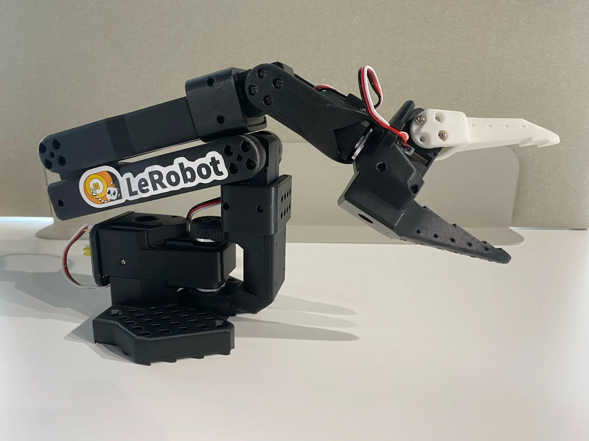
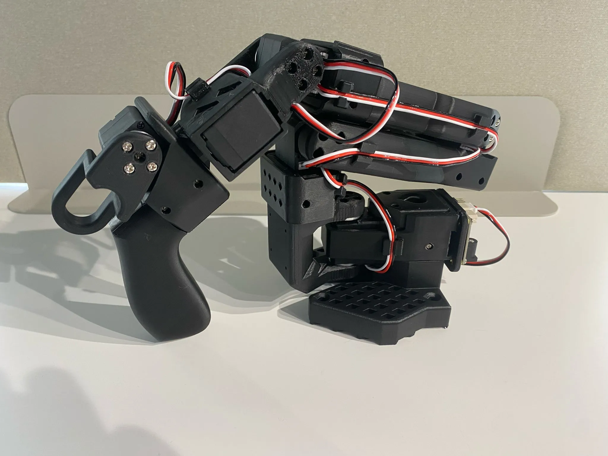

# LeRobot + SO-101：低成本桌面具身学习方案

资料截止：2026-11-08（Asia/Shanghai）。产品级多维调研；main 分支内容以原件 SHA256 固定，论文实验与当前产品配置分别说明。

[本产品导航](README.md) · [开源方案总览](../README.md)

## 产品图片与版本

图源：[SO101_Follower_Image](https://raw.githubusercontent.com/TheRobotStudio/SO-ARM100/main/media/SO101_Follower.webp)。官方产品/设计资料，图片不构成性能验收证据。

## 定位与代表性

SO-101 是 The Robot Studio 的开源机械臂设计，LeRobot 是 Hugging Face 的机器人学习软件库。两者组合提供从装配、遥操作、数据记录到策略训练与执行的学习入口。Hugging Face 的 SO-101 指南称其为旗舰机器人；当前 LeRobot README 将 SO101 列为原生支持硬件，因此本项目选它作为入门代表，而不以未经核实的销量或市占率判断“主流”。[SO101_Hardware](https://raw.githubusercontent.com/TheRobotStudio/SO-ARM100/main/README.md)、[SO101_Docs](https://huggingface.co/docs/lerobot/so101)、[LeRobot_README](https://raw.githubusercontent.com/huggingface/lerobot/main/README.md)。

它面向教育、个人开发者和需要低成本收集桌面操作数据的团队。适合轻物体抓取、分类、放置等任务原型；整机的意义在于能让学生实际经历校准和闭环学习。若研究目标是大负载、长期接触装配或安全协作，需要重新选硬件，不能仅凭装上大型模型就改变机械能力。

## 软硬件组成与数据链路

经典配置是一只 leader 示教臂和一只 follower 执行臂；两臂合计十二个 STS3215 舵机，机械臂动作含夹爪通道。结构件可三维打印，主机经 USB 舵机适配板访问串行总线。官方文档要求逐个电机设置唯一 ID 与波特率，再分别校准两个机械臂。这说明“买来可运行”仍需电机、端口、机械零位三个层面配合。[SO101_Docs](https://huggingface.co/docs/lerobot/so101)。

遥操作时，leader 的状态形成动作示范，follower 执行对应命令，相机与关节数据一起记录。LeRobot 提供统一 Robot 接口和数据格式，视频/图片与 Parquet 状态动作数据关联；模型训练与机器人控制可分别运行。ACT、Diffusion、VLA 等是策略选择，不是 SO-101 本体自带的泛化技能。模型是否能执行同一种动作表示、是否覆盖当前相机视角，都要实际核验。[LeRobot_README](https://raw.githubusercontent.com/huggingface/lerobot/main/README.md)。

官方硬件说明区分 follower 的 7.4V 与 12V 电机，12V 版本需要另配相应电源，SO101 leader 保持 7.4V。堵转力矩不能直接变成末端负载：连杆姿态、杠杆臂、持续电流与打印刚度都会限制抓取。因此本文不根据“30 kg·cm”宣传计算一个未经实测的整臂承载值。[SO101_Hardware](https://raw.githubusercontent.com/TheRobotStudio/SO-ARM100/main/README.md)。

## 价格、包含项与口径纠错

| 配置 | 价格/币种 | 价格类型 | 包含范围 | 未包含或边界 | 来源 |
| --- | --- | --- | --- | --- | --- |
| 单 follower | USD 121.94；EUR 124.3；CNY 682.23 | 官方列示零件 BOM | 六舵机、板、线、电源等 | 打印件、相机、电脑另计 | [SO101_Hardware](https://raw.githubusercontent.com/TheRobotStudio/SO-ARM100/main/README.md) |
| leader + follower | USD 229.88；EUR 226.3；表列 CNY 1,343.16 | 官方列示 BOM | 十二舵机与配套附件 | 人民币总数存在明细差异 | [SO101_Hardware](https://raw.githubusercontent.com/TheRobotStudio/SO-ARM100/main/README.md) |
| WowRobo Package 1 | USD 199 | 供应商变体价 | 打印件与十二舵机 | 不能当完整装配版 | [SO101_WowRobo_Price](https://shop.wowrobo.com/products/so-arm101-diy-kit-assembled-version-1) |
| WowRobo Package 2 | USD 259 | 供应商变体价 | 未装配 leader + follower + 一相机 | 电脑、训练资源、运输另计 | [SO101_WowRobo_Price](https://shop.wowrobo.com/products/so-arm101-diy-kit-assembled-version-1) |
| WowRobo Package 3 | USD 299 | 供应商变体价 | 已装配 leader + follower + 一相机 | 页面有售罄提示，库存未确认 | [SO101_WowRobo_Price](https://shop.wowrobo.com/products/so-arm101-diy-kit-assembled-version-1) |

以上为 2026-11-08 取得的原件。供应商变体价格由页面内产品 JSON 逐项读取；不能把页面默认的 199 美元同时用于所有套件。页面显示税费提示及分地区物流规则，实际落地价、是否有货以地区选择和正式订单为准。没有把“Sold out”解释为所有颜色永久停售，也没有按网页默认国家虚构国内含税价。

官方双臂人民币 BOM 列示 1,343.16 元，但按同页十二舵机、两块板、两根 USB 线、两电源、四夹具和工具的列示价格计算：12×97.72 + 2×27 + 2×23.9 + 2×22.31 + 4×5.2 + 14.9 = 1,354.76 元，与总行相差 11.60 元。这是明细算术复核，并非实时报价；采购预算应重新逐项询价，不能沿用存在差异的总数。

另一个采购陷阱是 Seeed 的历史链接：本次实际打开的是 SO-ARM100 舵机套件，200 美元、不含打印件，且显示缺货/停产相关标识。它可作为旧 SKU 记录，不能写成 SO-101 当前整机价。[SO101_Seeed_Price](https://www.seeedstudio.com/SO-ARM100-Low-Cost-AI-Arm-Kit.html)。

## 国内与海外获取

官方仓库给出中国、美国、欧洲、日本等分区零件价格和供应商入口，列有 Seeed、WowRobo、RobotEd 等。国内主要优势是舵机、打印与线材供应方便；海外则有本地经销及装配服务选择。地域可得性是供应链分析，不代表平台的开发者国籍，也不等于某地区销量领先。[SO101_Hardware](https://raw.githubusercontent.com/TheRobotStudio/SO-ARM100/main/README.md)。

对国内团队，建议先确定 7.4V/12V、leader/follower、固件和齿比，再采购备件，避免外观相同而动作与校准不同。海外团队要把舵机备件的运输与维修周期纳入预算。若课程需要大量复制，多买便宜本体未必比统一套件便宜：教师处理接线、固件和校准问题的时间也是实际投入。

## 分层开源与商业使用

LeRobot 代码的 LICENSE 为 Apache 2.0；SO-ARM100/SO101 硬件仓库本次取得的顶层 LICENSE 同为 Apache 2.0。报告仅将其用于各自仓库覆盖内容，没有据此宣称购买的舵机内部固件、全部相机驱动、所有训练数据和模型权重都开放。[LeRobot_LICENSE](https://raw.githubusercontent.com/huggingface/lerobot/main/LICENSE)、[SO101_LICENSE](https://raw.githubusercontent.com/TheRobotStudio/SO-ARM100/main/LICENSE)。

共享模型必须另看模型卡和所用数据的许可，网页上的硬件支持列表也不能替代某个模型在该硬件上的成功率证据。商业产品还需保留适用通知、区分商标及供应商保证；这些是开源使用边界，不是本次已完成的产品认证。

## 优势、限制与条件选型

优势一是低成本和可维修性：标准舵机与打印件降低首次试错和复制门槛，适用于早期任务验证。优势二是软件闭环：已有校准、录制和模型训练工具，能把时间集中在任务设计与数据质量。优势三是可移植接口：同一数据流程可以连接其他受支持本体，硬件升级时仍有部分工程积累可复用。

主要限制是小型结构和舵机系统的刚度、散热与持续寿命，本文未取得工业级重复定位、负载曲线或连续运行可靠性报告。另一个限制是数据分布：视角、夹爪摩擦、关节零位变化会使策略失败；软件库能训练不等于少量示范足以覆盖真实场景。选择它的条件应是轻物体、可控桌面和允许人工复位，而不是用它直接承担无人值守生产。

## 建议验证步骤

先完成无负载校准、限位与断电行为检查，再固定一个相机布局记录简单拿放。评估时把训练示范、验证物体位置和背景变化分开，记录真实成功次数、碰撞、复位和舵机过热。最后才比较 ACT 与 VLA；比较需保持对象、示范数量、相机和初始姿态一致，同时记录电脑与训练资源，不给没有共同测量条件的模型排榜。

预算验收应分别列出本体、相机、主机、训练 GPU/云资源、耗材和人工装配。只有这些都明确，所谓“低价开源具身方案”才从代码演示变成可复现项目。上述步骤是分析建议，本次没有操作实体机器人。

## 补充官方图表

图源：[SO101_Leader_Image](https://raw.githubusercontent.com/TheRobotStudio/SO-ARM100/main/media/SO101_Leader.webp)。官方产品/设计资料，图片不构成性能验收证据。

## 资料与核验

[参考来源及本地原件清单](REFERENCES.md) · [机器可读来源](sources.json) · [价格记录](research_state/prices.json) · [核验结果](research_state/archive_qa/01_Product_Research_quality.json)

部分网页静态依赖未取得，正文与原始响应保留；硬件性能、供应商库存和训练模型泛化尚未实机验证。
